# 快照为什么不能换机器恢复——版本约束藏在迁移流的哪些字段里

> 视频来源：[Failing Migrations: How and Why](https://www.youtube.com/watch?v=Ku8zgSeGjrM)（YouTube · KVM Forum 2017 · Dr. David Alan Gilbert，Red Hat 迁移子团队）｜时长约 47 分钟
> 导读：这是一场"反向"的 talk——不讲迁移有多快，只讲它为什么失败。本文只取其中与**快照/迁移的兼容性与版本约束**相关的那条线：一份状态文件里隐含了哪些环境假设、换机器换版本后为什么会失败甚至静默出错、以及工程上怎么把这些假设显式管起来。原片是英文，字幕为 YouTube 自动生成，术语已按 QEMU 源码习惯订正。

## 本讲要解决的核心问题（SCQA）

**背景**：快照和迁移在实现上是同一件事——把一台运行中的虚拟机的 vCPU 寄存器、内存、设备状态"抽"成一段字节流，再在另一处"灌"回去。区别只在字节流去了哪里：迁移是灌进另一台正在运行的 QEMU，快照是灌进磁盘上的一个文件，等几周或几个月后再灌回来。

**冲突**：这段字节流里没有"自解释"的格式。它记录的是**某一版 QEMU 的某个设备结构体按某个顺序排下来的字段**，两端必须对同一段字节做出完全相同的解释。一旦目的端的 QEMU 版本、machine type、CPU 型号、设备地址、ROM 布局有任何一处不同，这段字节就可能被读到"错位"的位置上——轻则干净地报错，重则虚拟机起来之后行为诡异、甚至悄悄写坏磁盘。

**疑问**：一份快照里到底隐含了哪些"环境假设"？换机器、换版本之后，哪一层会先崩？为什么有些失败会静默？

**回答（中心思想）**：**快照的可恢复范围不是由文件本身决定的，而是由五类"环境假设"的交集决定的**——machine type（VMM 版本与设备模型）、设备地址与 ROM/PCI 布局、CPU 型号与特性位、设备状态字段的结构（条件字段与子节）、以及恢复过程中的顺序与时钟。讲者用一句话概括了最坏的情况：**"快照就是一次要离开六个月的迁移"** [【跳转到 31:41】](https://www.youtube.com/watch?v=Ku8zgSeGjrM&t=1901)——迁移里毫秒级的版本差，在快照里会被放大成几个月的版本差。

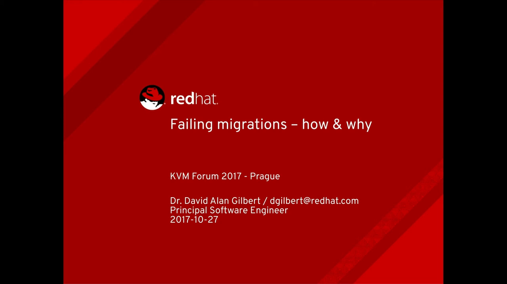

## 一、先看清这段字节流的结构：它是一串"具名区段"，不是一个整体

要理解兼容性约束，得先知道状态文件长什么样。讲者给的结构非常简单 [【跳转到 06:22】](https://www.youtube.com/watch?v=Ku8zgSeGjrM&t=382)：

- 开头是一个**头部**，里面带着版本信息和 machine type 信息；
- 然后是一串**区段（section）**，每个区段有自己的头部（"我是 RAM"、"我是这个设备"），区段末尾有一个**尾部标记（footer）**；
- 区段按名字区分，设备类区段通常就用 **PCI 设备号**命名；
- 区段分两种：RAM 是**迭代式**的（反复发，直到收敛），大多数设备（比如一个 IDE 控制器）是**一次性**的，在最后一次性发完。

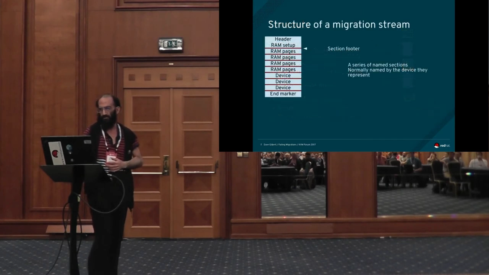

这个结构解释了后面所有兼容性问题的**共同形态**：状态不是"一个大 blob"，而是"一堆按名字和顺序排好的小块"。每一小块内部是一串**没有字段名的字节**（Byte、Word、Struct……），只能靠两端代码里同一份结构体定义来对齐。所以一旦某一端的结构体多了一个字段、少了一个字段、或者某个字段"这次该不该出现"的判断不一致，后面所有字节就会整体错位。

## 二、第一层约束：machine type 是"设备模型的版本号"，不是型号

讲者把"源和目的配置必须完全一致"列为第一要害 [【跳转到 08:15】](https://www.youtube.com/watch?v=Ku8zgSeGjrM&t=495)：你是把一个模拟器里的状态抽出来塞进另一个模拟器，除非两边严格匹配，否则要么有状态"不知道该去哪"，要么有状态"你没提供"，更糟的是——**某段状态以为自己是 A 的，却落进了 B 的坑里**。

QEMU 用来管这件事的机制是**带版本号的 machine type**（x86、ARM、Power、s390 都有）：

| 概念 | 含义 | 例子 |
| --- | --- | --- |
| machine type | 一套"设备模型 + 状态格式"的冻结组合 | `pc-i440fx-2.9`、`pc-q35-2.10` |
| 版本号 | QEMU 发布版本，用来给这套组合打标签 | 2.9、2.10、2.11 |
| 兼容规则 | 用 2.9 machine type 产生的状态，应能被 2.10 的 QEMU 用**同样的 2.9 machine type** 正确读出 | 向下兼容 |

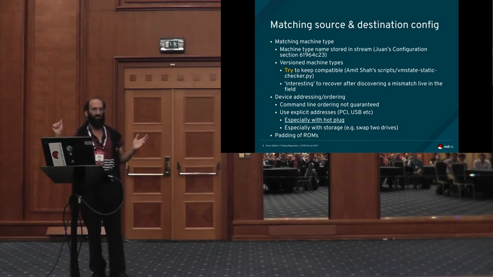

关键在于：**新增字段必须绑到"新的 machine type"上**。如果某个开发者加字段时不小心让它对所有 machine type 都生效，灾难就开始了 [【跳转到 09:55】](https://www.youtube.com/watch?v=Ku8zgSeGjrM&t=595)：

1. 2.10 发布时没人发现这个字段被错误地加到了所有 machine type 上；
2. 到 2.11 才有人想修——此时修好它，可能"能接受 2.10 的迁移流，却破坏了 2.9 的迁移流"；
3. 于是两个方向只能保一个，**发现得越晚越难两全**。

讲者提到 QEMU 里有一个脚本（Amit Shah 的 `scripts/vmstate-static-checker.py`）专门用来在改动时扫描迁移数据的变化，目的就是"尽量保持兼容"。这条约束对快照尤其致命：迁移的两端通常只差几个小版本，而快照的两端可能差好几个大版本，中间每一处"加错地方"的字段都会累积下来。

## 三、第二层约束：设备地址、ROM 布局与 PCI 配置空间

machine type 一致还不够，**同一台虚拟机在两端的"物理布局"也必须一致**。讲者举了三个非常具体的例子。

**设备地址不是由命令行顺序决定的。** QEMU 命令行里的顺序**没有任何保证**，你创建三块磁盘或三个 USB 设备，谁拿到哪个编号，除非你显式指定，否则是不确定的——热插拔时尤其如此 [【跳转到 10:20】](https://www.youtube.com/watch?v=Ku8zgSeGjrM&t=620)。后果很具体：两个 USB 存储设备在目的端被分到了相反的地址，客户机就会**拿着同一份数据去读另一块盘**。这不是崩溃，是静默的数据错乱。

**ROM 尺寸必须留出增长空间。** 假设这一版编译出来的 SeaBIOS 是 64K 的镜像，下一版你改了点小东西，它变成 68K；此时把 68K 的 ROM 镜像往 64K 的洞里塞，**塞不进去** [【跳转到 11:10】](https://www.youtube.com/watch?v=Ku8zgSeGjrM&t=670)。所以 Red Hat 在下游的做法是把 ROM 尺寸补齐到**下一个 2 的幂**，给增长留足余量。

**PCI 配置空间必须逐位匹配。** PCI 设备的配置空间里有一块"固定位 + 可变位"的数据，加载时会被逐项校验；不匹配时报的错长这样 [【跳转到 25:25】](https://www.youtube.com/watch?v=Ku8zgSeGjrM&t=1525)：

```text
get_pci_config_device: Bad config data: i=0xxx read: yy device: zz cmask: ss wmask: pp wlcmask
```

其中 `i` 是配置空间里的索引。典型触发场景是：有人发现某个 PCI 型号少实现了一个特性，补上之后**更新了一个 capability 标志位**，于是所有从旧版本迁入的流全部失败。更隐蔽的一条是：部分 capability 数据是**一条 capability 块组成的链表，顺序不能变**——清理代码时顺手重排一下就破坏了兼容性。讲者给了一个极简的检查办法：在客户机里跑 `lspci -v`，源端和目的端的输出应该基本一致。

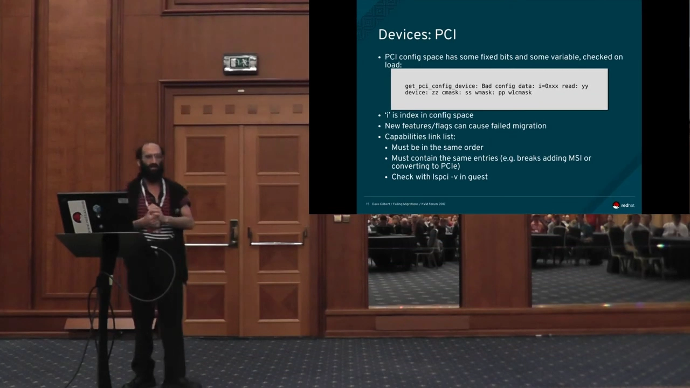

## 四、第三层约束：CPU 型号与特性位，一个名字盖不住几百种变体

配置一致里最难做到的是 CPU。讲者的原话是：拿到源和目的**匹配的 CPU 定义**是关键，而且**这实际上相当难** [【跳转到 12:39】](https://www.youtube.com/watch?v=Ku8zgSeGjrM&t=759)。

直觉做法是 `-cpu SandyBridge`，名字对上就完事。但现实是：

- **同一个名字下有大量变体。** 有服务器版的 CPU，还有好几种服务器版本，各自的 flag 不一样，**没有一个名字能覆盖它们全部**；
- **有些差异非常不直观。** 如果机器开了超线程，每个 vCPU 可用的**性能计数器数量只有不开超线程时的一半**；两端一个开一个不开，只要模拟里启用了性能计数器，迁移就会因为数量对不上而失败；
- **特性会消失。** CPU 厂商偶尔会在新版本或 BIOS 更新里**去掉一个冷门特性**；而 QEMU 也不能"假装它还在"——因为客户机一旦去访问那个寄存器，**寄存器根本不存在**；
- **硬件比 QEMU 新。** 云里上了一代比 QEMU 认识的更新的 CPU，该按哪一个来报？选老的 CPU 再加 flag，还是干脆忽略新 flag？这是个难题。

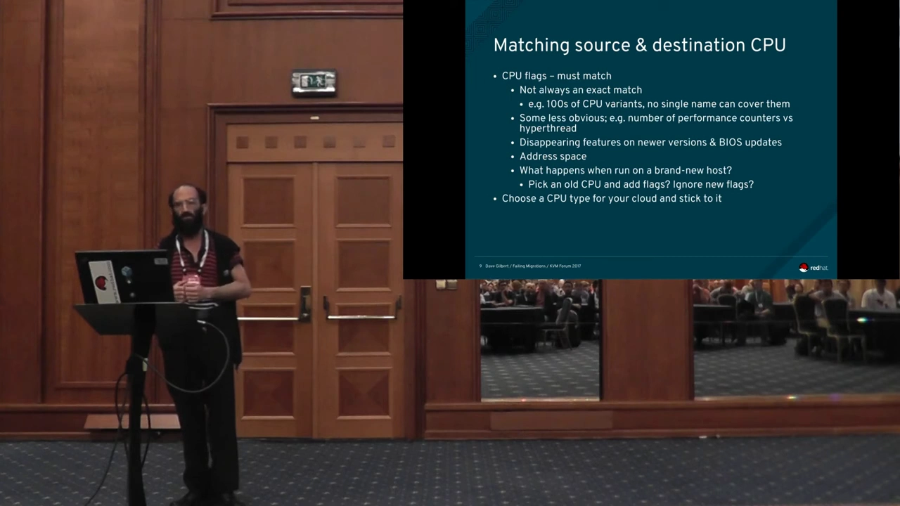

讲者给的结论很朴素：**给你的云挑一个 QEMU 认识的、能兼容你手上所有硬件的 CPU 型号，然后一直用它**；想要新特性时，再有计划地整体往前跳一代。这条结论对快照的意义比对迁移更大——迁移的两端通常在同一批硬件里，而一份快照可能在半年后被恢复到一个已经换过代的集群上。此时如果基线 CPU 型号没变，客户机看到的 CPUID 就还是原来那一套；如果基线变了、或者恢复时用了 `host` 模式，客户机就会看到一套**与它当初启动时不同**的特性位。这就是"同一份快照在缺 AVX512 的机器上恢复，客户机执行到一条它以为存在的指令"这类事故的来源（本系列 1.4.2 讲过 CPUID 的过滤与伪造机制，这里只关心它对快照的约束）。

## 五、第四层约束：设备状态的结构体就是一份 ABI

除了配置不匹配，另一大类失败发生在**序列化和反序列化设备状态的时候** [【跳转到 15:00】](https://www.youtube.com/watch?v=Ku8zgSeGjrM&t=900)。每个设备自己的存/取代码里都会做一些检查，而这些检查往往比正常运行时的检查**严厉得多**。

### 5.1 检查放在哪一端，决定了失败有多贵

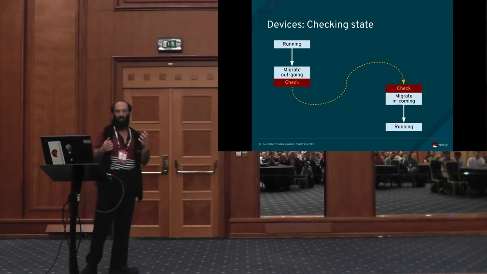

- **在源端（出向）检查失败**：源虚拟机此刻已经暂停，检查一报错，虚拟机就死了。用户看到的是"我只是想迁一下，结果机器没了"。
- **在目的端（入向）检查失败**：目的虚拟机不启动，但**迁移干净地失败**，源虚拟机还在跑，用户的关键业务还在。

所以讲者的偏好很明确：**宁可忽略一个有问题的设备，也不要让迁移失败** [【跳转到 16:40】](https://www.youtube.com/watch?v=Ku8zgSeGjrM&t=1000)。这个偏好背后是云的现实——管理员不知道客户的虚拟机里在跑什么，也没法让客户"先把状态整理干净再迁"。

### 5.2 有些"不一致"其实是客户机的锅

设备状态检查其实分两类 [【跳转到 17:08】](https://www.youtube.com/watch?v=Ku8zgSeGjrM&t=1028)：一类查的是**你自己模拟器内部的状态**，另一类查的是**客户机把设备编程成了什么样**。第二类经常误报：

- 客户机的驱动把设备配错了，序列化时抛错——但这是客户机的问题，不该拦住云管理员迁移；
- 客户机正在启动、正在跑固件、或者从安装盘启动（安装盘的驱动和正式系统不一样），设备状态本来就不"完整"，检查却当成错误；
- 客户机刚更新了一版驱动，于是**这台机器上的所有迁移突然开始失败**，要挖很久才发现原因。

讲者的诉求是：这类错误一定要在标准错误日志里说清楚**是哪个设备、为什么坏**，否则看到"某设备迁移失败"根本无从下手。

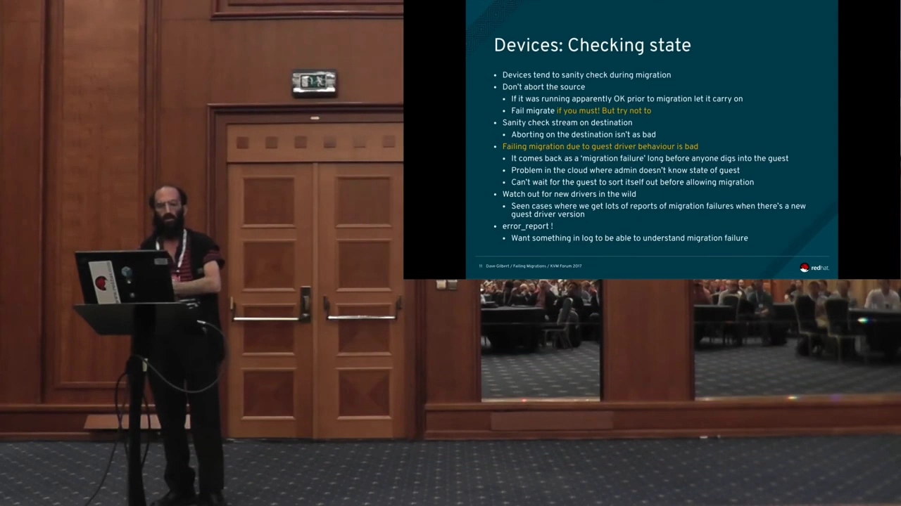

### 5.3 条件字段：两端判断不一致，整条流就错位

这是本节最"要命"的一个机制。所谓**条件状态**，是指设备状态里**不一定每次都要写进去**的那部分数据。它出现的原因有两种 [【跳转到 20:00】](https://www.youtube.com/watch?v=Ku8zgSeGjrM&t=1200)：一是这段状态只在某些罕见配置下才存在；二是你发现上一版**漏迁了一段状态**，于是在新 machine type 里补上。

QEMU 的 VMState 宏提供了两种补法，第一种是**条件字段**：

```c
VMSTATE_UINT16_TEST(field, MyStruct, bool_func);
```

意思是"只有当 `bool_func` 返回 true 时，这个 16 位整数才写进流里"。`bool_func` 可以复杂到去看一堆状态位。问题在于：**目的端的 `bool_func` 必须给出同样的答案** [【跳转到 20:50】](https://www.youtube.com/watch?v=Ku8zgSeGjrM&t=1250)。如果两端不一致，本该读 16 位的地方没读、或者不该读的地方多读了两字节，**这两个字节就落进了下一个字段**，后面全部错位。

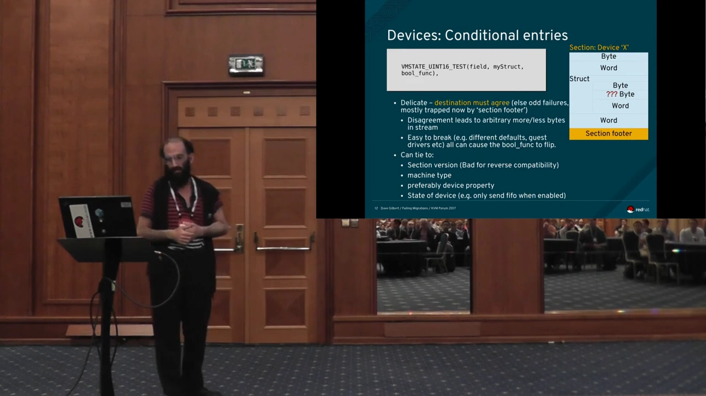

好在这类错位现在大多会被**区段尾部标记**兜住——尾部对不上就干净地失败。但讲者特意补了一句：**以前是兜不住的，会直接往下走，运气不好就是一台死掉的客户机**。所以结论是：尽量别用这种"靠布尔函数"的条件字段。

### 5.4 子节：把"可选结构"变成有名字的结构

替代方案是**子节（subsection）**：设备内部一个有名字的区段 [【跳转到 21:50】](https://www.youtube.com/watch?v=Ku8zgSeGjrM&t=1310)。它同样可以挂在任意条件上（machine type、设备属性、设备状态都行），但因为**有名字**，解析时如果发现"这个子节不该出现"，会给出一个明确的错误，失败得很干净。

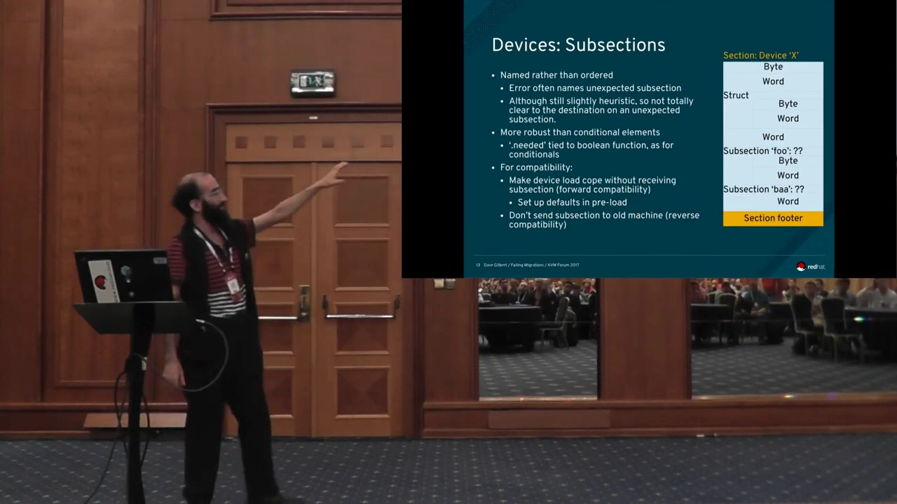

代价是两条：

1. **反向兼容要自己守。** 想保留"新版本迁回旧版本"的能力，就**绝不能对旧 machine type 发这个子节**；
2. **测试量爆炸。** 每个条件字段、每个子节都让组合数翻倍——你得测"有子节"和"没子节"两种情况，还得测各种奇怪状态 [【跳转到 22:55】](https://www.youtube.com/watch?v=Ku8zgSeGjrM&t=1375)。

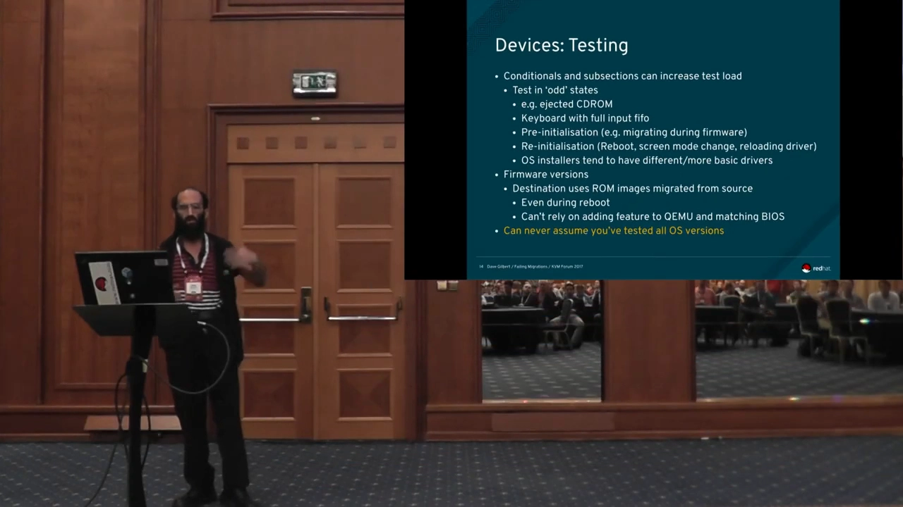

讲者列出的"奇怪状态"清单很值得抄下来：光驱已经弹出、键盘输入 FIFO 满、迁移发生在固件阶段、发生在重启过程中、发生在切换显示模式时、客户机用的是安装盘里那套更简陋的驱动。还有一条特别容易漏：**目的端用的是从源端带过来的 ROM 镜像**，即使你在目的端重启客户机，它用的还是那份**旧的 SeaBIOS 镜像**。所以测试必须覆盖"旧 ROM + 新 QEMU"的组合，而不能只测"新 QEMU + 新 ROM"。最后一句是：**永远不要以为你已经测过所有操作系统版本**——总有人拿着一台"看起来是同一个 Windows 版本"的机器过来。

## 六、第五层约束：顺序与时钟

即使字节完全对得上，**加载的顺序和时机**也会毁掉一次恢复 [【跳转到 29:11】](https://www.youtube.com/watch?v=Ku8zgSeGjrM&t=1751)。

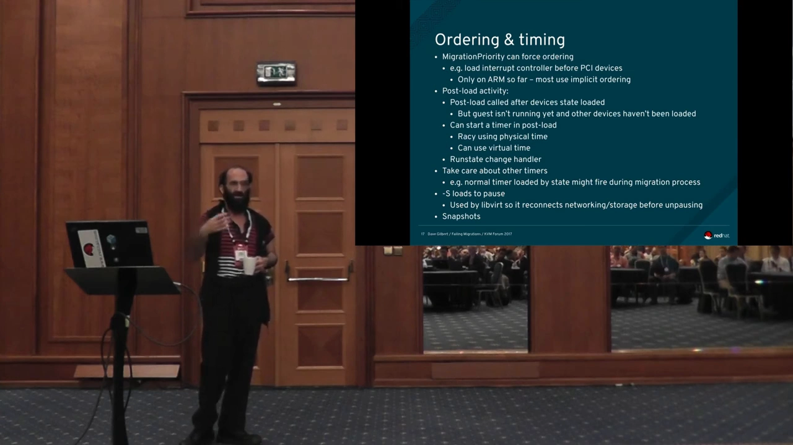

**顺序**：你正在加载一个 PCI 设备的状态，同时也在加载 PCI 桥或中断控制器的状态。如果这个 PCI 设备在迁移过程中**抛了一个中断**，接收它的中断控制器**准备好了吗**？这就要求设备按一致的顺序迁移——比如中断控制器必须先于所有会向它发中断的设备。QEMU 里可以用 `MigrationPriority` 强制排序，但讲者指出：**目前只有 ARM 用了显式排序，大多数 machine type 靠的是"设备创建顺序"这种隐式顺序**，这很吓人，而且大概率会在最意想不到的时候坏掉。

**时机**：设备状态加载完之后，设备里可能有一个模拟定时器，**什么时候启动它**？答案不是"在加载代码里立刻启动"——那个定时器可能在迁移还没加载完时就触发。也**绝对不能用宿主的物理时钟**去算；用**虚拟时间**是对的，因为它要等 vCPU 真正开始跑才会走；或者挂一个状态变更回调，把定时器启动推迟到虚拟机开始运行之后。

还有一个容易被忽略的窗口：管理层的 libvirt 通常用 `-S`（启动即暂停）拉起目的端，等迁移数据加载完，QEMU 并不立刻让客户机跑起来，而是**留出时间让 libvirt 重新配置网络和存储**。这段窗口里，设备状态和定时器都可能出问题。

讲者在这里给了一句全场最锋利的话：**快照是最坏的情况，因为快照就是一次要离开六个月的迁移** [【跳转到 31:41】](https://www.youtube.com/watch?v=Ku8zgSeGjrM&t=1901)。迁移里"两端版本差一点点"还能靠人盯着，快照里这半年内 QEMU、固件、machine type、CPU 基线全都可能变过。

## 七、失败长什么样：干净失败、静默出错、以及"到底是谁坏的"

兼容性问题最讨厌的地方不是"报错"，而是**报错信息指向不了原因**。

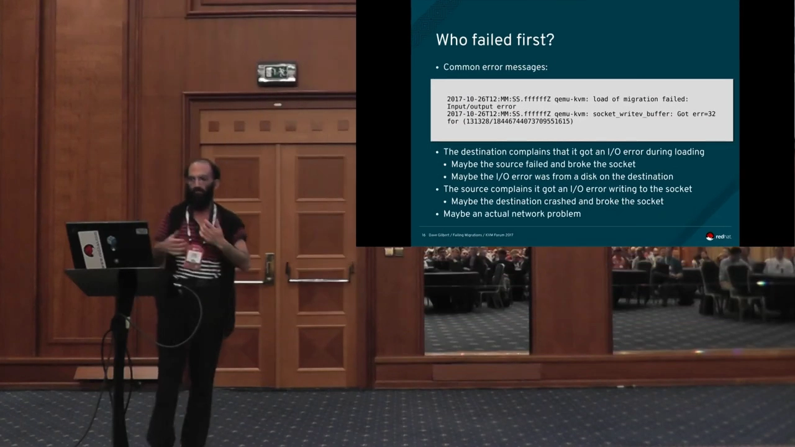

典型的一对错误 [【跳转到 27:21】](https://www.youtube.com/watch?v=Ku8zgSeGjrM&t=1641)：

```text
qemu-kvm: load of migration failed: Input/output error
qemu-kvm: socket_writev_buffer: Got err=32 for (...)
```

上面那条来自目的端（"我加载失败"），下面那条来自源端（"我往 socket 写的时候出错"）。那么到底谁坏了？可能是目的端先坏，可能是源端先坏，也可能是中间的网线坏了——网络一断，两端会**同时**报这两条错，于是你根本无法判断。更麻烦的是，如果目的端是**设备状态加载**失败（比如某块盘），这个错也可能长成这样，看起来像网络问题，其实跟网络毫无关系。

### 7.1 存储侧的"静默出错"最危险

存储迁移和核心迁移是两条相对独立的线，但它的失败模式最能说明"环境假设不一致"的后果 [【跳转到 32:28】](https://www.youtube.com/watch?v=Ku8zgSeGjrM&t=1948)：

| 管理层的误判 | 实际发生的事 | 后果 |
| --- | --- | --- |
| 以为是共享盘，其实是本地盘 | 于是没做块迁移 | 目的端从一块空盘开始读，客户机看到空文件系统 |
| 以为是本地盘，其实是共享盘 | 于是做了块迁移 | 迁移流把数据写回同一份共享镜像，盘被写坏 |

第二种比第一种更糟：它不会报错，只会留下一块**彻底损坏的磁盘**。另外还有两件与"恢复后是否一致"直接相关的事：

- **收尾时要排空写请求。** 迁移结束时源端必须把所有未完成的写刷到存储设备；如果客户机存储压力很大，这最后一段写会显著拉长停机时间 [【跳转到 34:42】](https://www.youtube.com/watch?v=Ku8zgSeGjrM&t=2082)。
- **缓存模式必须对。** 如果源端有缓存、数据还没落到共享存储，目的端就已经开始跑，就会读到旧数据。对 POSIX 类存储，讲者给的结论是**必须 `cache=none`**；对 Ceph 之类的存储，取决于 QEMU 用的那个库的语义。

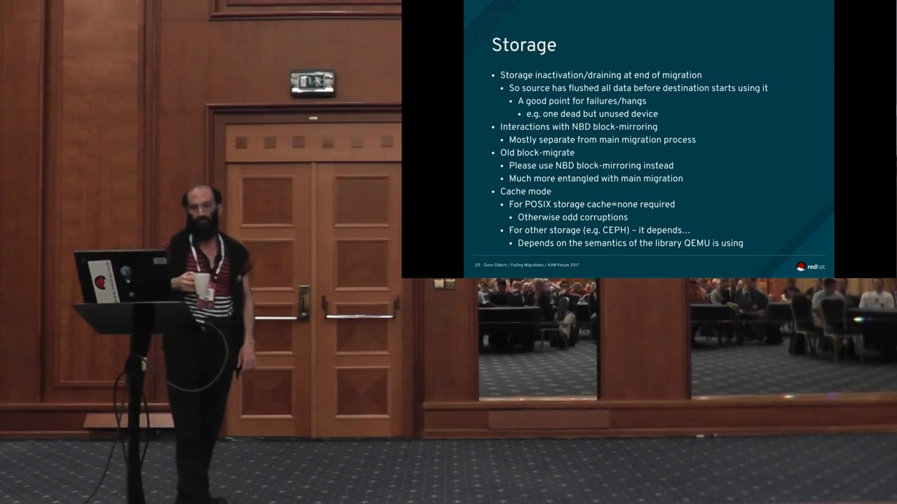

### 7.2 "迁移成功了"这件事本身也需要校验

以前判断迁移成功，靠的是**TCP socket 被关闭**——socket 一关，源端就说"好，成了" [【跳转到 37:17】](https://www.youtube.com/watch?v=Ku8zgSeGjrM&t=2237)。这非常脆弱：设备状态加载失败的那几 KB 可能正好卡在网络上传输的最后一个 4K 块里，两端对"到底成没成"的判断会形成竞态。后来 QEMU 加了显式的检查，至少能明确地说一句"失败了"。

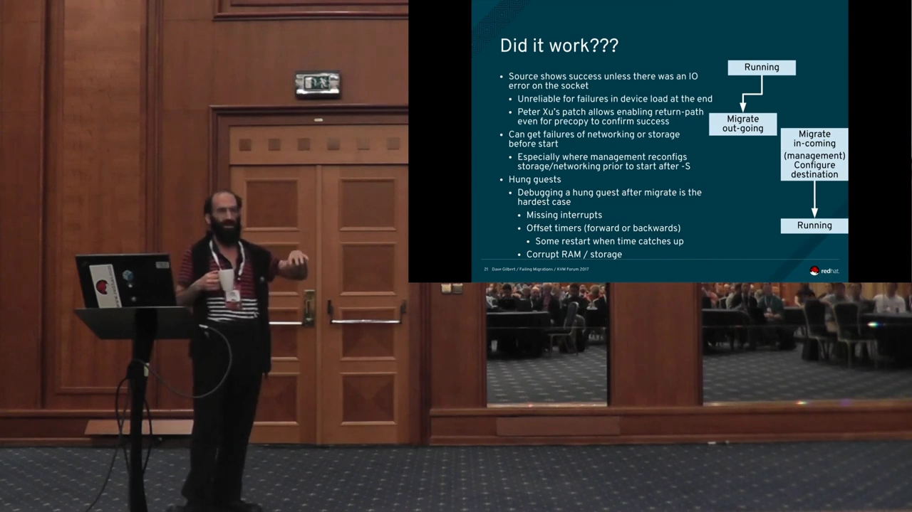

还有一类失败发生在**迁移流结束到目的端真正启动之间**：网络没重配好、交换机没切、存储没挂上，都会在这段"看起来已经成功"的窗口里出问题。而最难查的是：**迁移看起来全成功了，客户机就是死的**——典型原因包括丢了中断、定时器在某个方向上不一致、内存或存储内容被破坏。

## 八、工程上怎么把这些假设管起来

讲者的建议散在各处，归拢起来就是一张"把隐式假设变成显式约束"的清单：

1. **固定 CPU 基线。** 选一个 QEMU 认识的、能覆盖你所有硬件的 CPU 型号，全云统一，别用 `host`；要升级就整体跳一代，而不是逐台漂移。
2. **固定 machine type 与 VMM 版本。** machine type 是设备模型和状态格式的版本号；快照应当和产生它的 machine type 一起记录，恢复时用同一个 machine type，而不是"用最新的跑起来再说"。
3. **显式指定设备地址。** 存储、USB、热插拔设备都写死 PCI 地址，别依赖命令行顺序。
4. **ROM 尺寸按 2 的幂补齐**，给固件增长留余量；并测试"旧 ROM + 新 QEMU"的组合。
5. **新增状态优先用子节，而不是条件字段**；并且绝不对旧 machine type 发送新子节。
6. **恢复前做一致性校验。** 客户机里 `lspci -v` 的输出、CPU 特性位、machine type、ROM 版本，都可以在真正恢复前比一遍；QEMU 侧还有 `vmstate-static-checker.py` 这类静态检查工具。
7. **用"乒乓"测试兜底。** 讲者提到他们最常用的测试就是把虚拟机在两台机器之间来回迁移、放着跑一个周末——**能活过一个周末，这次迁移大概就是对的** [【跳转到 40:36】](https://www.youtube.com/watch?v=Ku8zgSeGjrM&t=2436)。对快照来说，等价的做法是：定期把快照恢复出来、跑一遍、再打一次快照。

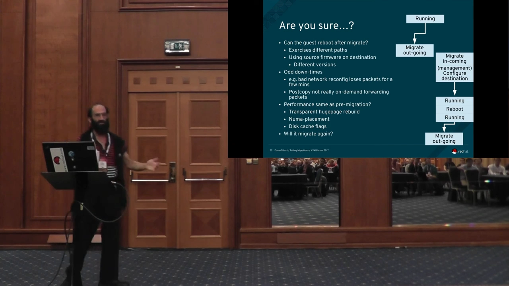

讲者最后那张"你确定吗"的清单，正好可以当作快照恢复后的验收项：迁移后客户机**能不能重启**（重启会走不同的设备代码路径，还会用上从源端带来的旧固件）、**停机时间是否异常**、**性能是否和迁移前一致**（透明大页有没有重建、NUMA 位置对不对、磁盘缓存标志对不对）、以及**能不能再迁一次**。

## 小结

- **快照是"延迟六个月的迁移"**，迁移里的每一条兼容性约束，在快照上都被时间放大。
- **状态文件是一串具名区段，区段内部是无名字的字节**，两端必须用同一份结构体定义去解释它；这就是所有版本约束的根源。
- **machine type 是设备模型与状态格式的版本号**：新增字段必须绑到新 machine type 上，加错地方就再也回不去了。
- **布局也要一致**：设备地址不能靠命令行顺序、ROM 尺寸要按 2 的幂补齐、PCI 配置空间与 capability 链表顺序必须逐位相同。
- **CPU 是最难对齐的一层**：一个型号名盖不住几百种变体，超线程会改变性能计数器数量，厂商会删特性，新硬件会超出 QEMU 的认知。
- **设备状态结构体就是 ABI**：条件字段两端判断不一致会让整条流错位，子节更安全但必须守住"不对旧 machine type 发送"。
- **顺序与时钟同样属于兼容性**：中断控制器要先于设备加载，定时器不能靠宿主物理时钟启动，`-S` 窗口里什么都可能发生。
- **最危险的不是报错，是静默出错**：共享盘误判会写坏磁盘，socket 关闭不等于迁移成功，迁移"成功"后客户机仍可能是死的。

## 关键术语速查

| 术语 | 一句话解释 |
| --- | --- |
| machine type | QEMU 里一套被冻结的"设备模型 + 状态格式"组合，带版本号，如 `pc-i440fx-2.9` |
| 迁移流 / 状态文件 | 头部 + 若干具名区段 + 尾部标记组成的字节流；快照就是把它写到磁盘 |
| 迭代式区段 | 会反复发送直到收敛的区段，典型是 RAM |
| 区段尾部（footer） | 每个区段末尾的标记，用来发现"字节数对不上"的错位 |
| 条件字段 | `VMSTATE_UINT16_TEST` 这类"满足条件才写入"的字段，两端判断必须一致 |
| 子节（subsection） | 设备内部有名字的可选结构，出错时报错清楚，反向兼容要自己守 |
| `MigrationPriority` | QEMU 里强制设备迁移顺序的机制，目前主要用在 ARM |
| `-S` | 启动即暂停，让 libvirt 在客户机跑起来之前重配网络与存储 |
| `vmstate-static-checker.py` | QEMU 里扫描迁移数据结构变化的脚本，用来提前发现兼容性破坏 |
| `cache=none` | POSIX 类共享存储上迁移时必须的缓存模式，避免目的端读到旧数据 |
