# 预拷贝与后拷贝：热迁移的停机时间与总传输量怎么权衡

> 视频来源：[Live Migration of Virtual Machines](https://www.youtube.com/watch?v=4axYrG5QBvY)（YouTube · Kartik Gopalan 课程讲座）｜时长约 43 分钟
> 简要导读：这是一堂按论文讲的课，主线是 Clark 等人 NSDI 2005 的**预拷贝**与 Hines 等人 VEE 2009 的**后拷贝**。本文顺着讲座的顺序走：先把"热"量化成停机时间与总迁移时间两个指标，再看两个极端方案为什么都不行，然后逐轮拆开预拷贝的收敛假设与脏页追踪，接着拆开后拷贝的"先切换、后补页"，最后落到混合方案与一张四策略对比表。字幕由本地语音识别生成，术语已按 slides 与论文习惯订正。

## 本讲要解决的核心问题（SCQA）

**背景**：虚拟机把一整个操作系统连同里面的应用打包成一个自包含的黑盒。热迁移要做的，是在这个黑盒**不关机**的前提下，把它从一台物理机搬到另一台物理机，搬完之后里面的程序接着跑，就像什么都没发生过。要搬的东西只有三样：内存、CPU 执行状态（寄存器、程序计数器、栈指针）、以及 I/O 设备状态（磁盘、网卡等）。

**冲突**：麻烦在于内存一直在变。一台虚拟机的内存可能有好几个 GB，把它从源端传到目的端要花几十秒甚至几分钟；而在这几十秒里，客户机还在不停地读写内存——你刚拷走的那一页，可能马上又被改了。于是"搬内存"这件事从一次性动作变成了一个必须收敛的过程。更麻烦的是，内存搬得越"晚"，停机就越短，但源端要承担的风险就越大；搬得越"早"，源端越安全，但停机越长。

**疑问**：能不能既不长时间停机，又能把内存搬完？两种主流策略（预拷贝、后拷贝）各自把代价放在了哪里？什么情况下预拷贝会永远搬不完？

**回答（中心思想）**：**预拷贝把代价放在"时间与带宽"上，后拷贝把代价放在"可靠性"上。** 预拷贝让虚拟机继续跑，用多轮迭代把脏页越传越少，直到剩余脏页小到可以停机一把传完——它的停机时间取决于"最后一轮还剩多少脏页"，因此**停机时间不可控**，遇到写密集负载可能永远收敛不了。后拷贝反过来：先停机、只传 CPU 与最小状态，让虚拟机在目的端立刻跑起来，剩下的内存按需缺页回源取、同时源端主动推送——它的停机时间极短且**总迁移时间可预测**，代价是迁移期间虚拟机状态被劈成两半，源端一挂虚拟机就没了。混合方案（先做若干轮预拷贝，再切后拷贝）则用"固定轮数"换"固定总时长"。

## 一、先把"热"量化：四个指标

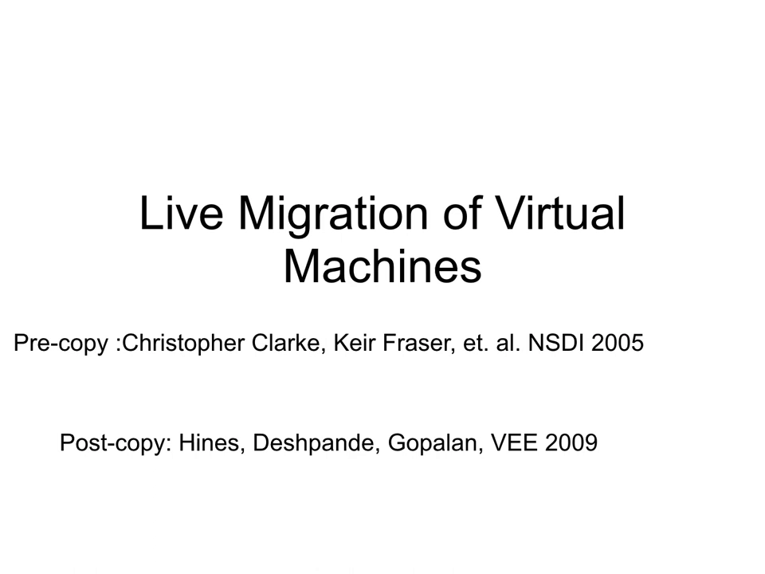

### 1.1 迁移由两个"迁移管理器"完成

讲座先把架构讲清楚：迁移不是虚拟机自己做的事，而是虚拟机**外面**的两个进程——源端的迁移管理器和目的端的迁移管理器——建立一条 TCP 连接，源端把内存内容和执行状态映射进自己的地址空间，通过这条连接送过去，目的端收到后把它恢复成一台虚拟机（[【跳转到 01:07】](https://www.youtube.com/watch?v=4axYrG5QBvY&t=67)）。具体到实现，Xen 里干这件事的进程叫 `xend`，KVM 环境里则是 `QEMU`（[【跳转到 01:32】](https://www.youtube.com/watch?v=4axYrG5QBvY&t=92)、[【跳转到 01:57】](https://www.youtube.com/watch?v=4axYrG5QBvY&t=117)）。

所以"迁移"在实现层面就是：**一个用户态进程把另一台虚拟机的内存读出来，写成一条字节流发出去。**

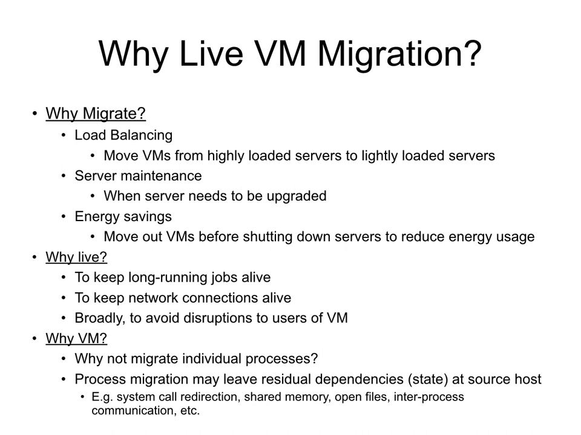

### 1.2 为什么要搬整台机器，而不是搬进程

一个自然的疑问是：既然只是搬应用，为什么不直接做**进程迁移**？讲座给的答案是：进程的状态大量藏在操作系统里（打开的文件、共享内存、进程间通信、系统调用重定向……），要把这些依赖从源 OS 里抽出来再塞进目的 OS，非常棘手，而且不总是可行（[【跳转到 05:10】](https://www.youtube.com/watch?v=4axYrG5QBvY&t=310)、[【跳转到 05:35】](https://www.youtube.com/watch?v=4axYrG5QBvY&t=335)）。整台虚拟机则是一个自包含的黑盒，把它整体挪走，比拆开搬干净得多。

### 1.3 四个指标：停机时间只是其中一个

讲座把"热"翻译成四个可度量的目标（[【跳转到 06:14】](https://www.youtube.com/watch?v=4axYrG5QBvY&t=374)）：

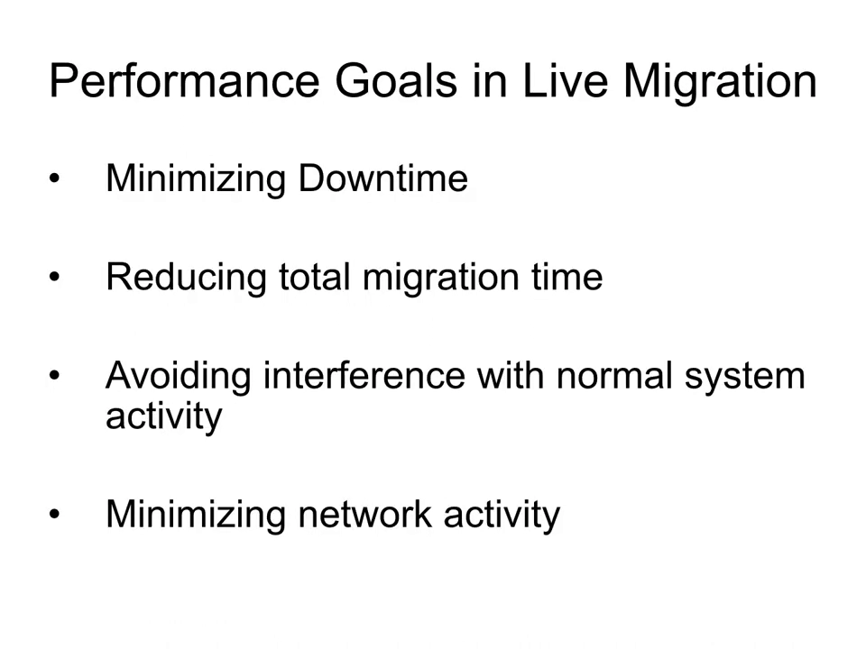

1. **停机时间（downtime）**：迁移过程中虚拟机**不执行**的那段时间。注意"热迁移"从来不是零停机——总要把虚拟机在源端停住、在目的端恢复，只是要把这段时间压到几百毫秒以内（[【跳转到 06:39】](https://www.youtube.com/watch?v=4axYrG5QBvY&t=399)）。
2. **总迁移时间（total migration time）**：从发出迁移命令，到虚拟机完全在目的端运行、不再依赖源端为止的端到端时间（[【跳转到 07:04】](https://www.youtube.com/watch?v=4axYrG5QBvY&t=424)）。
3. **对源端与目的端其它虚拟机的干扰**：迁移本身要消耗 CPU 和网络，这些额外活动会影响同一台物理机上**没有被迁移**的虚拟机（[【跳转到 07:54】](https://www.youtube.com/watch?v=4axYrG5QBvY&t=474)）。
4. **对整条网络的干扰**：迁移的数据和业务流量走同一张网，多台虚拟机同时迁移会把网络打满（[【跳转到 08:19】](https://www.youtube.com/watch?v=4axYrG5QBvY&t=499)）。

这里有个容易混淆的点，讲座专门强调：**停机时间不等于总迁移时间**。你可能发出命令后虚拟机还继续跑很久，停机只发生在中间的某一小段，而迁移真正完成（源端不再被依赖）可能又过了很久（[【跳转到 07:29】](https://www.youtube.com/watch?v=4axYrG5QBvY&t=449)）。后面所有策略的差异，本质上就是"把停机放在时间轴的哪个位置、放多长"。

## 二、两个极端：全停着拷 vs 完全按需取

在讲预拷贝和后拷贝之前，讲座先用两个"极端方案"把设计空间的两端钉住（[【跳转到 09:23】](https://www.youtube.com/watch?v=4axYrG5QBvY&t=563)）。

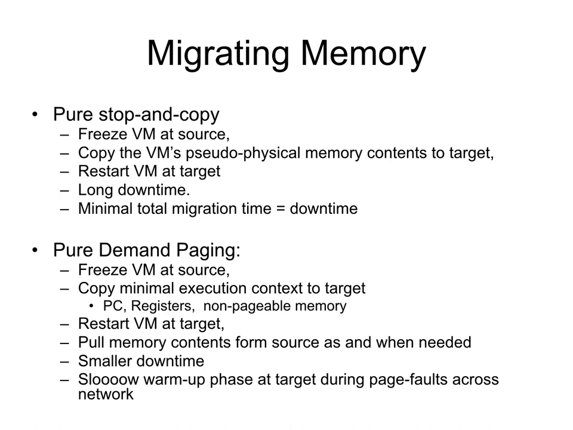

### 2.1 pure stop-and-copy：总时间最短，停机最长

最朴素的做法是**停机全拷**（checkpoint and restore）：在源端把虚拟机冻住，给它的全部状态拍一张快照，把快照搬到目的端，再在目的端恢复（[【跳转到 10:13】](https://www.youtube.com/watch?v=4axYrG5QBvY&t=613)）。

它的性质非常干净：

- 快照里最大的一块是内存，CPU 和 I/O 状态相对很小，所以**迁移时间几乎等于传内存的时间**；
- 因为一开始就冻住了，所以 **总迁移时间 = 停机时间**（[【跳转到 11:28】](https://www.youtube.com/watch?v=4axYrG5QBvY&t=688)）；
- 好处是总时间已经是最短了——整段时间只干"搬状态"一件事，没有任何东西拖慢它（[【跳转到 11:53】](https://www.youtube.com/watch?v=4axYrG5QBvY&t=713)）。

代价也很直白：用户会看到虚拟机停了 30 秒、1 分钟甚至几分钟，一定会抱怨。这就是"不 live"。

### 2.2 pure demand paging：停机最短，但永远搬不完

把上面的做法翻过来就是**纯按需取页**：先在源端冻住虚拟机，但只把**最小执行状态**送过去——CPU 状态、程序计数器、寄存器，加上少量**不可换出（non-pageable）**的内存；其余内存全部留在源端（[【跳转到 12:18】](https://www.youtube.com/watch?v=4axYrG5QBvY&t=738)）。

目的端立刻开始执行。它一开始访问内存就会触发**缺页（page fault）**，目的端的迁移管理器就去问源端："这一页我还没拿到，给我。"源端把这一页送过来，虚拟机继续跑几步，又缺页，再要一页，如此往复（[【跳转到 13:08】](https://www.youtube.com/watch?v=4axYrG5QBvY&t=788)、[【跳转到 13:33】](https://www.youtube.com/watch?v=4axYrG5QBvY&t=813)）。

结果是两个极端里最坏的那个：

- **停机时间极短**——从冻住到恢复只传了一点点状态；
- **总迁移时间不确定**——因为虚拟机不一定访问到所有页，源端永远会剩下一些内存没送出去，迁移**永远结束不了**；而且刚切换过去那段"每一页都要跨网取"的时间，慢得离谱（[【跳转到 14:23】](https://www.youtube.com/watch?v=4axYrG5QBvY&t=863)、[【跳转到 14:48】](https://www.youtube.com/watch?v=4axYrG5QBvY&t=888)）。

> 一句话记住这两个极端：**stop-and-copy 牺牲停机换总时间，pure demand paging 牺牲总时间换停机。** 预拷贝和后拷贝，就是在这两端之间各取一个位置。

## 三、预拷贝：靠"脏页越来越少"这个假设收敛

### 3.1 时序：边跑边传，多轮迭代

预拷贝（pre-copy）的核心思想是"**先把内存拷过去，再切换**"：不冻结源端虚拟机，让它继续跑，同时把内存页一页一页发往目的端（[【跳转到 15:13】](https://www.youtube.com/watch?v=4axYrG5QBvY&t=913)）。

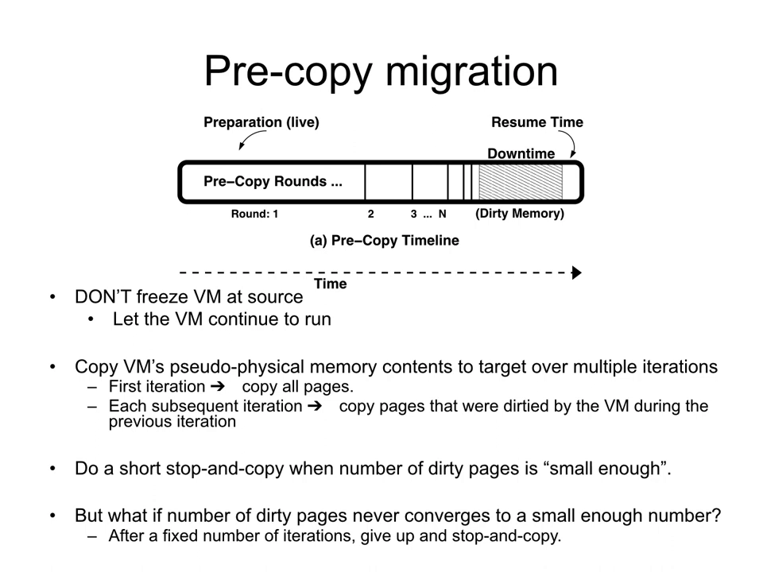

具体分三步（[【跳转到 15:49】](https://www.youtube.com/watch?v=4axYrG5QBvY&t=949)）：

1. **第一轮**：把全部内存页传一遍。这一轮跑完时，虚拟机已经把最早传走的那批页改脏了；
2. **第二轮**：回头找出第一轮期间被写脏的页，只传这些页。这一轮期间虚拟机仍在跑，所以又会脏一批；
3. **第 N 轮**：重复第 2 步，直到剩下的脏页"足够小"。这时才冻住虚拟机，把剩余脏页、CPU 状态、I/O 状态一起传过去，目的端恢复运行。

所以预拷贝的**停机时间是"最后一轮剩余脏页的传输时间 + 状态传输时间"**，而不是整个内存的传输时间。这正是它比 stop-and-copy 好得多的地方。

### 3.2 收敛条件：脏页产生速率必须小于传输速率

整个方案压在一个假设上：**每一轮要传的脏页都比上一轮少**（[【跳转到 17:29】](https://www.youtube.com/watch?v=4axYrG5QBvY&t=1049)）。

把这句话写成不等式，就是收敛条件。设：

- $V$ 为虚拟机内存总量（第一轮要传的字节数）；
- $B$ 为迁移可用的有效带宽（字节/秒）；
- $R$ 为虚拟机持续的**脏页产生速率**（字节/秒）。

第 $k$ 轮要传的数据量近似是 $R \cdot t_{k-1}$（上一轮的时长乘以脏页速率），而这一轮的时长又是 $t_k \approx R \cdot t_{k-1} / B$。要让 $t_k$ 逐轮收缩，必须满足

$$
R < B
$$

即**脏页产生的速度要慢于网络搬运的速度**。满足时，每轮的传输量按 $R/B$ 的比例衰减，轮次越多剩余越少，最终可以停机收尾；不满足时（$R \ge B$），每轮传走的量追不上新脏的量，剩余脏页不降反升，**永远收敛不了**。

讲座把这种情形说得很直接：如果虚拟机写内存写得非常频繁，下一轮的脏页甚至可能比上一轮更多，那就永远等不到"脏页足够少"的那一刻（[【跳转到 18:44】](https://www.youtube.com/watch?v=4axYrG5QBvY&t=1124)、[【跳转到 19:09】](https://www.youtube.com/watch?v=4axYrG5QBvY&t=1149)）。

> 工程上的应对不是"等它收敛"，而是**放弃收敛**：迭代到固定轮数后就不再等，直接停机做一次 stop-and-copy。这样迁移一定能结束，但停机时间就退化成了"剩余脏页的传输时间"——写密集负载下这个时间照样很长（[【跳转到 10:24】](https://www.youtube.com/watch?v=4axYrG5QBvY&t=624) 的 slide 上写着 "After a fixed number of iterations, give up and stop-and-copy"）。

### 3.3 脏页怎么追踪：写保护 + 写陷入 + 脏位图

"只传上一轮脏掉的页"听起来简单，但**你怎么知道哪些页被写过**？讲座给的机制是（[【跳转到 19:40】](https://www.youtube.com/watch?v=4axYrG5QBvY&t=1180)、[【跳转到 20:05】](https://www.youtube.com/watch?v=4axYrG5QBvY&t=1205)）：

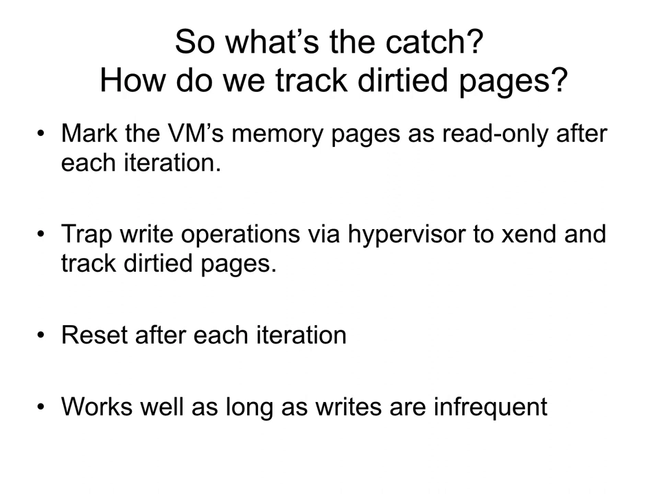

1. 每轮开始前，把虚拟机（或感兴趣的那段内存）的页**全部标成只读**；
2. 虚拟机一旦写某一页，就会触发**写陷入（write fault）**，陷入到 hypervisor；
3. hypervisor 在**脏位图（dirty bitmap）**里记下这一页，然后把该页改回可读写，让写操作继续；
4. 一轮结束时，脏位图就是这一轮要传的页清单；下一轮开始前，再全部标回只读。

这套机制和本系列 2.4「脏页位图与写保护」讲的是同一件事，代价也一样：**每个页在每轮里的第一次写都会陷入一次**。写不频繁时这点开销可以接受；写密集时，这些陷入会累加成显著的开销（[【跳转到 20:55】](https://www.youtube.com/watch?v=4axYrG5QBvY&t=1255)）。

### 3.4 三个优化：限带宽、暂停"捣乱进程"、丢掉 page cache

讲座列了三个让预拷贝"好过一点"的优化，并明确说它们**都不能根治问题**（[【跳转到 21:32】](https://www.youtube.com/watch?v=4axYrG5QBvY&t=1292)）：

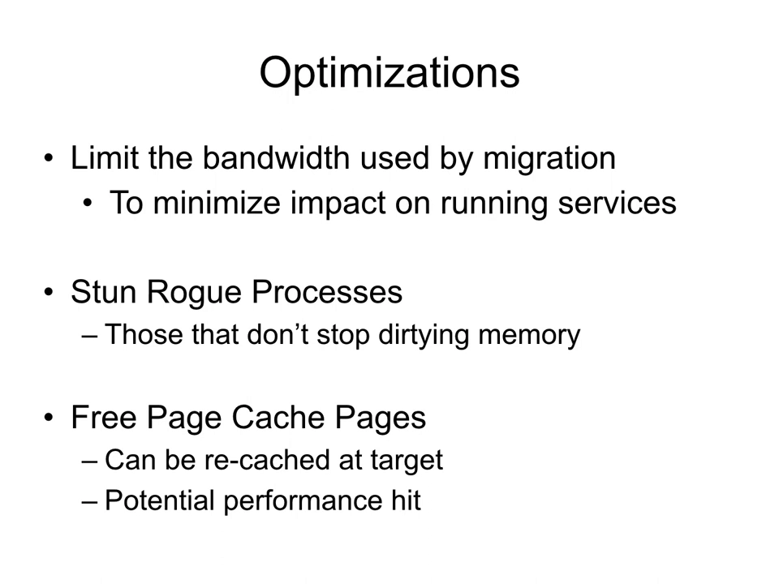

1. **限制迁移带宽**：比如一张 10 Gbps 的网卡，只给迁移 1 Gbps，剩下 9 Gbps 留给业务。代价是迁移变慢，收益是对同机其它虚拟机的影响变小（[【跳转到 21:57】](https://www.youtube.com/watch?v=4axYrG5QBvY&t=1317)）。
2. **暂停捣乱进程（stun rogue processes）**：找出客户机里疯狂写内存的进程，让客户机操作系统把它临时停住，等迁移做完再放开。这需要半虚拟化配合（客户机愿意听 hypervisor 的话），而且一旦这么做，迁移期间这些应用就不跑了，**"live" 的程度就退化了**（[【跳转到 22:22】](https://www.youtube.com/watch?v=4axYrG5QBvY&t=1342)、[【跳转到 22:47】](https://www.youtube.com/watch?v=4axYrG5QBvY&t=1367)）。
3. **丢掉 page cache 与空闲页**：操作系统内存里很大一部分是页缓存（为"以后可能用到"而留着的页）和空闲页，这些页在目的端可以重建，没必要传。识别并排除它们，能直接减少要传的字节数（[【跳转到 23:12】](https://www.youtube.com/watch?v=4axYrG5QBvY&t=1392)、[【跳转到 23:37】](https://www.youtube.com/watch?v=4axYrG5QBvY&t=1417)）。

讲座的结论是：**写密集应用是预拷贝的软肋**。它会让迁移拖得很长；即使你在某个任意时刻强行开始停机，这段停机时间也依然很大（[【跳转到 24:02】](https://www.youtube.com/watch?v=4axYrG5QBvY&t=1442)）。要解决这一类负载，得换策略。

## 四、后拷贝：先切换，再补内存

### 4.1 时序：只传 CPU 与最小状态就切换

后拷贝（post-copy）把顺序倒过来：**先传 CPU 与 I/O 执行状态，内存放到后面传**（[【跳转到 24:07】](https://www.youtube.com/watch?v=4axYrG5QBvY&t=1447)）。

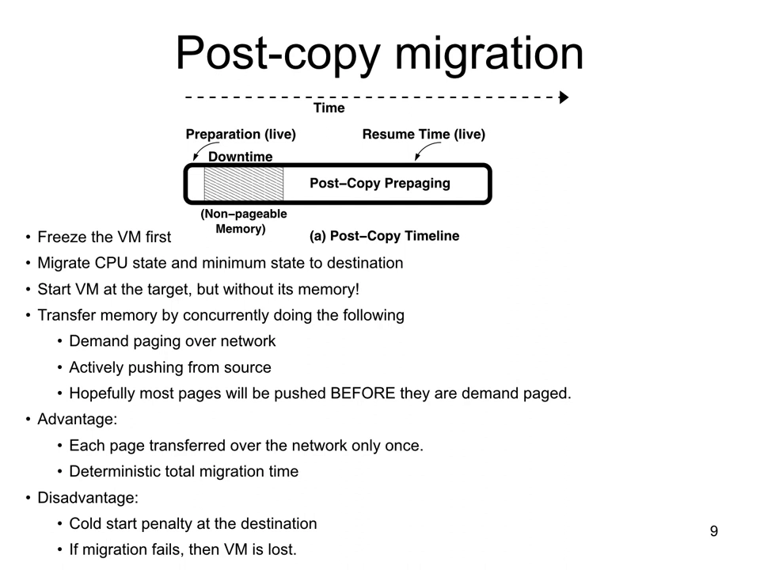

步骤是（[【跳转到 24:32】](https://www.youtube.com/watch?v=4axYrG5QBvY&t=1472)）：

1. **立刻**暂停虚拟机；
2. 把 CPU 与 I/O 执行状态传到目的端；
3. 在目的端**恢复运行**——尽管此时内存一页都还没传；
4. 内存靠两件事同时推进：目的端的**按需缺页**（缺哪页回源要哪页）与源端的**主动推送**。

### 4.2 为什么不是"纯按需"：主动推送是关键

如果只做按需缺页，那就退化成第二节的 pure demand paging，永远搬不完。后拷贝的关键补丁是：**源端不要被动等缺页请求，而是主动把页推过去**（[【跳转到 25:22】](https://www.youtube.com/watch?v=4axYrG5QBvY&t=1522)、[【跳转到 25:47】](https://www.youtube.com/watch?v=4axYrG5QBvY&t=1547)）。

理想情况下，**大多数页在虚拟机访问到它们之前就已经被推到了目的端**。这样一来：

- **停机时间极短**：暂停和恢复几乎挨在一起；
- **总迁移时间可预测（deterministic）**：预拷贝里同一页可能被反复传很多次，而后拷贝里**每一页只过网络一次**（[【跳转到 26:12】](https://www.youtube.com/watch?v=4axYrG5QBvY&t=1572)）。

这就是后拷贝对写密集负载特别干净的原因：不管负载读得多还是写得多，总传输量都约等于"内存总量 + 状态"，总时长有上界。

### 4.3 代价一：冷启动

刚切换过去的那一小段时间，虚拟机会很慢——最初的若干次内存访问都是缺页，每次都要跨网回源。等**工作集（working set）**被拉过来之后，速度就恢复了（[【跳转到 26:37】](https://www.youtube.com/watch?v=4axYrG5QBvY&t=1597)）。

### 4.4 代价二：状态被劈成两半，源端一挂全没了

更严重的问题在这里：迁移进行中，**虚拟机的状态分散在两端**——CPU 执行状态和最新的内存内容在目的端，还没传完的内存还在源端（[【跳转到 27:02】](https://www.youtube.com/watch?v=4axYrG5QBvY&t=1622)）。

于是三种故障都会致命（[【跳转到 27:27】](https://www.youtube.com/watch?v=4axYrG5QBvY&t=1647)、[【跳转到 27:52】](https://www.youtube.com/watch?v=4axYrG5QBvY&t=1672)）：

| 故障 | 预拷贝 | 后拷贝 |
| --- | --- | --- |
| 目的端挂掉 | 取消迁移即可，源端仍是最新状态，虚拟机继续跑 | 源端没有最新的 CPU 状态，虚拟机丢失 |
| 源端挂掉 | 源端本来就没了，但目的端已有一份较完整的内存 | 目的端缺内存，虚拟机无法继续 |
| 网络中断 | 取消迁移，虚拟机继续在源端跑 | 缺页请求发不出去，虚拟机卡死 |

讲座因此补上了第五个指标——**可靠性（reliability）**：迁移中出问题时，还能不能从最一致的状态把虚拟机救回来。结论是**预拷贝在可靠性上明显优于后拷贝**（[【跳转到 28:17】](https://www.youtube.com/watch?v=4axYrG5QBvY&t=1697)、[【跳转到 28:42】](https://www.youtube.com/watch?v=4axYrG5QBvY&t=1722)）。

> 这一条正是本系列 5.3.2 里讲的 `postcopy-recover` 想解决的问题：让后拷贝在源端失联后还能重新连上、把缺页通道接回去。但那是工程补丁，不是后拷贝的原始性质。

## 五、混合方案：先跑几轮预拷贝，再切后拷贝

既然两者互补，自然可以拼起来（[【跳转到 29:02】](https://www.youtube.com/watch?v=4axYrG5QBvY&t=1742)）：

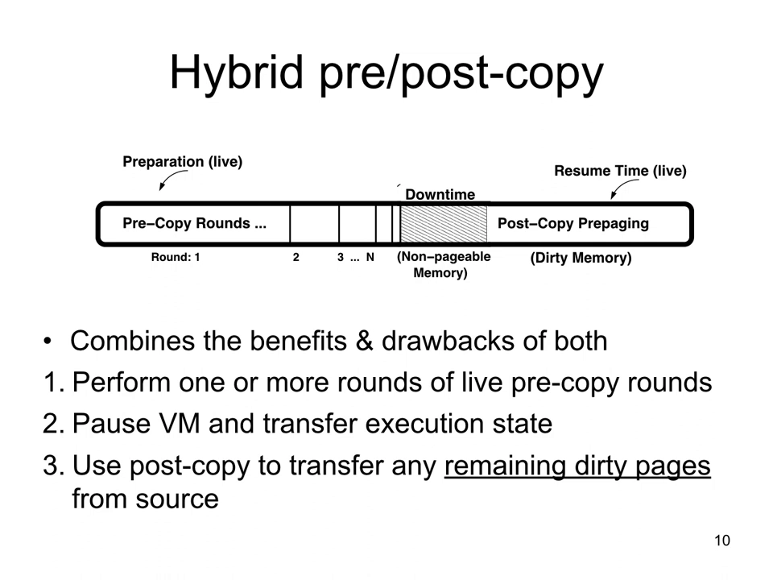

1. 先做**一轮或多轮预拷贝**，虚拟机继续跑；
2. 停机，传执行状态（停机窗口里**不传大块内存**）；
3. 目的端恢复运行，**剩余脏页**用后拷贝的方式补——缺页回源取，或源端主动推。

这样做的收益是：把预拷贝的轮数**固定**下来，再加上后拷贝的确定性，整个迁移就能在**一个有界的总时长**内完成，哪怕负载是写密集的（[【跳转到 29:27】](https://www.youtube.com/watch?v=4axYrG5QBvY&t=1767)）。如果负载恰好是读密集的，预拷贝几轮之后脏页就已经很少，后拷贝阶段几乎什么都不用做（[【跳转到 29:52】](https://www.youtube.com/watch?v=4axYrG5QBvY&t=1792)）。

代价是**两边的缺点也一起继承了**：只要含有后拷贝成分，可靠性就不如纯预拷贝；而只要含有预拷贝成分，就可能白跑几轮、最后发现脏页还是很多，等于把活儿全推给了后拷贝阶段（[【跳转到 30:17】](https://www.youtube.com/watch?v=4axYrG5QBvY&t=1817)）。讲座把这称为"一个有意思的设计点"，而不是标准答案。

## 六、搬完之后：网络与存储的收尾

内存传完、CPU 切过去，迁移在"虚拟机"这个层面就结束了。但对**用户**来说还没结束——用户的连接能不能断，取决于网络设备。

### 6.1 网络连接本身不用搬，交换机的转发表要重学

好消息是：TCP 状态、IP 地址、MAC 地址、端口号、所有打开的连接，全部封装在客户机操作系统里，而 OS 状态本来就在迁移范围内，所以它们**自动跟着过去了**（[【跳转到 30:47】](https://www.youtube.com/watch?v=4axYrG5QBvY&t=1847)、[【跳转到 31:12】](https://www.youtube.com/watch?v=4axYrG5QBvY&t=1872)）。虚拟机在目的端只需要一块新的虚拟网卡。

坏消息是**网络的转发表不认识这台虚拟机的新位置**。二层交换机靠"反向学习（backward learning）"建立 MAC 地址到端口的映射：看到某个 MAC 从某个口进来，就记住以后往这个口发。虚拟机换了机器，等于这个 MAC 出现在了一个新端口上，交换机需要重新学习（[【跳转到 32:02】](https://www.youtube.com/watch?v=4axYrG5QBvY&t=1922)、[【跳转到 32:27】](https://www.youtube.com/watch?v=4axYrG5QBvY&t=1947)）。

如果什么都不做，这个重学习可能要 30 秒左右，这期间虚拟机收不到包——**迁移本身的停机是 100 毫秒以内，但用户感知的中断是 30 秒**，等于白忙（[【跳转到 32:52】](https://www.youtube.com/watch?v=4axYrG5QBvY&t=1972)、[【跳转到 33:17】](https://www.youtube.com/watch?v=4axYrG5QBvY&t=1997)）。

解决办法是**主动发一个 ARP 应答（unsolicited ARP reply）**：没人问，目的端也主动广播一条"这个 IP/MAC 在我这里"。这条应答沿着网络扩散，沿途所有交换机顺手就完成了重学习，把 30 秒压到几毫秒（[【跳转到 33:42】](https://www.youtube.com/watch?v=4axYrG5QBvY&t=2022)、[【跳转到 34:32】](https://www.youtube.com/watch?v=4axYrG5QBvY&t=2072)）。

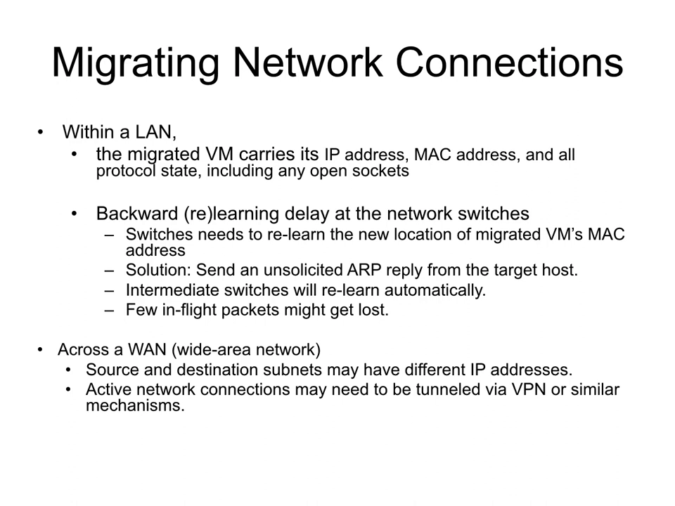

跨子网（WAN）迁移是另一回事：虚拟机在新子网里会拿到新 IP，网络身份变了，得靠 VPN 之类的隧道把发往源子网的流量重定向过去（[【跳转到 34:57】](https://www.youtube.com/watch?v=4axYrG5QBvY&t=2097)）。

### 6.2 存储：LAN 内假设共享，WAN 内要跟着搬

讲座前面一直假设存储是通过网络共享的（NFS、NBD、iSCSI 等），所以磁盘不用搬，问题简化成"网络状态迁移"（[【跳转到 35:36】](https://www.youtube.com/watch?v=4axYrG5QBvY&t=2136)）。但跨 WAN 时共享存储不可用，**虚拟磁盘镜像必须跟着搬**，而磁盘动辄几百 GB 到几 TB（[【跳转到 36:01】](https://www.youtube.com/watch?v=4axYrG5QBvY&t=2161)）。

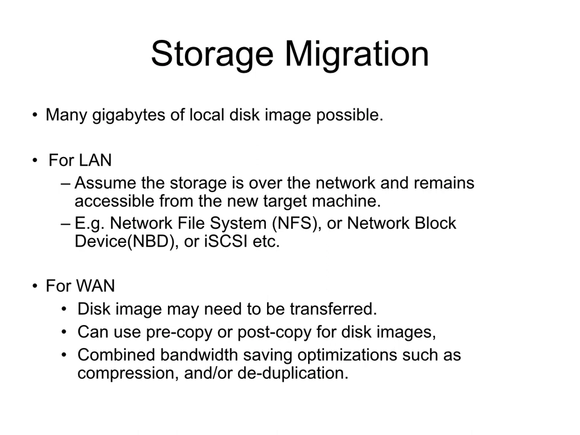

有意思的是：**预拷贝与后拷贝这套思路可以直接套到磁盘镜像上**，再叠加压缩、去重来减少传输量（[【跳转到 36:26】](https://www.youtube.com/watch?v=4axYrG5QBvY&t=2186)）。讲座举的现实场景是灾难规避——飓风要淹数据中心时，把负载整体搬到另一个州（[【跳转到 36:51】](https://www.youtube.com/watch?v=4axYrG5QBvY&t=2211)）。

### 6.3 两个变体：scatter-gather 与 gang migration

讲座最后补了两个不在主线上的变体，用来展示设计空间还有多宽（[【跳转到 38:50】](https://www.youtube.com/watch?v=4axYrG5QBvY&t=2330)）。

**Scatter-gather 迁移**：源端急着腾机器、目的端接收又慢时，源端可以把状态**撒**到网络上一堆中间节点，目的端按自己的节奏**收**回来；源端与目的端之间只保留一条控制连接，用于传控制信息、缺页和部分主动推送的页（[【跳转到 39:15】](https://www.youtube.com/watch?v=4axYrG5QBvY&t=2355)、[【跳转到 39:40】](https://www.youtube.com/watch?v=4axYrG5QBvY&t=2380)）。

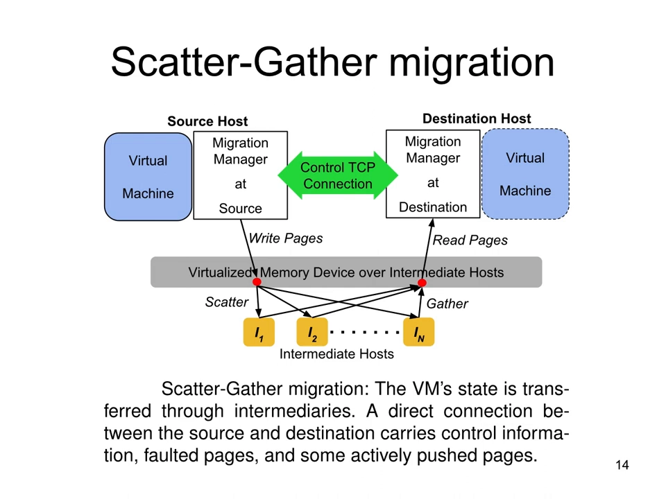

**多机（gang）迁移**：一台物理机上多台虚拟机要一起迁走。如果同时推，网络立刻被打满，什么都动不了。而同一台机器上的虚拟机往往高度相似（都跑 Linux、都跑同一套应用，大量内存页甚至是全零），**内容相同的页只需要传一份**，目的端再复制给各台虚拟机——这就是去重（deduplication）（[【跳转到 40:10】](https://www.youtube.com/watch?v=4axYrG5QBvY&t=2410)、[【跳转到 41:00】](https://www.youtube.com/watch?v=4axYrG5QBvY&t=2460)）。

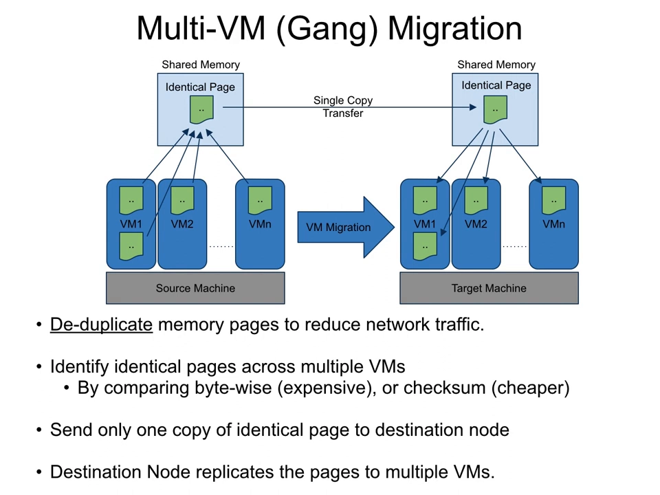

去重的代价是比较本身：逐字节比较几百 GB 内存太耗 CPU，实际做法是比**校验和（checksum）**，用哈希值代替内容比较（[【跳转到 41:50】](https://www.youtube.com/watch?v=4axYrG5QBvY&t=2510)、[【跳转到 42:15】](https://www.youtube.com/watch?v=4axYrG5QBvY&t=2535)）。

## 七、四种策略放在一张表里

| 策略 | 停机时间 | 总迁移时间 | 总传输量 | 故障风险 | 适合的负载 |
| --- | --- | --- | --- | --- | --- |
| pure stop-and-copy | 最长（≈ 总时间） | 最短（只搬状态） | 内存 + 状态，各一次 | 低（源端冻住，状态单一） | 可以接受中断的维护窗口 |
| 预拷贝 pre-copy | 取决于最后一轮剩余脏页，**不可控** | 取决于脏页率，可能很长甚至不收敛 | 内存 + 所有脏页的重复传输，**可能远超内存** | 低（源端始终持有最新状态，可取消） | 读密集、写不频繁的负载 |
| 后拷贝 post-copy | **最短**（只传 CPU 与最小状态） | **可预测**（每页只传一次） | 约等于内存 + 状态，**无重复** | 高（状态劈成两半，源端挂了就丢） | 写密集、要求总时长有界的负载 |
| 混合 pre/post-copy | 短（停机窗口只传状态） | 有界（轮数固定 + 后拷贝确定性） | 预拷贝部分有重复，后拷贝部分无重复 | 中高（继承了后拷贝的脆弱性） | 负载类型不确定、需要总时长上界 |

这张表就是本小节的学习出口：**停机时间、总传输量、故障风险三者在物理上无法同时最优**，选哪种策略等于选把代价放在哪一栏。

## 小结

- 热迁移要搬的是**内存 + CPU 执行状态 + I/O 设备状态**三样；内存是大头，也是唯一在迁移过程中还在变化的部分。
- 衡量"热"有四个指标：**停机时间、总迁移时间、对同机其它虚拟机的干扰、对整条网络的干扰**；后拷贝还额外引入第五个指标——**可靠性**。停机时间不等于总迁移时间。
- 两个极端把设计空间钉住：**stop-and-copy 总时间最短但停机最长**（总时间 = 停机时间）；**pure demand paging 停机最短但永远搬不完**。
- 预拷贝靠"脏页逐轮减少"收敛，收敛条件是**脏页产生速率小于有效带宽**（$R < B$）；写密集时可能永不收敛，工程上用"固定轮数后放弃收敛、直接停机"兜底，但那样停机时间就退化了。
- 预拷贝的脏页追踪靠**写保护 + 写陷入 + 脏位图**，代价是每轮每页的首次写都要陷入；三个优化（限带宽、暂停捣乱进程、丢掉 page cache）只能缓解，不能根治。
- 后拷贝**先切换再补内存**，靠"按需缺页 + 源端主动推送"完成，每页只过网络一次，停机极短、总时长可预测；代价是冷启动，以及**状态劈成两半**带来的可靠性问题。
- 混合方案用"固定预拷贝轮数 + 后拷贝收尾"换一个**有界的总时长**，同时继承了两边的缺点。
- 迁移完成后还有收尾工作：**主动 ARP 应答**把交换机重学习从 30 秒压到几毫秒；跨 WAN 还要搬磁盘镜像，并可用压缩、去重；多机迁移可用 gang migration 的去重来压低总传输量。

## 关键术语速查

| 术语 | 一句话解释 |
| --- | --- |
| 热迁移（live migration） | 虚拟机不关机，从一台物理机整体搬到另一台，搬完接着跑 |
| 停机时间（downtime） | 迁移过程中虚拟机完全不执行的那段时间，目标通常是几百毫秒以内 |
| 总迁移时间（total migration time） | 从发出迁移命令到虚拟机完全在目的端运行、不再依赖源端的端到端时间 |
| 脏页（dirty page） | 被虚拟机写过的内存页；预拷贝的每一轮只需要重传这些页 |
| 脏位图（dirty bitmap） | hypervisor 里记录"哪些页被写过"的位图，每轮开始前清零 |
| 写保护（write-protect） | 把页标成只读，让写操作陷入 hypervisor，从而捕获脏页 |
| 收敛（convergence） | 预拷贝中脏页量逐轮下降、最终小到可以停机一把传完的状态 |
| 预拷贝（pre-copy） | 先多轮传内存、最后停机传剩余脏页，停机短但总时长不可控 |
| 后拷贝（post-copy） | 先传 CPU 与最小状态、切换后再按需补内存，停机极短但可靠性差 |
| 按需缺页（demand paging） | 目的端访问到尚未传过来的页时触发缺页，回源端取这一页 |
| 工作集（working set） | 虚拟机在一段时间内实际频繁访问的那部分内存；它被拉过来之后性能就恢复 |
| 不可换出内存（non-pageable memory） | 不能被换到磁盘上的那部分内存，后拷贝切换前必须先传过去 |
| 混合 pre/post-copy | 先做若干轮预拷贝，再切后拷贝补剩余脏页，用固定轮数换有界总时长 |
| ARP 应答（unsolicited ARP reply） | 迁移后由目的端主动广播的地址应答，让交换机立刻重学习虚拟机的新位置 |
| gang migration | 多台虚拟机一起迁移，对内容相同的页只传一份，目的端再复制 |