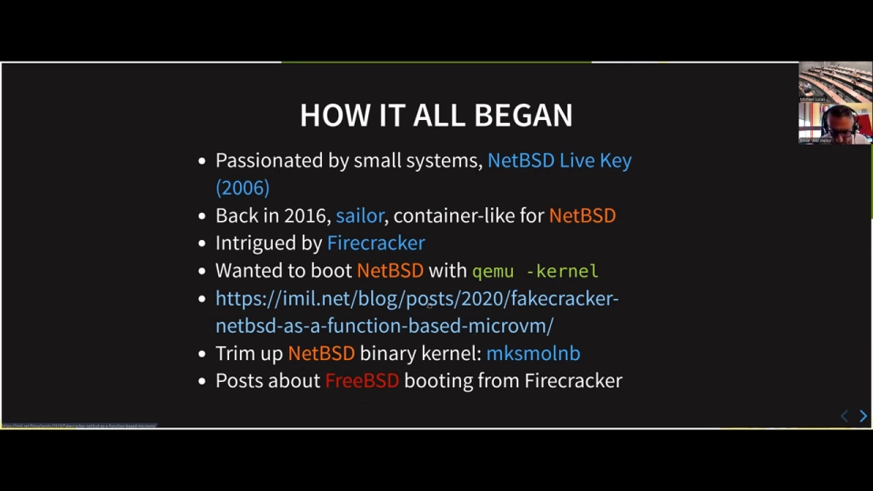
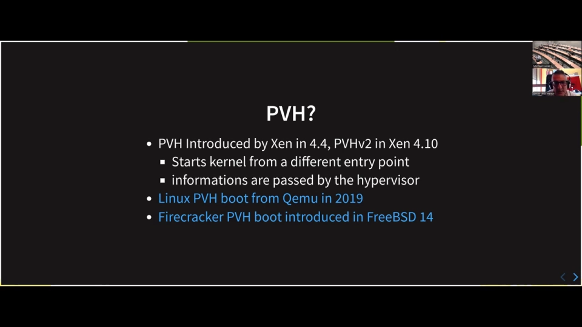
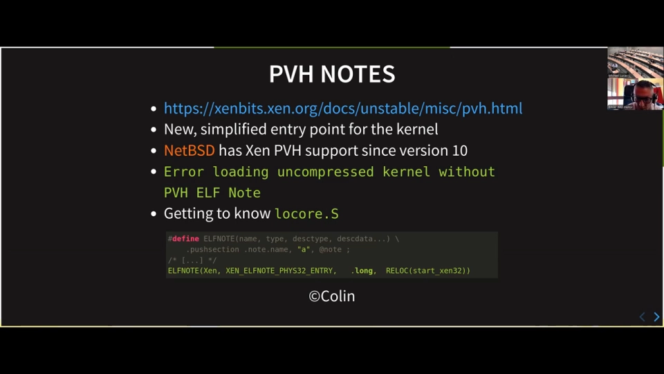
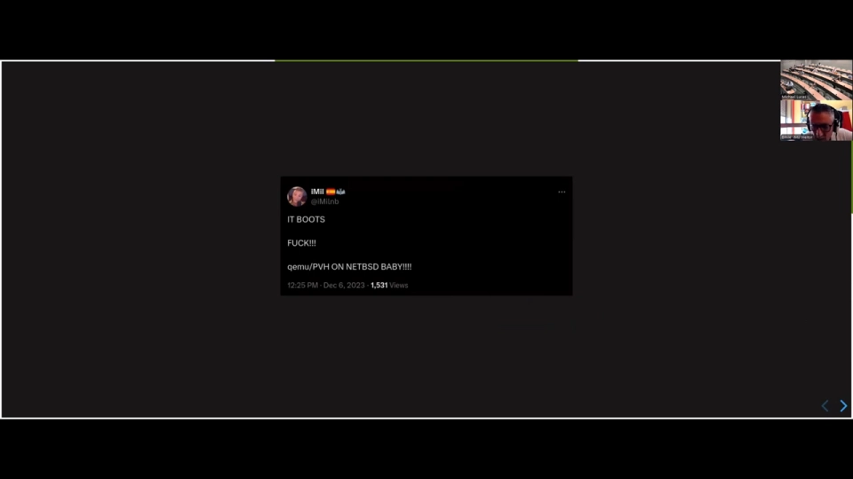
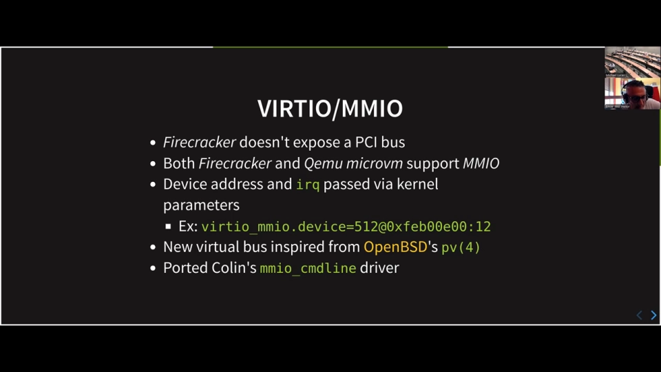
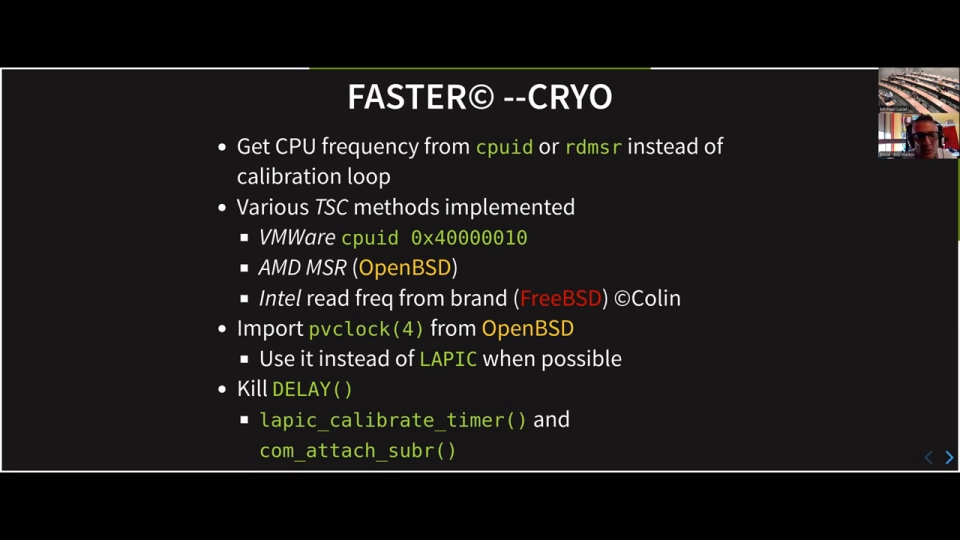
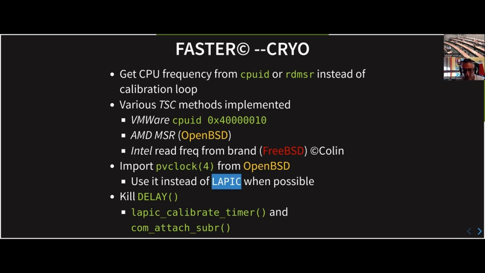
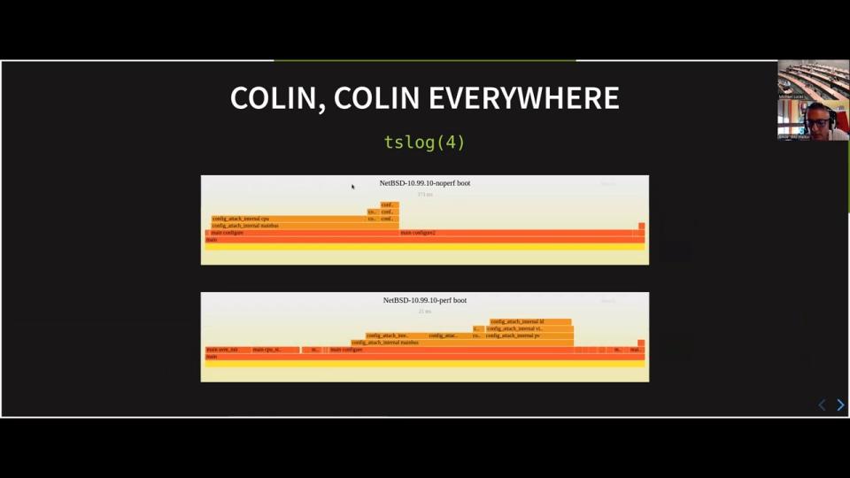
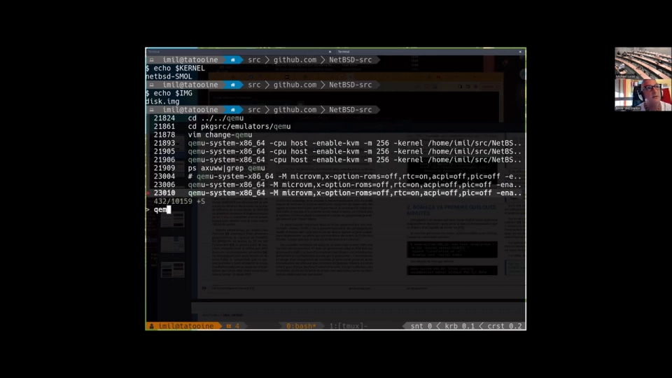

# NetBSD 微虚拟机启动从 373 毫秒压到 20 毫秒：内核启动时间到底花在哪

> 视频来源：[Making NetBSD as a fast(er) booting microvm by Emile Heitor](https://www.youtube.com/watch?v=6znKosuX3EM)（YouTube · BSDCan）｜时长约 62 分钟
> 导读：这是一场"逐项记账"式的性能演讲。作者把 NetBSD 内核在微虚拟机里的启动时间从 373 毫秒砍到 20 毫秒，每一刀都对应一个具体的耗时来源。本文按他的记账顺序讲：跳过固件、去掉 PCI 总线、删掉用不到的驱动、干掉内核里的固定等待。

## 本讲要解决的核心问题（SCQA）

**背景**：Firecracker 能在几十毫秒内启动一个 Linux 客户机，靠的是"没有 BIOS、没有 PCI、只有 virtio 设备"这套极简机器模型。

**冲突**：但同一套机器模型上换一个操作系统，启动时间可能反而变成几百毫秒甚至几秒。Emile Heitor 想把 NetBSD 塞进 Firecracker，第一次用 PVH 启动成功时，内核启动要 200 毫秒；再往前，官方内核在虚拟化环境里要好几秒。

**疑问**：这几百毫秒到底花在哪？砍掉哪些步骤能省下来，砍掉之后还剩什么？

**回答（中心思想）**：**启动时间几乎全花在"发现"和"等待"上**——固件枚举硬件、内核枚举总线、驱动探测设备、校准循环测频率、固定延时等缓冲区。把这些逐项换成"VMM 直接告诉你"和"不等待"，373 毫秒就能压到 20 毫秒。设备最小化之所以有效，正是因为它一次性消掉了"发现"这一大类。



## 一、先看账本

作者最后给出的数字很干脆：

> "改动之前 NetBSD 内核启动要 373 毫秒，做完这些之后大约 20 毫秒，在十几到二十几毫秒之间波动，取决于我机器的负载。"（[【跳转到 46:46】](https://www.youtube.com/watch?v=6znKosuX3EM&t=2806)）

从 373 到 20，接近 19 倍。而整个过程用到的技术没有一项是"更快的 CPU"或"更好的编译器"，全是**删掉不该做的事**。

为了讲清这笔账，可以把启动时间拆成三块（这是本文为了梳理结构做的拆解，不是演讲里的原话）：

$$
T_{\text{boot}} = T_{\text{固件}} + T_{\text{发现}} + T_{\text{等待}}
$$

- $T_{\text{固件}}$：BIOS/UEFI 自检、枚举总线、找启动设备。
- $T_{\text{发现}}$：客户机内核自己去找"我周围有什么"——总线枚举、设备探测、驱动匹配。
- $T_{\text{等待}}$：校准循环、固定延时、轮询超时这类"什么都不干但在耗时间"的部分。

下面四刀，分别砍在这三项上。

## 二、第一刀：跳过固件

### 2.1 `-kernel` 到底省了什么

作者最早的线索来自 QEMU 的一个参数：

> "QEMU 可以用 `-kernel` 直接加载一个 Linux 内核，这意味着你不需要走一遍 BIOS 初始化之类的流程，内核就这么被'魔法般'地加载了。"（[【跳转到 08:34】](https://www.youtube.com/watch?v=6znKosuX3EM&t=514)）

这句话值得拆开看。传统启动路径是：CPU 复位 → 跑固件 → 固件枚举硬件、建好设备树 → 找到启动盘 → 读引导扇区 → 加载 bootloader → bootloader 再加载内核。`-kernel` 把这条链整个砍掉，VMM 直接把内核镜像放进内存、跳到它的入口点。

省掉的不只是"固件那段代码的执行时间"，更是**固件做的那件事**：枚举硬件、把结果整理成表交给内核。这件事在微虚拟机里是多余的——VMM 本来就知道有哪些设备。

### 2.2 但 NetBSD 只有 32 位内核能这么启动

作者顺着这条线索试了一下，发现只有 NetBSD 的 32 位内核能用 `-kernel`：

> "只有 NetBSD 的 32 位内核带 multiboot 特性，才能用这个参数启动。"（[【跳转到 09:24】](https://www.youtube.com/watch?v=6znKosuX3EM&t=564)）

于是他做了第一个项目 Fake Cracker：重新构建一个只带极少驱动的 NetBSD 32 位内核，能在一两百毫秒内启动。但这条路走不通——"一切都是 32 位的……这并不算严肃的方案"。

真正的解在 FreeBSD 那边：Colin Percival 用 **PVH** 把 FreeBSD 跑进了 Firecracker。

### 2.3 PVH：把"发现"换成"被告知"

PVH 是 Xen 提出的一种启动模式，作者给的定义非常清楚：

> "PVH 做的事基本上是从正在运行的主机跳到一个次级入口点。"（[【跳转到 14:49】](https://www.youtube.com/watch?v=6znKosuX3EM&t=889)）

它有三个要点，正好对应前面那三项账：

1. **用硬件加速的虚拟化**（VT-x / AMD-V），CPU 指令不模拟。
2. **用半虚拟化驱动**（virtio），设备不模拟。
3. **不要求客户机走一遍 BIOS 初始化**——宿主和 VMM 把"这台机器长什么样"直接交给客户机：ACPI 值在哪、可用的物理内存区域有哪些、传给内核的启动标志是什么（[【跳转到 16:54】](https://www.youtube.com/watch?v=6znKosuX3EM&t=1014)）。



第 3 点是关键。传统启动里，内核是**主动去发现**硬件；PVH 里，内核是**被动接收**硬件描述。前者是一堆循环和探测，后者是读一张表。

### 2.4 移植的坑：ELF note 与那张表

PVH 的入口点怎么让 VMM 知道？靠内核 ELF 文件里的一条 note：

> "你只要在内核的 ELF notes 里声明它就行：你只要说'我要用 PVH 启动，这里是新的入口点'。"（[【跳转到 18:47】](https://www.youtube.com/watch?v=6znKosuX3EM&t=1127)）

如果内核没有这条 note，QEMU 会直接报错：`Error loading uncompressed kernel without PVH elf notes`（[【跳转到 20:27】](https://www.youtube.com/watch?v=6znKosuX3EM&t=1227)）。作者做的事就是把 FreeBSD 在 `lowcore.s` 里的那段补丁搬到 NetBSD——`lowcore.s` 是"内核最开始的那几步，是建立虚拟内存的地方，是从 32 位切到 64 位的地方"（[【跳转到 21:56】](https://www.youtube.com/watch?v=6znKosuX3EM&t=1316)）。



补丁打完，内核能跳到入口点了，但立刻拿到一个栈回溯。原因是 NetBSD 的 `lowcore` 里有个假设：**那张描述机器的表，就在内核结束地址的后面**。而 QEMU 和 Firecracker 挑的地址在**内核之前**，`lowcore` 建立虚拟内存时第一件事就是把 bootstrap 表清零——数据正好被清掉了。

解法很朴素：把表复制到内核期望的位置。作者还顺手把 NetBSD 里"以 Xen 为中心"的 PVH 代码改成了一个通用的客户机类型 `gen PVH`，从 `start_info` 结构里取控制台、物理内存地址和 ACPI 地址（[【跳转到 34:17】](https://www.youtube.com/watch?v=6znKosuX3EM&t=2057)）。

到这一步，NetBSD 第一次在 AMD64 上用 PVH 启动成功——2023 年 12 月 6 日。



## 三、第二刀：不要 PCI 总线

PVH 解决了"固件"，但设备还在 PCI 总线上。作者的版本此时启动约 200 毫秒（[【跳转到 38:02】](https://www.youtube.com/watch?v=6znKosuX3EM&t=2282)）。

PCI 的问题在于：**它是一套需要被枚举的间接层**。内核要先找到 PCI 控制器，然后逐个 bus / device / function 去读配置空间，才能知道"这里有个 virtio 网卡"。这个循环本身就是"发现"。

Firecracker 干脆不给 PCI：

> "Firecracker 不暴露 PCI 总线，它根本不知道 PCI 是什么。"（[【跳转到 38:27】](https://www.youtube.com/watch?v=6znKosuX3EM&t=2307)）

替代方案是 **virtio-mmio**（内存映射 I/O）：把内存的一部分映射出去，就伪造出了一个设备地址。设备地址和中断号不走总线，直接写在**内核命令行**里：

```
virtio_mmio.device=512@0xfeb00e00:12
```

这行参数的意思是"这里有一个 512 字节的 virtio-mmio 设备，地址 0xfeb00e00，用 IRQ 12"。内核读到这一行，就直接"发现"了这个设备，不需要任何枚举。



作者为此在 NetBSD 里加了一条不挂在任何总线上的虚拟总线（借鉴 OpenBSD 的 `pv` 实现），把 Colin 写的 `mmio_cmdline` 驱动挂上去，代码约 80% 来自 FreeBSD。

**这一刀砍掉的是"发现"里的总线枚举**。设备还在，但"找设备"这件事从"遍历总线"变成了"读一行字符串"。

## 四、第三刀：把用不到的驱动从二进制里删掉

在 PVH 之前，作者还试过一个更粗暴的办法：不重新编译内核，直接用 awk 脚本裁掉二进制内核里对未使用驱动的引用（项目叫 `mksmolnb`）。

> "官方的 NetBSD 二进制内核能在 100 到 200 毫秒内启动，而不是花上好几秒——只靠删掉内核二进制里那些驱动的引用。"（[【跳转到 11:29】](https://www.youtube.com/watch?v=6znKosuX3EM&t=689)）

这一刀的道理和前面一样：**驱动在不在内核里，决定了内核启动时要不要去试它**。一个通用发行版内核里编着几百个驱动，每个驱动在启动时都有机会被匹配、被初始化、被探测一次。哪怕大部分探测很快失败，累加起来也是几百毫秒。

这也解释了为什么"设备最小化"必须**两头一起做**：VMM 少给设备，内核里也要少编驱动。只做一头，另一头还会去做无用功。

## 五、第四刀：找出内核里的"等待"

前三刀砍的都是"发现"。到 200 毫秒左右，作者在 NetBSD 的 IRC 频道里说这事，有人回了一句"还能更快"，他就接了赌。这一轮他换了个方法：**先测量，再动手**。

### 5.1 CPU 频率：从校准循环到 MSR

第一个被揪出来的是 CPU 频率校准循环。

> "CPU 频率是从一个校准循环里算出来的，这个循环我想说没什么用，现在有更现代的办法确定真实 CPU 频率。"（[【跳转到 43:27】](https://www.youtube.com/watch?v=6znKosuX3EM&t=2607)）

校准循环的原理是"跑一段已知指令，数一下花了多少时间"，本质上是**故意等一段时间来测速**。在物理机上这还算合理，在虚拟机里完全没必要——宿主知道真实频率，可以直接告诉客户机。演讲里列出的替代方案包括 VMware 提出的 CPUID 叶子（`0x40000010`）、AMD 的 MSR、以及 Colin 的兜底办法：实在不行就从 CPU 品牌字符串里读频率。



### 5.2 时钟：从 LAPIC 到 pvclock

第二个是读时钟的方式。作者从 OpenBSD 引入了 `pvclock`：

> "PV clock 是一种从 KVM 读时钟的方式……我把 PV clock 引进来，在能用的地方用它替代更慢的 LAPIC。"（[【跳转到 44:42】](https://www.youtube.com/watch?v=6znKosuX3EM&t=2682)）

LAPIC 定时器在虚拟机里往往要走一趟陷入/模拟，而 pvclock 是 KVM 直接暴露给客户机的一段共享内存——读它不需要陷入。启动过程中要读很多次时间戳，这个差别会被放大。



### 5.3 最贵的一笔：串口驱动里的 100 毫秒

真正的大头在这里：

> "内核里有两个 delay 调用特别耗时间：一个在定时器校准里；第二个在 com 驱动里，那里有一个 100 毫秒的延迟，在等 com 缓冲区变空，或者等传输结束前有没有字符过来。"（[【跳转到 45:32】](https://www.youtube.com/watch?v=6znKosuX3EM&t=2732)）

**一行代码，100 毫秒。** 373 毫秒的账本里，这一笔就占了四分之一强。而且它跟设备数量直接相关——串口是微虚拟机里少数保留的设备之一，而它的驱动里带着一个为真实硬件设计的等待。

作者的处理方式是把 `DELAY()` 换成不带延迟的函数。演讲里那句总结很到位：

> "我只是找出时间到底消耗在哪儿。"（[【跳转到 43:27】](https://www.youtube.com/watch?v=6znKosuX3EM&t=2607)）

## 六、账本对上了：火焰图

为了看清收益来自哪儿，作者把 FreeBSD 的 `tslog(4)` 移植到 NetBSD，生成了启动过程的火焰图，上下两张对比：



火焰图的价值在于它把"感觉慢"变成了"这几条横条长"。上面那张图里，最长的一条横条就是那个 100 毫秒的串口等待；下面那张图里，整个启动被压成短短一截。

## 七、演示：把"关掉一切"写成一条命令行

演讲最后有一段演示，作者用 QEMU 的 `microvm` 机型复刻 Firecracker 的选项——"把所有东西都关掉"（[【跳转到 50:21】](https://www.youtube.com/watch?v=6znKosuX3EM&t=3021)）。



这条命令行本身就是"设备最小化"的清单：关掉 option ROM（不需要显卡 BIOS）、关掉 ACPI（不需要电源管理）、关掉 PIC（不需要传统中断控制器）。每一项关掉的都是"客户机启动时要初始化的一段代码"。

## 八、代价与边界

### 8.1 只加速启动，不加速运行

作者反复强调这一点：

> "这套补丁做的事是加速内核的启动，它不加速内核本身。"（[【跳转到 53:43】](https://www.youtube.com/watch?v=6znKosuX3EM&t=3223)）

所以它不是性能优化，而是**冷启动优化**。对"启动、跑一会儿、杀掉"的负载（测试框架、一次性沙箱）收益巨大；对长期运行的服务没有意义。

### 8.2 需要改内核，且依赖 VMM 配合

每一刀都有代价：

- PVH 需要在 `lowcore.s` 里加 ELF note、改入口点、加 `gen PVH` 客户机类型——**要改内核**。
- virtio-mmio 需要一条不在任何总线上的虚拟总线和新驱动——**要改内核**。
- 跳过固件意味着**放弃"自描述硬件"**：客户机不再能自己发现设备，必须由 VMM 传参。换个 VMM 就得重新对齐参数格式（作者就踩了"表放在内核前还是内核后"这个坑）。

这就是"启动快但生态窄"的具体形态：**快是拿通用性换的**。

### 8.3 微虚拟机是"一次性机器"

演讲的问答环节有个很好的收尾。有人问关机有多快，作者说没测过，但补了一句：

> "我的直觉是它这么快是因为你没有设备。但这些关机流程做的还是九十年代那套东西。"（[【跳转到 55:45】](https://www.youtube.com/watch?v=6znKosuX3EM&t=3345)）

接着他给出了更根本的观点：微虚拟机这个概念本身就不该太依赖磁盘上的文件系统，"它们应该被当成一次性机器，很像 Docker 容器"，所以"你直接杀掉它就行，无所谓"。

这条和 Firecracker 的做法一致——AWS 那边根本不走关机流程，直接杀进程。**当一台机器可以被随时丢弃，关机流程里那些"优雅"步骤就全是浪费。**

## 小结

- **启动时间花在"发现"和"等待"上**，不花在计算上。373 毫秒里，光串口驱动的一个固定延迟就占 100 毫秒。
- **第一刀砍固件**：`-kernel` 跳过 BIOS；PVH 更进一步，让 VMM 把 ACPI 地址、内存映射、启动标志直接传给内核，把"发现硬件"换成"接收硬件描述"。
- **第二刀砍总线**：Firecracker 不暴露 PCI，用 virtio-mmio 把设备地址和 IRQ 写进内核命令行，总线枚举变成读一行字符串。
- **第三刀砍驱动**：内核里少编一个驱动，启动时就少一次探测。裁二进制也能把启动从几秒压到一两百毫秒。
- **第四刀砍等待**：CPU 频率校准循环换成 CPUID/MSR，LAPIC 换成 pvclock，`DELAY()` 换成不等待的函数。
- **设备最小化必须两头做**：VMM 少给设备，内核少编驱动，两头都省才有效。
- **代价**：只加速启动不加速运行；要改内核；放弃"自描述硬件"，依赖 VMM 传参；换来的是"一次性机器"这种用法。
- **方法论**：先移植 `tslog` 做火焰图，再按横条长度动手。性能工作从测量开始，不从猜测开始。

## 关键术语速查

| 术语 | 一句话解释 |
| --- | --- |
| `-kernel` 参数 | 让 VMM 直接把内核镜像放进内存并跳进去，跳过固件与 bootloader |
| PVH | Xen 提出的启动模式：从次级入口点启动内核，硬件信息由 hypervisor 传入，不需要 BIOS |
| ELF note | 内核 ELF 文件里的一段元数据，PVH 用它声明"我的次级入口点在这里" |
| `start_info` 结构 | PVH 传给客户机的那张表，装着 ACPI 地址、内存映射、启动标志、控制台信息 |
| virtio-mmio | 把设备寄存器映射到一段内存地址上的 virtio 传输方式，不需要 PCI 总线 |
| PCI 枚举 | 内核遍历总线、逐个读设备配置空间来发现设备的过程，是启动耗时的一大来源 |
| 火焰图（flame graph） | 把函数调用栈按耗时画成横条，横条越长说明这段代码花的时间越多 |
| `tslog(4)` | FreeBSD 的启动时间戳记录设施，用来生成启动过程的火焰图 |
| pvclock | KVM 通过共享内存直接暴露给客户机的时钟，读它不需要陷入 |
| LAPIC 定时器 | 客户机本地的中断控制器定时器，在虚拟机里读它往往比 pvclock 慢 |
| unikernel | 应用与内核编译成一体的客户机形态，没有独立的"内核启动"阶段 |