# 机器模型只剩网卡和磁盘：MicroVM 如何用设备最小化换来 125 毫秒启动

> 视频来源：[Secure & Fast microVM for Serverless Computing • Radu Weiss & Arun Gupta • GOTO 2019](https://www.youtube.com/watch?v=oKKOBsqQndY)（YouTube · GOTO Conferences）｜时长约 44 分钟
> 导读：这场演讲的前半段由 Firecracker 团队负责人 Radu Weiss 讲设计取舍，后半段由 Arun Gupta 讲它在 Lambda / Fargate 里的落地。本文只取"设备最小化如何换来启动时间"这一条线，讲清砍掉哪些设备、省掉哪几段耗时、代价是什么。Firecracker 的整体架构与启动路径另见 6.2.1。

## 本讲要解决的核心问题（SCQA）

**背景**：虚拟机提供的是硬件强制的隔离边界，容器提供的是毫秒级启动和高密度。云上这两个性质都想要。

**冲突**：无服务器平台的每个沙箱里都可能跑着别人的恶意代码，所以必须有虚拟机这层边界；但传统虚拟机启动要几秒甚至几十秒，而 Lambda 的负载是突发的——"某个函数可能一直零调用，突然一分钟内来了一千、一万甚至一百万次调用"（[【跳转到 07:47】](https://www.youtube.com/watch?v=oKKOBsqQndY&t=467)）。等不起。

**疑问**：虚拟机启动为什么慢？砍掉什么，才能把它压到百毫秒级？

**回答（中心思想）**：启动时间的大头不是 CPU 算得慢，而是**客户机要认识一个复杂的世界**。把机器模型砍到只剩网卡和磁盘，需要枚举的总线、需要探测的驱动、需要初始化的设备就跟着一起消失，启动时间才从"秒"掉到"125 毫秒"这个量级。

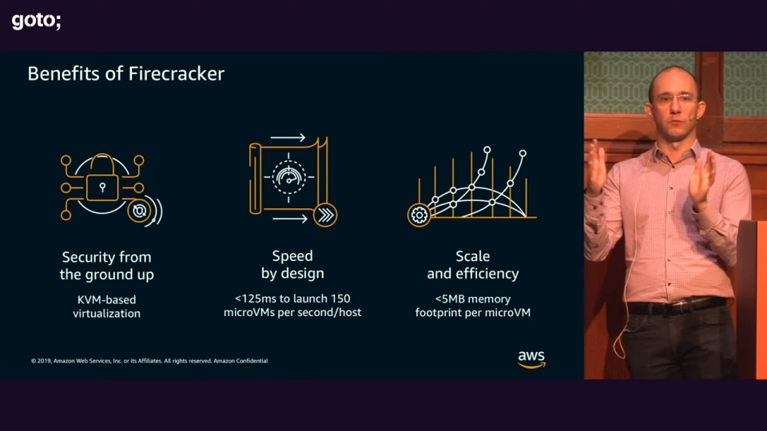

## 一、慢的不是计算，是"认识世界"

### 1.1 一台传统虚拟机交给客户机的是什么

先建立一个直觉。虚拟机监视器（VMM，Virtual Machine Monitor）要做两件事：给客户机内存和 CPU，以及**扮演它周围的硬件**。第二件事就是"设备模型"。

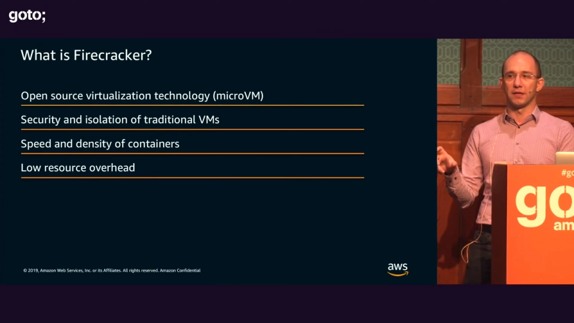

而无服务器平台的负载形状，决定了这套"扮演"必须做得极轻——下图是 Lambda worker 上多个客户函数的资源占用曲线，峰谷交错，靠统计复用才能把 CPU 撑到 90% 以上（[【跳转到 07:47】](https://www.youtube.com/watch?v=oKKOBsqQndY&t=467)）。

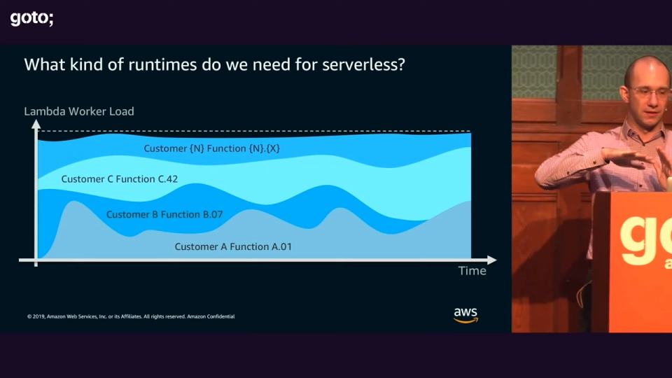

传统 VMM（比如 QEMU）扮演的是一个完整的 PC 平台：软驱、显卡、键盘、USB 控制器、IDE/SATA 控制器、声卡、串口、电源管理（ACPI）……这些东西对"跑一个无服务器函数"毫无用处，但客户机操作系统并不知道这一点。

于是客户机内核启动时会做一件很贵的事：**把整个平台摸一遍**。它要枚举总线、读设备 ID、给每个匹配上的设备加载并初始化驱动、分配中断和 I/O 资源。设备越多，这一段越长。

### 1.2 机器模型：客户机环顾四周时看到的世界

Radu Weiss 在演讲里给了一个很好用的说法：

> "机器模型（machine model）就是客户机操作系统环顾四周时看到的世界。"（[【跳转到 11:31】](https://www.youtube.com/watch?v=oKKOBsqQndY&t=691)）

这句话把问题从"VMM 支持多少设备"翻转成了"客户机眼里有多少东西"。前者是功能清单，后者才是启动成本的来源。Firecracker 的选择是把这个"世界"压到极小：

> "如果你是 Firecracker 的客户机，你看到的只有网络设备和存储设备，仅此而已。别的虚拟机里那些东西——软驱、图形设备、键盘——在这里都不存在。"（[【跳转到 11:31】](https://www.youtube.com/watch?v=oKKOBsqQndY&t=691)）

## 二、砍到只剩两类设备

### 2.1 网络与存储：virtio 半虚拟化

留下的两类设备是网络和存储，而且都是 **virtio** 设备。virtio 是"半虚拟化"（paravirtualization）设备标准：客户机知道自己运行在虚拟机里，于是不去探测"这到底是什么牌子的网卡"，而是直接用一套约定好的共享内存队列和宿主交换数据。

这一点对启动时间很关键：virtio 驱动是 Linux 内核**自带**的，不需要为某个具体型号去找驱动、做探测。Radu 讲架构时明确说了这一点：

> "网络和存储子系统，它们基于 virtio，这意味着 Linux 客户机会自带对应的半虚拟化驱动。"（[【跳转到 19:29】](https://www.youtube.com/watch?v=oKKOBsqQndY&t=1169)）

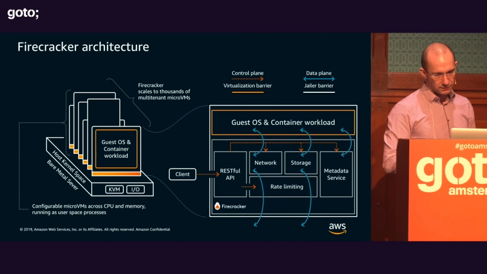

### 2.2 "没有的东西"才是重点

把演讲里散落的说法集中起来，Firecracker 的机器模型里**不存在**这些：

- **没有显卡 / 图形设备**：省掉 framebuffer 分配、显示控制器初始化，也省掉一整套与启动无关的显存管理。
- **没有键盘、没有软驱**：省掉输入设备与可移动介质的探测路径。
- **没有 USB、没有热插拔**：既然“只有网络和存储，仅此而已”，总线枚举与设备插拔状态机就没有存在的理由。
- **没有电源管理设备**：这是最极端的一条。Radu 说："我们根本没有做电源管理设备，所以很长一段时间里，我们推荐的关机方式就是 pkill 掉那个进程。"（[【跳转到 18:04】](https://www.youtube.com/watch?v=oKKOBsqQndY&t=1084)）

最后这条值得多想一秒。ACPI 电源管理意味着客户机要走一遍"请求关机 → 通知设备 → 逐个卸载 → 断电"的流程；没有它，关机就退化成"进程没了"。对一个随时可以被丢弃的沙箱来说，这个功能本来就不该存在。

### 2.3 结果：125 毫秒

> "因为设备模型非常轻、初始化时几乎不做什么工作……用一个配置得当的 Linux，从打开微虚拟机到进入用户态，可以做到 125 毫秒以内。"（[【跳转到 11:56】](https://www.youtube.com/watch?v=oKKOBsqQndY&t=716)）

注意这句话的两个限定词：**配置得当的 Linux**，以及**到进入用户态为止**。前者说明这不是随便一个发行版镜像都能做到，客户机内核本身也得裁；后者说明计时终点是"用户态第一个进程"，再往后就是应用自己的启动代码，不算在 VMM 头上。

## 三、因果链：设备少 → 驱动少 → 初始化少 → 启动快

把上面这些串起来，就是一条完整的因果链。用公式写出来大致是这样（这是本文为了讲清结构做的拆解，不是演讲里的原话）：

$$
T_{\text{boot}} = T_{\text{firmware}} + T_{\text{enum}} + T_{\text{driver}} + T_{\text{init}}
$$

- $T_{\text{firmware}}$：固件阶段。传统 PC 平台要先跑 BIOS/UEFI，做自检、枚举总线、把启动设备找出来。
- $T_{\text{enum}}$：总线枚举。客户机内核沿着 PCI 之类的总线把设备一个个读出来。
- $T_{\text{driver}}$：驱动探测与初始化。每个匹配上的设备都要分配资源、注册中断、初始化队列。
- $T_{\text{init}}$：内核自身初始化到拉起第一个用户态进程。

设备最小化砍的是前三项：

1. **没有一整套 PC 平台，就不需要固件去枚举它**——客户机不再"发现"硬件，而是由 VMM 直接把硬件信息告诉它。
2. **没有 PCI 总线上的几十个设备，就没有总线枚举的循环**。
3. **只剩两个 virtio 设备，驱动探测就只剩两条路径**，而且都是内核自带驱动。

### 3.1 125 毫秒里最大的一块，是客户机操作系统启动

演讲后半段 Arun Gupta 讲 OSv 时，把这条链的"权重"点破了：

> "我们前面讲的都是客户机里跑一个像 Linux 这样的客户机操作系统，看启动时间的话，大部分时间都花在客户机操作系统启动上。"（[【跳转到 41:39】](https://www.youtube.com/watch?v=oKKOBsqQndY&t=2499)）

这句话很重要：它说明 125 毫秒里，VMM 自己那部分开销其实很小，真正的大头是"客户机内核把自己启动起来"。而客户机内核启动时间又与它要认识的设备数量强相关——这就把设备最小化和启动时间直接锁在了一起。

### 3.2 反证：把客户机内核也去掉，能到 5 毫秒

同一段里，Arun 给了这个论证最漂亮的反证：

> "OSv 那边有个演示，用 Firecracker 在 5 毫秒内启动一个应用：从什么都没有到用户代码在 OSv 里、在 Firecracker 里跑起来，只要 5 毫秒。如果用 OSv，一台虚拟机端到端的生命周期大约 40 毫秒。"（[【跳转到 42:04】](https://www.youtube.com/watch?v=oKKOBsqQndY&t=2524)）

OSv 是一个 unikernel：它没有"通用操作系统内核启动"这一步，应用和内核编译在一起，直接跑。同一套 VMM、同一套设备模型，把客户机内核换掉，启动时间就从 125 毫秒掉到 5 毫秒。

这条反证说明了两件事：**第一，125 毫秒里绝大部分确实花在客户机操作系统上；第二，设备最小化只是把"必须初始化的东西"压到最小，剩下的那部分得靠换客户机形态来消除。**

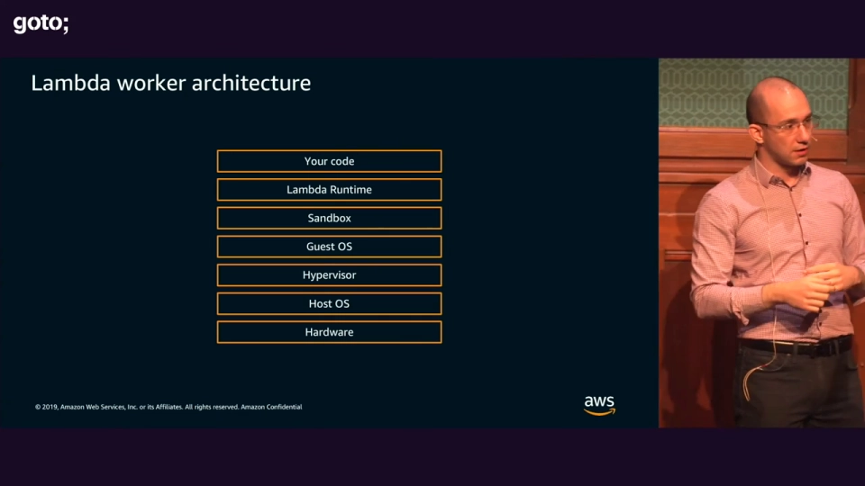

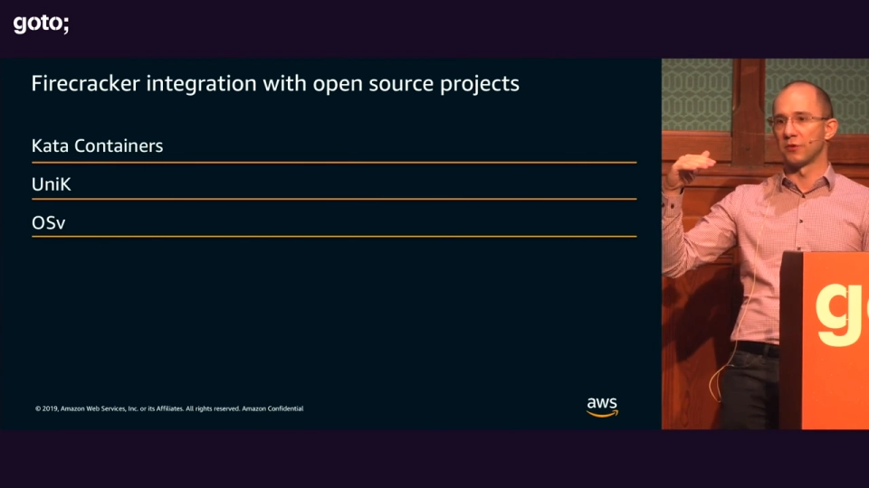

## 四、设备最小化的副产品：密度、安全、可预测

设备最小化本来是为了启动时间，但它顺带解决了另外三个问题。

### 4.1 每台 VMM 不到 5 MB

> "每个 Firecracker VMM 的内存开销不到 5 MB，所以一千个也就占 5 GB 内存。"（[【跳转到 13:11】](https://www.youtube.com/watch?v=oKKOBsqQndY&t=791)）

设备模型越简单，VMM 进程里的数据结构、缓冲区、线程就越少。5 MB 这个数字是"设备少"的直接后果，不是单独优化的结果。

### 4.2 每秒钟 150 台

> "因为启动发生得这么快，因为设备模型非常轻、初始化时几乎不做什么工作，我们能做到极高的虚拟机创建速率：测试中峰值是单机每秒 150 个微虚拟机。"（[【跳转到 13:11】](https://www.youtube.com/watch?v=oKKOBsqQndY&t=791)）

Radu 还补了一句更实用的口径：峰值 150，**稳态 100** 是"不会对运行中负载造成可观察影响"的速率。这句话说明启动速度不只是延迟指标，它同时是**吞吐指标**——每秒能换掉多少台机器。

### 4.3 攻击面

设备模型是 VMM 里最容易被攻击的部分：每个设备都要解析客户机发来的请求，解析代码越多，漏洞越多。

> "这让攻击者可以探测的攻击面非常小，同时也让客户机操作系统启动得非常快。"（[【跳转到 11:56】](https://www.youtube.com/watch?v=oKKOBsqQndY&t=716)）

注意这句话的结构：**同一个设计同时买到安全和速度**。这不是巧合——"少解析一种设备请求"和"少初始化一种设备"是同一件事的两面。安全边界的细节见 6.1.3。

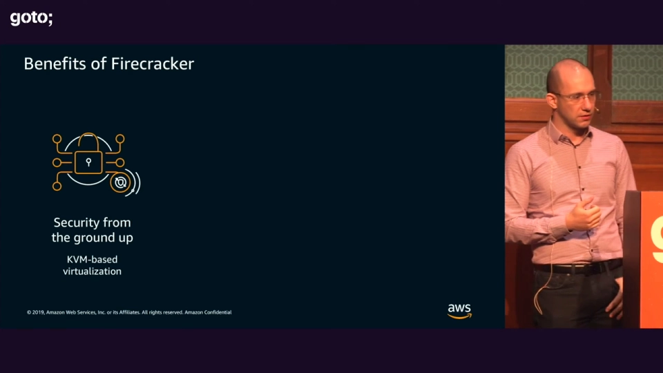

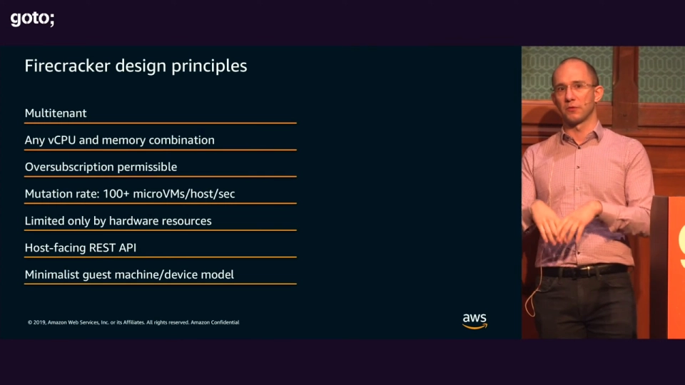

## 五、代价：启动快，生态窄

设备最小化不是免费的。演讲里对代价说得很坦率。

### 5.1 没有电源管理，也没有"通用虚拟机"

第一条代价是功能：没有 GPU、没有 USB 透传、没有热插拔、没有电源管理。想跑需要完整 PC 平台的操作系统，直接出局。

第二条代价是**定位**。Radu 说得很清楚：

> "你当然可以在自己机器上玩它，但它不是为通用虚拟机设计的。"（[【跳转到 43:25】](https://www.youtube.com/watch?v=oKKOBsqQndY&t=2605)）

这不是谦虚，是章程。Arun 补充说，Firecracker 发布时就公布了 charter（章程），明确"这是一个非常专用的工具，我们只想解决无服务器计算这一个场景——容器和函数，就这些"（[【跳转到 40:18】](https://www.youtube.com/watch?v=oKKOBsqQndY&t=2418)）。

### 5.2 拒绝功能请求，是一种设计纪律

最值得学的一句是：

> "即便它成了开源项目，我们也大概拒绝了和接受了一样多的功能请求：如果某个东西有点用，但会让我们复杂很多，我们就选择不做。"（[【跳转到 18:04】](https://www.youtube.com/watch?v=oKKOBsqQndY&t=1084)）

以及紧随其后的一句自我评价：

> "坦白说，你用 Firecracker 得到的很多性能，并不是因为什么突破性创新，而是因为我们长期做了一组非常聚焦的选择，并且一直守住这些选择带来的'缺点'。"（[【跳转到 18:29】](https://www.youtube.com/watch?v=oKKOBsqQndY&t=1109)）

这句话是整个演讲里最有价值的一句。125 毫秒不是某个天才优化的结果，是**持续拒绝加设备**的结果。

### 5.3 想要更多设备？去拼一个

那如果确实需要别的设备呢？AWS 的答案是：不要往 Firecracker 里加，去**拼一个新的 VMM**。

> "我们和其他组织的一批工程师一起启动了一个更模块化、更中立的项目，叫 Rust-VMM，它让你通过挑选虚拟化组件来构建自己定制的 VMM。"（[【跳转到 40:43】](https://www.youtube.com/watch?v=oKKOBsqQndY&t=2443)）

于是生态分成了两层：**Firecracker 保持极简**，需要更多设备的人用 Rust-VMM 的组件拼自己的 VMM（Cloud Hypervisor 就是这条路上的产物，见 6.2.2）。这就是"启动快但生态窄"的解法——不是把窄的那台做宽，而是在旁边另开一条路。

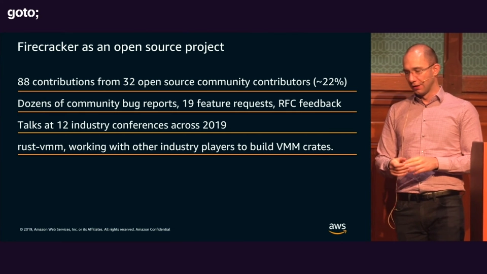

## 六、这套取舍在真实系统里长什么样

设备最小化的收益最终要落到"能不能把机器塞满"上。演讲后半段给了两个对照。

**改造前**：Fargate 用 EC2 实例当安全边界，一个任务一台实例。但 Fargate 最小的规格是 0.25 vCPU / 0.5 GB，而"没有哪种 EC2 实例提供这么小的内存"，于是背后有大量浪费；同时还要维护一个 EC2 预热池来吸收启动延迟（[【跳转到 31:14】](https://www.youtube.com/watch?v=oKKOBsqQndY&t=1874)）。

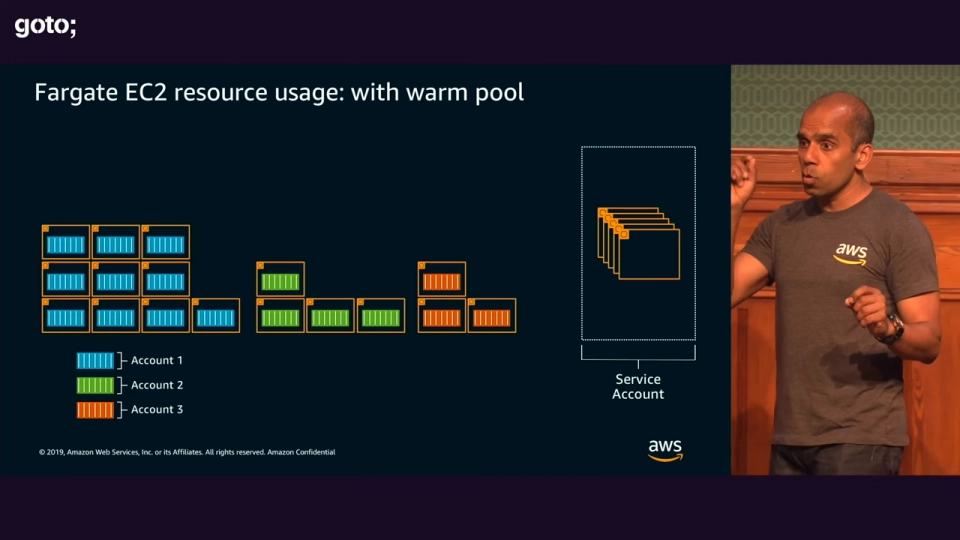

**改造后**：一个任务一台微虚拟机。因为 VMM 开销只有 5 MB，规格可以贴着需求给；因为启动够快，预热池这一层直接去掉了（[【跳转到 32:54】](https://www.youtube.com/watch?v=oKKOBsqQndY&t=1974)）。Arun 给出的结果是 Fargate 累计降价 35% 到 50%。

这条链路值得记住：**设备最小化 → 启动快 + 开销小 → 不需要预热池 + 规格可以贴紧 → 成本下降**。启动时间在这里不是体验指标，是成本结构的一部分。

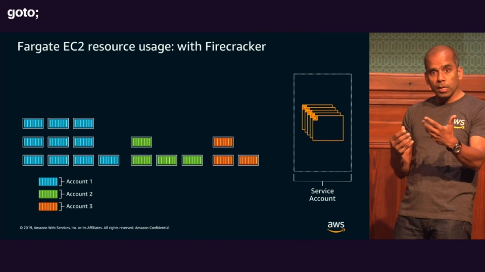

## 小结

- **慢的不是 CPU，是"认识世界"**：客户机启动时要枚举总线、探测驱动、初始化设备，设备越多这一段越长。
- **机器模型 = 客户机环顾四周时看到的世界**：Firecracker 把它压到只剩网络和存储两类 virtio 设备。
- **砍掉的具体清单**：显卡、键盘、软驱、USB/热插拔、电源管理设备。没有电源管理的直接后果是"关机就是 pkill"。
- **因果链**：设备少 → 驱动少 → 初始化少 → 启动快。125 毫秒里大部分花在客户机操作系统启动上，VMM 自身开销很小。
- **反证**：同一套 VMM 换成 unikernel（OSv），启动时间从 125 毫秒掉到 5 毫秒——说明剩下那部分只能靠换客户机形态来消除。
- **副产品**：每台 VMM 不到 5 MB、单机每秒 150 台、攻击面小。安全和速度在这里是同一个设计的两面。
- **代价**：没有 GPU / USB / 热插拔 / 电源管理，跑不了需要完整 PC 平台的操作系统，定位是专用工具而非通用虚拟机。
- **纪律**：拒绝功能请求和接受功能请求一样多；性能来自"守住缺点"，不是来自突破性创新。

## 关键术语速查

| 术语 | 一句话解释 |
| --- | --- |
| VMM（虚拟机监视器） | 用户态那个"给客户机造出硬件"的程序，QEMU 和 Firecracker 都属于这一类 |
| 机器模型（machine model） | 客户机操作系统启动时能看到的设备与平台的全集 |
| 设备模型（device model） | VMM 里具体实现每个设备行为的那部分代码 |
| 半虚拟化 / virtio | 客户机知道自己身处虚拟机，用约定好的共享内存队列与宿主通信，而不是模拟真实硬件 |
| 全模拟设备 | VMM 假装成某个真实型号的硬件，客户机每次访问都要陷入 VMM，慢且攻击面大 |
| 微虚拟机（MicroVM） | 只暴露最小设备集、因而能百毫秒级启动的虚拟机 |
| 预热池（warm pool） | 提前备好一批已启动的实例，用来掩盖启动延迟；启动够快就不需要它 |
| unikernel / OSv | 应用与内核编译成一体的客户机形态，没有"通用内核启动"这一步 |
| Rust-VMM | 一套可复用的虚拟化组件库，用来拼装定制 VMM，而不是往 Firecracker 里加设备 |