# 每台 3 MB 与每台 130 MB：MicroVM 的固定内存开销由什么构成

> 视频来源：[Read a paper: The VM that powers Amazon's Lambda](https://www.youtube.com/watch?v=ei2axGlKMGw)（YouTube · Vivek Haldar）｜时长约 11 分钟
> 简要导读：这是一期论文精读，逐段读 NSDI'20 的 Firecracker 论文。本文只取其中与内存有关的那条线：论文把"内存开销"定义成**与 VM 配置大小无关的那部分**，实测 Firecracker 约 3 MB、Cloud Hypervisor 约 13 MB、QEMU 约 130 MB。围绕这三个数字，本文把"固定开销"这个口径、它的构成来源、以及它为什么对小规格实例最致命讲清楚。字幕由本地语音识别生成，术语已按论文画面订正。

## 本讲要解决的核心问题（SCQA）

**背景**：一台虚拟机要吃两份内存。一份是客户机自己要用的——你给实例配 128 MB，它就有 128 MB 可用；另一份是"为了让它跑起来"额外付出的——VMM 进程、客户机内核、设备状态、页表等等。后者不产生任何业务价值，但你必须为它买单。

**冲突**：在按台计费的云上，这份额外内存按"台"计，不按"GB"计。于是一个反直觉的结论出现了：**实例规格越小，这份额外内存的占比越离谱**。论文实测 QEMU 每台 VM 的额外开销约 130 MB——如果你给函数配的正是 128 MB 内存，那么你付的钱里有一半以上买的不是你的代码，而是模拟一台 PC 的那套东西。

**疑问**：这 130 MB 到底花在哪？为什么 Firecracker 能压到 3 MB？这份开销和"你给 VM 配多大内存"是什么关系？

**回答（中心思想）**：**MicroVM 的内存开销是一个"每台"的常数，而不是"每 GB"的税。** 论文把开销定义为与配置大小无关的那部分，三个 VMM 分别是约 3 MB、约 13 MB、约 130 MB。差距的来源不是"谁的内存管理更聪明"，而是"每台 VM 要背多少结构"：VMM 进程本身的代码与数据结构、模拟出来的设备、客户机内核的常驻部分、以及固件与设备状态。因为它是常数，所以规格越小、占比越高；也正因为它是常数，把它从 130 MB 压到 3 MB，等于把"能塞进一台物理机的实例数"提高一到两个数量级。

## 一、先把"内存开销"定义清楚

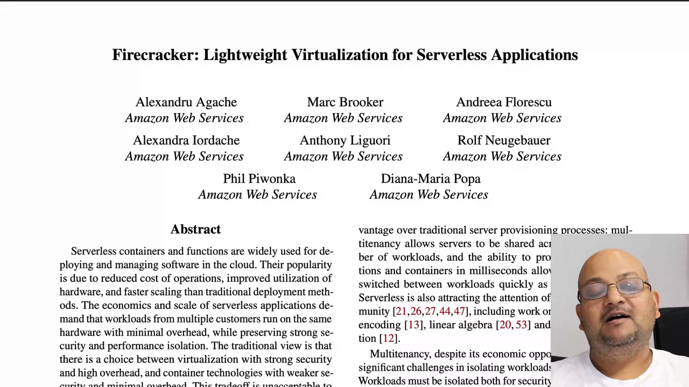

### 1.1 论文的原话：VMM 和客户机内核在"干正事之前"就要吃掉内存

视频读到论文第 2 节时，高亮了一句关键定义（[【跳转到 06:35】](https://www.youtube.com/watch?v=ei2axGlKMGw&t=395)）：

> "The VMM and kernel associated with each guest consumes some amount of CPU and memory before it does useful work, limiting density."

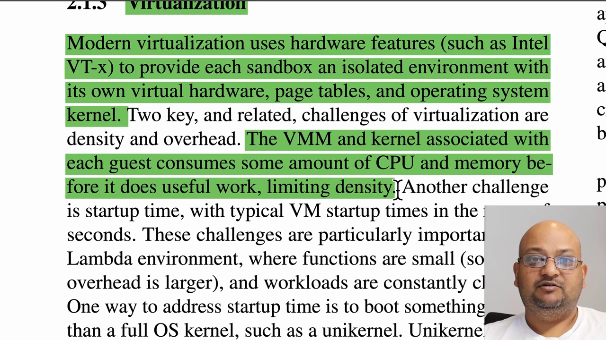

这句话把"内存开销"拆成了两个主语：**VMM** 和**客户机内核**。注意它说的是"每个客户机对应的"，也就是这两份东西是**按台**计的固定成本，与客户机里跑什么、配多大内存无关。这句话的后半句"limiting density（限制密度）"才是重点：在无服务器场景里，密度就是钱。

### 1.2 测量口径：排除 VMM 二进制本身，再用 `free` 交叉验证

视频读到论文第 5 节的测量部分时，画面里给出了完整的口径（[【跳转到 10:36】](https://www.youtube.com/watch?v=ei2axGlKMGw&t=636)）：

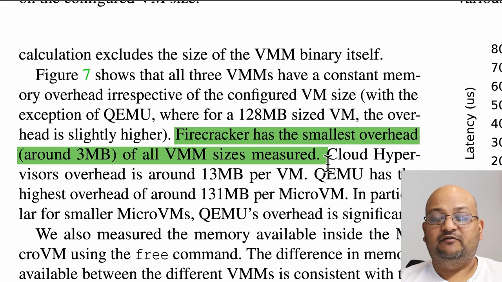

这段文字里有四个必须记住的细节：

1. **"constant memory overhead irrespective of the configured VM size"**——不管你把 VM 配成 128 MB 还是更大，额外开销基本不变。这就是"常数开销"的定义。
2. **口径排除 VMM 二进制本身**（"this calculation excludes the size of the VMM binary itself"）。这一点很容易被忽略：程序文件在磁盘上占的空间，和它运行时占的内存（RSS）不是一回事，论文只算后者。所以"3 MB"说的是**运行时**的开销，不是"Firecracker 二进制只有 3 MB"。
3. **QEMU 在 128 MB 规格时开销略高**——唯一的例外，说明 QEMU 的开销里有一部分会随配置微微变化（比如它要为客户机内存维护更多结构）。
4. **用客户机内的 `free` 命令交叉验证**——从 VM 内部看"还剩多少内存可用"，差值应当与从宿主机侧测到的开销一致。这是排除测量误差的常用手法：两侧对得上，数字才可信。

### 1.3 为什么"常数"这个词比具体数字更重要

如果开销是"每 GB 收 5%"的税，那么大小实例的性价比是一样的，谁也不会特别在意。但开销是**常数**，占比就变成了：

$$
\text{开销占比} = \frac{C_{\text{固定}}}{C_{\text{固定}} + M_{\text{客户机}}}
$$

其中 $C_{\text{固定}}$ 是每台的固定开销，$M_{\text{客户机}}$ 是你配置的客户机内存。取 $C_{\text{固定}} = 130\ \text{MB}$（QEMU）、$M_{\text{客户机}} = 128\ \text{MB}$，占比是 **50%**；取 $M_{\text{客户机}} = 4\ \text{GB}$，占比就降到约 **3%**。同一个 VMM，在小实例上是灾难，在大实例上无所谓。**这就是为什么"固定开销"这件事只在 MicroVM / 无服务器语境下才被当成头号问题。**

## 二、三个数字：3 MB、13 MB、131 MB

### 2.1 同一张图上的三个 VMM

论文把三个 VMM 放在同一套方法下测量（[【跳转到 10:29】](https://www.youtube.com/watch?v=ei2axGlKMGw&t=629)、[【跳转到 10:36】](https://www.youtube.com/watch?v=ei2axGlKMGw&t=636)）：

| VMM | 每台 VM 的固定内存开销 | 相对 Firecracker |
| --- | ---: | ---: |
| Firecracker | 约 3 MB | 1 倍 |
| Cloud Hypervisor | 约 13 MB | 约 4 倍 |
| QEMU | 约 131 MB | 约 40 倍 |

视频里主播的说法更直白："QEMU 差不多大了两个数量级，达到 130 兆字节"（[【跳转到 10:29】](https://www.youtube.com/watch?v=ei2axGlKMGw&t=629)）。注意这三个数字都来自**同一篇论文、同一套测量方法**，所以它们之间可以直接比较；如果拿不同来源的数字互相比，往往会因为口径不同（算不算二进制、算不算客户机内核、算不算页表）而差出好几倍。

### 2.2 两个数量级意味着什么

把开销换算成密度就很直观。论文的结论是（[【跳转到 10:50】](https://www.youtube.com/watch?v=ei2axGlKMGw&t=650)）：

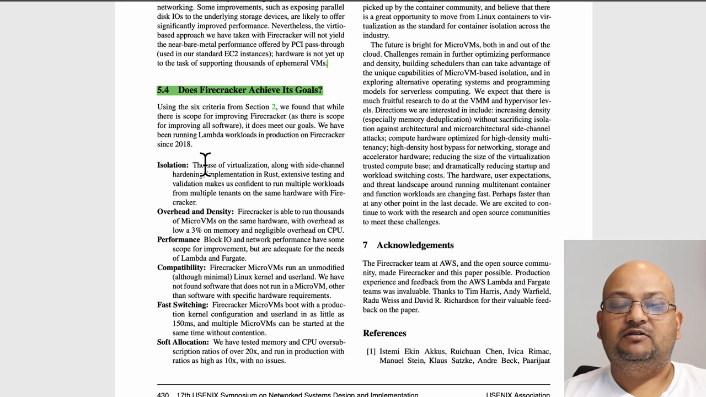

- "Firecracker is able to run **thousands of MicroVMs** on the same hardware"——同一台机器上数千台；
- "with overhead as low as **3% on memory** and negligible overhead on CPU"——内存开销低到 3%；
- 论文还给出了超卖比例："memory and CPU oversubscription ratios of over **20x**"——20 倍以上的超卖。

这三点是同一个事实的三个侧面：**固定开销足够小，密度才可能高；密度足够高，超卖才有意义。** 如果每台 VM 光 VMM 就要 130 MB，那么一台 256 GB 内存的机器上，还没跑任何业务，光 VMM 就吃掉 2000 台 × 130 MB ≈ 260 GB——机器已经满了。

## 三、开销从哪来：四块结构

论文没有给出一张"3 MB 的饼图"，但视频读到的几段文字已经把构成讲清楚了。把散落的线索归拢，固定开销大致来自四块。

### 3.1 第一块：VMM 进程本身——代码量决定常驻集

视频在讲虚拟化的三个问题时，给了一个对比（[【跳转到 06:58】](https://www.youtube.com/watch?v=ei2axGlKMGw&t=418)）：

> "QEMU has nearly **one and a half million lines of code** and uses about **270 kernel system calls**."

代码量大不一定等于内存占用大，但两者强相关：代码段要映射进进程、静态数据要占页、为各种设备准备的数据结构和缓冲区要占堆、处理这些设备的线程要有栈。QEMU 模拟的设备越多，这些"常驻的骨架"就越大。

Firecracker 的做法是**从源头砍**。视频读到它的实现来源（[【跳转到 09:38】](https://www.youtube.com/watch?v=ei2axGlKMGw&t=578)）：

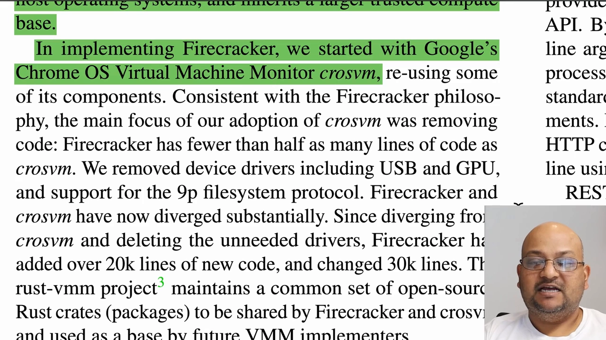

> "the main focus of our adoption of crosvm was removing code: Firecracker has **fewer than half as many lines of code** as crosvm. We removed device drivers including **USB and GPU**, and support for the **9p filesystem protocol**."

删掉 USB、GPU、9p，不只是删掉几段代码，而是删掉了这些设备对应的**状态机、缓冲区、线程和数据结构**——也就是删掉了它们的内存开销。

### 3.2 第二块：设备模型——模拟的东西越少，要记的状态越少

视频读到论文第 3 节开头时，画面里列出了 Firecracker 保留的全部设备（[【跳转到 08:00】](https://www.youtube.com/watch?v=ei2axGlKMGw&t=480)）：

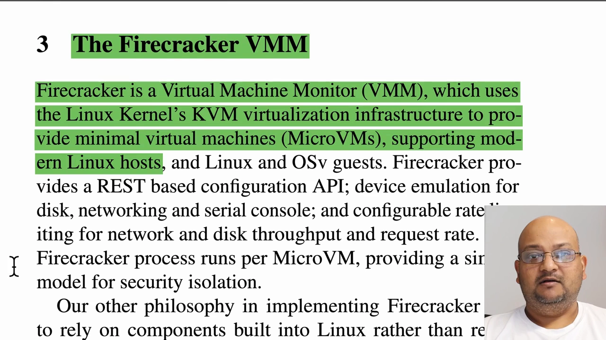

> "device emulation for **disk, networking and serial console**"

只有三样。对比 QEMU：它要模拟一整套 PC——BIOS、PCI 总线与配置空间、IDE/SCSI 控制器、VGA、USB、PS/2 键盘鼠标……每一样设备都有寄存器状态、DMA 缓冲、队列和中断逻辑。**每多模拟一个设备，就多一份"每台 VM 都要付"的常数。** 这就是为什么"设备最小化"既是启动时间的手段，也是内存开销的手段——它们是同一个设计的两个结果。

### 3.3 第三块：客户机内核的常驻部分

论文那句"VMM **and kernel** associated with each guest"（[【跳转到 06:35】](https://www.youtube.com/watch?v=ei2axGlKMGw&t=395)）提醒我们：客户机内核也是开销的一部分。内核映像本身、页表、每个内核线程的栈、slab 缓存、以及各个子系统初始化时分配的结构，都要在客户机内存里占一块。一台 MicroVM 的客户机内核再精简，也是几 MB 到几十 MB 的量级。

这也解释了论文为什么强调"**unmodified (although minimal) Linux kernel**"：它不要求你换一个特殊内核，但要求你把内核配置裁剪到最小——不编译用不到的驱动、不启用用不到的特性。每裁掉一个子系统，就少一份常驻内存。

### 3.4 第四块：不重复实现，就不重复占内存

视频读到 Firecracker 的第二个设计哲学（[【跳转到 08:52】](https://www.youtube.com/watch?v=ei2axGlKMGw&t=532)）：

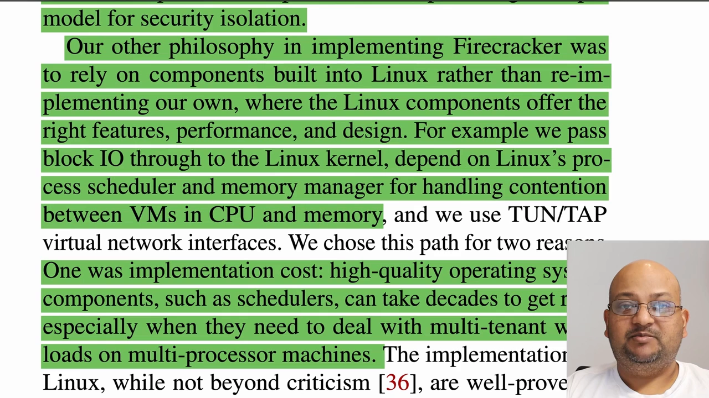

> "we pass block IO through to the Linux kernel, depend on Linux's process scheduler and memory manager for handling contention between VMs in CPU and memory, and we use TUN/TAP virtual network interfaces."

这段话表面上讲的是"少写代码"，实际上讲的是"少占内存"：如果 VMM 自己实现一套 IO 调度、一套内存回收、一套网络栈，那么每一台 VM 的 VMM 进程里都要装一份这些结构。把它们推给宿主内核，就变成**全机共享一份**——内核的页缓存、slab、网络缓冲是所有 VM 共用的，不再按台复制。

同一段文字里还有一句关键的架构事实：**"One Firecracker process runs per MicroVM"**。一进程一台 VM 意味着开销是**可观测、可计量**的：在宿主上 `ps`、`top`、`vmstat` 看到的 RSS，就是这台 VM 的 VMM 开销（[【跳转到 09:04】](https://www.youtube.com/watch?v=ei2axGlKMGw&t=544)）。这也解释了为什么论文能用"每台 VM 的 RSS"来做测量——如果多个 VM 共享一个进程，这笔账根本算不清。

## 四、把账算到底：为什么这件事只在"小"的时候要命

### 4.1 固定开销 vs 边际开销

把上面四块归一下类，会发现它们有一个共同点：**都不随 vCPU 数量或内存大小线性增长**。多给一个 vCPU，增加的是 KVM 里那份 vCPU 状态和它的内核栈；多给 1 GB 内存，增加的是客户机自己的页和对应的页表。这些是**边际成本**。而 VMM 的代码段、设备模型、内核映像、固件状态是**每台都要付一次的固定成本**。

这解释了为什么 MicroVM 的设计目标是"把每 VM 的固定成本压到几 MB"，而不是"把每 GB 的成本压低几个百分点"：在函数计算里，**实例本身可能只有几十 MB，固定成本才是主要矛盾**。

### 4.2 三个数字背后的工程取舍

| 设计选择 | 对固定内存开销的影响 | 视频里的依据 |
| --- | --- | --- |
| 只模拟磁盘、网络、串口 | 设备状态与缓冲按台减少 | [08:00](https://www.youtube.com/watch?v=ei2axGlKMGw&t=480) |
| 从 crosvm 裁剪，删 USB/GPU/9p | 代码段与相关结构减少 | [09:38](https://www.youtube.com/watch?v=ei2axGlKMGw&t=578) |
| 复用 Linux 的 IO、调度、内存管理、TUN/TAP | 不在每台 VMM 里复制一份 | [08:52](https://www.youtube.com/watch?v=ei2axGlKMGw&t=532) |
| 一进程一台 MicroVM | 开销可观测、可计量、可限额 | [08:52](https://www.youtube.com/watch?v=ei2axGlKMGw&t=532) |
| 精简客户机内核配置 | 内核常驻集减少 | [06:35](https://www.youtube.com/watch?v=ei2axGlKMGw&t=395) |

### 4.3 代价：省下来的内存，是拿可移植性和 TCB 换的

视频没有把这件事说成"免费的午餐"。读到论文的取舍时，主播特意停了一下（[【跳转到 09:23】](https://www.youtube.com/watch?v=ei2axGlKMGw&t=563)）：

> "they deliberately are sacrificing some amount of **portability** and inheriting a slightly **larger trusted computing base**."

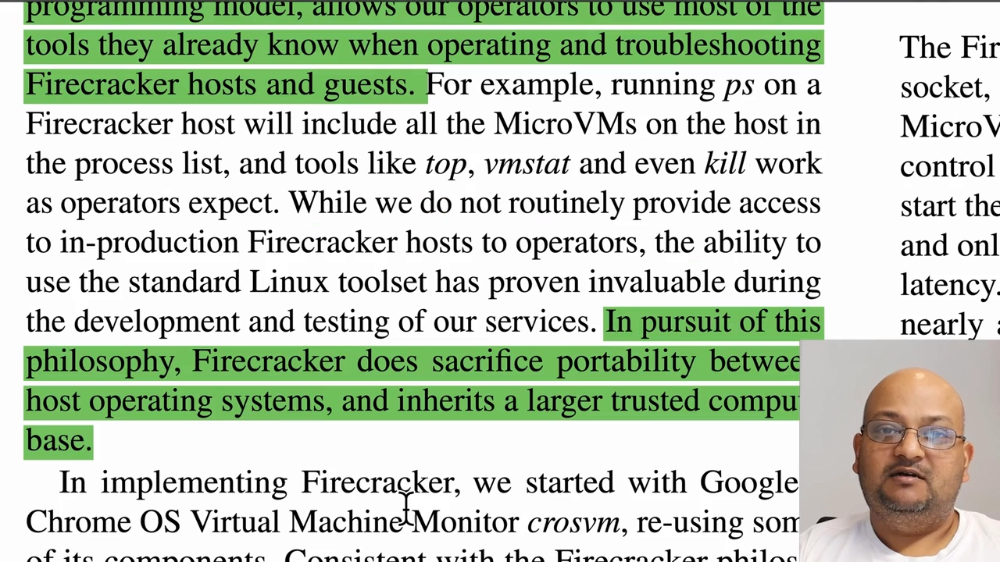

依赖宿主 Linux 意味着：它只能跑在 Linux 上（可移植性下降），而且宿主内核成了攻击面的一部分（TCB 变大）。**"把结构推给内核"省下了每台 VM 的内存，但也把信任边界往外扩了一圈。** 这是 MicroVM 设计里最典型的一组对冲：内存与密度 ↔ 可移植性与信任边界。

## 五、把这条线放回整个设计里

视频前半段铺垫了为什么需要 MicroVM（[【跳转到 01:58】](https://www.youtube.com/watch?v=ei2axGlKMGw&t=118)）：

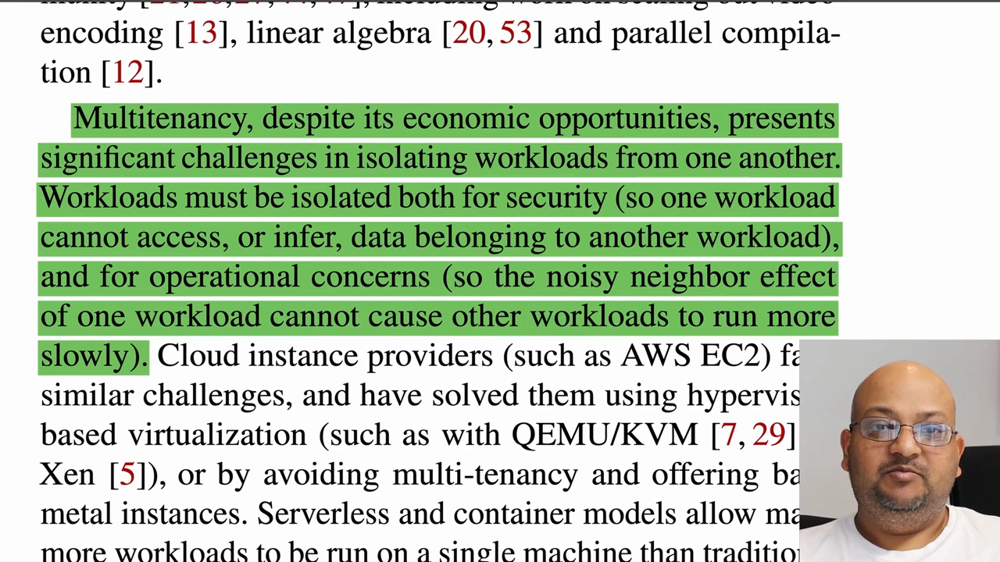

以及容器为什么不够（[【跳转到 04:45】](https://www.youtube.com/watch?v=ei2axGlKMGw&t=285)）：

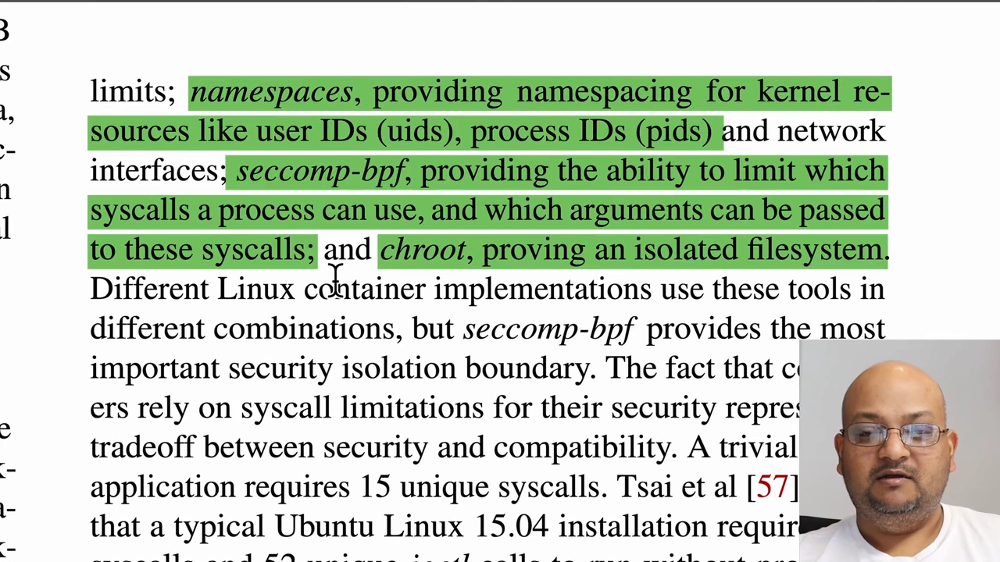

把这两段和内存这条线接起来，逻辑就闭环了：

1. 无服务器要**多租户**，所以要硬件级隔离 → 必须用虚拟机；
2. 传统虚拟机每台固定开销 130 MB、启动 200 ms 以上 → 密度和冷启动都受不了；
3. 于是把"每台要背的结构"砍到最小：设备只剩三个、代码砍一半、能推给内核的都推给内核；
4. 结果：固定开销 3 MB、启动 100~130 ms（[【跳转到 10:04】](https://www.youtube.com/watch?v=ei2axGlKMGw&t=604)）、单机数千台。

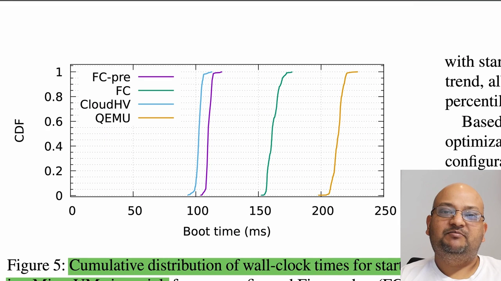

顺带说一句：这张图里 Cloud Hypervisor 的启动时间比 Firecracker 还略快，但它的内存开销是 13 MB。**启动时间和内存开销不是同一个指标，也不是同一套优化能同时压到最低的**——这也是为什么同一篇论文里要分别测、分别报。

## 小结

- **定义**：内存开销指"与 VM 配置大小无关"的那部分——VMM 与客户机内核在干正事之前就要吃掉的内存，论文明确排除了 VMM 二进制本身，并用客户机内 `free` 交叉验证。
- **三个数字**：Firecracker 约 3 MB、Cloud Hypervisor 约 13 MB、QEMU 约 131 MB；后两者分别是它的约 4 倍和约 40 倍。
- **它是常数**：占比 = 固定开销 /（固定开销 + 客户机内存）。128 MB 实例上 QEMU 的开销占比可达一半，4 GB 实例上就只剩几个百分点——所以固定开销只在"小"的时候要命。
- **四块构成**：VMM 进程本身（代码量、数据结构、线程栈）、设备模型（模拟的每个设备都要一份状态与缓冲）、客户机内核常驻部分、以及"不重复实现"省下的那部分（IO、调度、内存管理、网络都推给宿主内核，全机共享一份）。
- **可观测性**：一进程一台 MicroVM，`ps`/`top`/`vmstat` 看到的 RSS 就是这台 VM 的 VMM 开销，这也是论文能按台测量的前提。
- **代价**：省内存靠的是依赖宿主 Linux，换来的是可移植性下降与 TCB 变大。
- **收益**：单机数千台、内存开销低至 3%、超卖 20 倍以上。

## 关键术语速查

| 术语 | 一句话解释 |
| --- | --- |
| MicroVM | 只保留最小设备集、启动在百毫秒级的虚拟机，典型实现是 Firecracker |
| VMM | 虚拟机监视器，用户态那个"管着一台 VM"的进程；Firecracker 里一进程一台 |
| 固定内存开销 | 每台 VM 都要付、且不随配置大小变化的那部分内存，本文的主角 |
| 边际内存开销 | 多给一个 vCPU 或 1 GB 内存才增加的那部分，与固定开销相对 |
| RSS | 常驻集大小，进程当前真正占着的物理内存；论文测的就是 VMM 进程的 RSS |
| 客户机内核常驻集 | 客户机内核映像、页表、内核线程栈、slab 等长期占用的内存 |
| 设备模型 | VMM 里模拟出来的设备（磁盘、网卡、串口……），每个设备都要状态与缓冲 |
| TCB | 可信计算基，安全上必须信任的代码集合；依赖宿主内核会让它变大 |
| 超卖（oversubscription） | 分配的 CPU/内存总量超过物理资源，靠"不是所有负载同时满负荷"来兑现 |
| 密度 | 一台物理机上能同时跑多少台实例，MicroVM 的核心指标之一 |