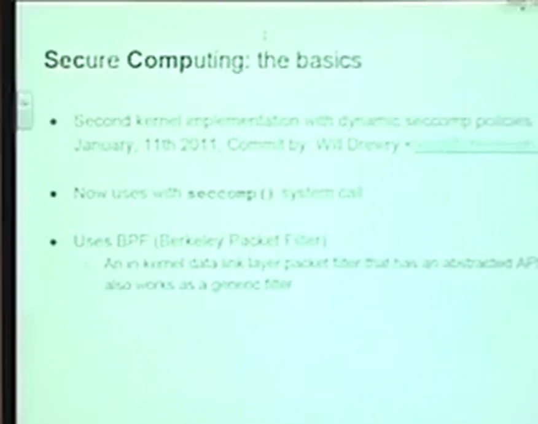
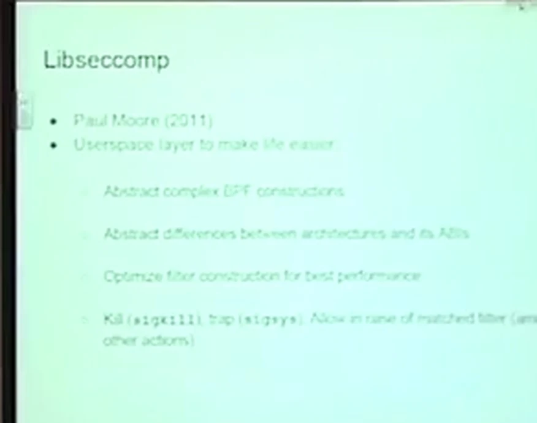
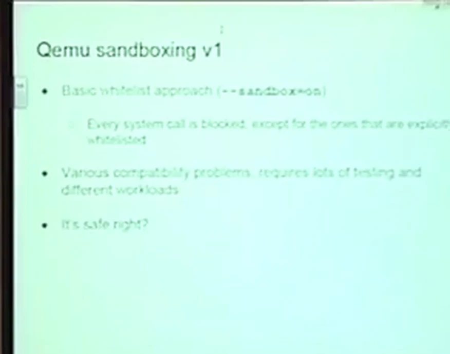
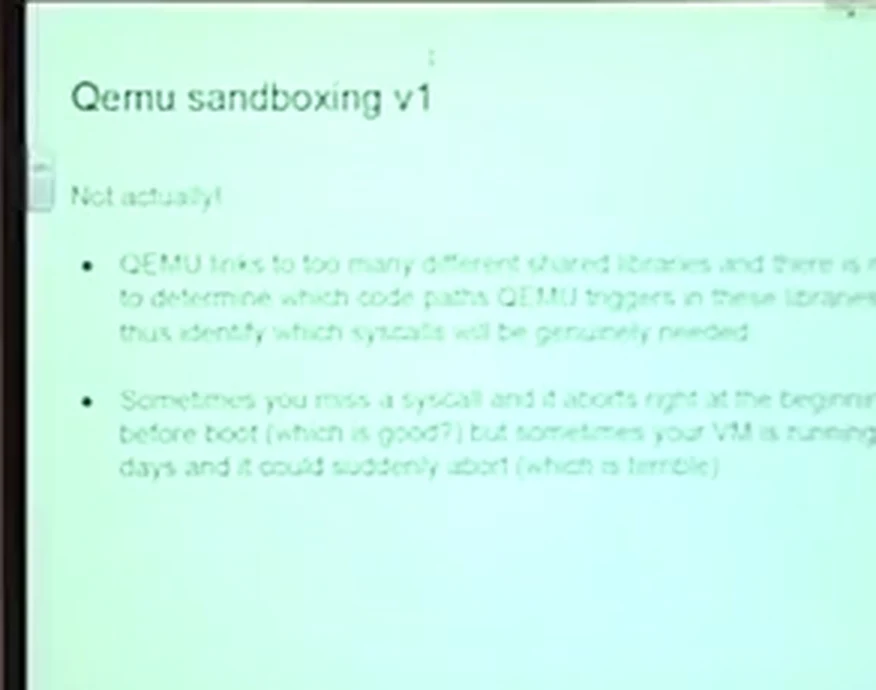
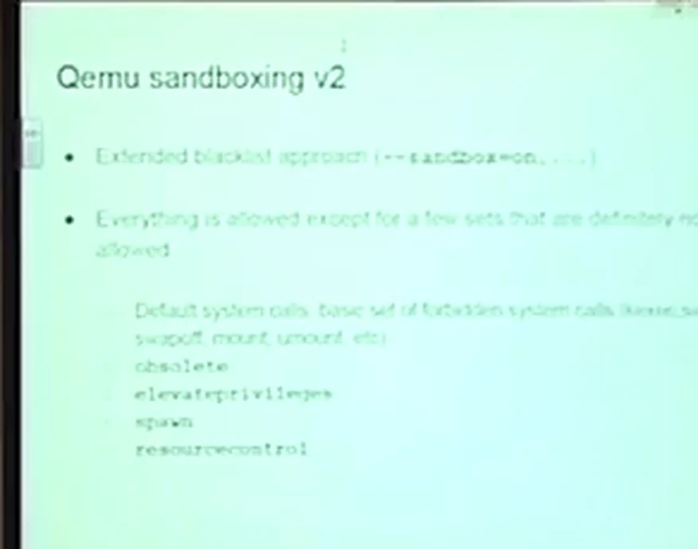
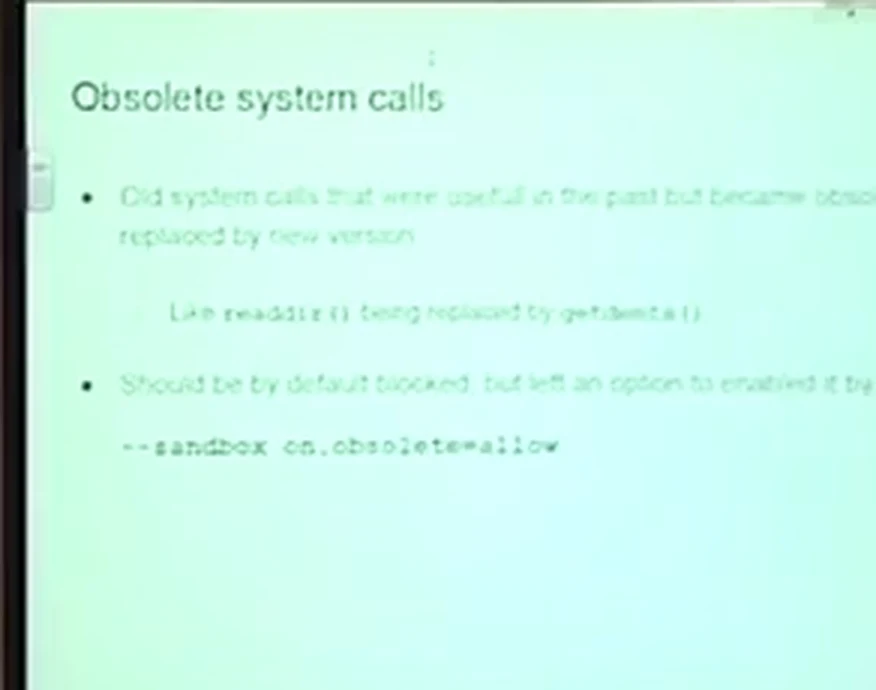
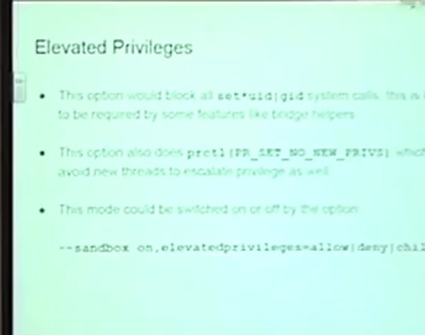
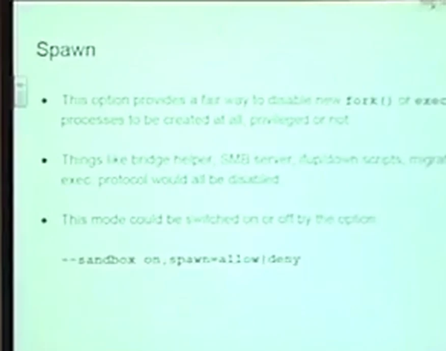
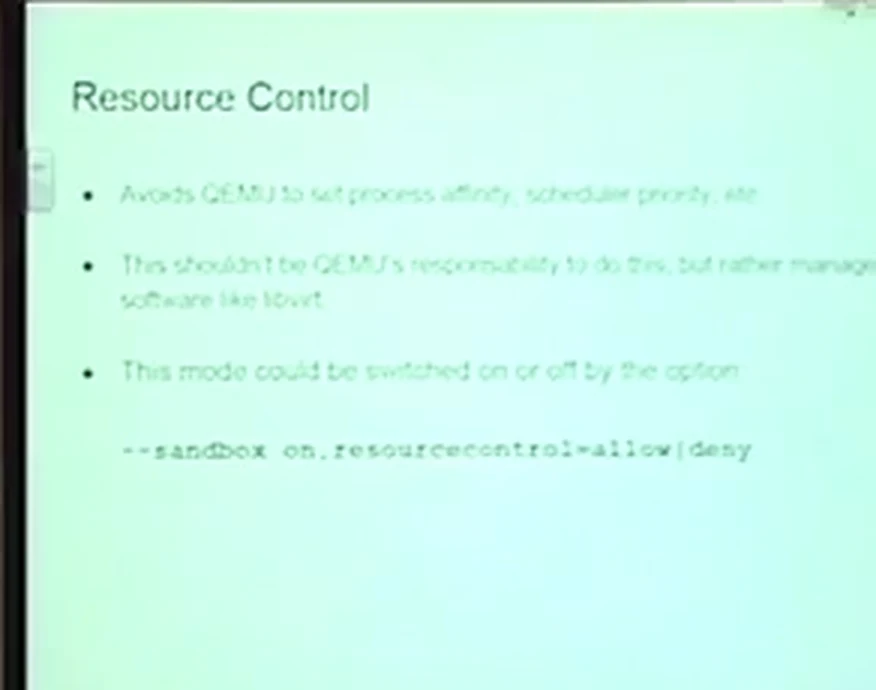
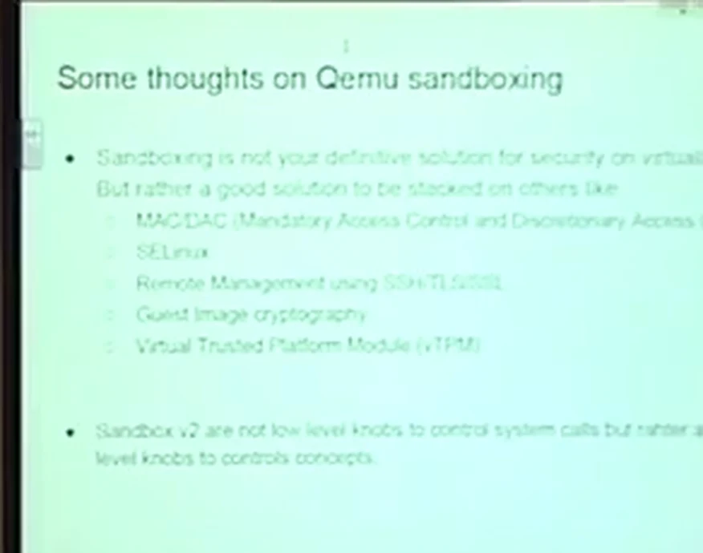

# VMM 的 seccomp 沙箱：把系统调用收成一张白名单

> 视频来源：[Eduardo Otubo: Qemu Sandboxing for dummies](https://www.youtube.com/watch?v=_7yGiafZdVc)（YouTube · DevConf 2018，讲者 Eduardo Otubo，Red Hat）
> 导读：这是一场 2018 年的 22 分钟演讲，讲者本人是 QEMU seccomp 沙箱的维护者之一。他从内核的 seccomp 机制讲起，一路讲到 QEMU 沙箱 v1 的"白名单"为什么失败、v2 的"分组黑名单"为什么更好。本文按这条线索组织，并补上它在 MicroVM 场景里的位置。

## 本讲要解决的核心问题（SCQA）

**背景**：一台虚拟机跑起来后，客户机内核和里面的进程都在 VMM（虚拟机监视器，这里指 QEMU 这样的宿主用户态进程）的控制之下。VMM 要替客户机模拟设备、转发 IO，因此它必须不断读取客户机发来的数据。

**冲突**：客户机是不可信的。攻击者可以先拿下客户机内核，再构造畸形请求去打 VMM。而 VMM 在宿主上只是一个普通用户态进程——一旦它被攻破，攻击者就拿到了"宿主上的一个普通用户"，可以读文件、开网络连接、执行命令。

**疑问**：既然 VMM 里迟早会有漏洞，能不能在"VMM 被攻破"之后，把攻击者能做的事情限制到最小？

**回答（中心思想）**：能，而且最划算的一刀砍在**系统调用**上。VMM 真正需要的系统调用只有几十个，用 seccomp 把它们收成一张白名单，即使 VMM 里存在内存破坏漏洞，攻击者也只能调白名单里的调用，拿不到 `execve`、`open`、`socket` 就难以横向移动。这一层要和 MAC、镜像加密、vTPM 等叠加使用，它是"兜底"，不是"唯一"。

## 一、先看清威胁模型：VMM 是宿主上的一个普通进程

理解 seccomp 的价值，先要理解 VMM 被攻破意味着什么。VMM 不是内核模块，也不是特权守护进程，它就是一个普通用户态程序：有文件描述符、有内存映射、有线程。它被攻破，攻击者就获得了这个进程的全部能力——按照进程当前的身份去读写文件、建立连接。

所以防御的目标不是"让 VMM 不出漏洞"（做不到），而是**让 VMM 出漏洞之后的爆炸半径变小**。演讲里给出的答案是层层叠加：

- 语言与代码层面：少写代码、少解析不可信输入；
- 进程层面：降权、chroot、命名空间、cgroup；
- 系统调用层面：seccomp 白名单。

本文只讲最后一层，也就是讲者最熟的那一层。

## 二、seccomp 是什么：从四个系统调用到一张可编程的过滤器

### 2.1 第一版：只允许四个系统调用

seccomp（secure computing mode）是内核里的一个特性，作用是**限制用户态程序能发起哪些系统调用**。第一版非常简陋：只允许 `exit`、`sigreturn`、`read`、`write` 四个，其它任何系统调用都会让进程被直接终止。

[【跳转到 03:03】](https://www.youtube.com/watch?v=_7yGiafZdVc&t=183)

这个设计在 2005 年算个不错的起点，但几乎没有实用价值：稍微复杂一点的程序都要用 `mmap`、`open`、`futex`。讲者的评价是"比没有强"（better than nothing）。

### 2.2 第二版：一份自己写的允许列表

2011 年，Paul Moore 提交了第二版实现。它把"允许哪些系统调用"变成一份**由程序自己提供的列表**，并通过 `seccomp()` 系统调用安装到内核里。实现上用的是 BPF（Berkeley Packet Filter）——原本是数据链路层的包过滤器，因为足够通用，被拿来过滤系统调用。

[【跳转到 04:18】](https://www.youtube.com/watch?v=_7yGiafZdVc&t=258)

BPF 的规则本质上是一段字节码：内核在每次系统调用入口执行它，根据返回值决定放行、返回错误还是杀掉进程。手写这段字节码非常痛苦，讲者在大屏幕上放了一段真实代码，然后说"这并不好读"。

### 2.3 libseccomp：把字节码藏起来

同年出现的 libseccomp 解决了可维护性问题。它把 BPF 的构造细节、不同 CPU 架构与 ABI 的差异、以及过滤器的性能优化都封装起来，使用者只需要按"系统调用 + 动作"的粒度写规则。

[【跳转到 05:58】](https://www.youtube.com/watch?v=_7yGiafZdVc&t=358)

libseccomp 提供几种动作，讲者列了其中三个：`kill`（用 SIGKILL 杀掉）、`trap`（用 SIGSYS 陷入，便于调试）、`allow`（放行）。这几种动作的选择，后面会直接决定沙箱的"性格"。

## 三、QEMU 沙箱 v1：白名单为什么走不通

### 3.1 设计：默认拒绝，逐条放行

QEMU 的第一版沙箱用 `--sandbox=on` 打开，采用最严格的**白名单**模型：除了显式列出的系统调用，其余全部阻断。

[【跳转到 07:38】](https://www.youtube.com/watch?v=_7yGiafZdVc&t=458)

从安全角度看这是最理想的形态。问题出在"白名单该怎么写"上——这份名单从 2011 年起就在维护，讲者坦言它"并不真的安全"。

### 3.2 失败原因：QEMU 链接了太多共享库

原因很朴素：QEMU 依赖大量共享库，你无法穷举它在运行中会走哪些代码路径、进而需要哪些系统调用。

[【跳转到 09:01】](https://www.youtube.com/watch?v=_7yGiafZdVc&t=541)

漏掉一个系统调用的后果有两种：如果它发生在启动早期，QEMU 立刻 abort，用户改配置重来即可，"还算好"；如果它发生在虚拟机已经跑了几天的某个冷门路径上，QEMU 会突然崩溃，这就是事故。讲者用一句话概括这种维护模式的风险：你得下载源码、把调用加进白名单、重新编译、再跑一遍。

## 四、QEMU 沙箱 v2：从"逐条放行"改成"分组禁止"

### 4.1 设计：默认允许，只禁掉确定不该做的

第二版换了思路：**默认允许，只禁止那些确定不该由 QEMU 做的事**。演讲里把它称为"扩展黑名单"（extended blacklist），入口是 `--sandbox=on,...`。

[【跳转到 10:21】](https://www.youtube.com/watch?v=_7yGiafZdVc&t=621)

默认禁止的是一小撮"QEMU 在任何情况下都不该用"的调用，例如 `kexec`（换内核）、`swapon`/`swapoff`、`mount`/`umount`。除此之外，v2 把剩下的策略拆成四个**概念级开关**，每个开关都可以取 `allow`、`deny` 或"只对子进程生效"：

| 开关 | 禁掉什么 | 典型受影响的功能 |
| --- | --- | --- |
| `obsoletesyscalls` | 已被新版本取代的老调用，如 `readdir` 被 `getdents` 取代 | 只在很老的宿主系统上才有意义 |
| `elevatedprivileges` | 所有 `set*uid`、`set*gid` 一类提权调用，并设置 `PR_SET_NO_NEW_PRIVS` | bridge helper 等需要特权的辅助程序 |
| `spawn` | `fork`、`exec` 一类创建新进程的调用 | bridge helper、SMB server、网卡 up/down 脚本、迁移时的 exec 协议 |
| `resourcecontrol` | 设置 CPU 亲和、调度优先级的调用 | 这类事本应由 libvirt 等管理层负责 |

### 4.2 逐个看这四个开关

**obsolete syscalls**：把历史上存在、如今已被替代的调用禁掉。讲者举的例子是 `readdir` 被 `getdents` 取代。这类开关的价值主要在于兼容老系统时可以放行。

[【跳转到 11:11】](https://www.youtube.com/watch?v=_7yGiafZdVc&t=671)

**elevated privileges**：这一组最有意思。它不仅阻断 `set*uid`/`set*gid` 系列，还会调用 `prctl` 的 `PR_SET_NO_NEW_PRIVS`——这个标志告诉内核：本进程及其后代永远不能通过 setuid 程序获得新特权。也就是说，即使攻击者能在 VMM 里执行代码，也没法借一个 setuid root 的二进制翻身。

[【跳转到 11:36】](https://www.youtube.com/watch?v=_7yGiafZdVc&t=696)

**spawn**：最干脆的一组——直接禁掉 `fork` 和 `exec`。代价是依赖"再起一个进程"的功能全部失效：bridge helper、SMB server、网卡 up/down 脚本、迁移时通过 exec 启动对端，都会被打断。

[【跳转到 12:01】](https://www.youtube.com/watch?v=_7yGiafZdVc&t=721)

**resource control**：禁止 QEMU 自己去设 CPU 亲和和调度优先级。讲者的观点是这本来就不该是 QEMU 的职责，应该交给 libvirt 这类管理软件——把职责边界划清，也就顺手把对应的系统调用关掉了。

[【跳转到 13:16】](https://www.youtube.com/watch?v=_7yGiafZdVc&t=796)

### 4.3 为什么是"概念开关"而不是"系统调用开关"

v2 的规则表里，每条规则右边都标着它属于哪个组。讲者特意强调：v2 不是给用户一堆底层系统调用的旋钮，而是给出**概念级**的开关（我要不要提权？我要不要起子进程？），由维护者在源码里把概念翻译成具体调用。

这个取舍在问答环节被追问过：为什么不给用户细粒度控制？讲者的回答很直接——如果把过滤器做成命令行参数或运行时配置，用户配错就等于自己开了个洞，这"不再安全"；所以规则必须**硬编码在源码里**，跟着编译和打包一起发布。想改就发补丁到邮件列表。

[【跳转到 17:08】](https://www.youtube.com/watch?v=_7yGiafZdVc&t=1028)

## 五、seccomp 不是终点，而是"叠在最上面的一层"

演讲最后放了一页"一些想法"，把定位讲得很清楚：沙箱不是虚拟化安全的终极方案，它应该**叠加**在其它机制之上。

[【跳转到 13:41】](https://www.youtube.com/watch?v=_7yGiafZdVc&t=821)

讲者列出的同层伙伴包括：

- **MAC/DAC**：强制访问控制与自主访问控制，例如 SELinux——它限制的是"能碰哪些文件、能连哪些端口"，和 seccomp 限制"能调哪些系统调用"正好互补；
- **远程管理走 SSH/TLS**：管理通道本身要加密和认证；
- **客户机镜像加密**；
- **vTPM**：给客户机提供可信平台模块，做度量与密钥保护。

这也解释了为什么 seccomp 值得单独做一层：它管的维度（系统调用）和上面这些机制管的维度（文件、网络、身份、密钥）几乎不重叠，叠起来才形成纵深。

## 六、回到 MicroVM：这一层为什么更关键

把这场 2018 年的演讲放回 MicroVM 的语境，会看到两个加强：

1. **代码面本来就小，白名单才写得出来**。QEMU 的困境是"链接了太多共享库、代码路径无法穷举"，所以只能退回黑名单。而 Firecracker 这类 MicroVM 只保留 virtio-net、virtio-block 等少数设备，代码量小、依赖少，才有可能维护一份真正的白名单（Firecracker 的 seccomp 过滤器就是默认拒绝，只放行几十个系统调用，并对 `ioctl` 的第一个参数做白名单校验）。
2. **进程级收敛是标配**。MicroVM 的 VMM 通常由 jailer 一类的小程序启动：先以 root 建好 chroot、命名空间、cgroup，再降权、设置 `PR_SET_NO_NEW_PRIVS`、装 seccomp 过滤器，最后 `execve` 成 VMM。也就是说，本文讲的 seccomp 只是这条流水线的最后一环。

换句话说：**缩小代码面**（少设备、内存安全的语言）减少"会不会被攻破"，**缩小系统调用面**（seccomp + 降权 + 命名空间）决定"被攻破之后还能干什么"。两者缺一不可。

## 小结

- VMM 在宿主上只是一个普通用户进程，被攻破就意味着攻击者拿到了这个进程的全部能力；seccomp 的作用是把这份能力砍到最小。
- seccomp v1（2005）只允许 `exit`、`sigreturn`、`read`、`write`，几乎不可用；v2（2011，Paul Moore）允许程序自带允许列表，底层用 BPF 实现。
- 手写 BPF 字节码不可维护，libseccomp 把构造、架构差异和性能优化封装起来，并提供 kill、trap、allow 等动作。
- QEMU 沙箱 v1 用严格白名单，但因为 QEMU 依赖的共享库太多、代码路径无法穷举，漏一个调用就可能在运行数天后崩溃，维护成本极高。
- QEMU 沙箱 v2 改为"默认允许 + 分组禁止"：默认禁掉 `kexec`、`mount` 等，再提供 `obsoletesyscalls`、`elevatedprivileges`、`spawn`、`resourcecontrol` 四个概念级开关，每个可设 allow/deny/仅子进程。
- 规则必须硬编码在源码里，不开放给用户在线配置——可配置的过滤器等于把开洞的权力交给用户。
- seccomp 只是纵深防御的一层，需与 MAC/SELinux、加密的管理通道、镜像加密、vTPM 叠加；在 MicroVM 里它通常与 jailer 的降权、chroot、命名空间、cgroup 一起构成"逃逸后的围栏"。

## 关键术语速查

| 术语 | 一句话解释 |
| --- | --- |
| seccomp | 内核特性，限制进程能发起哪些系统调用 |
| BPF | Berkeley Packet Filter，内核里的通用字节码过滤器，seccomp 用它判断系统调用是否放行 |
| libseccomp | 封装 BPF 构造细节的库，让"系统调用 + 动作"的规则易写易维护 |
| 白名单 / 黑名单 | 默认拒绝只放行列表内（白名单）；默认允许只禁止列表内（黑名单） |
| `PR_SET_NO_NEW_PRIVS` | 告诉内核：本进程及后代永远不能通过 setuid 程序获得新特权 |
| MAC / SELinux | 强制访问控制，限制进程能访问哪些文件、端口等资源 |
| vTPM | 虚拟可信平台模块，给客户机提供度量与密钥保护能力 |
| 纵深防御 | 多层独立机制叠加，任何一层被突破都不足以造成灾难 |