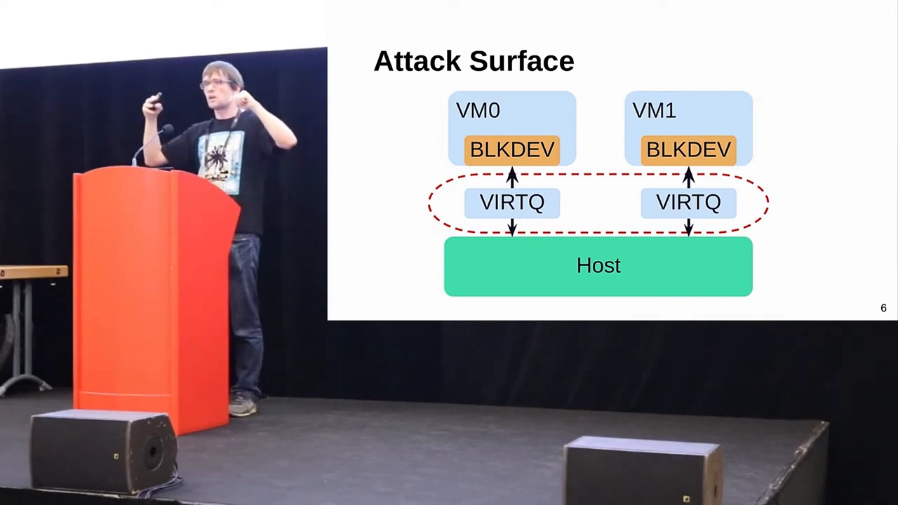
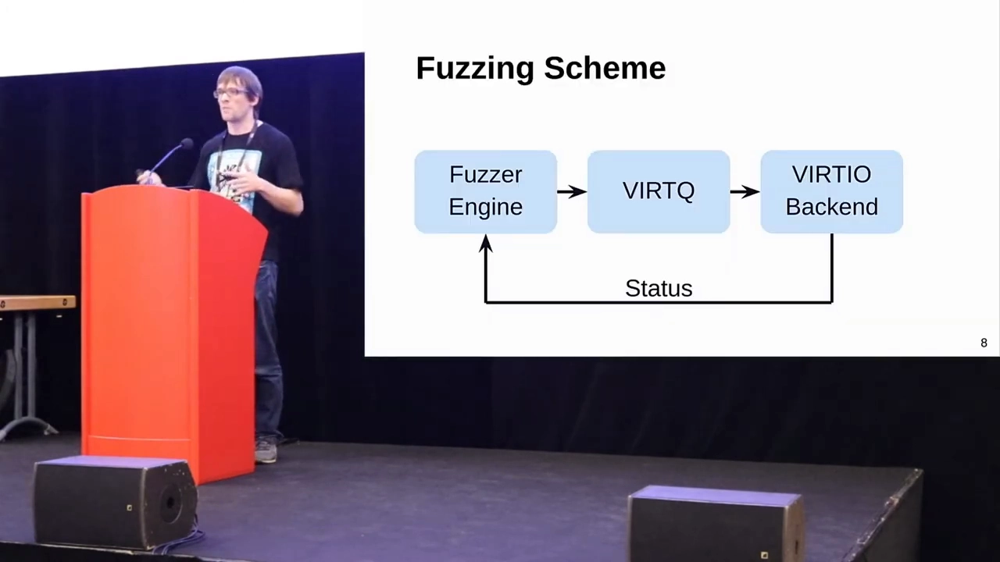
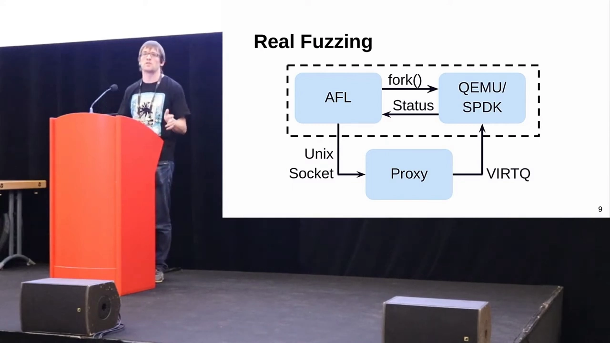
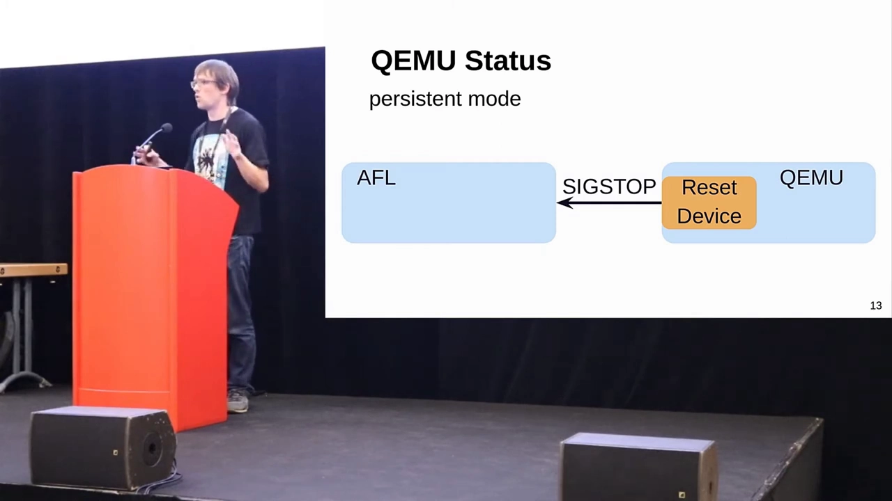
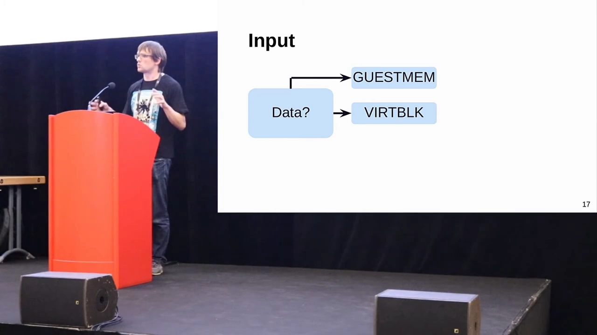
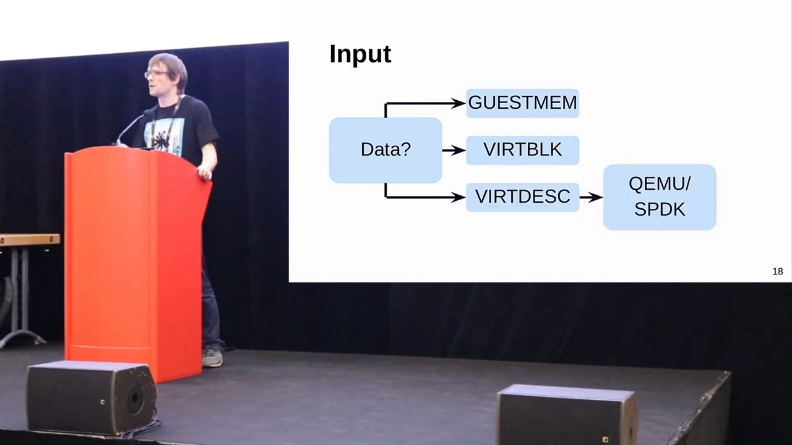
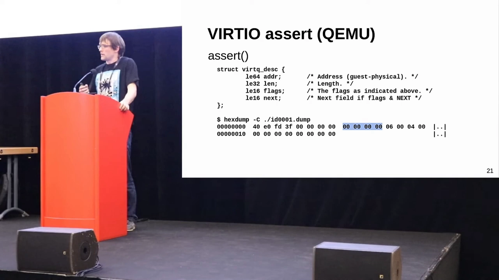
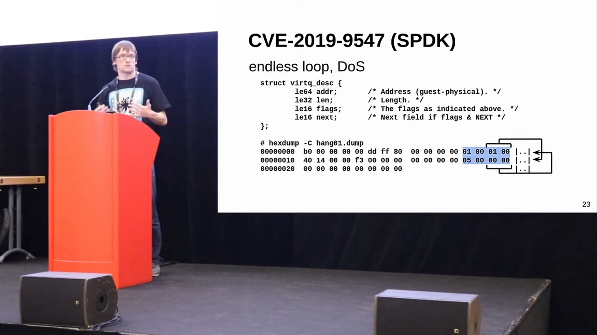
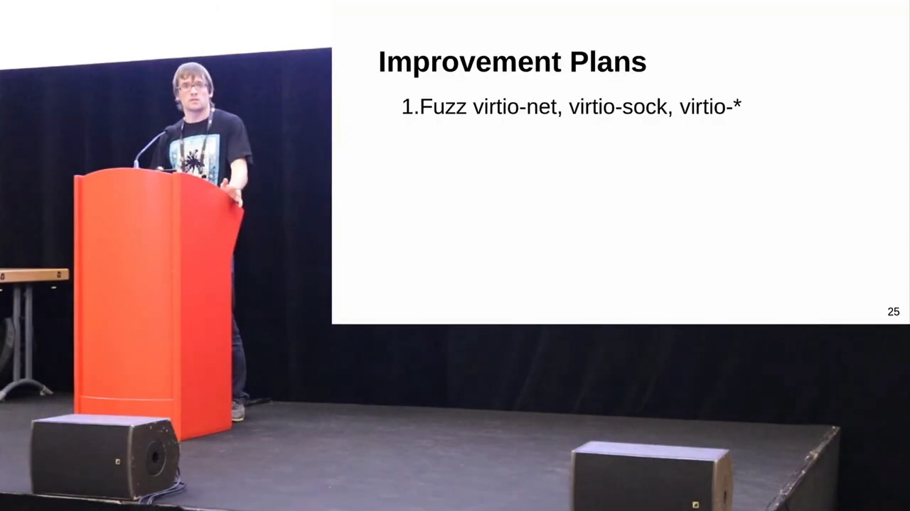

# virtqueue 就是攻击面：用 AFL 给 virtio 设备做 fuzzing

> 视频来源：[Virtio Device Fuzzing by Dmitrii Stepanov](https://www.youtube.com/watch?v=dk6SUD8ovXw)（YouTube · 2019，讲者 Dmitrii Stepanov，Yandex 虚拟化团队）
> 导读：这是一场 25 分钟的工程演讲。讲者所在团队负责 Yandex 公有云平台的 hypervisor，他们要给"客户机可控的那条数据通道"做 fuzzing。本文按"攻击面在哪 → 怎么把 fuzzer 接上去 → 找到了什么"的顺序还原，并补上它对 MicroVM 的含义。

## 本讲要解决的核心问题（SCQA）

**背景**：云上的 hypervisor 要替客户机模拟设备。客户机里的驱动把请求写进一块共享内存（virtqueue），宿主侧的设备后端再把请求读出来执行。

**冲突**：这块共享内存**完全由客户机控制**。客户机里可以是攻击者，他可以把描述符表写成任何形状——长度字段乱填、地址指向别处、描述符链首尾相连成环。宿主侧解析这些数据的代码只要有一处没考虑周全，后果从"虚拟机自己崩"一直到"逃逸到宿主"。

**疑问**：怎么系统性地找出这些解析代码里的漏洞，而不是等别人来打？

**回答（中心思想）**：把 virtqueue 当成一个**文件输入接口**，用覆盖率引导的 fuzzer（AFL）持续喂畸形请求给真实的设备后端（QEMU 和 SPDK），让崩溃自己暴露出来。这套东西必须常驻 CI，因为"什么时候、在哪里发现新问题"是不可预测的。

## 一、攻击面：客户机唯一能"任意写"的地方

讲者先把威胁模型摆清楚。Yandex 一年前上线公有云平台，团队的目标是"宿主相对于虚拟机的安全"——防止客户的错误操作导致内存泄漏、DoS，甚至 VM escape。

而虚拟机能影响宿主的所有途径里，最直接的一条是**模拟设备**：

[【跳转到 02:51】](https://www.youtube.com/watch?v=dk6SUD8ovXw&t=171)

这里要区分两个概念，它们是理解全文的前提：

- **virtio**：一套半虚拟化设备规范。客户机里跑的是"前端驱动"，宿主上跑的是"后端实现"，两边通过共享内存里的队列通信。
- **virtqueue（虚拟队列）**：这条共享内存通道的具体结构，包含描述符表（descriptor）、可用环（available）、已用环（used）三个部分。客户机负责填，宿主负责读。

关键点在于：virtqueue 的内容由客户机填。客户机是"用户"，不是"可信代码"。所以对宿主来说，virtqueue 等价于一个**攻击者可以任意构造的输入缓冲区**。

## 二、fuzzing 是什么：把"猜输入"变成"有反馈地猜"

讲者对 fuzzing 的定义很朴素：黑盒测试，fuzzer 生成输入、送给被测程序、观察它的状态——挂起、崩溃、还是正常处理完。

其中最重要的变量是"输入怎么生成"：可以每轮随机，也可以在上一轮基础上做变异（比特翻转、删字节等）。而当代最主流的是**覆盖率引导**（coverage-guided）的 fuzzer：它不仅看程序状态，还看这次输入走到了哪些代码路径，并用这份信息指导下一次怎么变异，从而不断把执行推进到更深的代码里。

[【跳转到 03:57】](https://www.youtube.com/watch?v=dk6SUD8ovXw&t=237)

讲者团队选的是 AFL——当时最成熟、最容易拿到源码级插桩的覆盖率引导 fuzzer。

## 三、把 fuzzer 接到 virtqueue 上：为什么要插一个 proxy

### 3.1 真实结构：AFL → Unix socket → proxy → virtqueue → 后端

理想结构是"fuzzer 直接对着 virtqueue 喂数据"，但工程上做不到，因为 AFL 默认从 stdin 或共享文件读输入，而 virtqueue 在客户机内存里。于是他们加了一层 proxy：

[【跳转到 05:12】](https://www.youtube.com/watch?v=dk6SUD8ovXw&t=312)

为什么非要这一层？讲者给了两个"不想做"的理由：

1. 改 AFL 让它支持 virtqueue 通信——会把 fuzzer 本身搞复杂；
2. 改 QEMU 让它从 stdin 读输入——会让**被测版本和线上版本不一致**，测出来的结论就不可信。

proxy 把这两件事都避开了：AFL 只管往 Unix socket 写字节，proxy 知道后端是 QEMU 还是 SPDK，负责把字节翻译成"往 virtqueue 里写描述符"。讲者还提到，后端甚至可以是某个 TCP/IP 服务器——也就是说这套结构对"任何吃字节的解析器"都成立。

### 3.2 用 QTest 操作设备与内存

对 QEMU，他们用 QTest 框架来初始化设备、读写 virtqueue 所在的内存。这样 fuzzer 不需要真的启动一台客户机，也能把请求"塞"进队列。

[【跳转到 06:27】](https://www.youtube.com/watch?v=dk6SUD8ovXw&t=387)

### 3.3 只插桩该插桩的代码

覆盖率引导需要给代码插桩。他们没有给整个 QEMU 插桩，只插了两块：**virtio 块设备实现**和**虚拟描述符处理**。

[【跳转到 06:52】](https://www.youtube.com/watch?v=dk6SUD8ovXw&t=412)

这个决定很实际：插桩范围越大，fuzzer 越容易被无关代码路径带偏，编译和运行也越慢。既然目标是"队列解析"，就只让这部分代码产生覆盖率信号。

### 3.4 持久模式：不要每轮都重启虚拟机

最直接的实现是"每轮跑完就退出进程，让 AFL fork 新的"。但每轮都要重新初始化虚拟机、重新初始化设备，速度会慢到不可接受。

他们的做法是用 AFL 的**持久模式**（persistent mode）：一轮结束后用 `SIGSTOP` 告诉 AFL"这轮结束了"，AFL 复用同一个进程跑下一轮。

[【跳转到 07:42】](https://www.youtube.com/watch?v=dk6SUD8ovXw&t=462)

代价是设备状态会累积：队列里的 available 索引、ID 等字段都变了。所以他们在 QEMU 里实现了"复位"——每轮开始前把 virtqueue 相关字段写回默认值。这个细节在问答环节被反复追问，讲者确认：**只复位内存里的队列字段，不重启进程**。

## 四、输入怎么造：三种方案与它们的取舍

这是全文最有工程味道的一段。要让 fuzzer 有效，得先决定"变异哪些字节"。

**方案一：把客户机内存里属于块设备的那段整体随机化。** 能跑，但很慢——每轮都要重新初始化整块客户机内存区域，哪怕只是一部分，也可能是几百 MB。

[【跳转到 08:57】](https://www.youtube.com/watch?v=dk6SUD8ovXw&t=537)

**方案二：用现成的 API 拼出描述符表，只变异块请求的内容。** 快，但覆盖率很差——因为描述符表总是"合法"的，永远走不到错误处理路径。

**方案三：连描述符表一起变异。** 既快又能覆盖错误路径，最终被采用。

[【跳转到 09:47】](https://www.youtube.com/watch?v=dk6SUD8ovXw&t=587)

这个取舍值得记住：**fuzzer 的输入格式决定了它能发现哪一类 bug**。如果输入永远构造得"合法"，那它只能测业务逻辑，测不到解析器的边界条件；而解析器的边界条件恰恰是逃逸漏洞的高发区。

崩溃管理（捕获崩溃、捕获挂起、崩溃后恢复、保存触发输入、统计）全部交给 AFL，讲者一句话带过："直接用就行"。

## 五、找到了什么：从 assert 到 CVE

### 5.1 QEMU：一个 assert 就能打崩虚拟机

第一个发现是 QEMU 里的若干 assert。典型例子：把间接描述符表（indirect descriptor table）的长度字段设成 0，就会命中断言，虚拟机崩溃。

[【跳转到 11:28】](https://www.youtube.com/watch?v=dk6SUD8ovXw&t=688)

严重性不高——客户机只能打崩自己的虚拟机，属于"自己 DoS 自己"。但它说明了一件事：解析路径上到处是"假设输入合法"的断言。

### 5.2 SPDK：对齐假设被打破后的越界读写

第二个问题在 SPDK（一套用户态存储实现，常被用作 virtio-blk 的后端）。当分配给块设备的内存区域**没有按大页对齐**时，存在很小的概率读到甚至写到另一个虚拟块设备的内存。

讲者自己也说"听起来很糟"，但实际影响有限：这种非对齐配置是极罕见的自定义场景，官方文档本来就标为不支持。不过这正好演示了 fuzzer 的价值——它会去试那些"文档说不支持、代码却没防住"的组合。

[【跳转到 11:53】](https://www.youtube.com/watch?v=dk6SUD8ovXw&t=713)

### 5.3 最有价值的一个：描述符环导致的死循环（CVE-2019-9547）

第三个发现是个真正的漏洞。客户机可以构造这样的描述符表：第一条指向第二条，第二条又指回第一条。宿主侧的处理函数沿着 `next` 指针遍历，就会永远在这个环里打转。

[【跳转到 12:43】](https://www.youtube.com/watch?v=dk6SUD8ovXw&t=763)

后果不是崩溃而是**挂起**：如果宿主上同一个处理线程挂着多个虚拟块设备，它们会一起卡死，等于对块存储子系统发起 DoS。讲者提醒听众：如果宿主用了 SPDK，就该升级。

这三个例子正好覆盖三类后果：**自己崩**（assert）、**越界读写**（内存安全）、**拖垮宿主**（DoS）。它们都不是"精心设计的攻击"，而是 fuzzer 在几小时到几周内自己撞出来的。

## 六、工程结论：fuzzing 是长期运行的基础设施

讲者反复强调的一点是：有些问题几小时就出来了，有些要几天甚至几周。所以 fuzzing 应该是一个**永不停止、集成进 CI 的进程**，因为你无法预知下一个问题什么时候、在哪里出现。

[【跳转到 13:38】](https://www.youtube.com/watch?v=dk6SUD8ovXw&t=818)

他们的后续计划包括：把设备范围从 virtio-blk 扩展到 virtio-net、virtio-sock；把被测面从 virtqueue 扩展到 PCI 配置空间；提高初始输入的质量；用直接内存访问替代 QMP 命令读写内存以提速；以及把改动上游化。

问答环节补充了几个很实用的经验：

- **怎么确认是真 bug**：AFL 会把触发崩溃的输入存成文件，把这个文件重新喂给**未修改的**生产版 QEMU/SPDK，能复现才算数。
- **为什么不用 ASan**：在 x64 上把带 ASan 的 QEMU 跑在 AFL 下会吃掉巨量内存（讲者说会到 TB 级别），所以当时只开了栈保护，ASan 是"以后要用"。
- **稳定性只有 27% 意味着什么**：有听众指出 AFL 界面上的 stability 很低，讲者确认这意味着同一份输入重跑时只有 27% 得到相同结果，也就是 fuzzer 不确定——这通常是设备状态没完全复位导致的。
- **AFL 与 libFuzzer 的分工**：讲者认为 libFuzzer 更像"单元测试级"的 fuzzing，而他们的方案跑的是完整的 QEMU 生产路径，两者应该并存。

[【跳转到 21:23】](https://www.youtube.com/watch?v=dk6SUD8ovXw&t=1283)

## 七、这对 MicroVM 意味着什么

MicroVM 的设计哲学是"砍设备"：只留 virtio-net、virtio-block 等少数几个。从安全角度看，这条原则的收益在本文里被量化了：

- 每一个模拟设备都是一段**要解析客户机输入**的代码，也就都是一段可以被 fuzz 的代码。少一个设备，就少一整片攻击面。
- 反过来，只要保留了某个设备，就必须把它当作"随时会被喂畸形输入"的解析器来对待：要么用内存安全的语言写（Rust），要么用 fuzzing 持续压它。
- fuzzing 与 seccomp 是两种不同性质的工作：fuzzing 在**开发期**减少漏洞数量，seccomp 在**运行期**限制漏洞被利用后的后果。两者不能互相替代。

## 小结

- 客户机唯一能任意构造的输入通道是 virtqueue；宿主侧的设备后端就是解析器，解析器就是攻击面。
- fuzzing 的核心是"有反馈地生成输入"：覆盖率引导让 fuzzer 不断深入代码，而不是盲目随机。
- 工程上把 AFL 和被测后端解耦：AFL → Unix socket → proxy → virtqueue → QEMU/SPDK，避免改动 fuzzer 或让被测版本偏离生产版本。
- 只对 virtio 块设备与描述符处理插桩；用持久模式（SIGSTOP）避免每轮重启虚拟机，代价是必须复位队列状态。
- 输入构造有三种方案，只有"连描述符表一起变异"才能覆盖错误路径——输入格式决定了能发现哪类 bug。
- 实战收获：QEMU 的 assert（自崩）、SPDK 的非对齐越界读写、SPDK 的描述符环死循环（CVE-2019-9547，可 DoS 宿主块子系统）。
- fuzzing 必须长期跑在 CI 里，并扩展到更多设备与 PCI 层；复现要用未修改的生产版本验证。

## 关键术语速查

| 术语 | 一句话解释 |
| --- | --- |
| fuzzing | 自动生成畸形输入喂给程序，观察是否崩溃或挂起 |
| 覆盖率引导 | fuzzer 记录输入走到了哪些代码路径，据此决定下一步变异方向 |
| AFL | 一款经典的覆盖率引导 fuzzer，支持源码插桩与持久模式 |
| 持久模式 | 一轮结束后不退出进程，用 SIGSTOP 回报状态，下一轮复用同一进程 |
| virtqueue | virtio 的共享内存队列，由客户机填写、宿主读取，是主要攻击面 |
| 描述符链 | 由 `next` 字段串起来的描述符序列，可被客户机构造成环 |
| SPDK | 用户态存储开发套件，常作为 virtio-blk 的高性能后端 |
| CVE-2019-9547 | 描述符环导致 SPDK 处理函数死循环、进而 DoS 块子系统的漏洞 |