# 逃逸之后还剩什么：Firecracker jailer 的四层收敛

> 视频来源：[15.3 The Jailer: Hardening with chroot, cgroups v2 | VirtIO & the Firecracker Jailer Architecture](https://www.youtube.com/watch?v=tozNBdoZqL8)（YouTube · Adsorp AI 课程，第 15.3 讲，约 20 分钟）
> 导读：这一讲把 Firecracker 的 `jailer` 当作一个独立的安全组件来讲——为什么它必须是一个单独的进程、它按什么顺序把 VMM 关进笼子、以及"VMM 已经被攻破"之后攻击者还能做什么。本文按"为什么 → 怎么做 → 效果如何"重排，并补上与 seccomp 白名单的关系。

## 本讲要解决的核心问题（SCQA）

**背景**：Firecracker 用 Rust 写，设备模型里的悬垂指针、释放后使用、缓冲区溢出在编译期就被挡住了。这消灭了一整类传统 hypervisor 的内存破坏漏洞。

**冲突**：只靠语言级安全是不够的。性能关键路径上可能有 `unsafe` 块；外部 crate 里的一次整数截断可能变成可利用的逻辑漏洞；更糟的是，宿主内核的 KVM 子系统本身也可能有 0day——攻击者只要在客户机里凑出一串畸形的 ioctl 参数就能触发。也就是说，"VMM 被攻破"必须被当作**会发生**的事来设计。

**疑问**：假设攻击者已经在宿主上拿到了 VMM 进程的执行权，怎么让他拿不到更多东西？

**回答（中心思想）**：用一个独立的 `jailer` 程序先把笼子搭好，再 `execve` 成 VMM。笼子有四层：命名空间（看不见宿主进程与网络）、chroot（看不见宿主文件）、cgroup v2（吃不光宿主 CPU 与内存）、降权加 seccomp（调不了危险系统调用）。四层叠加后，逃逸不等于宿主沦陷，攻击者只是落进一个"残废"的非特权进程。

## 一、为什么必须是独立进程：权限分离

### 1.1 搭笼子本身需要 root

要在 Linux 上搭出这套隔离，需要创建命名空间、配置 cgroup、挂载文件系统、`mknod` 造设备节点。这些操作需要 `CAP_SYS_ADMIN`、`CAP_NET_ADMIN`、`CAP_SYS_CHROOT`，或者干脆需要 UID 0。

而**运行时的 VMM 一个特权都不需要**。这两种需求是矛盾的，解法是老办法：把"搭笼子"和"住笼子"拆成两个进程。

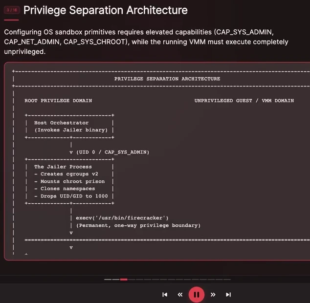

[【跳转到 01:50】](https://www.youtube.com/watch?v=tozNBdoZqL8&t=110)

流程是：宿主编排器以 UID 0 调用 `jailer`；jailer 建 cgroup v2、挂 chroot 监狱、克隆命名空间、把 UID/GID 降到 1000；最后 `execve("/usr/bin/firecracker")`。`execve` 之后，原来的进程映像被替换，特权再也回不来了——这是一条**单向**边界。

### 1.2 如果让 Firecracker 自己收容自己呢

这是最容易想到的替代方案，也是讲者特意否定的方案：让 Firecracker 以 root 启动，自己在启动流程里完成收容。

问题在于**时机**。如果那样做，命令行解析、初始内存分配、配置加载这些代码都会在"仍有完整 root 能力"的状态下执行。这些代码要处理外部输入（命令行、配置文件、API 请求），一旦其中有漏洞，攻击者在**收容完成之前**就已经拿到宿主 root 了。

jailer 的设计正是为了消灭这段窗口：它自己是一个"极简的单用途工具"，只做搭笼子这件事，逻辑越少越不容易出错；笼子搭好、权限丢掉之后，才把控制权交给复杂得多的 VMM。

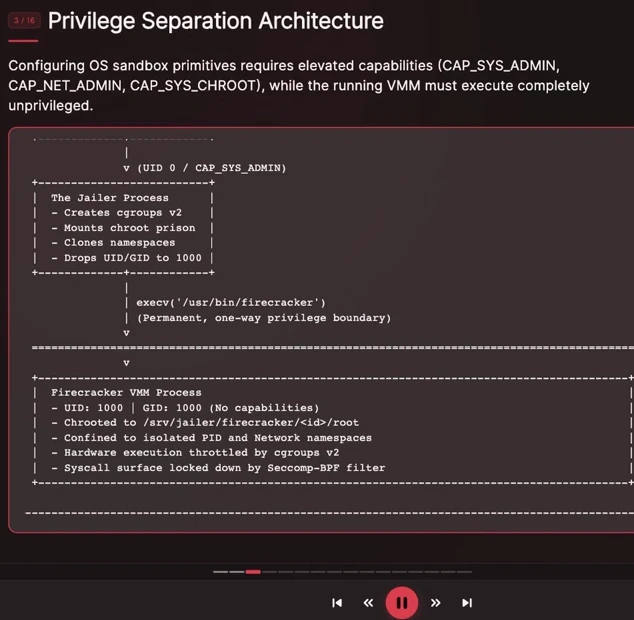

[【跳转到 02:15】](https://www.youtube.com/watch?v=tozNBdoZqL8&t=135)

## 二、渐进式锁定流水线：八步

jailer 的动作是严格有序的：每一步都剥掉一点能力、切断一条与宿主的联系。顺序不能乱——比如必须先 `mknod` 造设备节点，再降权（非特权进程不能 `mknod`）；必须先 `chroot`，再丢掉 `CAP_SYS_CHROOT`。

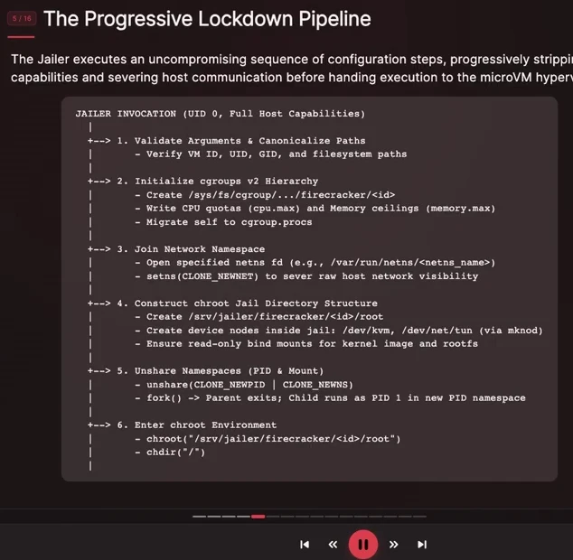

[【跳转到 03:22】](https://www.youtube.com/watch?v=tozNBdoZqL8&t=202)

完整顺序是：

1. **校验参数、规范化路径**：确认 VM ID、UID、GID 和各个文件系统路径；
2. **初始化 cgroup v2**：建 `/sys/fs/cgroup/firecracker/<id>`，写 `cpu.max`、`memory.max`，把自己迁进 `cgroup.procs`；
3. **加入网络命名空间**：打开 netns 的文件描述符，`setns` 加 `CLONE_NEWNET`；
4. **构造 chroot 目录结构**：建 root 目录、`mknod` 造 `/dev/kvm` 与 `/dev/net/tun`、为内核镜像和 rootfs 做只读 bind mount；
5. **unshare PID 与 mount 命名空间**：`unshare` 加 `CLONE_NEWPID`、`CLONE_NEWNS` 后 `fork`，父进程退出，子进程成为新 PID 命名空间里的 1 号进程；
6. **进入 chroot**：`chroot()` 到 jail 根目录，再 `chdir("/")`；
7. **永久降权**：`setgroups(0, NULL)` 清空附加组，`setresgid`、`setresuid` 设置真实/有效/保存三套 ID，并确认 capability 已归零；
8. **装 seccomp 过滤器、execve**：先 `prctl` 的 `PR_SET_NO_NEW_PRIVS`，再 `execve` 成 Firecracker。

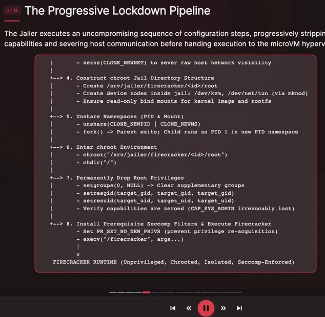

[【跳转到 04:12】](https://www.youtube.com/watch?v=tozNBdoZqL8&t=252)

下面逐层拆开看每一层到底挡住了什么。

## 三、第一层：命名空间——看不见宿主

### 3.1 网络命名空间：只有一根 TAP

`setns` 加 `CLONE_NEWNET` 之后，VMM 进程立刻从宿主的网络栈里被摘出去。它只能看到编排器显式搬进这个命名空间的虚拟网卡（通常是一根 TAP 设备）。

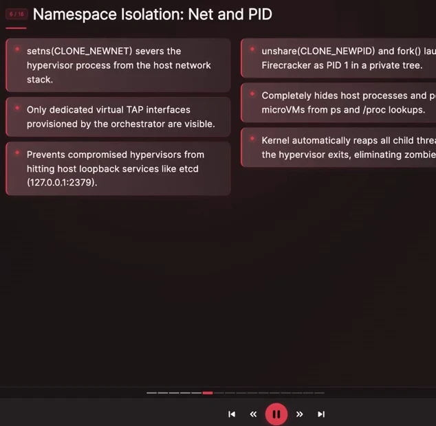

[【跳转到 05:02】](https://www.youtube.com/watch?v=tozNBdoZqL8&t=302)

实际影响很具体：即使攻击者控制了 VMM，他也连不上宿主回环地址上的服务——讲者举的例子是 `127.0.0.1:2379` 上的 etcd，或者本地数据库。云环境里这类"只监听本机"的组件往往没有认证，正是横向移动的跳板。

### 3.2 PID 命名空间：看不见也杀不了宿主进程

`unshare` 加 `CLONE_NEWPID` 有个容易踩的坑：调用 `unshare` 的进程本身**不会**进入新命名空间，只有它 `fork` 出来的子进程才会。所以 jailer 紧接着 `fork`，父进程退出，子进程成为新命名空间里的 PID 1。

成为 PID 1 之后，Firecracker 看不到、也 `kill` 不到、`ptrace` 不到宿主上的任何进程，`ps` 或 `/proc` 里只有它自己和它的线程。附带的好处是：PID 命名空间的 1 号进程退出时，内核会清理该命名空间里的所有线程，不会留僵尸。

## 四、第二层：chroot——看不见宿主文件

hypervisor 没有任何正当理由去浏览宿主文件系统：它不需要 `/etc/shadow`、`/home`、`/usr/bin`，也不需要宿主的共享库。jailer 在 `/srv/jailer/firecracker/<id>/root` 下建一个极小的根：

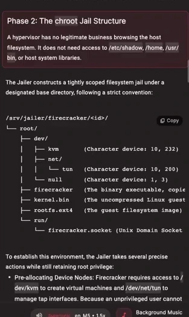

[【跳转到 06:42】](https://www.youtube.com/watch?v=tozNBdoZqL8&t=402)

这里有几个必须由 root 完成的动作：

- **预建设备节点**：Firecracker 要 `/dev/kvm` 来建虚拟机、`/dev/net/tun` 来管 TAP。非特权用户不能 `mknod` 造字符设备，所以 jailer 在**还有 root 权限时**用内核规定的主次设备号造好：`/dev/kvm` 是 10,232，`/dev/net/tun` 是 10,200，`/dev/null` 是 1,3。
- **递归改属主**：把整棵目录树 `chown` 给这个 microVM 专属的非特权 UID/GID。
- **锁死根**：`chroot()` 之后再 `chdir("/")`，进程的文件系统根就钉死在这个目录，没有任何路径能回到父目录——宿主文件系统对它"不存在"。

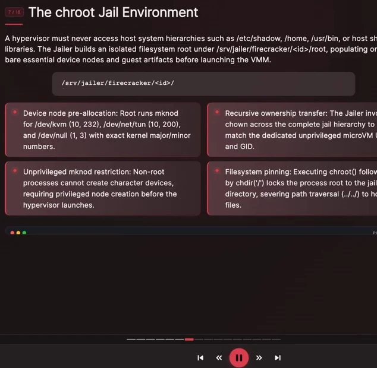

[【跳转到 07:32】](https://www.youtube.com/watch?v=tozNBdoZqL8&t=452)

## 五、第三层：cgroup v2——吃不光宿主

命名空间管"看得见什么"，cgroup 管"能用多少"。MicroVM 里跑的是不可信负载，可能疯狂申请内存或空转 CPU；virtqueue 的限流只管 IO 吞吐，管不了这些。

jailer 在 cgroup v2 统一层级下建一个专属目录，把限制写进控制文件，再把自己的 PID 迁进 `cgroup.procs`。讲者给了两个具体例子：

- **CPU 上限 `cpu.max`**：写入 `200000 100000`，含义是每 100 ms 的实际时间里，整个 Firecracker 进程（包括所有 vCPU 线程和设备事件循环）最多用 200 ms 的 CPU 时间——也就是**最多两个物理核**的算力。
- **内存上限 `memory.max`**：即使客户机只配了 512 MB 内存，被攻破的 VMM 也可能疯狂申请堆内存。把上限设成 600 MB 之后，一旦"客户机内存映射 + VMM 堆 + 设备缓冲 + 线程栈"的总和超限，宿主内核的 OOM killer 会立刻杀掉 Firecracker 进程，保护宿主稳定。

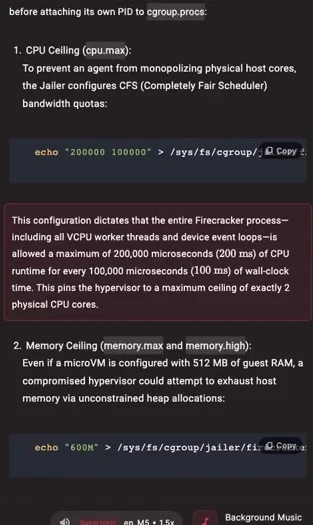

[【跳转到 08:47】](https://www.youtube.com/watch?v=tozNBdoZqL8&t=527)

注意这里的设计取舍：**宁可杀掉这台 microVM，也不能让它拖垮宿主**。对多租户平台来说，这是正确的默认值。

## 六、第四层：降权与 seccomp——调不了危险系统调用

### 6.1 不可逆的降权

环境配好、cgroup 限住、网络切断、设备节点造完、进程也 chroot 了，此时 jailer 必须丢掉 root 身份。这一步必须是**不可逆**的：

- `setgroups(0, NULL)` 清空附加组；
- `setresgid` / `setresuid` 同时设置真实、有效、保存三套 ID——三套都设成非特权值，进程就再也没有"切回 root"的机制；
- 确认 capability 归零，`CAP_SYS_ADMIN` 永久丢失；
- `prctl` 的 `PR_SET_NO_NEW_PRIVS`：告诉内核，此后任何操作——包括执行一个 setuid root 的二进制——都不能给本进程及其后代增加特权。

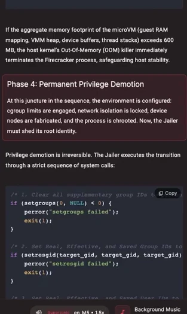

[【跳转到 10:02】](https://www.youtube.com/watch?v=tozNBdoZqL8&t=602)

### 6.2 seccomp：默认拒绝，越界即杀

文件路径受限、网络被摘掉、capability 归零之后，还剩一个根本性的入口：**系统调用接口**。Linux 内核向用户态暴露几百个系统调用，而 VMM 只需要其中极小的一部分——读写文件描述符、`epoll_wait` 等事件、`futex` 同步线程、`mmap` 映射内存、`ioctl` 操作 KVM。它没有任何正当理由去 `fork`、`execve`、`mount`、`chroot`、`connect`、`listen`。

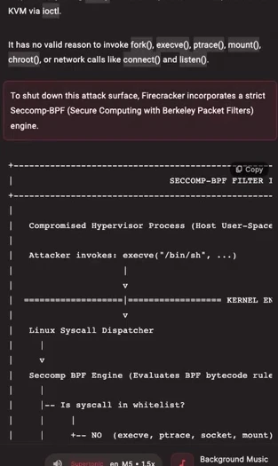

[【跳转到 10:52】](https://www.youtube.com/watch?v=tozNBdoZqL8&t=652)

Firecracker 的过滤器是**默认拒绝**：没有显式写进白名单的系统调用，一律拦下。而且拦截动作不是返回错误码，而是 `SECCOMP_RET_KILL_PROCESS`——直接杀掉整个进程。

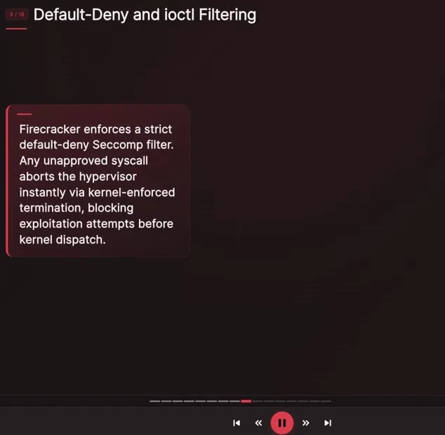

[【跳转到 11:17】](https://www.youtube.com/watch?v=tozNBdoZqL8&t=677)

这个选择很关键。如果返回 `-EPERM`，攻击者可以捕获错误、换一条路继续试；直接 `KILL_PROCESS` 则是确定性的：**一旦越界，这台 microVM 就没了**。对平台来说，杀掉一台 VM 是可接受的代价；让攻击者继续试探不是。

还有一个容易被忽略的细节：只按系统调用号过滤是不够的。`ioctl` 是个多路复用器——`ioctl` 的 `KVM_RUN` 命令 是执行客户机必需的，而一个冷门 ioctl 命令可能直接暴露宿主内核的攻击面。所以 Firecracker 的过滤器还要**检查 `ioctl` 的第一个参数**，只放行认识的控制码：

- `KVM_RUN`
- `KVM_GET_VCPU_MMAP_SIZE`
- `KVM_SET_USER_MEMORY_REGION`
- `KVM_IRQFD`
- `KVM_IOEVENTFD`
- `TUNSETIFF`（配置 TAP）

任何未批准的 ioctl 命令都会让 hypervisor 立刻终止。

## 七、生产环境怎么用：一条命令的参数就是边界

讲者用一段真实调用把前面所有概念串了起来。jailer 的参数几乎每一个都对应一条隔离边界：

| 参数 | 作用 |
| --- | --- |
| `--id` | microVM 标识，用来拼出 `/srv/jailer/firecracker/<id>` 这个 chroot 路径 |
| `--exec-file` | 沙箱建好后要 `execve` 的 VMM 二进制路径 |
| `--uid` / `--gid` | 降权后的非特权用户与组 |
| `--chroot-base-dir` | 存放 jail 结构的父目录 |
| `--netns` | 降权前要加入的网络命名空间 |
| `--daemonize` | 脱离控制终端，重定向标准 IO 并 `setsid` |
| `--api-sock` | 传给 Firecracker 的管理用 Unix socket 路径 |
| `--seccomp-level` | 0 关闭过滤、1 基础过滤、2 默认拒绝白名单加参数深检 |

[【跳转到 13:58】](https://www.youtube.com/watch?v=tozNBdoZqL8&t=838)

两个细节值得注意：

- **路径都是相对的**。因为 Firecracker 已经 chroot 到 jail 根目录，配置 API 里传的路径必须相对这个新根：内核是 `/vmlinux.bin`，磁盘镜像是 `/rootfs.ext4`。编排器看到的 `/srv/jailer/...` 和 VMM 看到的 `/` 是同一个地方的两个视角。
- **控制面只剩一个 socket**。编排器通过 jail 目录里的 Unix socket 发 HTTP 请求来配置和启动 VM（设置启动参数、挂 rootfs、`InstanceStart`）。VMM 被锁在笼子里，对笼子外的路径一无所知。

## 八、威胁模型演练：逃逸之后能做什么

讲者最后用一个具体场景收尾：假设一个自主 AI agent 在 microVM 里执行不可信 Python 代码，先利用客户机内核漏洞拿到 VM 内的 root，再构造恶意描述符链，触发 Firecracker 的一个假想 0day，在宿主 VMM 进程里执行 shellcode。**这时会发生什么？**

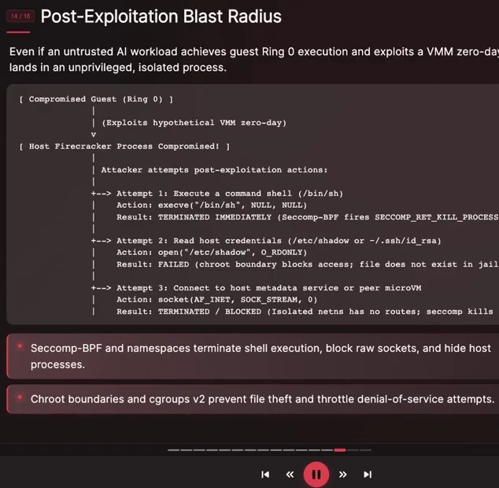

[【跳转到 16:03】](https://www.youtube.com/watch?v=tozNBdoZqL8&t=963)

讲者列了五种典型的"逃逸后动作"，每一种都被对应的那一层挡住：

| 攻击动作 | 挡住它的机制 | 结果 |
| --- | --- | --- |
| `execve("/bin/sh")` 起 shell | seccomp 默认拒绝 | `KILL_PROCESS` 立即终止 |
| 读 `/etc/shadow` 或 SSH 私钥 | chroot 边界 | 文件在 jail 里不存在，打开失败 |
| 连 metadata 服务或对等 microVM | 网络命名空间 + seccomp | 没有路由，`socket` 也被拦 |
| `kill` 宿主进程 | PID 命名空间 | 看不到宿主进程，信号无效 |
| 循环申请内存拖垮宿主 | cgroup v2 `memory.max` | 被 OOM killer 终止 |

把六层机制汇总成一张表，就是这一讲的"收容矩阵"：

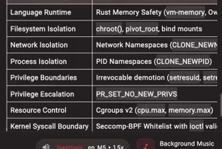

[【跳转到 17:18】](https://www.youtube.com/watch?v=tozNBdoZqL8&t=1038)

核心结论是那句被反复强调的话：**漏洞必须同时突破多条互相独立的边界，才能造成灾难性后果**。Rust 负责"少出漏洞"，jailer 负责"出了漏洞也别想跑远"。

## 九、和 seccomp 白名单的关系

这一讲把 seccomp 放在最后一步（第 8 步），不是偶然：

1. **它依赖前面的步骤**。chroot 让攻击者即使能 `open` 也看不到宿主文件；降权让 `setuid` 类调用失去意义；`PR_SET_NO_NEW_PRIVS` 关掉了提权路径。seccomp 是在这些基础上再补一刀。
2. **它管的是"最后一条通用通道"**。命名空间、chroot、cgroup 各自管一个维度，但所有进程共享同一个系统调用接口。只要 VMM 还能发起任意系统调用，攻击者就总能找到某个"没被前几层挡住"的组合。把接口收窄，等于把剩下的可能性一次性掐掉。
3. **它是确定性的**。`KILL_PROCESS` 不给你商量的余地，也不依赖攻击者"配合"。

所以纵深防御的层次可以这样理解：**客户机隔离（硬件虚拟化）→ VMM 内存安全（语言与代码面）→ 命名空间/chroot/cgroup（宿主资源边界）→ 降权与 seccomp（进程能力边界）**。越往后越"兜底"，也越不该被单独依赖。

## 小结

- 只靠 Rust 的内存安全不够：`unsafe`、外部 crate 的逻辑漏洞、KVM 自身的 0day 都可能让 VMM 被攻破，所以必须假设"逃逸会发生"。
- 搭笼子需要 root，住笼子不能有 root，因此 jailer 是独立程序：以 root 建好环境，降权后 `execve` 成 VMM，形成单向边界。
- 八步流水线：校验参数 → cgroup v2 → 加入 netns → 造 chroot 目录与设备节点 → unshare PID/mount 并 fork → chroot+chdir → 不可逆降权 → `PR_SET_NO_NEW_PRIVS` + seccomp + `execve`。
- 网络命名空间让 VMM 只看见一根 TAP，连不上宿主回环上的 etcd；PID 命名空间让它看不见也杀不了宿主进程。
- chroot 的 jail 里只有 `/dev/kvm`、`/dev/net/tun`、`/dev/null`、VMM 二进制、内核镜像、rootfs 和 API socket；设备节点必须在降权前 `mknod`。
- cgroup v2 用 `cpu.max`（如 200000/100000 ≈ 两核）和 `memory.max`（如 600 MB）把资源钉死，超限就 OOM kill，牺牲单台 VM 保住宿主。
- 降权要同时设置真实/有效/保存三套 ID，并设置 `PR_SET_NO_NEW_PRIVS`，让提权路径彻底消失。
- seccomp 默认拒绝、越界即 `KILL_PROCESS`，并对 `ioctl` 的第一个参数做白名单（`KVM_RUN`、`KVM_SET_USER_MEMORY_REGION` 等），因为 `ioctl` 是多路复用器。
- 逃逸后的五种典型动作全部被拦，说明"逃逸"与"宿主沦陷"之间还隔着好几层。

## 关键术语速查

| 术语 | 一句话解释 |
| --- | --- |
| jailer | Firecracker 配套的收容程序，以 root 搭好沙箱后降权并 execve 成 VMM |
| 权限分离 | 把"需要特权搭环境"和"运行时不带特权"拆成两个阶段/进程 |
| `setns` / `unshare` | 加入已有命名空间 / 创建新命名空间 |
| chroot | 把进程的文件系统根改到指定目录，使其看不到宿主路径 |
| `mknod` | 创建设备节点，需要特权，所以必须在降权前完成 |
| cgroup v2 | 统一层级的资源控制，`cpu.max` 限 CPU 带宽、`memory.max` 限内存 |
| `PR_SET_NO_NEW_PRIVS` | 禁止本进程及后代通过任何方式获得新特权 |
| `SECCOMP_RET_KILL_PROCESS` | seccomp 的拦截动作：直接杀掉整个进程，而非返回错误码 |
| 收容矩阵 | 把每条安全边界、其实现机制与防御效果列成的对照表 |