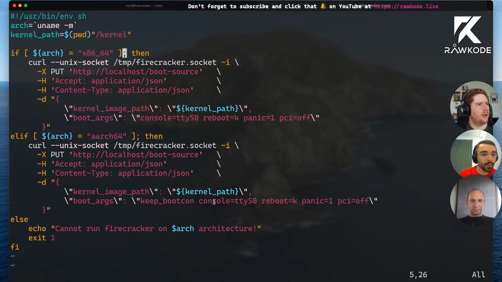
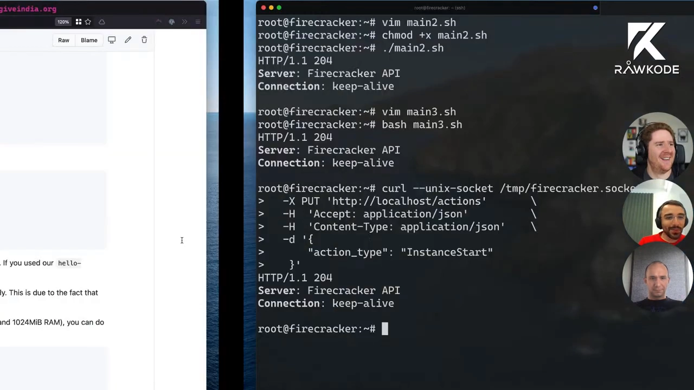
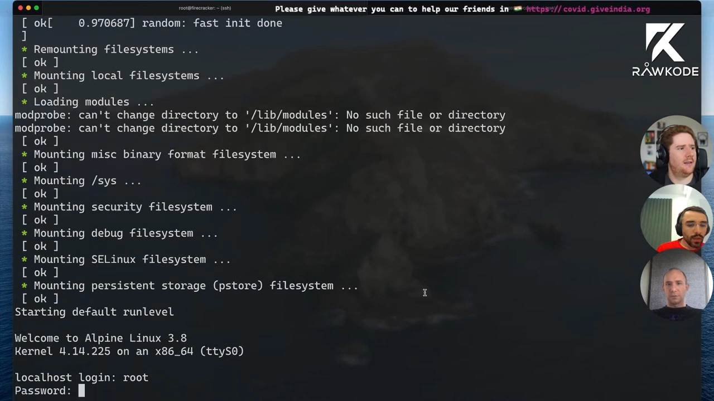
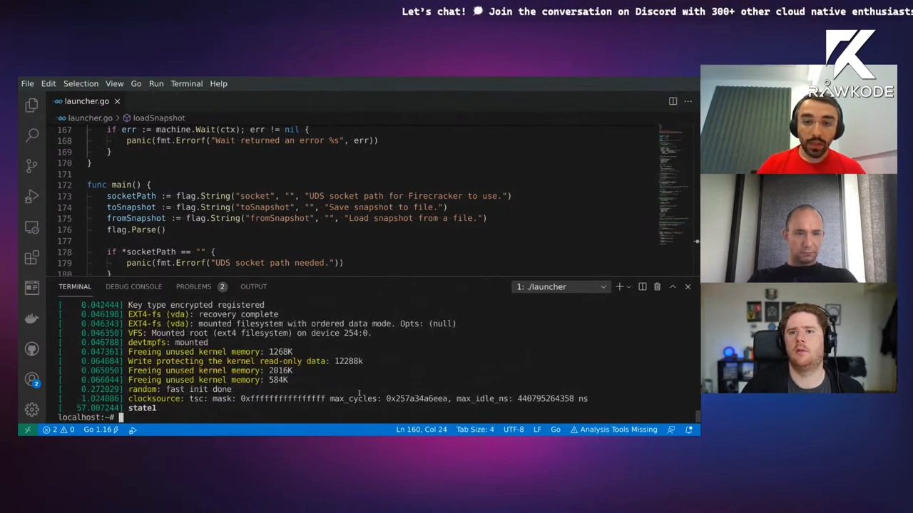
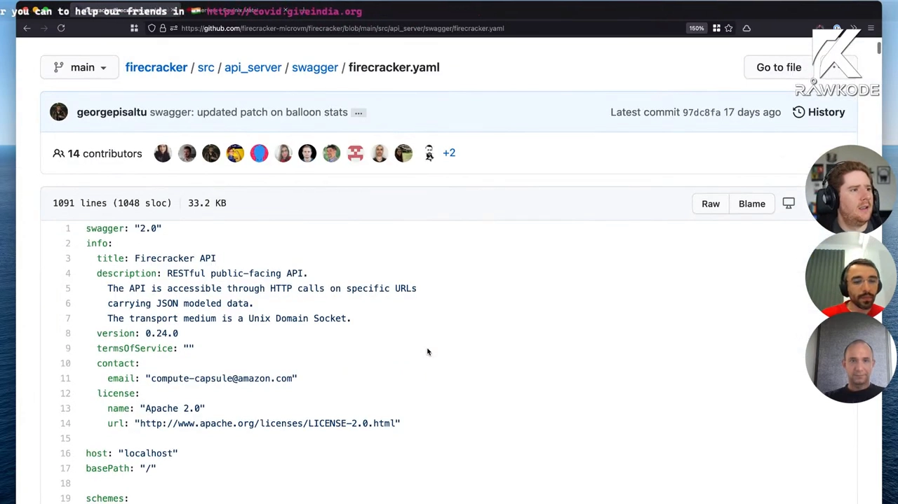
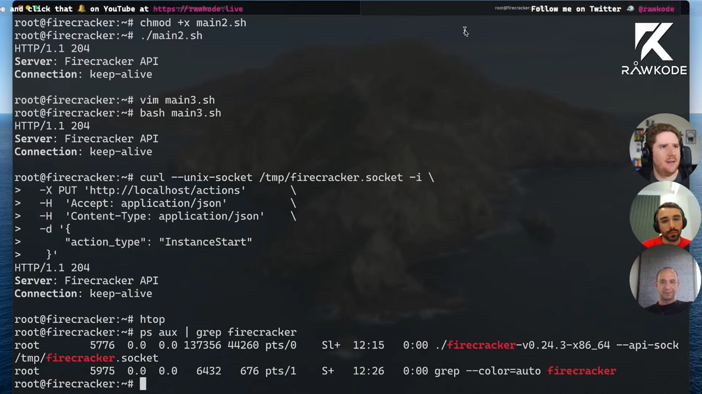
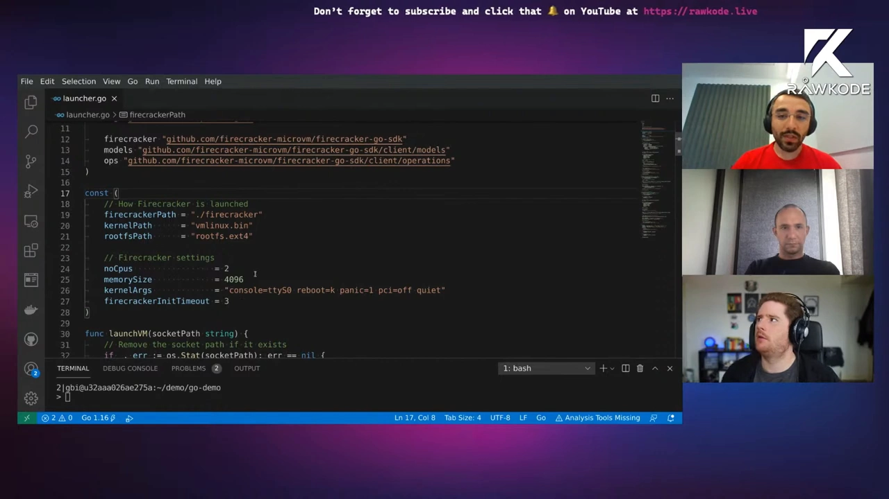
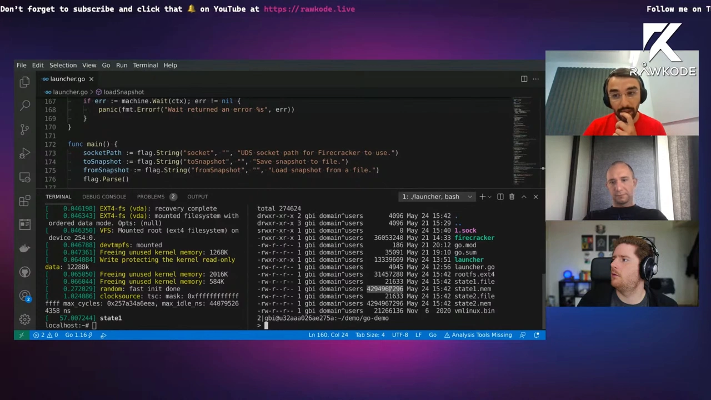
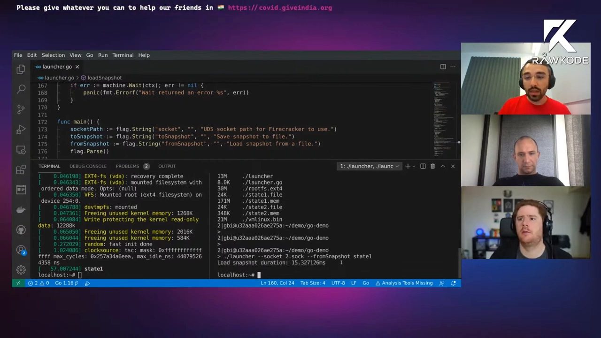

# 一条 curl 启动一台虚拟机：跟着 Firecracker 团队手搓 microVM

> 视频来源：[Firecracker MicroVMs: Hands-On Introduction and Demo](https://www.youtube.com/watch?v=dCa7qD2zGXs)（YouTube · Rawkode Academy，嘉宾为 AWS Firecracker 团队的 Gabriel 与 Radu）｜时长约 62 分钟
> 简要导读：这是一场带着源码和终端的直播：从下载两个二进制文件开始，用 `curl` 打 Unix socket 把一台 Alpine Linux 虚拟机点起来，再用 Go SDK 演示 full/diff 快照与毫秒级恢复。本文按「启动序列 → 设备从哪来 → jailer → 内存 → 快照实测」重排，保留实测数字；直播里的寒暄和观众问答只留有信息量的部分。字幕由本地 faster-whisper 转写。

## 本讲要解决的核心问题（SCQA）

**背景**：大家都知道 Firecracker 快，也知道它「设备少」。但「设备少」在操作层面到底意味着什么？一台 microVM 是怎么被一步步造出来的？

**冲突**：文档里写的是「`PUT /boot-source`、`PUT /drives`、`PUT /actions`」，看着像普通的 REST 调用；但真跑起来会发现，磁盘和网卡并不是 Firecracker 变出来的——你得先在宿主上把 TAP 设备建好、把文件格式化成文件系统。也就是说，**Firecracker 只做「接线」，不做「造零件」**。

**疑问**：这条接线流程具体长什么样？每一步返回什么？接完线之后，隔离、内存、快照又是怎么接上去的？

**回答（中心思想）**：Firecracker 把「造虚拟机」压缩成**一条 HTTP over Unix socket 的配置序列 + 一次点火**，所有资源（内核、rootfs、TAP）都由宿主侧的编排器提前准备好。它刻意只做最底层的原语，把「怎么建资源、怎么分配 IP、怎么调度」全部留给上层——这正是它能小、能快、能被各种平台复用的原因。

---

## 一、团队自己解释「为什么快」：只做两件事

直播里主持人直接问：虚拟机不是都很慢吗？Radu 的回答很朴素——**没有魔法，只有两件事**：

1. **我们几乎不模拟东西**。比较重的设备只有网络和块设备，另外还有一个 VSOCK 用于容器控制类的场景。Firecracker 本身很小，因为它大量依赖 Linux 的 KVM 去做真正的工作。
2. **客户机侧也很小**。没人阻止你在客户机里塞一个巨大的操作系统和巨大的应用，但所有真实用例用的都是**极小的客户机内核和极小的 rootfs**——这两件事必须同时成立，才能拿到「又快又小」的效果。

[【跳转到 04:20】](https://www.youtube.com/watch?v=dCa7qD2zGXs&t=260)

另一个反复被强调的设计取向是**「不挡路」**：Firecracker 只提供原语，具体怎么用由宿主上的编排器决定。Radu 的原话大意是——我们希望做到「你拿到了虚拟机隔离，但它完全不干扰你的工作负载」。

---

## 二、启动序列：从两个二进制文件到一台 Alpine

### 2.1 只有两个二进制

从 release 页下载下来的是两个文件：

- **`firecracker`**：VMM 本体，负责启动虚拟机。
- **`jailer`**：安全组件，把 Firecracker 关进命名空间里，作为额外一层隔离边界。团队的建议是**两者一起用**。

[【跳转到 09:00】](https://www.youtube.com/watch?v=dCa7qD2zGXs&t=540)

### 2.2 第一步不是开机，是「开一个 socket」

```bash
./firecracker --api-sock /tmp/firecracker.socket
```

这条命令**不会**启动任何虚拟机。它做的是创建一个 Unix domain socket，之后所有指令都通过这个 socket 以 HTTP 请求的形式发进去：设几个 vCPU、给多少内存、用什么内核……

[【跳转到 13:11】](https://www.youtube.com/watch?v=dCa7qD2zGXs&t=791)

这里有个容易被忽略的映射关系：**一个 Firecracker 进程 = 一台虚拟机**。没有「一个控制进程管所有虚拟机」的设计，一千台虚拟机就是一千个 socket、一千个进程；所有 vCPU 线程都是那个进程里的线程。团队明确说这是安全架构的一部分——一一对应。

[【跳转到 14:09】](https://www.youtube.com/watch?v=dCa7qD2zGXs&t=849)

### 2.3 配置：每个资源一个 API，每个都返回 204

启动脚本其实就是几次 `curl --unix-socket`。先是内核：

```bash
curl --unix-socket /tmp/firecracker.socket -i \
  -X PUT 'http://localhost/boot-source' \
  -H 'Accept: application/json' \
  -H 'Content-Type: application/json' \
  -d "{
        \"kernel_image_path\": \"${kernel_path}\",
        \"boot_args\": \"console=ttyS0 reboot=k panic=1 pci=off\"
      }"
```



注意 `boot_args` 里的 `pci=off`——这是「设备最小化」在命令行层面的直接体现：客户机内核根本不去枚举 PCI 总线。

[【跳转到 20:25】](https://www.youtube.com/watch?v=dCa7qD2zGXs&t=1225)

接着是 rootfs（一个 ext4 镜像文件），同样是 `PUT`，同样返回 `204`。最后才是点火：

```bash
curl --unix-socket /tmp/firecracker.socket -i \
  -X PUT 'http://localhost/actions' \
  -H 'Accept: application/json' \
  -H 'Content-Type: application/json' \
  -d '{ "action_type": "InstanceStart" }'
```



`204 No Content` 这个状态码在这里有实际意义：**配置成功 ≠ 机器在跑**。前两个 `PUT` 只是把参数记下来，只有 `InstanceStart` 会让它开始执行。而且这个动作只能成功一次。

[【跳转到 21:42】](https://www.youtube.com/watch?v=dCa7qD2zGXs&t=1302)

### 2.4 串口就是你的终端

点火之后切回第一个终端，能看到客户机内核的启动日志——因为 Firecracker 的 stdin/stdout 还连在那个终端上，**串口控制台就是它**。等一会儿就能看到 Alpine 的登录提示：



内核日志里的时间戳从 `0.04` 秒开始，到 `random: fast init done` 只用了 0.27 秒——这是「客户机内核本身很快」的直接证据，剩下的时间都在用户态：



默认配置是 **1 个 vCPU、128 MB 内存**。想让它在后台跑、把串口输出重定向到文件，就用 jailer 启动。

[【跳转到 26:09】](https://www.youtube.com/watch?v=dCa7qD2zGXs&t=1569)

---

## 三、设备从哪来：宿主先造好，Firecracker 只接线

这是整场直播里最有价值的一段澄清。主持人问：能不能给虚拟机挂个本地目录、加个存储钩子？回答是**没有**，并且解释了为什么：

- **网卡**：Firecracker 不创建网络。你要先在宿主上建好 TAP 设备并接好线，然后把这块 TAP 交给 Firecracker，客户机里才会出现一块网卡。
- **磁盘**：Firecracker 不创建文件系统。你要先创建文件、格式化成文件系统，再把它映射成一块盘，客户机里才会出现一个驱动器，而且**还得在客户机里自己 mount**。
- **开箱即用是没有网络的**：快速上手跑完的 Alpine 里没有网络接口，要按另一份文档配 TAP 才有。

[【跳转到 24:10】](https://www.youtube.com/watch?v=dCa7qD2zGXs&t=1450)

团队对此的解释是刻意的：Firecracker 提供的是一套**很底层的 API，把所有决策交给宿主上的编排器**。往上才有 Go SDK、`firectl`（把这一串 API 调用包成一条命令）、以及 containerd 集成。Radu 打了个比方：在这个层面上，Firecracker 大致相当于容器世界里的 `runc`——最底层的原语。

每个资源都有自己的 API 端点，完整定义在仓库里一份 **Swagger 文件**（`src/api_server/swagger/firecracker.yaml`）中，客户端 SDK 基本都是从它生成的。



[【跳转到 27:39】](https://www.youtube.com/watch?v=dCa7qD2zGXs&t=1659)

### 3.1 jailer：不是替代容器的隔离，而是加一层

团队特意说明了设计意图：他们想**在容器世界已有的实践之上再加一层虚拟化边界**，而不是替换掉那些实践。所以 jailer 干的事就是大家熟悉的那套——命名空间、cgroup、seccomp——只是把它套在 Firecracker 进程外面。

它的价值在「逃逸之后」：如果沙箱被突破，攻击者落在一个被关起来的进程里，没法顺手把宿主上所有 Firecracker 进程一起带走。

[【跳转到 10:26】](https://www.youtube.com/watch?v=dCa7qD2zGXs&t=626)

---

## 四、内存：先不分配，用到才给

直播里有个很直观的演示：机器刚起来时 `ps` 看到的 RSS 远小于配置的 128 MB，因为**内存并不是启动时一次性分配的**——每发生一次缺页，才给这个进程加一小块。



Radu 把这件事讲得更准确：Linux 上每个进程本来就是这样的，但 Firecracker 只做到了「一半」——**它按需把页拿进来，默认却不会把内存还回去**。要还回去得用 balloon 功能（客户机配合「放气」，把页交还宿主）。这也解释了为什么「一台 microVM 只占几 MB」和「一台 microVM 配了 128 MB」可以同时成立：前者是常驻开销，后者是上限。

顺带一提，快照对内存占用的影响非常大——下一节就会看到。

[【跳转到 29:40】](https://www.youtube.com/watch?v=dCa7qD2zGXs&t=1780)

---

## 五、快照实测：280 ms 存一次，15 ms 恢复

演示用的是 Firecracker 的 Go SDK 写的一个两百来行的小程序，加了两个开关：`-toSnapshot` 保存状态，`-fromSnapshot` 从状态恢复。程序里的常量正好是这台机器的全部「配置」：2 个 vCPU、4096 MB 内存，内核命令行 `console=ttyS0 reboot=k panic=1 pci=off quiet`。



### 5.1 full 与 diff

第一次快照耗时 **280 毫秒**；紧接着再存一次，只用了 **119 毫秒**。差别来自两种快照模式：

[【跳转到 40:27】](https://www.youtube.com/watch?v=dCa7qD2zGXs&t=2427)

- **full snapshot**：把虚拟机里的所有东西都存下来，包括全部内存内容。
- **diff snapshot**：只存**脏页**——自上次快照以来被客户机写过的那些页。

第一次快照之后所有页都被标记为「干净」，所以第二次只需要写很少的数据。这一点在文件大小上体现得非常夸张：



`ls` 看到的 4 GB 是**稀疏文件**的逻辑大小，`du` 看到的才是真正写到磁盘上的量：`state1.mem` 171 MB，`state2.mem` 只有 348 KB。也就是说，diff 快照不只是快，还省存储。

[【跳转到 42:25】](https://www.youtube.com/watch?v=dCa7qD2zGXs&t=2545)

### 5.2 恢复：15 毫秒

从快照恢复第二台虚拟机，SDK 打印出的耗时是 **15.3 毫秒**（在笔记本上，且包含了 SDK 自身的开销）：



团队给出的参照数字：生产环境的目标是 **9 毫秒**，ARM 上更快，**2.5 毫秒**；再往下优化，目标是 1 毫秒。

[【跳转到 43:56】](https://www.youtube.com/watch?v=dCa7qD2zGXs&t=2636)恢复出来的机器保留着快照那一刻的状态——演示里在客户机内核日志里能直接看到快照前写进去的那行字符串。

顺便，这也是为什么「启动快」还不够：即使 125 毫秒的冷启动已经很快，快照恢复仍快了一个数量级。

### 5.3 当时不能上生产的原因：克隆的随机性

直播里团队很坦白地说：快照当时还是**开发者预览**，别在生产用。原因不是性能，而是安全——你可以从同一个状态启动一千次，而这恰恰是大家想要的（预热的 JVM 状态），但**一千台机器的随机数发生器处在同一个状态**，克隆出来的密钥、ID、nonce 会撞车。

他们当时的思路是从底层往上打补丁：先让 systemd 这类组件能感知「我是从快照恢复的」，再往上层对接 OpenSSL 和 JVM，让这些系统自己重新变得安全。

[【跳转到 52:35】](https://www.youtube.com/watch?v=dCa7qD2zGXs&t=3155)

---

## 六、客户机的 IP 从哪来：DHCP 或元数据服务

观众问得最多的一个问题是「怎么把想要的 IP 配置传给虚拟机」。团队的回答是：Firecracker **没有**强制客户机使用某个 IP 的接口——它只负责把网卡接上，IP 是客户机用户态的事。可行的两条路：

1. **TAP + DHCP**：每台虚拟机配一个 TAP，接到 Linux 网桥上，网桥上跑 DHCP，客户机启动时自己请求地址。
2. **MMDS（微元数据服务）**：把元数据放进虚拟机可访问的一个小服务里，客户机里的进程（比如一个 systemd 服务）启动时用 HTTP 请求取回自己的标识，然后自己配置网卡。它是 IMDS 的缩小版。

还有一个更「省毫秒」的土办法：配置网卡时给一个 MAC 地址，宿主和客户机约定好「MAC 的某几个字节就是 IP 的哈希」，客户机启动时直接算出来配上去，连 DHCP 的往返都省了——团队说他们自己的测试里就这么干。

[【跳转到 49:06】](https://www.youtube.com/watch?v=dCa7qD2zGXs&t=2946)

---

## 七、这套原语之上长出了什么

直播里列了一串基于 Firecracker 的项目，可以看出「只做原语」的代价与收益：

- **`firectl`**：把那一串 `curl` 包成一条命令，给个内核和 rootfs 就能起。
- **Go SDK / `firecracker-go-sdk`**：演示里用的就是它，把 API 调用封装成函数。
- **containerd 集成 / firecracker-containerd**：让容器生态直接用上 microVM 隔离。
- **Weave Ignite、Firecracker 上的 Kubernetes（如 Kata Containers）**：把 microVM 当作 Pod 的运行时。

代价是「在这个层面起步比较麻烦」——你得自己建 TAP、自己格式化磁盘、自己分配 IP。收益是「你可以做任何事」。

团队还强调了另一面：Firecracker 本身**刻意不加功能**。「我们从用例倒推，不需要的东西就不做。」这也是为什么设备集一直那么小。

---

## 小结

- **两个二进制**：`firecracker`（VMM）与 `jailer`（安全外壳），建议一起用。
- **启动 = 一条 socket + 几次 PUT**：`--api-sock` 建 UDS → `PUT /boot-source`（内核 + `boot_args`，含 `pci=off`）→ `PUT` rootfs → `PUT /actions` 的 `InstanceStart`；前两步返回 `204` 但机器不动，点火只能一次。
- **一进程一虚拟机**：没有中心控制进程，一千台虚拟机就是一千个 socket。
- **设备是宿主造好的**：TAP 要自己建、盘要自己格式化并 mount，开箱没有网络；Firecracker 只做接线，把决策留给编排器。
- **jailer 是加法不是替换**：命名空间 + cgroup + seccomp 照旧，只是套在 Firecracker 外面。
- **内存按需给、默认不还**：缺页时逐块分配，回收要靠 balloon。
- **快照**：full 存全部内存（实测 280 ms），diff 只存脏页（实测 119 ms，348 KB vs 171 MB）；恢复 15 ms，生产目标 9 ms、ARM 2.5 ms。
- **当时不能上生产**：克隆共享同一随机数状态，需要从 systemd 到 OpenSSL/JVM 逐层配合。
- **IP 分配**：DHCP（TAP + 网桥）、MMDS 元数据，或按 MAC 约定直接算出来。

## 关键术语速查

| 术语 | 一句话解释 |
| :--- | :--- |
| UDS（Unix domain socket） | 本机进程间通信的套接字，Firecracker 的整个控制面就挂在这上面 |
| `--api-sock` | 启动参数，指定控制套接字的路径；一个 socket 对应一台虚拟机 |
| `InstanceStart` | `/actions` 上的点火动作，执行后机器才开始跑，且只能成功一次 |
| `boot_args` | 传给客户机内核的命令行，`pci=off` 表示不枚举 PCI 总线 |
| TAP 设备 | 宿主上的虚拟网卡，一端接宿主网络栈，一端交给虚拟机当网卡 |
| jailer | 在 Firecracker 之前设置命名空间、cgroup、seccomp 并降权的小程序 |
| full snapshot | 保存虚拟机全部内存与设备状态的快照 |
| diff snapshot | 只保存自上次快照以来被写过的脏页 |
| 稀疏文件 | 逻辑大小很大但实际占用很小的文件，`du` 与 `ls` 会给出不同数字 |
| balloon | 客户机配合「放气」把内存页交还宿主的机制 |
| MMDS | 微元数据服务，客户机通过 HTTP 取自己的元数据（IMDS 的缩小版） |
| `firectl` | 把 Firecracker 的一串 API 调用包成单条命令的小工具 |