# 五个设备与四步启动：Firecracker 的设备模型与启动路径

> 视频来源：[How AI Agent Sandboxes Actually Work: Firecracker MicroVMs, Snapshots & 125 ms Boots](https://www.youtube.com/watch?v=HhW1lnN6xc0)（YouTube · XOR）｜时长约 24 分钟
> 简要导读：这支视频用动画把 Firecracker 拆成四层——KVM、VMM、设备、jailer——再逐段说明 125 毫秒花在哪里、快照为什么能跳过冷启动。本文聚焦「设备模型 + 启动路径 + 快照/惰性加载」这条主线；视频里关于容器逃逸史、Agent 沙箱厂商对比的段落只做必要交代。字幕由本地 faster-whisper 转写，术语已人工校正。

## 本讲要解决的核心问题（SCQA）

**背景**：容器很轻，但它和宿主机共用同一个 Linux 内核；虚拟机隔离更硬，可传统虚拟机要模拟一整套 PC 硬件，启动以秒计。云厂商要在同一台物理机上跑成千上万个互不信任的租户，两头都不合适。

**冲突**：AWS 在 2014 年上线 Lambda 时，做法是「一个客户一台 EC2 虚拟机，函数以容器跑在里面」。容器这堵墙对陌生人太薄，而「一个函数一台虚拟机」又太重。

**疑问**：能不能既保留硬件虚拟化这道墙，又把「重」的部分去掉？去掉的到底是哪些东西？

**回答（中心思想）**：Firecracker 的做法是**把设备模型砍到只剩通信必需的那几个，再把启动路径做成一条「配置 → 点火」的直线**。设备少，需要模拟的代码就少，攻击面和启动开销同时下降；没有 BIOS、没有引导菜单，内核被直接放进客户机内存，于是从 `InstanceStart` 到客户机第一个进程只要 125 毫秒以内。快照则把这个数字进一步压到「不用启动」。

---

## 一、先分清两个东西：KVM 是 hypervisor，Firecracker 是 VMM

视频开篇先纠正一个常见混淆：**Firecracker 不是 hypervisor**。

- **hypervisor 是 KVM**，它是 Linux 内核的一部分，借助 CPU 的虚拟化扩展（Intel VT-x / AMD-V）真正运行虚拟处理器和客户机内存。
- **Firecracker 是 VMM（virtual machine monitor）**，一个普通用户态进程。它向 KVM 申请一台虚拟机，然后在外面把「这台机器长什么样」搭起来：内存布局、设备、以及进出设备的通路。

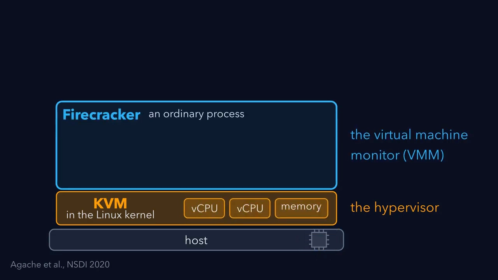

这个分层解释了为什么 Firecracker 能这么小：所有真正危险、真正复杂的硬件虚拟化工作都留在了内核里的 KVM，用户态只需要「搭壳子」。视频给出的数字是：2020 年的论文里 Firecracker 约 **5 万行 Rust**，比 QEMU 少 **96%** 的代码；它还是从 Google Chrome OS 的 VMM **crosvm** 裁剪而来，砍到不足原来一半。AWS 在 2018 年开源它，最初服务 Lambda 与 Fargate。

[【跳转到 06:29】](https://www.youtube.com/watch?v=HhW1lnN6xc0&t=389)

[【跳转到 05:14】](https://www.youtube.com/watch?v=HhW1lnN6xc0&t=314)

---

## 二、设备模型：一台「PC」被砍到只剩五个东西

传统虚拟机要假装自己是一台完整的 PC：显卡、声卡、USB、BIOS，以及把这些硬件「演」出来的全部代码。Firecracker 把这一整套几乎全扔掉，一台 microVM 只拿到：

| 设备 | 作用 | 宿主侧的后端 |
| :--- | :--- | :--- |
| 网络设备 | 收发网络包 | TAP 设备 |
| 磁盘 | 读写块设备 | 宿主上的一个文件 |
| VSOCK | 客户机与宿主之间的套接字通道 | 宿主进程 |
| 串口 | 控制台输出，调试与登录用 | 终端 / 日志文件 |
| 键盘控制器的一部分 | 只用来复位机器 | 无 |

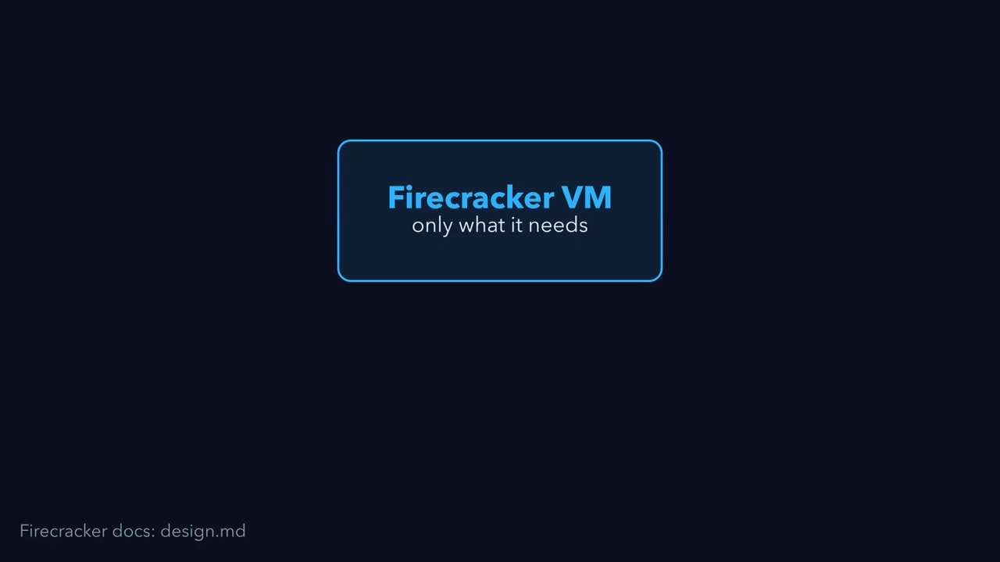

关键点不在「少」，而在**少得刚好够用**：

1. **没有 BIOS、没有引导菜单**。真实 PC 开机要先跑固件、枚举总线、找启动盘，这一串在微秒到毫秒量级上都是纯开销。Firecracker 直接把 Linux 内核镜像放进客户机内存的约定位置，然后跳进去。
2. **没有显卡、声卡、USB**。这些设备对「跑一段不受信任的代码」毫无用处，却每一个都是需要被模糊测试、可能出漏洞的代码。
3. **PCI 默认关闭**。视频特别澄清了一个流传很广的说法：Firecracker 并非永远不支持 PCI，从 1.13 版本起 PCI 变成了**可选开启**的功能，但默认配置仍然是那套最小设备集。
4. **设备越少，攻击面越小**。VMM 里每一行设备模拟代码都是「客户机可以主动喂输入」的代码；删掉一个设备，等于删掉一整类可被利用的解析路径。视频后面举了两个反例：2019 年 VSOCK 设备的一个 bug 让客户机可以读写 Firecracker 自己的部分内存；后来的安全公告则命中了新增的可选 PCI 支持——而默认的最小设备配置不受影响。

[【跳转到 06:04】](https://www.youtube.com/watch?v=HhW1lnN6xc0&t=364)

### 2.1 进程里只有三类线程

一台 microVM 对应**一个 Firecracker 进程**，进程里只有三种线程：

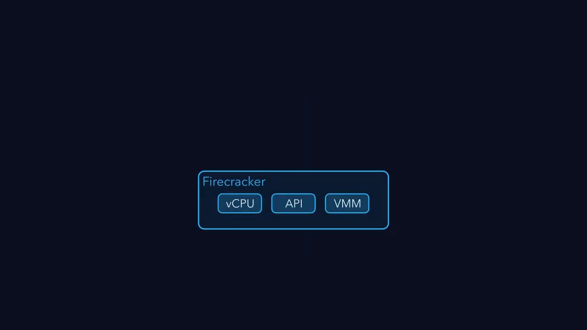

- **API 线程**：通过 Unix domain socket 接收 HTTP 请求，也就是「下单」的那一端。
- **VMM 线程**：跑设备模拟和杂事，是唯一的事件循环。
- **vCPU 线程**：每个虚拟 CPU 一个，负责通过 KVM 真正执行客户机代码。

这种「一进程一虚拟机」的映射不是随手设计，而是安全架构的一部分：没有中心控制进程，一个 microVM 的崩溃或逃逸不会顺着共享的控制面扩散到其他租户。

[【跳转到 06:54】](https://www.youtube.com/watch?v=HhW1lnN6xc0&t=414)

---

## 三、启动路径：一条直线，四步点火

视频把一次冷启动摊开成一条时间轴，这是全文最值得记住的一张图：

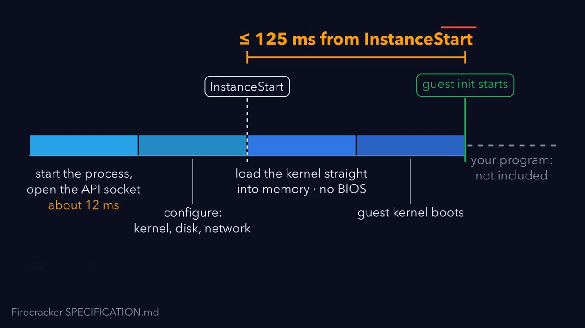

按顺序拆：

1. **启动进程、打开控制套接字**（约 12 毫秒）。`firecracker --api-sock /tmp/firecracker.socket` 之后，进程并不急着开机，只是把 UDS 建好等人下单。
2. **配置**：告诉它用哪个内核、哪个磁盘、哪个网络。这一步在 API 上是若干次 `PUT`，每次返回 `204 No Content`，但**机器还没有开始跑**。
3. **`InstanceStart`**：点火命令，只能成功执行一次。
4. **把内核直接装进内存并跳进去**——没有 BIOS，没有引导菜单。
5. **客户机内核启动**，直到客户机的第一个进程（`init`）开始运行。规范承诺这一段不超过 **125 毫秒**。

[【跳转到 07:19】](https://www.youtube.com/watch?v=HhW1lnN6xc0&t=439)

### 3.1 125 毫秒的「小字条款」

视频很克制地补了几条限定，这些限定比数字本身更重要：

- 125 毫秒是**从 `InstanceStart` 到客户机第一个进程**，不是「你的程序可以服务请求」的时间。
- 它是在**最小内核 + 串口控制台关闭**的条件下测出来的。论文发现，光是把控制台日志打开，就可能多花 **70 毫秒**——串口输出是同步的、逐字符的 I/O。
- 换成生产级内核和用户态，论文报告的最好成绩是 **150 毫秒**左右。
- 时钟在客户机第一个进程启动时就停了。你的语言运行时初始化、依赖导入、框架启动，全都在这之后。

所以「125 毫秒」是一个**边界清晰**的指标：它衡量的是虚拟化层加内核引导的成本，而不是应用启动的成本。

[【跳转到 08:09】](https://www.youtube.com/watch?v=HhW1lnN6xc0&t=489)

### 3.2 剩下那部分开销怎么办：预热池

既然一次启动要 125 毫秒，那按到达率算就需要常备机器。视频给了这个换算：

$$
\text{常备机器数} = \lambda \times t_{\text{boot}}
$$

当 $\lambda = 8$ 请求/秒、$t_{\text{boot}} = 0.125$ 秒时，需要常备 1 台已经启动好的机器。

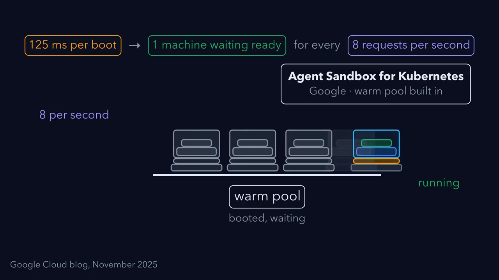

这就是**预热池（warm pool）**：请求取走一台已经启动完的机器，后台再补一台新的。视频提到 Google 的 Agent Sandbox for Kubernetes 就把这种池子做进了产品里。

[【跳转到 08:34】](https://www.youtube.com/watch?v=HhW1lnN6xc0&t=514)

---

## 四、jailer：在 Firecracker 启动之前先把房间锁好

Firecracker 的设计假设很直白：**每一个 vCPU 线程从第一刻起就当作在跑恶意代码**。那么假设攻击者真的从客户机里逃出来了，他落在哪里？

答案是：落在一个已经被关起来的进程里。

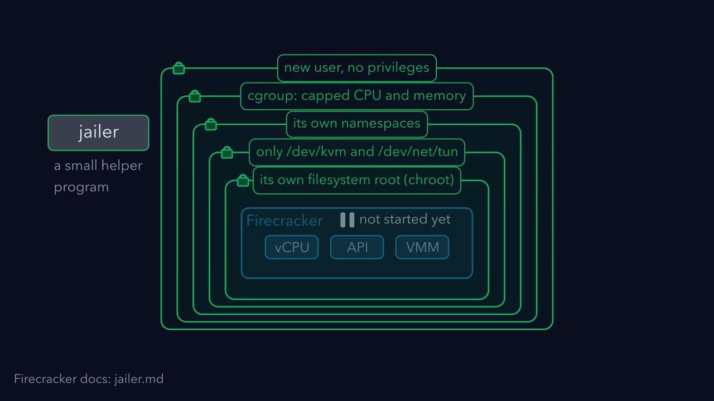

`jailer` 是一个独立的小程序，它在 Firecracker 运行**之前**把这些事做完：

1. **chroot**：给进程一个空的文件系统根，里面只有它需要的两个设备文件（`/dev/kvm`、`/dev/net/tun`）。
2. **命名空间**：放进自己的 mount、PID、网络等命名空间。
3. **cgroup**：限制它能用的 CPU 和内存。
4. **降权**：丢掉所有特权，切换成普通用户。
5. **seccomp**：Firecracker 自己再给**每类线程**装一张系统调用白名单，在客户机代码跑起来之前生效。

白名单有多短？视频给的是当前版本的数字：vCPU 线程 **27** 个系统调用，API 线程 **32** 个，设备线程 **51** 个。而 Linux 有几百个系统调用——不在名单上的，内核直接杀掉线程。

[【跳转到 10:14】](https://www.youtube.com/watch?v=HhW1lnN6xc0&t=614)

再往外还有两道：每个磁盘和网络设备都可以配限流器（令牌桶，一个桶管操作数、一个桶管字节数）；生产环境的建议是**一个租户一个 Firecracker 进程**，并在宿主上**关闭超线程（SMT）**，以堵住跨同一物理核心的侧信道攻击。

[【跳转到 09:24】](https://www.youtube.com/watch?v=HhW1lnN6xc0&t=564)

---

## 五、快照：把冷启动里最慢的那段做一次存起来

启动快是好事，但**不启动**更好。对很多程序来说，冷启动的大头根本不是内核，而是启动语言运行时、加载库、预热缓存——而这些工作每次都是重复的。

于是思路很自然：做一次，把机器冻在那一刻，之后每个新沙箱都从这一刻醒来。

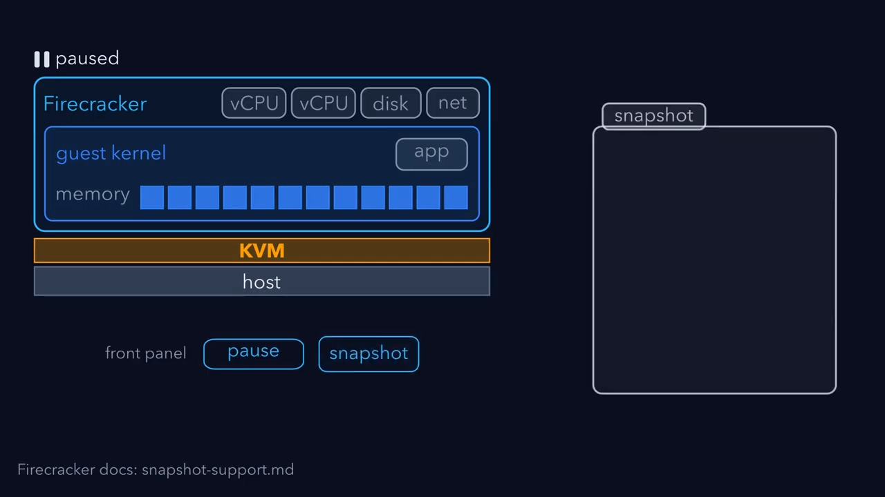

在 Firecracker 里，操作是「先暂停，再要快照」，产出**两个文件**：

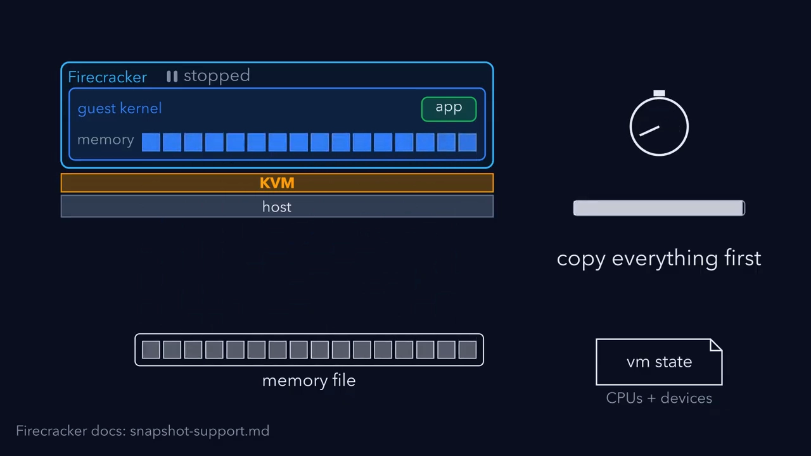

- **内存文件**：客户机内存的全部内容。
- **状态文件**：每个虚拟处理器、每个设备的状态。
- 磁盘由你自己另外保存。

快照还能做成**增量**的：KVM 可以跟踪客户机自上次快照以来写过哪些页，于是 diff 快照只把「脏页」叠加在 full 快照之上。视频注明这仍是开发者预览功能。

[【跳转到 11:47】](https://www.youtube.com/watch?v=HhW1lnN6xc0&t=707)

快照有它的规矩：必须在**同类硬件、同类软件**上恢复；文件里装着内存里的所有东西，包括密钥，所以要像对待密钥一样保护它。

[【跳转到 12:37】](https://www.youtube.com/watch?v=HhW1lnN6xc0&t=757)

### 5.1 惰性恢复：机器先跑起来，内存随后到

拿到快照之后，最直觉的恢复方式是把整个内存文件拷回 RAM 再按播放。但沙箱可能有几个 GB 内存，而它实际只会碰到其中一小部分。

Firecracker 的做法是**不拷贝**：

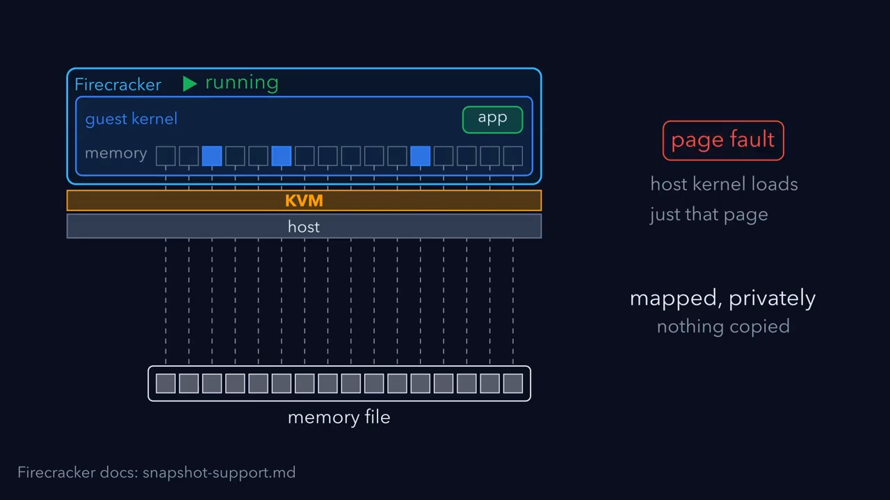

- 把内存文件**私有映射**到新机器，立刻开始执行。
- 客户机第一次碰到某一页时，触发一次页错误，宿主内核把**那一页**从文件里读进来。
- 如果客户机写这一页，它拿到自己的一份私有副本，文件本身不变——这就是写时复制（copy-on-write）。顺带的好处是：把同一个文件恢复到多台机器，它们可以共享只读页。

还有第二种更可控的玩法：Linux 的 **userfaultfd** 允许**另一个程序**来处理缺页。

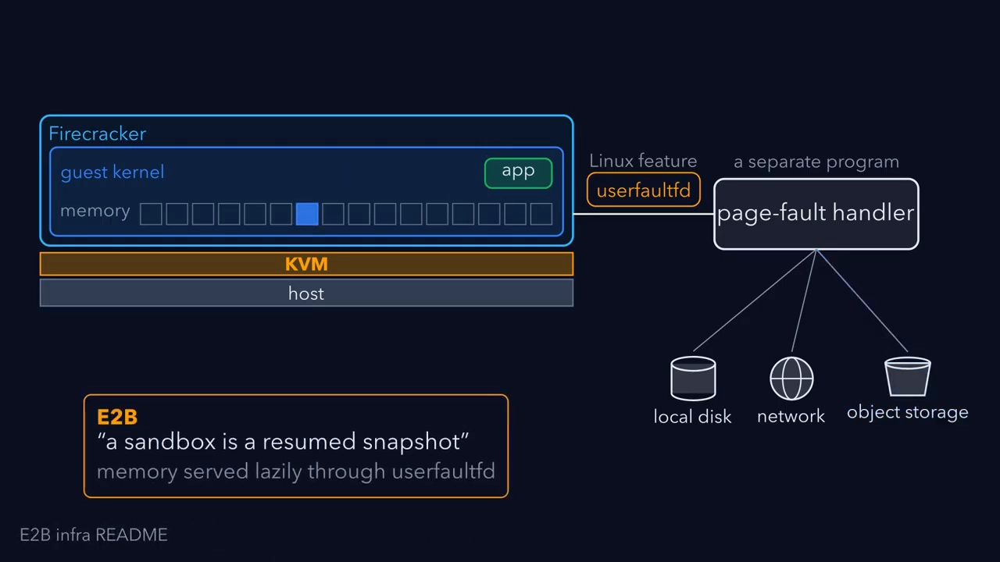

客户机碰到缺失的页时，那个程序收到通知，从任何地方（本地磁盘、网络、对象存储）把页取来塞进去。

[【跳转到 14:26】](https://www.youtube.com/watch?v=HhW1lnN6xc0&t=866)视频提到 E2B 就是这么做的，它的文档里写着「一个沙箱就是一次被恢复的快照，内存通过 userfaultfd 惰性供给」。

惰性加载也有代价，视频讲了两条：一是**缺页是逐个发生的**，每次都是一笔小开销——2021 年的一项研究发现，从快照恢复后运行的函数平均慢了 95%，解决办法是记录「这个函数总是需要哪些页」并一次性预取，把冷启动延迟平均降低 3.7 倍；二是**可靠性**——如果处理缺页的进程挂了，机器会在下一次缺页时卡死。

### 5.2 克隆出来的机器会掷出同一把骰子

同一个快照恢复一百次，就得到一百台「记得同一瞬间」的机器——包括随机数发生器的状态。于是每个克隆都准备掷出同样的骰子：同样的「随机」密钥、同样的唯一 ID、同样的 nonce。

Firecracker 的解法是一个很小的虚拟设备 **VM Generation ID**：每次恢复时写入一个新的 16 字节随机值并通知客户机；从 Linux 5.18 起，内核看到变化就重新播种随机数发生器。

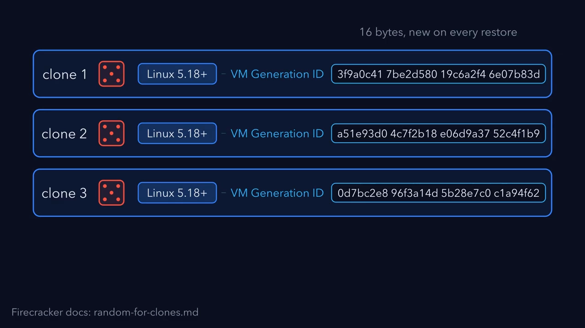

时间也是问题：恢复出来的机器以为自己还停在快照那一刻，所以 Firecracker 后来又加了一个时钟设备让客户机追上来。网络连接同理——机器记得连接，对端可能早就放弃了。所以程序自己也要配合：AWS Lambda 给了两个钩子，一个在快照前运行，一个在每次恢复后运行，官方建议是「把唯一 ID、密钥、随机性都放到恢复之后再生成」。

[【跳转到 13:18】](https://www.youtube.com/watch?v=HhW1lnN6xc0&t=798)

---

## 六、这套机制在真实系统里的样子

把所有零件拼起来就是 AWS Lambda 的 **SnapStart**：发布版本时跑一次初始化，对内存和磁盘打一个 Firecracker 快照，加密后缓存；此后每一份副本都从快照恢复，并按需分块拉取。

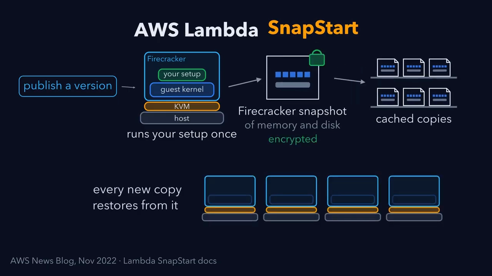

视频引用的数字：2022 年发布时，一个 Java Spring Boot 函数从 6 秒多降到 200 毫秒以内；2024 年扩展到 Python 和 .NET，并配上前面说的「快照前 / 恢复后」两个钩子。

[【跳转到 18:02】](https://www.youtube.com/watch?v=HhW1lnN6xc0&t=1082)

---

## 七、这套设计的边界

视频最后很干脆地列了限制，这些限制恰好反过来解释了前面的每个选择：

- **必须有 KVM**：所以宿主必须是 Linux，且暴露硬件虚拟化——裸金属服务器，或允许嵌套虚拟化的云主机。
- **只支持 Linux 客户机**：设备模型里没有 Windows 需要的那些东西（ACPI、完整键盘控制器、PCI 生态），也没有对应的驱动。
- **没有 GPU 直通**：设备模型里根本没有显卡。
- **快照只能在匹配的硬件与软件上恢复**：状态文件里存的是具体的 CPU 与设备状态。
- **快照文件本身就是机密**：里面是内存的全部内容。
- **Firecracker 不过滤网络流量**：墙再硬，门开着也没用。视频举的例子是，一次事件里没人去破虚拟机，出口是网络代理那条路。

[【跳转到 21:36】](https://www.youtube.com/watch?v=HhW1lnN6xc0&t=1296)

---

## 小结

- **分层**：KVM 在内核里跑 vCPU 和内存，Firecracker 只是用户态的一个普通进程，负责「搭壳子」；约 5 万行 Rust，比 QEMU 少 96% 代码，源自 crosvm。
- **设备模型**：网络、磁盘、VSOCK、串口、键盘控制器的一部分——五个设备，没有 BIOS、没有显卡/USB，PCI 从 1.13 起可选但默认关闭。设备少 → 需要模拟的代码少 → 攻击面小、启动快。
- **线程模型**：一进程一虚拟机，进程内只有 API 线程、VMM 线程、每 vCPU 一个线程。
- **启动路径**：开套接字（约 12 ms）→ 配置内核/磁盘/网络 → `InstanceStart` → 内核直接装进内存 → 客户机 `init`，规范承诺 ≤ 125 ms，且不含你的应用启动。
- **125 ms 的小字**：最小内核、串口控制台关闭；开控制台日志可能多花 70 ms；生产内核约 150 ms。
- **jailer**：chroot + 命名空间 + cgroup + 降权 + 每线程 seccomp（27/32/51 个系统调用），在 Firecracker 启动前完成。
- **快照**：暂停后产出内存文件 + 状态文件，支持 full 与 diff（脏页）；恢复时私有映射内存文件、按页缺页加载，或用 userfaultfd 交给外部程序供页。
- **克隆的唯一性**：VM Generation ID 每次恢复换新值，Linux 5.18+ 据此重新播种 RNG；时间与网络连接仍需应用配合。

## 关键术语速查

| 术语 | 一句话解释 |
| :--- | :--- |
| KVM | Linux 内核里的 hypervisor，借 CPU 虚拟化扩展运行虚拟处理器与客户机内存 |
| VMM | 用户态程序，向 KVM 申请虚拟机并搭建内存布局与设备，Firecracker 就是 VMM |
| microVM | 只保留最少设备的虚拟机，启动在百毫秒量级 |
| VSOCK | 客户机与宿主之间的套接字通道，不经过网络协议栈 |
| InstanceStart | 唯一一次「点火」的 API 动作，之后机器开始执行 |
| jailer | 在 Firecracker 之前设置 chroot、命名空间、cgroup、降权的小程序 |
| seccomp | 按线程限制可用系统调用的内核机制，Firecracker 用白名单 |
| 快照（snapshot） | 暂停机器后导出的内存文件 + 设备/vCPU 状态文件 |
| diff 快照 | 只保存自上次快照以来被写过的脏页 |
| userfaultfd | Linux 机制，允许另一个进程处理缺页，从而按需从任意位置供页 |
| CoW | 写时复制：读共享、写才复制，多个克隆共享只读页 |
| VM Generation ID | 每次恢复都换新值的虚拟设备，让客户机重新播种随机数 |
| 预热池 | 常备一批已启动的机器，请求来了直接取用 |