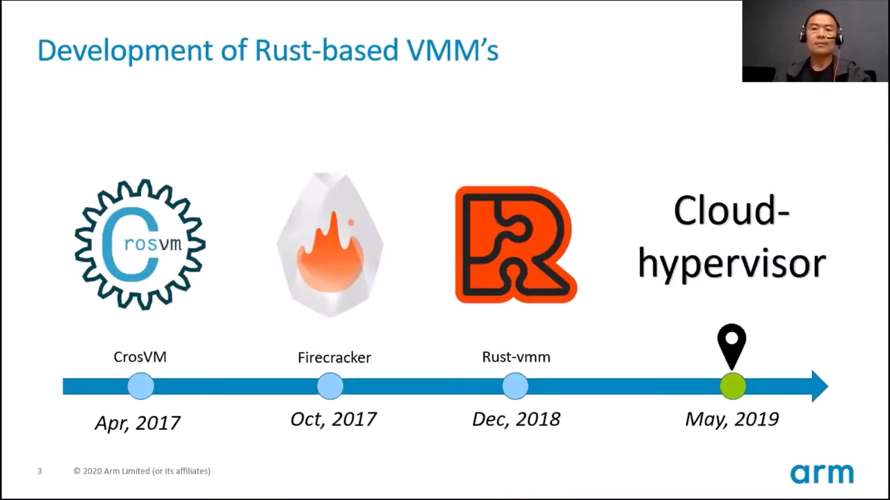
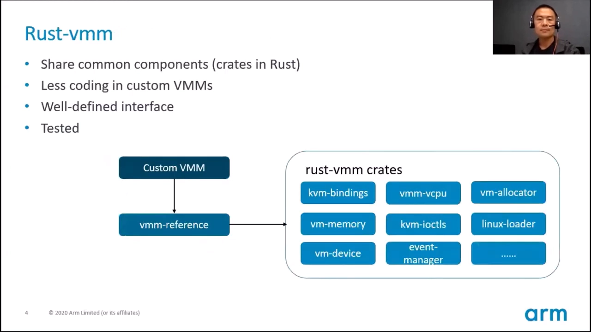
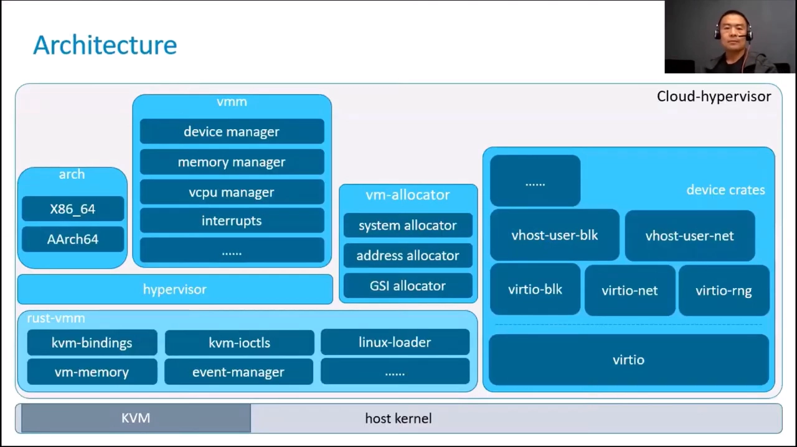
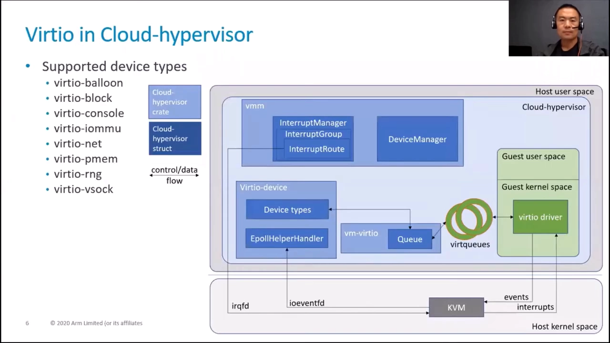
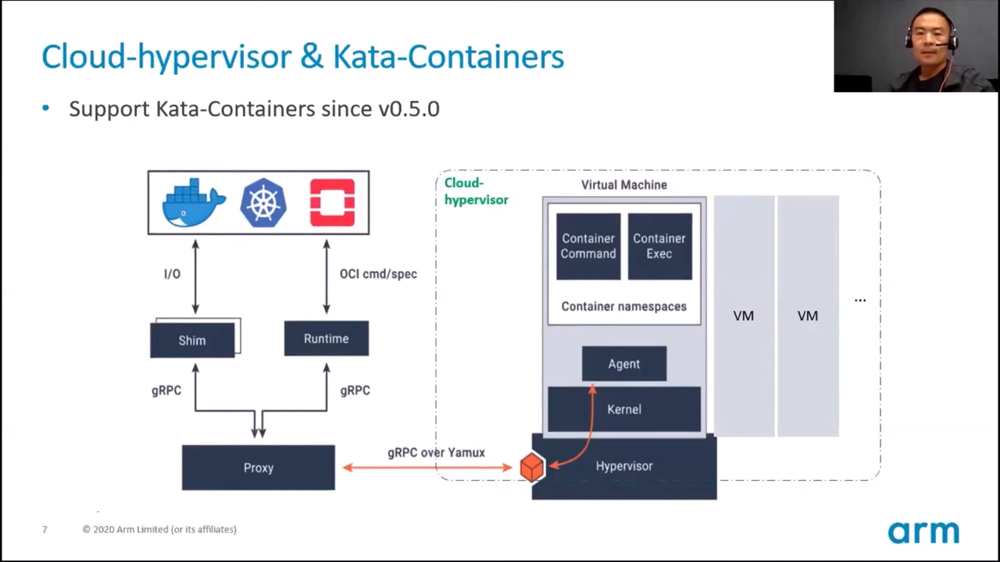
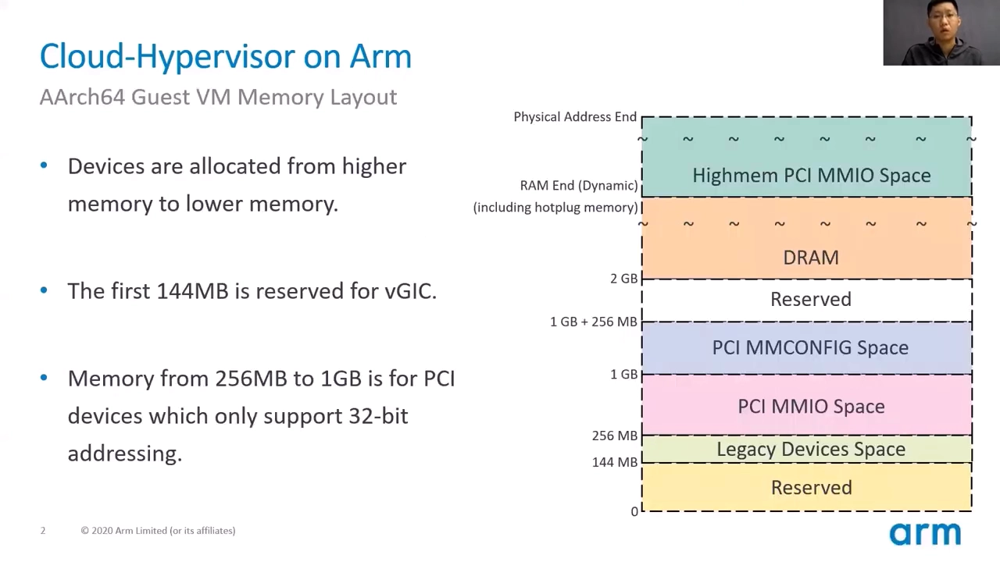
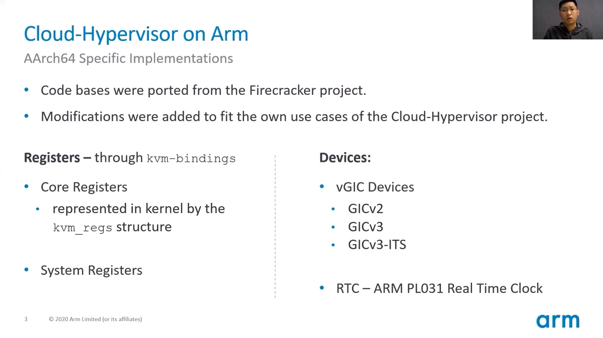
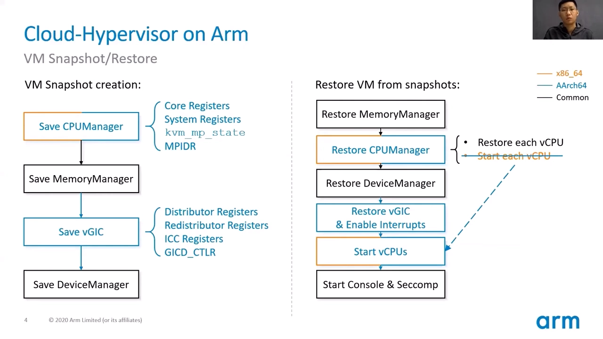
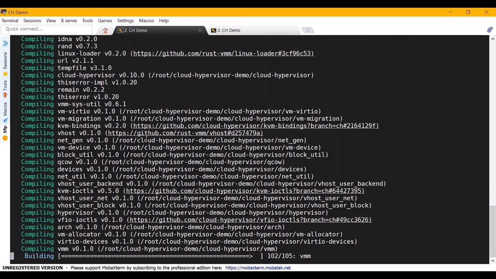

# Cloud Hypervisor 把通用能力交给 rust-vmm，自己只写云负载的定制代码

> 视频来源：[Cloud-hypervisor: A new choice for virtual machine monitor](https://www.youtube.com/watch?v=-l7UgwBBbio)（YouTube · OpenInfra Foundation，讲者 Michael Zhao、Henry Wang，来自 Arm）｜时长约 23 分钟
> 导读：这是一场 2020 年的会议分享，前半段讲 Rust 系 VMM 的血统、rust-vmm 的组件划分和 Cloud Hypervisor 的组件栈与 virtio 设备面，后半段讲 Cloud Hypervisor 移植到 aarch64 时补了哪些架构相关代码，最后现场演示构建、启动、快照与恢复。本文按「定位 → 组件 → 数据面 → 接入容器 → 换架构」的顺序整理，Firecracker 的最小设备集、Kata 的 shim 与 guest kernel、gVisor 的拦截模型留给相邻小节。

## 本讲要解决的核心问题（SCQA）

**背景**：你已经知道 VMM 和 KVM 的分工——KVM 在内核里利用 VT-x / AMD-V 让客户机指令直接跑在 CPU 上，"这台机器长什么样"由用户态 VMM 决定。

**冲突**：可 VMM 是个巨大的重复劳动现场。crosvm 和 Firecracker 各自维护一套几乎一样的代码：打开 `/dev/kvm`、发 ioctl、管客户机内存、装载内核、实现 virtqueue。2018 年之前，代码经常从一个项目手工搬到另一个项目，测试和评审吃掉大量人力。

**疑问**：既然 90% 的活是一样的，为什么每做一个新 VMM 都要重写一遍？一个"比 Firecracker 功能多、比 QEMU 小"的 VMM，能不能不重写这些零件？

**回答（中心思想）**：**Cloud Hypervisor 的答案是把自己切成"通用零件 + 定制代码"两层**：凡是与具体 hypervisor、具体架构无关的能力——KVM 的 ioctl 封装、客户机内存、内核装载、事件循环、资源分配——全部下沉到 rust-vmm 这组共享 crate；Cloud Hypervisor 自己只保留 `hypervisor`（屏蔽 KVM / Hyper-V 差异）、`arch`（x86_64 / aarch64 差异）、`vmm`（设备、内存、vCPU、中断的管理）和 `devices`（virtio 与 vhost-user）四块定制代码。设备面上它也只做云负载需要的那一小撮半虚拟化设备，不背 QEMU 的历史包袱。

## 一、Cloud Hypervisor 的定位：云负载的通用 VMM，不是最小 microVM

### 1.1 血统：从 crosvm 到 Firecracker 到 rust-vmm 到 Cloud Hypervisor

视频开篇给了一条时间线，四个节点把 Rust 系 VMM 的家谱讲清楚了 [【跳转到 01:09】](https://www.youtube.com/watch?v=-l7UgwBBbio&t=69)：

| 时间 | 项目 | 它想解决什么 |
| --- | --- | --- |
| 2017 年 4 月 | crosvm（Google） | 基于 KVM 的 Rust VMM，为 Chrome OS 而写 |
| 2017 年 10 月 | Firecracker | 从 crosvm 分叉，瞄准轻量虚拟机（microVM），承载多租户容器与微服务 |
| 2018 年 12 月 | rust-vmm | 把两个项目的公共组件抽出来共享 |
| 2019 年 5 月 | Cloud Hypervisor（Intel 发起） | 基于 rust-vmm 的新 VMM，面向云负载 |



注意第二行和第四行的差别：Firecracker 和 Cloud Hypervisor 都源自同一批代码，但**目标用例不同**。Firecracker 要的是"小而快"，Cloud Hypervisor 要的是"云上通用"——这句话是理解后面所有取舍的钥匙。

### 1.2 只做云负载：设备面是一小撮 virtio，不是 QEMU 那一堆

设备模拟的传统答案是 QEMU，但视频里的评价很直接：QEMU 很重，它模拟了大量设备，其中还有不少老设备 [【跳转到 06:51】](https://www.youtube.com/watch?v=-l7UgwBBbio&t=411)。Cloud Hypervisor 只关注云负载，因此只支持有限的一批半虚拟化设备；作为跑在云数据中心里的 VMM，它不太在乎老设备，**virtio 才是它设备面的主体**。

到 2020 年这场分享时，它已经支持的 virtio 类型包括 [【跳转到 07:16】](https://www.youtube.com/watch?v=-l7UgwBBbio&t=436)：

- `virtio-blk`：块设备（磁盘镜像）
- `virtio-net`：网卡
- `virtio-console`：控制台
- `virtio-balloon`：内存气球，用于回收客户机内存
- `virtio-iommu`：给客户机一个虚拟 IOMMU，是设备直通与内存热插拔的前置条件
- `virtio-pmem`：持久内存
- `virtio-rng`：随机数发生器
- `virtio-vsock`：宿主与客户机之间的 socket 通道

另外还有若干 **vhost-user** 设备（`vhost-user-blk`、`vhost-user-net` 等）可用——也就是把设备后端搬到独立进程里去实现。这两类设备在代码里是分开的 crate 簇，后面第三、四节会看到它们在组件栈里的位置。

## 二、rust-vmm：把 VMM 的公共零件抽出来

### 2.1 为什么要有一个"零件仓库"

2018 年 12 月，crosvm 和 Firecracker 的开发者讨论出一个结论：与其互相搬代码，不如启动 rust-vmm 项目，把做 VMM 的公共组件抽出来共享 [【跳转到 02:24】](https://www.youtube.com/watch?v=-l7UgwBBbio&t=144)。这套零件仓库的四条设计目标，视频里逐条列了出来 [【跳转到 02:59】](https://www.youtube.com/watch?v=-l7UgwBBbio&t=179)：

1. **共享公共组件**：以 Rust crate 的形式提供。crate 是 Rust 的构建单元，相当于 C 语言里的库。
2. **让定制 VMM 少写代码**：做一个新 VMM，你只需要写很少的代码把它们组合起来，再加自己的定制。
3. **接口定义清晰**：零件之间的边界要稳定，别人敢依赖。
4. **经过测试**：零件被多个项目共用，测试成本摊薄，质量反而更容易保证。

### 2.2 零件清单：从 kvm-bindings 到 linux-loader

视频给了一张 rust-vmm 的 crate 清单，并画出了它和"定制 VMM"的关系 [【跳转到 03:24】](https://www.youtube.com/watch?v=-l7UgwBBbio&t=204)：



图中这些 crate 各自管一件事，按职责可以分成四组：

| 分组 | crate | 干什么 |
| --- | --- | --- |
| 与 hypervisor 打交道 | `kvm-bindings`、`kvm-ioctls` | 前者是 KVM 内核接口的 Rust 绑定（结构体、常量），后者把 ioctl 包装成安全的函数调用 |
| 客户机内存 | `vm-memory` | 把客户机物理内存抽象成可以在宿主侧安全读写的一段区域 |
| vCPU 与事件 | `vmm-vcpu`、`event-manager` | vCPU 的通用抽象；基于 epoll 的事件循环骨架 |
| 资源与启动 | `vm-allocator`、`linux-loader`、`vm-device` | 分配 MMIO / PIO 地址与 IRQ 号；把 Linux 内核装进客户机内存；设备与总线的通用抽象 |

视频还特别提到一个新东西：**vmm-reference**。它是 rust-vmm 在几个月前引入的 crate，是架在其它 crate 之上的参考实现，目标是方便扩展和定制——你可以从这个参考实现出发，长出自己的 VMM [【跳转到 03:49】](https://www.youtube.com/watch?v=-l7UgwBBbio&t=229)。用一句话概括它的价值：**rust-vmm 提供零件，vmm-reference 提供一份"零件怎么拼"的样例**。

## 三、组件栈：一张图看清谁负责什么

### 3.1 从宿主内核往上数六层

视频用一张图给出了 Cloud Hypervisor 的完整组件栈，讲者从下往上、从左到右逐个介绍 [【跳转到 04:14】](https://www.youtube.com/watch?v=-l7UgwBBbio&t=254)：



把这张图翻译成文字，就是下面这段"谁负责什么"：

| 层 | 组件 | 职责 |
| --- | --- | --- |
| 宿主内核 | KVM | 用 CPU 虚拟化扩展执行客户机指令 |
| 共享零件 | rust-vmm 的 `kvm-bindings`、`kvm-ioctls`、`vm-memory`、`linux-loader`、`event-manager` 等 | 与 hypervisor 交互、管内存、装载内核、跑事件循环 |
| 抽象层 | `hypervisor` crate | 把底层 hypervisor 的细节包起来，对上给统一接口 |
| 架构层 | `arch` crate（`x86_64`、`aarch64`） | 放架构相关的东西：GIC、FDT、寄存器布局 |
| 核心 | `vmm` crate | 管理客户机的设备、内存、CPU、中断 |
| 资源 | `vm-allocator` | 分配 DRAM 地址、I/O 地址、IRQ 号（图里细分为 system / address / GSI allocator） |
| 设备 | `devices`（virtio 与 vhost-user 的 crate 簇） | 实现具体设备 |

### 3.2 `hypervisor` crate：一次抽象换来第二个后端

这张图里最值得多看一眼的是 `hypervisor` 这一层。Cloud Hypervisor 基于 KVM，但视频明确说 **KVM 不会是唯一的选择**：2020 年下半年微软加入社区，开始把 Cloud Hypervisor 扩展到 Hyper-V 上，于是设计了一个新 crate 来封装底层 hypervisor 的细节，也就是 `hypervisor` crate——它装着 KVM 的实现细节，对上提供一个统一接口 [【跳转到 04:39】](https://www.youtube.com/watch?v=-l7UgwBBbio&t=279)。

这就是"可组合"的实际收益：**换 hypervisor 只需要换这一层的实现，上面的 vmm、devices 不用动**。同一时期，架构相关的部分被放进 `aarch64` 这类 crate 里，GIC 和 FDT 的处理代码就在那儿 [【跳转到 05:04】](https://www.youtube.com/watch?v=-l7UgwBBbio&t=304)。

### 3.3 `vmm` crate：定制代码就长这样

讲者反复强调一句话：在 rust-vmm 之上，一个 VMM 应该只剩定制代码。在 Cloud Hypervisor 里，这块定制部分就是 `vmm` crate，它管理客户机的设备、内存、CPU 和中断 [【跳转到 05:29】](https://www.youtube.com/watch?v=-l7UgwBBbio&t=329)。

对照上面的组件栈图，`vmm` crate 内部是四个 manager 加一个中断模块：`device manager`、`memory manager`、`vcpu manager`、`interrupts`。这种"每类资源一个 manager"的切法，正是把"一台机器"拆成可独立管理的四堆状态——也解释了为什么后面的快照功能能按 manager 逐个保存（见第六节）。

### 3.4 一个还没做完的愿望：virtio 也该只有一份

讲者对设备层给了一句很诚实的评价：理想情况下，virtio 这一层应该设计成与具体实现无关，愿景是让它在 rust-vmm 里只有一份；**但 rust-vmm 在这块还没准备好**，将来 Cloud Hypervisor 里的 virtio 代码应该会被 rust-vmm 的 crate 替换掉 [【跳转到 06:19】](https://www.youtube.com/watch?v=-l7UgwBBbio&t=379)。

这句话点出了 rust-vmm 的分层现状：**越靠近 hypervisor 的部分（ioctl、内存、装载）共享得越彻底，越靠近设备语义的部分共享得越少**。设备面至今仍是各家 VMM 自己写，原因不难猜——设备的行为细节多、演进快，抽象成本高。
## 四、virtio 数据面在 Cloud Hypervisor 里怎么走

### 4.1 一条通路：virtqueue + ioeventfd + irqfd

设备类型只是"有什么"，真正决定性能的是"怎么走"。视频用一张图描绘了 Cloud Hypervisor 里 virtio 设备模拟的整体工作方式 [【跳转到 07:41】](https://www.youtube.com/watch?v=-l7UgwBBbio&t=461)：



图里有两组箭头，分别对应两个方向：

- **客户机 → 宿主（通知）**：客户机内核里的 virtio 驱动把请求放进 virtqueue，然后"敲门"通知后端。这个通知通过 **ioeventfd** 传递，由 vmm crate 里对应的 handler 接住 [【跳转到 08:31】](https://www.youtube.com/watch?v=-l7UgwBBbio&t=511)。ioeventfd 是 KVM 提供的一种机制：客户机写某个 MMIO/PIO 地址时，内核直接给一个 eventfd 加一，**不必把 vCPU 陷入用户态**。
- **宿主 → 客户机（中断）**：设备处理完请求，中断管理器通过 **irqfd** 向客户机注入中断。irqfd 是反方向的同款机制：往 eventfd 写一下，KVM 就替你把中断送进客户机。

### 4.2 三个角色：DeviceManager、InterruptManager、EpollHelperHandler

把图里的方框对上名字，Cloud Hypervisor 的 virtio 实现只有三个角色：

| 角色 | 所在 crate | 干什么 |
| --- | --- | --- |
| `DeviceManager` | `vmm` | 管理所有设备，把设备挂到总线与地址空间上 |
| `InterruptManager`（含 `InterruptGroup`、`InterruptRoute`） | `vmm` | 管理中断路由，通过 irqfd 注入中断 |
| `EpollHelperHandler` + `Device types` + `Queue` | 设备 crate | 睡在 epoll 上等 doorbell，醒来处理 virtqueue 里的描述符 |

这个结构解释了一件事：**Cloud Hypervisor 的 virtio 后端是"每队列一个线程 + epoll"的模型**，而不是 QEMU 那种大锁加主循环。设备线程被 ioeventfd 叫醒，处理完再睡回去——和 vCPU 线程各跑各的，互不阻塞。

## 五、它怎么被容器运行时用起来：Kata Containers

### 5.1 用户以为在用容器，其实负载在虚拟机里

视频把"作为容器运行时"列为轻量虚拟机当今最重要的用例之一。Cloud Hypervisor 可以和 Kata Containers 配合做到这一点：Kata 是一个开源社区，致力于用虚拟机构建安全的容器运行时 [【跳转到 08:50】](https://www.youtube.com/watch?v=-l7UgwBBbio&t=530)。

它的效果是一句很形象的话：**用 Kata 时，用户感觉自己在用容器，但负载实际上被一台虚拟机隔离**，这样就多了一层防御。对比纯容器栈——通常是 runc 在 runtime 层之下；而用 Kata 时，runtime 之下是一台虚拟机 [【跳转到 09:15】](https://www.youtube.com/watch?v=-l7UgwBBbio&t=555)。



### 5.2 Cloud Hypervisor 在图里的位置

图的右半边就是 Cloud Hypervisor 的位置：它负责提供虚拟机，虚拟机里装着 Kata agent，真正的容器负载跑在虚拟机里 [【跳转到 09:40】](https://www.youtube.com/watch?v=-l7UgwBBbio&t=580)。

请注意这张图对 Cloud Hypervisor 的要求：它必须能被"从外部进程通过 socket 驱动"——因为 Kata 的 shim 不是 Cloud Hypervisor 的一部分，它只是另一个客户端。这也解释了为什么 Cloud Hypervisor 把 REST API 和 `--api-socket` 做成一等公民（第七节的演示会用到它）。Kata 侧的 shim 契约与 guest kernel 细节属于相邻小节，这里只记住一点：**Cloud Hypervisor 在这条链路里扮演的是"可被远程驱动的 VMM"**。

## 六、同一套组件换个架构：aarch64 上补了什么

### 6.1 移植工作的三块

视频后半段由 Henry 讲 Cloud Hypervisor 在 aarch64 上的进展。他把团队在 aarch64 平台上的贡献分成三块 [【跳转到 10:22】](https://www.youtube.com/watch?v=-l7UgwBBbio&t=622)：

1. **使能 aarch64**：实现客户机内存布局、架构相关的寄存器和设备，并做了一个 Rust 的 FFI 封装去调用 `libfdt` 生成扁平设备树（FDT），这棵设备树在启动虚拟机时要用。
2. **测试基础设施**：先把开发容器使能起来（使能 aarch64 之后，每个开发和测试脚本都在容器里执行），再给社区 CI 加上 aarch64 相关的检查以及单元测试和集成测试。
3. **面向将来的能力**：其中最关键的是虚拟机快照与恢复。

这段内容对本文主题的价值在于：它演示了**"换一个架构要动多少代码"**——答案正是第三节那张组件栈图里 `arch` 那一小块。

### 6.2 内存布局：设备从高地址往低地址长

aarch64 的客户机内存布局，最重要的作用之一是为每一类设备划分出内存区段，而在每个区段里，设备是**从高地址往低地址**分配的 [【跳转到 11:36】](https://www.youtube.com/watch?v=-l7UgwBBbio&t=696)：



从下往上数 [【跳转到 12:01】](https://www.youtube.com/watch?v=-l7UgwBBbio&t=721)：

- 0–144 MiB：留给 vGIC（虚拟中断控制器）；
- 144–256 MiB：老式设备空间，包括串口和 RTC；
- 256 MiB–1 GiB：第一段 PCI MMIO 空间，只支持 32 位寻址的 PCI 设备分配在这一段的前 256 MiB；
- 1–2 GiB：PCI MMIO 配置空间，其余留作将来使用；
- 2 GiB 到物理地址顶端：DRAM 和第二段 PCI MMIO 空间。

因为设备是从高往低分配的，**DRAM 的大小就是动态的**，取决于有多少个高地址的 PCI MMIO 设备 [【跳转到 12:51】](https://www.youtube.com/watch?v=-l7UgwBBbio&t=771)。这种"给每类设备划一段地址、设备从高往低长"的做法，是平台相关的约定——**地址空间的划分规则属于 `arch` crate，不属于 `vmm` crate**。

### 6.3 架构相关代码：寄存器靠 kvm-bindings，设备靠 KVM ioctl

aarch64 的实现最初来自 Firecracker 项目，团队做了修改来满足 Cloud Hypervisor 的需求 [【跳转到 13:00】](https://www.youtube.com/watch?v=-l7UgwBBbio&t=780)。具体分两块：



- **寄存器**：基于 rust-vmm 的 `kvm-bindings` crate。和 Linux 内核一样，aarch64 的寄存器集合被分成核心寄存器和系统寄存器，核心寄存器在内核里由 `kvm_regs` 结构表示 [【跳转到 13:25】](https://www.youtube.com/watch?v=-l7UgwBBbio&t=805)。
- **设备**：aarch64 上的关键设备是管理中断的 GIC 和提供时钟的 RTC。GIC 设备的实现基于 KVM 的 ioctl，分别实现了 GICv2、GICv3 和 GICv3 ITS；RTC 则是纯软件模拟 [【跳转到 13:50】](https://www.youtube.com/watch?v=-l7UgwBBbio&t=830)。

注意这两块的差别：**寄存器是"绑定"（bindings），设备是"ioctl 调用"**。前者只是把内核 ABI 的结构体搬到 Rust 里，后者要真的发命令。这也说明 rust-vmm 的分层不是"越底层越共享"这么简单，而是按"接口是否稳定"来切。

### 6.4 快照与恢复：顺序是有讲究的

ARM 上的虚拟机快照与恢复特性最近已经合入主干分支，它基于 x86 上已有的实现，做了一些修改来适配 ARM 平台 [【跳转到 14:15】](https://www.youtube.com/watch?v=-l7UgwBBbio&t=855)。流程可以画在一张图上：橙色是 x86 平台需要的步骤，蓝色是 ARM 平台需要的步骤，黑色是两边共用的步骤。



保存侧，为了保存虚拟机的状态，要按特定顺序保存每个组件：`cpu manager` → `memory manager` → `device manager`。在 aarch64 上，需要保存的 CPU 状态是核心寄存器、系统寄存器、KVM 的 MP state 和 MPIDR 寄存器，这些和 x86 不同 [【跳转到 14:40】](https://www.youtube.com/watch?v=-l7UgwBBbio&t=880)。此外还有一个关键步骤：保存 GIC 设备的状态，也就是 distributor、redistributor、ICC 寄存器和 VGIC 控制寄存器的状态——这一步要**插在保存 memory manager 和保存 device manager 之间** [【跳转到 15:05】](https://www.youtube.com/watch?v=-l7UgwBBbio&t=905)。

恢复侧顺序是 `memory manager` → `cpu manager` → `device manager`。这里有个必须改的地方：以前在恢复 `cpu manager` 这一步，vCPU 的状态恢复完就直接启动了；但 aarch64 上 **vCPU 启动之前必须先创建并恢复 VGIC**，所以原来的设计被调整，把 vCPU 的启动拆成单独一步，把 VGIC 的恢复插在 vCPU 启动之前 [【跳转到 15:55】](https://www.youtube.com/watch?v=-l7UgwBBbio&t=955)。

这段细节值得记住的原因不是 ARM 本身，而是它暴露了一条通用规律：**"每类资源一个 manager"的切法让快照可以分模块做，但模块之间的顺序约束必须显式建模**。x86 上"恢复完 CPU 就直接启动"能成立，是因为中断控制器的状态在别处；换到 ARM，vGIC 成了启动的前置条件，顺序就得改。

### 6.5 后续工作：把 C 依赖换成 Rust

视频列了两项后续工作 [【跳转到 16:20】](https://www.youtube.com/watch?v=-l7UgwBBbio&t=980)：

- **代码重构**：目前生成 FDT 的代码基于 Rust FFI，依赖团队的 C 库，从 Rust 调用 C 函数需要 `unsafe` 块，这不是大家想要的。Cloud Hypervisor 和 rust-vmm 社区都建议用 Rust 实现一个专门的 FDT crate。
- **aarch64 上的特性对齐**：改进快照与恢复（GICv3 ITS 的保存与恢复），以及 ACPI、UEFI、VFIO 和 CPU 与设备的热插拔支持 [【跳转到 17:10】](https://www.youtube.com/watch?v=-l7UgwBBbio&t=1030)。

第一项恰好是 rust-vmm 这套思路的自然延伸：**连"生成设备树"这种小功能，也应该有一个安全的、可共享的 Rust crate**，而不是靠 FFI 去借 C 库。

## 七、从源码到跑起来：构建日志里的组件清单

### 7.1 编译输出就是一张依赖图

演示部分在一台 aarch64 宿主上进行（先用 `uname -m` 确认架构），克隆主干分支，然后用 `cargo` 构建 [【跳转到 18:46】](https://www.youtube.com/watch?v=-l7UgwBBbio&t=1126)。构建大概需要一分钟，而这段编译日志本身就是本文主题最好的证据：



把日志里的 crate 按来源分成两堆，正好对上第三节那张组件栈图：

| 来源 | 日志里出现的 crate |
| --- | --- |
| rust-vmm（从 github.com/rust-vmm 拉取） | `linux-loader`、`kvm-bindings`、`kvm-ioctls`、`vhost`、`vmm-sys-util` |
| Cloud Hypervisor 自己 | `arch`、`vmm`、`vm-allocator`、`vm-virtio`、`vm-device`、`vm-migration`、`virtio-devices`、`vhost_user_backend`、`vhost_user_block`、`vhost_user_net`、`net_util`、`block_util`、`qcow`、`devices`、`hypervisor`、`vfio-ioctls` |

这张表把"复用了什么"写得比任何架构图都直白：**与 KVM 相关的一切（bindings、ioctls）、内核装载、事件循环工具（`vmm-sys-util`）、vhost 协议，全部是外部 crate**；Cloud Hypervisor 自己写的是架构适配、设备实现、迁移和设备后端。

### 7.2 一条命令行启动一台虚拟机

构建完成后二进制放在 `target/debug` 目录里，启动客户机的命令用了这几个参数 [【跳转到 20:26】](https://www.youtube.com/watch?v=-l7UgwBBbio&t=1226)：

```bash
cloud-hypervisor \
  --api-socket <socket 路径> \
  --kernel <客户机内核> \
  --disk <磁盘镜像> \
  --cmdline <传给客户机内核的命令行> \
  --cpus <vCPU 数量> \
  --memory <内存大小>
```

每个参数的作用：

- `--api-socket`：让 Cloud Hypervisor 创建一个 socket 文件，供其它进程连接——这就是第五节里 Kata 驱动它的入口。
- `--kernel` / `--disk` / `--cmdline`：内核、磁盘和传给客户机内核的命令行。
- `--cpus` / `--memory`：客户机的 vCPU 数量和内存大小。

启动后登录客户机核对，CPU 数量是 2、内存大小也对，符合预期 [【跳转到 21:05】](https://www.youtube.com/watch?v=-l7UgwBBbio&t=1265)。注意这条命令里没有任何固件参数——内核是被 `linux-loader` 直接装进客户机内存的，这正是 rust-vmm 那个 crate 存在的理由。

### 7.3 快照与恢复：全靠 API socket

要给这台虚拟机做快照，需要另开一个终端，用 `ch-remote` 这个二进制作为工具，连接到刚才创建的 socket 文件，然后通过 socket 向 Cloud Hypervisor 的 API server 发命令 [【跳转到 21:30】](https://www.youtube.com/watch?v=-l7UgwBBbio&t=1290)。整个流程是四步：

1. **暂停**虚拟机（`pause`），确认状态已暂停；
2. 建一个目录存放快照数据；
3. 对虚拟机**做快照**；
4. 恢复运行，然后关机 [【跳转到 22:20】](https://www.youtube.com/watch?v=-l7UgwBBbio&t=1340)。

要验证快照真的可用，就重新启动 Cloud Hypervisor 的 API server，从这些文件里恢复虚拟机，再回到第二个终端把它恢复起来——恢复出来的正是刚才关掉的那一台 [【跳转到 23:18】](https://www.youtube.com/watch?v=-l7UgwBBbio&t=1398)。

这段演示没有讲任何内部机制，但它把 Cloud Hypervisor 的接口形态钉死了：**一台虚拟机从生到死、从暂停到恢复，全部通过 `/api/v1` 的请求完成**。命令行只是另一个 API 客户端，Kata 的 shim 也是。这种"一切皆 API"的设计，是它能被放进容器运行时链路的前提。

## 小结

- **Cloud Hypervisor 的定位是"云负载的通用 VMM"**：它和 Firecracker 同源（都从 crosvm 那批代码演化而来），但 Firecracker 追求小而快，它追求云上通用——PCI、VFIO 设备直通、CPU 与设备热插拔、ACPI 与 UEFI 这些云场景需要的东西（讲者在讲 aarch64 特性对齐时逐项列过）。
- **它的代码之所以少，是因为把通用能力下沉到了 rust-vmm**：`kvm-bindings` / `kvm-ioctls` 管与 KVM 的交互，`vm-memory` 管客户机内存，`linux-loader` 装内核，`vmm-sys-util` 提供事件循环等系统工具，`vm-allocator` 分配地址与 IRQ。
- **它自己只写四块定制代码**：`hypervisor` 屏蔽 KVM / Hyper-V 差异，`arch` 装 x86_64 / aarch64 差异，`vmm` 管设备/内存/vCPU/中断，`devices` 实现 virtio 与 vhost-user。
- **设备面只做 virtio**：blk、net、console、balloon、iommu、pmem、rng、vsock，外加若干 vhost-user 设备；不做 QEMU 那一堆老设备，因为云上不需要。
- **virtio 数据面靠两个 eventfd 打通**：客户机的通知走 ioeventfd 直达设备线程，设备的中断走 irqfd 注入客户机，中间不需要 vCPU 陷入用户态。
- **换架构只动 `arch` 那一小块**：aarch64 上补了内存布局、`kvm-bindings` 的寄存器、vGIC 与 RTC 设备，快照顺序也因 vGIC 的依赖关系做了调整。
- **一切皆 API**：`--api-socket` 让 Cloud Hypervisor 可以被 `ch-remote`、被 Kata 的 shim、被任何客户端驱动，快照与恢复也只是几个 API 请求。

## 关键术语速查

| 术语 | 一句话解释 |
| --- | --- |
| VMM（虚拟机监视器） | 用户态程序，决定"这台虚拟机长什么样"：多少内存、挂哪些设备、CPU 有什么特性 |
| microVM | 只保留最小设备集、能在百毫秒级启动的轻量虚拟机，Firecracker 是代表 |
| rust-vmm | 一组用 Rust 写的 VMM 公共组件 crate，由 crosvm 与 Firecracker 社区在 2018 年底发起 |
| crate | Rust 的构建单元与依赖单位，相当于 C 语言里的库 |
| vmm-reference | rust-vmm 提供的参考实现，演示如何把这些 crate 拼成一个能跑的 VMM |
| `kvm-bindings` | KVM 内核接口的 Rust 绑定：结构体、常量、寄存器定义 |
| `kvm-ioctls` | 把 KVM 的 ioctl 包装成类型安全的 Rust 函数 |
| `vm-memory` | 客户机内存的抽象，让宿主侧可以安全地读写客户机物理内存 |
| `linux-loader` | 把 Linux 内核（bzImage / PE）装进客户机内存并准备好启动参数 |
| `vm-allocator` | 分配 MMIO / PIO 地址与 IRQ 号的资源管理器 |
| vhost-user | 把 virtio 设备后端放到独立进程，通过 Unix socket 传控制命令、通过共享内存传数据 |
| ioeventfd / irqfd | KVM 的两个 eventfd 机制：前者把客户机的 MMIO/PIO 写变成一次 eventfd 通知，后者把 eventfd 写变成一次客户机中断 |
| vGIC / GICv3-ITS | ARM 上的虚拟中断控制器；ITS 负责把 MSI 消息翻译成中断 |
| FDT（扁平设备树） | ARM 上向内核描述硬件布局的数据结构，Cloud Hypervisor 用它替代 x86 的 ACPI 表 |
| Kata Containers | 用虚拟机承载容器的运行时，用户感觉像容器，隔离边界是 VM |
