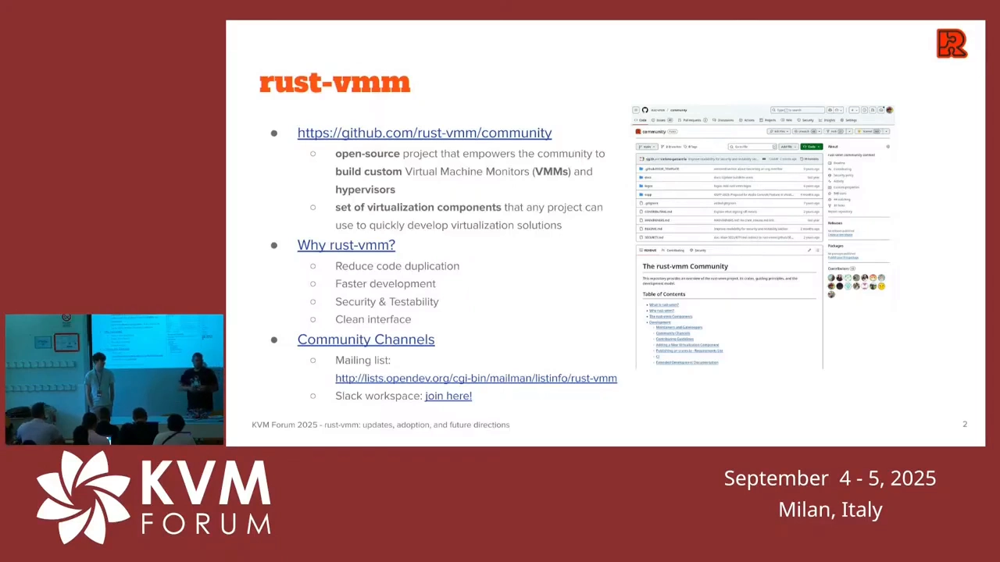
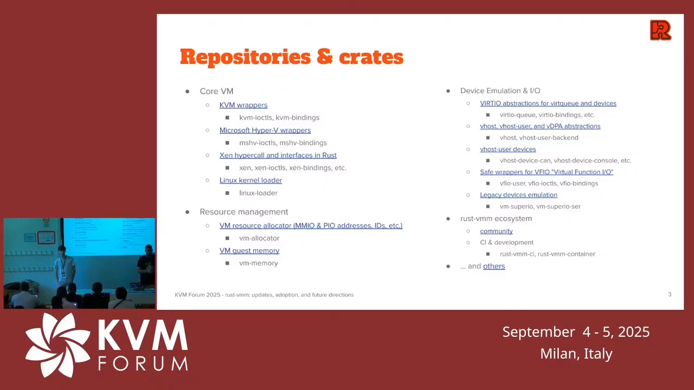
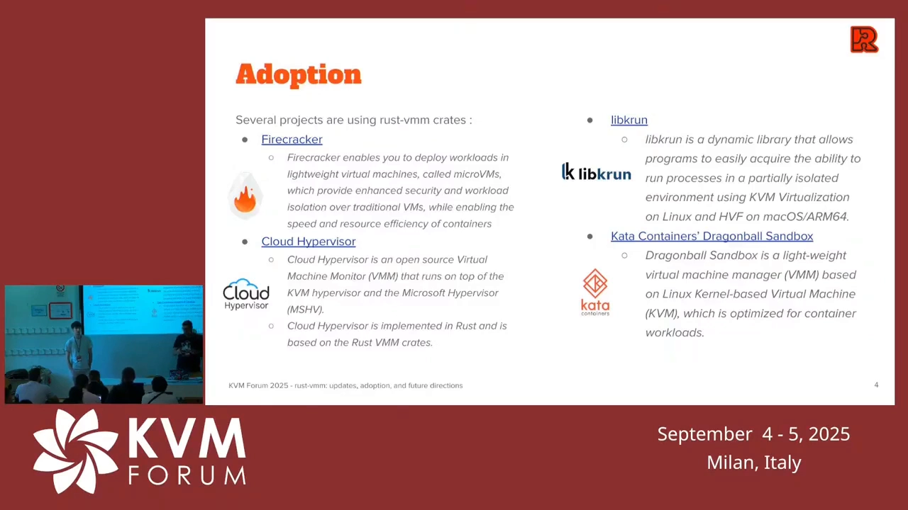
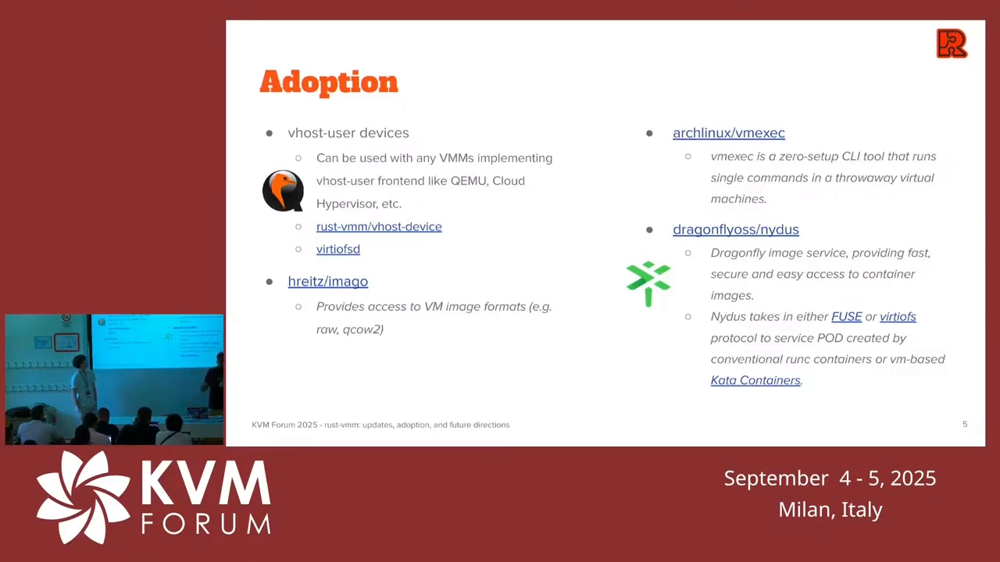
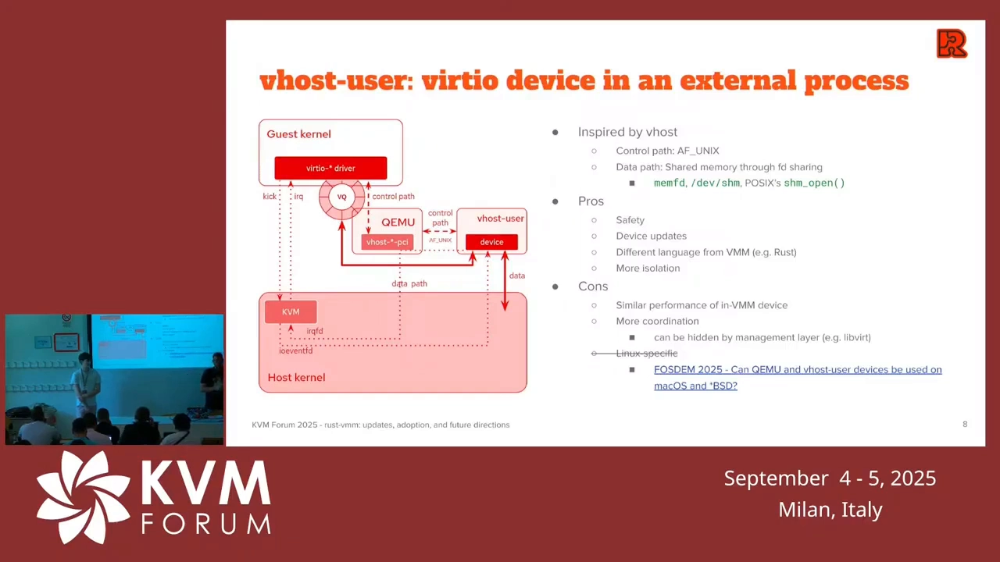
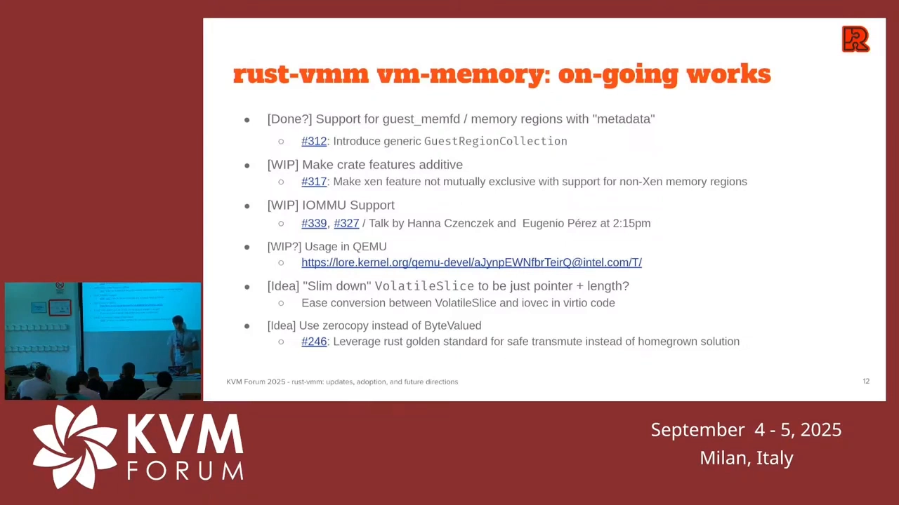
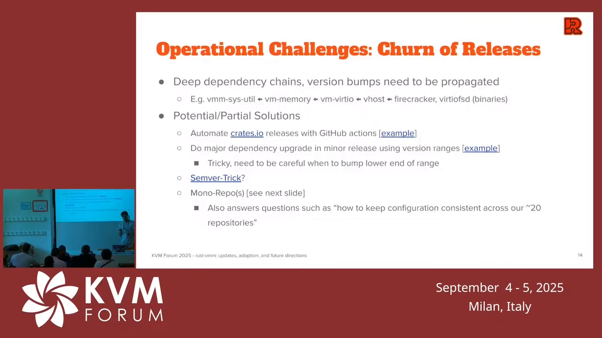
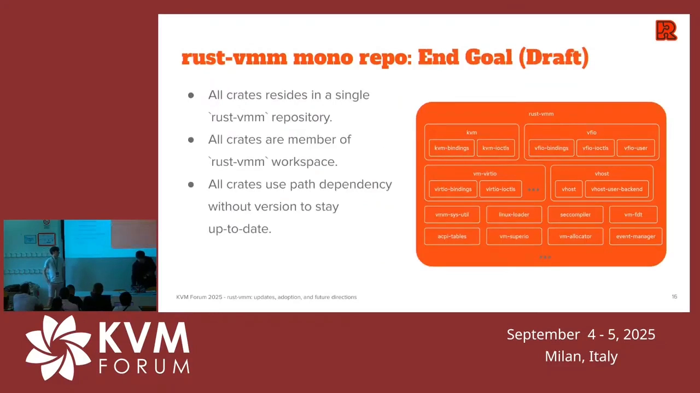
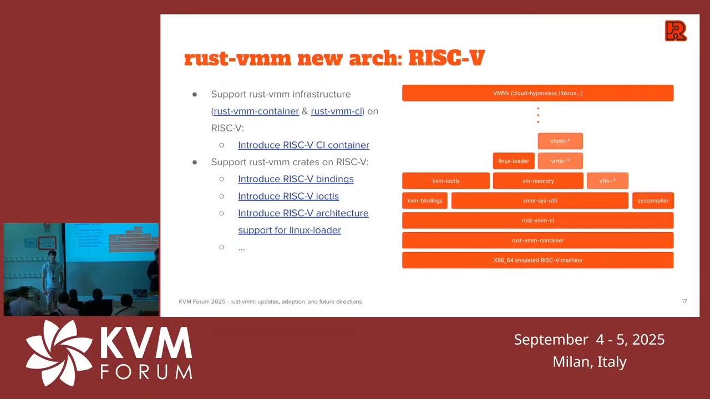

# rust-vmm 把 VMM 拆成二十几个 crate，Firecracker 与 Cloud Hypervisor 共用同一批零件

> 视频来源：[rust-vmm: updates, adoption, and future directions](https://www.youtube.com/watch?v=5h1HYOuCwLc)（YouTube · KVM Forum 2025，讲者 Stefano Garzarella（Red Hat）、Ruoqing He（中国科学院软件研究所）、Patrick Roy（AWS））｜时长约 30 分钟
> 导读：上一篇博客从 Cloud Hypervisor 的角度看"它复用了什么"，这一篇换成零件供应商的视角：rust-vmm 到底提供了哪些 crate、谁在用、共用带来了什么好处和什么麻烦。后半段关于发布流程、monorepo 与 RISC-V 移植的部分是社区运维视角，本文也一并整理，因为它们决定了这套零件能不能长期用下去。

## 本讲要解决的核心问题（SCQA）

**背景**：你已经知道 Cloud Hypervisor 的组件栈是"rust-vmm 的零件 + 自己的定制代码"。Firecracker、Cloud Hypervisor、libkrun 这些 VMM 都在依赖同一批 crate。

**冲突**：但"共用一批 crate"听起来美好，做起来是另一回事。零件要覆盖 KVM、Hyper-V、Xen 三种 hypervisor，要跑在 x86、ARM、RISC-V 三种架构上，还要同时满足"最小 microVM"和"云上通用 VMM"这两种完全不同的诉求；而二十几个 crate 互相依赖，改一个底层 crate 要连锁发布一圈。

**疑问**：这套零件是按什么原则切分的？共用真的省下了什么？代价又落在谁身上？

**回答（中心思想）**：**rust-vmm 的切分原则不是"按功能"，而是"按接口的稳定程度"**——越靠近内核 ABI 的东西（bindings、ioctl）越薄、越稳定，越往上的东西（内存抽象、virtio、vhost）越厚、越容易变。共用让每个 VMM 少写几千行代码、让一处修复惠及所有下游，代价是把"版本传播"变成了社区级运维问题，所以社区正在把所有 crate 合并进一个 monorepo。

## 一、rust-vmm 是什么：只提供零件，不提供虚拟机

### 1.1 四条设计目标

rust-vmm 是一个开源项目，为 VMM 和 hypervisor 这类虚拟化方案提供构建块。它给自己的四条理由是 [[【跳转到 00:30】](https://www.youtube.com/watch?v=5h1HYOuCwLc&t=30)]：



1. **减少代码重复**：你想在自己的 VMM 里实现一个 virtio 设备，可以直接拿现成的 virtqueue 实现。
2. **加快开发**：不用从零写起，开发自己方案的速度能提上来。
3. **安全与可测试**：crate 被多个项目共用，测试成本摊薄，质量反而更容易保证。
4. **干净接口**：接口要稳定、清晰，别人才敢依赖。

讲者反复强调一句话：**本质上我们只提供构建块，不提供任何完整的虚拟机** [[【跳转到 03:25】](https://www.youtube.com/watch?v=5h1HYOuCwLc&t=205)]。这句话划清了边界——rust-vmm 不是"另一个 QEMU"，它连一台能启动的虚拟机都不给你，只给你拼装用的零件。

### 1.2 零件清单：一张幻灯片就是完整的组件划分

这是全场信息密度最高的一页，把 rust-vmm 的仓库与 crate 按职责列全了 [[【跳转到 01:45】](https://www.youtube.com/watch?v=5h1HYOuCwLc&t=105)]：



把它整理成表，就是 rust-vmm 的"产品目录"：

| 分组 | crate | 一句话职责 |
| --- | --- | --- |
| Core VM | `kvm-ioctls`、`kvm-bindings` | KVM 的 ioctl 封装与内核 ABI 绑定 |
| Core VM | `mshv-ioctls`、`mshv-bindings` | 微软 Hyper-V（MSHV）的同款封装 |
| Core VM | `xen`、`xen-ioctls`、`xen-bindings` | Xen hypercall 与接口的 Rust 版本 |
| Core VM | `linux-loader` | 不用 OVMF 这类固件时，直接把 Linux 内核装进客户机内存 |
| 资源管理 | `vm-allocator` | 分配 MMIO / PIO 地址与设备 ID |
| 资源管理 | `vm-memory` | 客户机内存抽象，大部分设备模拟代码都在用它 |
| 设备与 I/O | `virtio-queue`、`virtio-bindings` 等 | virtqueue 与 virtio 设备的抽象 |
| 设备与 I/O | `vhost`、`vhost-user-backend` | 把 vhost / vhost-user / vDPA 抽象出来 |
| 设备与 I/O | `vhost-device-*` | 一批现成的 vhost-user 设备（can、console 等） |
| 设备与 I/O | `vfio-ioctls`、`vfio-bindings`、`vfio-user` | 把设备或虚拟功能（VF）直通给虚拟机 |
| 设备与 I/O | `vm-superio`、`vm-superio-ser` | 老式设备（super I/O）的模拟 |
| 生态 | `community`、`rust-vmm-ci`、`rust-vmm-container` | 文档、CI 与开发容器 |

### 1.3 切分原则：按"接口有多稳定"分层

把这张表竖着看，会发现一条规律：**越靠下的 crate 越薄、越贴近内核 ABI；越靠上的越厚、越贴近设备语义**。

- `kvm-bindings` 只是把内核的结构体和常量搬到 Rust 里，内核 ABI 不变它就不变；
- `kvm-ioctls` 把 ioctl 包成函数，接口就是内核命令本身；
- `vm-memory` 开始有设计取舍了（怎么抽象一段客户机物理内存），所以它的演进最多（第四节会看到）；
- `virtio-*` 和 `vhost-*` 直接编码协议语义，变化最快，也是共享得最不彻底的一层。

这也解释了上一篇博客里那句"virtio 这一层理想情况下也该只有一份，但 rust-vmm 还没准备好"——**协议层比 ABI 层难共享得多**。

## 二、谁在用：一份采用者名单

### 2.1 四个主要 VMM

视频给出的采用者名单里，四个主要项目各有各的定位 [[【跳转到 03:50】](https://www.youtube.com/watch?v=5h1HYOuCwLc&t=230)]：



| 项目 | 它是什么 | 为什么用 rust-vmm |
| --- | --- | --- |
| Firecracker | 轻量虚拟机（microVM），目标是容器负载 | rust-vmm 就是和它一起诞生的——当年它从 crosvm 分叉出来 |
| Cloud Hypervisor | 一个"更大的" VMM，主要面向云负载 | 大量使用 rust-vmm 的 crate，并和社区（包括 AWS 的人）协作 |
| libkrun | 一个动态库，让应用能在非常轻量的虚拟机里拉起进程 | 用例之一是 podman 的容器运行时：在轻量虚拟机里启动容器 |
| Dragonball Sandbox | Kata Containers 的一个运行时，也是轻量 VMM | 部分使用 rust-vmm 的 crate |

注意这四个项目的形态差别有多大：Firecracker 是一个**独立进程**，Cloud Hypervisor 也是独立进程但功能多得多，libkrun 是**一个库**（被别人的进程加载），Dragonball 是**容器运行时的一部分**。同一批 crate 能同时服务这四种形态，本身就是"零件化"的证明——**零件不预设宿主形态**。

### 2.2 还有一批"间接采用者"

除了 VMM 本身，还有一批项目通过 vhost-user 用上了 rust-vmm 的 crate [[【跳转到 05:05】](https://www.youtube.com/watch?v=5h1HYOuCwLc&t=305)]：

- **vhost-user 设备**：`rust-vmm/vhost-device` 里的一批现成设备，以及外部维护的 `virtiofsd`。它们可以被任何实现了 vhost-user 前端的 VMM 使用（QEMU、Cloud Hypervisor 等）。
- **hreitz/imago**：提供对 raw、qcow2 这类虚拟机镜像格式的访问。
- **archlinux/vmexec**：一个零配置的命令行工具，用一条命令在一台用完即弃的虚拟机里跑命令。
- **Dragonfly 的 Nydus**：镜像服务，提供对容器镜像快速、安全的访问，用 FUSE 或 virtiofs 协议服务普通 runc 容器或基于 Kata 的虚拟机创建的 Pod，并用 rust-vmm 的 crate 实现了 EROFS 协议 [[【跳转到 05:30】](https://www.youtube.com/watch?v=5h1HYOuCwLc&t=330)]。



这一组项目说明了一件事：**rust-vmm 的复用已经溢出到 VMM 之外**——镜像服务、命令行工具、容器运行时都在用它的 crate 解析镜像、跑协议。

### 2.3 两个"相关但没采用"的项目

讲者还特意点了两个项目，它们的处境很能说明生态的现实 [[【跳转到 06:20】](https://www.youtube.com/watch?v=5h1HYOuCwLc&t=380)]：

- **crosvm**：rust-vmm 的很多代码本来就是从 crosvm 移植过来的，crosvm 也表过态说愿意用 rust-vmm 的 crate，**但到现在还没真正用起来**。
- **微软的 OpenVMM**：主要面向机密计算/机密虚拟机，把它当 paravisor 用，把 C 的实现换成了 Rust 的，文档里提到了 rust-vmm，也希望能和社区协作。

"血缘上是父辈，采用上却是空白"——这是开源组件化最常见的尴尬：**代码可以共享，路线图很难共享**。

### 2.4 支持的架构与操作系统

到 2025 年，rust-vmm 支持三种架构：x86_64、aarch64、riscv64；操作系统方面 Linux 是每个 crate 都真正支持的，Windows 是部分支持，POSIX（macOS / BSD）是进行中的工作，而且**主要与 vhost-user 设备相关** [[【跳转到 07:10】](https://www.youtube.com/watch?v=5h1HYOuCwLc&t=430)]。

最后这一条值得留意：为什么"支持 macOS"这件事会和 vhost-user 绑在一起？因为 vhost-user 让设备模拟跑在独立进程里，而那个进程完全可以是一个跨平台的普通应用——**把设备从 VMM 里拆出来，顺带把设备变成了可移植的软件**。

## 三、共用的第一个收益：vhost-user 让设备离开 VMM

### 3.1 从 vhost 到 vhost-user：动机变了

vhost-user 让我们能把 virtio 设备的模拟从 VMM 搬到外部进程，这个思路是受 vhost 启发的：**vhost 当初是为了性能**，把模拟从 VMM 搬进宿主内核；而 **vhost-user 更多是为了安全和隔离**，也方便你维护代码、在线更新代码，而且你的 VMM 和 virtio 设备甚至可以用完全不同的语言来写 [[【跳转到 07:35】](https://www.youtube.com/watch?v=5h1HYOuCwLc&t=455)]。

### 3.2 一条控制路径 + 一块共享内存

协议本身很简单 [[【跳转到 08:25】](https://www.youtube.com/watch?v=5h1HYOuCwLc&t=505)]：

- **控制路径**：VMM 和应用之间有一个 Unix domain socket（`AF_UNIX`）。
- **数据路径**：一块共享内存，从 VMM 共享给设备。唯一的要求是这块内存必须能被一个文件描述符寻址，这样才能共享出去——`memfd`、`/dev/shm`、POSIX 的 `shm_open` 都可以。



这张图把上一篇博客里 Cloud Hypervisor 的 virtio 数据面又推进了一层：**kick 和 irq 还是走 KVM 的 ioeventfd / irqfd，但真正处理请求的代码已经不在 VMM 进程里了**。好处是安全（设备进程被攻破不等于 VMM 被攻破）、可独立更新、可用别的语言写；代价是性能与进程内设备相近，而且需要更多协调（这部分复杂度可以被管理面隐藏，比如 libvirt）。

### 3.3 rust-vmm 提供的三个 crate

围绕 vhost-user，rust-vmm 提供了三个层次的零件 [[【跳转到 09:15】](https://www.youtube.com/watch?v=5h1HYOuCwLc&t=555)]：

| crate | 角色 |
| --- | --- |
| `vhost` | 一个 Rust 库，把 vhost、vhost-user 和 vDPA 三种后端统一抽象出来 |
| `vhost-user-backend` | 实现 vhost-user 后端的框架：前端通常是 VMM，后端是实现设备的应用 |
| `vhost-device-*` | 现成的设备实现：键盘、控制台、声音、视频、vsock 等 |

此外还有外部维护的 `virtiofsd`（实现 virtio-fs 设备）。

### 3.4 最近在 virtio / vhost crate 里做的事

讲者列了几项近期工作 [[【跳转到 10:05】](https://www.youtube.com/watch?v=5h1HYOuCwLc&t=605)]：

- **vhost-user 的热迁移**：主要贡献者是 Herman；
- **vhost-user 设备的共享对象**：通常 virtio 里内存是从客户机暴露给宿主的，但在 GPU 或者 virtio-fs 这类场景下，宿主需要把一些内存暴露给客户机，这个特性就是为这些场景准备的 [[【跳转到 10:30】](https://www.youtube.com/watch?v=5h1HYOuCwLc&t=630)]；
- **改进设备 reset 的方式**（Anna 的功劳）；
- **read/write 相关的类**：改进处理 virtio 描述符的方式（Matias 等人）；
- **packed descriptor**：加进了 `virtio-queue` 这个 crate [[【跳转到 10:55】](https://www.youtube.com/watch?v=5h1HYOuCwLc&t=655)]。

还有两个 GSoC 项目值得一提：一个是让 vhost-user 设备能跑在 Linux 之外的系统上（结项报告里列的 PR 大部分已合并，工作快完成了），另一个是**形式化验证**（由 Matias 指导）[[【跳转到 11:10】](https://www.youtube.com/watch?v=5h1HYOuCwLc&t=670)]。

## 四、共用的第二个收益：一个 crate 修一次，所有 VMM 受益

### 4.1 vm-memory 是什么：把 unsafe 关进一个 crate

Patrick 负责讲 `vm-memory`，他对这个 crate 的定义很精确：**它把一堆你在 Rust 里处理裸指针时本来要写的 unsafe 代码包了起来，在上面给出安全、好用的接口**，同时处理好 Rust 在裸内存上的安全性和可变性（variance）这些坑 [[【跳转到 12:25】](https://www.youtube.com/watch?v=5h1HYOuCwLc&t=745)]。

为什么这个 crate 是核心？因为**客户机内存本质上就是 VMM 进程里的一段普通内存**，VMM 要能直接读写它；而"直接读写一段不受 Rust 类型系统管辖的内存"恰恰是 Rust 里最危险的操作。把这层危险封装掉，等于给所有下游 VMM 省掉了最容易出安全漏洞的一块代码。

### 4.2 一年的进展：从"一个 slot 一块内存"到"一组内存区域"

`vm-memory` 过去一年的改动，几乎都围绕"模型不够灵活"这一个问题展开 [[【跳转到 12:50】](https://www.youtube.com/watch?v=5h1HYOuCwLc&t=770)]：

**问题一：guest_memfd 用起来别扭。** `guest_memfd` 是 KVM 新的内存管理接口，目前主要用于机密虚拟机。而 `vm-memory` 原来和"每个区域一块客户机内存"这个模型绑得很紧：每个 KVM memory slot 对应一块 `vm-memory` 管理的区域，所有访问指令都要经过这个映射。可有时候我们还想给客户机内存**关联一些元数据**——比如某个项目自己也有一块 `guest_memfd`，把元数据完全独立于客户机内存存放会带来不少麻烦，如果能都塞进同一个客户机内存区域里就轻松多了 [[【跳转到 13:40】](https://www.youtube.com/watch?v=5h1HYOuCwLc&t=820)]。

**解法：泛化"一组客户机内存区域"。** 与其在 `vm-memory` 里显式支持 `guest_memfd`（这也会很复杂，因为还要支持 Windows 和 Xen，而 Xen 那边根本没有 `guest_memfd`），不如把"管理一组客户机内存区域"这件事泛化：只要实现了某个定义了内存基本操作的 trait，你就可以管理任意一组区域，并把元数据挂到每个区域上 [[【跳转到 14:05】](https://www.youtube.com/watch?v=5h1HYOuCwLc&t=845)]。

**这个改动的直接受益者**：Firecracker 打算用它来做**内存热插拔**，记录哪些内存区域被热插过、哪些没有 [[【跳转到 14:30】](https://www.youtube.com/watch?v=5h1HYOuCwLc&t=870)]。

### 4.3 一个 crate 的设计缺陷，会变成所有下游的编译期负担

Xen 支持的例子最能说明"共用"的双刃性。Xen 有一套不同的内存访问模型：有 grant mapping 和 foreign mapping，访问内存之前要先做一次映射，读和写要分别映射。再加上内存代码最初写法的影响，里面有很多条件分支，核心结构体在不同架构上还有不同的定义 [[【跳转到 14:55】](https://www.youtube.com/watch?v=5h1HYOuCwLc&t=895)]。

当初的实现方式，是把它当成"另一个架构"甚至"另一个操作系统"来对待——虽然它其实还是 Linux，但因为那段代码里全是 Linux 和 Unix/KVM 的 `ifdef`，**vhost 那边的人被迫维护两个二进制：一个支持 Xen，一个不支持** [[【跳转到 15:20】](https://www.youtube.com/watch?v=5h1HYOuCwLc&t=920)]。

社区正在把这块解开，让所有功能都在同一个二进制里：把 Xen 支持做成一个**可叠加的 feature**，而不是互斥开关。已经有一个 PR 开着，在逐步推进。

### 4.4 还没做完的几件事

同一页幻灯片列了 `vm-memory` 的完整待办 [[【跳转到 12:25】](https://www.youtube.com/watch?v=5h1HYOuCwLc&t=745)]：



- **虚拟内存模型**：目前 `vm-memory` 完全是纯物理内存——你对一个内存对象做的所有访问，都被解释成通过客户机物理地址完成，所以如果有 MMU，你就没法表达那些访问。Hannah 在加这个支持（也就是 IOMMU 支持）[[【跳转到 16:10】](https://www.youtube.com/watch?v=5h1HYOuCwLc&t=970)]。
- **在 QEMU 里的使用**：有人在尝试把 `vm-memory` 用到 QEMU 里，讲者说问了几个相关的人也不太清楚这件事，把链接放在了幻灯片上 [[【跳转到 16:35】](https://www.youtube.com/watch?v=5h1HYOuCwLc&t=995)]。
- **给 `VolatileSlice` 瘦身**：现在有个类型本质上就是"客户机内存的一个切片"，按说它应该只是一个指针加一个长度，但里面塞了一些额外的元数据。讲者很想把它去掉，只是还没想好怎么做 [[【跳转到 17:00】](https://www.youtube.com/watch?v=5h1HYOuCwLc&t=1020)]。
- **用 zerocopy 替代自研方案**：Rust 生态一直在做"安全地做类型转换"，rust-vmm 有自己的方案（`ByteValued`），但更想换成通用 Rust 社区那个测试更充分的方案，这样还能做到零拷贝。这被标成一个适合新人上手的 issue [[【跳转到 17:25】](https://www.youtube.com/watch?v=5h1HYOuCwLc&t=1045)]。

### 4.5 从 Firecracker 的视角看：还缺什么

Patrick 同时是 Firecracker 的维护者，所以他还会从"什么对 Firecracker 更好"的角度看 rust-vmm [[【跳转到 18:15】](https://www.youtube.com/watch?v=5h1HYOuCwLc&t=1095)]：

- **ACPI 和 PCI 支持不够好**。目前有一个 ACPI 的 crate，但它没发布到 crates.io，下游的 Firecracker 没法依赖，只好自己维护一份——他很想把它去掉，改用上游的。
- **RNG 已经没有自己的代码了**，直接用 hypervisor 里的那份。
- **希望有一个公共的 PCI crate**，也许可以先从 bindings 开始——这看起来是个容易达成一致、再往上长的起点 [[【跳转到 18:40】](https://www.youtube.com/watch?v=5h1HYOuCwLc&t=1120)]。

这段内容回答了一个很实际的问题：**共用不是"有就拿来用"，还要看它有没有发布、接口够不够用**。一个没发到 crates.io 的 crate，对下游等于不存在。

## 五、共用的代价：二十几个 crate 的版本传播

### 5.1 一条真实的依赖链

讲者把 rust-vmm 的运维挑战摆到了台面上：现在大约二十几个 crate，其中一些的依赖链非常长 [[【跳转到 19:05】](https://www.youtube.com/watch?v=5h1HYOuCwLc&t=1145)]：



图里那条链是：

```text
vmm-sys-util → vm-memory → vm-virtio → vhost → firecracker / virtiofsd
```

每当我们给 `vmm-sys-util` 做一次大版本发布，就要把它传播到 `vm-memory` 的大版本、再传播到 `vhost` 的大版本，然后下游才能真正用上 [[【跳转到 19:30】](https://www.youtube.com/watch?v=5h1HYOuCwLc&t=1170)]。中间任何一环漏了，就得回头再发一次版本——讲者的原话是"我们老是漏东西，然后回头补，挺乱的" [[【跳转到 19:55】](https://www.youtube.com/watch?v=5h1HYOuCwLc&t=1195)]。

### 5.2 四个候选解法

幻灯片列了四条路 [[【跳转到 19:05】](https://www.youtube.com/watch?v=5h1HYOuCwLc&t=1145)]：

1. **用 GitHub Actions 自动发布到 crates.io**；
2. **在小版本里做依赖大升级**（用版本范围），但这很 tricky，要小心什么时候抬高范围下界；
3. **Semver-Trick**：一个知名的版本兼容技巧；
4. **monorepo**：把仓库合并，顺带还能回答"怎么让二十几个仓库的配置保持一致"这个问题。

讲者说最终会做的是第 4 条：把大部分 crate 合并到一个仓库里，这样所有版本号可以在一个 PR 里一起升，PR 一合并就自动发布 [[【跳转到 19:55】](https://www.youtube.com/watch?v=5h1HYOuCwLc&t=1195)]。

### 5.3 已经合并的仓库

Ruoqing 接着讲了进展：他们已经有几个 monorepo 了——把 `kvm-bindings` 合并进了 `kvm-ioctls`，仓库改名叫 `kvm`；VFIO 那边也做了同样的事；还有 `vhost` 仓库 [[【跳转到 21:35】](https://www.youtube.com/watch?v=5h1HYOuCwLc&t=1295)]。

在提问环节有人追问这件事，回答补了一个细节：**VFIO 其实早就是"一个仓库多个 crate"的形态**（`vfio-bindings` 是一个 crate，`vfio-ioctls` 是另一个），所以合并仓库对社区并不陌生；真正的痛点还是发布——`vmm-sys-util` 被所有 crate 使用，它一改，其它 crate 都得等它发布到 crates.io 才能跟进 [[【跳转到 29:10】](https://www.youtube.com/watch?v=5h1HYOuCwLc&t=1750)]。

## 六、monorepo 蓝图：一张图就是完整的组件划分

### 6.1 终态长什么样

幻灯片给出了 monorepo 的终态草案 [[【跳转到 22:20】](https://www.youtube.com/watch?v=5h1HYOuCwLc&t=1340)]：



三条规则：

1. 所有 crate 放在一个 `rust-vmm` 仓库里；
2. 所有 crate 都是 `rust-vmm` workspace 的成员；
3. 所有 crate 用**不带版本号的 path 依赖**，保证始终是最新的。

第 3 条是这套方案的关键：用 path 依赖，CI 跑的就是工作树上最新的代码，不会出现"上游修了但下游还在用旧版本"的窗口 [[【跳转到 22:45】](https://www.youtube.com/watch?v=5h1HYOuCwLc&t=1365)]。

### 6.2 这张图就是本文要的"组件划分"

抛开 monorepo 的运维话题，这张图本身是 rust-vmm 组件划分最完整的一张：

| 子目录 | 成员 crate | 管什么 |
| --- | --- | --- |
| `kvm` | `kvm-bindings`、`kvm-ioctls` | KVM 的 ABI 绑定与 ioctl |
| `vfio` | `vfio-bindings`、`vfio-ioctls`、`vfio-user` | 设备直通 |
| `vm-virtio` | `virtio-bindings`、`virtio-ioctls` 等 | virtio 设备与传输层 |
| `vhost` | `vhost`、`vhost-user-backend` | 后端卸载 |
| 独立 | `vmm-sys-util`、`linux-loader`、`seccompiler`、`vm-fdt`、`acpi-tables`、`vm-superio`、`vm-allocator`、`event-manager` | 系统调用工具、内核装载、沙箱、设备树、ACPI 表、老式设备、资源分配、事件循环 |

对照上一篇博客里 Cloud Hypervisor 的组件栈，会发现两边几乎是同一张图的两种画法：**Cloud Hypervisor 画的是"我用到了哪些"，rust-vmm 画的是"我提供了哪些"**。

## 七、新架构：RISC-V 是怎么加进去的

### 7.1 动机：先把 Cloud Hypervisor 搬过去，结果发现零件不支持

Ruoqing 讲了他做 RISC-V 支持的起点：他一开始想把 Cloud Hypervisor 和 Kata Containers 带到 RISC-V 上，然后发现这些 crate 缺少 RISC-V 架构支持——这是绕不过去的，必须先补上 [[【跳转到 23:10】](https://www.youtube.com/watch?v=5h1HYOuCwLc&t=1390)]。

### 7.2 顺序：先 CI，再核心 crate

幻灯片画出了 RISC-V 支持的分层推进方式 [[【跳转到 23:35】](https://www.youtube.com/watch?v=5h1HYOuCwLc&t=1415)]：



这张图把"加一个新架构要动什么"讲得比任何文档都清楚：

1. **最底层**：CI 容器与 CI 流水线先支持 RISC-V（`rust-vmm-container`、`rust-vmm-ci`）；
2. **然后**：`vmm-sys-util`、`seccompiler` 这类基础 crate；
3. **再往上**：`kvm-bindings`、`kvm-ioctls`（引入 RISC-V 的 bindings 与 ioctls）；
4. **接着**：`vm-memory`、`linux-loader`、`virtio-*`；
5. **最后**：`vhost-*`，以及最上面的 VMM。

**为什么 CI 必须先行？** 因为"在把代码合并进 `kvm-bindings` 这类核心 crate 之前，我们首先得让 CI 能在 RISC-V 上跑测试" [[【跳转到 23:35】](https://www.youtube.com/watch?v=5h1HYOuCwLc&t=1415)]。没有测试的架构支持，等于给所有下游埋雷。

### 7.3 没有硬件怎么办：在 x86 上模拟

难点很现实：这类硬件还没量产，而且要么缺扩展（比如 Intel 那边的 VT-x 之类）。他们的办法是用 **x86 机器上由 AWS 提供的模拟环境**，来跑 rust-vmm crate 的简单构建和单元测试 [[【跳转到 24:00】](https://www.youtube.com/watch?v=5h1HYOuCwLc&t=1440)]。

后续计划是：等研究所拿到真实硬件、接进基础设施之后，让它们来跑 RISC-V 的任务 [[【跳转到 25:15】](https://www.youtube.com/watch?v=5h1HYOuCwLc&t=1515)]；同时补上还缺 RISC-V 支持的 crate（比如 vhost 与 vhost-user 相关的），并为 CI 写流水线 [[【跳转到 25:40】](https://www.youtube.com/watch?v=5h1HYOuCwLc&t=1540)]。

### 7.4 下游的进展

最后是采用者的状态 [[【跳转到 26:05】](https://www.youtube.com/watch?v=5h1HYOuCwLc&t=1565)]：

- **Cloud Hypervisor**：现在能直接启动 Linux；
- **libkrun**：也差不多能启动 Linux 了，还有一些 GSI 配置的工作要收尾；
- **Kata Containers**：也快好了。

这段顺序值得记住：**架构支持是一条从 CI 到基础 crate 再到 VMM 的链**，任何一环没到位，最上面的 VMM 都跑不起来。

## 八、问答：老式设备与仓库合并

视频末尾有两个提问，答案补充了两点信息。

**问：有人在 rust-vmm 里做 hypervisor 的老式设备模拟吗？** 回答是：RTC 其实有一点支持，因为 Firecracker 支持它；但 rust-vmm 很多代码诞生于 Firecracker，而 Firecracker 当初说的是"一张白纸"，不支持任何老式设备，所以现在对这些老式设备支持不多——不过**如果你愿意做，我们肯定接受贡献**。回答里还补了一句很有信息量的话：Cloud Hypervisor 的目标就不只是 microVM [[【跳转到 27:00】](https://www.youtube.com/watch?v=5h1HYOuCwLc&t=1620)]。

**问：仓库合并的进展？** 回答重申了痛点：`vmm-sys-util` 被所有 crate 使用，它一改，其它 crate 得等它发布到 crates.io 才能跟进，有时候漏了一步就得再发一次版本 [[【跳转到 29:10】](https://www.youtube.com/watch?v=5h1HYOuCwLc&t=1750)]。

## 小结

- **rust-vmm 只提供零件，不提供虚拟机**：它的四条目标是减少重复、加快开发、安全可测试、接口干净；连一台能启动的虚拟机都不给你。
- **切分原则是"按接口稳定程度分层"**：`kvm-bindings`/`kvm-ioctls` 贴着内核 ABI 最稳定，`vm-memory` 开始有设计取舍，`virtio-*`/`vhost-*` 编码协议语义、变化最快也最难共享。
- **采用者形态各异**：Firecracker（独立进程、microVM）、Cloud Hypervisor（独立进程、云上通用）、libkrun（库）、Dragonball（运行时的一部分），还有 imago、vmexec、Nydus 这些 VMM 之外的项目。
- **vhost-user 是"设备离开 VMM"的那条路**：控制路径走 Unix socket，数据路径走共享内存，KVM 的 ioeventfd/irqfd 仍在；`vhost`、`vhost-user-backend`、`vhost-device-*` 三层零件把这件事标准化。
- **一个 crate 修一次，所有下游受益**：`vm-memory` 把裸内存的 unsafe 关进一个 crate，一年里把"一个 slot 一块内存"泛化成"一组内存区域"，直接支撑了 Firecracker 的内存热插拔。
- **共用的代价是版本传播**：`vmm-sys-util → vm-memory → vm-virtio → vhost → 下游` 这条链让每次大版本发布都要逐层跟进，社区的解法是合并成 monorepo，用 path 依赖保持最新。
- **加一个新架构是一条链**：CI 容器与流水线 → 基础 crate → `kvm-bindings`/`kvm-ioctls` → `vm-memory`/`linux-loader`/`virtio-*` → `vhost-*` → VMM；没有硬件时先用 x86 上的模拟环境跑构建与单测。

## 关键术语速查

| 术语 | 一句话解释 |
| --- | --- |
| rust-vmm | 一组用 Rust 写的 VMM 公共组件 crate，只提供零件，不提供完整虚拟机 |
| crate | Rust 的构建单元与依赖单位，相当于 C 语言里的库 |
| `kvm-bindings` | KVM 内核 ABI 的 Rust 绑定：结构体、常量、寄存器定义 |
| `kvm-ioctls` | 把 KVM 的 ioctl 包装成类型安全的 Rust 函数 |
| `vm-memory` | 客户机内存抽象，把处理裸指针的 unsafe 代码封装起来 |
| `vmm-sys-util` | 系统调用与事件循环的通用工具，几乎所有 crate 都依赖它 |
| `linux-loader` | 不用固件时，直接把 Linux 内核装进客户机内存 |
| `virtio-queue` | virtqueue 的实现，含 packed descriptor 等特性 |
| `vhost` | 把 vhost / vhost-user / vDPA 三种后端统一抽象的 crate |
| `vhost-user-backend` | 实现 vhost-user 后端的框架，前端通常是 VMM |
| `vhost-device-*` | 现成的 vhost-user 设备实现（键盘、控制台、声音、vsock 等） |
| `vm-superio` | 老式设备（super I/O）的模拟 |
| `vfio-ioctls` / `vfio-user` | 设备直通；`vfio-user` 让直通设备也能跑在独立进程里 |
| `guest_memfd` | KVM 新的客户机内存管理接口，主要用于机密虚拟机 |
| `GuestRegionCollection` | `vm-memory` 里"一组客户机内存区域"的抽象，可挂元数据 |
| vDPA | 一种让 virtio 数据面直接落到硬件上的框架 |
| monorepo | 把多个 crate 放进一个仓库，用 workspace 统一管理依赖与发布 |
| EROFS | 一种只读文件系统，Nydus 用它承载容器镜像 |