# gVisor 的两层隔离：用用户态内核截住每一次系统调用

> 视频来源：[The Enemy Within: Running Untrusted Code with gVisor](https://www.youtube.com/watch?v=1Ib-rfSzDuM)（KubeCon + CloudNativeCon + Open Source Summit China 2019 · Ian Lewis，Google）｜时长约 35 分钟
> 导读：这是一支把「为什么要在用户态再写一个内核」讲得最直白的演讲。讲者从一次 `open()` 出发，画出容器、虚拟机、gVisor 三种隔离边界，然后逐个拆开 Sentry、Gofer 与平台层，最后坦白列出 gVisor 管不了的那些事。字幕为自动生成，术语已按上下文校正。

## 本讲要解决的核心问题（SCQA）

**背景**：容器靠 namespace 和 cgroup 把进程「关」起来。被关住的进程看到的文件系统、进程表、网络都是自己的一份，看起来像一台独立的小机器。

**冲突**：这种「关」只发生在资源的可见性上，不发生在特权级上。容器里的进程要读文件，仍然要执行一条 `syscall` 指令，CPU 仍然要切到内核态，真正干活的仍然是宿主那一份 Linux 内核代码——那是一段以最高权限运行的、几十万行量级的 C 代码。任何一个接口上的 bug，都可能变成一次容器逃逸。而「少给几个系统调用」这条路走不通：Dirty COW 这类著名漏洞出在 `madvise` 上，而几乎所有应用都需要 `madvise`。

**疑问**：既然不能靠削减系统调用数量来缩小攻击面，那能不能让应用的系统调用**根本不进入宿主内核**？

**回答（中心思想）**：gVisor 的做法是在用户态用 Go 重新实现一个 Linux 内核——Sentry，把应用发出的系统调用全部截下来自己处理；文件 I/O 再交给沙箱外的另一个进程 Gofer 代理。于是宿主内核只能看到 Sentry 主动发出的几十个「干净」系统调用。它换来的是**两层隔离**和极小的宿主攻击面，代价是每次系统调用多一趟用户态往返，以及一部分内核语义只能「近似实现」。

## 一、容器为什么不够：每一次 open 都在跑特权代码

### 1.1 系统调用就是一次进入内核

演讲从一个最简单的动作开始：应用打开一个文件。

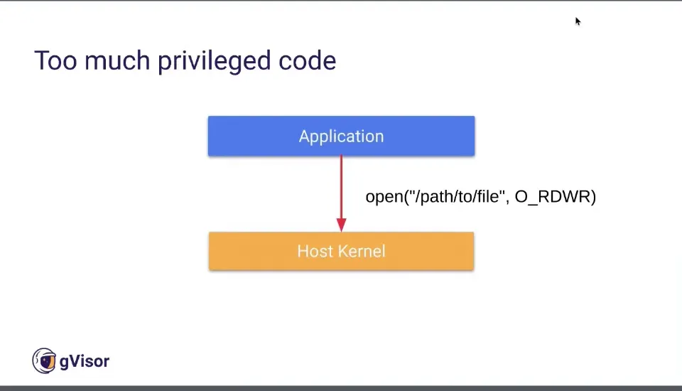

应用在 CPU 上跑着，执行到这次对内核的调用，发生一次上下文切换到内核态：把一些代码或数据放到内存里，然后切进内核，内核读这些内存、执行对应的系统调用实现。这里举的例子是打开文件，返回时应用拿到一个文件描述符。[【跳转到 04:01】](https://www.youtube.com/watch?v=1Ib-rfSzDuM&t=241)

关键在于：切换之后真正执行的是**宿主内核的代码**，而且是在特权模式下执行。也就是说，应用正常运行的过程中，一直在「以内核身份运行别人的代码」。[【跳转到 04:26】](https://www.youtube.com/watch?v=1Ib-rfSzDuM&t=266)

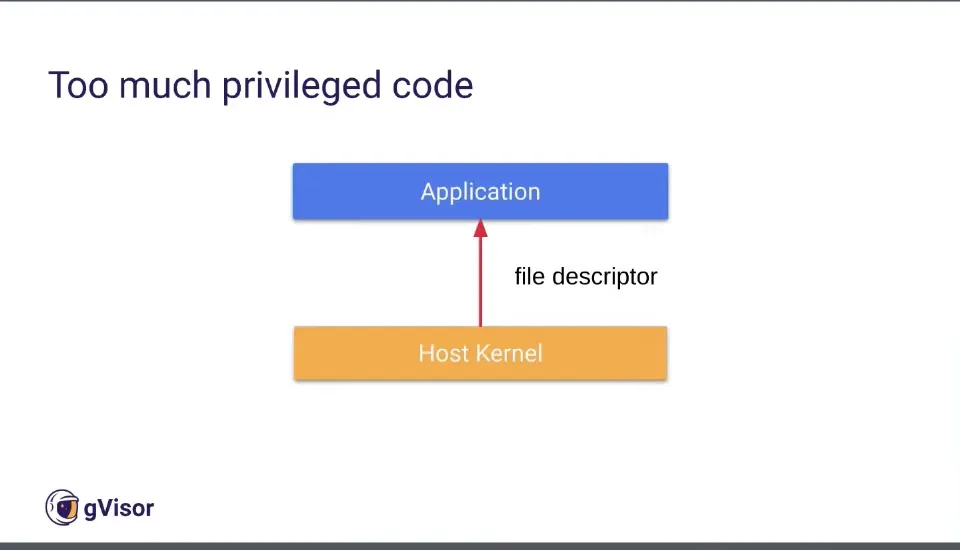

### 1.2 一个 bug 的距离

这段被执行的代码恰恰是整个系统里最敏感的部分。如果 Linux 内核或宿主 OS 里有一个 bug，攻击者就可能拿到与内核同等权限的任意代码执行——这是讲者反复强调的「我们非常不想看到的事情」。[【跳转到 04:51】](https://www.youtube.com/watch?v=1Ib-rfSzDuM&t=291)

所以普通容器的问题可以一句话概括：**它离内核 bug 只有一步之遥**。容器本质上就是直接跑在宿主上的进程，它暴露的任何一个接口上的 bug，都可能成为逃逸通道。[【跳转到 05:41】](https://www.youtube.com/watch?v=1Ib-rfSzDuM&t=341)

### 1.3 为什么「少给几个系统调用」行不通

最直觉的补救是 seccomp：把不需要的系统调用禁掉。讲者直接否掉了这条路，理由是应用真正需要的系统调用太多，而且**恰恰是最普通的那些最容易出问题**。

Dirty COW（CVE-2016-5195）就是典型例子：漏洞出在 `madvise` 相关路径上，而 `madvise` 几乎是每个应用都会用到的调用。你没法把它禁掉，也就没法靠过滤把攻击面降到足够小。[【跳转到 09:26】](https://www.youtube.com/watch?v=1Ib-rfSzDuM&t=566)

同一个逻辑也否掉了 unikernel 路线：把客户 OS 作为库链接进应用、跑在 hypervisor 或锁死的容器里，想法很好，但大多数情况下你没法「自带容器」——你得专门构建一个包含操作系统的容器，构建流程要另搞一套，能跑的应用类型也受限。[【跳转到 10:16】](https://www.youtube.com/watch?v=1Ib-rfSzDuM&t=616)

## 二、沙箱的目标：两层隔离

### 2.1 一层边界不够

讲者把沙箱的目标写成三条：

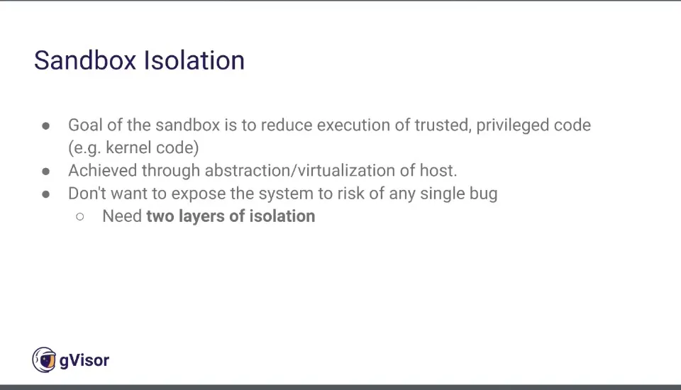

- 缩小攻击面的关键，是**减少内核里受信任的特权代码被执行的机会**；
- 手段是某种虚拟化或抽象——造一个「虚拟主机」，它被攻破也不会把整台宿主暴露出去；
- 而 Google 构建沙箱系统的一条原则是：**要有两层隔离**。

### 2.2 为什么偏偏是两层

理由很朴素：不希望基础设施「离被攻破只差一个 bug」。单个 bug 也许还能接受，但要同时凑齐两个能配合工作的 bug，几乎闻所未闻。[【跳转到 07:46】](https://www.youtube.com/watch?v=1Ib-rfSzDuM&t=466)

所以攻击者要拿到用户数据或宿主上的东西，必须穿过两层边界。讲者认为这大大降低了逃逸概率——这也是后面所有架构决定的出发点。[【跳转到 08:11】](https://www.youtube.com/watch?v=1Ib-rfSzDuM&t=491)

## 三、gVisor 的选择：虚拟化 OS，而不是虚拟化硬件

### 3.1 虚拟机的做法：把硬件抽象掉

虚拟机是大家最熟悉、用得最多的沙箱方式。它给你一个客户 OS——你通常把整个 VM 镜像（客户 OS 加应用）一起带进来，隔离层落在 hypervisor 这一层。

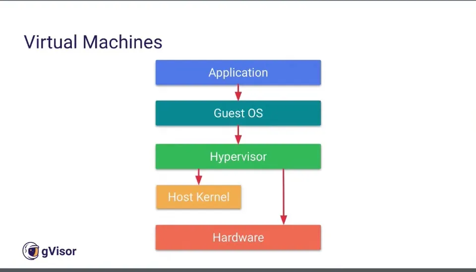

这条边界的强度取决于形态：Type 2 的 hypervisor 是内核的一部分，VM 作为普通进程运行，给你一层不错的边界，但仍然离「hypervisor 里一个 bug 就拿下整台宿主」只差一步；Type 1 则可能要求攻击者同时凑到 hypervisor 的 bug 加上某些硬件问题才能逃逸，稍好一些。[【跳转到 12:46】](https://www.youtube.com/watch?v=1Ib-rfSzDuM&t=766)

虚拟机还有三个实际缺点，正好解释了 gVisor 为什么要另起炉灶：

- **资源不灵活**：必须给沙箱分配整块的 CPU 和内存，然后完全划给它；超分（over-commit）能力有限。
- **内存气球需要客户机配合**：气球回收内存要靠沙箱里的 OS 配合，而那个 OS 未必可信。
- **启动时间受设备数量拖累**：microVM 能改善启动，但需要支持的设备一多，启动又慢下来。

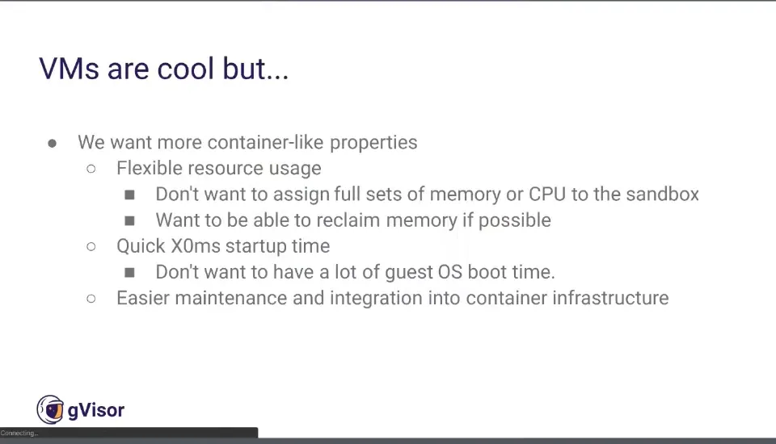

讲者还补了一条产品层面的诉求：希望它「非常像容器」，能直接接进 Kubernetes，在资源分配和管理上给用户容器化的体验，而不是让沙箱和非沙箱变成两套范式。[【跳转到 14:51】](https://www.youtube.com/watch?v=1Ib-rfSzDuM&t=891)

### 3.2 gVisor 的做法：把 OS 层虚拟化

对照虚拟机的分层，gVisor 换了一个虚拟化的层次：**不虚拟化硬件，而是虚拟化操作系统**。

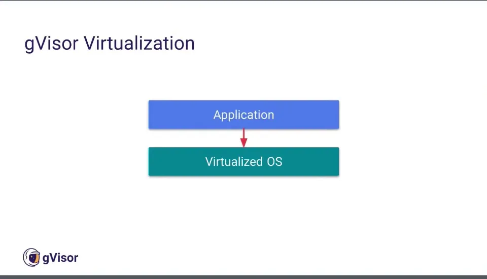

应用之上那一层「虚拟 OS」是可信的——至少到应用真正开始运行为止；应用本身可以完全不可信，直接带进来跑。这正是两层隔离的来源：一层是**由我们控制、我们期望的那个客户 OS**，另一层是宿主内核这一道强边界。[【跳转到 16:06】](https://www.youtube.com/watch?v=1Ib-rfSzDuM&t=966)

### 3.3 拦截是怎么发生的

具体机制只有一句话：**拦截应用发起的系统调用，交给用户态内核处理**。整个沙箱作为用户态里的一个包运行，只需要向真正的宿主发起很有限的系统调用。[【跳转到 16:56】](https://www.youtube.com/watch?v=1Ib-rfSzDuM&t=1016)

这样做有两个收益：

1. **数量少了**——真正落到宿主内核的系统调用大幅减少；
2. **参数可控了**——传给这些系统调用的参数也由 gVisor 自己构造，能控制得更细。[【跳转到 17:21】](https://www.youtube.com/watch?v=1Ib-rfSzDuM&t=1041)

于是攻击者的路径变成：先突破用户态，或者在 Sentry 本身找到 bug 越过这一层，才有可能向内核发出任意系统调用；而即便越过了，他能用的系统调用也被限制在一个大幅缩减的集合里。[【跳转到 18:11】](https://www.youtube.com/watch?v=1Ib-rfSzDuM&t=1091)

## 四、架构：Sentry、Gofer 与平台层

### 4.1 一张图看全

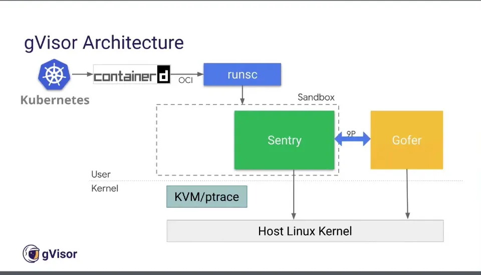

这张图里有四个角色：

- **runsc**：gVisor 的运行时，对应 OCI 里的 runtime，由 containerd 调用；
- **Sentry**：跑在沙箱里的用户态内核，应用的系统调用都进到它这里；
- **Gofer**：跑在沙箱外，替 Sentry 做文件 I/O，两者之间走 **9P** 协议；
- **平台（platform）**：图上的 `KVM/ptrace` 方块，负责把应用的系统调用「截」下来交给 Sentry。

### 4.2 Sentry：用户态内核

Sentry 是整个设计的核心。它用 Go 写，实现了 Linux 系统调用的语义（文件、进程、内存、信号、网络等），所以应用完全察觉不到自己面对的不是真内核。

它同时是「第一层防线」，讲者的原话是：**假设它一定会被攻破**，所以它跑在用户态、以 nobody 身份运行。[【跳转到 16:31】](https://www.youtube.com/watch?v=1Ib-rfSzDuM&t=991)

### 4.3 Gofer：把文件系统挪出沙箱

文件操作是唯一没法完全在沙箱内解决的部分——沙箱本身几乎没有文件系统。所以 gVisor 把「打开文件」这件事交给沙箱外的 Gofer：Sentry 通过 9P 协议把请求发过去，Gofer 在宿主的真实文件系统上执行，再把结果回传。[【跳转到 20:16】](https://www.youtube.com/watch?v=1Ib-rfSzDuM&t=1216)

这带来第二层隔离：想打开一个你本来没权限打开的文件，你得先突破 Sentry，**再在 Gofer 里找到另一个 bug**。[【跳转到 23:35】](https://www.youtube.com/watch?v=1Ib-rfSzDuM&t=1415)

### 4.4 平台层：ptrace 或 KVM

把系统调用「截下来」这件事本身需要机制支撑，gVisor 把这一层叫做 **platform**。演讲里点名了两种：`ptrace` 与 `KVM`。[【跳转到 20:41】](https://www.youtube.com/watch?v=1Ib-rfSzDuM&t=1241)

- **ptrace**：借 Linux 的调试接口，让 Sentry 以「调试器」身份观察并改写被调试进程的系统调用。不需要硬件虚拟化支持，但每次系统调用都要陷入宿主内核再回到用户态，路径最长。
- **KVM**：把 Sentry 当成一个「微型 hypervisor」，应用跑在一个特殊的客户机里，系统调用由硬件机制直接陷入 Sentry，省掉一次宿主内核往返。

两种平台对应不同的取舍：ptrace 兼容性最好、开销最大；KVM 更快，但要求机器支持硬件虚拟化。后来 gVisor 又加入了 systrap 等方案，用 seccomp 的用户通知机制配合内存里的跳板代码来拦截，目标是在不依赖硬件虚拟化的前提下把开销压下来——这部分演讲没有展开，本文也不越界补写。

### 4.5 启动顺序：先建可信沙箱，再放不可信代码

把上面的角色按时间排一遍，就是 gVisor 的启动流程：

1. runsc 建立沙箱环境，此时还没有任何不可信代码，Sentry 是我们期望的那个；
2. 起一个 Gofer，负责后续的文件 I/O；
3. 用 ptrace 或 KVM 把系统调用拦截通道架好；
4. 把沙箱和 Gofer 一起塞进 seccomp 沙箱和 namespace，跑在一个相当受限的真实容器里；
5. 最后才运行应用本身。

应用一旦跑起来，整个沙箱就被视为**不可信**——因为里面已经在跑不可信代码，沙箱本身可以被认为可能已被攻破。[【跳转到 21:06】](https://www.youtube.com/watch?v=1Ib-rfSzDuM&t=1266)

### 4.6 Pod 就是沙箱

gVisor 还支持在一个沙箱里跑多个容器，这正是 Kubernetes 里 Pod 的实现方式：一个 Pod 对应一个沙箱，沙箱里跑多个容器。它们按名字区分，共享同一个 IP，可以互相通过 localhost 通信——体验和普通容器几乎一样。[【跳转到 22:21】](https://www.youtube.com/watch?v=1Ib-rfSzDuM&t=1341)

## 五、沙箱进程自己怎么被关起来

Sentry 和 Gofer 虽然是「自己人」，但 gVisor 依然按「假设会被攻破」来限制它们。这一节是整场演讲里最实操的部分。

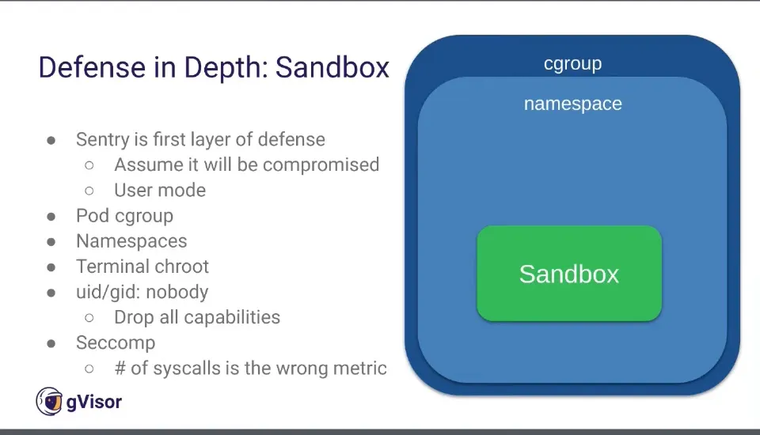

### 5.1 沙箱：nobody 身份 + 30~40 个系统调用

Sentry 所在的沙箱被限制得很死：

- 用 namespace 加 chroot / `pivot_root` 切到一个特定目录，这个目录里除了 `runsc` 几乎什么都没有，也就是说**沙箱本身几乎没有文件系统**；
- 丢掉所有 capability，把 UID/GID 设成 `nobody`；
- 套一份受限的 seccomp 配置，只允许大约 30 到 40 个系统调用；
- 文件操作只留 4 个——因为真正的文件操作必须交给 Gofer。[【跳转到 27:27】](https://www.youtube.com/watch?v=1Ib-rfSzDuM&t=1647)

作为对照：Docker 默认的 seccomp 配置大概允许 200 个系统调用，而 gVisor 只允许 30 个左右。[【跳转到 24:25】](https://www.youtube.com/watch?v=1Ib-rfSzDuM&t=1465)

### 5.2 Gofer：能开文件，但被削得很薄

Gofer 的处境不同，它必须能真的在机器上打开文件，所以权限比沙箱大一点，但依然被层层包住：

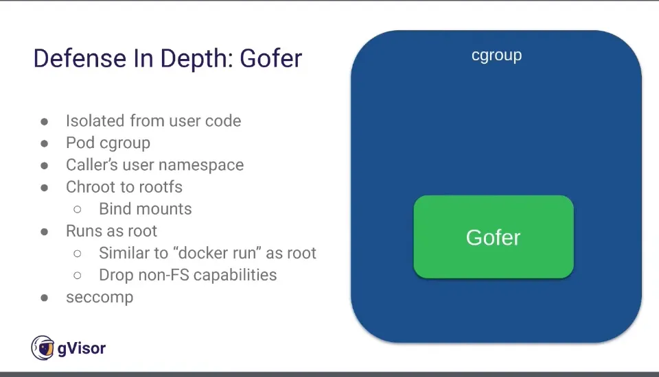

- 跑在 Pod 的 cgroup 里，namespace 集合比沙箱更少；
- chroot 到 rootfs，需要的目录用 bind mount 挂进来；
- 以 root 身份运行（讲者的类比是「类似 `docker run` 以 root 跑」），但丢掉所有与文件系统无关的 capability；
- 同样套 seccomp。

这样设计的目的很明确：即使你设法利用了 Gofer 里的一个 bug，也希望你没法从 Gofer 里逃出去。[【跳转到 28:41】](https://www.youtube.com/watch?v=1Ib-rfSzDuM&t=1721)

## 六、设计原则：纯 Go、最小宿主访问

讲者把 gVisor 的设计约束列成一页：

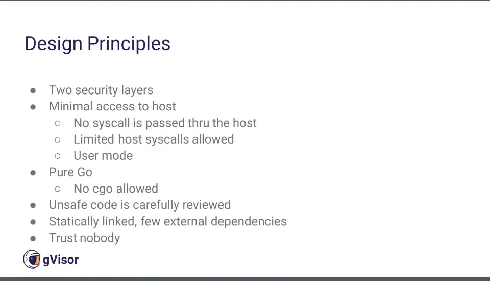

其中几条值得展开：

- **纯 Go，不允许 cgo**。用 C 写内核容易踩缓冲区溢出，而 Go 把数组越界检查做进了语言和运行时，天然是内存安全的；`unsafe` 代码要单独评审。
- **静态链接、极少外部依赖**。这样不会出现「有人覆盖了动态链接库」这类问题。
- **最小宿主访问**。gVisor 不是那种「把所有系统调用透传」的 seccomp 沙箱：宿主系统调用是在沙箱实现内部按需发出的，而且数量被限制。
- **Trust nobody**。连自己的组件也按「可能被攻破」来设计。

此外，沙箱还大量复用宿主已有的机制：cgroup 限制资源、namespace 隔离视图、`pivot_root` 切根，并以 `nobody` 的 UID/GID 运行、丢掉几乎全部 capability——因为其中大部分能力沙箱自己就能实现。[【跳转到 26:05】](https://www.youtube.com/watch?v=1Ib-rfSzDuM&t=1565)

## 七、gVisor 不保护什么

这是整场演讲最诚实的一页：沙箱能做的保护是有限的，很多东西得你自己补。

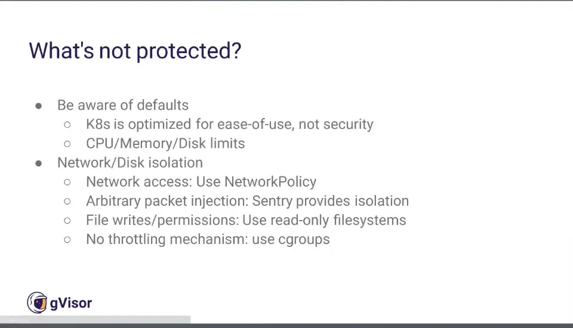

- **默认值不可信**。Kubernetes 和 Docker 的很多默认设置是为易用性优化的，不是为安全。比如 Docker 默认 capability 里就包含 raw socket。就 raw socket 而言，gVisor 实际上并不真的让你访问它，但关键在于默认值本身不是安全承诺。[【跳转到 29:00】](https://www.youtube.com/watch?v=1Ib-rfSzDuM&t=1740)
- **资源限额要自己给**。如果你在 OCI 配置里写了内存和磁盘限额，runsc 会为沙箱设置；但你必须确保这些限制存在，否则沙箱可能把宿主内存吃光。[【跳转到 29:50】](https://www.youtube.com/watch?v=1Ib-rfSzDuM&t=1790)
- **网络隔离要自己配**。Pod 会分到一个 IP、接在 Pod 网络上，得用 NetworkPolicy 之类的机制限制它。隔离确实存在——代码跑在沙箱里——但沙箱本身能发任意报文：一旦有人控制了沙箱或 Sentry，他就能往网络上写任意报文。[【跳转到 30:40】](https://www.youtube.com/watch?v=1Ib-rfSzDuM&t=1840)
- **文件权限要自己收**。如果别人能写容器的根文件系统，就可能覆盖会被执行的程序或文件；基础根文件系统最好用只读的。
- **gVisor 没有内置限流**。要用 cgroup 或依赖宿主来做。

## 八、取舍：gVisor 换到了什么，又失去了什么

把演讲里的线索收拢成一张对照表（只做对比，不展开各家实现细节）：

| 维度 | 普通容器 | gVisor | 虚拟机 / microVM |
| --- | --- | --- | --- |
| 内核 | 与宿主共享 | 用户态重写一份（Sentry） | 自带客户内核 |
| 隔离边界层数 | 一层（namespace/cgroup） | 两层（Sentry + seccomp/namespace） | 一层（hypervisor），Type 1 可视为更硬 |
| 宿主内核暴露面 | 应用的全部系统调用 | 约 30 个由 Sentry 发出的系统调用 | 虚拟设备与 hypervisor 接口 |
| 系统调用开销 | 一次陷入 | 一次陷入 + 一次用户态往返 | 一次陷入（客户内核内） |
| 资源弹性 | 好 | 好（容器式） | 差（整块分配） |
| 启动时间 | 毫秒级 | 毫秒级 | 百毫秒级起 |
| 内核特性完整度 | 完整 | 近似实现，部分特性缺失 | 完整 |

两条最关键的结论：

1. **它换来的不是「更快的隔离」，而是「更小的宿主攻击面 + 更细的隔离层数」**。gVisor 不虚拟化硬件，所以它既没有虚拟机的整块资源分配问题，也不需要客户内核；代价是系统调用路径变长。
2. **它的语义是「近似 Linux」**。Sentry 用 Go 重新实现系统调用，不可能和真内核逐位一致；越依赖冷门内核特性的负载，越容易撞到「不支持」或「行为略有差异」。

讲者最后提到落地方式：在 Kubernetes 里用 RuntimeClass 指定 gVisor，请求经 containerd 落到 runsc；minikube 有现成插件可以试用；GKE 上则是开箱即用的 GKE Sandbox。[【跳转到 31:55】](https://www.youtube.com/watch?v=1Ib-rfSzDuM&t=1915)

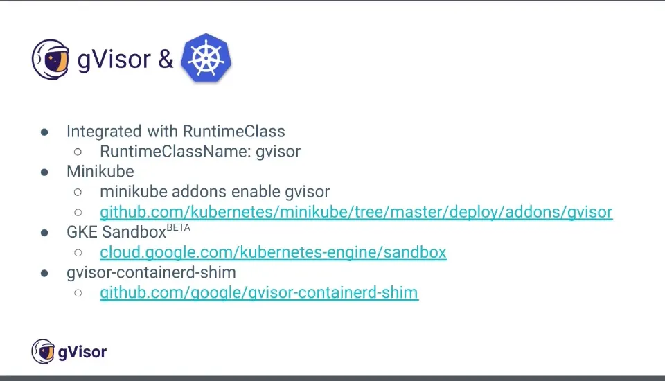

## 小结

- 容器的问题不在「隔离得不够多」，而在**隔离发生在错误的层次**：资源视图被隔离了，特权代码没有被隔离。
- 靠 seccomp 削减系统调用数量行不通，因为最容易出漏洞的恰恰是 `madvise` 这类人人都要用的调用。
- gVisor 把虚拟化的层次从硬件搬到 OS：用 Go 写一个用户态内核 Sentry，接管应用的全部系统调用。
- 文件 I/O 是唯一必须外置的部分，交给沙箱外的 Gofer，两者走 9P；这让文件操作也变成两层。
- 平台层（ptrace / KVM）决定系统调用怎么被「截」下来，也决定了这部分开销的量级。
- 沙箱自己也被关得很死：nobody 身份、几乎空的文件系统、30~40 个系统调用、丢掉全部 capability。
- 代价是系统调用路径变长、内核语义只能近似实现；收益是宿主内核只看到几十个受控的系统调用。
- gVisor 不保护「配置错误」：资源限额、NetworkPolicy、只读根文件系统、限流，仍然要自己配。

## 关键术语速查

| 术语 | 一句话解释 |
| --- | --- |
| Sentry | gVisor 的用户态内核，用 Go 实现 Linux 系统调用语义，跑在沙箱内 |
| Gofer | 跑在沙箱外的文件系统代理进程，替 Sentry 执行真实的文件操作 |
| runsc | gVisor 的 OCI 运行时，由 containerd 调用，负责拉起沙箱与 Gofer |
| platform | 系统调用的拦截机制，演讲中提到的两种是 ptrace 与 KVM |
| 9P | Sentry 与 Gofer 之间的通信协议，把文件请求序列化后跨进程传递 |
| seccomp | Linux 的系统调用过滤机制；gVisor 用它把沙箱自身的系统调用压到 30 个左右 |
| 两层隔离 | gVisor 的核心设计目标：突破 Sentry 之后还要再突破 seccomp/namespace 才能碰到宿主 |
| RuntimeClass | Kubernetes 里指定某个 Pod 用哪个运行时的字段，gVisor 借此接入 |