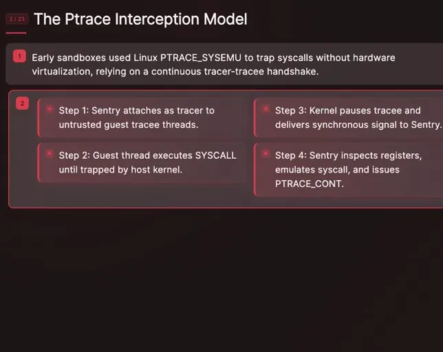
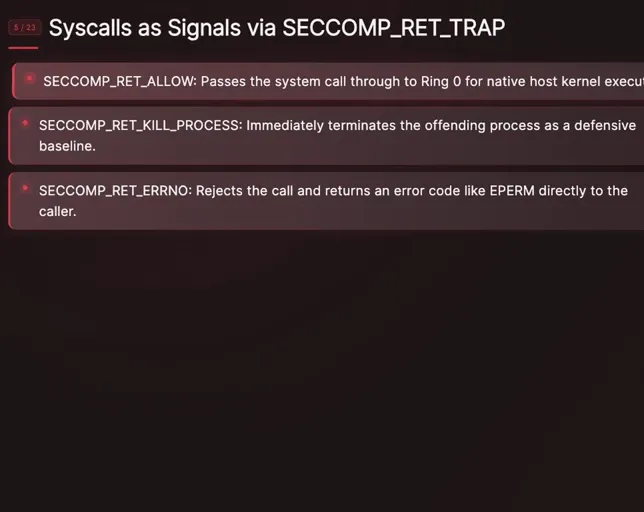
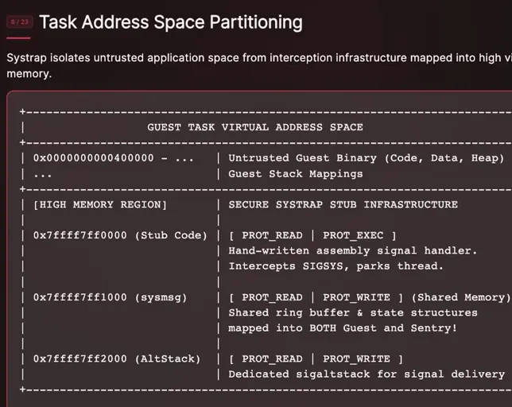
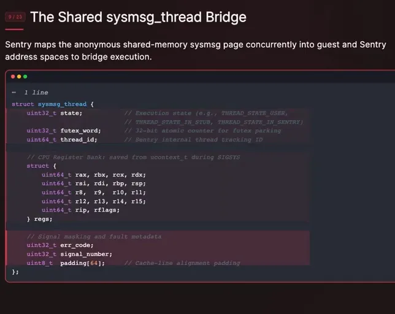
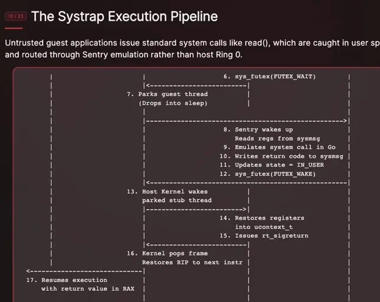
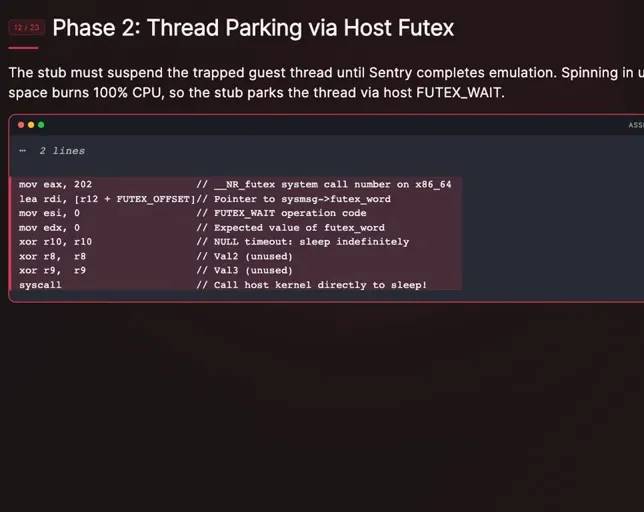
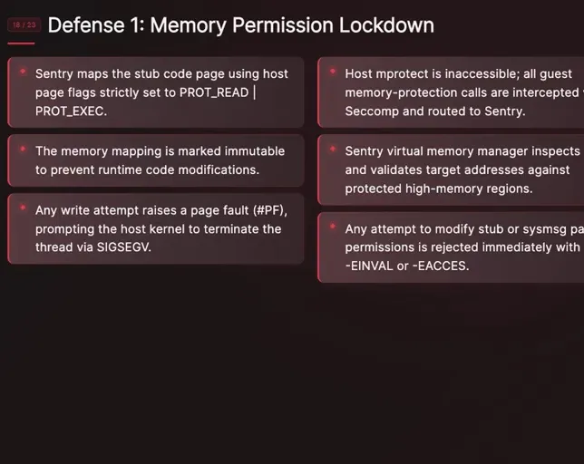
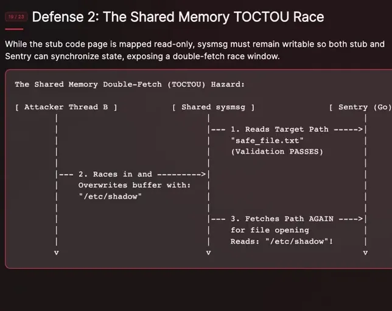
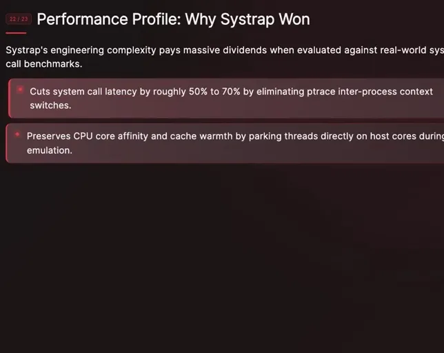

# gVisor 的系统调用拦截：ptrace 的代价与 systrap 的解法

> 视频来源：[12.1 Systrap Architecture & SECCOMP Trap Stubs](https://www.youtube.com/watch?v=i1E00u8zvrI)（Adsorp AI《Escaping the Cage》第 12 章 · Systrap、KVM 与 Sentry-Gofer IPC）｜时长约 19 分钟
> 导读：这支视频只回答一个问题——Sentry 是个普通的用户态进程，它凭什么在宿主内核之前截住 `syscall` 指令？答案是「把系统调用变成信号」：seccomp 的 `RET_TRAP` 造一个 SIGSYS，进程内的汇编跳板接住它，再用 futex 把线程挂起，交给 Go 写的 Sentry 模拟。视频把这条 17 步的流水线逐步拆开，也把「控制结构放进敌意地址空间」带来的三类安全风险讲透了。

## 本讲要解决的核心问题（SCQA）

**背景**：gVisor 的 Sentry 是一个跑在 ring 3 的普通用户态进程。它要实现 Linux 系统调用语义，就必须在应用的 `syscall` 指令生效之前把控制权抢过来。

**冲突**：`syscall` 指令在设计上是不可拦截的——它把执行流从 ring 3 直接切到 ring 0，从 `MSR_LSTAR` 取出内核入口地址就跳走了。最早的做法是 `ptrace`：Sentry 当调试器，应用当被调试者。但这条路每次系统调用要四次上下文切换，在每秒几万次系统调用的负载上直接把性能拖垮。而换用 KVM 平台又要求硬件虚拟化可用，这在云上的嵌套容器里经常不成立。

**疑问**：有没有一种机制，既不需要硬件虚拟化，又能把拦截开销从「跨进程」压到「进程内」？

**回答（中心思想）**：systrap 把系统调用变成**信号**。它在应用线程上装一个 seccomp BPF 过滤器，命中规则时返回 `SECCOMP_RET_TRAP`，宿主内核于是不执行这次调用，而是同步给这个线程投递一个 SIGSYS；进程内一段手写汇编跳板接住信号、把寄存器搬进共享内存，然后用 futex 把线程挂起；Sentry 从共享内存读出请求、用 Go 模拟、写回返回值，再唤醒线程。整条路径不跨进程、不换核，系统调用延迟比 ptrace 降低约 50% 到 70%。

## 一、起点：一条不可拦截的指令

### 1.1 syscall 像一道单向阀

写过底层系统代码、调试过内核驱动的人都熟悉这种感觉：CPU 的 `syscall` 指令是一道不可逆的单向阀。

在 x86-64 上，执行这条指令会把执行流从 ring 3 切到 ring 0，从 MSR `MSR_LSTAR` 里取出内核入口地址，直接把控制权交给宿主内核空间。[【跳转到 00:05】](https://www.youtube.com/watch?v=i1E00u8zvrI&t=5)

而 Sentry 不跑在 ring 0，也没有任何内核态权限。所以问题很尖锐：**一个用户态守护进程，凭什么在宿主内核执行之前截住那条指令，而且还不把整个应用卡死？**[【跳转到 00:30】](https://www.youtube.com/watch?v=i1E00u8zvrI&t=30)

### 1.2 第一代答案：ptrace 与它的四次上下文切换

早期应用沙箱在没有硬件特权时的标准做法，是借 Linux 的调试接口 `ptrace`。架构看上去很直白：



1. Sentry 进程当 tracer，被沙箱的应用线程是 tracee；
2. 应用一直跑，直到它发出一次系统调用；
3. 宿主内核停下 tracee，并向 Sentry 发一个信号事件；
4. Sentry 处理事件：用 `PTRACE_GETREGS` 读寄存器，跑自己的模拟逻辑，用 `PTRACE_SETREGS` 改写寄存器，取消宿主原生的系统调用，最后用 `PTRACE_CONT` 让 tracee 继续。

问题出在这条链路的长度上。一次系统调用要走完：guest 触发调用陷入内核 → 内核挂起进程、第一次上下文切换唤醒 Sentry → Sentry 发 `GETREGS` → 内核返回寄存器 → Sentry 模拟 → Sentry 发 `SETREGS` → 内核确认 → Sentry 发 `CONT` → 内核恢复 guest、第二次上下文切换。[【跳转到 01:45】](https://www.youtube.com/watch?v=i1E00u8zvrI&t=105)

讲者把这笔账算得很直白：**每次系统调用四次上下文切换**（按进程调度算，其中两次是进程切换，另两次是陷入内核的往返），外加同步的进程间信号。在数据库或微服务这种每秒几万次系统调用的负载上，开销是灾难性的——TLB 被反复刷掉，CPU 指令缓存变冷，线程延迟飙升。[【跳转到 02:35】](https://www.youtube.com/watch?v=i1E00u8zvrI&t=155)

### 1.3 云上还有一道硬约束

如果只是慢，也许还能忍。真正逼出 systrap 的是另一件事：**硬件虚拟化并不总是可用**。

在标准云主机上的 Kubernetes 集群里跑不可信负载时，嵌套硬件虚拟化（VT-x / AMD-V）经常被禁用、被策略锁死，或者在底层 hypervisor 上根本不支持。所以 gVisor 需要一个能跑在任何地方——哪怕是无特权的嵌套容器里——同时又把 ptrace 往返延迟砍下来的引擎。[【跳转到 03:00】](https://www.youtube.com/watch?v=i1E00u8zvrI&t=180)

## 二、核心机制：把系统调用变成信号

### 2.1 seccomp 的四种动作

systrap 的支点是 Linux 的安全计算模式 seccomp。你可能熟悉它的三种常见动作：



- `SECCOMP_RET_ALLOW`：让宿主内核原生执行；
- `SECCOMP_RET_KILL_PROCESS`：立刻杀掉进程，这是防御基线；
- `SECCOMP_RET_ERRNO`：拦下系统调用并直接返回 `EPERM` 之类的错误码。

但 seccomp 引擎还提供第四种、高度专用的动作：`SECCOMP_RET_TRAP`。[【跳转到 03:50】](https://www.youtube.com/watch?v=i1E00u8zvrI&t=230)

### 2.2 RET_TRAP：不执行，改投一个信号

当过滤器求值为 `RET_TRAP` 时，宿主内核拒绝在 ring 0 执行该系统调用。它改为在出错线程的栈上压一个信号帧，并向该线程合成一个 **SIGSYS**（bad system call）信号。

这里就是整个架构的转折点：**信号是同步投递给发起调用的那个线程的，完全发生在这个进程自己的地址空间里**。[【跳转到 04:15】](https://www.youtube.com/watch?v=i1E00u8zvrI&t=255)

### 2.3 控制流被改写成了什么

把两条路径并排看：

```text
正常执行：
  [ User App ] -- SYSCALL --> [ Host Ring 0 ] --> host driver / hardware

systrap 执行：
  [ User App ] -- SYSCALL --> [ Host seccomp ]
                                    |
                              (interception)
                                    v
  [ Signal Stub ] <-- SIGSYS (ucontext_t on stack)  (in-process)
```

宿主内核不需要跨一道沉重的 IPC 去唤醒外部调试器进程。它留在当前 CPU 核上，把线程的体系结构寄存器状态打包成标准 POSIX 的 `ucontext_t`，然后把线程的指令指针 RIP 重定向到注册好的信号处理函数。[【跳转到 04:40】](https://www.youtube.com/watch?v=i1E00u8zvrI&t=280)

一句话概括这个转折：**只要那个信号处理函数在我们控制之下，我们就能在系统调用发生的那一刻把它接住。**

## 三、进程内跳板与共享内存

### 3.1 为什么不能直接写个 C 信号处理函数

最直觉的做法是在应用里写一个标准 C 信号处理函数。讲者直接否掉了：标准运行时的信号处理依赖动态分配器、会调用 C 库函数、还会跑用户代码——而这些都可能被恶意的 guest 负载劫持，既带来巨大开销，也带来安全漏洞。[【跳转到 05:05】](https://www.youtube.com/watch?v=i1E00u8zvrI&t=305)

systrap 的解法是：把一个极小的、手工优化过的**汇编跳板**，连同一条专用的共享内存通信通道，直接映射进 guest 应用的虚拟地址空间。

### 3.2 地址空间被切成两半



- **低地址**：从 `0x000000000400000` 开始是不可信的 guest 二进制（代码、数据、堆）以及 guest 的栈映射；
- **`0x7ffff7ff0000`**：跳板代码页，用 `PROT_READ` 加 `PROT_EXEC` 保护，里面是手写的汇编信号处理函数，负责接住 SIGSYS 并把线程停住；
- **`0x7ffff7ff1000`**：共享内存页，用 `PROT_READ` 加 `PROT_WRITE` 保护，里面是共享环形缓冲区和状态结构，**同时映射进 guest 和 Sentry**；
- **`0x7ffff7ff2000`**：alt stack，用 `PROT_READ` 加 `PROT_WRITE` 保护，作为信号投递专用的 `sigaltstack`。

这块共享内存的创建方式很关键：Sentry 用 `MAP_SHARED` 映射一块由匿名内存文件描述符 memfd 支撑的区域，在 gVisor 内部叫 **sysmsg page**，它同时出现在不可信的 guest 进程地址空间和 Sentry 的地址空间里。[【跳转到 06:19】](https://www.youtube.com/watch?v=i1E00u8zvrI&t=379)

### 3.3 sysmsg_thread：两界之间的桥



共享内存里放的是一个控制结构数组，每个被沙箱的应用线程各占一个槽位。这个 C 结构体记录：执行状态、futex 用的 32 位原子计数器、Sentry 内部的线程 ID、系统调用陷入时保存的完整 CPU 寄存器组、信号故障的元数据，以及按 cache line 对齐的填充。[【跳转到 06:49】](https://www.youtube.com/watch?v=i1E00u8zvrI&t=409)

讲者的说法很形象：这个结构是两界之间的桥——一边是 guest 线程，另一边是 Sentry 那个用 Go 写的虚拟内核。

## 四、一次系统调用的 17 步

### 4.1 全景



当 gVisor 里的不可信应用想发一次系统调用——比如用 `read` 读若干字节——它执行的是标准的平台指令序列。在 systrap 下，这次请求的完整生命周期是 17 步：

1. guest 线程向宿主内核发出系统调用；
2. seccomp 求值，动作为 `RET_TRAP`；
3. 把 `ucontext_t` 压栈，跳到 systrap 跳板里的处理函数；
4. 跳板进入汇编，从 `ucontext_t` 里取出寄存器写进 sysmsg；
5. 做一次原子状态迁移，把状态置为「在 Sentry 中」；
6. 调用 `futex` 的 `FUTEX_WAIT` 陷入宿主内核；
7. 宿主内核把 guest 线程挂起，线程进入睡眠，并通知 Sentry；
8. Sentry 醒来，从共享内存里读寄存器；
9. 用 Go 模拟这次系统调用；
10. 把返回码写回共享内存；
11. 把状态改回「在用户态」；
12. 调用 `futex` 的 `FUTEX_WAKE`；
13. 宿主内核唤醒被挂住的跳板线程；
14. 跳板把寄存器恢复进 `ucontext_t`；
15. 发出 `rt_sigreturn`；
16. 内核弹出信号帧、把 RIP 恢复到下一条指令；
17. guest 线程带着 `rax` 里的返回值继续执行。[【跳转到 07:39】](https://www.youtube.com/watch?v=i1E00u8zvrI&t=459)

### 4.2 阶段一：陷入与上下文提取

guest 应用按 System V AMD64 ABI 把参数放进寄存器——`rax` 是系统调用号，`rdi`、`rsi`、`rdx`、`r10`、`r8`、`r9` 是参数——然后执行 `syscall` 指令。宿主内核的 seccomp 过滤器拦下这条指令；因为指令来自应用代码，规则命中，触发 `RET_TRAP`。

宿主内核暂停原生执行，切到线程注册的备用信号栈 `sigaltstack`，构造一个 `ucontext_t` 保存陷入那一刻的精确寄存器快照，然后跳到信号处理函数——也就是 systrap 的汇编跳板。[【跳转到 08:59】](https://www.youtube.com/watch?v=i1E00u8zvrI&t=539)

这个汇编跳板不调用任何库函数，只执行极短的一段汇编：

1. 在共享内存页里定位当前线程专用的 sysmsg 结构；
2. 从宿主构造的 `ucontext_t` 里读出寄存器值，拷进 sysmsg 的寄存器块；
3. 写一个原子标志，表示该线程正从用户态执行转入陷入状态。

### 4.3 阶段二：用 futex 停住线程，以及「认指令指针」的 seccomp

跳板必须等到 Sentry 模拟完成。如果它用自旋锁死等，会把宿主 CPU 核跑到 100%，白白烧掉周期。所以跳板用宿主内核原生的 futex（Fast Userspace Mutex）把自己挂起。



这里有个表面上的悖论：跳板自己也在执行 `syscall` 指令去调 futex，可整个应用不是被 seccomp 过滤器包住、专门用来拦系统调用的吗？跳板发系统调用，岂不是又触发一次 SIGSYS，形成无限重入？

这是 systrap 最精巧的设计之一：**seccomp 过滤器是「认指令指针」的**。

Sentry 为 guest 进程初始化 seccomp BPF 过滤器时，会加载一条规则去检查系统调用发起处的指令指针（`seccomp_data.instruction_pointer`）：

- 如果指令指针落在**不可信应用内存**范围内，过滤器返回 `RET_TRAP`；
- 如果指令指针正好落在 **systrap 跳板代码页**的虚拟地址边界内，过滤器就把请求的系统调用拿去和一份严格白名单比对，只允许 `futex` 和 `rt_sigreturn`；
- 跳板发出的其他任何系统调用，都会被 `RET_KILL` 立刻杀掉。[【跳转到 09:59】](https://www.youtube.com/watch?v=i1E00u8zvrI&t=599)

这个设计让跳板可以调用宿主内核来管理自己的睡眠周期，同时又完全剥夺了 guest 负载的这项能力。注意它为什么能成立：跳板代码页的地址是固定的，所以「指令指针落在哪一页」可以写进 BPF 规则里。

### 4.4 阶段三：Sentry 模拟并唤醒

当 guest 线程睡在宿主内核的 futex 队列里时，Sentry 正在干活。它跑着自己的一批调度例程，通过主动轮询任务队列、或者等待配套的事件通道，发现某个任务已经进入「在 Sentry 中」的状态。

Sentry 直接从共享内存的寄存器结构里读出系统调用号和参数，然后完全在自己的 Go 虚拟环境里执行这次调用：

- 如果 guest 请求的是 `openat`，Sentry 的虚拟文件系统会检查访问权限、定位到合成的 inode；
- 如果 guest 调的是 `mmap`，Sentry 就更新自己内部的内存跟踪结构。[【跳转到 11:14】](https://www.youtube.com/watch?v=i1E00u8zvrI&t=674)

模拟结束后，Sentry 把结果写回寄存器结构里的返回寄存器（x86-64 上是 `RAX`，ARM64 上是 `X0`）：可能是一个合成的文件描述符、一个映射地址，或者 `-ENOENT` 这样的负 POSIX 错误码。最后，Sentry 发一次宿主系统调用，把睡着的线程唤醒。

### 4.5 阶段四：恢复寄存器与 rt_sigreturn

宿主内核收到 futex 唤醒调用，在等待队列里找到那个 guest 线程，把它标为可运行并调度到某个核上。guest 线程从 futex 系统调用返回，回到汇编跳板里。现在跳板跑反向流水线：

1. 从共享内存里读出更新后的寄存器组，包括刚写进去的 `rax` 返回值；
2. 把这些值覆盖回宿主最初压在信号栈上的 `ucontext_t`；
3. 执行这一轮最后的汇编指令 `rt_sigreturn`。

宿主内核的信号处理子系统接管：读取被改过的 `ucontext_t`，用新值恢复物理 CPU 寄存器，清掉栈上的信号帧，然后把指令指针直接跳到原始 guest `syscall` 的下一条指令。[【跳转到 12:29】](https://www.youtube.com/watch?v=i1E00u8zvrI&t=749)

从被沙箱的应用角度看，它只是发了一次系统调用、拿到了一个返回码。它完全不知道宿主内核从未处理过这个请求，不知道一个汇编跳板截走了它的控制流，也不知道一整个 Go 写的操作系统通过共享内存桥完成了这次操作。

## 五、把控制结构放进敌意地址空间，代价是什么

这一节是整支视频最有价值的部分。当一个架构把关键的控制基础设施——汇编跳板和 sysmsg 数据块——放进一个不可信、可能充满敌意的 guest 进程的地址空间里时，安全研究者立刻会问：**是什么阻止恶意负载篡改这个跳板？**

讲者把问题问得更具体：如果一个跑在沙箱里的前沿 AI agent 通过自身二进制的内存破坏漏洞拿到了任意写内存的能力，它能不能改掉跳板、或者伪造信号上下文来逃出沙箱？[【跳转到 13:19】](https://www.youtube.com/watch?v=i1E00u8zvrI&t=799)

### 5.1 第一道防御：跳板不可写



- Sentry 初始化沙箱任务时，用宿主页标志把跳板的可执行代码页映射成严格的 `PROT_READ` 加 `PROT_EXEC`，并标记为不可变；
- 如果 guest 试图写跳板代码页——比如用 shellcode 覆盖汇编指令，或者改掉 seccomp 白名单所依赖的指令指针——CPU 立刻触发缺页（PF），宿主内核随即以段错误 `SIGSEGV` 终止该线程；
- 而且 guest 在宿主上没有 `mprotect` 的权限：guest 调 `mprotect` 时，这次调用会被 seccomp 过滤器拦下、转给 Sentry；Sentry 的虚拟内存管理器校验目标地址，如果指向存放跳板或 `rt_sigreturn` 页的高地址区域，就用 `-EINVAL` 或 `-EACCES` 拒绝。[【跳转到 14:09】](https://www.youtube.com/watch?v=i1E00u8zvrI&t=849)

### 5.2 第二道防御：共享内存的 TOCTOU

跳板代码页是只读的，但共享内存页必须可写——跳板和 Sentry 都要更新状态标志、寄存器组和 futex 字。这就制造了一个高风险的竞态面。



设想一个多线程攻击者：线程 A 发一次 `write(fd, buf, count)`，进跳板、把寄存器拷进共享内存、调 futex 睡下；当线程 A 睡着、Sentry 正在从共享内存读寄存器时，线程 B 在另一个核上继续跑。

于是就有了这张时序图：

1. Sentry 从共享内存读出目标路径 `safe_file.txt`，校验通过；
2. 攻击者线程 B 抢进来，把共享内存里的缓冲区覆盖成 `/etc/shadow`；
3. Sentry 为了打开文件再次从共享内存取路径，读到的已经是 `/etc/shadow`。

如果 Sentry 先读一次寄存器做校验、之后再读同一个寄存器去执行系统调用逻辑，线程 B 就能在「检查」和「使用」之间把值换掉。[【跳转到 14:59】](https://www.youtube.com/watch?v=i1E00u8zvrI&t=899)

消除办法是**严格的原子快照**：一旦某个 Sentry 工作线程开始检查一个陷入的任务，它就把整个寄存器组和负载数据一次性私有拷贝到 Sentry 自己的堆内存里；所有权限校验、指针运算和文件系统操作，都只针对这份私有快照执行。共享内存区域被当作彻底敌意、不可信的东西。[【跳转到 15:49】](https://www.youtube.com/watch?v=i1E00u8zvrI&t=949)

### 5.3 第三道防御：信号重入与状态机

第二讲里提过的 sigreturn 导向编程（SROP）在这里变成了现实威胁：攻击者可以在栈上伪造一个 `ucontext_t`，再调用 `rt_sigreturn`，一次性把任意值装进所有 CPU 寄存器。而在 systrap 里信号是持续飞行的——如果被沙箱的应用故意给自己配一个 SIGSYS 处理函数，或者在线程正卡在汇编跳板里时发一个跨线程信号，会发生什么？

systrap 做了三件事：

- **专用信号栈**：用 `sigaltstack` 把信号投递用的内存隔离出来，跳板从不依赖 guest 用户控制的栈指针 RSP；即使 guest 把自己的栈指针搞坏，宿主内核也能安全地把 SIGSYS 投递到隔离的备用栈上；
- **跳板执行期间屏蔽信号**：处理函数的 `sigaction` 配置了一份完整的 `sigmask`，宿主内核投递 SIGSYS、跳进跳板时，会自动阻塞该线程上所有其他标准 POSIX 信号（SIGINT、SIGSEGV 等），保证汇编跳板原子地跑完，不会被嵌套的信号帧打断；
- **状态机校验**：Sentry 处理任何系统调用请求之前，都会校验共享内存里的线程状态机；如果线程发出了非法的 futex 信号序列，或者试图不经 Sentry 就把状态从「用户态」直接改成「用户态」，Sentry 会把这种异常标记为不变量违规，并立刻拆掉整个沙箱容器。[【跳转到 17:04】](https://www.youtube.com/watch?v=i1E00u8zvrI&t=1024)

## 六、性能与边界：systrap 换来了什么



systrap 的工程复杂度在真实基准里回报巨大：避开了 ptrace 的多进程上下文切换和 tracer 同步锁之后，对系统调用密集的负载，**系统调用延迟降低了大约 50% 到 70%**。[【跳转到 17:29】](https://www.youtube.com/watch?v=i1E00u8zvrI&t=1049)

更重要的是两个结构性收益：

- **缓存热度得以保持**。应用线程始终停在自己的宿主 CPU 核上，宿主内核保持了线程亲和性，不会因为唤醒另一个进程而把缓存和 TLB 冲掉。
- **隔离边界与部署环境解耦**。systrap 在裸金属、虚拟机和 Kubernetes 无特权节点上表现一致——它把 Linux 内核的标准特性（seccomp、信号、futex）变成了一条高速虚拟化总线，而不需要任何专用硬件支持。

但讲者也把边界说清楚了：systrap 再漂亮，终究受限于宿主内核的软件机制。**每一次陷入，宿主都必须构造信号帧、执行 seccomp BPF 过滤器、管理 futex 队列。** 如果环境确实提供了硬件虚拟化扩展、宿主给了我们 `/dev/kvm`，就可以把信号帧和 seccomp 过滤器整个扔掉，改为配置物理 CPU 的控制寄存器（例如 MSR_STAR），在硅片层面接住系统调用——这是下一节的内容。[【跳转到 18:19】](https://www.youtube.com/watch?v=i1E00u8zvrI&t=1099)

## 七、三种平台各自站在哪

把 gVisor 的平台层拉平来看，三种拦截方式的分工与代价是这样的：

| 平台 | 拦截手段 | 一次系统调用的路径 | 主要代价 | 前提条件 |
| --- | --- | --- | --- | --- |
| ptrace | 调试接口 tracer/tracee | 跨进程：两次上下文切换 + 多次 GETREGS/SETREGS/CONT | 开销最大，缓存与 TLB 反复失效 | 无（任何 Linux 都行） |
| systrap | seccomp RET_TRAP + 进程内汇编跳板 + futex | 进程内：一次信号投递 + 一次 futex 睡眠/唤醒 | 仍需构造信号帧、跑 BPF、管 futex 队列 | 无（seccomp 可用即可） |
| KVM | 硬件虚拟化入口 + MSR 配置 | 硬件陷入，直接进 Sentry | 需要客户机与 vCPU 管理 | 宿主开放 `/dev/kvm` |

这张表也解释了为什么 gVisor 要维护多个平台而不是只留一个：**它们不是性能档位，而是可用性档位**。云上嵌套容器里经常没有 `/dev/kvm`，这时 systrap 是唯一既安全又不太慢的选择；而在能拿到 KVM 的环境里，把拦截下沉到硬件可以进一步省掉软件路径。

## 小结

- `syscall` 指令本身不可拦截，Sentry 要接管它，必须借助宿主内核提供的某个「副作用」。
- ptrace 的副作用是信号 + 调试暂停，代价是每次系统调用四次上下文切换，系统调用密集的负载扛不住。
- systrap 的副作用是 `SECCOMP_RET_TRAP` 合成的 SIGSYS：信号同步投递给发起线程，全程留在进程地址空间内。
- 跳板是手写汇编，映射在固定的高地址页；共享内存页（sysmsg）同时映射进 guest 与 Sentry，承载每个线程的控制块。
- 跳板自己也要调 `futex` 才能睡下，靠的是「认指令指针」的 seccomp 规则：来自跳板页的系统调用走白名单，其余一律 `RET_KILL`。
- 把控制结构放进敌意地址空间要付安全代价，对应三道防御：跳板页只读不可变、共享内存只做原子快照、信号栈与状态机严格隔离校验。
- 收益是系统调用延迟降低约 50% 到 70%，且不依赖硬件虚拟化；代价是宿主内核仍要为每次陷入构造信号帧、跑 BPF、管 futex。
- 三种平台是可用性档位而非纯性能档位：ptrace 最通用、systrap 最平衡、KVM 最快但要求硬件。

## 关键术语速查

| 术语 | 一句话解释 |
| --- | --- |
| Sentry | gVisor 的用户态内核，用 Go 实现 Linux 系统调用语义 |
| systrap | gVisor 的平台实现，用 seccomp RET_TRAP + 进程内汇编跳板拦截系统调用 |
| SECCOMP_RET_TRAP | seccomp 的动作码：不执行系统调用，改为向该线程投递 SIGSYS |
| SIGSYS | 内核合成的「坏系统调用」信号，systrap 靠它把控制权交给跳板 |
| ucontext_t | POSIX 定义的寄存器上下文结构，宿主内核在信号帧里保存陷入瞬间的寄存器快照 |
| sigaltstack | 专用信号栈，保证信号投递不依赖可能被破坏的用户栈 |
| sysmsg page | gVisor 内部对那块共享内存页的称呼，由 memfd 支撑、MAP_SHARED 映射进两界 |
| sysmsg_thread | 每个被沙箱线程在共享内存里的控制块，含状态、futex 字与完整寄存器组 |
| futex | 快速用户态互斥量，跳板用它把线程挂起、Sentry 用它把线程唤醒 |
| rt_sigreturn | 信号返回系统调用，跳板用它把改写后的上下文装回 CPU 并回到用户态 |
| TOCTOU | 「检查时」与「使用时」不一致的竞态，这里指共享内存被二次读取时被篡改 |
| MSR_LSTAR / MSR_STAR | 存放系统调用入口地址的模型特定寄存器，KVM 平台靠劫持它拦截系统调用 |