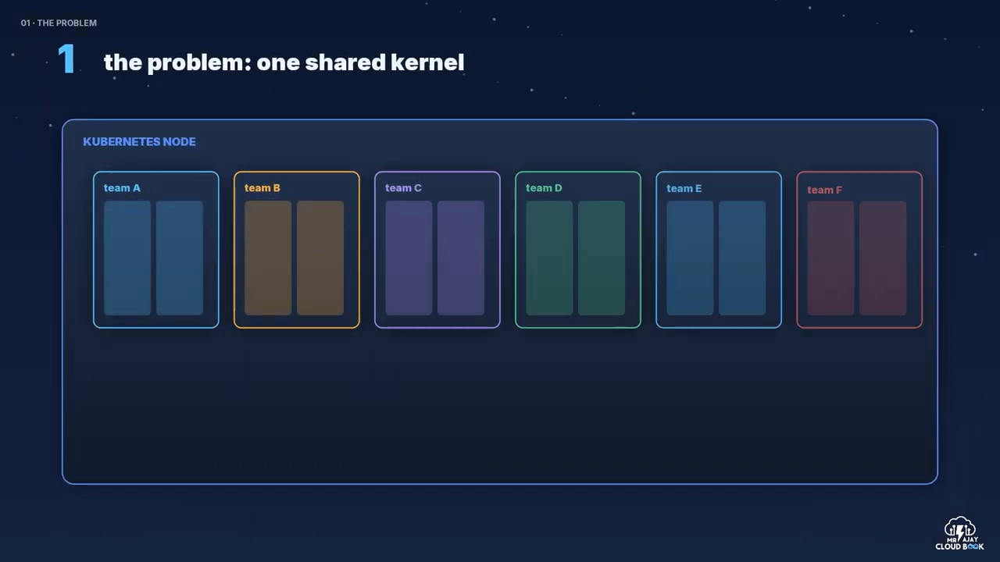
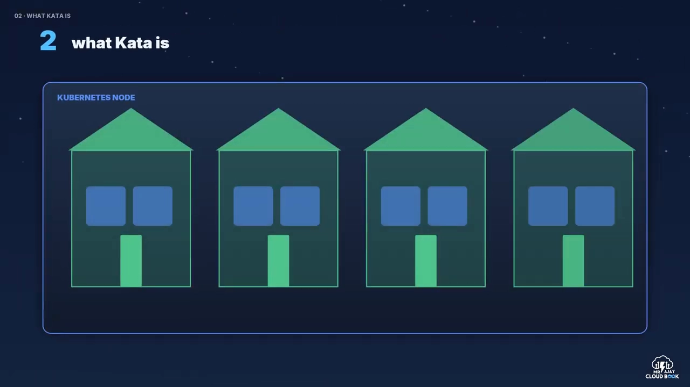
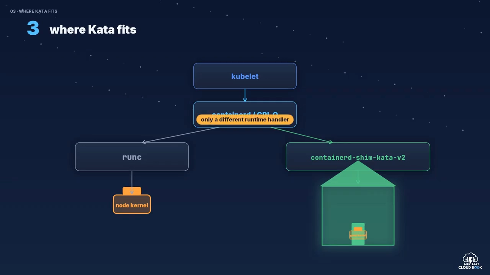
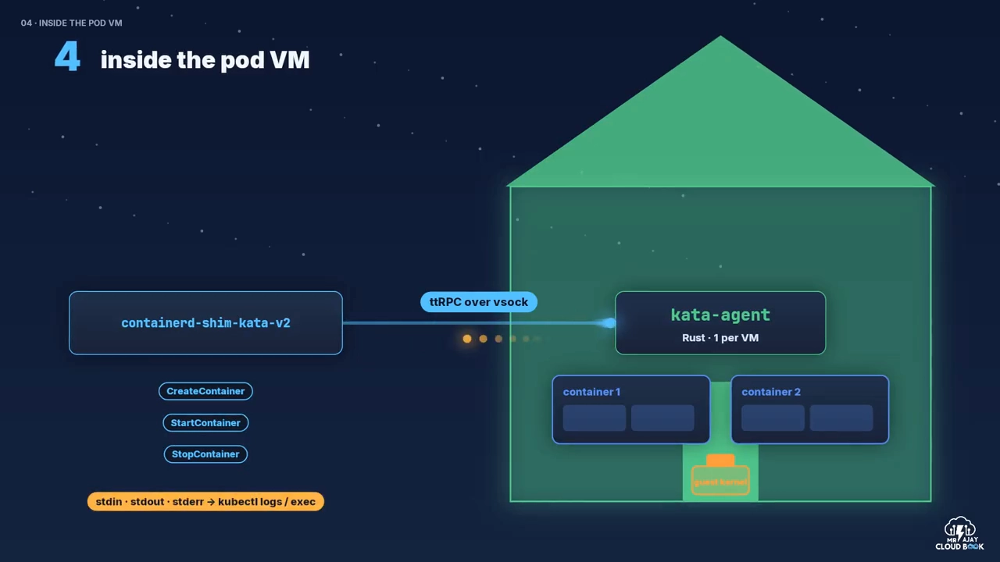
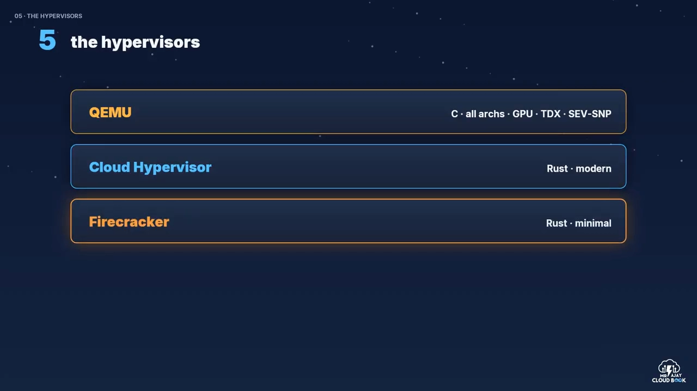
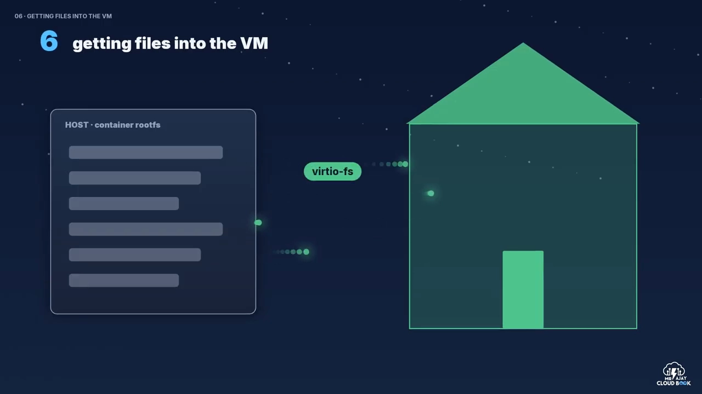
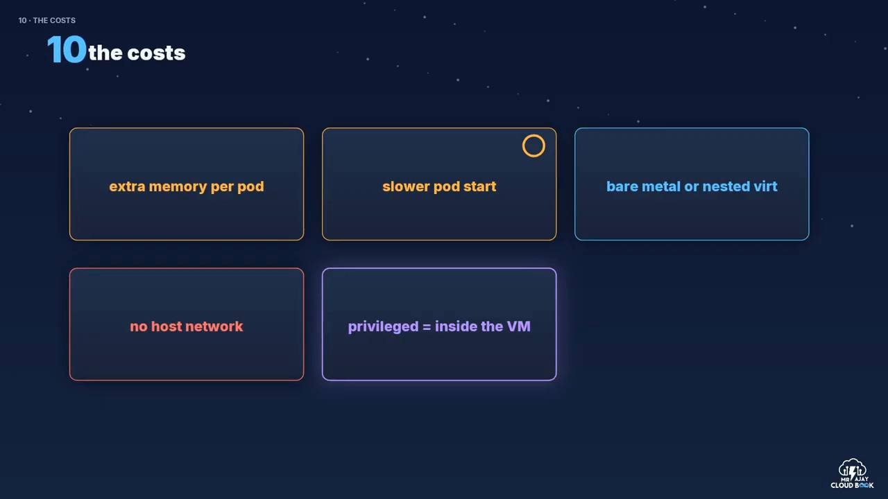
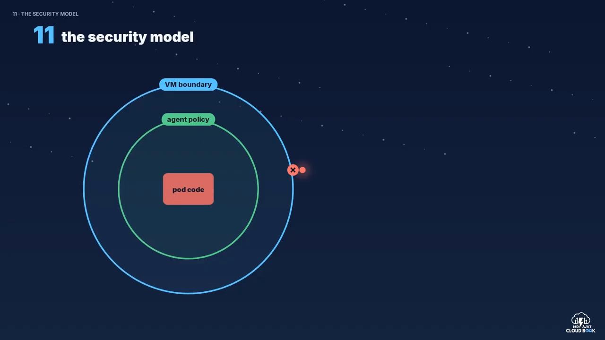

# containerd-shim-kata-v2：把每个 Pod 的创建请求翻译成一台 MicroVM

> 视频来源：[Kata Containers Explained: Run Kubernetes Pods in MicroVMs](https://www.youtube.com/watch?v=-GeMK4y13aY)（YouTube · Mr. Cloud Book）｜时长约 11 分钟
> 导读：这是一支「沿着一条 Pod 创建请求往下走」的讲解片：从 kubelet 把活派给 containerd 开始，一路走到 shim 进程、hypervisor、客户机里的 kata-agent，最后落到 `kubectl exec` 的命令怎么进 VM。它回答的正是本节的问题——一个 VM 运行时如何把自己接成 containerd 的 shim v2。字幕为本地语音识别生成，术语已按上下文校正；RuntimeClass、hypervisor 内部实现、镜像到 rootfs 的细节只点到为止，分别留给 6.3.3、6.2.x 与 6.3.2。

## 本讲要解决的核心问题（SCQA）

**背景**：Kubernetes 节点上跑着很多 Pod，它们来自不同团队、不同客户，但所有容器共用同一个内核——也就是节点内核。这正是容器又快又轻的原因。

**冲突**：共用内核也是容器最薄的一环。只要有一个容器从内核漏洞里逃出来，它就能碰到同一节点上的每一个 Pod。对可信负载这没什么，对不可信代码、多租户集群、会执行命令的 AI agent，这就是大风险。[【跳转到 00:33】](https://www.youtube.com/watch?v=-GeMK4y13aY&t=33)

**疑问**：既想保留 `kubectl`、同一套镜像、同一份 YAML 的使用习惯，又想给每个 Pod 一个独立内核，中间这一层要谁来做？换句话说，一个 VM 运行时怎么才能被 containerd 当成「另一个普通运行时」来调用？

**回答（中心思想）**：靠一个**常驻的 shim 进程**。containerd 不再 fork 一个跑完就退出的 `runc`，而是启动 `containerd-shim-kata-v2` 并长期保留它；这个 shim 收到与 `runc` 完全相同的 OCI bundle，但它不直接 `clone` 容器进程，而是**起一台 hypervisor、把 bundle 交给 VM 里的 kata-agent**，之后所有 Create/Start/Stop、标准输入输出、`exec` 都通过 vsock 上的 ttrpc 转发。对 Kubernetes 来说，唯一的差别只是「换了个 runtime handler」。[【跳转到 01:58】](https://www.youtube.com/watch?v=-GeMK4y13aY&t=118)

## 一、先看 Kata 在整条链路里的位置

### 1.1 从「共享内核」到「每个 Pod 一栋小房子」

视频用一个很直白的比喻：普通容器是同一栋楼里的不同房间，MicroVM 是「带自己小厨房的独立小屋」。Kata 做的事就是给每个 Pod 发一栋小屋。[【跳转到 00:00】](https://www.youtube.com/watch?v=-GeMK4y13aY&t=0)

换成 Kata 之后，同一个节点上的每个 Pod 各自住进一栋「小屋」，也就是一台轻量虚拟机：

这里有个容易被忽略的粒度问题：**Kata 是每个 Pod 一台 VM，不是每个容器一台 VM**。一个 Pod 里的所有容器共享这台 VM。[【跳转到 01:39】](https://www.youtube.com/watch?v=-GeMK4y13aY&t=99) 这一点直接决定了后面 shim 的进程模型——一个 Pod 的 shim 要管的是「一台 VM + 里面若干个容器」，而不是一个容器。

### 1.2 对 Kubernetes 而言，变化只有一行 handler

Kata 用的是 OCI 标准，所以它跑的就是你已经在构建的那批镜像；`kubectl`、镜像、YAML 都不用改。[【跳转到 01:14】](https://www.youtube.com/watch?v=-GeMK4y13aY&t=74)

## 二、shim 这一层：VM 运行时真正要实现的接口

### 2.1 两条分叉路：runc 与 containerd-shim-kata-v2

kubelet 把「创建这个 Pod」的活派给容器运行时（containerd 或 CRI-O）。正常情况下，运行时会调用 `runc`，由 `runc` 直接在节点内核上把容器进程拉起来。走 Kata 时，运行时调用的是另一个 shim：`containerd-shim-kata-v2`。shim 去启动 hypervisor，hypervisor 再为这个 Pod 启动一台小虚拟机。[【跳转到 01:58】](https://www.youtube.com/watch?v=-GeMK4y13aY&t=118)

这张图就是本节的核心：**VM 运行时并没有改写 containerd，它只是把自己注册成 containerd 的又一个 runtime handler**。对 containerd 和 CRI-O 来说，这次改动「只是换了个 runtime handler」，Kubernetes 其余部分完全不知道底下是 VM。[【跳转到 02:23】](https://www.youtube.com/watch?v=-GeMK4y13aY&t=143)

### 2.2 为什么必须是「常驻进程」

shim v2 的关键在于**进程生命周期**。Kata 1.x 时代，运行时是一个独立程序，每一步操作都要被重新调用一次；Kata 2.0 换成 shim v2 之后，这个进程常驻、保留自己的状态，因此更快。[【跳转到 02:23】](https://www.youtube.com/watch?v=-GeMK4y13aY&t=143)

这句话背后的因果关系值得展开：

- 如果每做一步都重新启动一个程序，那么「这台 VM 的 socket 在哪、哪个容器对应哪个进程、上次 Create 到哪一步」这些状态就得反复序列化到磁盘、再读回来；
- 常驻进程可以把这些状态放在内存里，Create 之后紧接着 Start、Start 之后再来 Exec，都在同一个进程的上下文里完成；
- 代价是这个进程必须自己负责「活着」这件事——它一旦崩掉，containerd 就得重新把它拉起来并恢复状态。

### 2.3 shim 收到的还是那份 OCI bundle

shim 从 containerd 那里收到的，是**和 `runc` 完全相同的 OCI bundle**（一个目录，里面有 `config.json` 和 `rootfs`）。区别只在它拿这份 bundle 做什么：`runc` 会照着 `config.json` 去 `clone` 进程、设 namespace 和 cgroup；shim 则把它当作「要在客户机里复现的容器描述」。[【跳转到 02:46】](https://www.youtube.com/watch?v=-GeMK4y13aY&t=166)

这就是「伪装」的技术本质：**契约没变，执行位置变了**。bundle 是同一份，只是解释它的程序从「宿主上的 `runc`」换成了「宿主上的 shim + 客户机里的 agent」。

## 三、VM 里面：一个 agent 管住所有容器

### 3.1 客户机里跑的是 kata-agent

VM 有自己的客户机内核和一个很小的根文件系统。在这个 VM 里，有一个常驻进程统管一切：**kata-agent**。它用 Rust 写，每台 VM 里只有一个。[【跳转到 02:58】](https://www.youtube.com/watch?v=-GeMK4y13aY&t=178)

### 3.2 宿主 shim 与客户机 agent 之间的通道

宿主上的 shim 用 **ttrpc over vsock** 跟 agent 说话。ttrpc 可以理解成「为这种跨边界场景裁剪过的 gRPC」：同样的 protobuf 消息定义、同样的「调远端方法」的心智模型，但去掉了 HTTP/2 那一整套，实现更轻，适合塞进一个只有几 MB 的客户机里。vsock 则是虚拟机与宿主之间的一条「不走网络栈的 socket」，不依赖客户机有没有配好网卡和 IP。

通过这条链路，shim 请 agent 去创建容器、启动容器、停止容器。**同一条链路还承载标准输入输出流**，所以 `kubectl logs` 和 `kubectl exec` 依然能用。[【跳转到 03:23】](https://www.youtube.com/watch?v=-GeMK4y13aY&t=203)

这一点是「VM 运行时实现 shim v2」最容易被低估的部分。CRI 里 `exec`、`attach`、`logs` 都是流式接口，containerd 期望 shim 提供一个能读写的流端点。VM 运行时没有 `/proc/<pid>/fd` 可以借用，它必须自己把「宿主侧的流」和「客户机里容器进程的 stdin/stdout/stderr」接起来——Kata 的做法就是复用 shim 与 agent 之间那条 ttrpc 连接。

排障时，管理员还可以通过同一个通道在 VM 里开一个调试控制台。[【跳转到 03:30】](https://www.youtube.com/watch?v=-GeMK4y13aY&t=210)

因为每台 VM 只有一个 agent，同一个 agent 就管理着这个 Pod 的所有容器。[【跳转到 03:37】](https://www.youtube.com/watch?v=-GeMK4y13aY&t=217)

## 四、shim 背后那台 VM 由谁造

### 4.1 Kata 自己不实现 hypervisor

Kata 不自己造这台「房子」，它用一个 hypervisor，而且可以选。视频里列了四类选择：

- **QEMU**：C 写，支持所有架构，是 GPU 与 Intel TDX / AMD SEV-SNP 机密计算场景支持最好的选择；
- **Cloud Hypervisor**：Rust 写的现代 hypervisor；
- **Firecracker**：极简 hypervisor，也就是这个系列上一集手工搭 VM 时用的那个；
- **Dragonball**：比较特殊，它跑在与 Rust 版 shim 同一个进程里。[【跳转到 04:09】](https://www.youtube.com/watch?v=-GeMK4y13aY&t=249)

每个 Kata 运行时只用一种 hypervisor，写在它的配置文件里。同时 shim 本身也有两套实现：最初的 Go 版本，以及更新的 Rust 版本 `runtime-rs`。[【跳转到 04:09】](https://www.youtube.com/watch?v=-GeMK4y13aY&t=249)

一句话选型：要最全的特性支持选 QEMU，要更轻的 Rust 栈选 Cloud Hypervisor 或 Dragonball，要最小体积选 Firecracker。[【跳转到 04:34】](https://www.youtube.com/watch?v=-GeMK4y13aY&t=274)

### 4.2 容器的文件怎么进 VM

VM 里的容器需要自己的文件。多数 hypervisor 下，Kata 用 **virtio-fs** 把容器的根文件系统共享进 VM，VM 里看到的是宿主上的一个共享目录。[【跳转到 04:48】](https://www.youtube.com/watch?v=-GeMK4y13aY&t=288)

Firecracker 没有 virtio-fs，所以走 Firecracker 时 Kata 需要一块块设备当后端存储，containerd 侧用 devicemapper snapshotter 给每个容器一块块设备。[【跳转到 04:58】](https://www.youtube.com/watch?v=-GeMK4y13aY&t=298) 对机密负载，Kata 还可以让镜像在客户机内部拉取，这样宿主根本不接触镜像内容；而用 virtio-fs 时，客户机是直接从宿主读文件，镜像不会被复制进 VM。[【跳转到 05:12】](https://www.youtube.com/watch?v=-GeMK4y13aY&t=312)

## 五、Pod 怎么选中 Kata，以及这套做法的代价

### 5.1 选路：RuntimeClass 只是一行

用一个叫 RuntimeClass 的 Kubernetes 对象来选。Kata 会安装若干个 RuntimeClass，每个配置一个，例如 `kata-qemu`、`kata-clh`、`kata-fc`。在 Pod spec 里加一行 `runtimeClassName: kata-qemu` 即可；没写这一行的 Pod 仍然走 `runc`。所以一个集群可以在同一批节点上混跑两类 Pod。[【跳转到 05:27】](https://www.youtube.com/watch?v=-GeMK4y13aY&t=327)

RuntimeClass 还能声明 pod overhead，让调度器把 VM 额外占的内存和 CPU 算进去；它的 handler 名字必须和节点上 containerd / CRI-O 里配置的 runtime handler 对上，这一步由 `kata-deploy` 帮你完成。[【跳转到 05:52】](https://www.youtube.com/watch?v=-GeMK4y13aY&t=352)（RuntimeClass 的调度语义属于 6.3.3，这里不展开。）

### 5.2 一条 `uname -r` 就是证据

在同一节点上对比两个 Pod：走 `runc` 的那个，`uname -r` 显示的是节点内核版本；走 `kata-qemu` 的那个，显示的是另一个版本——它自己那台 VM 的客户机内核。这一行输出就是证据：这个 Pod 不再共享节点内核。[【跳转到 06:53】](https://www.youtube.com/watch?v=-GeMK4y13aY&t=413)

### 5.3 代价：内存、启动时间与平台前提

隔离不是免费的：

- 每个 Pod VM 都要为它的客户机内核和 agent 多花一份内存；
- Pod 启动比 `runc` 慢，因为 VM 必须先启动；
- 在云节点上需要裸金属或嵌套虚拟化，节点才有能力跑 VM；
- 有些特性不工作，比如不支持 host network，所以别给 Kata Pod 配 host network；
- 特权容器的语义也变了：一个特权的 Kata 容器是在**它自己的 VM 里**特权，而不是在节点上特权。[【跳转到 07:43】](https://www.youtube.com/watch?v=-GeMK4y13aY&t=463)

Pod VM 的默认内存和 vCPU 数可以在 Kata 配置文件里调。[【跳转到 08:08】](https://www.youtube.com/watch?v=-GeMK4y13aY&t=488)

## 六、两道墙：VM 边界与 agent 策略

Kata 给出的是两层防护：

- **第一道墙是 VM 边界**：Pod 里的代码必须先打穿客户机内核，再打穿 hypervisor，才能碰到节点。
- **第二道墙是 agent 策略**：管理员可以配置策略，把 agent API 的一部分打开或关掉。[【跳转到 08:08】](https://www.youtube.com/watch?v=-GeMK4y13aY&t=488)

策略用 Rego 语言写，`genpolicy` 这个工具可以从你的 Pod spec 生成它；测试时还有 agent control tool 可以往测试系统发 agent API 请求。配合 Kubernetes 网络策略与镜像扫描，构成纵深防御。[【跳转到 08:33】](https://www.youtube.com/watch?v=-GeMK4y13aY&t=513)

第二道墙的存在恰好说明了 shim v2 这条路线的取舍：**agent 是一个强大的接口**——它能创建容器、能传流、能开调试控制台。VM 边界挡住了外部，但一旦 Pod 里的代码能骗过 agent 的调用方（比如通过伪造的 Pod spec 让 agent 去挂载宿主的某个路径），墙就出现缺口。所以 Kata 在 agent 前面又加了一层策略校验。

## 七、机密容器与选型建议

Kata 也是 Confidential Containers 的基础：配合 Intel TDX 或 AMD SEV-SNP 这类硬件，Pod VM 的内存由 CPU 加密，连节点所有者都读不到。这也是 QEMU 在这里重要的原因——它是支持这些特性的 hypervisor。在 Pod 拿到密钥之前，硬件可以证明 VM 里跑的是什么，这一步叫 **attestation**（远程证明）。机密计算需要节点上有特殊硬件和固件，所以要先确认云实例类型。[【跳转到 08:57】](https://www.youtube.com/watch?v=-GeMK4y13aY&t=537)

那么什么时候该用 Kata？

- **用 Kata**：不可信代码、多租户集群、CI runner、会执行命令的 AI agent；
- **用 runc**：所有负载都可信，且密度和启动时间最重要。[【跳转到 09:20】](https://www.youtube.com/watch?v=-GeMK4y13aY&t=560)

很多团队两者都用：大多数 Pod 走 `runc`，只有高风险的那些走 Kata。落地时从小处开始——先在一个节点池上装 Kata，把一个高风险负载迁过去。[【跳转到 09:44】](https://www.youtube.com/watch?v=-GeMK4y13aY&t=584)

## 小结

- Kata 对 Kubernetes 的接口改动只有一处：把 runtime handler 从 `runc` 换成 `containerd-shim-kata-v2`，其余部分无感。[【跳转到 01:58】](https://www.youtube.com/watch?v=-GeMK4y13aY&t=118)
- shim 是**常驻进程**，这是 shim v2 相对 Kata 1.x 的核心变化：状态留在内存里，不必每步重启一个程序。[【跳转到 02:23】](https://www.youtube.com/watch?v=-GeMK4y13aY&t=143)
- shim 收到与 `runc` 相同的 OCI bundle，但把它交给 VM 里的 agent 去解释，而不是在本机 `clone` 进程。[【跳转到 02:46】](https://www.youtube.com/watch?v=-GeMK4y13aY&t=166)
- 宿主 shim 与客户机 kata-agent 之间是 ttrpc over vsock；Create/Start/Stop 与 stdio 流共用这条通道，`logs`/`exec` 因此照常工作。[【跳转到 03:23】](https://www.youtube.com/watch?v=-GeMK4y13aY&t=203)
- 一个 Pod 一台 VM、一个 agent 管全部容器，所以 shim 的粒度是 Pod 而不是容器。[【跳转到 01:39】](https://www.youtube.com/watch?v=-GeMK4y13aY&t=99)
- 文件进 VM 的两条路：virtio-fs 共享 rootfs，或 Firecracker 下用块设备加 devicemapper snapshotter。[【跳转到 04:58】](https://www.youtube.com/watch?v=-GeMK4y13aY&t=298)
- 代价是每 Pod 额外内存、更慢的启动、需要裸金属或嵌套虚拟化，以及 host network 等特性不可用。[【跳转到 07:43】](https://www.youtube.com/watch?v=-GeMK4y13aY&t=463)
- 安全上是两道墙：VM 边界加 agent 策略（Rego / genpolicy）。[【跳转到 08:33】](https://www.youtube.com/watch?v=-GeMK4y13aY&t=513)

## 关键术语速查

| 术语 | 一句话解释 |
| --- | --- |
| shim v2 | containerd 的运行时接口约定：一个常驻进程通过 ttrpc 提供 Task 服务，containerd 通过它管理容器生命周期 |
| containerd-shim-kata-v2 | Kata 对 shim v2 的实现：收到 OCI bundle 后起 hypervisor、把容器交给客户机里的 agent |
| runtime handler | containerd 配置里给某个 shim 起的名字，Kubernetes 侧用 RuntimeClass 的 handler 字段对上它 |
| OCI bundle | 一个目录，含 `config.json` 与 `rootfs`；`runc` 与 Kata shim 收到的是同一份 |
| kata-agent | 客户机里的常驻进程（Rust 实现），每 VM 一个，负责创建/启停容器并转发 stdio |
| ttrpc | 裁剪版 gRPC：保留 protobuf 方法调用语义，去掉 HTTP/2，适合跨 VM 边界的小体积通信 |
| vsock | 虚拟机与宿主之间的 socket 通道，不依赖客户机网络栈 |
| virtio-fs | 把宿主目录共享给客户机的半虚拟化文件系统，Kata 用它把容器 rootfs 暴露进 VM |
| devicemapper snapshotter | containerd 的一种快照器，用块设备承载容器 rootfs；Firecracker 无 virtio-fs 时用它 |
| agent policy | 用 Rego 写的策略，限制 agent API 的哪些方法可用，构成 VM 边界内的第二道墙 |
| attestation | 远程证明：由硬件出具证据，证明 VM 里跑的确实是预期的那份代码 |