# containerd 与 Kata 的接口演进：shim v2 如何把一台 MicroVM 藏进容器运行时

> 视频来源：[Enhancing Node Stability Through Containerd and Kata Containers Interface Evolution](https://www.youtube.com/watch?v=R2VPkkNBci0)（KubeCon + CloudNativeCon + Open Source Summit China 2023 · 吴超（阿里云）与彭涛（蚂蚁集团），均为 Kata Containers maintainer）｜时长约 37 分钟
> 导读：这是一支站在「VM 运行时这一侧」讲 shim 的演讲：从 shim v1 时代 Kata 怎么假装自己是 runc，讲到 shim v2 怎么把 gRPC 服务搬进 shim 进程、把 shim 数量从「每容器一个」压到「每 Pod 一个」，再到 Kata 3.0 把 shim 与 VMM 合进同一个进程、以及正在推进的 Sandbox API。字幕为本地语音识别生成（含中英混讲），术语已按上下文校正。

## 本讲要解决的核心问题（SCQA）

**背景**：容器生态里有一堆名字都叫「容器运行时」的组件——containerd、CRI-O、Kata、gVisor、Kuasar。它们其实处在软件栈的不同层：上面是高层运行时（管镜像、管 Pod），下面是低层运行时（真正把进程或虚拟机拉起来）。

**冲突**：Kata 这种「用虚拟机做隔离边界」的运行时，天生和 containerd 的接口假设不合。containerd 早期只认一个接口——`runc` 的命令行；后来有了 shim v2，接口是 gRPC，但语义里**只有容器、没有沙箱**。于是 Kata 必须在 shim 这一层做大量「翻译」和「推断」：同一个 `Create` 调用，到底是要建沙箱、建 Pod 容器，还是建普通容器？同一个 `Delete`，是删容器还是关整台 VM？[【跳转到 19:42】](https://www.youtube.com/watch?v=R2VPkkNBci0&t=1182)

**疑问**：一个 VM 运行时到底要在这层接口上做哪些事，才能既被 containerd 当作普通运行时调用，又不让「VM 的状态」和「容器的状态」纠缠成一团？

**回答（中心思想）**：VM 运行时的实现侧经历了三次结构性改造——**shim v1 时代靠伪装命令行**（把 `runc create/start/kill/delete` 换成 `kata-runtime ...`），**shim v2 时代靠一个常驻的 gRPC 服务端**（每 Pod 一个 `containerd-shim-kata-v2`，shim 数量从「容器数 × 2 + proxy + VM」压到「1 shim + 1 VM」），**Kata 3.0 再把 shim 与 VMM 合进同一个进程**（Rust 重写 + Dragonball），最后通过 **Sandbox API** 把「沙箱」提升为一等公民，彻底解耦容器逻辑与沙箱逻辑。[【跳转到 01:27】](https://www.youtube.com/watch?v=R2VPkkNBci0&t=87)

## 一、先定位：接口决定生态位

### 1.1 从 OCI 到 CRI，两级标准各管一段

2015 年容器兴起时，Docker 有一套标准、rkt 有一套标准，镜像互不相认。于是业界定了一个叫 OCI（Open Container Initiative）的东西。演讲者特意强调：**OCI 是一个 initiative，不是一个 interface**，它定义了一串规范——镜像规范、运行时规范、分发规范。[【跳转到 01:35】](https://www.youtube.com/watch?v=R2VPkkNBci0&t=95)

Kubernetes 出现之后又乱了一次：节点上可能装 containerd，也可能装 CRI-O，kubelet 需要一种统一的方式跟它们说话。于是有了 CRI（Container Runtime Interface）——**这个才是真正的接口**，分 image service 与 runtime service 两部分，规定了对沙箱、对容器、对镜像各能做什么操作。[【跳转到 02:40】](https://www.youtube.com/watch?v=R2VPkkNBci0&t=160)

### 1.2 四层结构与「沙箱的形状」

演讲把整条链路拆成四层：高层容器管理（kubelet）、高层容器运行时（containerd / CRI-O / iSulad）、低层容器运行时（Kata / gVisor / runc）、以及最终产出的容器。[【跳转到 03:55】](https://www.youtube.com/watch?v=R2VPkkNBci0&t=235)

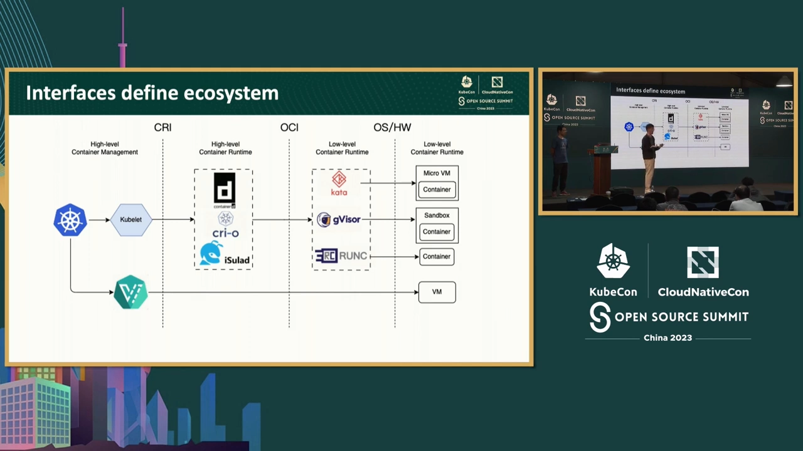

关键在这张图最右边一列：**不同低层运行时的「最终形态」不一样**。runc 产出的就是一个容器（namespace + cgroup 包起来的一组进程）；gVisor 产出一个沙箱，在里面拦截并处理系统调用；Kata 产出一台 micro-VM，容器跑在 VM 里面。[【跳转到 04:45】](https://www.youtube.com/watch?v=R2VPkkNBci0&t=285)

还有一个贯穿全场的概念要先立住：**沙箱是创建容器时第一个产生、却是整个 Pod 资源里最后一个销毁的东西**。[【跳转到 03:30】](https://www.youtube.com/watch?v=R2VPkkNBci0&t=210) 后面讲 shim v2 的缺陷时，所有问题都源于「接口里没有给沙箱一个位置」。

## 二、shim v1 时代：Kata 伪装成 runc

### 2.1 runc 的命令行就是事实标准

OCI 的 runtime spec 基本定义了 `runc` 的命令行长什么样，于是 `runc` 成了 containerd 与低层运行时之间唯一的标准接口。[【跳转到 07:57】](https://www.youtube.com/watch?v=R2VPkkNBci0&t=477)

一次容器生命周期在这条命令行上是这样的：

1. containerd 先准备一个 **bundle**：里面有容器的 rootfs 和一个 `config.json`，后者描述「这个容器该怎么跑」；
2. `runc create` 把容器的 init 进程拉起来，此时 namespace、cgroup、rootfs 都已就位；
3. `runc start` 之后，那个临时 init 进程被替换成真正的 entrypoint，容器开始运行；
4. 停止时 `runc kill` 给进程发信号，进程退出、namespace 与 cgroup 被销毁，但网络 namespace、rootfs 这些资源还留着；
5. 最后由 `runc delete` 做清理。[【跳转到 09:17】](https://www.youtube.com/watch?v=R2VPkkNBci0&t=557)

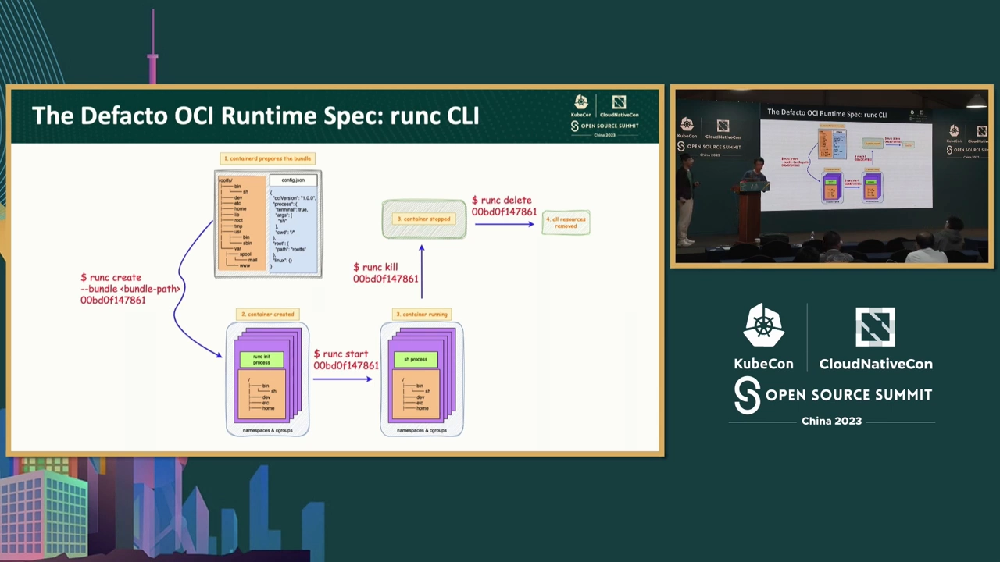

### 2.2 Kata 早期：把 `runc` 换成 `kata-runtime`

Kata 最早的做法非常直接：**在命令行层面完整替换 runc**。对 containerd 来说，Kata 和 runc 没有区别，只需要把 `runc create / start / kill / delete` 换成 `kata-runtime create / start / ...`。[【跳转到 10:07】](https://www.youtube.com/watch?v=R2VPkkNBci0&t=607)

演讲者甚至说，那个年代想用 Kata，你完全可以「hack 一下」：把 Kata 的命令行改成 runc 的名字，然后替换掉 runc 就行。因为当时只有一个标准——runc 是 containerd 和容器运行时之间唯一的接口。[【跳转到 10:32】](https://www.youtube.com/watch?v=R2VPkkNBci0&t=632)

### 2.3 2017 年的真实架构：shim + runtime + proxy + agent

那时代码结构大致是这样：宿主上跑着 **Kata 的 shim、Kata 的 runtime、Kata 的 proxy**，三者串起宿主侧所有连接；然后通过 **gRPC over yamux** 穿过 hypervisor 的串口进到客户机里的 **agent**，由 agent 在客户机内部真正创建容器。[【跳转到 07:12】](https://www.youtube.com/watch?v=R2VPkkNBci0&t=432)

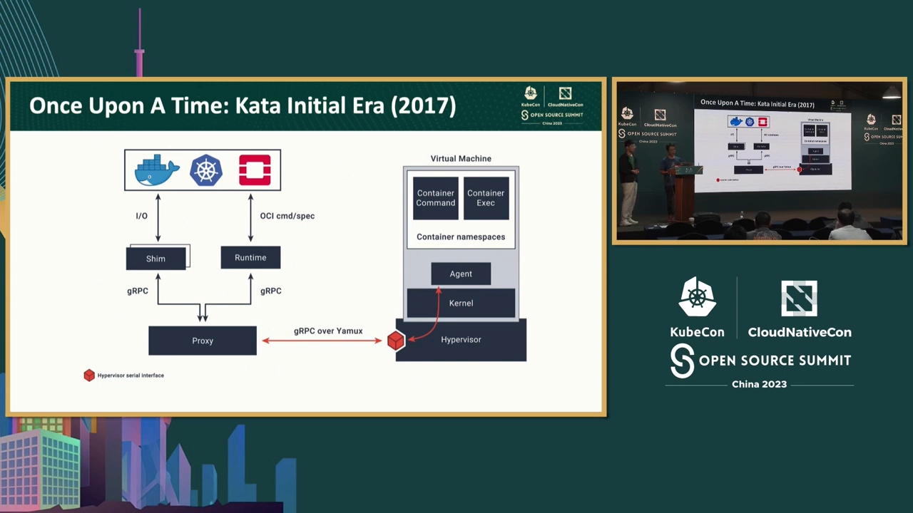

注意这里已经出现了 VM 运行时实现侧的两个固有难点，后面会反复回到它们：

- **宿主与客户机之间存在地址语义差**：containerd 看到的 rootfs、volume、device 路径，和客户机里 agent 看到的路径完全不是一回事，必须有人在中间做转换；
- **多进程意味着状态可能不一致**：shim 认为 VMM 还活着，VMM 其实已经退了，或者反过来。[【跳转到 16:47】](https://www.youtube.com/watch?v=R2VPkkNBci0&t=1007)

## 三、shim 爆炸：为什么「每容器一个 shim」撑不住

### 3.1 shim v1 的结构性缺陷

shim v1 时代，containerd 与 shim 之间已经是 gRPC，但 **shim 与运行时之间仍然是命令行**。这套结构能跑，但它有很多隐含假设：大家都得是 runc；而不同运行时的命令行总有细微差别，于是「原生集成」很难做。[【跳转到 11:22】](https://www.youtube.com/watch?v=R2VPkkNBci0&t=682)

真正致命的是 **shim 数量爆炸**：

- 每创建一个容器，就有一个 `containerd-shim` 和一个 `kata-shim`；
- 每次 `exec` 进去，又会各多一个 `containerd-shim` 和 `kata-shim`；
- 于是整台宿主上的 shim 数量非常非常大。[【跳转到 12:12】](https://www.youtube.com/watch?v=R2VPkkNBci0&t=732)

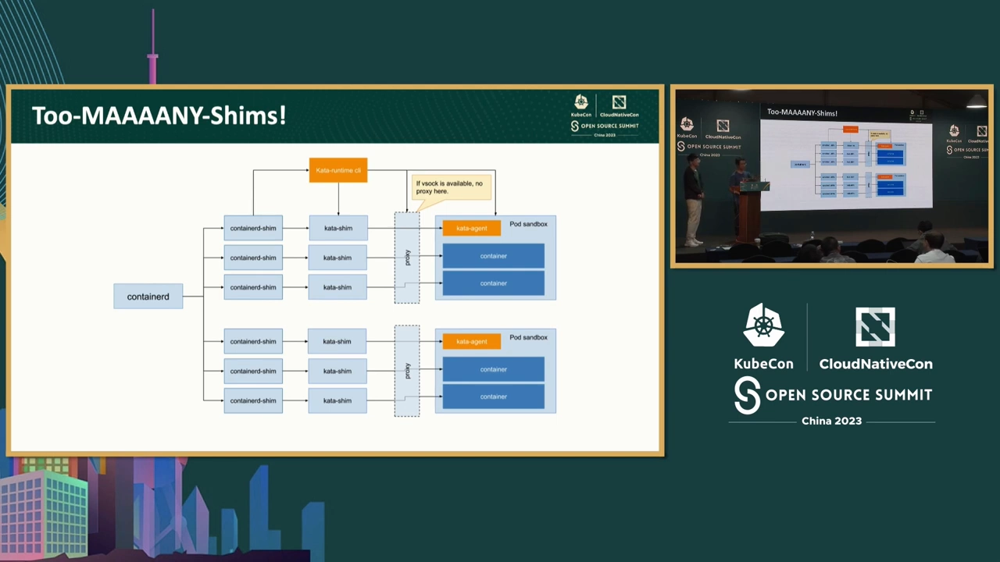

生产上这直接导致两类事故：一是内存开销大（每个 shim 都是一个进程）；二是**shim 跑飞（runaway）**——某个 shim 出问题后脱离 containerd 的管理，留下没人回收的进程。[【跳转到 12:37】](https://www.youtube.com/watch?v=R2VPkkNBci0&t=757)

## 四、shim v2：把 gRPC 服务端搬进 shim 进程

### 4.1 接口变了什么

社区的解法是与 containerd 社区一起设计 **shim v2 API**：containerd 与 shim 之间是 gRPC，shim 与运行时之间也改成 gRPC。更关键的是进程模型的规定：**一个 Pod 里可以有很多容器，但只能有一个 containerd-shim**。[【跳转到 13:02】](https://www.youtube.com/watch?v=R2VPkkNBci0&t=782)

从实现角度看，shim v2 的落地方式是：containerd 的 shim 框架被编进 containerd 二进制本身，所以只需要一个 containerd；**不同运行时各自实现自己的 shim v2 gRPC server**，containerd 通过 gRPC 与它通信。[【跳转到 13:27】](https://www.youtube.com/watch?v=R2VPkkNBci0&t=807)

社区当时出现了三个实现：runc 的 shim v2（C 实现）、Google 的 runsc shim v2，以及 Kata 自己的实现。[【跳转到 13:52】](https://www.youtube.com/watch?v=R2VPkkNBci0&t=832)

### 4.2 契约长什么样：`Shim` 服务 vs `Task` 服务

演讲把两版 proto 并排放在一页上，这是理解「VM 运行时要实现什么」的最直接材料：

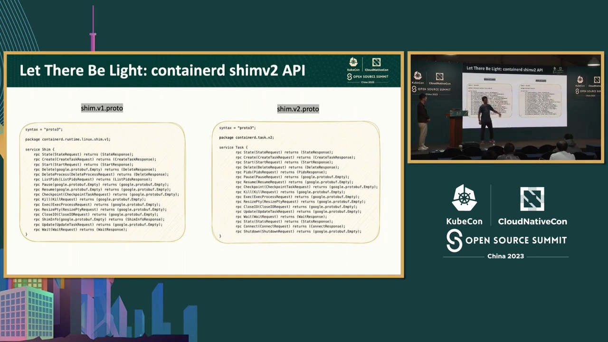

- `shim.v1.proto` 定义 `service Shim`：`State`、`Create`、`Start`、`Delete`、`DeleteProcess`、`ListPids`、`Pause`、`Resume`、`Checkpoint`、`Kill`、`Exec`、`ResizePty`、`CloseIO`、`ShimInfo`、`Update`、`Wait`；
- `shim.v2.proto` 定义 `service Task`：同样是 `State`、`Create`、`Start`、`Delete`、`Pids`、`Pause`、`Resume`、`Checkpoint`、`Kill`、`Exec`、`ResizePty`、`CloseIO`、`Update`、`Wait`、`Stats`，另外多了 `Connect` 与 `Shutdown`。

演讲者的总结是：**shim v1 与 shim v2 的接口非常非常相似，差别主要在于多了 connect 和 shutdown——也就是「建立连接」与「清理退出」**。[【跳转到 14:17】](https://www.youtube.com/watch?v=R2VPkkNBci0&t=857)

这个「相似」很重要，它解释了一个工程事实：**VM 运行时迁移到 shim v2 的代价不在方法语义，而在进程生命周期与状态管理**。方法还是那些方法，但从「每次调用起一个进程、跑完就退」变成「一个进程常驻、自己维护所有 Task 的状态」，这才是重写的部分。

### 4.3 Kata 的实现：一个 Pod 一个 `containerd-shim-kata-v2`

Kata 把原来那一堆 shim 收拢成一个 **`containerd-shim-kata-v2` 进程**，每个沙箱只有一个 shim。架构一下子清爽了。[【跳转到 14:42】](https://www.youtube.com/watch?v=R2VPkkNBci0&t=882)

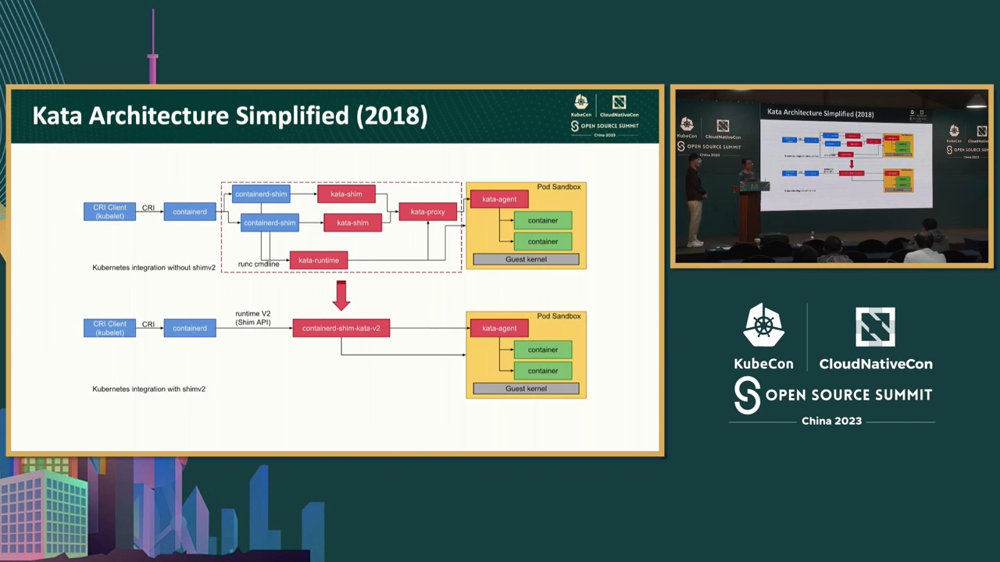

收益被量化成一句话：原来「容器数 × 2 个 shim + 1 个 proxy + 1 个 VM」，现在只需要「1 个 shim + 1 个 VM」；进入系统的进程数下降，内存开销随之显著下降，安装部署也简化了很多，**shim 跑飞的问题基本消失**。[【跳转到 15:32】](https://www.youtube.com/watch?v=R2VPkkNBci0&t=932)

这里值得停一下，把「为什么 shim 跑飞会消失」讲清楚：shim v1 里，一个容器的生命周期被切成很多次独立的命令行调用，每次调用都是一个新进程，谁也不知道上一个进程留下了什么；shim v2 里，一个 Pod 的所有 Task 都在同一个进程里，进程活着就代表状态在，进程死了 containerd 立刻能感知并重建。**状态的归属从「文件系统上的残留」变成了「一个进程的内存」**。

## 五、Kata 3.0：把 shim 和 VMM 合成一个进程

### 5.1 shim v2 时代还剩什么问题

shim v2 解决了 shim 爆炸，但幕后**至少还有两个进程**：一个是 shim，一个是 VMM。两个进程就带来理论上的不一致窗口——shim 认为 VMM 还在，VMM 已经退了；或者 VMM 还在，shim 已经退了。清理逻辑因此变得棘手。[【跳转到 16:47】](https://www.youtube.com/watch?v=R2VPkkNBci0&t=1007)

Kata 2.x 的 IO 侧同样多进程：virtio-fs 有两种实现（virtiofsd 与 nydusd），加上 Go 写的 shim，内存开销依然不小。[【跳转到 17:37】](https://www.youtube.com/watch?v=R2VPkkNBci0&t=1057)

### 5.2 用 Rust 重写 + Dragonball 内嵌

Kata 3.0 做了两件事：**用 Rust 重写 Kata 的 runtime**，并引入同样用 Rust 写的 **Dragonball**（一个可以内嵌的轻量 VMM）。两者可以合成一个进程，于是 shim 进程与 VMM 进程被合并。[【跳转到 18:02】](https://www.youtube.com/watch?v=R2VPkkNBci0&t=1082)

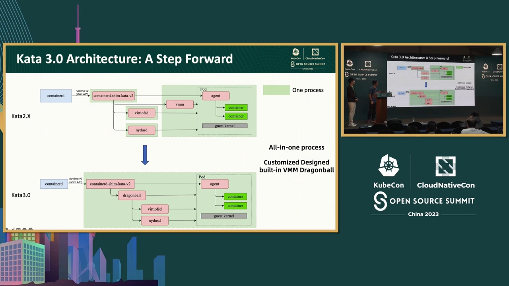

结果：宿主上不再出现「一个进程死了、另一个还活着」的状态，内存开销进一步下降。[【跳转到 18:27】](https://www.youtube.com/watch?v=R2VPkkNBci0&t=1107)

注意这里的取舍：**只有能编进同一个进程的 VMM 才能享受这个收益**。QEMU、Cloud Hypervisor 这类独立 VMM 无法塞进 Kata shim，所以走它们时宿主上仍然会多出一个进程。[【跳转到 23:47】](https://www.youtube.com/watch?v=R2VPkkNBci0&t=1427)

## 六、Sandbox API：把「沙箱」从 shim v2 里解耦出来

### 6.1 问题：接口里没有沙箱

CRI 里明明有 `RunPodSandbox` / `StopPodSandbox`，但到了 shim v2 就只剩 `Start` / `Delete`——**沙箱这个概念在 CRI 到 shim v2 的传递中丢失了**。[【跳转到 19:17】](https://www.youtube.com/watch?v=R2VPkkNBci0&t=1157)

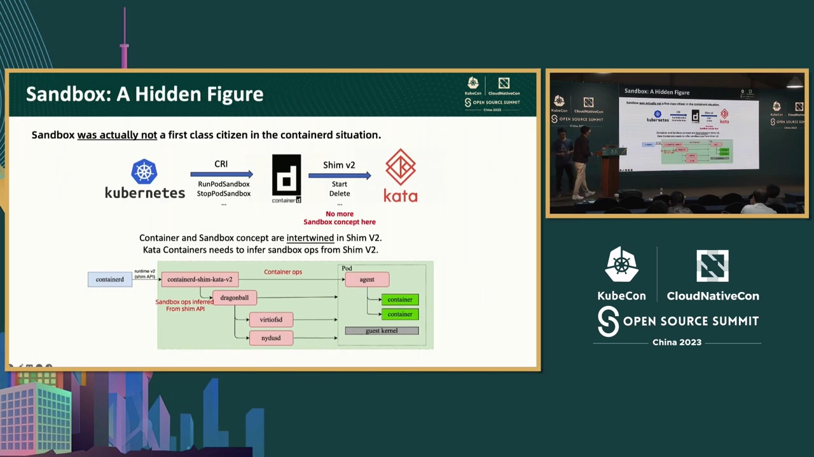

后果有两个，都是实现侧的真实痛点：

1. **同一个方法名有多种含义**。`Create` 可能是「创建沙箱」、可能是「创建 Pod 的 pause 容器」、也可能是「在沙箱里创建容器」；`Delete` 可能是删容器，也可能是关掉整个沙箱。[【跳转到 20:32】](https://www.youtube.com/watch?v=R2VPkkNBci0&t=1232)
2. **状态互相纠缠**。shim v2 的语义只到「容器」这一层，于是 VMM 的状态和 containerd 的状态被迫绑在一起，下游组件（也就是 Kata shim 自己）必须去解这个纠缠。[【跳转到 20:57】](https://www.youtube.com/watch?v=R2VPkkNBci0&t=1257)

### 6.2 解法：Task API 管容器，Sandbox API 管沙箱

Kata 在 shim 接口里从原来的 Task API 中**抽出 Sandbox API**，专门做沙箱相关操作，沙箱于是成为这套语言体系里的一等公民：它的状态是什么、需要做什么、需要改什么，都能直接表达。[【跳转到 21:47】](https://www.youtube.com/watch?v=R2VPkkNBci0&t=1307)

containerd 社区也引入了 sandbox 接口（1.7 里是实验特性），把 create / start / stop 沙箱的时机定义清楚。[【跳转到 22:12】](https://www.youtube.com/watch?v=R2VPkkNBci0&t=1332)

对 Kata 3.0 的 Dragonball 架构来说，第一步就是**把容器逻辑与沙箱逻辑解耦**：Sandbox API 服务沙箱，Task API 服务任务，容器的事归容器，客户机的事归客户机，整条逻辑链变得清晰顺滑。[【跳转到 22:37】](https://www.youtube.com/watch?v=R2VPkkNBci0&t=1357)

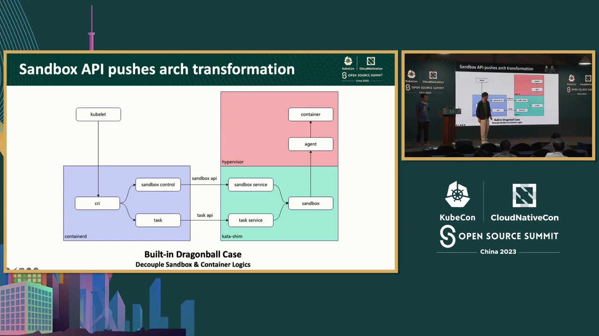

### 6.3 再往前一步：1 对 n 的 sandboxer

对非 Dragonball 的形态（QEMU、Cloud Hypervisor），VMM 进不了 shim 进程，宿主上仍是一堆进程。演讲者提出一个实验性想法：把所有 shim 收拢成一个 **sandboxer** 结构，做成 1 对 n——因为 kubelet 管 containerd 是 1 对 n，containerd 管 shim 也可以是 1 对 n。[【跳转到 23:52】](https://www.youtube.com/watch?v=R2VPkkNBci0&t=1432)

这个 sandboxer 以 DaemonSet 形式跑在宿主上，一对一地处理不同 VM：来自 Sandbox API 的请求做沙箱操作，来自 Task API 的请求做任务操作。**但 Task API 仍然要穿过沙箱，不能直连宿主上的 kata agent**——因为中间隔着一台 VM，宿主与客户机的地址语义不同，必须有人做转换。[【跳转到 24:57】](https://www.youtube.com/watch?v=R2VPkkNBci0&t=1497)

还有一条更激进的探索：让容器的 IO 直接走**基于 fd 的 vsock** 转发，不经过 shim 或 sandbox 进程。这样沙箱可以自由升级替换，而不用担心 IO 被打断。[【跳转到 25:07】](https://www.youtube.com/watch?v=R2VPkkNBci0&t=1507)

## 七、收益、代价与留下的问题

### 7.1 三类收益

- **沙箱成为一等公民**：不再有「容器逻辑与沙箱逻辑纠缠」的运行时；
- **可以删掉历史包袱**：理解了沙箱行为之后，Kata 里那些「逻辑奇怪」的 Pod 容器（比如 pause 容器）可以尝试简化甚至去掉；
- **1 对 n 带来的资源收益**：内存占用与加载速度都大幅改善。[【跳转到 26:22】](https://www.youtube.com/watch?v=R2VPkkNBci0&t=1582)

### 7.2 实测数据

Kata 3 + Dragonball 对比 Kata 2 + QEMU：

| 测试项 | Kata Containers 3.0.0 | Kata Containers 2.4.3 |
| --- | --- | --- |
| 单容器启动时间 | 354 ms | 709 ms |
| 100 个容器内存占用 | 9,501,144 KB | 18,001,884 KB |

启动快约 2 倍，内存轻约 1.8 倍。[【跳转到 27:12】](https://www.youtube.com/watch?v=R2VPkkNBci0&t=1632)

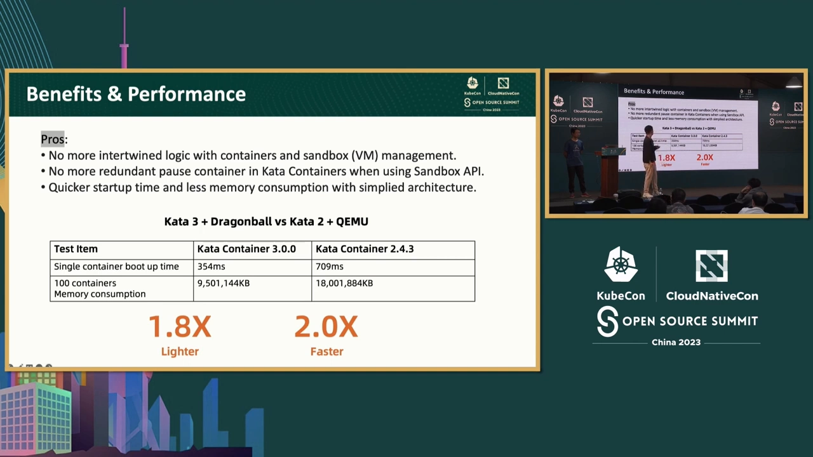

### 7.3 遗留问题

演讲者在 shim v2 那一页就点明了两个「Leftovers」：**仍然是一个 Pod 一个 shim**，以及**必须处理 shim 与 VMM 进程之间的状态不一致**。[【跳转到 16:47】](https://www.youtube.com/watch?v=R2VPkkNBci0&t=1007) 前者靠 sandboxer 的 1 对 n 设想来缓解，后者靠 Kata 3.0 的单进程架构来消除。

## 八、现场 demo：两条命令看穿「伪装」

### 8.1 用 sandbox API 跑一个 busybox

演示环境打开了 sandbox API 模式，之后 containerd 创建的 Pod 全部走 sandbox API；沙箱和容器各有一份 JSON 定义。[【跳转到 29:18】](https://www.youtube.com/watch?v=R2VPkkNBci0&t=1758)

关键命令是 `crictl run -r kata`：让 crictl 长时间使用 kata 这个 runtime，而不是 runc。[【跳转到 29:43】](https://www.youtube.com/watch?v=R2VPkkNBci0&t=1783)

### 8.2 `uname -r` 与 `ps` 两个证据

进容器执行 `uname -r`，得到 **5.10**——这是客户机内核；在宿主上执行 `uname -r`，得到 **4.19**。同一个节点上两个不同的内核版本，这就是 micro-VM 形态的直接证据。[【跳转到 30:08】](https://www.youtube.com/watch?v=R2VPkkNBci0&t=1808)

再看进程列表：Kata 3.0 的 Dragonball 形态下，整台 Kata 就是**一个进程**——`containerd-shim-kata-v2`，没有别的进程；而且这个 shim 进程自己就挂着 KVM 的 fd，说明 VMM 已经合进来了。[【跳转到 30:58】](https://www.youtube.com/watch?v=R2VPkkNBci0&t=1858)

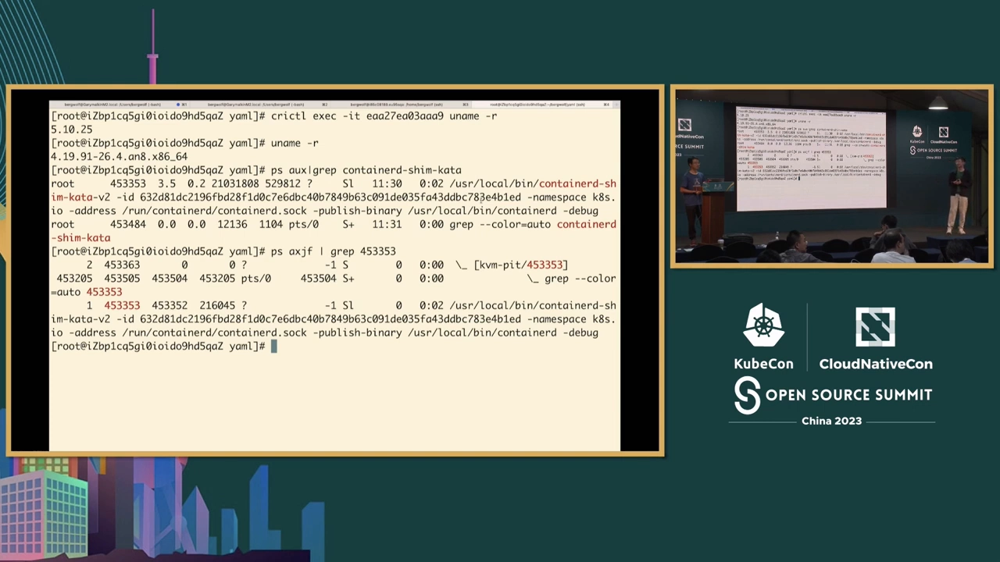

这张截图值得逐项读一遍，因为它就是「shim v2 契约在进程层面长什么样」：

```text
/usr/local/bin/containerd-shim-kata-v2 -id 632d81dc... -namespace k8s.io \
  -address /run/containerd/containerd.sock -publish-binary /usr/local/bin/containerd -debug
```

- `-id`：这个 shim 负责的沙箱 ID，一个 shim 对应一个沙箱；
- `-namespace`：containerd 的 namespace，这里是 `k8s.io`；
- `-address`：containerd 的 socket 路径，shim 通过它反向连回 containerd；
- `-publish-binary`：用于把事件发布回 containerd 的二进制。

这四件事合起来说明：**shim 不是一个被 containerd 单向调用的命令，而是一个能反向连回 containerd、自己发布事件的服务端进程**。这正是 shim v2 与 shim v1 在进程模型上的分水岭。

## 九、Q&A 里暴露的两个设计争议

### 9.1 sandboxer 会不会取代 containerd

有听众问：既然有了 sandboxer，是不是可以直接替换 containerd？回答是：不需要替换。containerd 允许插件化，你可以把 containerd 和 sandboxer 编在一起，也可以拆成两个进程；containerd 允许以这种插件形式被编进别的二进制。[【跳转到 32:13】](https://www.youtube.com/watch?v=R2VPkkNBci0&t=1933)

### 9.2 Task API 该不该穿过沙箱

另一位听众的质疑更尖锐：既然叫 sandboxer，为什么 Task API 还要经过它，而不是直接给沙箱？

回答分两层：

- **实现细节要挡住**：Kata 不想把沙箱实现的细节暴露给 containerd，也不想改 Task API，所以让 Task API 原样下来，容器资源相关的事在 Kata 侧处理；[【跳转到 34:18】](https://www.youtube.com/watch?v=R2VPkkNBci0&t=2058)
- **地址语义必须转换**：containerd 看到的 rootfs、volume、device，与客户机里 agent 看到的完全不是一回事，这个转换必须由沙箱外的逻辑来做，这正是 Kata shim 在干的事。[【跳转到 35:33】](https://www.youtube.com/watch?v=R2VPkkNBci0&t=2133)

但演讲者也承认这里的风险：containerd 期望的是「你给我一个 task server，我把请求发给你」，而不是「我发给你之后你还要自己做一层转换」——这会让 containerd 侧产生误解。[【跳转到 36:23】](https://www.youtube.com/watch?v=R2VPkkNBci0&t=2183)

## 小结

- **接口决定生态位**：CRI 管高层运行时，OCI 管低层运行时；低层运行时的「最终形态」可以是容器、沙箱或 micro-VM。[【跳转到 03:55】](https://www.youtube.com/watch?v=R2VPkkNBci0&t=235)
- **shim v1 时代靠伪装**：Kata 把 `runc create/start/kill/delete` 换成 `kata-runtime ...`，宿主上是 shim + runtime + proxy 三段加客户机 agent。[【跳转到 07:12】](https://www.youtube.com/watch?v=R2VPkkNBci0&t=432)
- **shim 爆炸是 shim v2 的直接动因**：每容器两个 shim、每次 exec 再加两个，生产上出现内存膨胀与 shim 跑飞。[【跳转到 12:12】](https://www.youtube.com/watch?v=R2VPkkNBci0&t=732)
- **shim v2 的接口与 v1 几乎一样**，真正的变化是「每 Pod 一个常驻 shim 进程」，多出 connect / shutdown 两个方法。[【跳转到 14:17】](https://www.youtube.com/watch?v=R2VPkkNBci0&t=857)
- **Kata 3.0 把 shim 与 VMM 合成一个进程**（Rust 重写 + Dragonball），消除了两进程状态不一致的窗口。[【跳转到 18:02】](https://www.youtube.com/watch?v=R2VPkkNBci0&t=1082)
- **Sandbox API 把沙箱提升为一等公民**，解决「同一个 Create/Delete 有多种含义」的语义纠缠。[【跳转到 21:47】](https://www.youtube.com/watch?v=R2VPkkNBci0&t=1307)
- **收益可量化**：Kata 3 + Dragonball 对比 Kata 2 + QEMU，启动快约 2 倍、内存轻约 1.8 倍。[【跳转到 27:12】](https://www.youtube.com/watch?v=R2VPkkNBci0&t=1632)
- **遗留问题仍在**：一 Pod 一 shim 的粒度、宿主与客户机的地址语义转换、以及 Task API 是否该穿过沙箱，都还没有定论。[【跳转到 36:23】](https://www.youtube.com/watch?v=R2VPkkNBci0&t=2183)

## 关键术语速查

| 术语 | 一句话解释 |
| --- | --- |
| OCI | Open Container Initiative，一套规范集合（镜像 / 运行时 / 分发），不是一个接口 |
| CRI | Container Runtime Interface，kubelet 与高层容器运行时之间的 gRPC 接口，含 image service 与 runtime service |
| 低层运行时 | 真正把东西跑起来的组件：runc 产出容器，gVisor 产出沙箱，Kata 产出 micro-VM |
| shim v1 | containerd 与 shim 之间 gRPC、shim 与运行时之间命令行的旧模型，每容器一个 shim |
| shim v2 | 每 Pod 一个常驻 shim 进程，暴露 `Task` gRPC 服务（Create/Start/Delete/Exec/State 等），多出 Connect 与 Shutdown |
| `containerd-shim-kata-v2` | Kata 的 shim v2 实现，一个沙箱一个进程，负责起 VMM 并与客户机 agent 通信 |
| bundle | containerd 交给运行时的目录，含 rootfs 与 `config.json`（运行时配置） |
| proxy | Kata 早期架构里在宿主侧转发 gRPC over yamux 到 hypervisor 串口的组件 |
| Dragonball | Kata 自研的 Rust 轻量 VMM，可内嵌进 shim 进程，实现单进程架构 |
| Sandbox API | 从 Task API 中抽出的沙箱操作接口，让沙箱在 containerd 里成为一等公民（1.7 起为实验特性） |
| sandboxer | 实验性的 1 对 n 结构：一个宿主守护进程统一承接多个沙箱的 Sandbox API 与 Task API 请求 |
| shim 跑飞 | shim v1 时代的事故形态：shim 进程脱离 containerd 管理后残留，无人回收 |