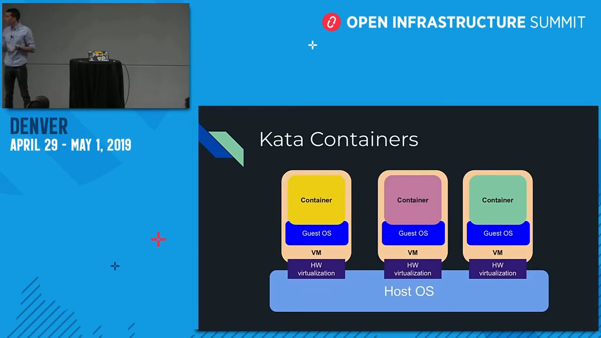
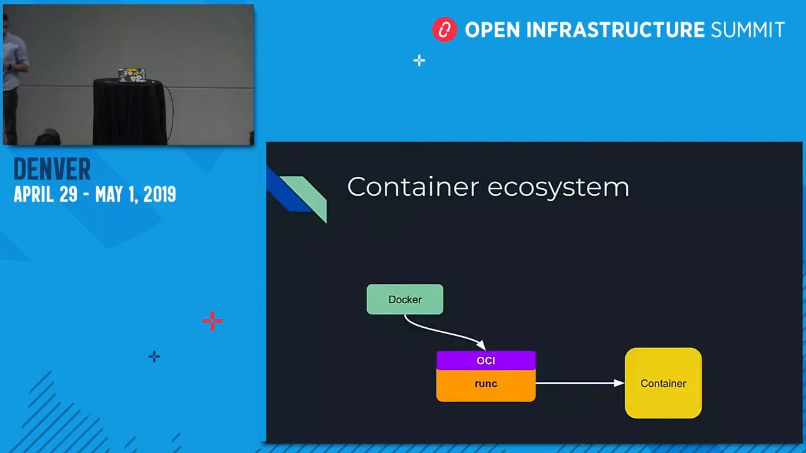
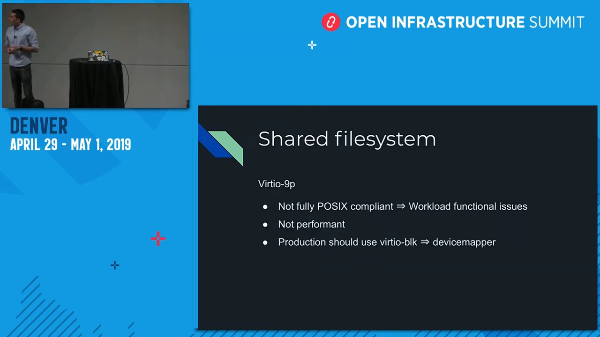
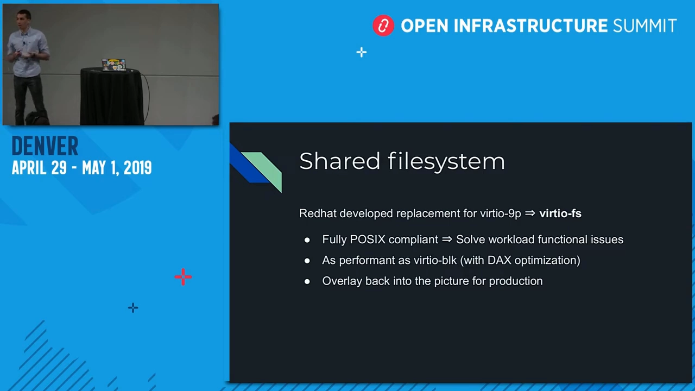
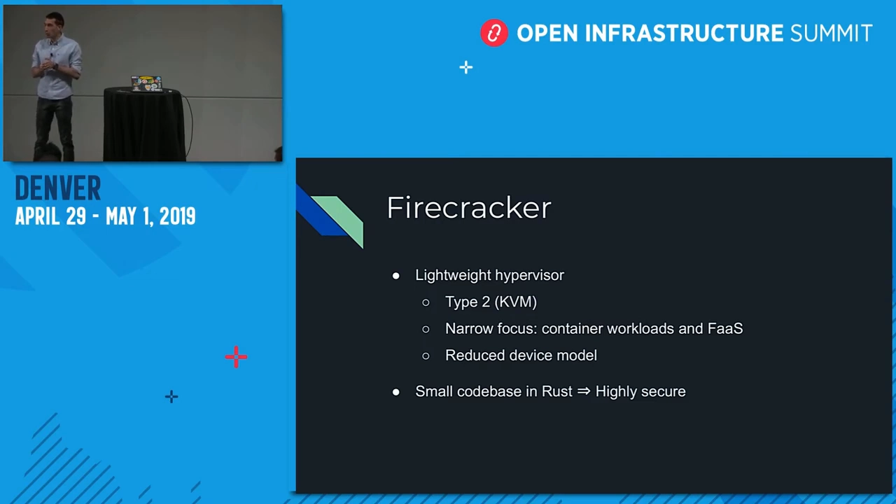
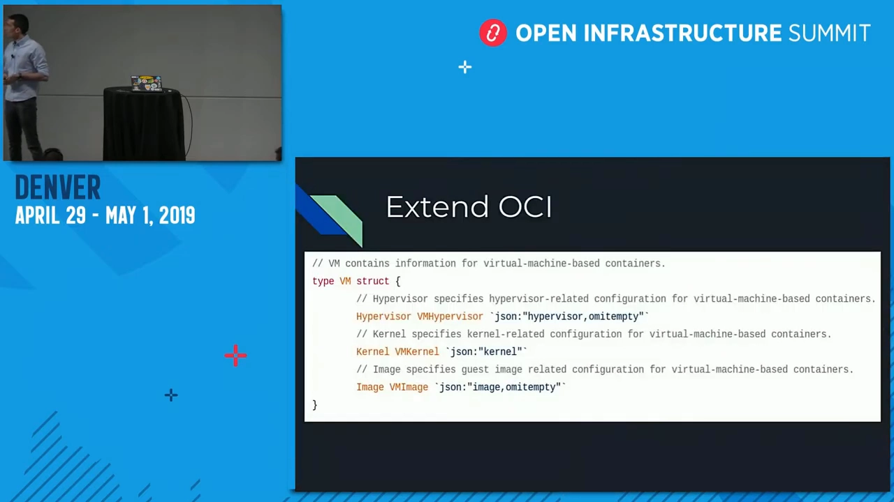
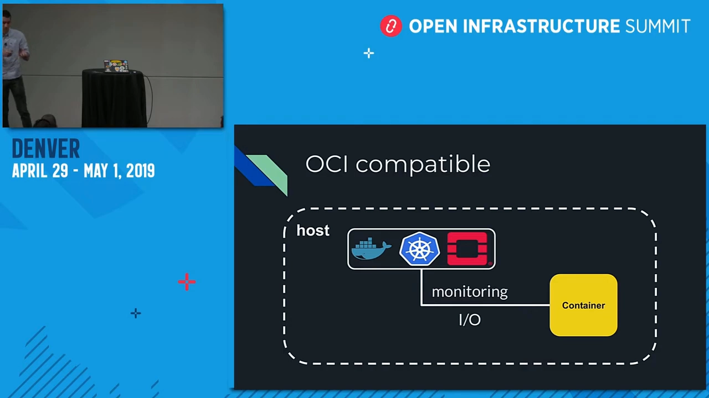
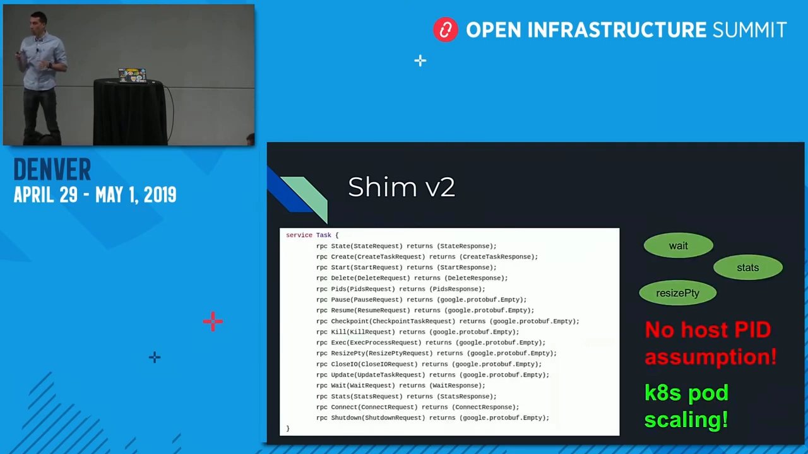
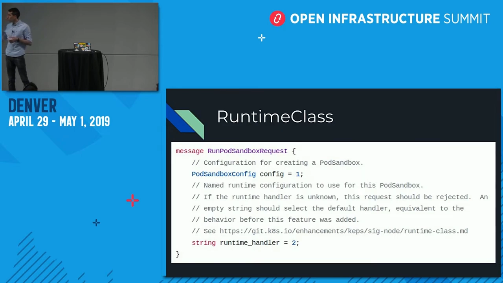
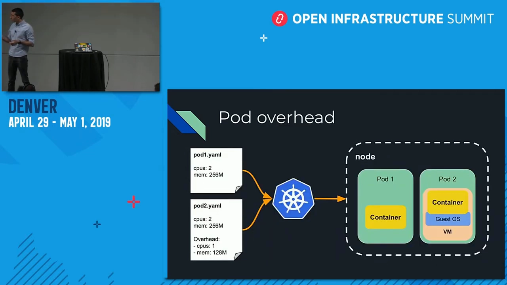

# Kata 的根文件系统：9p、virtio-fs 与 device mapper 三条路

> 视频来源：[Kata Containers, story of a container runtime](https://www.youtube.com/watch?v=G7c7vhZndA4)（YouTube · Open Infrastructure Summit Denver 2019，讲者 Sébastien Boeuf，Intel）｜时长约 31 分钟
> 导读：这是一场 Kata 1.x 时期的项目综述，讲者按"为什么做 → 怎么接进生态 → 影响了哪些组件 → 支持哪些 hypervisor"的顺序讲完。本文只抽取其中与本小节相关的一条线：**容器的根文件系统（rootfs）怎么从宿主上的镜像，变成客户机里的 `/`**。讲者用两页幻灯片把这件事的选择讲透了——9p 不行、生产用 device mapper、virtio-fs 是补丁。shim v2 与 RuntimeClass 属于同节另外两个小节，这里只做背景交代。

## 本讲要解决的核心问题（SCQA）

**背景**：容器镜像是一叠 tar 层，`runc` 在宿主上把它们解包、用 overlayfs 合成一棵目录树，然后 `chroot`/`pivot_root` 进去，这棵目录树就是容器的 rootfs。这套流程在"内核共享"的世界里运转良好。

**冲突**：Kata 把容器塞进了一台轻量虚拟机，容器进程跑在**客户机内核**上。宿主上那棵解包好的目录树，客户机根本看不见——客户机有自己的内核、自己的挂载命名空间。

**疑问**：那客户机的 `/` 从哪儿来？镜像怎么变成客户机能用的根文件系统？

**回答（中心思想）**：只有两条路。要么**把宿主上的目录共享进客户机**（9p，后来换成 virtio-fs），要么**把镜像层落成块设备**（device mapper + virtio-blk），让客户机挂一个真正的磁盘。讲者的结论很直接：9p 语义不全、性能不行，"生产环境应该用 virtio-blk + device mapper"；virtio-fs 出现后，共享目录这条路才重新回到生产选项里。

[【跳转到 03:07】](https://www.youtube.com/watch?v=G7c7vhZndA4&t=187)

## 一、镜像没变，变的是"解包给谁看"

### 1.1 Kata 只替换了 OCI 运行时这一层

讲者反复强调一件事：Kata 不是另起一套容器平台，它替换的是 `runc` 所在的那一层。Docker 或 Kubernetes 照常调用 OCI 接口，只是最后创建容器的不是宿主上的 `runc`，而是"一台虚拟机 + 客户机里的 agent + 客户机里的 runc"。

[【跳转到 03:50】](https://www.youtube.com/watch?v=G7c7vhZndA4&t=230)

这意味着镜像格式、manifest、layer digest、镜像仓库全都不用动——**这正是本小节要讲的那一段的起点**：镜像还是那个镜像，问题出在"解包"这一步的执行位置变了。原来解包结果被宿主上的 `runc` 直接使用，现在解包结果必须穿过虚拟机边界，送到客户机里去。

### 1.2 客户机里还得有一个 runc

讲者提到，虚拟机里跑着一个 agent，agent 会调用客户机内的 `runc`，由它去组装 namespace、cgroup 这些原语。所以"rootfs 准备好了"的判据是：**客户机里的 runc 能像在宿主上一样，看到一棵完整的、可挂载的目录树**。这句话把两条路的差别说清楚了——一个共享目录，一个真磁盘，都得让客户机里的 runc 认账。

## 二、文件系统路径：把宿主上的目录共享进客户机

### 2.1 9p 的三个问题：语义、性能、以及"那就别用"

Kata 早期共享文件系统用的是 **virtio-9p**（简称 9p）：宿主把某个目录导出，客户机通过 virtio 设备把它挂载进来。讲者用一页幻灯片列了三条罪状：

[【跳转到 18:32】](https://www.youtube.com/watch?v=G7c7vhZndA4&t=1112)

1. **不完全符合 POSIX**。讲者举的例子是符号链接：某些 symlink 用法在 9p 下不被支持，程序的行为就和在 `runc` 下跑不一样。对初学者来说，这句话的含义是：容器里的程序以为自己在一个普通 Linux 文件系统上，但 9p 只实现了其中一部分语义，凡是用到边角特性的程序就可能出功能问题。
2. **性能不好**。讲者的解释是"it involves an extra copy of the data"——数据要在宿主和客户机之间多拷一次，而不是直接映射。
3. **结论**：所以很长时间里，Kata 的官方建议是"生产环境用 device mapper"，也就是干脆别共享目录，走块设备。

### 2.2 virtio-fs：Red Hat 做的替代品，把语义补齐了

后来 Red Hat 做了一个 9p 的替代品 **virtio-fs**。讲者说它"基于 FUSE，因此完全符合 POSIX"，9p 那些功能性问题就没了；更关键的是性能：

[【跳转到 19:47】](https://www.youtube.com/watch?v=G7c7vhZndA4&t=1187)

幻灯片上写的是"as performant as virtio-blk (with DAX optimization)"，讲者的口头补充是：如果用 virtio-fs 加上 DAX，把文件直接映射进与客户机共享的那段内存里，就能拿到和 virtio-blk 同一水平的性能。**"Overlay back into the picture for production"**——这句是重点：一旦共享目录的性能追平块设备，overlayfs 那套"层叠 + CoW"的做法就可以重新用在生产上，不必再为了性能把镜像转成块。

对本小节来说，这就是**文件系统路径**的完整形态：宿主上仍然是 overlayfs 合成出来的一棵目录树（镜像层不用转换、runc 生态原样复用），只是这棵树通过 virtio-fs 挂进客户机当 `/`。

### 2.3 代价转移到了安全边界上

讲者特意提醒了一处容易被忽略的差别：9p 的后端实现在虚拟机内部，所以"约束住这台 VM"就等于约束住了 9p 后端；而 virtio-fs 是用户态实现（FUSE），宿主侧多了一个守护进程 **virtiofsd** 来当后端，于是**必须同时约束 VM 和这个守护进程**，virtio-fs 才算是安全方案。

[【跳转到 20:34】](https://www.youtube.com/watch?v=G7c7vhZndA4&t=1234)

这句话值得记住：换一条 rootfs 的路，不只是换性能，还换了攻击面。宿主上多一个能读镜像目录的进程，就多一个需要被关进沙箱的对象。

## 三、块设备路径：把镜像层"落成块"

### 3.1 device mapper 的角色

讲者对块设备路径只有一句话，但信息量足够：生产环境用 **virtio-blk + device mapper**。拆开看是两件事：

- **virtio-blk** 是虚拟机的块设备（一块虚拟磁盘），客户机看到的是 `/dev/vda` 这样的设备，可以在上面挂 ext4/xfs，得到的是**本地文件系统**语义。
- **device mapper** 是 Linux 的块设备映射框架，能把物理设备映射成虚拟设备。Kata 用它把镜像的每一层做成一个只读块设备，再用 thin pool 给容器做可写层——**层叠与写时复制从 overlayfs 搬到了块层**。

### 3.2 两条路的本质差别：共享的是"目录"还是"块"

这是本小节最该记住的一句对照：

| 维度 | 文件系统路径（9p / virtio-fs） | 块设备路径（virtio-blk + device mapper） |
| --- | --- | --- |
| 共享的东西 | 宿主上的一个**目录** | 一块**块设备** |
| 客户机看到的语义 | 9p / FUSE 的语义（不是真 inode） | 真正的磁盘 + 真正的 ext4/xfs |
| 镜像是否要转换 | 不用，解包成目录即可 | 要，层要"落成块" |
| 层叠与 CoW 由谁承担 | overlayfs | thin pool（块级 CoW） |
| 主要短板 | 元数据操作慢、`mmap` 受限（9p 时代尤其明显） | 多一步转换，转换耗时计入创建容器 |

## 四、Hypervisor 决定了你**能不能**选文件系统路径

讲者在后半段横向比较了几个 VMM，其中一条对比直接限制了 rootfs 的选择：**Firecracker 不支持文件系统共享**。讲者的原话是，如果你想在宿主和客户机之间共享一整个目录，Firecracker 做不到，所以你得先看清自己的用例再选 VMM。

[【跳转到 23:33】](https://www.youtube.com/watch?v=G7c7vhZndA4&t=1413)

这条约束很实用：**设备模型越裁剪，能走的 rootfs 路径越少**。Firecracker 只有块设备，所以接 Firecracker 的运行时基本只能走"镜像落成块"这条路——这也解释了下一篇要讲的 firecracker-containerd 为什么一上来就写了个块设备快照器。

## 五、镜像之外还要声明"用哪个内核、哪个客户机镜像"

既然一台 VM 里既有容器又有客户机内核，OCI 规范里就得多几个字段。讲者提到 Kata 推动 OCI 扩展，加了一个 `VM` 结构，用来描述三样东西：**hypervisor 相关配置、内核配置、客户机镜像配置**。

[【跳转到 11:05】](https://www.youtube.com/watch?v=G7c7vhZndA4&t=665)

注意这里的 `Image` 指的是**客户机镜像**（guest image），不是应用镜像。也就是说，VM 型运行时在"镜像"这件事上有两份东西要对上：应用镜像负责容器里的 `/`，客户机镜像负责 VM 里的内核和基础系统。**rootfs 的准备，实际上是这两份东西的拼接**。

## 六、其余生态接口（只作背景，不展开）

讲者用了一半篇幅讲 Kata 怎么接进容器生态，这些属于同节 6.3.1 与 6.3.3 的内容，这里只留三条线索：

- **shim v2**：containerd 与 CRI-O 通过一个长期运行的 gRPC 服务直接与 Kata 对话，不再需要在宿主上有一个"代表容器"的进程，因此去掉了"宿主上必须有容器 PID"的假设，也顺带让 `stats` 能直接问客户机里的 agent。

[【跳转到 07:18】](https://www.youtube.com/watch?v=G7c7vhZndA4&t=438)

[【跳转到 16:35】](https://www.youtube.com/watch?v=G7c7vhZndA4&t=995)

- **RuntimeClass**：Pod spec 里多一个字段声明"这个 Pod 用 runc 还是 Kata"，调度器据此把 Pod 放到装了对应运行时的节点上。

[【跳转到 12:06】](https://www.youtube.com/watch?v=G7c7vhZndA4&t=726)

- **pod overhead**：VM 型运行时每台 VM 有固定开销，需要在 Pod 级别声明，否则调度器会按容器声明的资源去排，结果节点被 VM 的额外内存挤爆。讲者给的量级是"额外 1 个 CPU、128MB 内存"。

[【跳转到 13:22】](https://www.youtube.com/watch?v=G7c7vhZndA4&t=802)

## 小结

- 镜像格式没变，变的是**解包结果送给谁用**：内核共享时给宿主上的 `runc`，内核独立时给客户机里的 `runc`。
- **文件系统路径**共享的是宿主上的一个目录。9p 语义不全、性能差，被讲者明确判为不适合生产；virtio-fs 基于 FUSE 补齐了 POSIX 语义，配合 DAX 性能追平 virtio-blk，于是 overlayfs 重新可用于生产。
- **块设备路径**共享的是一块磁盘。镜像层被落成只读块设备，thin pool 提供写时复制，客户机里挂的是真正的 ext4/xfs。
- 两条路的 CoW 承担者不同：**overlayfs 在文件层做，thin pool 在块层做**——同一件事的两种落地。
- 换路径也换攻击面：virtio-fs 多了一个宿主侧守护进程 virtiofsd，必须一起约束。
- VMM 的能力上限决定了可选路径：Firecracker 不支持文件系统共享，只能走块设备。

## 关键术语速查

| 术语 | 一句话解释 |
| --- | --- |
| rootfs | 容器的根文件系统，容器进程看到的 `/` 就是它 |
| 9p（virtio-9p） | 一种把宿主目录共享给虚拟机的协议，语义不全、性能一般 |
| virtio-fs | Red Hat 开发的共享文件系统，基于 FUSE，语义完整，配合 DAX 性能接近块设备 |
| DAX | 让客户机直接把共享内存里的文件页映射进自己的地址空间，省掉一次拷贝 |
| virtiofsd | virtio-fs 在宿主侧的后端守护进程，需要单独约束 |
| virtio-blk | 虚拟机的块设备，客户机看到一块磁盘 |
| device mapper | Linux 的块设备映射框架，可把镜像层做成只读块设备 |
| thin pool | device mapper 的瘦置备池，按需分配块并支持块级快照（CoW） |
| overlayfs | 把多个只读层叠成一个可写视图的联合文件系统，runc 的默认做法 |
| shim v2 | containerd 与运行时之间的 gRPC 接口，详见 6.3.1 |
| RuntimeClass | K8s 里声明 Pod 用哪个容器运行时的字段，详见 6.3.3 |