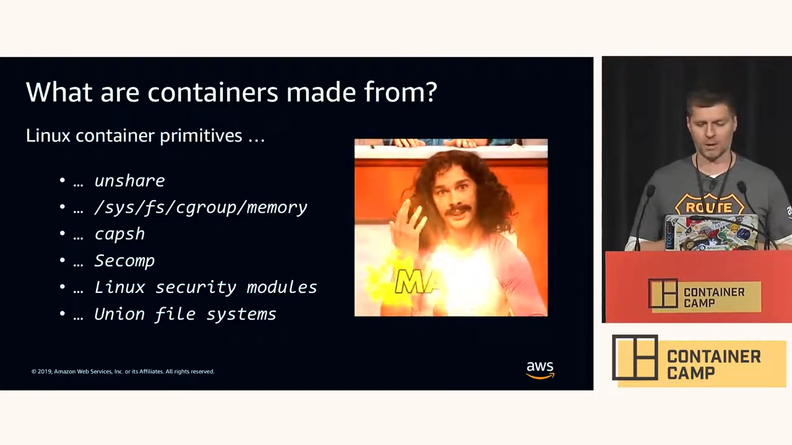
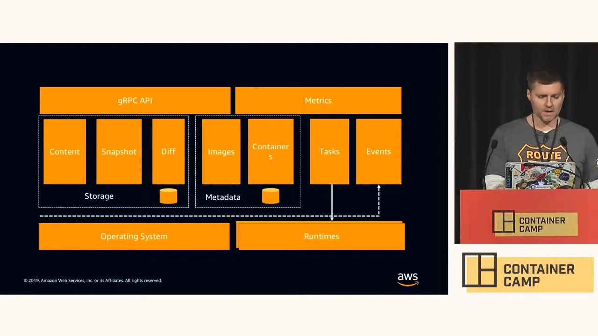
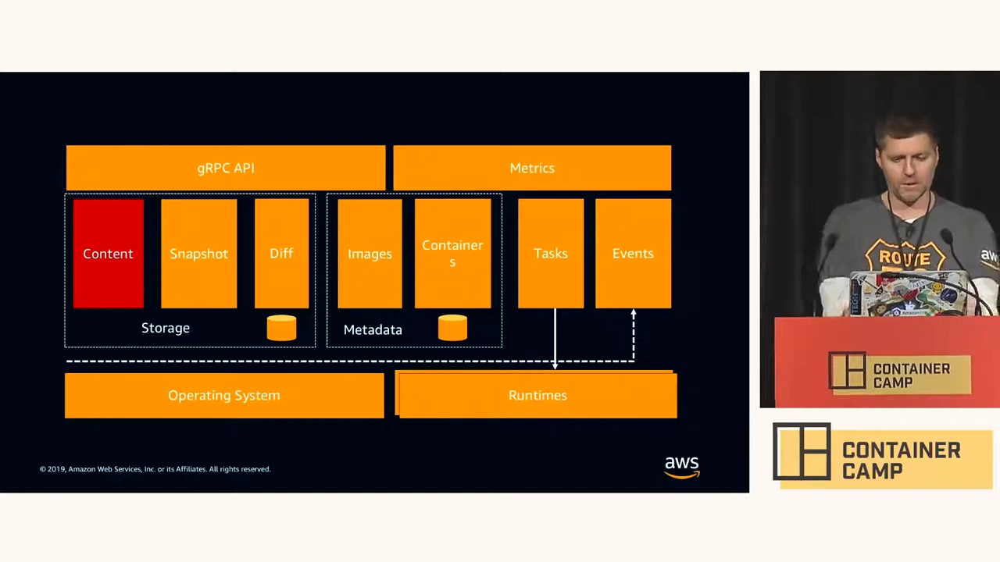
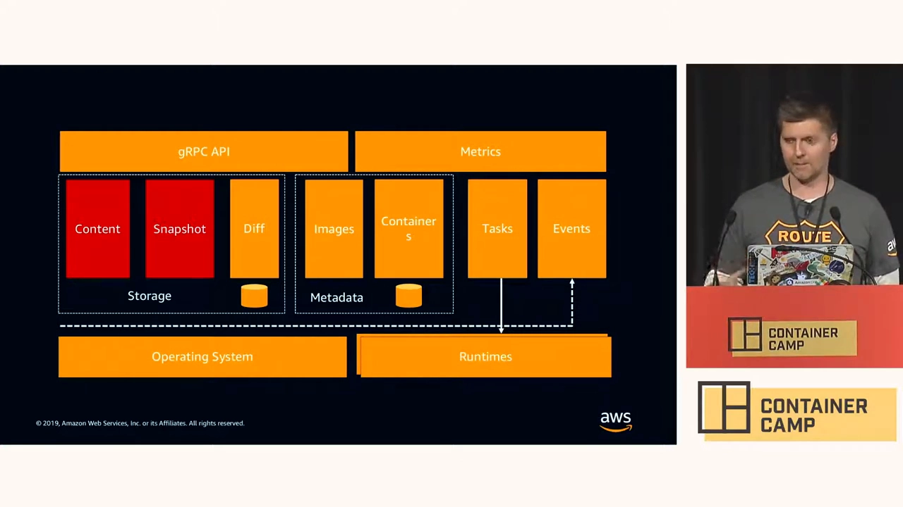
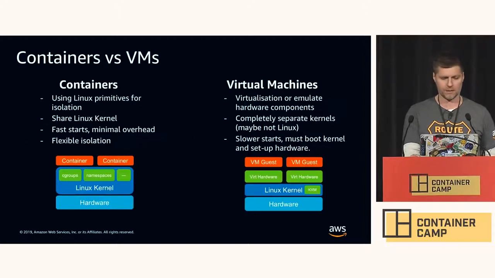
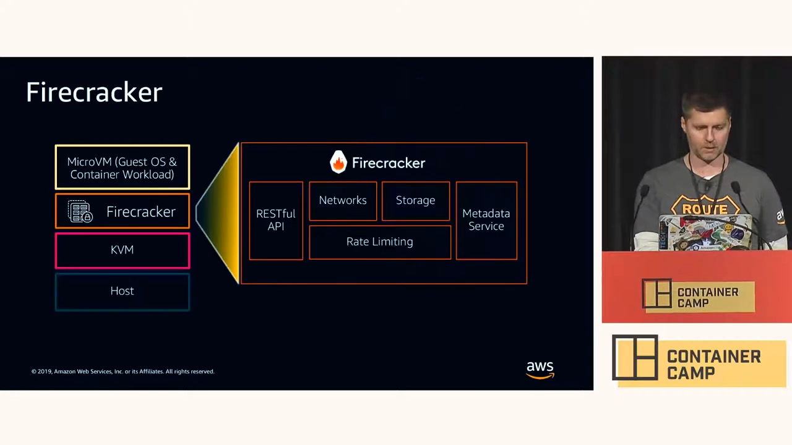
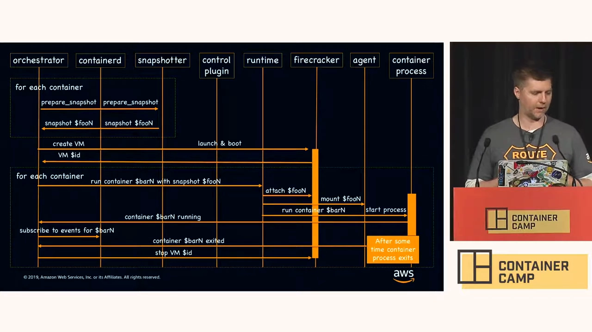
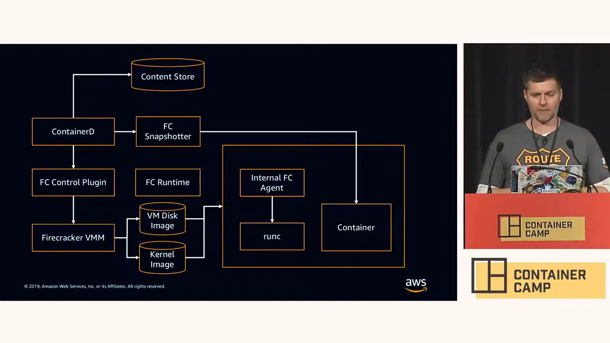
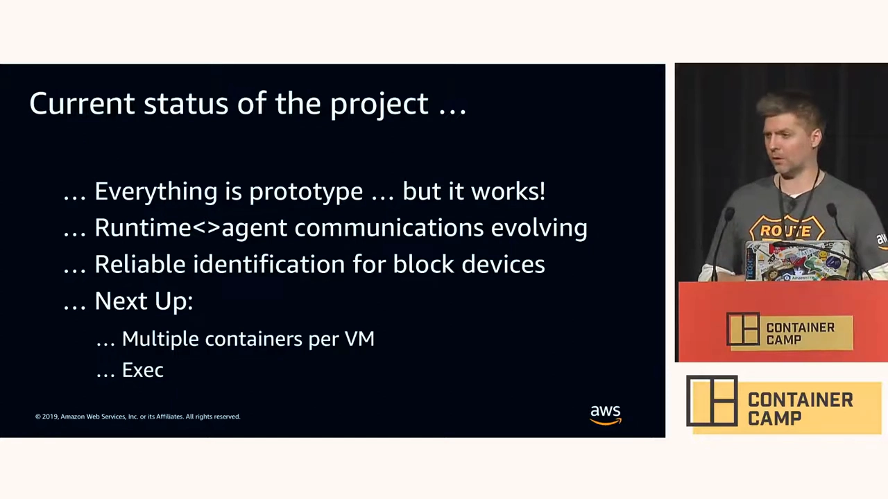

# firecracker-containerd：把镜像解包成块设备当根文件系统

> 视频来源：[Deep Dive into firecracker-containerd](https://www.youtube.com/watch?v=2rwYZdVPN4g)（YouTube · Container Camp AU 2019，讲者 Mitch Beaumont，AWS 解决方案架构师）｜时长约 32 分钟
> 导读：这场演讲的前半段在铺垫容器与虚拟机的差别，后半段才是干货：containerd 的四个新组件，以及那个"把镜像写成块设备"的快照器。它正好是"镜像 → 客户机根文件系统"这条链路上**块设备路径**的一份完整实现记录。文中提到的项目当时还是原型，讲者也说得很清楚。

## 本讲要解决的核心问题（SCQA）

**背景**：containerd 管容器的生命周期。它把镜像的每一层 tar 原样存在 content store 里，再由 snapshotter 把层解包、合成一棵目录树，交给运行时当 rootfs。默认的 snapshotter 用 overlayfs 做层叠与写时复制。

**冲突**：firecracker-containerd 要把容器放进 Firecracker 微虚拟机。可是 Firecracker 的设备模型被裁到极小，**没有共享文件系统的设备**；而 AWS 的立场是"安全是第一优先级"，讲者直说他们"找不到一种安全的方式在宿主与客户机之间共享文件"。

**疑问**：宿主上的镜像目录，怎么变成客户机里那个 `/`？

**回答（中心思想）**：既然不能共享文件，那就共享**块**。他们写了一个**块设备快照器**：把镜像 tar 解包后整份写进一个块设备，把这个块设备挂给 Firecracker 虚拟机，客户机里的 agent 再把它挂成容器的 rootfs。层叠与写时复制则交给 device mapper 的 thin pool。代价是每次创建容器都要"解包 + 写块"，这正好抵消了微虚拟机引以为傲的快速启动。

[【跳转到 04:00】](https://www.youtube.com/watch?v=2rwYZdVPN4g&t=240)

## 一、先分清"镜像"和"rootfs"是两件东西

### 1.1 containerd 的分层：谁存 tar，谁变目录

讲者把 containerd 拆成几块讲，其中三块和本小节直接相关：

[【跳转到 14:12】](https://www.youtube.com/watch?v=2rwYZdVPN4g&t=852)

- **Content store**：镜像下载下来是什么样，它就存什么样——一个装着 rootfs 表示的 tar 包，原封不动躺在那里。
- **Snapshotter**：负责把 content store 里的 tar **解包、转换**成符合 OCI 标准、容器能直接用的文件系统。**写时复制就在这一层实现**。
- **Runtimes**：最底下一层，默认是 `runc`，可插拔。

[【跳转到 15:02】](https://www.youtube.com/watch?v=2rwYZdVPN4g&t=902)

[【跳转到 15:52】](https://www.youtube.com/watch?v=2rwYZdVPN4g&t=952)

[【跳转到 04:15】](https://www.youtube.com/watch?v=2rwYZdVPN4g&t=255)

### 1.2 关键的架构缝隙：snapshotter 是可插拔的

讲者强调 containerd 的模块化程度很高："snapshotter 背后的逻辑可以是任何东西，我们可以在底下实现任何我们想要的东西。"这句话是整个项目的立足点——**镜像到 rootfs 这一步是可以换实现的**。默认实现产出的是宿主上的目录（overlayfs），他们要做的是产出宿主上的一块块设备。

## 二、为什么非要走块设备

### 2.1 微虚拟机没有"共享目录"这个设备

Firecracker 的定位是"设备模型极小、代码量极小、用 Rust 写"，换来的是更小的攻击面。

[【跳转到 17:10】](https://www.youtube.com/watch?v=2rwYZdVPN4g&t=1030)

设备少是优点，也是约束：**没有 virtio-fs、没有 9p**，客户机看不到宿主的任何目录。所以"把镜像解包成目录再共享进去"这条路，在 Firecracker 上根本不存在。

### 2.2 安全上的取舍：宁可不共享文件

讲者的原话是，他们在宿主与客户机之间"找不到安全地共享文件的办法"，于是转向块设备。

[【跳转到 22:36】](https://www.youtube.com/watch?v=2rwYZdVPN4g&t=1356)

这个取舍值得单独记一笔：**共享文件系统意味着宿主上有一个能被客户机读取的目录，也就意味着多一个需要被约束的进程与一条新的攻击路径**。块设备把这个面收窄成"一块磁盘"，客户机只能看到块上的内容，看不到宿主的目录结构。

## 三、块设备快照器：解包 → 写块 → 挂载

### 3.1 四步流程

讲者把做法讲得很朴素：

1. 从 content store 取出镜像，**解开 tar**；
2. 在宿主上**创建一个块设备**，把解出来的整个 rootfs 内容**写进这个块设备**；
3. 把这个块设备**挂给 Firecracker 虚拟机**（virtio-blk）；
4. 客户机里的 agent 拿到这块设备，**挂载**它，作为容器的 rootfs。

于是容器里的 `/` 是一块真正的磁盘上的文件系统，而不是一个共享目录。

### 3.2 从"朴素版"到 device mapper

他们写过两版：

- **naive 版**：每次创建镜像就完整预拷贝一份。讲者的评价是"存储空间上非常低效"，但它证明了链路能跑通。
- **device mapper 版**：用 device mapper 把物理设备映射成虚拟设备，底层用 **thin pool**（瘦置备池）表示设备，于是**多个容器的块可以共享**，拿到去重的收益。

讲者提到这个实现后来合进了上游 containerd（幻灯片上给了 PR 链接）。

[【跳转到 24:41】](https://www.youtube.com/watch?v=2rwYZdVPN4g&t=1481)

### 3.3 层与 CoW 就这样搬到了块层

把这一步和上一篇对照着看最清楚：OCI 镜像的"层叠 + 只读下层 + 可写上层"，在文件系统路径里由 **overlayfs** 承担，在这里由 **thin pool 的块级快照**承担。**同一件事，一个在文件层做，一个在块层做**。镜像的层数、digest、manifest 全都不变，变的只是"层叠"这个动作发生在哪一层。

## 四、一次容器启动的完整时序

讲者给了一张时序图，把"镜像 → rootfs"放进整条链路里看：

[【跳转到 28:26】](https://www.youtube.com/watch?v=2rwYZdVPN4g&t=1706)

按图从左到右读：

1. 编排器调 containerd；
2. containerd 让 **snapshotter** 准备快照，拿到一个快照 ID（图上的 `$fooN`）——**解包与写块就发生在这里**；
3. **control plugin** 让 Firecracker 创建并启动 VM；
4. **runtime** 把 `$fooN` 对应的块设备 attach 给这台 VM；
5. 客户机里的 **agent** 把这块设备 mount 起来，调用 `runc` 启动容器进程；
6. 容器退出后，VM 被停掉。

注意第 2 步和第 3 步是**并行**的：镜像落块和 VM 启动同时进行，这是他们能压住总时延的关键。

### 4.1 一个绕不开的限制：块设备必须预先分配

讲者专门讲了一个坑：因为 Firecracker 的设备模型被裁得很小，**它不支持运行时动态挂载存储卷或块设备**。所以他们的做法是**预先给 VM 分配好块设备**，等快照器把块设备创建出来之后，再把这些预先分配的位置"重定向"到真正的块设备上。

[【跳转到 30:06】](https://www.youtube.com/watch?v=2rwYZdVPN4g&t=1806)

这条限制对理解"块设备路径"很重要：它不只是"换个地方放 rootfs"，还要求**VM 的磁盘布局在启动前就定好**，于是"创建容器"和"创建 VM"这两件事被绑得更紧。

## 五、为了这条路，他们加了四个组件

[【跳转到 20:31】](https://www.youtube.com/watch?v=2rwYZdVPN4g&t=1231)

- **FC Snapshotter**：块设备快照器，进程外的 gRPC 代理插件，不用编进 containerd 二进制。
- **FC Control Plugin**：管 VM 生命周期（建 VM、配 CPU 内存、挂卷、指定磁盘镜像）。当时还被编进 containerd，讲者说这是临时状态。
- **FC Runtime**：在 VM 外面，通过 **vsock** 与客户机里的 agent 通信，把指令代理进去。
- **Internal FC Agent**：在 VM 里面，相当于客户机里的"迷你 containerd"，负责调 `runc` 组装 namespace、cgroup，并把快照对应的块设备挂成 rootfs。

讲者还解释了他们为什么坚持用 `runc`：为了让容器"看起来、闻起来、用起来"和用户熟悉的容器一样——同一个镜像、同一套工具链，只是外面多了一层虚拟机硬壳。

## 六、当时的现状与代价

[【跳转到 31:21】](https://www.youtube.com/watch?v=2rwYZdVPN4g&t=1881)

讲者列了三条待办：vsock 实现是实验性的、块设备与 VM 的映射关系需要可靠识别、下一步要支持一台 VM 跑多个容器以及 `docker exec` 这类操作。

### 6.1 与"百毫秒启动"的矛盾

把这条链路和微虚拟机的卖点放在一起看，问题就出来了：**解包镜像、把内容写进块设备，都发生在"创建容器"这一步**。一个几百 MB 的镜像，解包加写块要几秒；而 Firecracker 启动一台 VM 只要百毫秒级。也就是说，**rootfs 的准备时间会把 VM 启动省下来的时间全部吃掉**。

本系列 5.2.3 讲的"快照模板"正是针对这件事：冷启动一次、把准备好的状态存成快照，之后只恢复。另一条思路是干脆不解包——下一篇的 stargz 懒加载就是这条路。

## 小结

- containerd 里"镜像"和"rootfs"是两件事：**content store 存原始 tar，snapshotter 负责把它变成可用的文件系统**，而 snapshotter 是可插拔的。
- Firecracker 没有共享文件系统的设备，AWS 也不愿意在宿主与客户机之间共享文件，于是选择**共享块**。
- 块设备快照器的四步：解包 tar → 写入块设备 → 挂给 VM → 客户机 agent 挂成 rootfs。
- 层叠与 CoW 从 overlayfs 搬到 **device mapper 的 thin pool**，多个容器的块可以共享、去重。
- 代价有两处：**每次创建容器都要解包写块**（吃掉微虚拟机的启动优势）；**块设备必须预先分配**（Firecracker 不支持热插）。
- 这条路要凑齐四个新组件：块设备快照器、VM 控制插件、VM 外运行时（vsock）、客户机内 agent。

## 关键术语速查

| 术语 | 一句话解释 |
| --- | --- |
| containerd | 管理容器生命周期的守护进程，镜像、快照、任务都在它这里 |
| content store | containerd 里存"原始数据"的地方，镜像层 tar 原样存放 |
| snapshotter | 把镜像层变成可用 rootfs 的组件，默认用 overlayfs |
| 块设备快照器 | 把镜像层写进块设备、以块设备形式提供 rootfs 的 snapshotter |
| device mapper | Linux 的块设备映射框架，把物理设备映射成虚拟设备 |
| thin pool | device mapper 的瘦置备池，按需分配块、支持块级快照 |
| Firecracker | AWS 的微虚拟机监视器，基于 KVM，设备模型极小 |
| vsock | 虚拟机与宿主之间的套接字通道，这里用来把指令送进客户机 |
| agent | 跑在客户机里的进程，负责调 runc、挂载 rootfs |
| 预分配块设备 | 因为 Firecracker 不支持热插，块设备必须在 VM 启动前就安排好 |