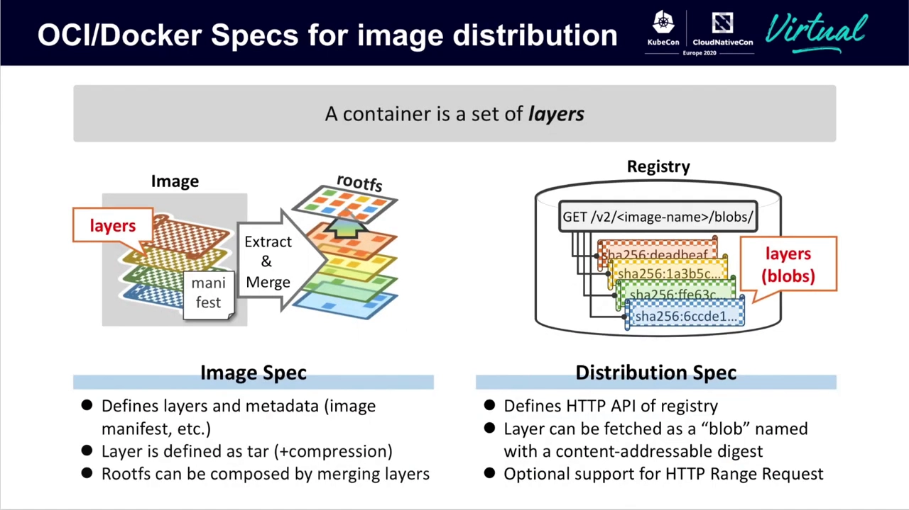
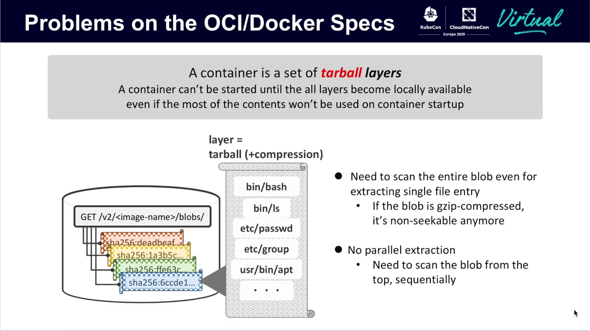
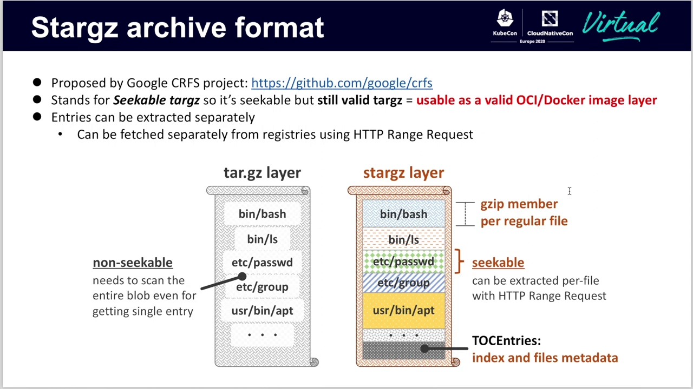
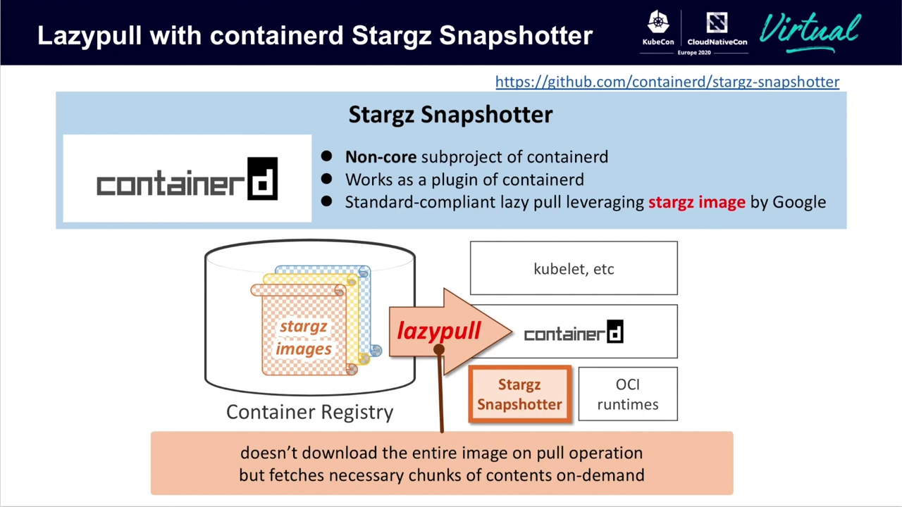
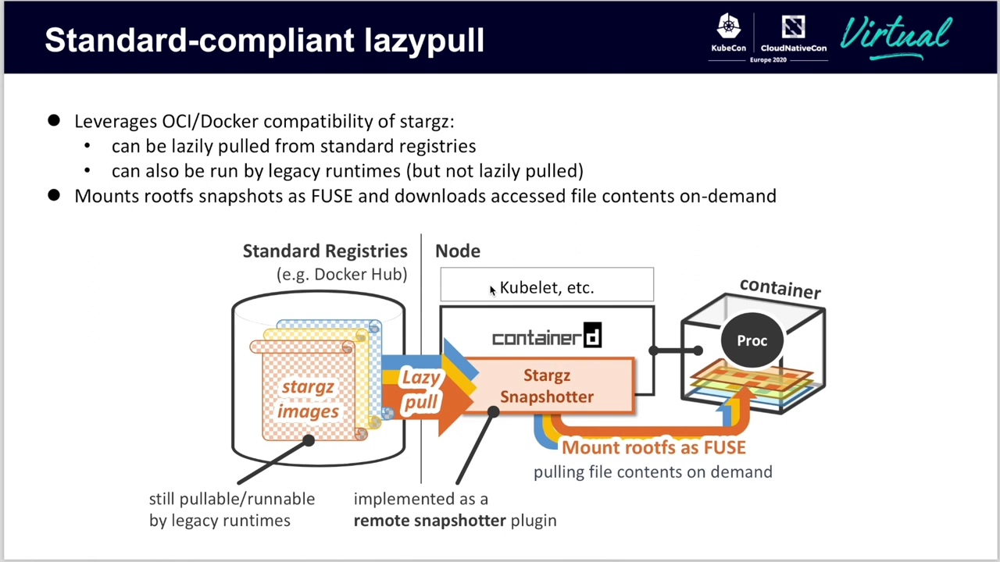
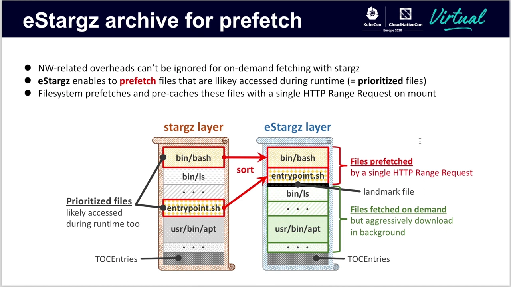
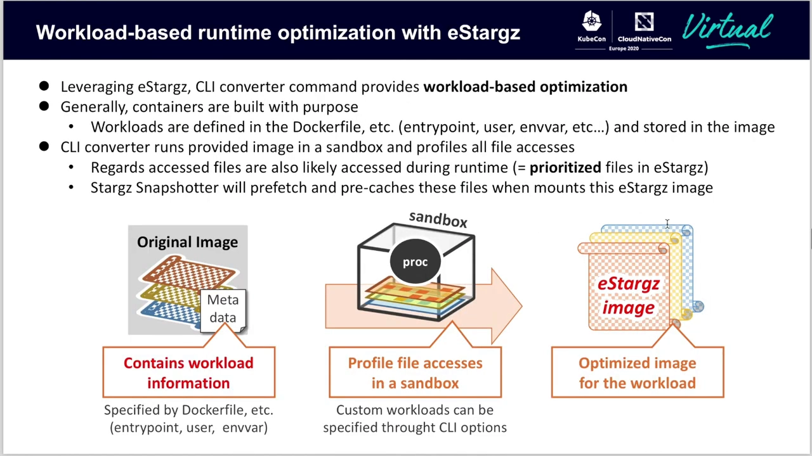
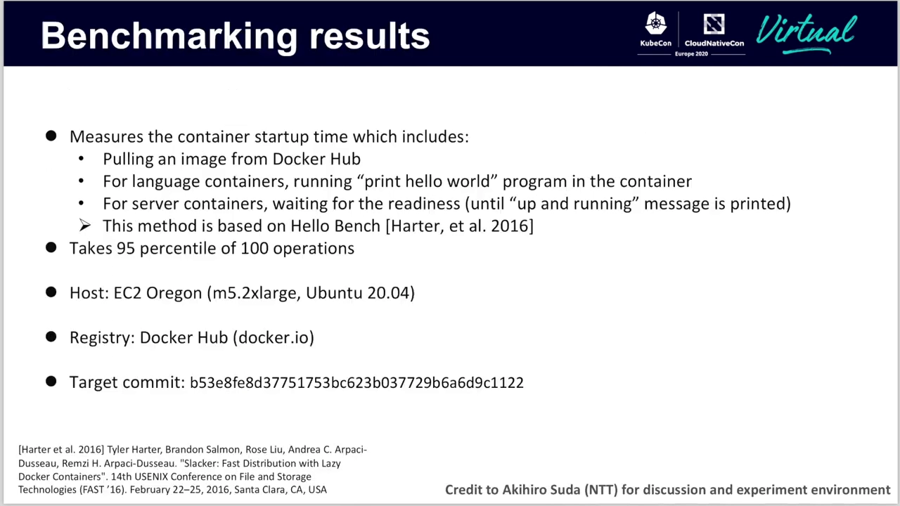
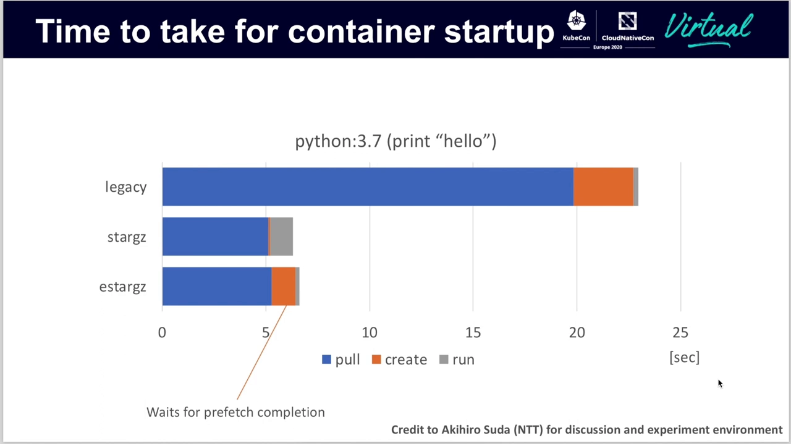

# stargz 懒加载：跳过解包按需准备rootfs

> 视频来源：[Startup Containers in Lightning Speed with Lazy Image Distribution](https://www.youtube.com/watch?v=H4Lbi26CqNU)（YouTube · KubeCon + CloudNativeCon Europe 2020，讲者 Kohei Tokunaga，NTT）｜时长约 25 分钟
> 导读：这是 stargz-snapshotter 项目的一次系统介绍，讲法很工程师：先量化"pull 到底慢在哪"，再讲层格式怎么改、containerd 侧怎么接、实测差多少。它对应本小节里"绕开解包"的那条思路——**rootfs 不必在创建容器前就完整准备好**。字幕里项目名与工具名被识别得很乱（stargz 被识别成 sergio/strategic 等），文中已按上下文订正。

## 本讲要解决的核心问题（SCQA）

**背景**：容器启动的固定套路是：从镜像仓库 pull 下所有层，逐层解包，合成 rootfs，然后启动进程。镜像层是 tar 包，可能再套一层 gzip 压缩。

**冲突**：讲者引用的研究给出两个刺眼的数字——**pull 占容器启动时间的 76%，而拉下来的数据里只有 6.4% 会被真正读到**。更糟的是，tar 不可随机访问，gzip 之后连"跳着读"都做不到，所以哪怕只需要一个文件，也得把整个 blob 顺序扫一遍。

**疑问**：既然只用 6.4%，为什么非得把 100% 都拉下来、都解开？

**回答（中心思想）**：把层换成**可随机访问**的格式（stargz），再让 containerd 的 **remote snapshotter** 把 rootfs 以 FUSE 的方式挂载，文件被访问时才去仓库下载对应的那一段。这样"准备 rootfs"就从"创建容器之前的一次性动作"变成了"运行过程中按需发生的事"。代价是运行时变慢、依赖网络；eStargz 用**预取**把这块补回来。

[【跳转到 03:05】](https://www.youtube.com/watch?v=H4Lbi26CqNU&t=185)

## 一、慢在哪：不是"下载慢"，是"必须整份下载"

### 1.1 层是 tar，tar 不可 seek

讲者把问题拆得很清楚：

[【跳转到 04:18】](https://www.youtube.com/watch?v=H4Lbi26CqNU&t=258)

- **tar 是流式格式**：文件一个接一个排着，要找到第 100 个文件，得先走过前 99 个的头部。
- **gzip 让它更糟**：压缩后的字节流不可 seek，只能从头顺序解，于是也不能并行解包。
- **结果**：容器必须等所有层都下载完、解包完才能启动。

对初学者可以这样理解：这就像把一本书的所有页粘成一条长纸带，想看第 300 页，只能从头展开到第 300 页——哪怕你只需要那一页。

### 1.2 缓存和"把镜像做小"都不够

讲者顺手否掉了两个常见答案：节点上可以缓存镜像，但**第一次 pull（冷启动）还是慢**；镜像可以尽量做小，但**不是所有镜像都能做小**——语言运行时、框架这些基础镜像就是很大。

## 二、stargz：让 tar.gz 变成可随机访问的格式

### 2.1 一句话定义

**stargz = seekable tar.gz**：可随机访问，但**仍然是一个合法的 tar.gz**，因此仍然是一个合法的 OCI/Docker 镜像层。

[【跳转到 10:20】](https://www.youtube.com/watch?v=H4Lbi26CqNU&t=620)

两个设计点：

1. **每个文件一个 gzip member**。gzip 规范允许把多个压缩流拼接在一起，于是"解压一个文件"不必解压整个层。
2. **尾部有 TOC（Table of Contents）**。里面是索引和所有文件的元数据，读一次 TOC 就知道每个文件在 blob 里的偏移量，于是可以用 **HTTP Range Request** 只取需要的那一段。

### 2.2 兼容性是这个方案最聪明的地方

因为 stargz 仍然是合法的 tar.gz，它带来两个好处：**可以从标准仓库（Docker Hub 等）懒加载**，不需要自建分发系统；**老运行时也能拉下来正常跑**，只是享受不到懒加载。

[【跳转到 08:15】](https://www.youtube.com/watch?v=H4Lbi26CqNU&t=495)

这一点很关键：它没有像某些加速方案那样要求"换一套镜像格式 + 换一套分发基础设施"，而是**在 OCI 规范内部做文章**。

## 三、containerd 侧怎么落地：remote snapshotter + FUSE 挂载

### 3.1 Stargz Snapshotter 是一个插件

[【跳转到 05:38】](https://www.youtube.com/watch?v=H4Lbi26CqNU&t=338)

讲者的定义是：懒加载意味着 **containerd 在 pull 时不下载整个镜像，只按需取需要的块**，所以容器可以在镜像内容还没全部到本地之前就启动。

### 3.2 关键机制：把 rootfs 挂成 FUSE

[【跳转到 08:40】](https://www.youtube.com/watch?v=H4Lbi26CqNU&t=520)

这张图值得细看，因为它把"rootfs 从哪来"讲全了：

- 这个 snapshotter 是 **remote snapshotter**——一类特殊的 containerd 插件，允许把 rootfs 快照**从远端存储直接挂载**到节点上，而不是先在本地解包。
- mount 的时候，**大部分层内容还没下载**；rootfs 以 **FUSE** 的形式挂出来，容器访问哪个文件，就触发下载那个文件对应的那段内容。
- 讲者顺带提了一句：remote snapshotter 是通用机制，如果你用的不是镜像仓库而是别的远端存储，也可以自己实现一个。

### 3.3 这是"文件系统路径"的第三种形态

对照本小节的两条路，这里出现了第三种形态：**rootfs 不是宿主上的目录（overlayfs），也不是块设备，而是一个按需填充的 FUSE 文件系统**。它共享的仍然是"文件系统语义"，但内容来自网络而不是本地磁盘。

这也解释了它对 MicroVM 的意义：微虚拟机把启动压到百毫秒级，可 rootfs 的准备（pull + 解包）动辄几秒到几十秒。**把准备动作挪到"访问时"，VM 的启动优势才不会被抵消**。

## 四、代价与补丁：eStargz 的预取

### 4.1 按需下载的代价是网络往返

讲者很坦诚：按需取文件意味着**每次读文件都可能触发一次网络请求**，这在慢网络下不能忽略。

### 4.2 eStargz：把"大概率会读的文件"排到前面

[【跳转到 12:25】](https://www.youtube.com/watch?v=H4Lbi26CqNU&t=745)

做法是：把文件按优先级**重新排序**，让"运行时大概率会读"的文件在 blob 里连续排列，于是 mount 时**一次 Range Request 就能把它们全取回来**。剩下的文件仍然按需取，但会在后台积极下载。

### 4.3 怎么知道哪些文件"大概率会读"：跑一遍

[【跳转到 14:00】](https://www.youtube.com/watch?v=H4Lbi26CqNU&t=840)

讲者的思路是"容器是有目的的"：workload 就写在 Dockerfile 里。所以转换器**在沙箱里把镜像跑一遍，记录它访问了哪些文件**，把这些文件当作优先级文件写进 eStargz 镜像。之后这个镜像被挂载时，这些文件会被预取。

## 五、实测差多少

[【跳转到 15:37】](https://www.youtube.com/watch?v=H4Lbi26CqNU&t=937)

[【跳转到 16:32】](https://www.youtube.com/watch?v=H4Lbi26CqNU&t=992)

讲者对这张图的解读值得照抄：

- **legacy**：pull 占了绝大部分时间（图中蓝色段最长）。
- **stargz**：pull 时间大幅缩短，因为只拉了元数据和索引；但 **run 阶段变慢**（灰色段变长），因为运行时要按需去取文件。
- **eStargz**：run 的劣势被预取补回来，但 **create 阶段变长**，因为它要等预取完成。

他还给了两个反例：**gcc 镜像**即使加了 eStargz，run 仍然慢——因为这个 workload 要编译程序，而源码目录是运行时挂载进来的，不在镜像里，转换器无法 profile 到这些访问；**glassfish** 这类服务型镜像则是初始化本身慢，eStargz 也帮不上。

## 六、适合用在哪，以及要注意什么

讲者列了四类受益场景：镜像构建时基础镜像的分发（尤其是多阶段构建里那些不进最终镜像的中间镜像）、开发流水线与测试环境、大型科学计算/机器学习框架（常常超过 1GB）、以及服务型负载的冷启动。

需要小心的三点：项目当时还在早期、实现还需要优化；**性能受网络状况和实例位置影响**（讲者在东京做 demo，在 Oregon 跑基准，数字不一样）；**在层内容被完整缓存之前，强制重启这类操作要小心**。

他还顺带列了社区里的其他方案：基于 NFS 的懒加载、面向高能物理软件栈的 CernVM-FS（通过 HTTP 从服务器仓库按需挂载和下载）、以及若干在讨论中的镜像格式提案（包括把每个文件当作内容寻址 blob 的做法，和给 `fuse-overlayfs` 做的插件）。

## 小结

- 容器启动慢的主因是 **pull + 解包**：pull 占 76% 的启动时间，而只有 6.4% 的数据会被读到。
- 根因是**格式**：tar 不可 seek，gzip 之后更不可 seek，只能整份下载、顺序解包。
- **stargz** 把层改成"每文件一个 gzip member + 尾部 TOC"，于是可以按文件用 HTTP Range Request 取，同时仍然是合法的 OCI 层。
- containerd 侧用 **remote snapshotter** 接住：pull 时只取元数据，mount 时把 rootfs 挂成 **FUSE**，文件被访问才下载。
- 代价是运行时变慢、依赖网络；**eStargz** 用"优先级文件 + 一次 Range Request 预取"把代价补回来，优先级靠**在沙箱里跑一遍 profile** 得到。
- 对 MicroVM 来说，这条路的意义是：**rootfs 的准备从"创建前"挪到"访问时"**，不再抵消百毫秒级的启动优势。

## 关键术语速查

| 术语 | 一句话解释 |
| --- | --- |
| pull | 从镜像仓库把层下载到本地节点 |
| 解包（unpack/extract） | 把层 tar 展开成目录树，供容器当 rootfs |
| tar / tar.gz | 流式归档格式；gzip 压缩后不可随机访问 |
| stargz | seekable tar.gz，每文件一个 gzip member，尾部带 TOC 索引 |
| TOC | stargz 尾部的目录索引，记录每个文件的偏移与元数据 |
| HTTP Range Request | 只请求 blob 中某一段字节的 HTTP 能力，懒加载的前提 |
| snapshotter | containerd 里负责把镜像层变成 rootfs 的插件 |
| remote snapshotter | 一类特殊 snapshotter，可以从远端存储直接挂载 rootfs |
| FUSE | 用户态文件系统框架，让普通进程实现一个文件系统 |
| eStargz | stargz 的扩展，支持标记并预取"大概率会读"的文件 |
| 预取（prefetch） | 在真正访问之前先把文件取回本地缓存 |
| HelloBench | 衡量容器启动耗时的基准方法，从拉镜像算到进程输出 hello |