# CRI 只认容器、不认 Pod：RuntimeClass 补上的「选运行时」这一层

> 视频来源：[Surviving Serverless Battle By Secure Runtime, CRI and RuntimeClass](https://www.youtube.com/watch?v=2_je65FCltk)（YouTube · KubeCon + CloudNativeCon Europe 2019，阿里巴巴 张磊（Li Zhang / Harry）与肖宇（Xiao Yu））｜时长约 27 分钟
> 导读：这是一支 2019 年的会议演讲，讲的是「在同一个集群里同时用 runc 和 Kata」这件事在**接口层**上到底是怎么成立的。它没有停在「建个 RuntimeClass 写个 handler」的用法层面，而是先讲清容器 = 运行时 + 镜像、CRI 为什么是**以容器为中心**的接口（里面根本没有 Pod）、containerd 内部还有第二层 shim v2 接口，最后才落到 RuntimeClass。也正因为讲清了分层，它才能解释一个常被忽略的问题：**为什么有些 Pod 你不敢放到 Kata 里**。字幕为本地语音识别生成，术语已按上下文校正（识别稿里的 Kata 被听成 cut/Cata，gVisor 被听成 GYthere/G-Wider，containerd 被听成 containerD）。

## 本讲要解决的核心问题（SCQA）

**背景**：Kubernetes 跟容器运行时之间隔着一个 CRI（Container Runtime Interface）。kubelet 只跟 CRI 说话，谁想接进 Kubernetes，谁就实现一份 CRI，社区里叫 CRI shim。containerd、CRI-O、PouchContainer 都是这么接进来的。[【跳转到 09:51】](https://www.youtube.com/watch?v=2_je65FCltk&t=591)

**冲突**：Kata Containers 这类沙箱运行时的隔离边界是**一台虚拟机**，而 Kubernetes 的调度与生命周期单位是 **Pod**——所以 Kata 的 VM 天然对应一个 Pod。可是 CRI 这个接口本身**是以容器为中心的，里面没有 Pod 这种东西**：它只定义了 sandbox 和 container 两个概念，Pod 模型要靠每个 CRI shim 自己去实现。[【跳转到 11:16】](https://www.youtube.com/watch?v=2_je65FCltk&t=676)

**疑问**：既然接口里没有「Pod 用哪个运行时」这个位置，那「这个 Pod 用 Kata、那个 Pod 用 runc」这件事，到底该在哪一层、用什么机制表达？

**回答（中心思想）**：靠**三层分工**。第一层是 **CRI**——Kubernetes 只认接口，用 `sandbox` 这个概念把「Pod 模型」外包给运行时；第二层是 containerd 内部的 **shim v2 API**——它把请求翻译成 OCI runtime spec，交给 runc 或 Kata 引擎；第三层才是 **RuntimeClass**——它给用户一个声明入口：Pod spec 里写 `runtimeClassName`，CRI shim 读出来，再去选底层 OCI 运行时。而 RuntimeClass 真正的价值不在「能选」，而在**能按 Pod 粒度选**：因为 Kata 有硬限制（不支持 host networking、IO 性能不如 runc），一个集群里必然有一部分 Pod 必须留在 runc 上。[【跳转到 17:23】](https://www.youtube.com/watch?v=2_je65FCltk&t=1043)

## 一、先把「容器」拆成两半：运行时与镜像

### 1.1 容器运行时 = namespace + cgroups

讲者先给了一个定义式的拆解：只要你在用 Linux 内核，你创建出来的就是 Linux 容器。而 Linux 容器可以拆成两个概念。[【跳转到 02:46】](https://www.youtube.com/watch?v=2_je65FCltk&t=166)

- **容器运行时**：用 **cgroups** 做资源限制，用 **namespace** 做隔离视图。namespace 让容器里的进程看不到别的 namespace 里的进程、也看不到宿主机上的进程；cgroups 划出资源边界，比如「最多一个 CPU 核、200 MB 内存」。
- **容器镜像**：程序的**静态视图**，包含操作系统目录、文件、应用的所有依赖。镜像用 overlay 文件系统把这一切打包，这个包在技术上通常就叫 **rootfs**。

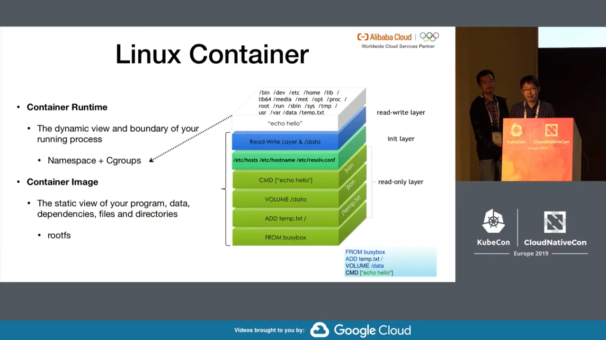

### 1.2 「Linux 容器只是另一种进程」

把两半合起来看，一个容器就是「一个跑在一组 rootfs 之上的普通进程」，唯一的区别是它被一组 namespace 隔离、被 cgroups 限制了资源。讲者的原话是：**这就是为什么我们说 Linux 容器只是另一种进程**。[【跳转到 04:26】](https://www.youtube.com/watch?v=2_je65FCltk&t=266)

这句话不是修辞，它是后面所有问题的根源：**因为它是普通进程，所以它跟宿主机共享同一个内核。**

### 1.3 共享内核在 serverless 场景下是硬伤

讲者把话题拉到 serverless：要在云上管理巨大集群、要做 serverless，就必须面对**硬多租户（hard multi-tenancy）**。而 namespace 和 cgroups 面对黑客是脆弱的——一个跑在容器里的进程其实很容易逃出去（jailbreak）。[【跳转到 03:00】](https://www.youtube.com/watch?v=2_je65FCltk&t=180)

他给了一个很有说服力的观察：**这就是为什么每一家公有云厂商都会先给你虚拟机、再在虚拟机里跑容器**——因为需要虚拟机作为多租户资源边界，而不是 cgroups 和 namespace。

## 二、沙箱运行时的共同点：一个 Pod 一个内核

### 2.1 三条不同的技术路线

社区里在运行时层面做更强隔离的技术，讲者点了三个名字：[【跳转到 03:50】](https://www.youtube.com/watch?v=2_je65FCltk&t=230)

| 项目 | 路线 | 讲者的定位 |
| :--- | :--- | :--- |
| **Kata Containers** | 用 hypervisor 起一台轻量 VM，容器跑在 VM 里 | 讲者本人是 Kata 团队成员（前 Hyper） |
| **Firecracker** |  AWS 开源的基于 VM 的运行时 | 更多是在**虚拟机管理器**这一层工作 |
| **gVisor** | 用 Go 语言实现一个客户机内核（sentry） | 来自 Google App Engine 团队，路线不同 |

三条路的技术细节完全不同，但有一个**本质共同点**：**你都会有一个独立的客户机内核**，而不是共享宿主机的内核。[【跳转到 04:16】](https://www.youtube.com/watch?v=2_je65FCltk&t=256)

### 2.2 隔离边界从「容器」上移到了「Pod」

这是本讲最关键的一个推论。对 Kata 来说，容器运行时**根本不是用 cgroups 或 namespace 实现的**，而是用硬件虚拟化实现的，就像一台普通虚拟机。而因为它本质上是一台虚拟机，**这个资源边界会映射到 Pod 这个概念上，而不是容器本身**。[【跳转到 05:21】](https://www.youtube.com/watch?v=2_je65FCltk&t=321)

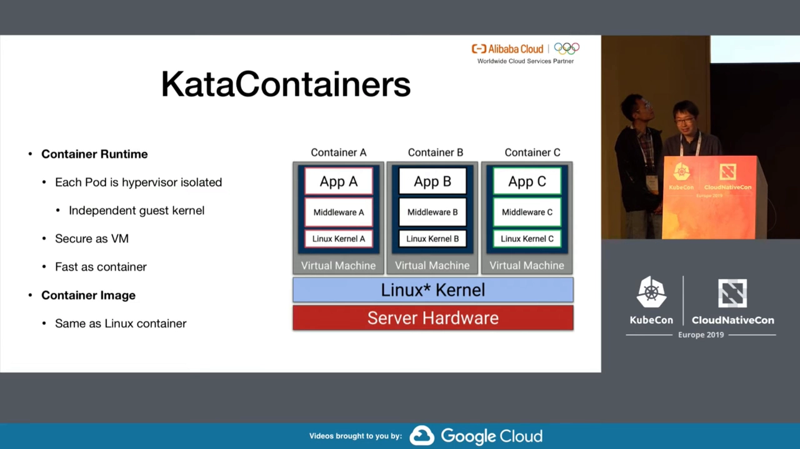

具体地说：你在 Kubernetes 里创建一个用 Kata 作为运行时的 Pod，你实际上**创建了一台虚拟机作为一个 Pod**，然后在这台 VM 里跑容器——而这些容器**仍然**是用 namespace 和 cgroups 实现的。

这个「边界上移」解释了 Kata 的一个常见困惑：为什么一个 Pod 里的多个容器共享同一个内核？因为它们本来就住在同一台 VM 里。也解释了 Kata 的一个硬限制：**VM 里没有 host networking 这个概念**（后面会展开）。

### 2.3 硬多租户的两条路：加固容器，还是换内核

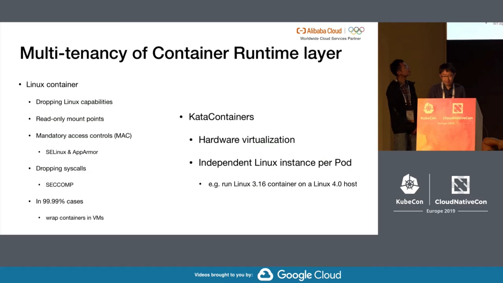

讲者把两条路线并排列了出来：[【跳转到 04:41】](https://www.youtube.com/watch?v=2_je65FCltk&t=281)

- **加固 Linux 容器**：去掉不想暴露给用户的 Linux capability、挂只读挂载点、用 SELinux / AppArmor 做强制访问控制、用 seccomp 裁掉系统调用……然后幻灯片上写了一句话：**99.99% 的情况下，最终做法还是把容器包进虚拟机里**。
- **换内核**：Kata 用硬件虚拟化，**每个 Pod 一个独立的 Linux 实例**，幻灯片上的例子是「在 Linux 4.0 的宿主机上跑 Linux 3.16 的容器」。

第二条路的价值不只是「更安全」，还在于**内核版本可以跟宿主机解耦**——这对需要特定内核版本的老业务是很实际的好处。

## 三、CRI：Kubernetes 只认接口，而且只认容器

### 3.1 CRI shim 是一个 gRPC server

沙箱运行时怎么被 Kubernetes 用起来？关键就是 CRI。讲者的表述很直接：**在 Kubernetes 里，它并不知道底层的容器运行时是什么，它只知道自己在跟一个叫 CRI 的接口说话。** CRI 是 Kubernetes 内置的接口，可以说是「Kubernetes 的代理」，它是一个基于 gRPC 的接口。[【跳转到 09:51】](https://www.youtube.com/watch?v=2_je65FCltk&t=591)

于是每个想接入 Kubernetes 的运行时都必须实现自己的一份 CRI 实现，社区里叫 **CRI shim**。CRI shim 是一个 gRPC server，它把 CRI 请求翻译成底层容器运行时的 API——比如 containerd 的 CRI shim 会去调 containerd API 完成剩下的事。[【跳转到 10:01】](https://www.youtube.com/watch?v=2_je65FCltk&t=601)

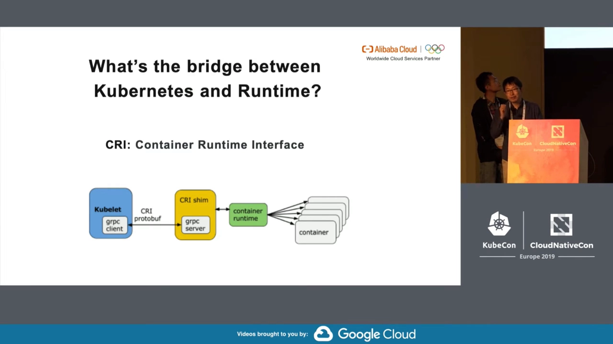

讲者还补了一个当时的背景：Kubernetes 里内置了 dockershim，而上游正在推进把它移除。**将来 Kubernetes 不会有所谓的默认运行时，默认的容器运行时永远是 CRI。**

### 3.2 CRI 里没有 Pod，只有 sandbox

这是全篇最反直觉的一点。讲者明确说：**CRI 是一个以容器为中心的接口，CRI 里没有 Pod 这种东西。** 原因也很清楚——**并不是每个容器运行时都有 Pod 概念**。Kata 有，因为 Kata 是一台虚拟机；Docker 和其他 Linux 容器没有，它们只知道容器。所以社区把「怎么实现 Pod」的自由留给了运行时自己。[【跳转到 11:16】](https://www.youtube.com/watch?v=2_je65FCltk&t=676)

那 CRI 里怎么表达 Pod 呢？用 **sandbox**。CRI 的容器 spec 可以分成两部分：

- **sandbox**：你怎么实现 Pod 模型。Kata 用一台虚拟机实现；Docker 没有这种东西，它会创建一个 **infra container**，infra container 就映射成 sandbox。
- **container**：普通容器。Linux 容器用 namespace + cgroups 实现；Kata 里则是「由 hypervisor 控制的 namespace 容器」。

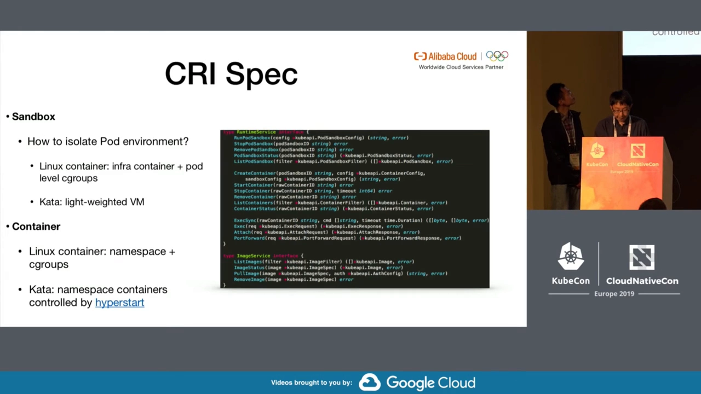

### 3.3 sandbox 恰好等价于 Pod 生命周期

这个等价关系带来一个很实用的推论：**一个 Pod 里可以没有任何容器**。讲者的例子是——在 Docker 里你只会有 infra container 而没有用户容器；在 Kata 里就是**你有一台虚拟机，但虚拟机里没有任何容器**。[【跳转到 12:38】](https://www.youtube.com/watch?v=2_je65FCltk&t=758)

这也解释了为什么 Pod 的创建顺序是「先 sandbox、再容器」，以及为什么删 Pod 时 sandbox 是最后一个消失的——它承载的是 Pod 的生命周期本身。

## 四、shim v2：containerd 内部的第二层接口

### 4.1 两层接口，别混在一起

讲者特别提醒注意这一点：**你基本上会有两个接口**。[【跳转到 15:16】](https://www.youtube.com/watch?v=2_je65FCltk&t=916)

1. **第一层是 CRI**，在 kubelet 和 CRI shim 之间，管的是「Pod / sandbox / container」这一套语义。
2. **第二层在 containerd 自己内部，叫 shim v2 API**，管的是「容器运行时怎么跟 OCI 运行时对话」。

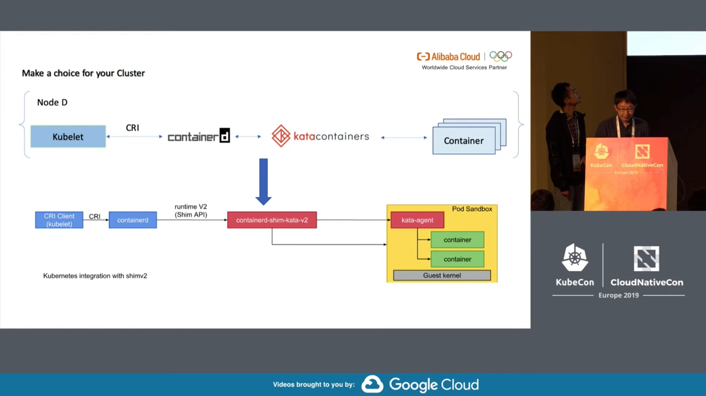

### 4.2 一条请求的完整链路

把两层接口串起来，一条链路是这样的：**kubelet → CRI → containerd（它本身是 CRI shim）→ shim v2 → runc 或 Kata**。shim v2 API 把你的 API 请求翻译成 **OCI runtime spec**；走 Kata 时，机器上会有一个 **Kata 引擎**，把请求翻译成 Kata spec，然后为你启动一台虚拟机。[【跳转到 15:41】](https://www.youtube.com/watch?v=2_je65FCltk&t=941)

这里有一个容易忽略的前提：**Kata 其实等价于 runc，也就是所谓的 OCI 运行时**。所以在 Kata 前面必须有东西充当 CRI shim，社区里最常见的做法是用 containerd 来充当——先部署 containerd，再安装 Kata 运行时**替换掉 runc**。[【跳转到 14:51】](https://www.youtube.com/watch?v=2_je65FCltk&t=891)

## 五、RuntimeClass：把「选运行时」变成一次声明

### 5.1 多运行时的三种做法，从粗到细

讲者按「粒度」把方案排了一遍，这个顺序本身就是一条演进线：[【跳转到 14:01】](https://www.youtube.com/watch?v=2_je65FCltk&t=841)

| 做法 | 粒度 | 怎么选 | 局限 |
| :--- | :--- | :--- | :--- |
| 不同节点装不同运行时 | 节点 | 在 Pod 上加 **label selector**，说「我要调度到 CRI-O 节点 / containerd 节点」 | 一个节点只能有一种运行时 |
| 一个节点装多个运行时 | 节点内 | 还是靠 label selector / annotation / toleration 手动指 | 没有标准机制，全靠约定 |
| **RuntimeClass** | Pod | Pod spec 里写 `runtimeClassName` | 需要 containerd 里配好同名 runtime |

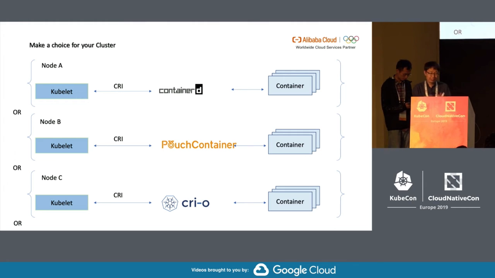

第二种做法讲者说得很实在：**今天你可以在单个节点上同时装 containerd 和 CRI-O，它确实能工作**。但「能工作」和「有标准」是两件事——没有 RuntimeClass 之前，你只能靠 annotation、label selector、toleration 这些通用手段去凑。

### 5.2 RuntimeClass 到底做了什么

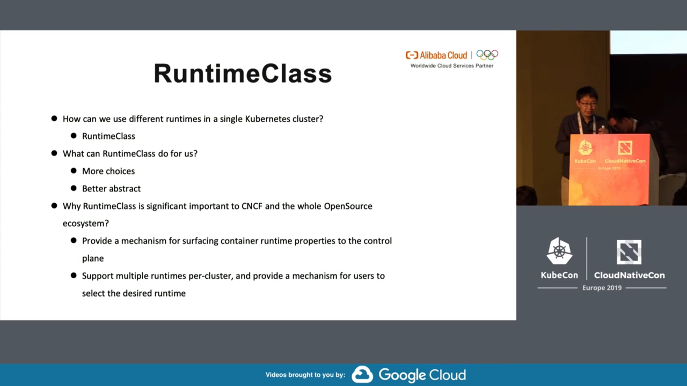

RuntimeClass 是较新版本 Kubernetes 的特性，**在 1.14 里变得更完善**。它的工作方式只有两步：[【跳转到 17:23】](https://www.youtube.com/watch?v=2_je65FCltk&t=1043)

1. **Pod 上有一个字段** `runtimeClassName`，让你声明想用哪个 RuntimeClass（比如 `kata`）。
2. **containerd 或任何 CRI shim** 现在都支持读取 Pod 的 spec，读出 `runtimeClassName`，然后为你选择底层的 OCI 运行时。

前提是：**你需要在 containerd 里把 Kata 配置成一个运行时名字**，这样 containerd 才知道 `kata` 指的是什么。这跟上一节讲的「Kata 替换 runc」是同一件事——配置里那个名字，就是 RuntimeClass 里 `handler` 要填的东西。

幻灯片把 RuntimeClass 的意义总结成两条，值得抄下来：

- 提供了一种**把容器运行时的属性暴露给控制面**的机制；
- 支持**一个集群多种运行时**，并给用户提供**选择所需运行时**的机制。

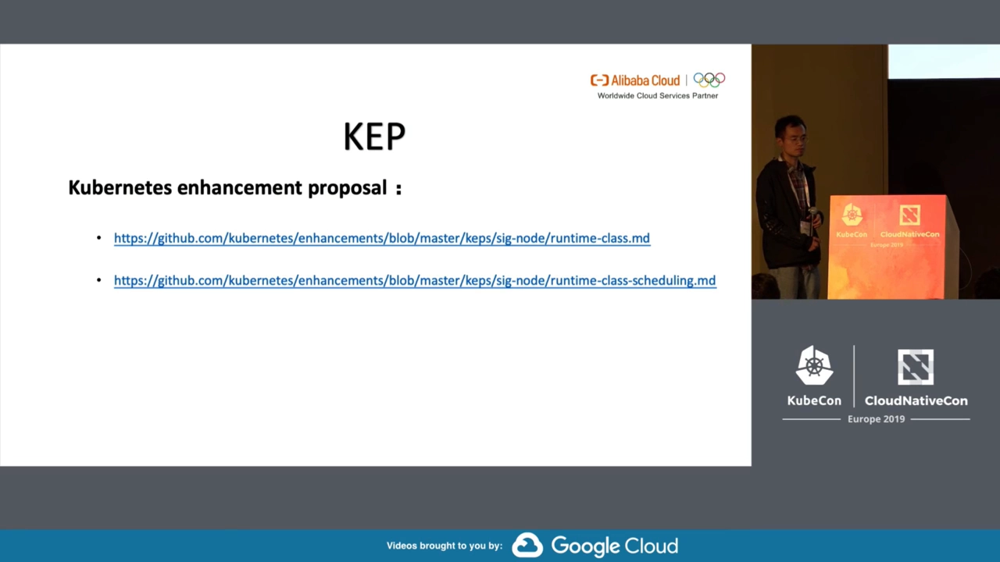

讲者还贴了两个上游 KEP 的链接，其中一个的路径是 `runtime-class.md`，另一个是 `runtime-class-scheduling.md`——**「调度」是单独一个 KEP**，这也印证了调度约束不是 handler 的附属品，而是后来单独补上的一层。[【跳转到 21:49】](https://www.youtube.com/watch?v=2_je65FCltk&t=1309)

### 5.3 为什么必须按 Pod 粒度选：Kata 的两个硬限制

这一节是整场演讲最有价值的部分。既然 Kata 更安全，为什么不干脆全用 Kata？讲者给了两个具体理由：[【跳转到 21:49】](https://www.youtube.com/watch?v=2_je65FCltk&t=1309)

1. **host networking 用不了**。如果某个 Pod 需要 `hostNetwork`，Kata 做不到——**因为 VM 里没有 host networking 这个概念**。这类 Pod 必须指定用默认的 runtime class，也就是 runc。
2. **IO 性能**。如果你跑 MySQL 这类对 IO 敏感的负载，想让它在高性能节点上拿到高性能 IO，你可能也要考虑用 runc 运行时。

**这两个理由合起来，正好回答了「为什么光靠节点级隔离不够」**：如果按节点划分（沙箱节点 / 普通节点），你就得为「偶尔需要 hostNetwork 的沙箱业务」准备一整套特殊节点；而按 Pod 划分，同一个节点上可以既有 Kata Pod 又有 runc Pod，业务方只需要在自己那个 Pod 上写一行 `runtimeClassName`。

### 5.4 生态的缺口：serverless 平台不认 runtimeClassName

讲者泼了一盆冷水：**目前大多数开源 serverless 平台并不支持 RuntimeClass**。原因是它们生成的是 Pod 模板或 Deployment 模板，**而这些模板里没有 `runtimeClassName` 这个字段**。[【跳转到 22:23】](https://www.youtube.com/watch?v=2_je65FCltk&t=1343)

现场演示了两个例子：把 `runtimeClassName` 加进 Knative 官网的用例脚本，**直接失败**（spec 里没有这个位置）；换成 Kubeless，**连编辑 runtime class 的地方都找不到**。讲者的结论是「还有很长的路要走」。[【跳转到 23:58】](https://www.youtube.com/watch?v=2_je65FCltk&t=1438)

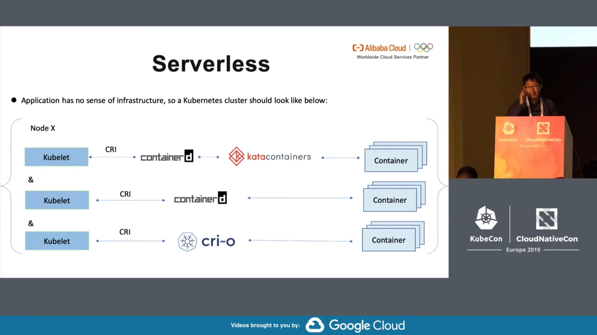

他也给了过渡方案：**可以手动做**——在 Pod 或节点上加 annotation，然后用 label selector 或 toleration 之类的方式来实现。这其实就是第 5.1 节表格里第二种做法的现实版本：**在 RuntimeClass 被上层平台接受之前，调度约束只能靠通用机制手工拼**。

### 5.5 演示：用 `uname` 证明它真的在 VM 里

现场 demo 基于 minikube、Kubernetes 1.14、containerd 的 shim v2 加 Kata Containers。先装 containerd，再写配置让 containerd 认识 Kata 运行时，然后创建 RuntimeClass，最后起一个 busybox Pod。[【跳转到 20:53】](https://www.youtube.com/watch?v=2_je65FCltk&t=1253)

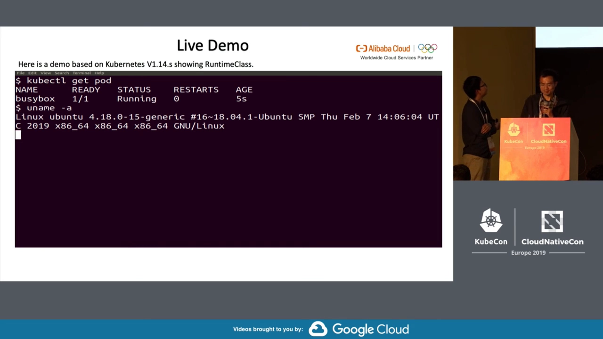

验证方式非常朴素也很有效：**进容器执行 `uname -a`，看到的内核版本跟宿主机不一样**。这就是「独立客户机内核」最直接的证据。讲者特意强调：客户机内核的版本是不一样的，对吧？

## 六、一个 5000 节点的真实案例

### 6.1 每租户一个控制面，租户只看得到虚拟节点

阿里巴巴维护着一个非常大的 Kubernetes 集群，**5000 多个节点**，服务阿里巴巴的所有客户；每个业务单元就是一个租户。[【跳转到 24:45】](https://www.youtube.com/watch?v=2_je65FCltk&t=1485)

多租户模型是「**每租户一个控制面**」：每个租户有自己的 API server、自己的 controller manager，但**没有自己的 scheduler**（用的是统一调度器）。而租户**没有真实节点**，它能看到的只是一组**虚拟节点**——所以这个模型叫基于虚拟集群的多租户。[【跳转到 25:10】](https://www.youtube.com/watch?v=2_je65FCltk&t=1510)

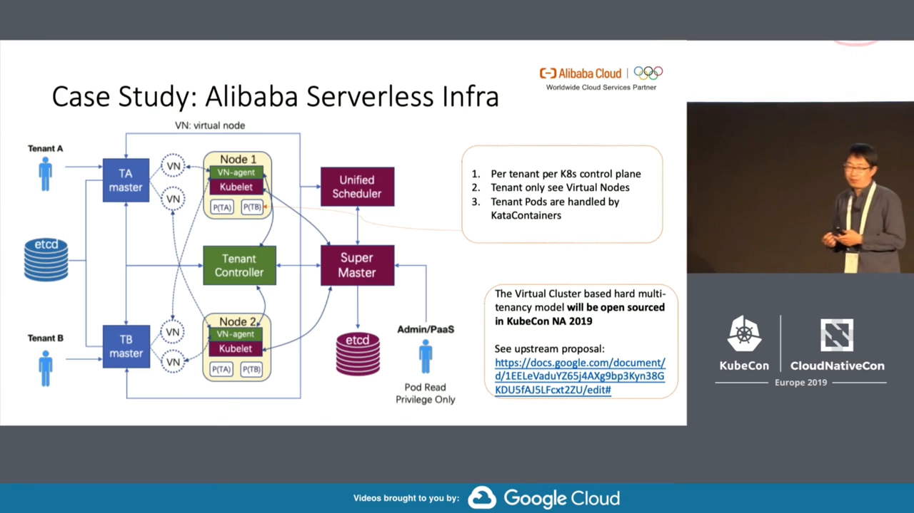

虚拟节点由跑在**每一台真实节点**上的一个小引擎（virtual node engine）提供，它把真实节点虚拟化成 API 对象；另一种实现是用 virtual kubelet 创建虚拟节点。

### 6.2 为什么 Kata 必须是默认运行时

这个架构里最关键的一点是：**必须把 Kata Containers 作为默认容器运行时**。理由很直接——同一个集群里跑着不同租户，需要更强的隔离。这就是「用 Kata 或任何沙箱容器而不是 runc」最重要的理由。[【跳转到 26:25】](https://www.youtube.com/watch?v=2_je65FCltk&t=1585)

注意这里的选择逻辑跟第 5.3 节正好相反：**在「多租户共享一个物理集群」这个场景下，默认值必须是沙箱运行时，runc 才是那个需要被显式指定的例外。** 默认值往哪边设，取决于你的集群是「可信负载为主」还是「不可信租户为主」。

## 小结

- **容器 = 运行时 + 镜像**。运行时用 namespace + cgroups 给进程划边界，镜像是程序的静态视图（rootfs）。因为容器只是普通进程，所以它跟宿主机共享内核。
- **沙箱运行时的共同点是独立客户机内核**（Kata 用 hypervisor、gVisor 用 Go 写的 sentry、Firecracker 在 VMM 层），代价是**隔离边界从容器上移到 Pod**。
- **CRI 是以容器为中心的接口，里面没有 Pod**。Pod 模型被外包成 `sandbox`：Kata 用一台 VM，Docker 用 infra container。sandbox 等价于 Pod 生命周期，所以一个 Pod 可以没有任何容器。
- **有两层接口**：CRI（kubelet ↔ CRI shim）和 shim v2（containerd ↔ OCI 运行时）。Kata 等价于 runc，所以它需要 containerd 在前面充当 CRI shim。
- **多运行时有三档粒度**：不同节点装不同运行时（靠 label selector）、同节点多运行时（靠 annotation/toleration 手工拼）、RuntimeClass（Pod 级声明）。
- **RuntimeClass 的两步**：Pod 写 `runtimeClassName`，CRI shim 读出来选底层 OCI 运行时；前提是 containerd 里配了同名 runtime。
- **必须按 Pod 粒度选**，因为 Kata 有硬限制：不支持 host networking、IO 性能不如 runc。全用或全不用都不对。
- **生态缺口**：serverless 平台（Knative、Kubeless）生成的模板里没有 `runtimeClassName`，只能退回 annotation + label selector 的老办法。

## 关键术语速查

| 术语 | 一句话解释 |
| :--- | :--- |
| CRI | Container Runtime Interface，kubelet 与运行时之间的 gRPC 接口，**以容器为中心**，没有 Pod 概念 |
| CRI shim | 实现了 CRI 的 gRPC server，把 CRI 请求翻译成底层容器运行时 API |
| sandbox | CRI 里表达「Pod 模型」的那一半；Kata 用一台 VM，Docker 用 infra container |
| infra container | pause 容器，Linux 容器方案里用来承载 Pod 级 namespace 与 cgroups 的「占位容器」 |
| shim v2 API | containerd 内部的第二层接口，把请求翻译成 OCI runtime spec 再交给 runc / Kata |
| OCI runtime | 按 OCI 运行时规范启动进程的组件（runc），Kata 在这一层与之等价 |
| RuntimeClass | 1.14 起完善的特性，让 Pod 用 `runtimeClassName` 声明想用的运行时 |
| hard multi-tenancy | 硬多租户，要求租户之间在资源边界上真正隔离（靠 VM 而不是 namespace/cgroups） |
| gVisor / sentry | 用 Go 实现的用户态客户机内核，拦截并处理容器发出的系统调用 |
| virtual node | 虚拟节点，把真实节点虚拟化成 API 对象，让租户只看到属于自己的虚拟集群 |