# RuntimeClass 的三个字段：handler 定运行时、scheduling 定节点、overhead 定配额

> 视频来源：[理解 RuntimeClass 与使用多容器运行时](https://www.bilibili.com/video/BV1LE41147jG/)（Bilibili · 阿里云容器团队 贾卓，CNCF 云原生系列课程）｜时长约 19 分钟
> 导读：这是一支把 RuntimeClass 从头到尾讲一遍的课程录像：先讲它为什么会出现（容器运行时的演进），再逐字段拆开 `handler` / `scheduling` / `overhead` 三个字段，最后在阿里云 ACK 安全沙箱节点上把 `runc` 与 `runv`（Kata）两个运行时并排跑起来，用 `kubectl` 验证 Pod 到底落在哪个 handler 上。字幕为本地语音识别生成，术语已按上下文校正（识别稿里的「Cognitive / Komnotis」都是 Kubernetes，「Cata」是 Kata，「JYZ」是 gVisor）。

## 本讲要解决的核心问题（SCQA）

**背景**：Kubernetes 在 1.5 引入 CRI（Container Runtime Interface）之后，kubelet 不再直接认某个具体运行时，而是对着一个接口说话。于是 Kata、gVisor 这类「不是 runc」的运行时也能接进来——它们只要实现 CRI 就行。[【跳转到 01:05】](https://www.bilibili.com/video/BV1LE41147jG/?t=65)

**冲突**：接得进来，不等于用得顺手。一个集群里同时装着 runc 和 Kata 之后，立刻冒出四个没人回答的问题：集群里到底有哪些可用运行时？怎么让某个 Pod 选中它要的那个？怎么保证 Pod 被调度到的那个节点上真的有这个运行时？还有，像 sandbox 这种自带额外开销的容器，这份开销谁来记账？[【跳转到 01:55】](https://www.bilibili.com/video/BV1LE41147jG/?t=115)

**疑问**：这四个问题，Kubernetes 用什么对象来一次性回答？

**回答（中心思想）**：用 **RuntimeClass**——一个集群级的资源对象，一个对象代表一种容器运行时。它只用三个字段就把上面四个问题收干净了：**`handler` 回答「用哪个运行时」**（它是 CRI 实现里配置的一个名字，不是二进制路径）；**`scheduling` 回答「调度到哪些节点」**（`nodeSelector` + `tolerations`，由 admission 自动注入到 Pod 上）；**`overhead` 回答「额外开销怎么记账」**（`podFixed` 里的 CPU/内存会被算进调度、ResourceQuota 与 kubelet 驱逐）。三者合起来，才是「按运行时选节点」这件事的完整答案。[【跳转到 04:06】](https://www.bilibili.com/video/BV1LE41147jG/?t=246)

## 一、先看它为什么存在：从「唯一运行时」到「混着用」

### 1.1 三个阶段：Docker 独占、rkt 入局、CRI 解耦

讲者把 Kubernetes 容器运行时的演进分成三段。[【跳转到 00:30】](https://www.bilibili.com/video/BV1LE41147jG/?t=30)

| 阶段 | 时间 | 发生了什么 | 后果 |
| :--- | :--- | :--- | :--- |
| 一家独大 | 2014 年 6 月，Kubernetes 开源 | Docker 是唯一、也是默认的容器运行时 | 没有选择问题 |
| 第二家进来 | Kubernetes 1.3 | rkt 合入主干，成为第二个运行时 | 社区开始要为正副两个运行时各维护一套代码分支 |
| 接口解耦 | Kubernetes 1.5 | 推出 CRI（Container Runtime Interface） | 运行时与 Kubernetes 解耦，Kata、gVisor 只要实现 CRI 即可接入 |

第二段是问题的起点：如果每接一个运行时就要在 Kubernetes 主干里维护一条分支，维护成本和质量保障都会出问题。CRI 把这个成本转嫁给了运行时实现方——**Kubernetes 只定义接口，谁想接就自己实现 CRI**。[【跳转到 00:55】](https://www.bilibili.com/video/BV1LE41147jG/?t=55)

### 1.2 CRI 解决了「能不能接」，没解决「怎么选」

CRI 之后，一个节点上装几个运行时都行。但「装得下」和「用得对」是两件事。讲者列出的四个问题，其实正好对应 RuntimeClass 的三个字段：[【跳转到 01:15】](https://www.bilibili.com/video/BV1LE41147jG/?t=75)

1. **集群里有哪些可用运行时？** → 用 `kubectl get runtimeclass` 就能列出来（RuntimeClass 是内置资源，不是自定义资源）。
2. **怎么让 Pod 选中合适的运行时？** → Pod 里写 `runtimeClassName`，指向一个 RuntimeClass。
3. **怎么保证调度到的节点上有这个运行时？** → RuntimeClass 的 `scheduling.nodeSelector`，由 admission 注入到 Pod。
4. **sandbox 的额外开销怎么统计？** → RuntimeClass 的 `overhead.podFixed`。

### 1.3 版本演进：1.12 是 CRD，1.14 转正，1.16 补齐调度与开销

RuntimeClass 不是一步到位的：[【跳转到 01:50】](https://www.bilibili.com/video/BV1LE41147jG/?t=110)

- **1.12**：以 CRD（自定义资源）形式引入，用起来是「装一个扩展」。
- **1.14**：变成 Kubernetes **内置的全局资源**，`kubectl` 直接就能看到 `runtimeclass` 这个资源类型。
- **1.16**：在 1.14 基础上扩充，**新增 `scheduling` 与 `overhead` 两个字段**。

这一点值得记住：`handler` 是 1.14 就有的，而「把 Pod 约束到有该运行时的节点」和「把额外开销记账」这两件事，是 1.16 才补上的。本文后面讲的所有内容，都以 1.16 之后的 RuntimeClass 为准。[【跳转到 03:15】](https://www.bilibili.com/video/BV1LE41147jG/?t=195)

## 二、一个 RuntimeClass 对象就是三件事

### 2.1 结构体：Handler、Overhead、Scheduling

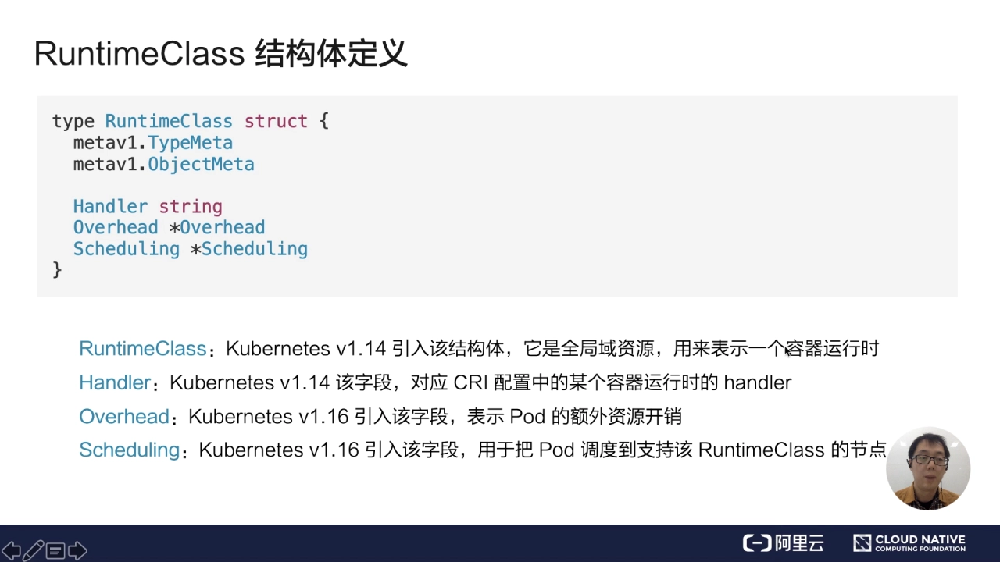

```go
type RuntimeClass struct {
    metav1.TypeMeta
    metav1.ObjectMeta

    Handler    string
    Overhead   *Overhead
    Scheduling *Scheduling
}
```

三个字段的语义，讲者的原话可以浓缩成一行一个：[【跳转到 04:16】](https://www.bilibili.com/video/BV1LE41147jG/?t=256)

| 字段 | 引入版本 | 作用 |
| :--- | :--- | :--- |
| `Handler` | 1.14 | 对应 CRI 实现配置中的某个容器运行时的 handler |
| `Overhead` | 1.16 | 表示 Pod 的额外资源开销 |
| `Scheduling` | 1.16 | 用于把 Pod 调度到支持该 RuntimeClass 的节点 |

### 2.2 handler 不是二进制路径，而是「CRI 配置里的一个名字」

这是最容易误解的一点。`handler` 里写的既不是 `/usr/bin/kata-runtime`，也不是镜像地址，而是**CRI 实现（containerd、CRI-O 等）配置文件里给某个运行时起的名字**。不同的 CRI 实现配置方式不同；以 containerd 为例，它由一堆插件组成，运行时就在配置文件的 runtime 段里配。[【跳转到 04:41】](https://www.bilibili.com/video/BV1LE41147jG/?t=281)

所以一条完整的链路是「**Pod → RuntimeClass → handler 名字 → containerd 配置里的同名条目 → 真正的 shim / 运行时**」。中间任何一环名字对不上，这条链就断了——这也是后面最容易踩的坑。

### 2.3 最小可用写法：一个 RuntimeClass + 一个 Pod

一个 RuntimeClass 的定义简单到只有四行有效内容：[【跳转到 08:11】](https://www.bilibili.com/video/BV1LE41147jG/?t=491)

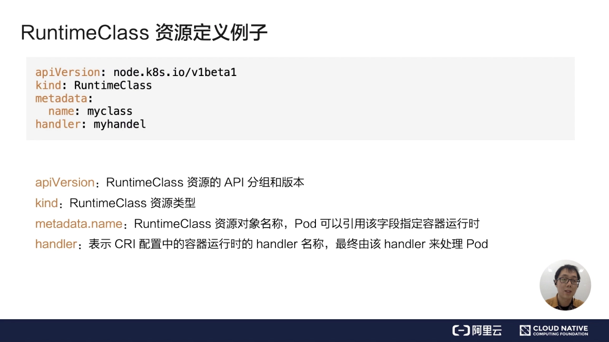

```yaml
apiVersion: node.k8s.io/v1beta1
kind: RuntimeClass
metadata:
  name: myclass          # Pod 通过这个名字引用它
handler: myhandel        # 必须是 CRI 配置里存在的 handler 名
```

Pod 侧的引用同样只有一行：[【跳转到 05:16】](https://www.bilibili.com/video/BV1LE41147jG/?t=316)

```yaml
apiVersion: v1
kind: Pod
metadata:
  name: my-runv-pod
spec:
  runtimeClassName: myclass   # 指向 RuntimeClass 的 metadata.name
  containers:
    - name: app
      image: nginx
```

注意这两个名字是**两回事**：`metadata.name` 是 Kubernetes 侧的对象名，`handler` 是节点侧运行时配置里的名字。前者随便起，后者必须和节点配置严格一致。

## 三、一次 Pod 创建：从 master 到 handler 的完整路径

讲者用一张图把「调度」和「运行时选择」这两件常被混为一谈的事拆开了。[【跳转到 02:20】](https://www.bilibili.com/video/BV1LE41147jG/?t=140)

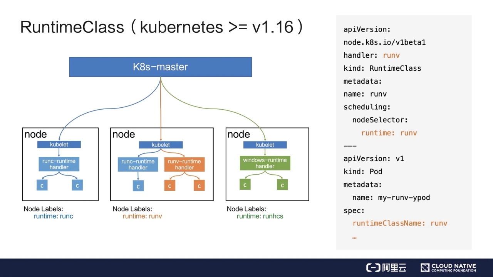

图里三个节点的情况是：

| 节点 | 装了什么 handler | 打的 label |
| :--- | :--- | :--- |
| 左 | `runc-runtime handler` | `runtime: runc` |
| 中 | `runc-runtime handler` + `runv-runtime handler` | `runtime: runv` |
| 右 | `windows-runtime handler` | `runtime: runcs` |

一个引用了 `runv` 这个 RuntimeClass 的 Pod 进来之后，发生两件事，顺序不能颠倒：[【跳转到 03:45】](https://www.bilibili.com/video/BV1LE41147jG/?t=225)

1. **调度器先按 label 选节点**。`scheduling.nodeSelector` 里写了 `runtime: runv`，所以只有中间那个节点满足条件，Pod 落在这里。
2. **kubelet 再按 handler 选运行时**。`handler: runv` 告诉 CRI：这个 Pod 请交给 `runv` 这个 handler 处理。请求最终被转发到橙色的 `runv-runtime handler` 上，由它负责创建、更新、删除容器。


**这就是 RuntimeClass 的关键设计：调度决策（在哪台机器）和执行决策（用哪个运行时）是两个独立步骤，靠两个不同字段驱动。** 一个字段写错，故障现象完全不同——`scheduling` 写错是 Pod 一直 Pending（没有节点满足 nodeSelector），`handler` 写错是 Pod 调度成功但容器起不来（节点上没有这个 handler）。这个区分在排障时非常有用。

## 四、scheduling：把 Pod 约束到「有这个 handler 的节点」

### 4.1 两个字段：NodeSelector 与 Tolerations

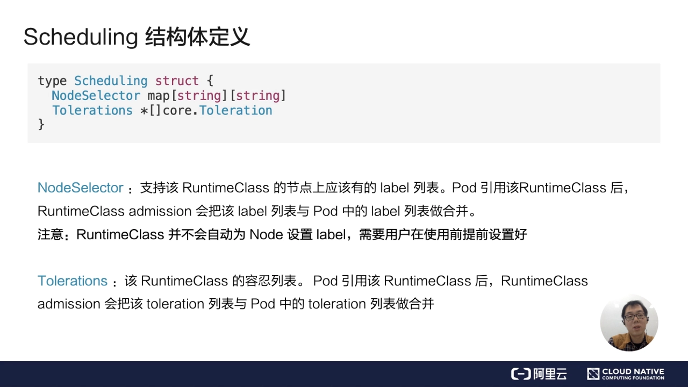

```go
type Scheduling struct {
    NodeSelector map[string]string
    Tolerations  *[]core.Toleration
}
```

讲者特意强调了一句容易看错的话：**这里的 scheduling 不是 RuntimeClass 对象自己的调度，而是会影响「引用了该 RuntimeClass 的 Pod」的调度**。RuntimeClass 是集群级对象，它本身不需要被调度到任何节点上。[【跳转到 05:16】](https://www.bilibili.com/video/BV1LE41147jG/?t=316)

两个字段的语义和 Pod 自己的 `nodeSelector` / `tolerations` 几乎一样：

- **`NodeSelector`**：支持该 RuntimeClass 的节点上**应该有的 label 列表**。
- **`Tolerations`**：该 RuntimeClass 的**容忍列表**。

### 4.2 真正干活的不是调度器，是 admission

关键在于「谁把这两个字段搬到 Pod 上」。答案是 **RuntimeClass admission**（准入控制器）：Pod 一旦引用了某个 RuntimeClass，admission 就会把 RuntimeClass 里的 `nodeSelector` / `tolerations` 与 Pod 自己写的那份**做一次合并**。[【跳转到 05:41】](https://www.bilibili.com/video/BV1LE41147jG/?t=341)

合并规则有两条，都很实用：

- **label 冲突会被拒绝**。所谓冲突，指的是 **key 相同、value 不同**。比如 RuntimeClass 要求 `runtime: runv`，而 Pod 自己写了 `runtime: runc`，这个 Pod 直接被 admission 拒绝，不会「后写的覆盖先写的」。[【跳转到 06:06】](https://www.bilibili.com/video/BV1LE41147jG/?t=366)
- **toleration 重复会被去重**。两处的容忍列表合并，相同的容忍只保留一份，不会出现重复条目。

这解释了一个常见困惑：为什么在 Pod 上写 `nodeSelector` 想「改掉」RuntimeClass 的约束改不掉。因为约束是**并集语义**，不是覆盖语义。

### 4.3 为什么 RuntimeClass 不替你给节点打 label

讲者专门解释了设计取舍：**RuntimeClass 不会自动为 Node 设置 label，需要用户提前设置好**。[【跳转到 09:51】](https://www.bilibili.com/video/BV1LE41147jG/?t=591)

理由说得很直白：label 是一个**通用的**机制，节点上可能同时有 `runtime`、`kubernetes.io/os`、机型、可用区等一堆 label，交给用户自己规划更灵活方便。RuntimeClass 只负责「声明我需要什么样的节点」，不负责「去改节点的元数据」。

反过来说，这也意味着一个责任：**装了 Kata 的节点必须有人给它打上对应 label，否则 RuntimeClass 的 nodeSelector 永远匹配不到它**，Pod 就会一直 Pending。而如果节点打了 label、却没配 handler，Pod 会调度上去然后创建失败。两种错配，两种故障。

### 4.4 光有 nodeSelector 不够：Tolerations 补上另一半

`nodeSelector` 只能表达「我要去有某个 label 的节点」，表达不了「我要去**被隔离出来**的节点」。生产上常见的做法是给沙箱节点打 **taint**（污点），让普通 Pod 默认不会落上去，只有显式声明容忍的 Pod 才能进。

RuntimeClass 的 `tolerations` 字段就是为这个场景准备的：把「这批节点是沙箱专用」写进 RuntimeClass，那么任何引用它的 Pod 都会自动获得对应的容忍，**用户不需要在自己的 YAML 里重复写一遍 toleration**。这样「用 Kata 的 Pod」和「只能用 Kata 节点」这两件事就被绑在一次声明里了。

## 五、overhead：把 VM 的「看不见的开销」算进账

### 5.1 为什么 pause 不算，而 kata-agent 必须算

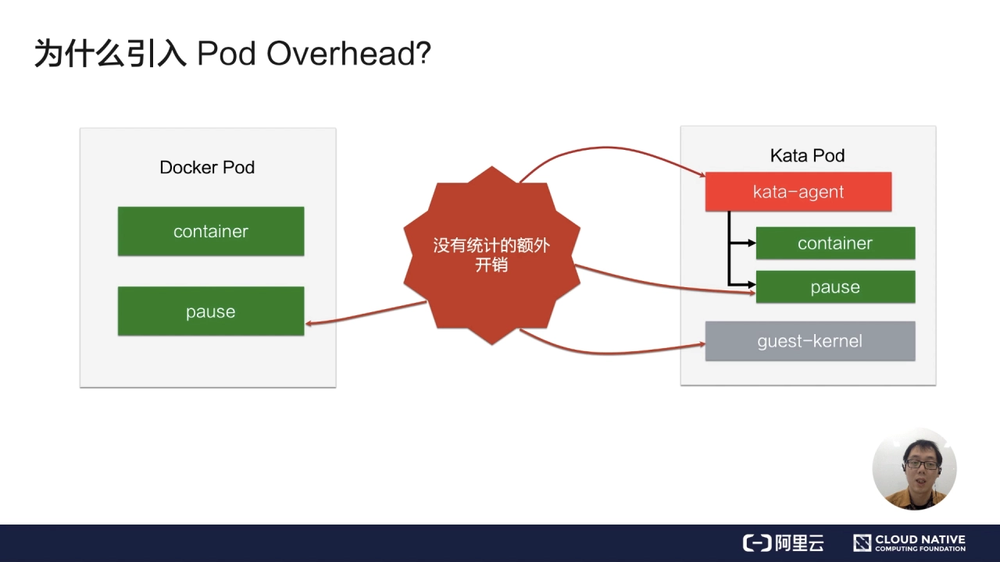

讲者用两个 Pod 做对比：[【跳转到 06:27】](https://www.bilibili.com/video/BV1LE41147jG/?t=387)

- **Docker Pod**：除了业务容器，还有一个 `pause` 容器。计算容器开销时，`pause` 是**被忽略、没有被统计**的。
- **Kata Pod**：除了业务容器，还有 `kata-agent`、`pause`、**guest OS（客户机内核）**。这些开销同样没有被统计进来。

差别在于量级：Docker 的 `pause` 只占几百 KB，忽略无所谓；而 Kata 的 agent 加客户机内核，**多的时候甚至能超过 100 MB**。这份开销没法忽略，因为它真实占着节点的内存。[【跳转到 06:52】](https://www.bilibili.com/video/BV1LE41147jG/?t=412)

这就是引入 Pod Overhead 的初衷：**给「业务容器之外、但确实要占资源」的那部分，找一个能进调度账本的位置。**

### 5.2 podFixed：一个 resourceName → quantity 的映射

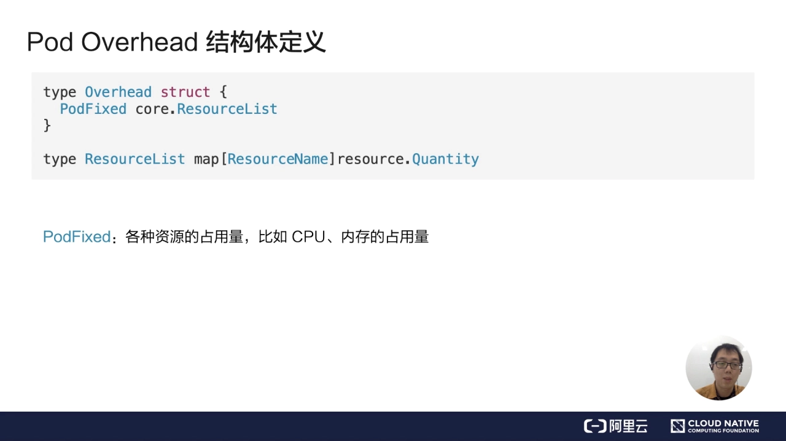

```go
type Overhead struct {
    PodFixed core.ResourceList
}

type ResourceList map[ResourceName]resource.Quantity
```

结构简单到只有一个字段。`podFixed` 是一个映射：key 是资源名，value 是数量。常用的就是 CPU 和内存的占用量。[【跳转到 07:01】](https://www.bilibili.com/video/BV1LE41147jG/?t=421)

### 5.3 三个使用场景：调度、配额、驱逐


**场景一：Pod 调度。** 这是最核心的一处。规则的变化只有一句话：[【跳转到 07:26】](https://www.bilibili.com/video/BV1LE41147jG/?t=446)

$$
\text{引入前：} \quad \text{节点可用量} \ge \text{request}
\qquad\Longrightarrow\qquad
\text{引入后：} \quad \text{节点可用量} \ge \text{overhead} + \text{request}
$$

也就是说，`overhead` 会和容器的 `requests` 累加，作为这个 Pod 的**调度最小资源值**。不设 `overhead` 的后果很直接：调度器以为这个 Pod 只吃 500 Mi，实际上它还要多占 100 Mi 给客户机内核，节点就被**超卖**了。

**场景二：ResourceQuota。** `overhead` 会被统计到 namespace 的资源限额里。讲者给的算例很清楚：[【跳转到 07:51】](https://www.bilibili.com/video/BV1LE41147jG/?t=471)

- namespace 内存配额 1 GB，Pod 的 request 是 500 Mi → 最多调度 **2 个**。
- 同一个 Pod 加上 200 Mi 的 overhead → 每个 Pod 实际占 700 Mi → 最多只能调度 **1 个**。

配额没变，能跑的 Pod 数少了一半。这就是「overhead 不进配额」时配额会失真的具体样子。

**场景三：kubelet 的 Pod 驱逐。** `overhead` 会被统计到**节点的已使用资源**中，从而抬高已使用资源的占比，最终影响 kubelet 的驱逐判断。换句话说，不算 overhead 时，节点看起来还有余量，实际上已经贴着驱逐阈值了。[【跳转到 07:56】](https://www.bilibili.com/video/BV1LE41147jG/?t=476)

### 5.4 三条限制：永久、不可手改、不影响 HPA/VPA

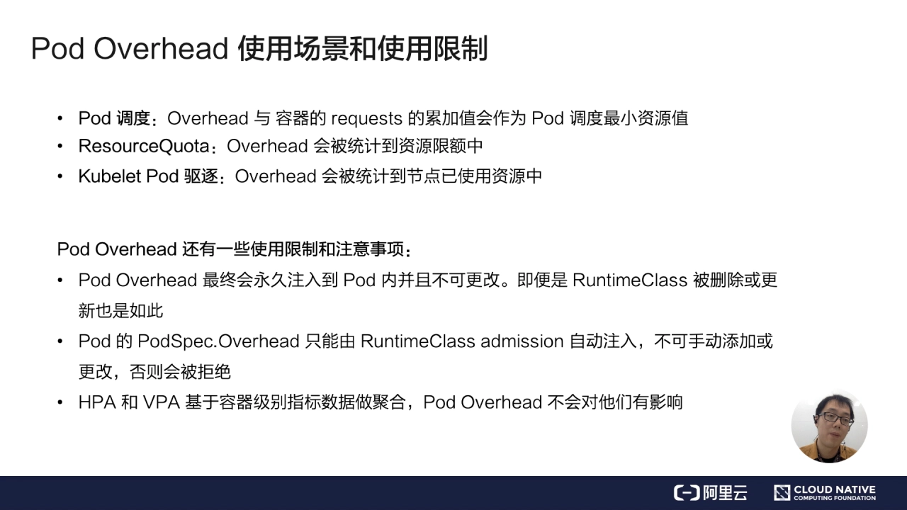

这三条限制决定了运维时该怎么想这件事：[【跳转到 08:01】](https://www.bilibili.com/video/BV1LE41147jG/?t=481)

1. **永久注入、不可更改**。`overhead` 最终会永久注入到 Pod 内，并且不可手动更改。**即便是把 RuntimeClass 对象删除或更新了，Pod 的 overhead 依然存在并且有效。** 也就是说，改 RuntimeClass 的 `overhead` 只影响之后新建的 Pod，已经跑着的 Pod 不会跟着变。
2. **只能由 admission 注入**。Pod 的 `PodSpec.Overhead` 只能由 RuntimeClass admission 自动注入，**手动添加或修改会被拒绝**。这防止了用户「自己把开销写小一点」来骗调度器。
3. **不影响 HPA / VPA**。HPA 和 VPA 是基于**容器级别**的指标数据做聚合的，Pod 的 overhead 不会对它们造成影响。所以扩容决策看的是业务容器的实际用量，不会因为 VM 的固定开销而误判。

## 六、把两个运行时装进一个集群：一个完整示例

讲者在阿里云 ACK 的安全沙箱容器节点上做了演示：同一个集群里，`runc` 的 Pod 和 `runv`（Kata）的 Pod 并存。[【跳转到 14:23】](https://www.bilibili.com/video/BV1LE41147jG/?t=863)

### 6.1 两条请求路径，在 CRI plugin 处分叉

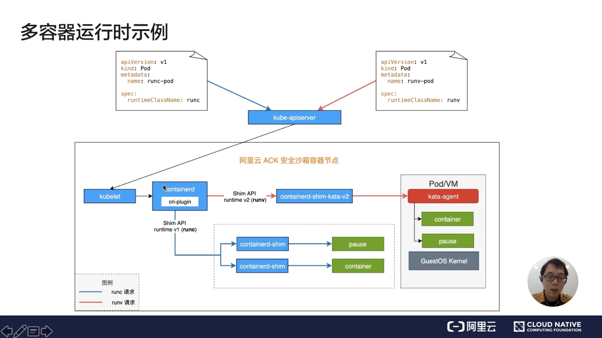

图里蓝色是 runc 的请求，红色是 runv 的请求。两条路径的前半段完全一样，**分叉点在 containerd 的 CRI plugin**：[【跳转到 09:13】](https://www.bilibili.com/video/BV1LE41147jG/?t=553)

- **runc 路径**：kube-apiserver → kubelet → CRI plugin → 查 containerd 配置里 `runc` 对应的 handler → 走 **shim API runtime v1** 请求 `containerd-shim` → 由 shim 创建 `pause` 与业务容器。
- **runv 路径**：kube-apiserver → kubelet → CRI plugin → 匹配 containerd 配置 → 走 **shim API runtime v2** 创建 `containerd-shim-kata-v2` → 由它创建 Kata 的 Pod/VM，VM 里跑 `kata-agent`、业务容器、`pause` 和 GuestOS 内核。

**两条路在 `kubelet` 之后才分开，说明 RuntimeClass 对 Kubernetes 控制面是透明的**——apiserver、调度器、kubelet 都不需要知道 Kata 是什么，它们只是把一个字符串（handler）往下传。

### 6.2 containerd 配置：runtimes 下的名字必须与 handler 一致

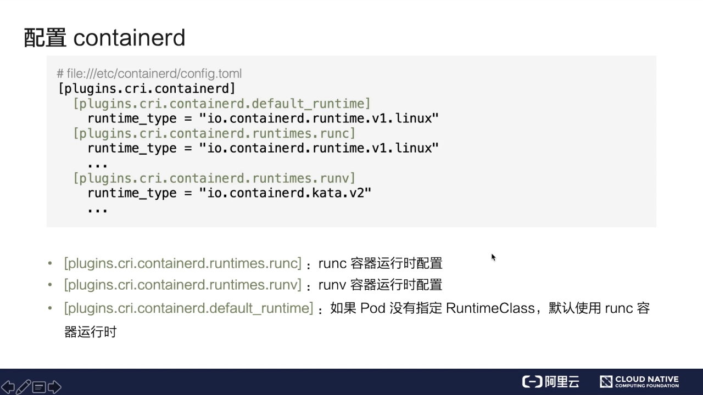

配置文件在 `/etc/containerd/config.toml`，核心段落在 `plugins.cri.containerd` 下：[【跳转到 09:56】](https://www.bilibili.com/video/BV1LE41147jG/?t=596)

```toml
# file:///etc/containerd/config.toml
[plugins.cri.containerd]
  [plugins.cri.containerd.default_runtime]
    runtime_type = "io.containerd.runtime.v1.linux"
  [plugins.cri.containerd.runtimes.runc]
    runtime_type = "io.containerd.runtime.v1.linux"
  ...
  [plugins.cri.containerd.runtimes.runv]
    runtime_type = "io.containerd.kata.v2"
  ...
```

三个要点：

1. `runtimes.runc` 与 `runtimes.runv` 里的 **`runc` / `runv` 就是 RuntimeClass 对象里 `handler` 的名字**，两边必须对得上。
2. `runtime_type` 决定这个 handler 实际调用哪套实现：`io.containerd.runtime.v1.linux` 对应 runc 那条 shim v1 路径，`io.containerd.kata.v2` 对应 `containerd-shim-kata-v2` 那条 shim v2 路径。
3. **`default_runtime`** 是兜底：如果一个 Pod **没有指定 RuntimeClass**、但被调度到了这个节点，它默认还是用 `runc`。

> 注：视频里的写法是 containerd 1.x 早期的 `[plugins.cri.containerd.runtimes.<name>]` 简写。较新的 containerd 用的是完整插件路径 `[plugins."io.containerd.grpc.v1.cri".containerd.runtimes.<name>]`，语义完全一致——`runtimes` 下的**子表名**就是 handler 名。

### 6.3 创建 RuntimeClass，然后引用它

```bash
# 两个 RuntimeClass 对象：runc 与 runv
kubectl get runtimeclass        # 列出当前集群所有可用的容器运行时
```

演示里创建了两个 RuntimeClass 对象，分别对应 `runc` 与 `runv`。[【跳转到 10:46】](https://www.bilibili.com/video/BV1LE41147jG/?t=646) 然后是两个 Pod，唯一的差别就是 `runtimeClassName` 那一行：

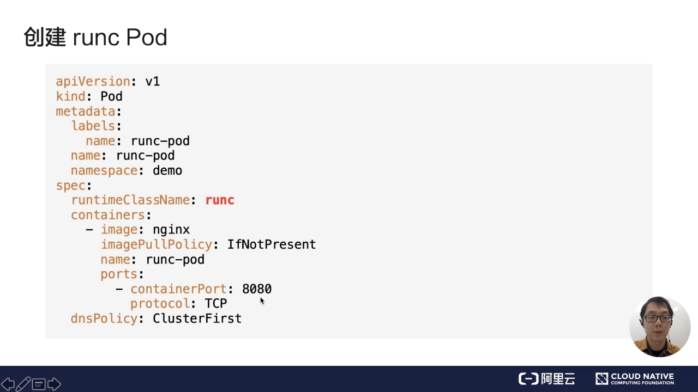

```yaml
apiVersion: v1
kind: Pod
metadata:
  name: runc-pod
  namespace: demo
spec:
  runtimeClassName: runc     # ← 只有这一行不同
  containers:
    - name: runc-pod
      image: nginx
      imagePullPolicy: IfNotPresent
      ports:
        - containerPort: 8080
          protocol: TCP
  dnsPolicy: ClusterFirst
```

### 6.4 验证：Pod 到底跑在哪个运行时上

`runtimeClassName` 是 Pod spec 里的字段，所以可以直接用 `custom-columns` 把它打出来：[【跳转到 18:01】](https://www.bilibili.com/video/BV1LE41147jG/?t=1081)

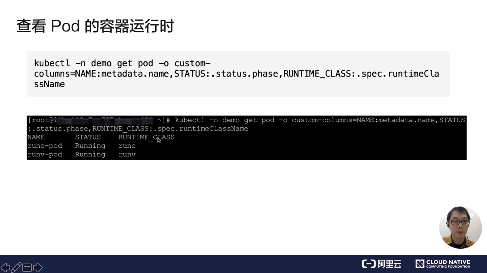

```bash
kubectl -n demo get pod -o custom-columns=\
NAME:metadata.name,STATUS:.status.phase,RUNTIME_CLASS:.spec.runtimeClassName
```

输出里两个 Pod 都是 `Running`，`RUNTIME_CLASS` 一列分别显示 `runc` 和 `runv`：

```
NAME       STATUS    RUNTIME_CLASS
runc-pod   Running   runc
runv-pod   Running   runv
```

注意这一列显示的是 **spec 里声明的值**，也就是「我希望用哪个运行时」。要确认节点上真的按这个 handler 起了容器，还需要回到节点上看 containerd 的 shim 进程（`containerd-shim-kata-v2` 有没有起来），或者看 `kubectl describe pod` 里的容器 ID 前缀。**声明成功 ≠ 执行成功**，这是 RuntimeClass 排障时最容易混淆的一处。

## 小结

- **RuntimeClass 是 Kubernetes 的内置全局资源**（1.12 起是 CRD，1.14 转正），一个对象代表一种容器运行时，用来解决「多个运行时混用」这件事。
- **`handler` 是名字，不是路径**。它指向 CRI 实现（如 containerd）配置里 `runtimes.<name>` 的子表名，两边必须严格一致。
- **调度与执行是两个独立步骤**：`scheduling.nodeSelector` 决定 Pod 落在哪个节点，`handler` 决定 kubelet 把请求交给哪个运行时。前者写错是 Pending，后者写错是容器起不来。
- **`scheduling` 由 admission 注入，是并集语义**。label 冲突（同 key 不同 value）会被拒绝，toleration 重复会被去重；RuntimeClass **不会**自动给节点打 label。
- **`overhead` 是给「业务之外的固定开销」记的账**。Kata 的 agent 加客户机内核能超过 100 MB，不记账就会导致节点超卖、配额失真、驱逐判断滞后。
- **`overhead` 一次注入、永久生效**：改 RuntimeClass 只影响新 Pod；手动改 `PodSpec.Overhead` 会被拒绝；HPA/VPA 不受影响。
- **`default_runtime` 是兜底**：没写 `runtimeClassName` 的 Pod 落到节点上，仍然用默认运行时。

## 关键术语速查

| 术语 | 一句话解释 |
| :--- | :--- |
| CRI | Container Runtime Interface，Kubernetes 1.5 引入的运行时接口，让 Kata、gVisor 等不必改 Kubernetes 主干就能接入 |
| RuntimeClass | Kubernetes 内置的集群级资源，一个对象代表一种容器运行时，含 `handler` / `scheduling` / `overhead` 三个字段 |
| handler | RuntimeClass 里指向 CRI 配置中某个运行时条目的名字，如 `runc`、`runv`、`kata` |
| runtimeClassName | Pod spec 里的字段，写 RuntimeClass 的 `metadata.name` 来引用它 |
| RuntimeClass admission | 准入控制器，负责把 RuntimeClass 的 `nodeSelector` / `tolerations` / `overhead` 注入到 Pod |
| nodeSelector（RuntimeClass 内） | 支持该运行时的节点应具备的 label 列表，与 Pod 自身的 nodeSelector 合并 |
| tolerations（RuntimeClass 内） | 该运行时的容忍列表，与 Pod 自身的 tolerations 合并并去重 |
| Pod Overhead | 1.16 引入的概念，把业务容器之外的固定资源开销计入调度、配额与驱逐 |
| podFixed | Overhead 的唯一字段，类型是 resourceName → quantity 的映射 |
| default_runtime | containerd 配置项，未指定 RuntimeClass 的 Pod 使用的默认运行时 |
| shim API runtime v1 / v2 | containerd 调用 shim 的两套接口，runc 走 v1、Kata 走 v2（`containerd-shim-kata-v2`） |