# 嵌套虚拟化如何让 L2 拿到硬件虚拟化能力

> 视频来源：[KVM Nested Virtualization: Workings and Usecases - Bandan Das - FOSSASIA Summit 2017](https://www.youtube.com/watch?v=_h-N5hxEa88)（YouTube · FOSSASIA · 讲者 Bandan Das，Red Hat）｜时长约 31 分钟
> 简要导读：这支演讲专门讲「内部机制」——L1 创建的 VMCS 为什么不能直接加载、KVM 怎么合成 VMCS02 代跑 L2、以及 shadow VMCS / nested EPT / nested VPID 这些硬件特性各自省掉了哪一次 exit。字幕为 YouTube 自动生成，本文对 `Zen`（Xen）、`bmcs`（VMCS）、`NPD`（nested EPT）等识别错误做了订正。本文只讲「怎么实现」，性能数字与场景取舍见同节 7.1.2。

## 本讲要解决的核心问题（SCQA）

**背景**：在 L0 上跑 KVM，把一台 Linux 作为 L1 客户机；L1 里再装 KVM（或 Xen、Hyper-V），想启动自己的客户机 L2。这就是嵌套虚拟化——hypervisor 里套 hypervisor。

**冲突**：x86 的硬件虚拟化只有「一套」。VMCS（Virtual Machine Control Structure，虚拟机控制结构）是处理器用来启动一台客户机的控制块，可硬件上同一时刻只有**一个** VMCS 是「当前」的，而且只有 L0 有资格加载它。L1 在自己看来创建了一个 VMCS 去启动 L2，可这个 VMCS 在硬件上根本没有位置。

**疑问**：既然 L1 的 VMCS 加载不了，L2 的每次进入（VM entry）到底是谁执行的？L1 又凭什么仍然以为自己拥有 L2？

**回答（中心思想）**：**L2 从来不是由 L1 真正跑起来的，而是 L0 用一份「合成出来的」VMCS02 代跑的**。L0 拦截 L1 的每一次 VMX 操作，把 L1 的 VMCS12 与自己的 VMCS01 取交集生成 VMCS02，用它在硬件上跑 L2；再把结果写回 VMCS12，让 L1 看到它期望的退出原因。嵌套虚拟化的全部实现，就是这条「代跑 + 回写」链路的正确性，以及用 shadow VMCS、nested EPT、nested VPID、抢占定时器、中断确认等硬件特性把代跑多出来的 exit 压下去。

## 一、三层角色：只有 L0 真正碰硬件

先统一术语。演讲里反复出现三个层次：

- **L0**：宿主机上的 hypervisor（这里是 KVM），唯一直接操作 VT-x/VMX 的一层；
- **L1**：跑在 L0 上的客户机，它自己也是个 hypervisor（演讲里以 Xen 为例，KVM 同理）；
- **L2**：L1 想启动的客户机，比如一台 Linux。

对应三份控制结构：KVM 用 **VMCS01** 启动 L1；L1 自己创建 **VMCS12** 想启动 L2；而硬件上真正被加载、用来跑 L2 的，是 L0 生成的 **VMCS02**。

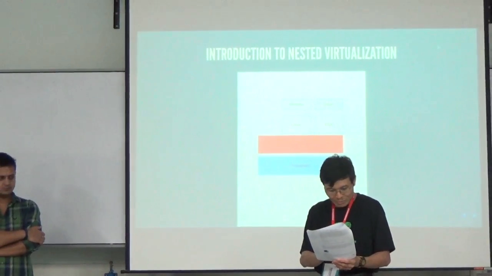

[【跳转到 04:04】](https://www.youtube.com/watch?v=_h-N5hxEa88&t=244)

关键的一步在 VMCS 的归属上：**VMCS12 是 L1 在 L0 分给它的内存里写出来的**，L1 认为自己拥有它，L0 也确实看得见它——只是 L0 不允许它被直接加载到处理器上。

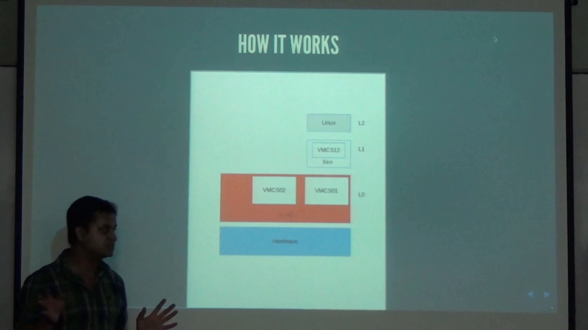

[【跳转到 05:38】](https://www.youtube.com/watch?v=_h-N5hxEa88&t=338)

### 1.1 合成 VMCS02 时要取「最小交集」

L0 合成 VMCS02 时，不是简单照抄 VMCS12，而是取 **VMCS12 与 VMCS01 的交集**。原因很直白：**不能让 L2 拥有比 L1 本身更多的特性**。

举个例子：L0 根本没把某个 VMX 特性透传给 L1，L1 却把它写进了 VMCS12；或者 L1 想给 L2 配置超出自己实际拥有的 CPU 数量。这些「越权」的字段在 VMCS02 里必须被削掉，否则 L2 就绕过了 L0 对 L1 的能力限制——这既破坏隔离，也让 L0 无法正确模拟。

[【跳转到 05:22】](https://www.youtube.com/watch?v=_h-N5hxEa88&t=322)

## 二、代跑是怎么发生的：L1 的一次 VM entry 变成 L0 的一次 exit

把一次「L1 启动 L2」拆开看，顺序是这样的：

1. L1 执行 `VMLAUNCH`/`VMRUN`（Intel 的 VM entry 指令），想把 VMCS12 加载到处理器上；
2. 这个操作**被 L0 拦截**（L1 跑在非根模式下，VMX 指令本身就是会触发 exit 的敏感指令），控制权回到 KVM；
3. KVM 拿 VMCS12 与 VMCS01 合成 VMCS02，加载 VMCS02，**由 L0 在硬件上跑 L2**；
4. L2 触发退出时，退出信息先落到 L0；L0 判断这次退出该由谁处理，必要时把退出原因、退出资格等字段**写回 VMCS12**，再切回 L1；
5. L1 从自己的 `VMLAUNCH` 处「返回」，看到 VMCS12 里那份它期望的退出信息，于是认为自己刚刚跑过 L2、并且 L2 因为某个原因退出了。

于是 L1 的整个世界都是自洽的：它写的 VMCS 有人读，它的 VM entry 有返回值，它的 L2 在推进。**只是中间那一步被 L0 换掉了。**

[【跳转到 06:01】](https://www.youtube.com/watch?v=_h-N5hxEa88&t=361)

## 三、代价：exit 会一层层乘起来

嵌套最贵的地方不是「多了一层翻译」，而是 **VM exit 的数量被乘了**。演讲用定时器中断举了个非常具体的例子：

假设现在 L2 在跑，而 L0 必须保证 L1 也能推进（否则 L1 里的时钟、调度全停摆）。L0 的做法是给 L1 注入定时器中断，比如每 100 毫秒一次。这一次注入要走完：

1. 从 L2 退出到 L0，把跑 L2 的 VMCS02 从处理器上卸下；
2. 重新加载 VMCS01，向 L1 注入一个虚拟中断，跑 L1；
3. L1 看到中断，要真正处理它就必须再退出一次；
4. 又从 L1 退出到 L0，KVM 做完该做的事，让 L1 看到中断，再跳回 L1；
5. 过一会儿再跳回 L0，最后跳回 L2。

一次「给 L1 送个时钟中断」，在嵌套下变成了四五次模式切换。这就是为什么**即使用了硬件虚拟化扩展，嵌套仍然明显更慢**。

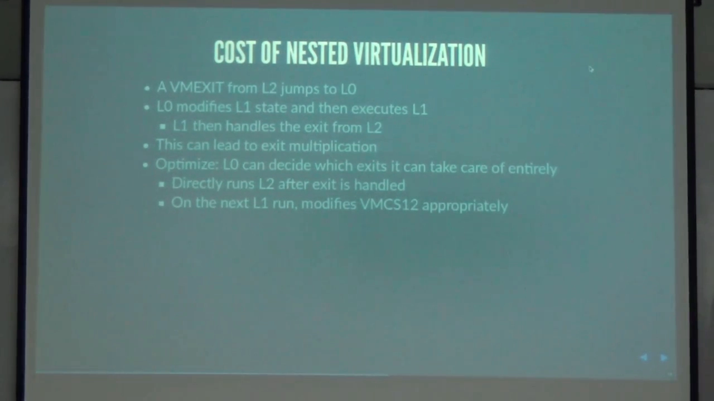

[【跳转到 10:14】](https://www.youtube.com/watch?v=_h-N5hxEa88&t=614)

### 3.1 优化的核心：L0 不必事事都通知 L1

既然 L0 才是真正在跑 L2 的那一层，那就不必把 L1 的每一点状态变化都实时同步过去——**只要在跑 L2，L1 就没在跑**。于是 KVM 的策略是：

- 能在 L0 内部处理完的退出，就直接处理完、直接回到 L2，**不切回 L1**；
- 把「本该让 L1 看到」的改动先记下来，等下次真的要进入 L1 时，再一次性写进 VMCS12。

这样 L1 醒来看到的状态依然是正确的，而 exit 次数大幅下降，两层都能以可接受的节奏推进。

[【跳转到 09:33】](https://www.youtube.com/watch?v=_h-N5hxEa88&t=573)
## 四、用硬件特性把「乘出来的 exit」压回去

演讲列出的优化特性可以按「省掉哪一类退出」分成三组：省掉地址翻译的退出、省掉 VMCS 访问的退出、省掉事件注入的退出。

### 4.1 nested EPT：把四级翻译塞进一个 EPT

先复习单层虚拟化里的 EPT（Extended Page Tables，扩展页表）：客户机自己用页表把 GVA 翻成 GPA，宿主上的 EPT 再把 GPA 翻成 HPA，一次走完，不必再用影子页表（shadow page table，早期用软件模拟页表、靠写保护触发缺页的做法）。

嵌套之后地址变成了四级：

$$
\text{nGVA} \to \text{nGPA} \to \text{GPA} \to \text{HPA}
$$

**但硬件只支持两级。** 传统做法是「L0 用 EPT，L1 用影子页表」，也就是把 L1 的 EPT 也退化成软件影子页表，慢在众所周知的地方。

nested EPT 的做法是：**每当 L1 试图创建或修改它的 EPT 页表，L0 就拦截这个操作，替 L1 合成一份「影子」的 $\text{nGPA} \to \text{HPA}$ 映射**——把 L1 的 $\text{nGPA} \to \text{GPA}$ 与 L0 自己的 $\text{GPA} \to \text{HPA}$ 在软件里合并好，交给硬件 EPT 用。这样 L2 依然管理自己的地址空间，硬件依然只做两级翻译。

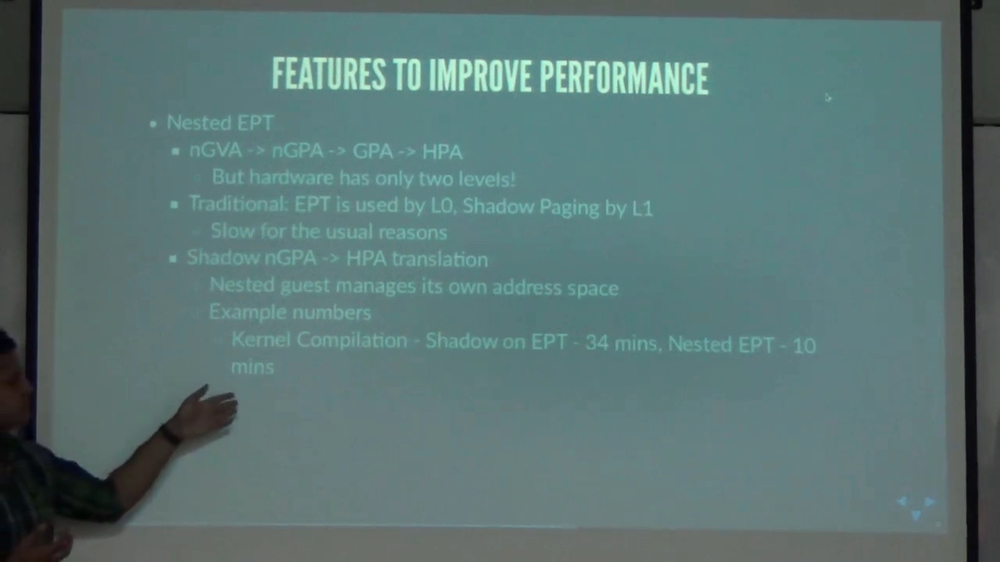

[【跳转到 12:19】](https://www.youtube.com/watch?v=_h-N5hxEa88&t=739)

收益有多大？演讲给了一个数字：内核编译（kbuild）在「EPT 上再叠影子分页」时要 34 分钟，改用 nested EPT 后是 10 分钟。差别不在 CPU 算力，而在**每一次 L2 访问内存都可能触发一次由影子页表引起的退出**。

### 4.2 shadow VMCS：L1 读写自己的 VMCS 不再退出

第二类开销来自「L1 频繁访问 VMCS」。VMCS 是内存里的结构，但通过 `VMREAD`/`VMWRITE` 访问它属于敏感操作，在嵌套下每次都要退出到 L0 由软件模拟——而 L1 在调度自己的客户机时会密集地读写 VMCS。

shadow VMCS 是硬件给的一份「影子副本」：L0 除了 L1 正在用的那个 VMCS 之外，再建一个影子 VMCS 并让处理器把它当作 VMCS12 的替身。于是**L1 访问 VMCS 时完全不产生 VM exit**，处理器直接读写影子区；等真正退出回 L0 时，L0 再把影子 VMCS 与真正的 VMCS 同步一次。

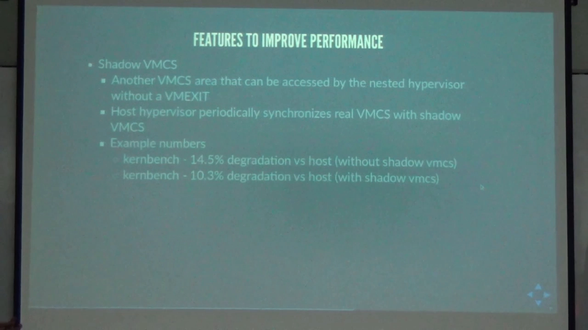

[【跳转到 13:24】](https://www.youtube.com/watch?v=_h-N5hxEa88&t=804)

注意它的语义是「周期性同步」而不是「实时一致」：L0 在两次同步之间看到的是旧值，所以哪些字段可以放进影子区、什么时候必须同步，是 KVM 里需要小心处理的地方。

### 4.3 抢占定时器与中断确认：省掉事件注入的来回

**抢占定时器（preemption timer）** 针对的正是第三节那个「每 100 毫秒注入一次时钟中断」的开销。与其让 L0 周期性打断 L2 去给 L1 送中断，不如让 L0 设一个硬件定时器、指定「过多久再回来」：时间到了才退出，L0 借机跑一会儿 L1，然后重新设一次定时器。退出次数从「每个中断一次」变成「每个时间片一次」。

**中断确认（interrupt acknowledgement）** 针对的是中断注入的两步走。正常情况下要把一个外部中断送给 L1，得先看「中断窗口」（interrupt window）是否打开，为此要先注入一个假中断，客户机响应后才能注入真中断——两次 VM exit。中断确认允许 L0 **直接把中断向量信息写进 VMCS12** 再恢复 L1，L1 一跑起来就看到了中断。演讲提到这个特性在 VMX 之后更晚的处理器上才出现，所以当初没被写进标准，但现在主流 hypervisor 都在用。

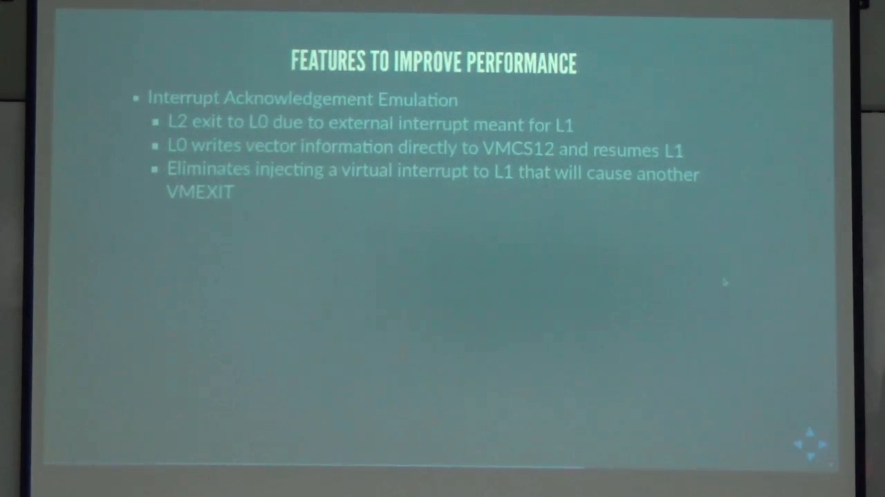

[【跳转到 15:29】](https://www.youtube.com/watch?v=_h-N5hxEa88&t=929)

### 4.4 nested VPID：在 L1 与 L2 之间切换不必刷 TLB

VPID（Virtual Processor Identifier）是处理器给不同客户机地址空间打标签、用来区分 TLB 条目的东西。早期的做法是**不给 L1 分配 VPID，让 L1 和 L2 共用一个**，代价是一旦失效这个标签，两层的地址空间翻译缓存被一起清掉。

改成 nested VPID 之后：L1 有自己的 VPID，它下面所有 L2 共用一个 VPID；当 L1 切换不同 L2 时，用 `invvpid` 精确失效那一组条目，而不是整个刷掉。前提假设很符合现实——**L1 相对稳定、一直在那儿，L2 是来来去去的**，所以没必要为了 L2 的进出牺牲 L1 的 TLB 命中。

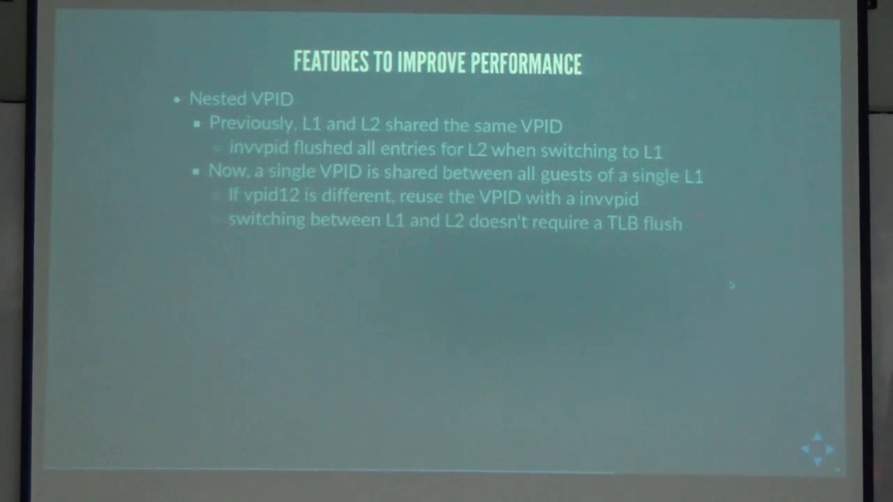

[【跳转到 15:54】](https://www.youtube.com/watch?v=_h-N5hxEa88&t=954)

### 4.5 还有三个「顺手」的特性

- **MSR load/store**：硬件支持在 VM entry/exit 时一次性批量加载、批量保存一组 MSR，省掉逐条模拟 MSR 访问的退出；
- **nested APICv**：L1 访问本地 APIC 时不再退出，由硬件虚拟化 APIC 的访问路径处理；
- **nested IOMMU / VT-d**：让嵌套客户机也能做设备直通，把宿主的外部设备直接分配给 L2，同时减少 VM exit。演讲说这块当时还是进行中的工作。

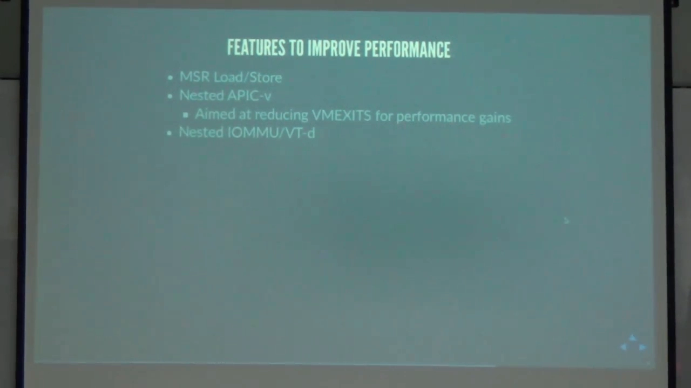

[【跳转到 17:34】](https://www.youtube.com/watch?v=_h-N5hxEa88&t=1054)

## 五、为什么必须由宿主显式打开

嵌套虚拟化不是「装上就自动有」的能力，要两步都做到：

1. **在 L0 的 KVM 模块上打开开关**：`kvm_intel` 加载时设置 `nested=1`（`modprobe kvm_intel nested=1`）。AMD 侧对应 `kvm_amd`，而且演讲指出 **AMD 上嵌套默认就是开的**，不需要额外设置。
2. **把 VMX 位透传给 L1**：跑 QEMU 时用 `-cpu host,+vmx` 之类的写法，让 L1 看到一颗带虚拟化扩展的处理器。

这两步缺一不可：模块参数决定 L0 愿不愿意替 L1 代跑，CPUID 里的 VMX 位决定 L1 是否**知道自己可以**去启动客户机。L1 看不到 VMX 位，它的 KVM 模块根本不会加载，也就谈不上嵌套。

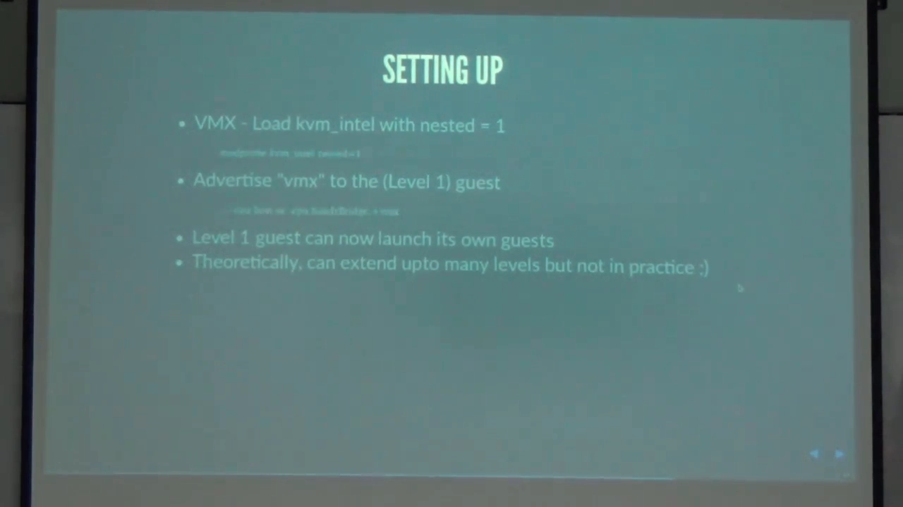

[【跳转到 18:24】](https://www.youtube.com/watch?v=_h-N5hxEa88&t=1104)

演讲提到，很多人抱怨「某个环境里跑不了嵌套」，原因往往就是**那个环境没把开关打开**。理论上这套机制可以一层层套下去，但实践中没人测那么多层，通常就用两三层。

## 六、L1 眼里的「我的 VMCS」，其实是 L0 给它的内存

问答环节里有一个很关键的澄清，值得单独拎出来：**到底是谁需要理解谁？**

听众问：「宿主 hypervisor 不需要知道里面那个虚拟 hypervisor 的任何事情，对吧？」讲者的回答是反过来的——**嵌套 hypervisor 不需要知道太多它自己客户机的事情，因为真正在跑的是宿主**。如果 L1 对某个 VMCS 位有期待，L0 可以在进入 L1 之前把它设成期待的值。

反过来说，**L0 必须理解 L1**，而且它做得到，原因很朴素：

- L1 创建的每一个 VMCS 都写在 **L0 分配给它的那块内存里**，L0 天然看得见；
- VMCS 的布局是 **Intel 规定的标准结构**，不管 L1 里跑的是 Xen、KVM 还是 Hyper-V，字段含义都一样。

[【跳转到 24:50】](https://www.youtube.com/watch?v=_h-N5hxEa88&t=1490)

这也解释了演讲开头强调的那件事：**只要 L1 严格遵循规范，L0 就不需要为某个特定 hypervisor 写特例**。但现实是开发者常常为了「先让它跑起来」而走捷径，于是 KVM 上跑 Linux 客户机没问题，换成在 KVM 里跑别的 hypervisor 就崩——因为对方做的事情不一样。

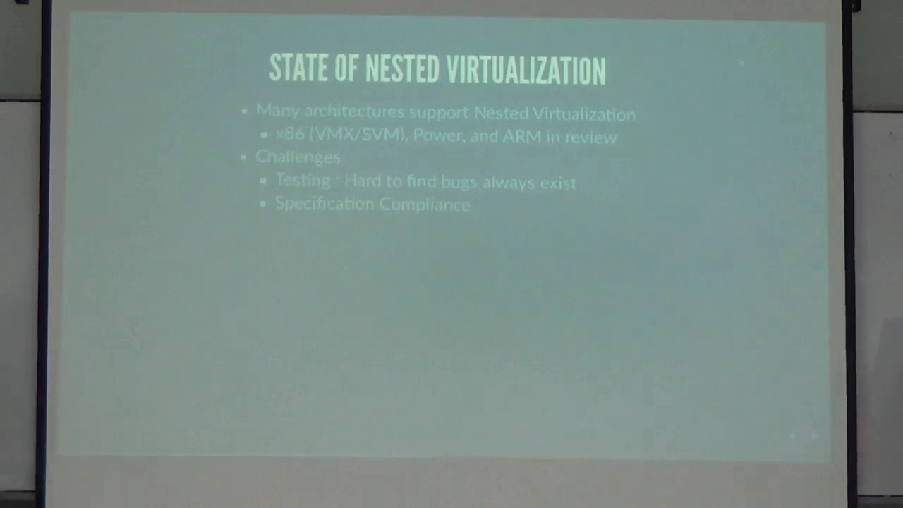

[【跳转到 02:56】](https://www.youtube.com/watch?v=_h-N5hxEa88&t=176)

## 七、谁真的需要 L2 拿到硬件虚拟化能力

演讲列出的用途都指向同一个前提：**客户机里的软件自己要求 VMX/SVM**。

- **操作系统本身就是 hypervisor**：比如 Windows 10 里的 XP 模式，客户机操作系统需要虚拟化扩展才能提供这个能力；
- **云厂商给用户「自己跑 hypervisor」的能力**：在受控环境里开放嵌套（演讲说当时还不确定有谁真的开放了）；
- **在虚拟化环境里跑安全扩展**：例如 McAfee DeepSafe 这类依赖 VMX 的安全产品；
- **测试与调试**：Red Hat 与 OpenStack 的人常用它在一台机器里模拟整套控制节点，脚本搭起来、跑完就销毁；
- **研究 hypervisor 漏洞**：在嵌套环境里做攻击面研究，风险被限制在里层。

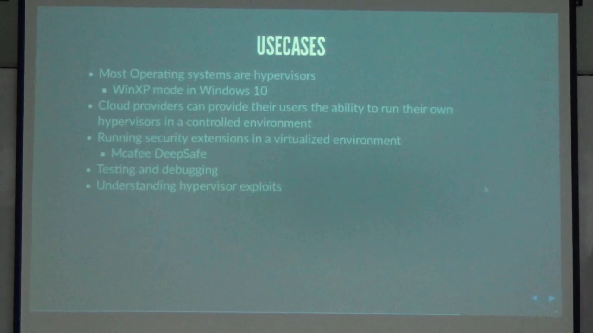

[【跳转到 20:29】](https://www.youtube.com/watch?v=_h-N5hxEa88&t=1229)

## 八、这套机制的边界

- **I/O 是短板**：CPU 密集负载可以做到接近裸机（演讲给的量级是 96%–97%），但 I/O 不行，因为对 I/O 来说一切都是嵌套的，当时还没人认真研究怎么把 I/O 高效直通到 L0。方向是 nested VT-d，属于进行中的工作。
- **VT-d 不等于 SR-IOV**：VT-d 是 IOMMU 层面的地址空间机制，让多个客户机共用同一个硬件设备；SR-IOV 是把一个 PCI 功能拆成多个虚拟功能（VF），各给一个客户机。两者常被混为一谈。
- **规范遵循是长期债**：为了兼容性，hypervisor 会「改规范」——演讲举的例子是在嵌套里跑 VMware ESX 时，它会从日志里识别出这不是 ESX 的测试环境，从而关掉某些特性（如 CBT）。没有行业需求，大家就绕开严格的规范遵循。

[【跳转到 26:51】](https://www.youtube.com/watch?v=_h-N5hxEa88&t=1611)

## 小结

- **L2 是 L0 代跑的**：L1 的 `VMLAUNCH`/`VMRUN` 被 L0 拦截，L0 用 VMCS12 与 VMCS01 的交集合成 VMCS02，在硬件上跑 L2，再把退出信息写回 VMCS12 让 L1 以为自己在跑。
- **取交集是为了不越权**：L2 不能拥有比 L1 更多的特性，否则 L0 对 L1 的能力限制就被绕过了。
- **嵌套的主要成本是 exit 乘法**：一次给 L1 注入时钟中断，可能引发四五次模式切换；优化思路是 L0 能自己处理就直接回 L2，延后再同步 VMCS12。
- **硬件特性各管一段**：nested EPT 省地址翻译退出（四级翻译压进两级 EPT），shadow VMCS 省 VMCS 访问退出，抢占定时器省周期性中断退出，中断确认省注入两步走，nested VPID 省 TLB 刷写。
- **必须显式开启**：`kvm_intel nested=1`（AMD 默认开）+ 向 L1 透传 VMX 位，两步缺一不可。
- **L0 能理解 L1 的前提是标准**：VMCS 就在 L0 给的内存里、布局由 Intel 规定，所以理论上任何遵循规范的 hypervisor 都能跑；走捷径的实现则只对特定 hypervisor 有效。

## 关键术语速查

| 术语 | 一句话解释 |
| --- | --- |
| L0 / L1 / L2 | 宿主 hypervisor / 客户机里的 hypervisor / 客户机的客户机 |
| VMCS | 处理器用来启动一台客户机的控制块，硬件同一时刻只认一个「当前」VMCS |
| VMCS01 / VMCS12 / VMCS02 | KVM 启动 L1 用的 / L1 想启动 L2 用的 / L0 实际用来跑 L2 的合成版 |
| VM exit | 客户机触发需要 hypervisor 处理的事件时，控制权从客户机返回 hypervisor |
| exit 乘法 | 嵌套下一次 L2 事件可能引发 L2→L0、L1→L0 的多轮退出 |
| nested EPT | 把 nGVA→nGPA→GPA→HPA 四级翻译压成硬件支持的两级 EPT |
| shadow VMCS | 硬件提供的 VMCS 影子副本，L1 访问它不产生 VM exit，由 L0 周期性同步 |
| VPID | 处理器给客户机地址空间打标签的标识，用于区分 TLB 条目 |
| 抢占定时器 | 硬件定时器，让 L0 指定「过多久再退出」，替代周期性中断注入 |
| 中断确认 | 把中断向量直接写进 VMCS 再恢复 L1，省掉注入虚拟中断的那次退出 |
| nested VT-d | 让嵌套客户机也能做设备直通（IOMMU 层面），当时仍在开发中 |
