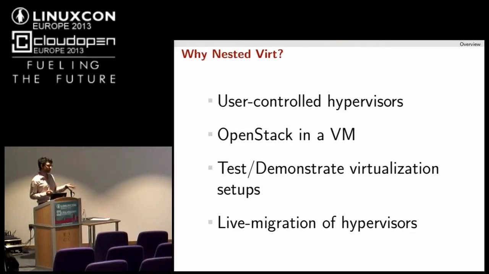
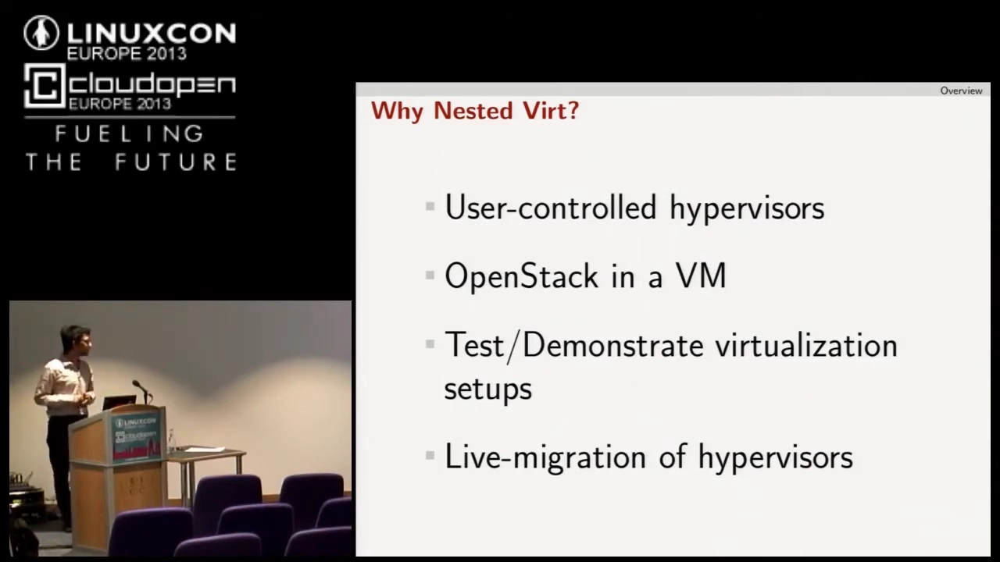
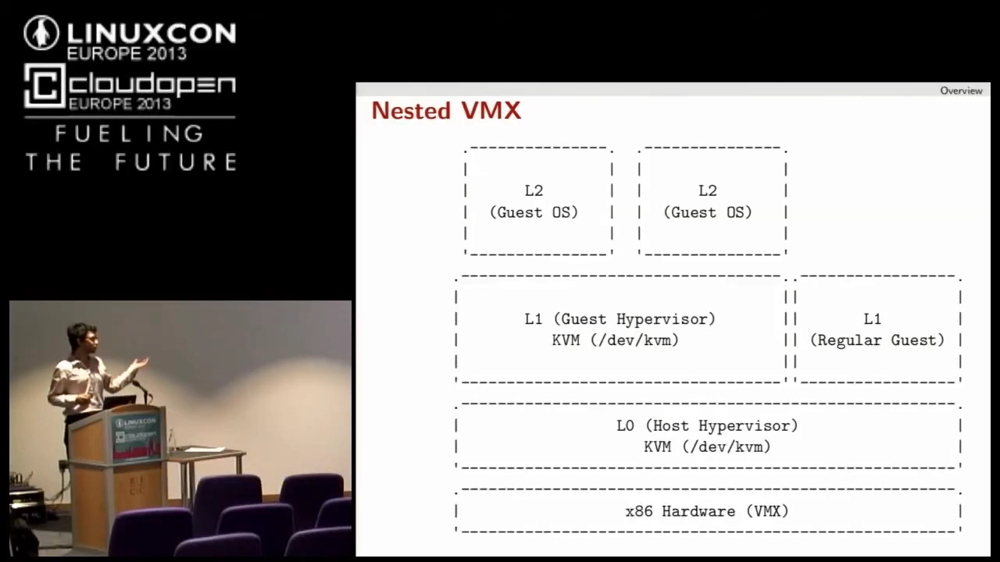
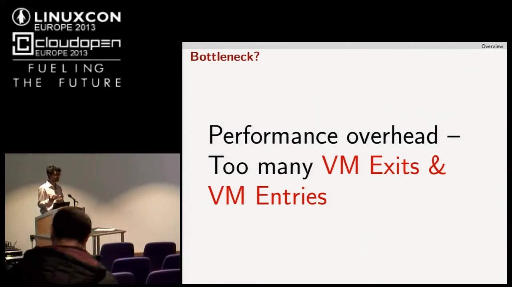
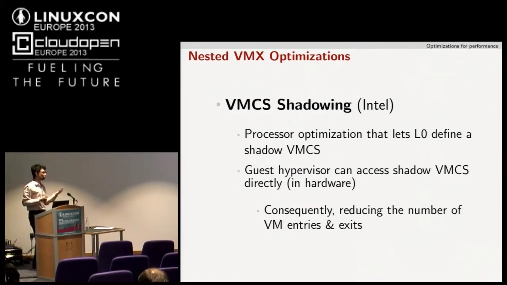
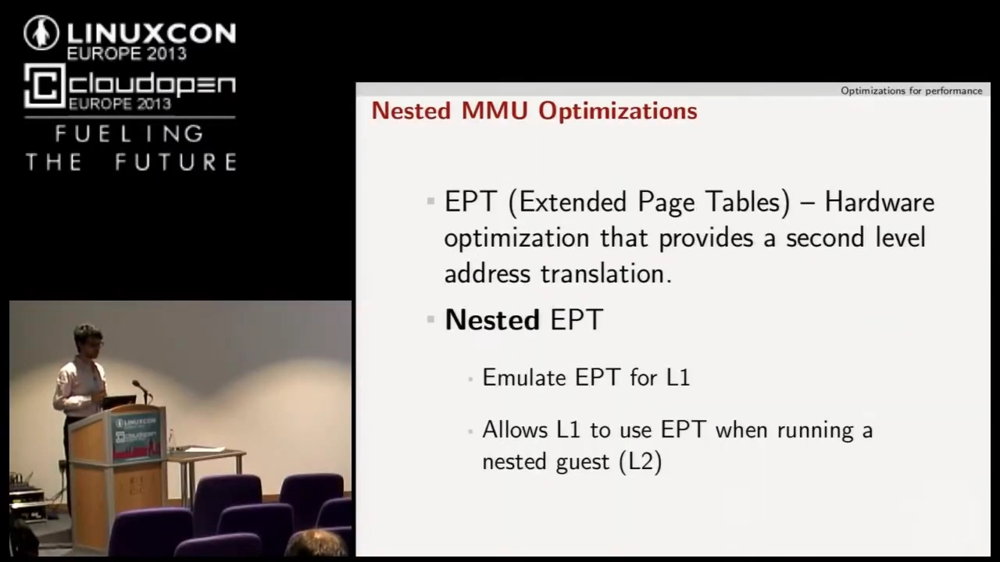
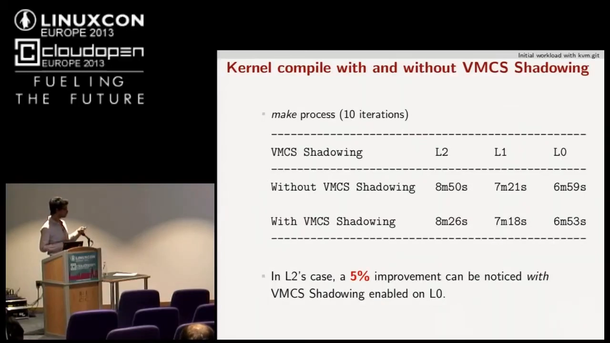
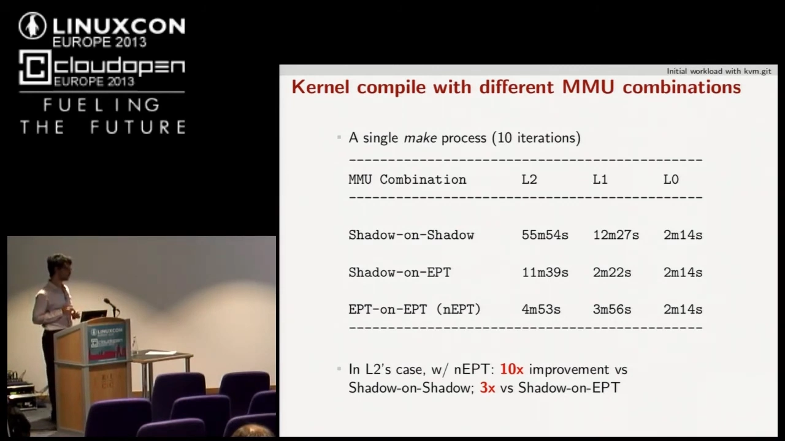
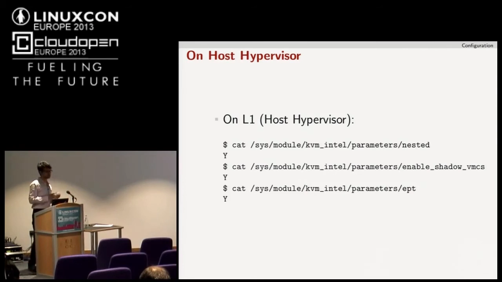
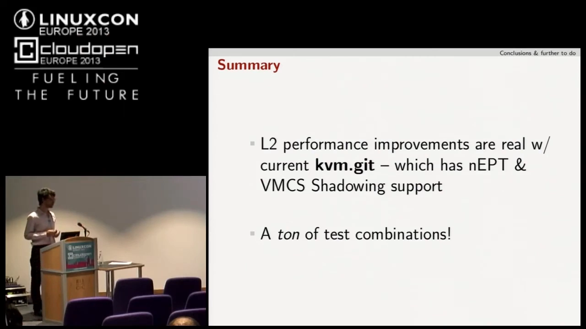

# 在云主机里再跑 KVM：嵌套虚拟化的场景与代价

> 视频来源：[Notes on Taking KVM-on-KVM Nested Virtualization for a Spin](https://www.youtube.com/watch?v=ISKfq66vTs8)（YouTube · LinuxCon + CloudOpen Europe 2013 · 讲者 Kashyap Chamarthy，Red Hat）｜时长约 32 分钟
> 导读：这是一份"动手试过之后写的笔记"。讲者不谈架构设计，而是回答三个很实际的问题：嵌套到底给谁用？代价有多大？把硬件优化打开之后能好多少？文中数字是 2013 年在 Haswell 机器 + 当时 KVM git 上测的，属于"讲者给出的实测值"，请当作量级参考，不要当今天的绝对值。

## 本讲要解决的核心问题（SCQA）

**背景**：一台普通虚拟机里跑的是普通客户机操作系统，它看不到 `/dev/kvm`，也没法再开虚拟机。想让云主机里的机器自己当 hypervisor，就需要嵌套虚拟化。

**冲突**：多一层 hypervisor 就多一层陷入。社区早在 2010 年前后就讨论过嵌套，但一直有个悬而未决的问题——**它到底有没有真实用途**，还是只是"看起来很酷"？

**疑问**：哪些场景真的需要它？代价具体有多大？Intel 的 VMCS shadowing 和嵌套 EPT 这两项硬件优化，能把代价压到多少？

**回答（中心思想）**：**嵌套虚拟化值得用的场景，全都是"你需要自己当 hypervisor"的场景**——自建实验环境、在虚拟机里演示整套云、CI 里测虚拟化功能。它的代价几乎全部来自**退出放大**（一次 L2 的退出变成多次 L1 的退出），而两项硬件优化能把它压下来一个数量级：嵌套 EPT 让内核编译从 55 分钟降到 4 分 53 秒，VMCS shadowing 再贡献约 5%。但它在当时仍是**实验特性**，默认不开，且 I/O 完全没有测过。

## 一、先看用途：嵌套解决的是"你要自己当 hypervisor"

讲者列的用例不多，但每一个都指向同一件事：普通虚拟机给不了你虚拟化能力 [【跳转到 03:34】](https://www.youtube.com/watch?v=ISKfq66vTs8&t=214)。



1. **用户自控 hypervisor（user-controlled hypervisor）**：一个开发者想在不同发行版上测自己的应用。与其找云厂商开三台不同操作系统的机器，不如要一台配置很足的 hypervisor，自己在上面管理那批客户机 [【跳转到 03:34】](https://www.youtube.com/watch?v=ISKfq66vTs8&t=214)。
2. **虚拟机里跑 OpenStack**：把整套云基础设施跑在一台大虚拟机里，演示起来更容易，加上最新的那些改进，性能也会稍好一点 [【跳转到 04:24】](https://www.youtube.com/watch?v=ISKfq66vTs8&t=264)。
3. **测试与演示整套虚拟化环境**：在单台虚拟机里演示完整的虚拟化栈及其关联客户机。
4. **hypervisor 的在线迁移**：讲者明确说自己完全没测过，只是在邮件列表上看到讨论 [【跳转到 04:49】](https://www.youtube.com/watch?v=ISKfq66vTs8&t=289)。



邮件列表上还有一类讨论是 **hypervisor 级别的 rootkit** 和安全研究，但讲者认为那在当时还只是理论上的 [【跳转到 04:49】](https://www.youtube.com/watch?v=ISKfq66vTs8&t=289)。

这四类用例有个共同点：**它们要的是"能力"，不是"性能"**。这一点很重要——它决定了后面那些百分比该怎么读。测试环境慢 60% 也能用，生产数据库慢 60% 就不能用。

## 二、代价的根源：退出放大

先把三层摆清楚：最底下是 x86 硬件（VMX），上面是 L0 宿主 hypervisor，L0 之上有一台 L1 客户机 hypervisor，它自己又跑着一批 L2 客户机 [【跳转到 02:56】](https://www.youtube.com/watch?v=ISKfq66vTs8&t=176)。



讲者把瓶颈讲得非常干脆：**性能开销来自太多的 VM exit 和 VM entry** [【跳转到 05:16】](https://www.youtube.com/watch?v=ISKfq66vTs8&t=316)。



机制是这样的：只要客户机要执行一条特权指令，就必须把控制权交还给宿主 hypervisor，这是个昂贵的操作。所谓特权指令，可能是访问硬件资源（比如时间和日期），也可能是 CPUID 这样的指令 [【跳转到 05:41】](https://www.youtube.com/watch?v=ISKfq66vTs8&t=341)。

到了嵌套场景，麻烦在于**一次退出会被放大**：

> 当 L2 客户机（嵌套客户机）想退出时，一次 L1 到 L2 的退出可以放大成多次 L1 层的退出。

这个现象有个专门的术语，叫**退出放大（exit multiplication）** [【跳转到 06:06】](https://www.youtube.com/watch?v=ISKfq66vTs8&t=366)。

换句话说：**L2 付一次陷入的价钱，L0 可能要收好几次**。这就是嵌套所有开销的总源头——后面讲的所有优化，本质上都是在减少这个放大倍数。

## 三、两项硬件优化把放大倍数压下来

### 3.1 VMCS shadowing：让 L1 直接读写 VMCS，不退出

VMCS 是虚拟机控制结构（Virtual Machine Control Structure），是处理器相关的数据结构，里面存着客户机和宿主的 CPU 状态。有了 **VMCS shadowing**，L0 hypervisor 可以为 L1 再定义一份"影子 VMCS"，这样客户机 hypervisor 就不必退到 L0，可以直接把客户机状态存进 shadow VMCS 里 [【跳转到 06:30】](https://www.youtube.com/watch?v=ISKfq66vTs8&t=390)。



讲者的实测结论是：**VM exit 和 VM entry 的次数确实减少了，性能提升不算巨大，但至少观察到 45% 的改善** [【跳转到 07:45】](https://www.youtube.com/watch?v=ISKfq66vTs8&t=465)。

注意这里的 45% 是**退出次数**的减少，不是端到端性能提升 45%——这两件事在下一节的数字里会分得很清楚。

### 3.2 嵌套 EPT：把页表翻译的退出也省掉

内存侧的优化是 **EPT（Extended Page Tables，扩展页表）**：在硬件上提供第二级地址翻译。在它之前用的是影子页表（shadow page tables），非常慢——因为从客户机虚拟地址到客户机物理地址、再从客户机物理地址到宿主物理地址要翻译很多次，退出次数也多得多 [【跳转到 08:35】](https://www.youtube.com/watch?v=ISKfq66vTs8&t=515)。

**嵌套 EPT（nEPT）** 做的事是：把扩展页表这个能力暴露给 L1 hypervisor，相当于在 L1 上模拟出扩展页表，让 L1 在跑嵌套客户机时也能用上 EPT [【跳转到 09:00】](https://www.youtube.com/watch?v=ISKfq66vTs8&t=540)。



讲者的初步测试结果是**几乎观察到八到十倍**的性能提升 [【跳转到 09:55】](https://www.youtube.com/watch?v=ISKfq66vTs8&t=595)。这个数字比 VMCS shadowing 的 45% 大得多，原因也清楚：页表翻译的退出比 VMCS 字段访问的退出密集得多。

## 四、实测：内核编译上的三组数字

讲者用 `make defconfig` 编译内核作为负载，跑 10 轮，每轮之间清理并丢掉页缓存，保证计时一致 [【跳转到 12:17】](https://www.youtube.com/watch?v=ISKfq66vTs8&t=737)。

### 4.1 打开 VMCS shadowing：L2 快 5%

| 配置 | L2 | L1 | L0 |
| --- | --- | --- | --- |
| 不开 VMCS shadowing | 8m50s | 7m21s | 6m59s |
| 开 VMCS shadowing | 8m26s | 7m18s | 6m53s |



从这张表能读出三件事：

1. **L2 有约 5% 的改善**（8m50s → 8m26s）。
2. **L1 和 L0 几乎没变化**（7m21s → 7m18s，6m59s → 6m53s）。讲者解释：L0 本来就该一样，它的一致性说明这个改动没有把开销转移到别处 [【跳转到 13:43】](https://www.youtube.com/watch?v=ISKfq66vTs8&t=823)。
3. 讲者拿这个结果去问了 Intel 嵌套虚拟化补丁的作者，对方说这个量级是合理的 [【跳转到 13:18】](https://www.youtube.com/watch?v=ISKfq66vTs8&t=798)。

### 4.2 换 MMU 组合：差 10 倍，这才是大头

| MMU 组合 | L2 | L1 | L0 |
| --- | --- | --- | --- |
| Shadow-on-Shadow | 55m54s | 12m27s | 2m14s |
| Shadow-on-EPT | 11m39s | 2m22s | 2m14s |
| EPT-on-EPT（nEPT） | 4m53s | 3m56s | 2m14s |



这张表信息量最大：

- **L2 的差距是 10 倍**：Shadow-on-Shadow 55m54s，嵌套 EPT 4m53s；相对 Shadow-on-EPT 也有 3 倍 [【跳转到 18:51】](https://www.youtube.com/watch?v=ISKfq66vTs8&t=1131)。
- **L0 始终是 2m14s**，说明这些组合差异全部来自虚拟化层，不是硬件或负载本身。
- **L1 反而在 Shadow-on-EPT 下更快**（2m22s vs 3m56s）。这个反直觉的现象在问答里被追问了：L1 并没有跑第二层客户机，为什么 MMU 组合会有影响？讲者承认这是个需要进一步查清的问题 [【跳转到 24:34】](https://www.youtube.com/watch?v=ISKfq66vTs8&t=1474)。

最后一行对使用者的含义是：**"嵌套慢"主要慢在页表，而不是慢在 VMCS 访问**。所以判断一个平台能不能用嵌套，先问它的嵌套 EPT 支持到什么程度。

## 五、什么情况下不该用：四个明确的边界

讲者在问答里把边界讲得很清楚，这些比性能数字更值得记住。

### 5.1 它默认不开，原因是稳定性而不是开销

有人问：开嵌套会不会拖慢非嵌套场景？为什么默认不开？讲者的回答是：至少在当时，KVM 的开发者和维护者还称它是**实验性**的；报告 bug 的人、来提问的用户都不多，所以是信心不够，**不是因为开它会带来开销**，纯粹是"够不够稳定到可以默认开启"的问题 [【跳转到 14:33】](https://www.youtube.com/watch?v=ISKfq66vTs8&t=873)。

### 5.2 测试覆盖面很窄：只有最小化的 Linux，没有图形

讲者强调，他测的负载主要是 Linux on Linux，**完全不带图形**，就是最小的 Linux core 安装。一旦涉及图形、涉及 Windows 之类的客户机，可能性和组合就多得多 [【跳转到 14:58】](https://www.youtube.com/watch?v=ISKfq66vTs8&t=898)。他自己的测试跑了大半年，结果相当一致，也没见过莫名其妙的崩溃；但确实有做大量测试的团队报告过不少不稳定的情况 [【跳转到 16:13】](https://www.youtube.com/watch?v=ISKfq66vTs8&t=973)。

他自己遇到过一次崩溃，只复现了两次，是在尝试关闭或者强制断电一台 L2 客户机的时候 [【跳转到 17:03】](https://www.youtube.com/watch?v=ISKfq66vTs8&t=1023)。

### 5.3 I/O 完全没测

讲者明确说：**I/O 负载一个都没测**，I/O 的改进他根本没机会验证 [【跳转到 22:03】](https://www.youtube.com/watch?v=ISKfq66vTs8&t=1323)。这是一个非常重要的空白——真实业务里磁盘和网络往往比 CPU 更容易成为瓶颈，而嵌套在 I/O 路径上的放大通常更严重。

### 5.4 `-cpu host` 会挡住在线迁移

配置上有个陷阱：要让 L1 看到 VMX 指令集，最省事的做法是把完整宿主 CPU 型号透传下去（`-cpu host`）。但讲者指出，**这会给在线迁移带来问题，因为目标宿主也必须是同样的架构** [【跳转到 11:19】](https://www.youtube.com/watch?v=ISKfq66vTs8&t=679)。也就是说，为了性能做的透传，会牺牲掉迁移的灵活性。

## 六、配置清单：三个开关和一个 CPU 型号

要复现讲者的环境，宿主侧需要确认三个内核模块参数 [【跳转到 10:26】](https://www.youtube.com/watch?v=ISKfq66vTs8&t=626)：



```bash
# 宿主（L0）上确认三个参数都是 Y
cat /sys/module/kvm_intel/parameters/nested
cat /sys/module/kvm_intel/parameters/enable_shadow_vmcs
cat /sys/module/kvm_intel/parameters/ept
```

- `nested`：允许在客户机里再跑 KVM。
- `enable_shadow_vmcs`：打开 VMCS shadowing，需要 Haswell 及以后的 CPU。
- `ept`：默认就是开的。

然后是在 libvirt / QEMU 里把 VMX 暴露给 L1：可以显式声明要暴露的 CPU 特性，也可以直接 `-cpu host` 做完整透传（代价见上一节）。讲者也吐槽了当时那串 QEMU 命令行相当难看，不过社区正在改进 [【跳转到 11:36】](https://www.youtube.com/watch?v=ISKfq66vTs8&t=696)。

## 七、结论：能力是真的，性能要挑场景

讲者的总结很克制 [【跳转到 20:36】](https://www.youtube.com/watch?v=ISKfq66vTs8&t=1236)：



- 用当时的 `kvm.git`（带嵌套 EPT 与 VMCS shadowing 支持），**L2 的性能改善是真实的**。
- 但**测试组合多得惊人**，光跑这个 make 测试就花了不少时间；make 未必能复现真实世界的场景 [【跳转到 21:11】](https://www.youtube.com/watch?v=ISKfq66vTs8&t=1271)。

把这场分享放回本小节的问题上，可以给出这样的判断：

**值得用**——你需要"自己当 hypervisor"的能力，而负载对延迟不敏感：CI 里跑虚拟化测试、开发者自建实验环境、教学演示、在虚拟机里搭一整套 OpenStack。

**不值得用**——你要的是生产级的延迟与稳定性：数据库、低延迟网络服务、需要设备直通的负载。按本讲的数据，页表组合能把 L2 拖到 10 倍慢；按另一场 KVM Forum 的剖析，延迟敏感负载在嵌套下会掉 60%。

**替代方案**——如果既需要虚拟化能力又受不了代价，裸金属实例是直接答案：它把 L0 这一层去掉，L1 直接跑在硬件上，退出放大也就不存在了。

## 小结

- 嵌套虚拟化的用途高度集中：**一切"要在机器里再当一次 hypervisor"的场景**——自建实验环境、虚拟机里跑 OpenStack、测试与演示、hypervisor 迁移研究。
- 代价的唯一根源是**退出放大**：L2 的一次退出会在 L1 里变成多次退出。
- 两项硬件优化针对不同环节：VMCS shadowing 减少 VMCS 访问引发的退出（实测退出次数降 45%，端到端约 5%），嵌套 EPT 减少页表翻译引发的退出（内核编译快约 10 倍）。
- MMU 组合是决定性变量：影子页表叠影子页表要 55 分钟，嵌套 EPT 只要 4 分 53 秒，而 L0 始终是 2 分 14 秒。
- 当时的嵌套仍是实验特性，默认不开的原因是不稳定而非开销；测试只覆盖最小化 Linux、无图形，I/O 完全没测。
- `-cpu host` 透传能拿到性能，但会挡住在线迁移。

## 关键术语速查

| 术语 | 一句话解释 |
| --- | --- |
| L0 / L1 / L2 | 物理宿主上的 hypervisor / 客户机里的 hypervisor / 嵌套客户机 |
| 退出放大 | 一次 L2 的 VM exit 在 L1 层被放大成多次退出，是嵌套开销的总源头 |
| VMCS | 虚拟机控制结构，存放客户机与宿主的 CPU 状态 |
| VMCS shadowing | 让 L1 直接读写影子 VMCS 而不引发退出的硬件能力 |
| 影子页表 | EPT 之前的软件地址翻译方案，翻译次数多、退出多，非常慢 |
| EPT / 嵌套 EPT | 硬件第二级地址翻译 / 把 EPT 能力暴露给 L1 使用 |
| `-cpu host` | 把宿主 CPU 型号完整透传给客户机，性能好但影响迁移 |
| 测试矩阵爆炸 | 嵌套涉及 L0/L1/L2 三层与多种 MMU、CPU 特性组合，组合数极多 |