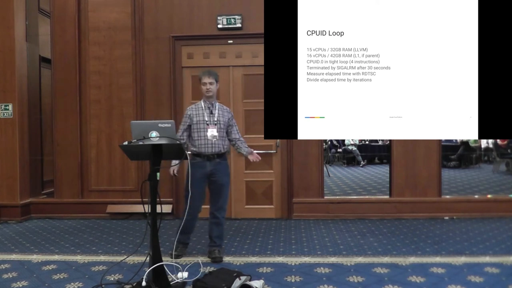
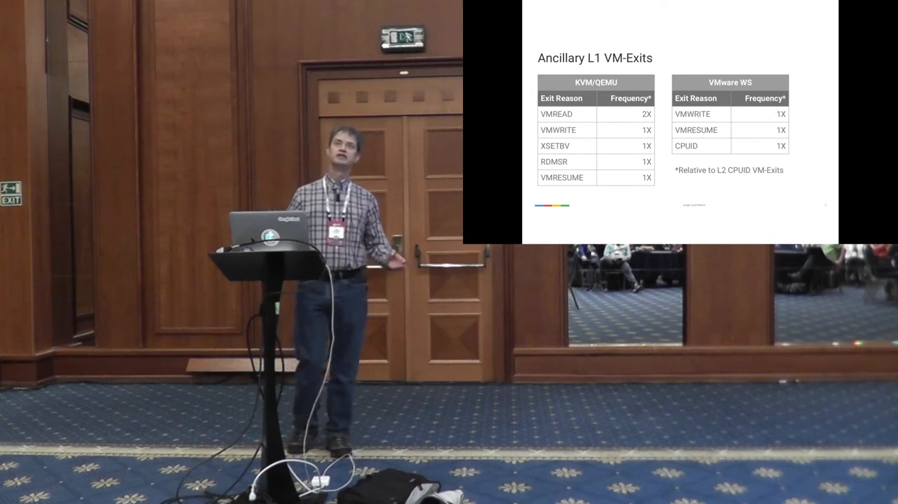
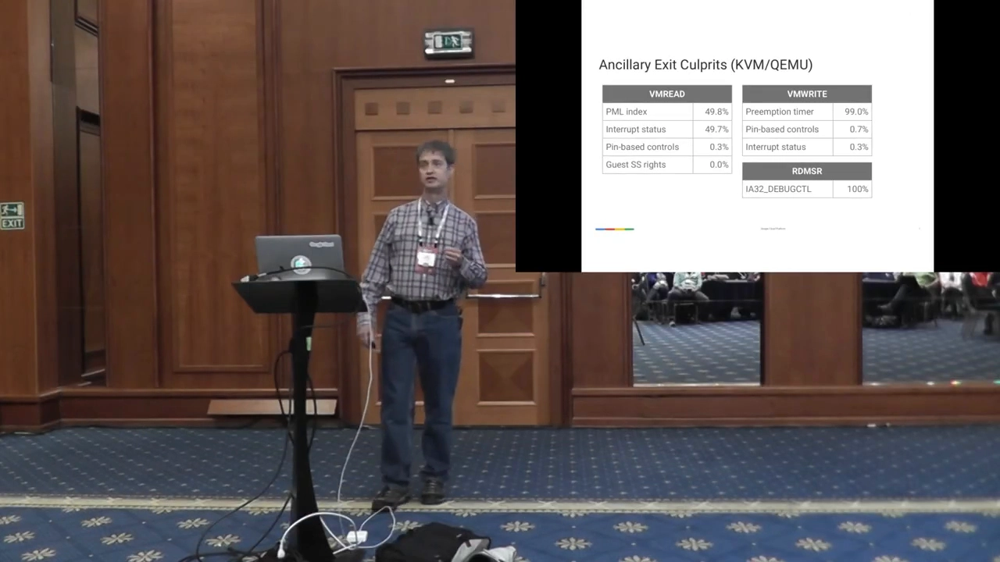
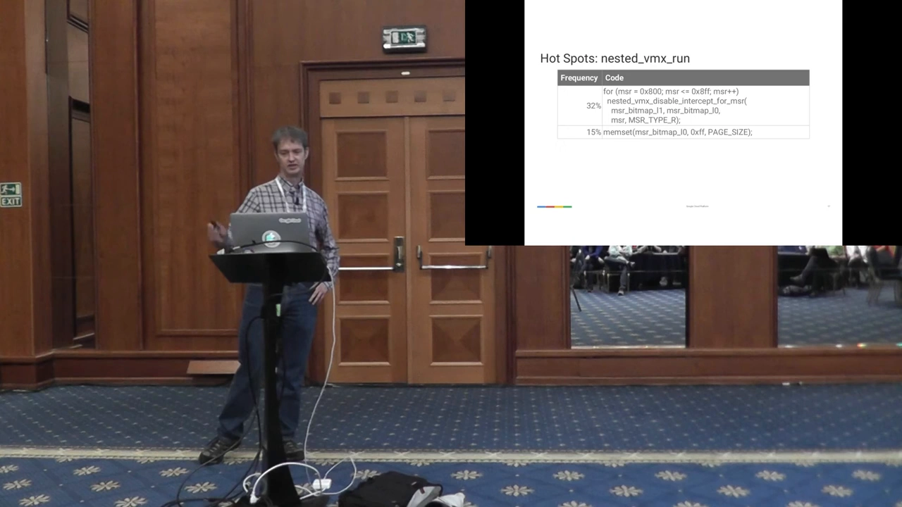
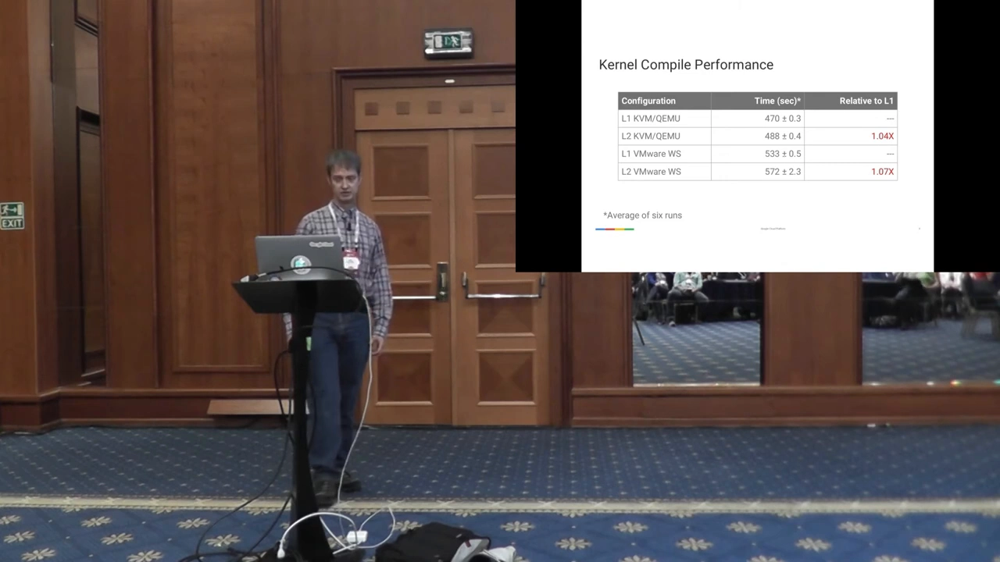
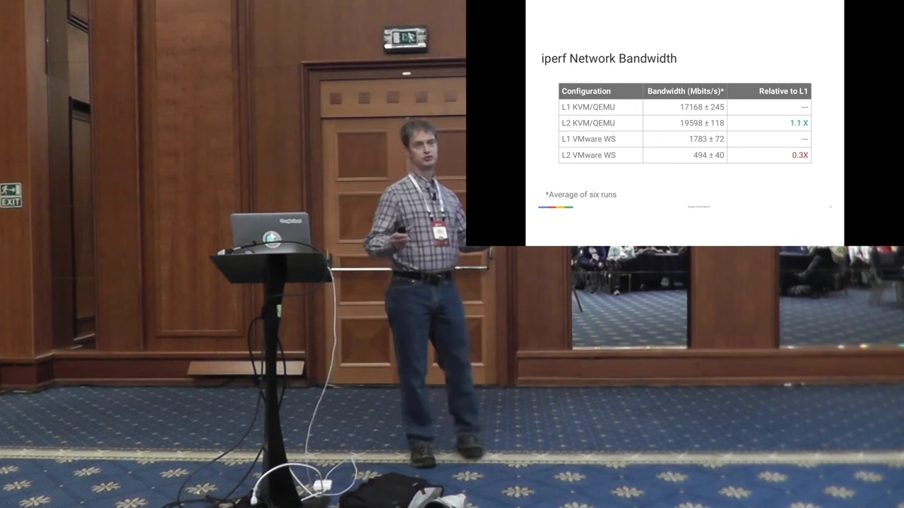
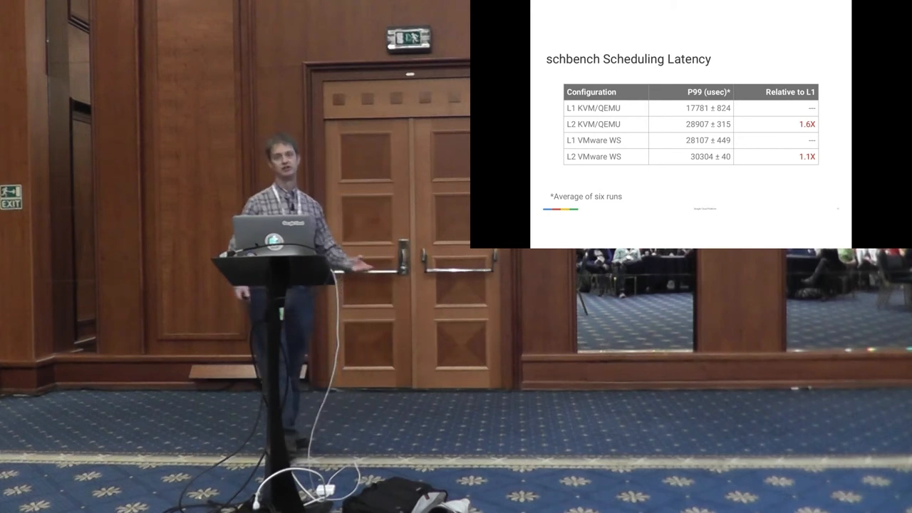
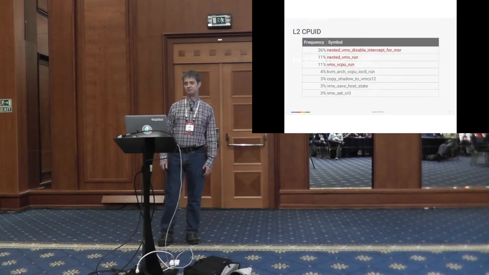
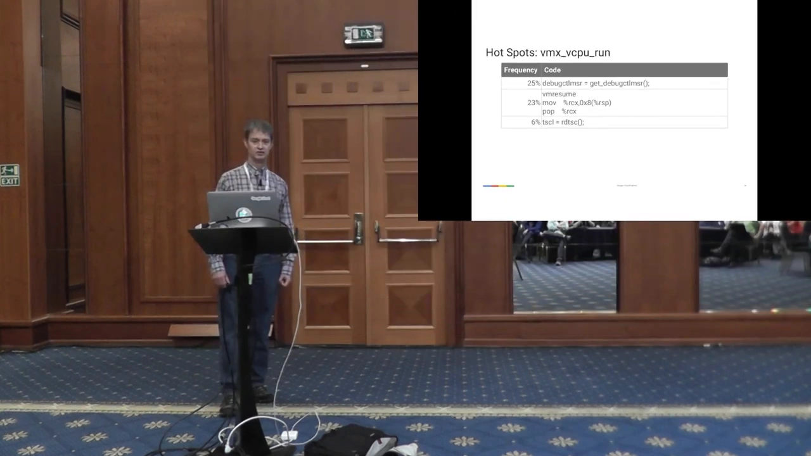
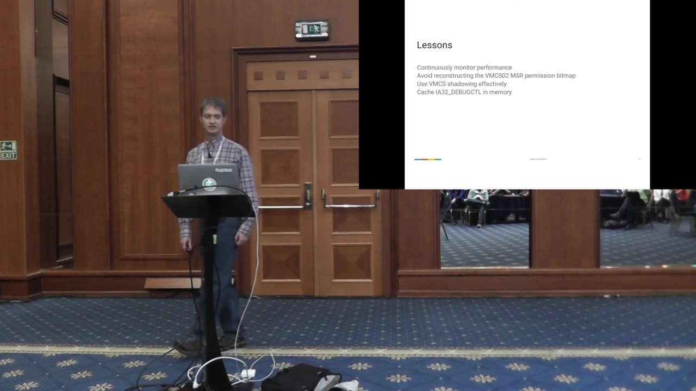

# 嵌套 KVM 慢在哪：一次 CPUID 放大成六次 VM exit

> 视频来源：[Where Does the Time Go? Profiling Nested KVM on x86/Intel](https://www.youtube.com/watch?v=PxDHNfrpwHE)（YouTube · KVM Forum 2017 · 讲者 Jim Mattson，Google）｜时长约 28 分钟
> 导读：这是一场纯性能剖析的分享。讲者不讲嵌套虚拟化"怎么实现"，而是拿 perf 去问一个更实用的问题：**多出来的时间到底花在哪个函数上**。文中所有数字都是 2017 年在 Broadwell 机器 + Linux 4.13/4.14 + QEMU 2.10 上测出来的，属于"讲者给出的实测值"，不是今天的绝对值；但开销的**结构**至今没变。

## 本讲要解决的核心问题（SCQA）

**背景**：硬件辅助虚拟化（Intel VT-x）让一台虚拟机跑起来已经很快，KVM 里的客户机做一次特权操作才会陷入一次 VM exit，代价可以接受。

**冲突**：一旦在客户机里再跑一个 hypervisor（L1），再由它跑客户机（L2），同样的操作就要多穿一层。业界都知道"嵌套很慢"，但没人说得清慢在哪——过去这些年，社区把精力都花在把功能做对上。

**疑问**：嵌套到底把时间花到哪去了？是硬件天生如此，还是软件还有得救？哪些负载受害最深？

**回答（中心思想）**：嵌套的开销**不是"多了一层"这个抽象概念，而是"一次 L2 的退出在 L1 里被放大成好几次退出"**。讲者测到的放大是 6 倍：L2 每做一次 CPUID 退出，在 L1 层会看到 2 次 VMREAD、1 次 VMWRITE、1 次 XSETBV、1 次 RDMSR，再加上那一次省不掉的 VMRESUME。这些额外退出几乎都是**软件可以省掉的**，所以"嵌套慢"在很大程度上是一个待修的 bug，而不是物理定律。

## 一、先看结论：开销集中在"退出放大"，而不是"多一层"

嵌套虚拟化里，L0 是物理宿主上的 hypervisor，L1 是客户机里的 hypervisor，L2 是嵌套客户机。术语本身不难，难的是想清楚一次操作要穿几层。

讲者的做法很直接：**先造一个最坏情况的微基准**，把放大效应放到最大，再逐个函数看时间花在哪。这个微基准就是"在一个循环里执行 CPUID"——循环体只有四条指令，跑 30 秒，用 alarm 信号终止，最后算每次迭代的周期数 [【跳转到 04:02】](https://www.youtube.com/watch?v=PxDHNfrpwHE&t=242)。

为什么要用 CPUID？因为 CPUID 是典型的"必须陷入"的指令：客户机想知道 CPU 支持什么特性，只能问 hypervisor，而 hypervisor 又要问更下面一层。它天然把"退出放大"暴露得最彻底。

### 1.1 一次 L2 的 CPUID，在 L1 里变成六次退出

讲者把 L1 因为"处理 L2 转上来的退出"而自己产生的退出，称为**附带 L1 VM exit（ancillary L1 VM exits）**。他用退出原因分类统计了一次 L2 CPUID 退出所引发的全部附带退出 [【跳转到 06:36】](https://www.youtube.com/watch?v=PxDHNfrpwHE&t=396)：

| 退出原因 | KVM/QEMU 上每次 L2 CPUID 触发的次数 | VMware Workstation 上的次数 |
| --- | --- | --- |
| VMREAD | 2 | 0 |
| VMWRITE | 1 | 1 |
| XSETBV | 1 | 0 |
| RDMSR | 1 | 0 |
| CPUID | 0 | 1 |
| VMRESUME | 1 | 1 |

（表中"次数"是相对一次 L2 CPUID 退出的频率，讲者用"2X/1X"这样的相对值表示。）

读这张表要抓住两点：

1. **VMRESUME 那一次是省不掉的。**L1 处理完退出总要回到 L2 的执行上下文，这就是一次 VM entry，属于"硬件做一次 VM entry 必须付的代价" [【跳转到 07:24】](https://www.youtube.com/watch?v=PxDHNfrpwHE&t=444)。
2. **其余五次都是软件行为。**VMREAD/VMWRITE 是 L1 在读写 VMCS（虚拟机控制结构，存客户机与宿主 CPU 状态的数据结构），XSETBV 是在给 L2 设置 xcr0，RDMSR 是在读一个 MSR 寄存器。这些都不该由“L2 执行了一条 CPUID”来触发。VMware 那边则是把 CPUID 又往上转了一次，所以它多了一次 CPUID 退出、少了那些字段访问。

这就是"放大"的具体含义：**L2 一条指令 → L0 一次退出 → L1 里六次退出**。微基准之所以能把差距拉到 25 倍，就是因为它把这条放大链跑到了极限。

## 二、三类可以省掉的开销

把上面五次附带退出拆开，能归成三类，每一类都有明确的软件原因。

### 2.1 VMCS shadowing 本该免掉 VMREAD/VMWRITE，但字段清单没跟上

Intel 从 Haswell 起提供 **VMCS shadowing**：L0 可以为 L1 再定义一份"影子 VMCS"，让 L1 直接对这份结构做 VMREAD/VMWRITE 而**不引发 VM exit** [【跳转到 08:39】](https://www.youtube.com/watch?v=PxDHNfrpwHE&t=519)。

既然硬件支持，为什么还在退出？因为 L0 手里有一份"允许 L1 直接读写的字段清单"，而 L1 频繁访问的一些字段**不在清单上**。统计下来，绝大多数 VMREAD 集中在两个字段上：PML index 和 interrupt status [【跳转到 09:22】](https://www.youtube.com/watch?v=PxDHNfrpwHE&t=562)。VMWRITE 那边则是每次往返都写一次 VMX preemption timer，这个字段同样不在清单上。

讲者对这份清单的批评很直接：清单是很多年前生成的，后来不断有新特性加进来，却没人盯着它该跟着改 [【跳转到 10:30】](https://www.youtube.com/watch?v=PxDHNfrpwHE&t=630)。这是一个典型的"性能债"：功能都对，但每次访问都在多付一次退出。

### 2.2 每次嵌套退出都去读一个恒为 0 的 MSR

RDMSR 那一项最让人无语：每次处理嵌套 VM exit，KVM 都会读一次 `IA32_DEBUGCTL`，而讲者说在他的机器上这个值 100% 的时候都是 0 [【跳转到 10:12】](https://www.youtube.com/watch?v=PxDHNfrpwHE&t=612)。

读 MSR 是硬件操作，比读内存慢得多。既然内核自己设置过这个 MSR，它完全可以记住自己写了什么，直接从内存取值——这正是讲者最后一条建议 [【跳转到 24:08】](https://www.youtube.com/watch?v=PxDHNfrpwHE&t=1448)。

### 2.3 每次进入 L2 都重建一遍 MSR 权限位图

还有一类开销不在"退出"里，而在"进入"里。L0 对"哪些 MSR 愿意透传给自己的虚拟机"有一套策略，L1 对"哪些 MSR 愿意透传给它的虚拟机"也有自己的一套；要让 L0 跑 L2，必须取两套权限的**交集**。

KVM 的做法是：先把 4KB 的位图 memset 成"一个都不允许"，再遍历 256 个 x2APIC 寄存器逐个放行 [【跳转到 21:24】](https://www.youtube.com/watch?v=PxDHNfrpwHE&t=1284)。讲者的意见是：这张位图基本是常量，0x000–0x1FF 里绝大多数永远一样，剩下 96 个可以按 64 位批量处理，能快六倍 [【跳转到 23:18】](https://www.youtube.com/watch?v=PxDHNfrpwHE&t=1398)。

## 三、量化：CPU 密集只掉几个点，调度延迟掉 60%

微基准是最坏情况，不能拿来判断"我的业务能不能用"。讲者因此又跑了三个宏基准，结论差别很大 [【跳转到 10:55】](https://www.youtube.com/watch?v=PxDHNfrpwHE&t=655)。

### 3.1 CPU 密集型：内核编译只慢 4%

测试方法是：在最底层虚拟机里拿 80% 内存做 ramdisk，把编译内核要用的文件放上去，然后计时编译内核和所有模块 [【跳转到 11:25】](https://www.youtube.com/watch?v=PxDHNfrpwHE&t=685)。

| 配置 | 耗时（秒） | 相对 L1 |
| --- | --- | --- |
| L1 KVM/QEMU | 470 ± 0.3 | — |
| L2 KVM/QEMU | 488 ± 0.4 | 1.04X |
| L1 VMware WS | 533 ± 5 | — |
| L2 VMware WS | 572 ± 2.3 | 1.07X |

讲者的解释是：这主要是 CPU 密集型基准，VM exit 大概不多，所以嵌套在这个方向上表现很好 [【跳转到 11:50】](https://www.youtube.com/watch?v=PxDHNfrpwHE&t=710)。**这条结论对选型最重要**：如果你的负载是编译、渲染、数值计算这类"进去了就一直在算"的活，嵌套的代价可以小到 4%。

### 3.2 网络带宽：嵌套反而快了 10%

第二个基准是 iperf，两台 L2 虚拟机各 7 vCPU / 16GB，网络直接接在两台 L2 之间，不涉及任何硬件网络，完全是软件网络 [【跳转到 14:05】](https://www.youtube.com/watch?v=PxDHNfrpwHE&t=845)。

| 配置 | 带宽（Mb/s） | 相对 L1 |
| --- | --- | --- |
| L1 KVM/QEMU | 17168 ± 245 | — |
| L2 KVM/QEMU | 19598 ± 118 | 1.1X |
| L1 VMware WS | 1783 ± 72 | — |
| L2 VMware WS | 494 ± 40 | 0.3X |

嵌套**更快**，讲者说他至今解释不了 [【跳转到 14:30】](https://www.youtube.com/watch?v=PxDHNfrpwHE&t=870)。会后问答里给出了一个可能的机制：带宽测试是单向推流量，绝对性能更低的平台相对线速更慢，单位时间收到的中断更少，每次中断能缓冲更多数据，于是吞吐反而上去了 [【跳转到 25:28】](https://www.youtube.com/watch?v=PxDHNfrpwHE&t=1528)。

这个例子提醒我们：**嵌套的开销不是单调的**。凡是"退出次数"和"中断次数"主导的负载，嵌套的影响可能被其他效应掩盖，甚至反向。

### 3.3 调度延迟：P99 慢了 60%，这才是真实业务的最坏情况

第三个基准是 schbench，本质上测的是调度延迟（消息传递型负载的唤醒延迟）[【跳转到 15:31】](https://www.youtube.com/watch?v=PxDHNfrpwHE&t=931)。

| 配置 | P99 延迟（微秒） | 相对 L1 |
| --- | --- | --- |
| L1 KVM/QEMU | 17781 ± 824 | — |
| L2 KVM/QEMU | 28907 ± 315 | 1.6X |
| L1 VMware WS | 28107 ± 449 | — |
| L2 VMware WS | 30304 ± 40 | 1.1X |

讲者的判断是：对真实世界的负载来说，这大概就是嵌套最糟的情况了——性能掉 60%，也就是慢了 1.6 倍 [【跳转到 16:21】](https://www.youtube.com/watch?v=PxDHNfrpwHE&t=981)。

### 3.4 三张表合起来看

| 负载类型 | 代表基准 | L2 相对 L1 的变化 | 原因 |
| --- | --- | --- | --- |
| 极端退出密集 | CPUID 循环 | 慢 25 倍 | 退出放大被放到最大 |
| CPU 密集 | 内核编译 | 慢 4% | 退出少，几乎不受影响 |
| 单向带宽 | iperf | 快 10% | 中断合并效应盖过了退出开销 |
| 延迟敏感 | schbench P99 | 慢 60% | 每次唤醒都要穿两层，延迟被放大 |

**这张表就是"嵌套能不能用"的判据**：看你的负载属于哪一行。CPU 密集可以放心用；延迟敏感的消息传递型负载（数据库、RPC、实时服务）是重灾区。

## 四、perf 说时间花在哪几个函数上

知道"慢"还不够，讲者用 perf 把热点函数抓了出来 [【跳转到 16:53】](https://www.youtube.com/watch?v=PxDHNfrpwHE&t=1013)。

### 4.1 三个常驻热点

在 CPUID 基准上，热点排序是 [【跳转到 17:23】](https://www.youtube.com/watch?v=PxDHNfrpwHE&t=1043)：

- `nested_vmx_disable_intercept_for_msr` 26%
- `nested_vmx_run` 11%（负责模拟 L1 到 L2 的 VM entry）
- `vmx_vcpu_run` 11%（真正执行 L0 到 L1/L2 的 VM entry）
- `copy_shadow_to_vmcs12` 3%（把状态从 shadow VMCS 拷回去）

`nested_vmx_run` 和 `vmx_vcpu_run` 在每个基准里都出现，属于"普遍重要"的热点；而 `nested_vmx_disable_intercept_for_msr` 排第一，正好对应前面说的"MSR 权限位图重建"。

### 4.2 内核编译里的意外热点

在内核编译基准上，讲者看到一个让他意外的名字：queued spinlock 慢路径排得很靠前 [【跳转到 19:04】](https://www.youtube.com/watch?v=PxDHNfrpwHE&t=1144)。他的判断是不用太担心——**如果你在自旋等锁，说明你本来也没活干**，它排前面不影响整体。

另一个轻微上浮的是 read TSC：几乎每次嵌套 VM entry 都要读一次时间戳计数器，讲者认为这里省不出多少 [【跳转到 19:29】](https://www.youtube.com/watch?v=PxDHNfrpwHE&t=1169)。

### 4.3 perf annotate 落到具体几行代码

最后讲者用 `perf annotate` 打开函数看具体指令 [【跳转到 20:04】](https://www.youtube.com/watch?v=PxDHNfrpwHE&t=1204)：

- 代码行 `debugctlmsr` 的赋值（读 debugctl MSR）占 25%——就是前面那个"恒为 0 的 MSR"；
- `vmresume` 指令本身占 23%——这是硬件做一次 VM entry 的固定成本，省不掉；
- `rdtsc` 占 6%。

这张图把"哪些是硬件的钱、哪些是软件的钱"分得很清楚：**23% 是硬成本，25% 是纯浪费**。

## 五、讲者留下的四条经验，其实是给所有用嵌套的人的清单

讲者在结尾给了四条建议 [【跳转到 22:48】](https://www.youtube.com/watch?v=PxDHNfrpwHE&t=1368)：

1. **持续监控性能。**这些 VMREAD/VMWRITE 退出是在不断加新特性、却没更新 VMCS shadowing 清单的过程中悄悄混进来的，本不该发生。
2. **别反复重建 MSR 权限位图。**4KB memset 加 256 次循环，改成批量处理能快六倍。
3. **真正用好 VMCS shadowing。**否则硬件给了能力也用不上。
4. **把 `IA32_DEBUGCTL` 缓存在内存里。**别每次都去读硬件。

对使用者来说，这四条可以翻译成一句话：**嵌套的开销有很大一部分是软件实现质量决定的，所以它会随内核版本变化**。同一个负载，在不同内核上测出来的嵌套损耗可能差很多——这也是为什么"网上说嵌套慢 60%"这类说法必须结合版本看。

## 六、判断：什么场景值得用嵌套

把上面的数字和机制合起来，可以给出一个不依赖具体版本的判断框架。

**值得用的场景**（共同点：要么退出少，要么延迟不敏感）：

- **CI 里跑 KVM 相关测试。**测试要验证的是功能正确性，跑得慢一点无所谓，而"能在云主机里拿到 KVM"这件事本身价值很大。
- **开发者在云主机里搭实验环境。**想要一台自己的 hypervisor、在上面开几台不同发行版的机器，比向云厂商申请三台不同系统的实例更灵活。
- **教学与演示。**整套虚拟化环境可以塞进一台虚拟机里演示。
- **CPU 密集型的批处理。**按内核编译那组数字，只慢 4%。

**不该用的场景**（共同点：延迟敏感或需要硬件直通）：

- **生产数据库、低延迟网络服务。**schbench 那 60% 就是这类负载的形状——每次唤醒都要穿两层。
- **依赖 SR-IOV / 设备直通的负载。**嵌套下直通链路更长，且这类负载通常对延迟极敏感。
- **需要稳定可预期的场景。**嵌套本身在很多发行版里仍是实验性能力，默认不开。

**替代方案**：如果确实需要虚拟化能力又受不了这个代价，裸金属实例是直接答案——它把 L0 这一层去掉，L1 直接跑在硬件上。讲者也提到，社区当时在推进"虚拟化 VMCS shadowing"，目的就是让 shadow 能力可以往下延伸到 L1 以下，从而支持更深的嵌套 [【跳转到 26:18】](https://www.youtube.com/watch?v=PxDHNfrpwHE&t=1578)。

## 小结

- 嵌套的开销不是"多了一层"这个抽象代价，而是**一次 L2 退出在 L1 里被放大成多次退出**；讲者测到的放大是 6 倍（1 次 VMRESUME + 2 次 VMREAD + 1 次 VMWRITE + 1 次 XSETBV + 1 次 RDMSR）。
- 微基准 CPUID 上，L2 比 L1 慢 25 倍（VMware Workstation 是 11 倍），差距主要来自软件产生的附带退出。
- 换到真实负载，代价差别巨大：内核编译只慢 4%，iperf 带宽反而快 10%，schbench P99 延迟慢 60%。
- perf 显示热点集中在三处：MSR 权限位图重建、嵌套 entry 路径、每次退出都读 `IA32_DEBUGCTL`。
- 其中 `vmresume` 那 23% 是硬件硬成本，其余大部分是软件可以省掉的钱——所以嵌套损耗会随内核版本显著变化。
- 选型判据：CPU 密集、对延迟不敏感的批处理与测试环境可以用；延迟敏感的服务与需要设备直通的负载应该上裸金属。

## 关键术语速查

| 术语 | 一句话解释 |
| --- | --- |
| L0 / L1 / L2 | 物理宿主上的 hypervisor / 客户机里的 hypervisor / 嵌套客户机 |
| VM exit | 客户机执行特权操作时把控制权交回 hypervisor 的那次陷入 |
| VM entry | hypervisor 处理完后把控制权交回客户机，硬件要付出固定成本 |
| 附带 L1 VM exit | L1 为了处理 L2 转上来的退出而自己额外产生的退出，是嵌套放大的来源 |
| VMCS | 虚拟机控制结构，存放客户机与宿主的 CPU 状态 |
| VMCS shadowing | Intel 的硬件能力，让 L1 直接读写影子 VMCS 而不引发退出 |
| 嵌套 EPT | 把扩展页表能力暴露给 L1，避免它退回影子页表 |
| schbench | 测调度延迟（消息传递唤醒延迟）的基准，看 P99 分位 |