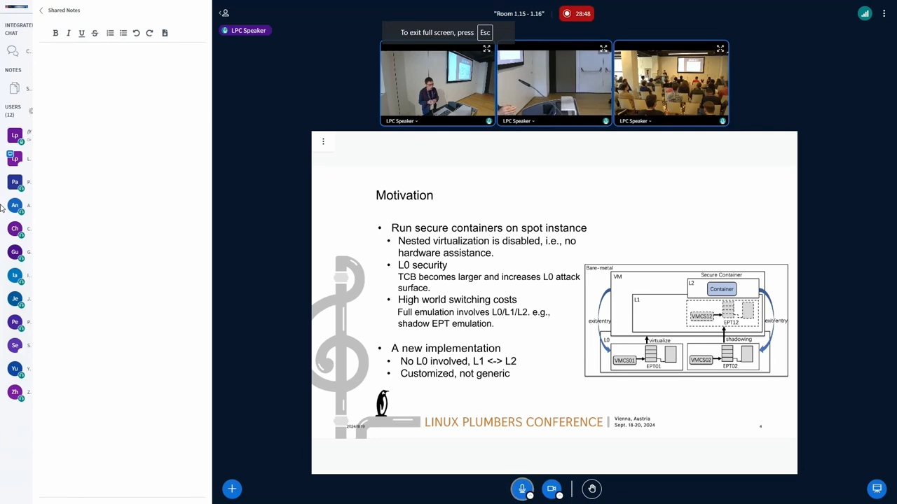
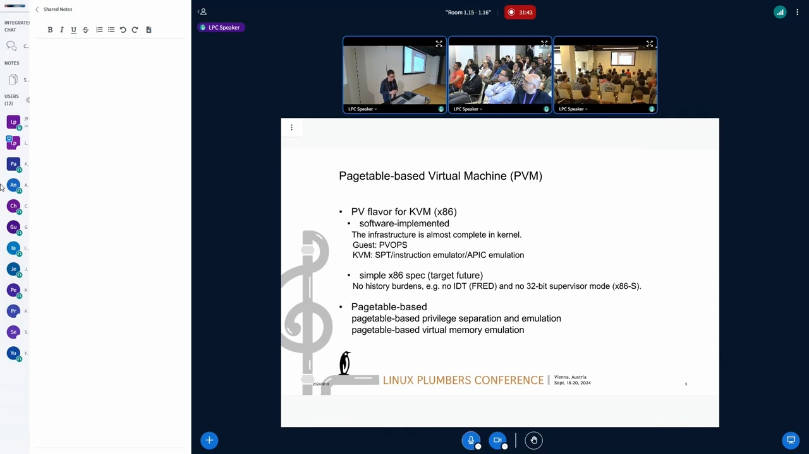
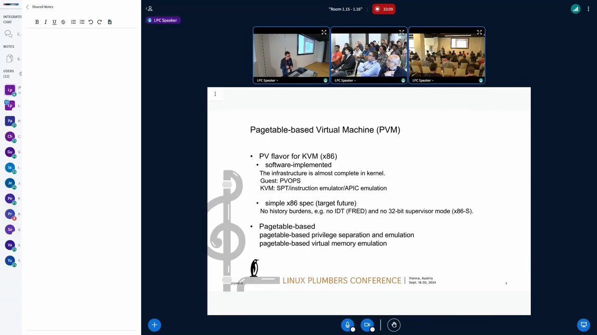
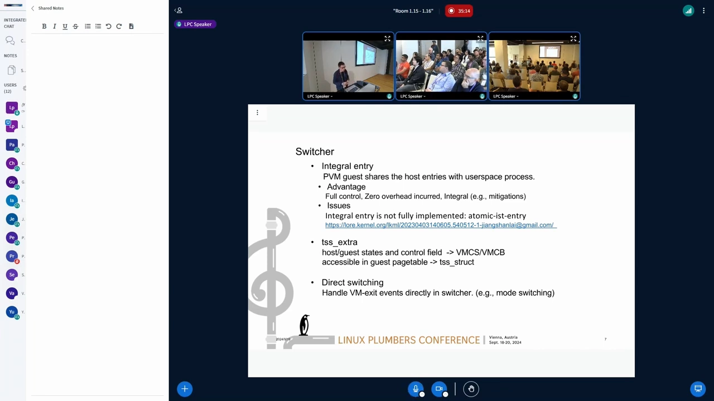
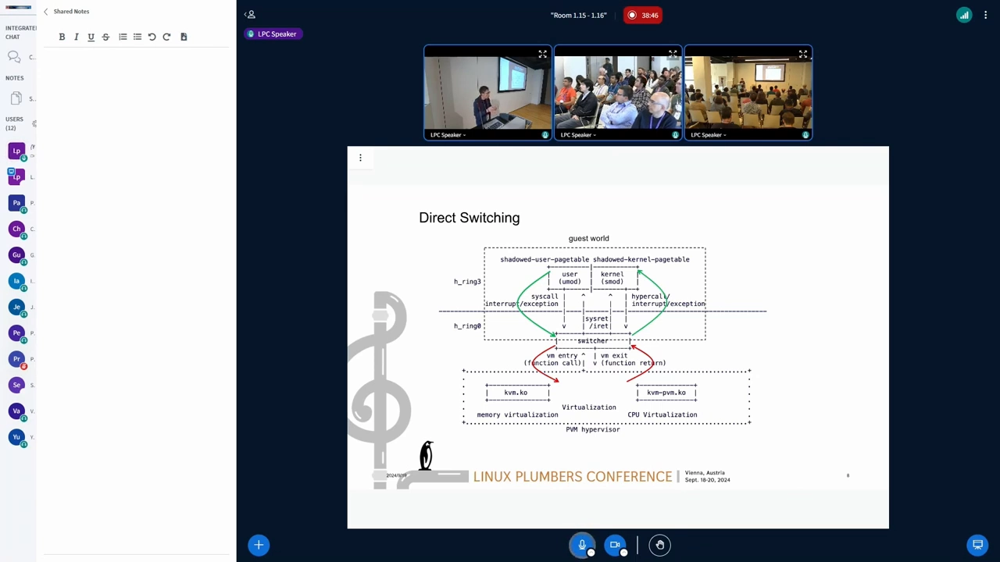
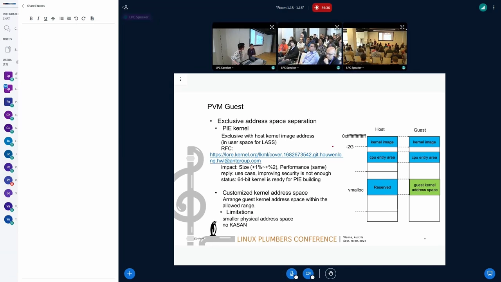
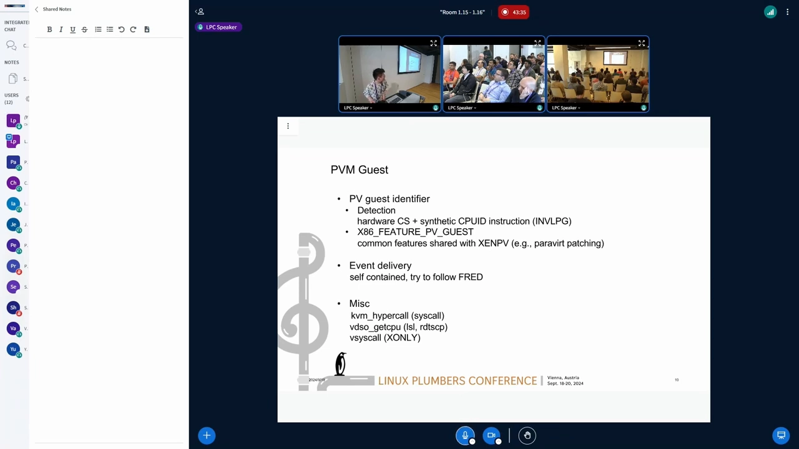
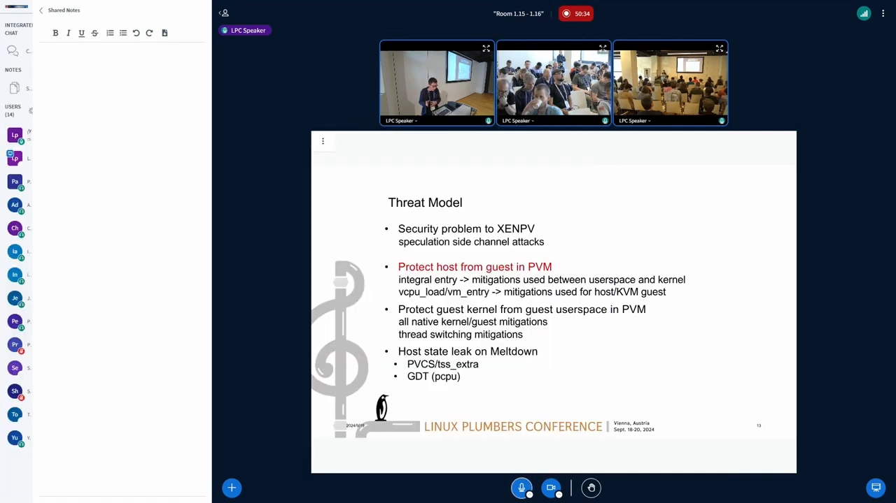
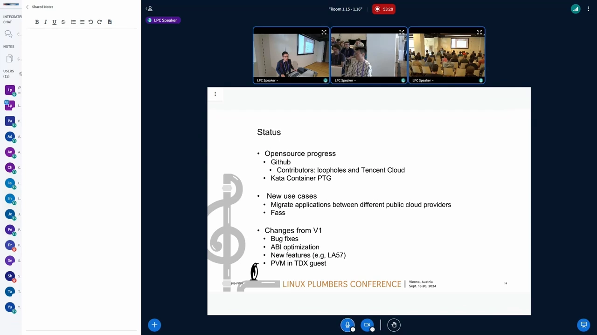

# PVM：把客户机内核降到 ring 3，没有 VMX 的云主机也能跑 KVM

> 视频来源：[Pagetable-based Virtual Machine (PVM) as a PV flavor for KVM](https://www.youtube.com/watch?v=YrEq-o16yiw)（YouTube · Linux Plumbers Conference 2024 · KVM 微型会议 · 讲者 Liang Shan、Wanlong Hou，蚂蚁集团）｜时长约 32 分钟
> 导读：这是一场设计说明会，不是使用教程。讲者先解释"为什么云上跑不了安全容器"，再讲 PVM 怎么用页表把客户机内核关进 ring 3，最后被听众追问出一堆限制（CPUID、侧信道、地址空间）。本文按"问题 → 思路 → 架构 → 客户机改动 → 限制"的顺序重排了讲者的内容，机制部分配了幻灯片，争议部分保留了现场问答。

## 本讲要解决的核心问题（SCQA）

**背景**：安全容器（Kata Containers）的本质是"一台轻量虚拟机"——容器跑在 VM 里，靠 hypervisor 拿到比 namespace 更强的隔离。讲者的团队（蚂蚁集团）就用 Kata 跑自己的服务。

**冲突**：业务量会波动，不可能一直用裸金属，有时必须把负载弹性扩到公有云的普通 VM 里。但**大多数云 hypervisor 并不支持嵌套虚拟化**，也就是客户机里拿不到 VMX，`/dev/kvm` 用不了，Kata 的 VM 起不来。

**疑问**：在没有硬件虚拟化、也没有嵌套虚拟化的机器上，还能不能跑 KVM？

**回答（中心思想）**：能，但换了一条路。PVM（Pagetable-based Virtual Machine）**不去模拟 VMX，而是让 VMX 变得不必要**——它把客户机内核从 ring 0 降到 ring 3，用页表做特权级隔离，让 KVM 多出一个纯软件的 flavor。代价是：客户机内核必须打补丁（PIE 内核、定制地址空间），一部分硬件隔离语义会失效，而且它明确不是通用 hypervisor，只为多租户安全容器这类场景设计。

## 一、问题：云上要跑安全容器，偏偏没有嵌套虚拟化

### 1.1 从 runV 到 Kata：安全容器本质是"一台 VM"

讲者先补了一段历史：2015 年他加入一家叫 Hyper 的创业公司，产品叫 runV，做的是"用虚拟化来跑容器"——和 runC 做同一件事，只是底下换成 KVM [【跳转到 03:20】](https://www.youtube.com/watch?v=YrEq-o16yiw&t=200)。一两年后，Hyper 和 Intel 把工作合并，runV 与 clear container 合成 **Kata Containers**，也就是今天的 Kata [【跳转到 04:04】](https://www.youtube.com/watch?v=YrEq-o16yiw&t=244)。

这里有个关键前提值得先讲清楚：**Kata 的隔离来自 hypervisor，而不是来自内核的 namespace**。所以"在云上跑 Kata"等价于"在云主机里再跑一层 KVM"——这正好是嵌套虚拟化的活儿。

### 1.2 云厂商为什么关掉嵌套：TCB、攻击面、切换代价

讲者把云厂商的理由总结成三条，都在同一页幻灯片上 [【跳转到 05:21】](https://www.youtube.com/watch?v=YrEq-o16yiw&t=321)：

1. **抬高 L0 的 TCB**。TCB 是"可信计算基"（Trusted Computing Base），指安全所依赖的全部代码。支持嵌套，就意味着宿主 hypervisor 要多管一层 VMCS、多模拟一层 EPT，代码量和对未知 bug 的暴露面都变大 [【跳转到 05:46】](https://www.youtube.com/watch?v=YrEq-o16yiw&t=346)。
2. **扩大攻击面**。多一层可被客户机触发的模拟路径，就多一批可被利用的接口。
3. **切换代价高**。嵌套下 L1 到 L2 的切换本来就很贵；而 KVM 里 vCPU 常被大幅超分，调度更频繁，切换次数还会被放大 [【跳转到 06:12】](https://www.youtube.com/watch?v=YrEq-o16yiw&t=372)。

第 3 条值得展开，因为它决定了 PVM 的设计目标：

> 有嵌套虚拟化时，L1 必须先陷入 L0，再切到 L2，中间 L0 还要切换 EPT 和 VMCS。

也就是说，一次 L2 的退出，实际要穿过两层 hypervisor，还要在 L0 里换两套地址翻译结构。讲者还补了一句：嵌套下**影子 EPT 的效率不高，尤其在 VM 冷启动阶段** [【跳转到 07:02】](https://www.youtube.com/watch?v=YrEq-o16yiw&t=422)。

### 1.3 于是目标变成：不牵扯 L0，切换只发生在 L1 与 L2 之间

讲者给新实现定了两条规矩 [【跳转到 07:27】](https://www.youtube.com/watch?v=YrEq-o16yiw&t=447)：

- **不牵扯任何 L0 环境**，所有切换只在 L1 与 L2 之间；
- **为安全容器专门化**，不做通用实现。

第二点很重要，它解释了后面所有的"限制"：这不是一个想取代 VMX 的通用方案，而是一个为特定场景裁剪过的方案。

## 二、思路：不模拟 VMX，而是让 VMX 变得不必要

### 2.1 PVM 是 KVM 的一个新 flavor，纯软件实现

PVM 的定位在幻灯片上写得很直白 [【跳转到 08:03】](https://www.youtube.com/watch?v=YrEq-o16yiw&t=483)：

- 它是 **x86 KVM 的一个 PV flavor**（半虚拟化变体）——地位和 VMX、SVM 平级，而不是跑在它们之上的框架；
- **纯软件实现**，不需要 VT-x/SVM；
- 规范上**不背历史包袱**：不复用 TSS、IDT 这类间接表，因为"它们会带来很多问题"；
- 名字里的"page-table based"来自它的实现方式：**特权级分离与模拟都基于页表，虚拟内存也基于页表** [【跳转到 09:31】](https://www.youtube.com/watch?v=YrEq-o16yiw&t=571)。

### 2.2 内核里现成的零件：PV ops、影子页表、指令模拟、APIC 模拟

为什么这件事不需要重写一个 hypervisor？讲者的回答是"零件都在" [【跳转到 08:16】](https://www.youtube.com/watch?v=YrEq-o16yiw&t=496)：

- 客户机侧有 **PV ops**（半虚拟化操作：把 I/O、中断、时钟这类操作改成调用 hypervisor，而不是直接操作硬件）；
- KVM 侧有 **SPT（影子页表）**、**指令模拟器**、**APIC 模拟器**。

换句话说，Xen PV 那条“半虚拟化客户机”的技术栈，大部分可以直接借来用；PVM 要补的是另一件事：**让一个不在 ring 0 的内核仍能正常工作**——它知道自己没有特权，遇到特权操作就通过 PV ops / hypercall 交给 switcher 和 hypervisor。

### 2.3 一句话讲清：客户机内核不再是 ring 0，而是 ring 3 的"用户态内核"

这是整场演讲最反直觉、也最关键的一点。PVM 客户机**整个跑在硬件 ring 3** [【跳转到 10:32】](https://www.youtube.com/watch?v=YrEq-o16yiw&t=632)：

- 客户机的用户态程序在 ring 3；
- 客户机的**内核**也在 ring 3；
- 两者之间靠**两组页表**隔开：一组"客户机用户态页表"，一组"客户机内核页表"；
- 一旦发生事件、或者要在用户态/内核态之间切换，代码就进入 **switcher**。

这就绕开了 VMX：既然客户机内核根本没有 ring 0 特权，就不需要 VMX 去"把 ring 0 借给它"。特权操作不再靠硬件陷入，而是靠**页表权限 + 显式的调用约定**来拦截。

> 对比一下常见的另一种想象：让客户机里的 KVM 把 `VMXON`/`VMLAUNCH` 转发给宿主执行。PVM 走得更彻底——它**没有 VMX 可转发**，因为客户机内核压根不在 ring 0。这也解释了为什么它必须改客户机内核：ring 3 里的内核不能再用原来的方式碰特权指令。

## 三、架构：switcher、客户机、hypervisor 三层

### 3.1 整体图：vm entry 是函数调用，vm exit 是函数返回

这张图值得逐块读 [【跳转到 09:42】](https://www.youtube.com/watch?v=YrEq-o16yiw&t=582)：

- **下层是 hypervisor**：由 `kvm.ko` 和 `kvm-pvm.ko` 组成，作为 x86 KVM 的一个新 flavor 工作，"就像 VMX 和 SVM 一样"；如果将来支持多 KVM，也能和它们共存 [【跳转到 10:07】](https://www.youtube.com/watch?v=YrEq-o16yiw&t=607)。
- **中间是 switcher**：负责客户机 ↔ hypervisor、以及客户机用户态 ↔ 客户机内核之间的切换。
- **上层是 PVM 客户机**：整个客户机在 ring 3，用两组页表把用户态和内核分开。

图里还有两个箭头名字很关键：**vm entry 被实现成"函数调用"（function call），vm exit 被实现成"函数返回"（function return）**。这跟 VMX 的 `VMLAUNCH`/`VMEXIT` 是两回事——后者要保存/恢复整台机器的状态并切换地址翻译，前者只是一次普通的函数调用。

### 3.2 switcher 为什么放进宿主入口代码

switcher 不是一个独立的内核，它被**集成进内核入口代码**，位置在 x86 Linux 的 CPU entry area [【跳转到 11:47】](https://www.youtube.com/watch?v=YrEq-o16yiw&t=707)。

讲者对比了 Xen PV 和 lguest：那两者的 hypervisor/switcher 有**自己的入口代码**，任何事件都先由它处理，再进入宿主 Linux——宿主内核管不到入口代码 [【跳转到 12:37】](https://www.youtube.com/watch?v=YrEq-o16yiw&t=757)。PVM 反过来，把 switcher 塞进宿主入口代码，换来三个好处：

1. **宿主内核完全掌控 switcher**；
2. **宿主进程路径零开销**：普通宿主进程走入口代码时可以完全绕过 PVM 代码；而在 Xen PV/lguest 里，一切都要先经过 hypervisor，这份开销消不掉 [【跳转到 13:02】](https://www.youtube.com/watch?v=YrEq-o16yiw&t=782)；
3. **缓解措施可以一起设计**：入口代码和 switcher 放在一起，安全缓解（mitigation）能统一考虑 [【跳转到 13:27】](https://www.youtube.com/watch?v=YrEq-o16yiw&t=807)。

代价也写在幻灯片上：这种"integral entry"当时**还没有完全实现**（讲者引用了上游邮件列表里 `atomic-ist-entry` 的讨论）。

### 3.3 tss_extra：128 字节的"VMCS"

VMX 用 VMCS 保存"进入客户机时用什么状态、发生事件时回到哪里"。PVM 需要一个对应的东西，它叫 **`tss_extra`**，因为它嵌在 Linux 内核的软件 TSS 结构里 [【跳转到 14:17】](https://www.youtube.com/watch?v=YrEq-o16yiw&t=857)：

- 里面放**宿主/客户机的状态和控制字段**，作用相当于 VMCS/VMCB；
- 它**只有 128 字节**，小到可以塞进现有结构而不撑大宿主入口代码 [【跳转到 14:42】](https://www.youtube.com/watch?v=YrEq-o16yiw&t=882)。

### 3.4 direct switching：省掉一次往返

客户机用户态调用内核（syscall）时，如果每次都要先经过 switcher 再进客户机内核，就多了一次切换。PVM 设计了**直接切换（direct switching）**：客户机用户态可以直接转换到客户机内核，switcher 只在必要的时候介入 [【跳转到 15:12】](https://www.youtube.com/watch?v=YrEq-o16yiw&t=912)。

讲者的说法是：没有 switcher 时，用户态进内核要"绿灯 + 红灯"两次转换；有了直接切换，只需要绿灯一次。另外，某些 VM-exit 事件（比如模式切换）也可以**直接在 switcher 里处理**，不必回到 hypervisor。

## 四、客户机侧要改什么

讲者把客户机侧的改动分成"自包含"和"不自包含"两类：得益于 Xen PV，**大多数改动是自包含的**（走 PV ops 就够了），真正麻烦的是地址空间和身份识别 [【跳转到 16:09】](https://www.youtube.com/watch?v=YrEq-o16yiw&t=969)。

### 4.1 地址空间：内核镜像必须让位

因为要把 switcher 映射进客户机的共享页表，客户机内核镜像必须从地址空间顶部的 2G 挪开——而传统 x86 内核镜像恰好就放在那里 [【跳转到 16:34】](https://www.youtube.com/watch?v=YrEq-o16yiw&t=994)。

于是需要一个 **PIE（位置无关可执行）内核**：可以放在任意虚拟地址，甚至放到低半区、放到用户空间（如果宿主启用了 Intel LASS 这类线性地址空间隔离）[【跳转到 16:59】](https://www.youtube.com/watch?v=YrEq-o16yiw&t=1019)。讲者说他们去年发了第一版 PIE 补丁集，社区的主要质疑是"只随机化基址，安全收益不够，需要明确用例"——他们希望 PVM 客户机成为 PIE 的第一个用例；目前已有部分补丁合入上游 [【跳转到 17:24】](https://www.youtube.com/watch?v=YrEq-o16yiw&t=1044)。

除了内核镜像，PVM 还要求**宿主内核地址空间与客户机内核地址空间彻底分离**：在宿主内核的 vmalloc 区预留一段地址范围，宿主内核因此可以保留全局数据、减少 TLB flush [【跳转到 17:49】](https://www.youtube.com/watch?v=YrEq-o16yiw&t=1069)。

### 4.2 代价：物理地址空间变小、KASAN 关掉

这种定制直接带来两条限制 [【跳转到 18:48】](https://www.youtube.com/watch?v=YrEq-o16yiw&t=1128)：

- **没有足够空间支撑完整的直接映射区**，所以客户机可用的物理地址空间比正常内核小；
- 预留区里没有 KASAN 需要的空间，**PVM 客户机里 KASAN 无法启用**（KASAN 是内核的内存越界检测工具，调试期很常用）。

### 4.3 身份识别：硬件 CS + 非法页触发的"合成 CPUID"

PVM 客户机同时也是一个 KVM 客户机，用的是同一套 64 位内核入口，所以必须在启动早期探测"我是不是 PVM 客户机" [【跳转到 19:18】](https://www.youtube.com/watch?v=YrEq-o16yiw&t=1158)。

做法分两步：

1. **看硬件 CS**：PVM 客户机跑在 ring 3，CS 的当前特权级能直接暴露这一点；
2. **再取 CPUID**：但不能直接用 `CPUID` 指令——在 ring 3 里，如果没有 CPUID faulting 这个硬件特性，就拿不到正确的客户机 CPUID 信息 [【跳转到 20:08】](https://www.youtube.com/watch?v=YrEq-o16yiw&t=1208)。

他们最后选了**非法页**的方式触发：用一条合成指令（幻灯片上写的是 `INVLPG`）去碰一个特意留成非法的页，让 hypervisor 在陷入时把 CPUID 信息递进来。理由是“非法页几乎在所有 CPU 上都支持，而且在 KVM 里不会被 trap”——他们不想为了取 CPUID 而陷入 L0 [【跳转到 20:33】](https://www.youtube.com/watch?v=YrEq-o16yiw&t=1233)。

### 4.4 其余靠 PV ops 自包含

幻灯片上还列了几项 [【跳转到 22:38】](https://www.youtube.com/watch?v=YrEq-o16yiw&t=1358)：

- **特性位**：复用 `X86_FEATURE_PV_GUEST`，与 Xen PV 共享一部分特性（例如 paravirt patching，即在启动时把内核里的指令替换成 hypercall）；
- **事件投递**：自成一套，尽量跟随 FRED（新的中断/异常投递机制）；
- **杂项**：`kvm_hypercall` 走 syscall，`vdso_getcpu` 用 `lsl`/`rdtscp`，`vsyscall` 只保留 XONLY 模式。

## 五、限制：这套方案换来了什么，又失去了什么

讲者的现场问答比幻灯片更有信息量——限制几乎都是被听众追问出来的。

### 5.1 必须用打过补丁的客户机内核

这是最硬的一条：PIE 内核、定制的地址空间布局、PVM 的入口代码，都要求客户机内核**专门编译**。它不能跑一个未经修改的发行版内核。对使用者的含义是：内核版本要自己跟，补丁要自己维护。

### 5.2 CPUID 与用户态：没改造的程序拿不到"正确的机器"

听众直接问：客户机用户态没有 CPUID faulting，那些没被改造过的程序怎么拿到正确的 CPUID？[【跳转到 20:53】](https://www.youtube.com/watch?v=YrEq-o16yiw&t=1253)

讲者承认：确实有些程序直接用 `CPUID`，**目前他们还没处理用户态应用的 CPUID 问题**。讨论里给出的方向是：内核用合成的 CPUID 指令（走 hypercall/syscall 拿信息），而用户态可以靠 CPUID faulting（让 `CPUID` 触发异常再由内核代答）来兜；有听众指出 AMD 其实也支持这个特性 [【跳转到 22:08】](https://www.youtube.com/watch?v=YrEq-o16yiw&t=1328)。另一位听众补了一句更本质的：**对内核你总归要"撒谎"**——不实现的 MSR 就不虚拟化、不实现的 XCR0 位就不暴露，和普通 KVM 一样；用户态要撒谎的地方少一些，主要是 XSAVE、CR4 里那些位 [【跳转到 23:28】](https://www.youtube.com/watch?v=YrEq-o16yiw&t=1408)。

结论：**PVM 客户机看到的 CPU 特性是裁剪过的**，不是宿主 CPU 的完整能力。

### 5.3 硬件缓解语义变了：ring 3 对 ring 3 的隔离

一位 Xen 开发者提了全场最尖锐的问题：你的客户机内核跑在 CPL3，那么**所有依赖 CPL 标记的硬件缓解措施都不按原样工作**了——ring 3 对 ring 3 的隔离，EIBRS 这类特性失效 [【跳转到 29:36】](https://www.youtube.com/watch?v=YrEq-o16yiw&t=1776)。

唯一的办法是切换时做一次 **IBPB**（间接分支预测器屏障，把预测器状态整体刷掉），"这比较慢"。更要紧的是后半句：**新硬件正在把"ring 3 对 ring 0"这个假设固化进去**，所以这条路"可能只会越来越难走" [【跳转到 30:01】](https://www.youtube.com/watch?v=YrEq-o16yiw&t=1801)。

讲者的回应是回到场景：Kata 里应用的所有者和内核的所有者通常是**同一个租户**，所以不需要全部缓解措施 [【跳转到 30:51】](https://www.youtube.com/watch?v=YrEq-o16yiw&t=1851)。听众的回答也很直接："但这会限制它的适用范围。"这句话其实就是 PVM 的边界：**它的安全性建立在"同租户"假设上，不是通用多租户 hypervisor 的替代品。**

### 5.4 侧信道：威胁模型被拆成两半

讲者把威胁模型拆成两个方向 [【跳转到 25:49】](https://www.youtube.com/watch?v=YrEq-o16yiw&t=1549)：

- **保护宿主不被客户机攻击**：因为 switcher 集成在宿主入口代码里，宿主的所有缓解措施都能作用在 switcher 上；PVM 客户机运行起来"就像一个普通的宿主进程" [【跳转到 26:14】](https://www.youtube.com/watch?v=YrEq-o16yiw&t=1574)。
- **保护客户机内核不被客户机用户态攻击**：同样在 switcher 里实现，宿主内核的缓解措施也应用在这里；其中一部分可以由客户机内核配置——客户机可以选择不做全部缓解 [【跳转到 27:07】](https://www.youtube.com/watch?v=YrEq-o16yiw&t=1627)。
- **Meltdown 下的宿主状态泄漏**：switcher 被映射进客户机页表，如果 CPU 有 Meltdown 问题，客户机在内核态下可能从 switcher 结构里偷到信息（讲者举了 PVCS/`ss_ext`、GDT 的例子），但"这些信息并不敏感" [【跳转到 27:51】](https://www.youtube.com/watch?v=YrEq-o16yiw&t=1671)。

### 5.5 适用场景：多租户安全容器、FaaS、跨云迁移

听众问"相比传统容器，PVM 的主要好处是什么"，讲者的回答把场景钉死了：**主要动机是让我们能在没有硬件辅助的环境里跑安全容器**，把服务弹性扩到云厂商提供的 VM 里 [【跳转到 28:41】](https://www.youtube.com/watch?v=YrEq-o16yiw&t=1721)。

结合限制看，它适合的是：

- 在普通云实例（没有嵌套虚拟化）上跑 Kata/Firecracker 这类安全容器；
- CI、FaaS 这类"要隔离、但能接受额外开销"的负载；
- 需要把同一套安全容器方案在多家云之间搬来搬去的场景。

它不适合：需要完整 CPU 特性透传的负载、需要严格侧信道隔离的强多租户场景、以及不想维护内核补丁的团队。

## 六、现状：RFC 补丁、Kata PTG 与下一步

讲者在结尾展示了现状页（视频最后一段只剩幻灯片与问答，字幕已在 31:16 处结束）[【跳转到 30:01】](https://www.youtube.com/watch?v=YrEq-o16yiw&t=1801)：

- **开源进展**：代码在 GitHub 上，贡献者包括 loopholes 和腾讯云，并在 Kata Containers 的 PTG 上讨论过；
- **新用例**：在不同公有云之间迁移应用、FaaS；
- **相对 V1 的变化**：bug 修复、ABI 优化、新特性（例如 LA57，即五级页表）、以及在 TDX 客户机里跑 PVM。

## 小结

- **PVM 解决的是"云上没有 VMX"**：普通云实例不暴露硬件虚拟化，嵌套虚拟化又被云厂商以 TCB、攻击面、切换代价为由关掉，Kata 这类安全容器就无处落脚。
- **它的做法不是模拟 VMX，而是取消 VMX 的必要性**：客户机内核整体跑在 ring 3，靠页表做特权级隔离，KVM 多出一个纯软件的 PVM flavor（`kvm.ko` + `kvm-pvm.ko`）。
- **switcher 是核心**：它被集成进宿主入口代码，因此宿主进程零开销、缓解措施可统一设计；`tss_extra` 用 128 字节承担 VMCS 的角色；vm entry/exit 就是函数调用/返回。
- **客户机必须打补丁**：PIE 内核把镜像挪出顶部 2G、内核地址空间要挤进宿主预留区，代价是物理地址空间变小、KASAN 关闭。
- **限制来自"ring 3 里的内核"**：CPUID 需要合成指令、用户态程序可能拿不到正确信息、基于 CPL 的硬件缓解失效（只能靠 IBPB 全量刷新），安全性依赖"应用与内核同租户"的假设。
- **定位是专用而非通用**：为多租户安全容器/FaaS 设计，讲者自己说"不做通用实现"。

## 关键术语速查

| 术语 | 一句话解释 |
| --- | --- |
| PVM | Pagetable-based Virtual Machine，KVM 的一个纯软件半虚拟化 flavor，用页表代替 VT-x/SVM 做隔离 |
| PV flavor | 半虚拟化变体：客户机知道自己被虚拟化，主动配合 hypervisor，而不是靠硬件陷入 |
| ring 3 / CPL3 | x86 的最低特权级，平时跑用户态程序；PVM 把客户机内核也放在这一级 |
| switcher | PVM 的切换器，集成在宿主内核入口代码里，负责客户机 ↔ hypervisor、客户机用户态 ↔ 客户机内核的转换 |
| tss_extra | PVM 里对应 VMCS 的 128 字节结构，存放宿主/客户机状态与控制字段 |
| SPT | Shadow Page Table，影子页表：hypervisor 维护一份"客户机页表 + 地址翻译"的合成页表 |
| PV ops | 半虚拟化操作接口，把 I/O、中断、时钟等特权操作改成调用 hypervisor |
| PIE 内核 | 位置无关的内核镜像，可以加载到任意虚拟地址，PVM 用它把内核挪出地址空间顶部 2G |
| TCB | Trusted Computing Base，可信计算基：安全所依赖的全部代码，越大越难保证 |
| IBPB | 间接分支预测器屏障，用于在切换时清空分支预测状态，代价较高 |
| Kata Containers | 用轻量 VM 承载容器、从而拿到 hypervisor 级隔离的容器运行时 |