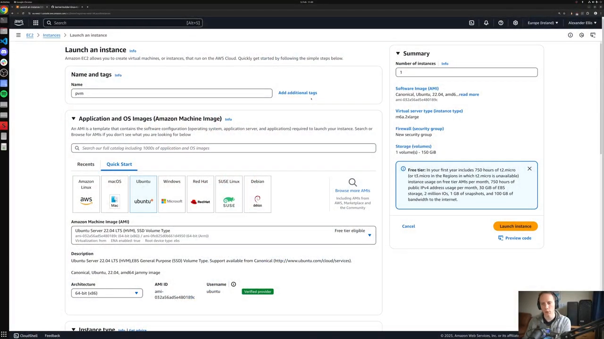
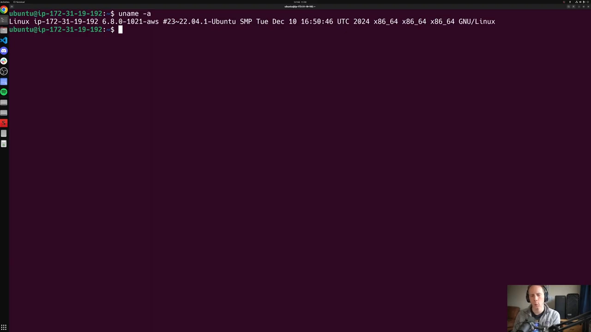
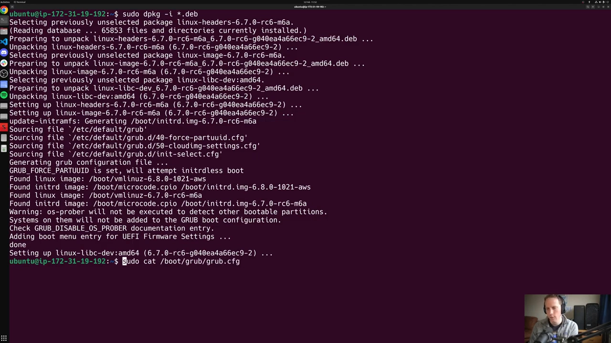
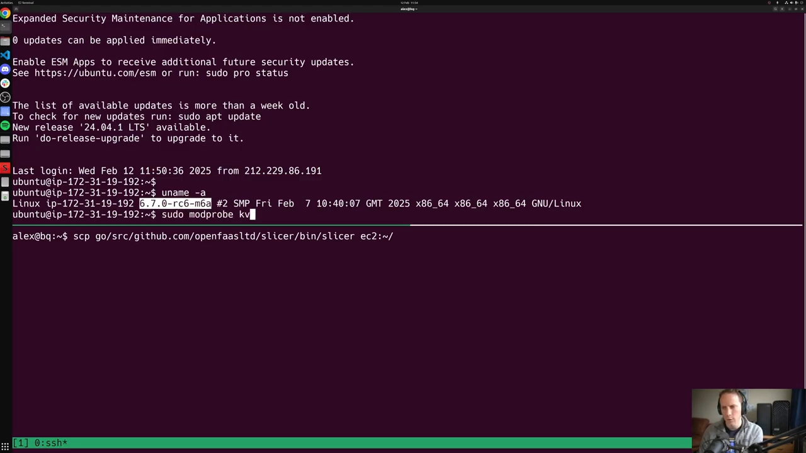
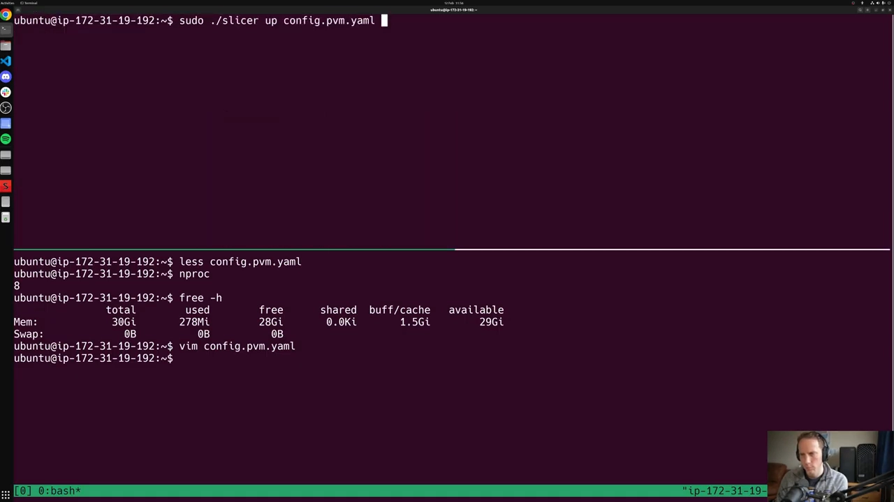
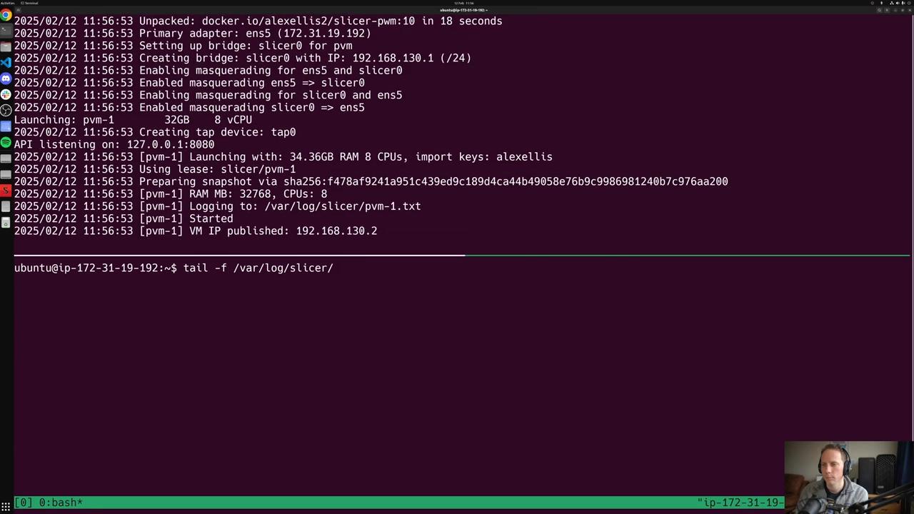
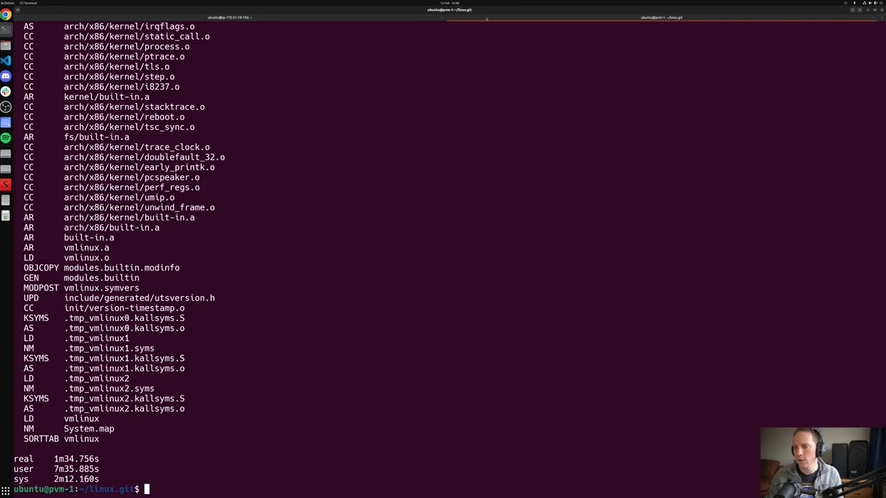
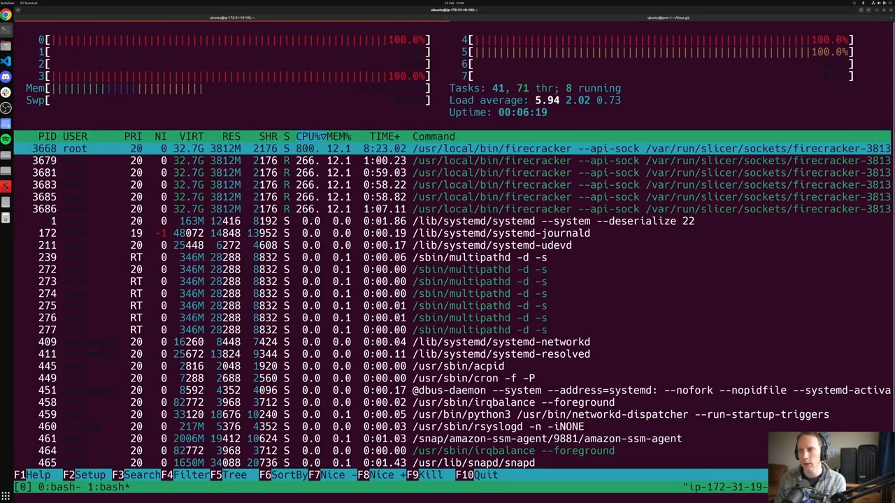
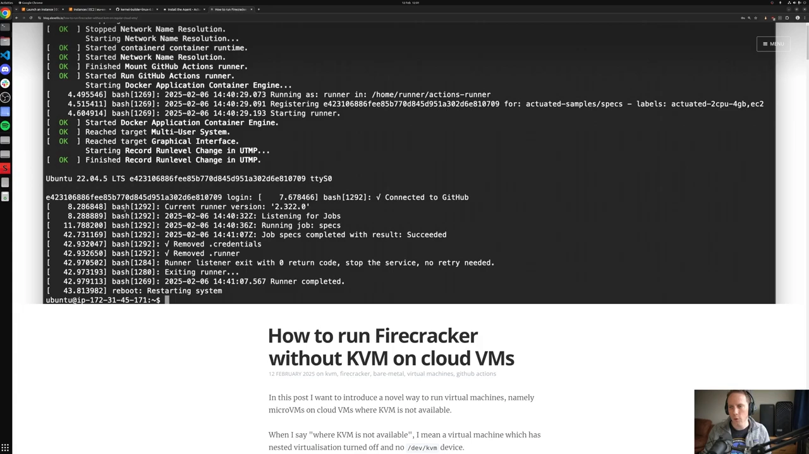

# 在普通 EC2 上跑 Firecracker：PVM 补丁实测

> 视频来源：[Walk-through of Linux KVM PVM with Firecracker on AWS EC2](https://www.youtube.com/watch?v=aUsC1sAoTCg)（YouTube · Alex Ellis，openFaaS）｜时长约 13 分钟
> 导读：这是一次动手演示，不是原理课。作者用阿里云的 PVM 补丁重编译内核，把一台**普通**（非裸金属）EC2 实例变成能跑 Firecracker 的宿主，然后量了一下代价。想先看机制，请读同小节的另一篇《PVM：把客户机内核降到 ring 3，没有 VMX 的云主机也能跑 KVM》。

## 本讲要解决的核心问题（SCQA）

**背景**：Firecracker 这类 microVM 运行时依赖 `/dev/kvm`，也就是依赖硬件虚拟化。平时想用它，要么有自己的裸金属机器，要么云厂商给你开了嵌套虚拟化。

**冲突**：普通云实例两者都没有——没有 VMX，嵌套虚拟化默认关闭。作者在博客里把这种情况说得很清楚：所谓"KVM 不可用"，指的是**一台关掉了嵌套虚拟化、没有 `/dev/kvm` 的虚拟机** [【跳转到 12:32】](https://www.youtube.com/watch?v=aUsC1sAoTCg&t=752)。

**疑问**：不换裸金属，能不能在普通实例里跑起 Firecracker？代价是什么？

**回答（中心思想）**：能。用阿里云的 **PVM 补丁**重编译一个内核、`modprobe kvm_pvm`，普通 EC2 上就能启动 Firecracker，客户机 2 秒起机；代价是**必须换内核**，而且虚拟化开销真实存在——同样编译一个最小内核，PVM 客户机里用 1 分 34 秒，宿主上只要 30 秒到 1 分钟。

## 一、先算账：为什么值得折腾

作者开场的定位很直接：这是"大概两周折腾 PVM 补丁的成果"，这些补丁**由阿里云开发**，作用是"在没有硬件虚拟化的机器上做虚拟化——你在普通云 VM 里，而且嵌套虚拟化也不可用"，实现方式是**靠页表** [【跳转到 00:00】](https://www.youtube.com/watch?v=aUsC1sAoTCg&t=0)。

先看钱。他开的是一台普通实例，不是裸金属 [【跳转到 00:41】](https://www.youtube.com/watch?v=aUsC1sAoTCg&t=41)：



| 形态 | 规格 | 价格（演示当时） |
| --- | --- | --- |
| 普通实例 m6a | 8 vCPU / 32 GB | 每小时 0.7 美元 |
| 同等规格裸金属 | 8 vCPU / 32 GB | 每小时 11 美元 |

差了一个数量级还多。这就是动机：**如果能用普通实例干裸金属的活，弹性扩缩的成本模型完全不同**。

## 二、准备：换内核是这套方案的门票

### 2.1 先确认"原样不行"

实例起来后，`uname -a` 显示的是云厂商自带的内核（6.8.0-1021-aws）[【跳转到 01:53】](https://www.youtube.com/watch?v=aUsC1sAoTCg&t=113)：



这一步是伏笔：PVM 不是装个软件包就能用的东西，它要求**换掉客户机内核**。

### 2.2 拿云上能跑的内核配置当底

作者的做法值得记下来，因为它决定了这套方案能不能在你自己的云上复现 [【跳转到 01:53】](https://www.youtube.com/watch?v=aUsC1sAoTCg&t=113)：

1. 先看 `/boot` 里**云厂商那个能正常工作的内核配置**，把它当基础——"AWS 的 hypervisor 可能需要某些配置项"；
2. 如果你在 Azure 或其他云上，就把原始配置带回本地，**套上 PVM 需要的配置项**，再编译内核；
3. 客户机内核也照这个思路来：基本是"能跑 Firecracker 的最小配置 + PVM 的设置" [【跳转到 02:43】](https://www.youtube.com/watch?v=aUsC1sAoTCg&t=163)。

也就是说，**PVM 的内核配置是"云厂商配置 + PVM 增量"，不是一份通用配置**。这一步没做好，后面很可能起不来。

### 2.3 装包、改 grub、重启

打好的是 Debian 包，直接装到宿主上，会多出一个内核条目 [【跳转到 03:58】](https://www.youtube.com/watch?v=aUsC1sAoTCg&t=238)：



接着在 `/boot/grub/grub.cfg` 里找到 `menuentry`，拼出 "Advanced options" 下那个带版本号的条目，写进 defaults 文件，跑 `grub update`，然后重启 [【跳转到 03:58】](https://www.youtube.com/watch?v=aUsC1sAoTCg&t=238)。

### 2.4 关键一步：modprobe kvm_pvm

重启进新内核后，作者执行了两条命令 [【跳转到 05:12】](https://www.youtube.com/watch?v=aUsC1sAoTCg&t=312)：

```bash
sudo modprobe kvm
sudo modprobe kvm_pvm
```



他的原话是：这样"我们有了 KVM，可以启动一个打过补丁的 hypervisor——**这在普通 EC2 上是从来做不到的**"。这句话就是整个演示的题眼：`kvm_pvm` 是 KVM 的一个新 flavor，加载它之后 `/dev/kvm` 才真正可用，Firecracker 才有东西可调。

## 三、跑起来：2 秒起一台 PVM 客户机

### 3.1 用一个配置起一台长生命周期的 VM

作者用的是自家工具 **slicer**（openFaaS 写的，用于大规模测试：几乎瞬间启动几百台 VM、装大 Kubernetes 集群做测试）[【跳转到 05:37】](https://www.youtube.com/watch?v=aUsC1sAoTCg&t=337)。配置很朴素 [【跳转到 06:43】](https://www.youtube.com/watch?v=aUsC1sAoTCg&t=403)：



- 每台 host 4 vCPU、16 GB 内存、一个静态 IP；
- 预装作者的 GitHub SSH key；
- **使用打过补丁的内核**——这一行是它能跑起来的前提。

实际机器是 8 vCPU / 32 GB，所以他把配置调大了一点，或者干脆起两台 [【跳转到 07:12】](https://www.youtube.com/watch?v=aUsC1sAoTCg&t=432)。

### 3.2 起机只花两秒



镜像解包完之后，VM 几乎瞬间启动；日志里能看到 slicer 目录（放日志）和第一台 VM 的串口控制台 [【跳转到 07:37】](https://www.youtube.com/watch?v=aUsC1sAoTCg&t=457)。作者的原话是"起来了，**两秒**启动，很不错"——这次还稍慢，因为它访问了 GitHub 下载 SSH key 并装进机器 [【跳转到 08:02】](https://www.youtube.com/watch?v=aUsC1sAoTCg&t=482)。

然后他把这台 VM 当跳板机 SSH 进去，确认"我们用的正是打过补丁的内核"，进程和内存也都正常分配 [【跳转到 08:02】](https://www.youtube.com/watch?v=aUsC1sAoTCg&t=482)。

## 四、代价：慢多少，慢在哪

### 4.1 基准：编一个最小内核

为了有个可比的负载，他在客户机里编译 LTS 内核，但配置上"几乎把一切关掉"——目的不是测编译一个庞大内核要多久，而是拿一个**到处都能跑、结果一致**的基准 [【跳转到 09:09】](https://www.youtube.com/watch?v=aUsC1sAoTCg&t=549)。具体做法：

```bash
make allnoconfig      # 几乎最小的空配置
make -j$(nproc)       # 用上 8 个 vCPU
```

### 4.2 结果：1 分 34 秒 vs 30 秒~1 分钟



- **PVM 客户机里**：1 分 34 秒 [【跳转到 11:34】](https://www.youtube.com/watch?v=aUsC1sAoTCg&t=694)；
- **宿主上直接跑**：30 秒到 1 分钟（他在测试中观察到的区间）[【跳转到 09:48】](https://www.youtube.com/watch?v=aUsC1sAoTCg&t=588)。

同时宿主侧的情况很典型：8 个 CPU 全被 Firecracker 打满，内存没有完全用满——"编译内核不怎么吃内存，但会把 CPU 吃满" [【跳转到 11:11】](https://www.youtube.com/watch?v=aUsC1sAoTCg&t=671)。



### 4.3 慢在哪：页表

作者的解释很朴素，但方向是对的 [【跳转到 10:13】](https://www.youtube.com/watch?v=aUsC1sAoTCg&t=613)：

- 如果在裸金属上用 KVM，几乎和宿主一样快，开销极小；
- 而 PVM 这套方案**确实有开销**，因为它是"靠页表"实现的，VM 就跑在页表之上——"这可能就是开销稍大的原因"。

这跟原理那篇对得上：PVM 客户机内核在 ring 3，用户态与内核靠两组页表隔离，特权操作要靠 switcher 转接，没有 VT-x 那种"一条指令进出客户机"的硬件加速。

### 4.4 什么时候感觉不到

作者给了两个判断 [【跳转到 10:38】](https://www.youtube.com/watch?v=aUsC1sAoTCg&t=638)：

- **对 CI 来说**，因为负载是短时、CPU 密集的，开销会比较明显；
- **对长时间运行的 Node.js、Java Web 服务**——"也就是阿里云主要的使用场景"——长期看可能根本感觉不到。

这句话把适用边界说清楚了：**PVM 换的是"能不能跑"，不是"跑得一样快"**。

## 五、边界：这套方案要求你接受什么

把演示里的细节收一收，用 PVM 在普通云上跑 Firecracker，至少要接受四件事：

1. **必须换内核**。不是装个模块了事，而是重编译并切换客户机内核；而且内核配置要从云厂商的可用配置出发 [【跳转到 01:53】](https://www.youtube.com/watch?v=aUsC1sAoTCg&t=113)。
2. **要跟着内核版本走**。演示里用的是 `6.7.0-rc6` 的 PVM 内核，作者最后也说"留意一下 PVM 会不会进入主线内核"——言下之意是**当时还没进主线**，补丁得自己维护 [【跳转到 12:57】](https://www.youtube.com/watch?v=aUsC1sAoTCg&t=777)。
3. **性能有折扣**。CPU 密集负载上大约慢一倍（1m34 vs 30s~1min），长跑服务上可能不明显。
4. **跨云可用但要重做配置**。作者在 **Hetzner** 和 **Google Cloud** 上都试过 [【跳转到 11:49】](https://www.youtube.com/watch?v=aUsC1sAoTCg&t=709)，说明思路是通用的；但每家云的基础内核配置不同，得各自适配。

另外，作者用 actuated（他们的 CI 产品）做过端到端验证，也用它做过更完整的基准：让 EC2 实例、机器上的 heads、一台裸金属主机和他自己的电脑**并行编译同样的东西**，再对比构建时间 [【跳转到 12:32】](https://www.youtube.com/watch?v=aUsC1sAoTCg&t=752)。



## 小结

- **能跑**：普通 EC2（m6a，8 vCPU/32 GB，约 0.7 美元/小时）换上 PVM 内核、`modprobe kvm_pvm` 之后，Firecracker 可以正常启动客户机，2 秒起机。
- **省很多钱**：同规格裸金属约 11 美元/小时，差一个数量级；这就是折腾两周补丁的动力。
- **门槛在内核**：配置要基于云厂商可用内核，再叠加 PVM 选项；装包、改 grub、重启，一步都省不了。
- **代价是性能**：CPU 密集负载上，客户机里编译最小内核 1 分 34 秒，宿主上 30 秒到 1 分钟；作者归因于"靠页表"的实现方式。
- **定位清楚**：适合 CI、实验、以及长时间运行的 Web 服务这类"要隔离、能接受折扣"的场景；不适合把性能当第一指标的负载。
- **当时未进主线**：演示用的是 6.7.0-rc6 的 PVM 内核，补丁要自己跟版本。

## 关键术语速查

| 术语 | 一句话解释 |
| --- | --- |
| PVM | 阿里云开发的 KVM 半虚拟化 flavor，用页表代替 VT-x/SVM，让没有硬件虚拟化的云 VM 也能跑 KVM |
| Firecracker | AWS 开源的 microVM 运行时，靠 `/dev/kvm` 创建轻量虚拟机 |
| `/dev/kvm` | KVM 暴露给用户态的字符设备，VMM 通过 ioctl 在它上面创建 VM 与 vCPU |
| 嵌套虚拟化 | 在虚拟机里再跑 hypervisor；云厂商常默认关闭，因为会抬高 TCB、扩大攻击面 |
| 裸金属实例 | 直接给用户整台物理机的云产品，能用硬件虚拟化，但价格远高于普通实例 |
| slicer | openFaaS 的工具，用配置快速批量启动 microVM，作者用它起了一台长生命周期的实验机 |
| actuated | openFaaS 的 CI 产品，用 VM 提供隔离的 runner，作者用它做端到端验证与基准对比 |
| allnoconfig | 内核构建目标，生成一个几乎不含任何可选特性的最小配置，适合做可比的编译基准 |