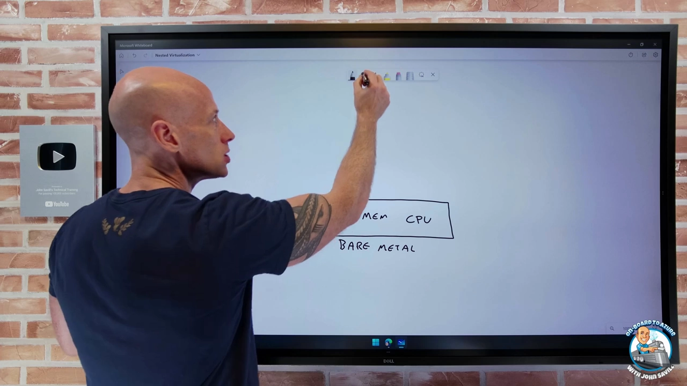
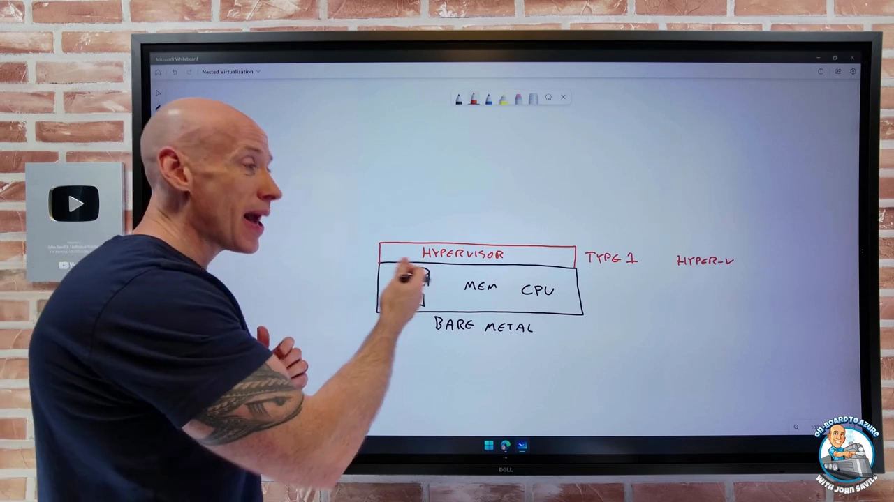
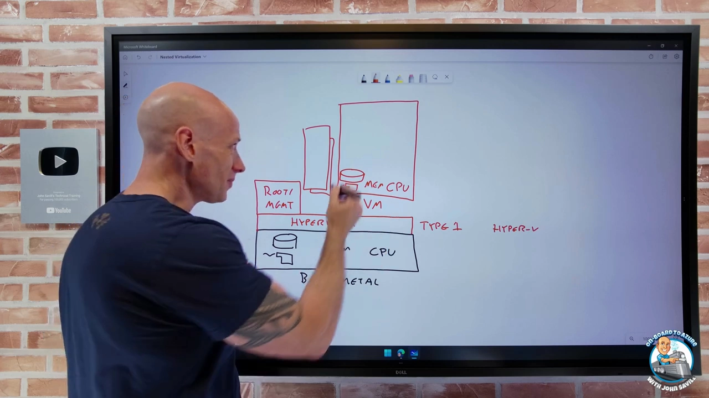
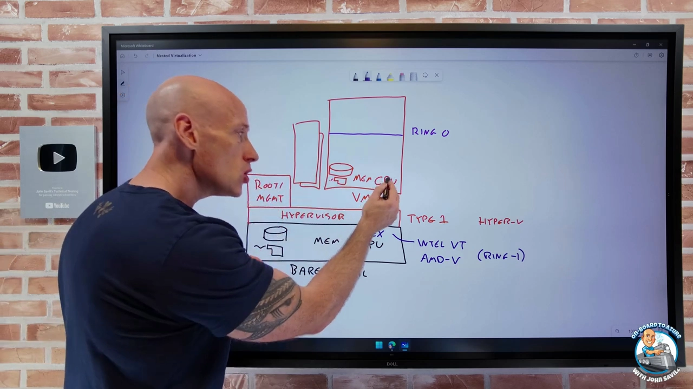
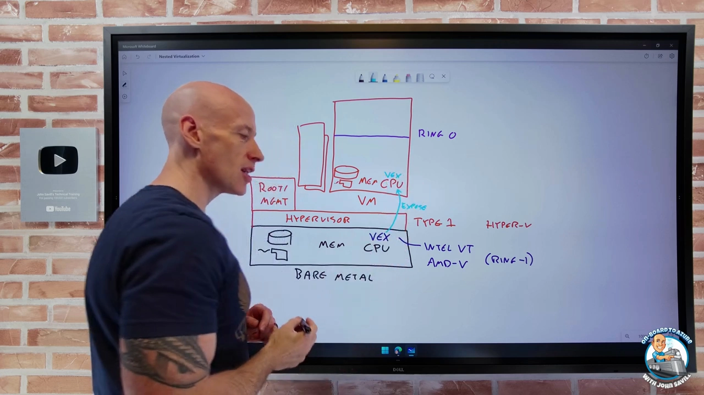
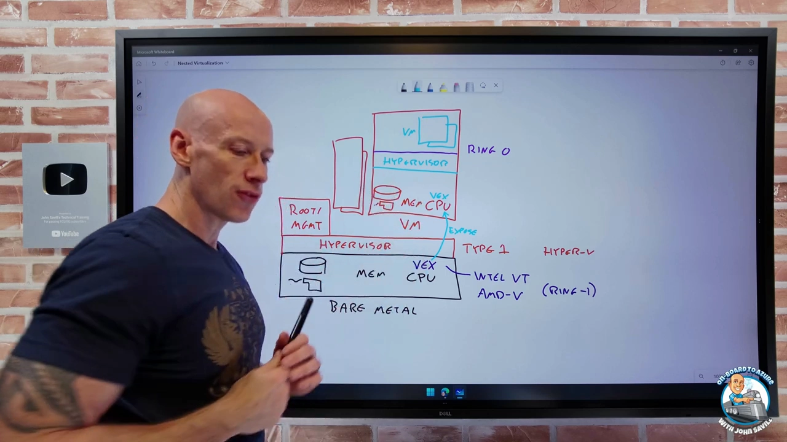
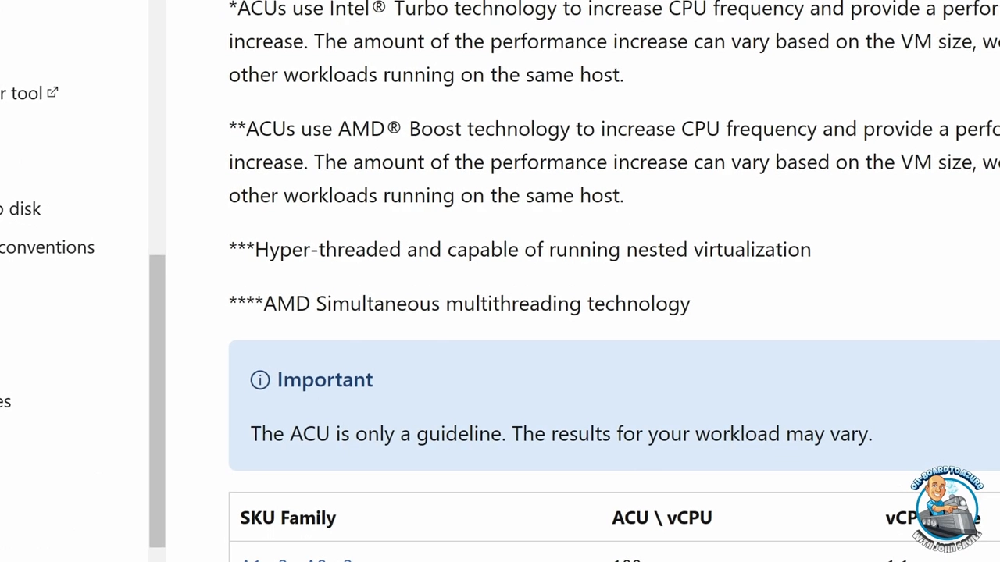
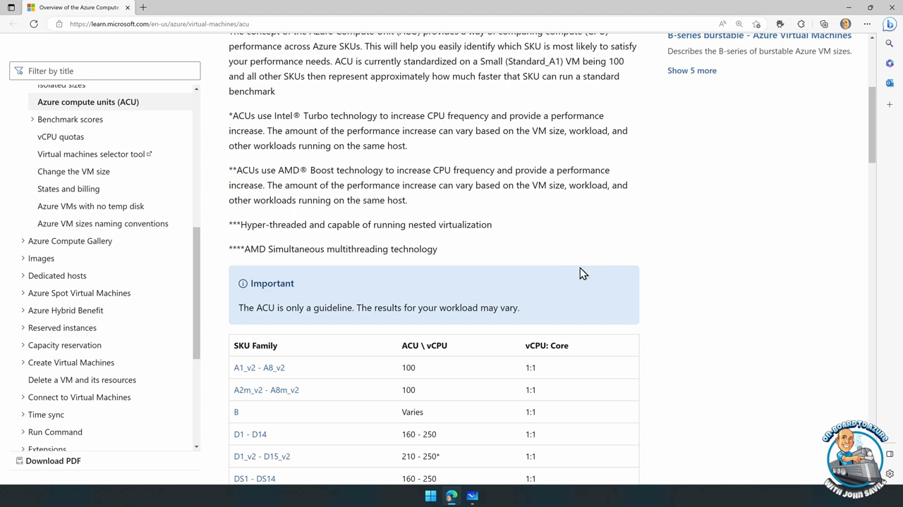
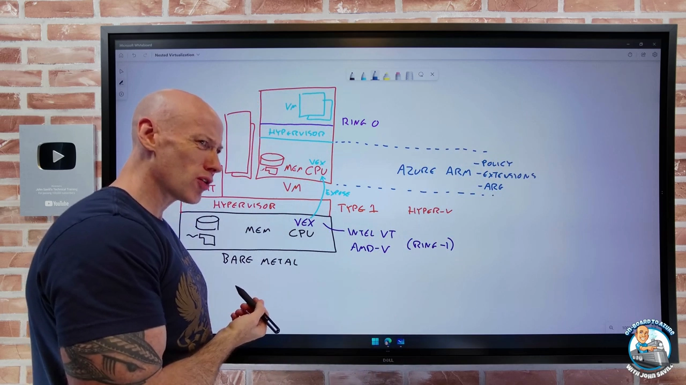

# 云厂商的嵌套虚拟化实例：拿到VT-x丢掉控制平面

> 视频来源：[Nested Virtualization Overview](https://www.youtube.com/watch?v=hIIzA8Gm4T0)（YouTube · John Savill's Technical Training）｜时长约 11 分钟
> 讲者是微软背景的技术讲师，全程用白板画 Azure 的层次。本文按视频顺序整理：先补上"裸金属 → hypervisor → VM → 嵌套"这四层，再看云厂商是怎么把 VT-x 透传给你的（Azure 规格表里的三个星号），最后看他为什么说"这东西不是默认选项"。嵌套的机制细节属于 7.1.1，这里只谈这种形态的取舍。

## 本讲要解决的核心问题（SCQA）

**背景**：你在云厂商的虚拟机规格表里会看到一些规格后面跟着三个星号，脚注写着"支持运行嵌套虚拟化"。也就是说，云厂商已经替你把 CPU 的虚拟化扩展（Intel VT-x / AMD-V）透传到了 vCPU 上，你在这台 VM 里可以再装一个 hypervisor。

**冲突**：这听起来是白拿的能力——不用买裸金属，就能在云上跑自己的虚拟化平台。但讲者反复强调一句话：**这不是我会普遍推荐的做法**。因为一旦你在 VM 里再跑 hypervisor，云厂商的控制平面就看不见里面那些 VM 了。

**疑问**：那么这种"厂商帮你把 VT-x 透传好"的形态（本文按小节约定称它为 Dev-Env 形态）到底给你什么、又拿走什么？它和裸金属、和 PVM 各自适合谁？

**回答（中心思想）**：Dev-Env 形态把"硬件能力"这一项补上了——性能接近裸金属、开通仍是分钟级、按需计费；但它把**可管理性与可见性**拿走了。所以它只适合那些"确实需要在 VM 里再跑 hypervisor"的特定场景，而不是图省事的默认选择。

## 一、先把四层画清楚：裸金属、hypervisor、VM、嵌套

讲者的画法很朴素，但顺序很重要。

第一步，**裸金属就是一台物理机**：里面有 CPU、有若干内存、大概有些本地存储、大概有网络连接。虚拟化的目的，就是把这些资源切分成一台台虚拟机。[【跳转到 00:21】](https://www.youtube.com/watch?v=hIIzA8Gm4T0&t=21)

第二步，**在这台裸金属上放一个 hypervisor**。讲者特意区分了类型：这里关注的是**类型一（type 1）**，也就是不需要去改写客户机内核特权级的那种，它直接跑在裸金属上，比如 Hyper-V 和 ESX。[【跳转到 01:06】](https://www.youtube.com/watch?v=hIIzA8Gm4T0&t=66)

这里有个很多人会搞错的细节，讲者专门澄清：**Hyper-V 不是跑在 Windows Server 之上的**。你启用 Hyper-V 时，实际发生的是 hypervisor 先加载，然后我们以为跑在裸金属上的那个 Windows 变成了 hypervisor 的根分区（root / management partition），它的 CPU 和内存访问仍然要经过 hypervisor。[【跳转到 02:20】](https://www.youtube.com/watch?v=hIIzA8Gm4T0&t=140) 而 Azure 就跑在 Hyper-V 上。

第三步，**在这层 hypervisor 之上创建 VM**。每台 VM 拿到的是硬件的一部分：一定量的 CPU、一定量的内存、一定量的存储（通常是在本地或远程存储上创建虚拟硬盘再暴露给它），以及通过网络连接——那是在管理分区上创建虚拟交换机实现的。[【跳转到 02:48】](https://www.youtube.com/watch?v=hIIzA8Gm4T0&t=168)

第四步才是嵌套。**是什么让 hypervisor 能坐在 ring 0 和处理器之间？** 是 CPU 里的虚拟化扩展：Intel 叫 VT-x，AMD 叫 AMD-V。讲者的说法是，它几乎暴露出一个"ring -1"，让 hypervisor 坐在那里管理对 CPU 的访问，而其他东西仍然跑在传统的最低 ring（内核态）里。[【跳转到 04:38】](https://www.youtube.com/watch?v=hIIzA8Gm4T0&t=278)

于是嵌套虚拟化做的事就一句话：**把这些虚拟化扩展再往下暴露一层，暴露给 VM 的 vCPU**。

这台 VM 的 CPU 有了虚拟化扩展，你就可以在它里面装一个类型一 hypervisor（Hyper-V 或 ESX），再往下切分出新的 VM。[【跳转到 05:16】](https://www.youtube.com/watch?v=hIIzA8Gm4T0&t=316)

## 二、为什么真的会有人需要它

讲者给了三个具体场景，都不是"为了好玩"：

1. **Docker 在某些场景下会用到 hypervisor**。
2. **内核隔离容器**（kernel-isolated containers）。它的工作方式是：在容器主机上创建一台受管的 VM——而容器主机本身就是一台 VM——所以它必须能创建 VM，也就需要一个 hypervisor；里面跑一个非常精简的 Mariner 系统，这样每个 Pod、每个容器都跑在自己独立的内核空间里，与其他 Pod 完全隔离。[【跳转到 06:13】](https://www.youtube.com/watch?v=hIIzA8Gm4T0&t=373)
3. **一些高级安全特性**，比如虚拟安全模式（VSM），它也要用 hypervisor。

这三条有一个共同点：**需要的是"内核级隔离"这件事本身，而不是"我要一台虚拟机"**。第 2 条尤其值得注意——它正是本系列反复出现的 MicroVM 思路：把每个容器塞进自己的内核里。而如果这个容器平台本身部署在云上的 VM 里，就必然要求"VM 里能开 VM"。

## 三、厂商是怎么"帮你透传好"的：三个星号

讲者翻到 Azure 文档里的"计算单元"（Azure compute units, ACU）页面，指着脚注念：**三个星号意味着它是超线程的，并且支持运行嵌套虚拟化**。[【跳转到 09:14】](https://www.youtube.com/watch?v=hIIzA8Gm4T0&t=554)

这个脚注就是"Dev-Env 形态"在文档里的样子：它不是一种单独的产品，而是**规格表上的一个标记**。你不需要买裸金属，只要挑一个带星号的规格，VT-x 就已经在你的 vCPU 上了。

而且覆盖面很广：讲者说这些星号出现在大量 VM 规格上，甚至回溯到 v3 系列，v4、v5 系列上也有，也就是说"我可以在很多东西上用它"。[【跳转到 09:33】](https://www.youtube.com/watch?v=hIIzA8Gm4T0&t=573)

这就是它相对裸金属的最大优势：**可得性**。裸金属要等库存、开通是分钟级、按整机计费；带星号的普通规格随时能开、按秒计费、规格还能随时改。性能上它比 PVM 更接近裸金属（因为是真的硬件透传，而不是靠页表模拟），但比裸金属多了一层 L1 hypervisor 的 exit 开销——那部分属于 7.1.2 的内容。

## 四、代价：控制平面看不见你里面的 VM

这是整支视频真正的重点。讲者画了一条边界，把 Azure 分成两半：一边是 **Azure Resource Manager（ARM）控制平面**，另一边是底下的计算资源。

控制平面给你什么？策略（policy）、各种增加功能和管理能力的扩展、Azure Resource Graph、以及通过它做的变更分析。**它能理解 VM 这一层，也能看到 VM 这一层**。[【跳转到 07:46】](https://www.youtube.com/watch?v=hIIzA8Gm4T0&t=466)

但一旦你在 VM 里面再创建 VM：

**ARM 对里面那些 VM 一无所知**。讲者的原话是：从可管理性上、从可见性上，这些我全都丢掉了；我现在只能通过 Hyper-V 管理器连进去、或者在本地运行它来管理这些 VM。[【跳转到 07:56】](https://www.youtube.com/watch?v=hIIzA8Gm4T0&t=476)

他还主动给了"补救方案"，同时说明了补救的代价：技术上你可以在这些 VM 里跑 Arc，也可以在 hypervisor 的管理分区上跑 Arc，通过 Arc 把很多 ARM 的能力带进来——但那是**你还得额外维护的另一层管理**，而且它的价值是什么？[【跳转到 08:15】](https://www.youtube.com/watch?v=hIIzA8Gm4T0&t=495)

这段话翻译成运维语言就是：

- **策略不再生效**：你在订阅级别设的合规策略，管不到嵌套 VM。
- **清单不再完整**：资源图里没有它们，资产盘点会漏。
- **变更不再可审计**：变更分析看不到里面的改动。
- **模板不再覆盖**：你没法用 ARM 模板把整套环境声明式地重建出来。

讲者最后把结论收在一句话上：它不是我传统上会直接跳进去的做法，因为我想用那个控制平面、想通过模板创建东西，而一旦开始在 VM 里跑 hypervisor，这些我就会失去很多；是的，我可以用 Arc 之类的东西补回来，但除非它真的带来某些好处，否则别把我们的生活搞得更复杂。[【跳转到 10:07】](https://www.youtube.com/watch?v=hIIzA8Gm4T0&t=607)

## 五、三种形态的取舍：把两个维度放在一起

把这一讲和同目录另一篇（PVM 那一篇）的证据合起来看，三种形态其实是在两个维度上做交换：**硬件能力**（能不能拿到 VT-x、性能损失多少）和**可管理性**（云厂商的控制平面能不能看见你）。

| 形态 | 硬件能力 | 开通与计费 | 控制平面可见性 | 运维负担 |
| --- | --- | --- | --- | --- |
| 裸金属 | 完整，性能接近 100% | 分钟级开通，按整机小时计费，受库存影响 | 厂商只管到硬件，hypervisor 由你自己管 | 自己管 hypervisor、自己排布 VM |
| Dev-Env（带星号的嵌套规格） | 硬件透传，接近裸金属，多一层 L1 exit | 随时开通，按秒/小时计费，规格弹性 | 只到 VM 这一层，里面的 VM 不可见 | 多一层管理（如 Arc），策略与模板失效 |
| PVM（补丁内核） | 靠页表实现，有可测的性能折扣 | 普通实例价格，随时开通 | 同样只到 VM 这一层 | 自己编译、维护补丁内核 |

于是判断规则可以写得很短：

- **需要内核级隔离、且平台本身就跑在云上**（比如在云 VM 里跑 Kata 或自建 MicroVM 平台）→ 选 Dev-Env 形态，接受控制平面失明；如果规模大到需要严格资产治理，就把 Arc 这类旁路管理算进成本。
- **需要完整硬件能力**（SR-IOV、GPU 直通、特殊网卡）或需要独占硬件 → 裸金属。这一条在 PVM 那一篇里也有价格证据：同等规格的裸金属是普通实例的十几倍。
- **只是想在 CI 里跑一次 KVM 测试** → PVM，用普通实例的价格换一次性的运维麻烦。
- **只是想在云上跑容器、不需要自己的内核** → 上面三种都不必选。

还有一句要留给 7.2：这三种形态里，Dev-Env 和 PVM 都仍然跑在多租户共享的物理机上。"厂商帮你透传 VT-x"并不会改变你和邻居共享缓存、共享内存带宽这件事——侧信道与共享资源风险属于 7.2.1，这里只点到"隔离边界"这一维。

## 小结

- 嵌套虚拟化的前提是 CPU 的虚拟化扩展（VT-x / AMD-V）被透传到 vCPU 上，云厂商用规格表里的三个星号标记这件事。
- 这种"Dev-Env 形态"的收益是可得性：不用买裸金属，随时开通、按需计费，性能接近裸金属。
- 它真正的代价是可管理性：控制平面只看到 VM 这一层，嵌套 VM 不在策略、资源图、变更分析与模板的覆盖范围内。
- 需要它的场景很具体：内核隔离容器、某些依赖 hypervisor 的安全特性；不是"图方便"的默认选项。
- 选型看两维：要硬件能力就裸金属，要可得性就 Dev-Env，要便宜且能忍运维就 PVM。

## 关键术语速查

| 术语 | 一句话解释 |
| --- | --- |
| 类型一 hypervisor | 直接跑在裸金属上的 hypervisor，如 Hyper-V、ESX；客户机内核不必改写 |
| 根分区 / 管理分区 | 启用 Hyper-V 后，原来那套 Windows 变成 hypervisor 的管理分区，仍受 hypervisor 调度 |
| VT-x / AMD-V | Intel / AMD 的 CPU 虚拟化扩展，提供"ring -1"给 hypervisor 使用 |
| 嵌套虚拟化 | 把上述扩展再透传给 VM 的 vCPU，使 VM 内可以再装 hypervisor |
| Dev-Env 形态 | 云厂商提供的"支持嵌套虚拟化"的普通实例规格，本质是厂商替你做好了 VT-x 透传 |
| ARM | Azure Resource Manager，云的控制平面，负责策略、模板、资源图与变更分析 |
| 内核隔离容器 | 每个容器跑在独立内核里的容器形态，需要宿主能创建 VM |
| ACU | Azure Compute Unit，微软用来横向比较不同规格算力的单位 |