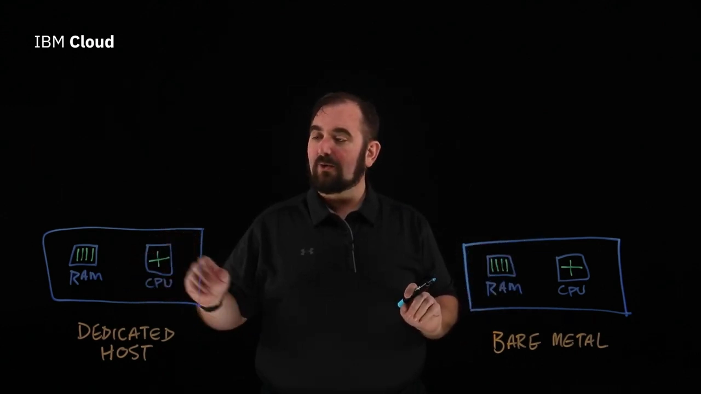
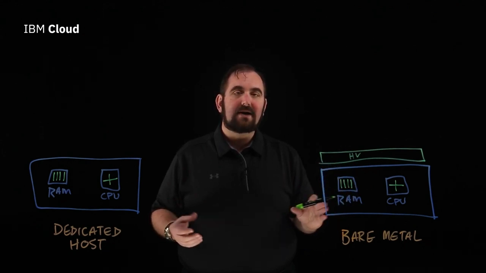
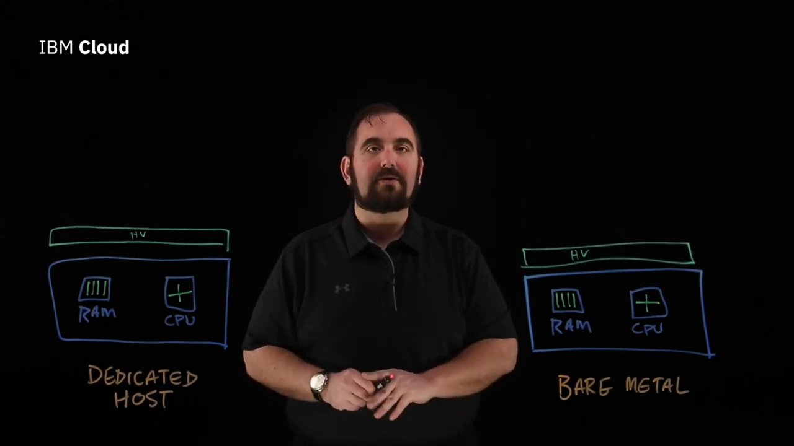
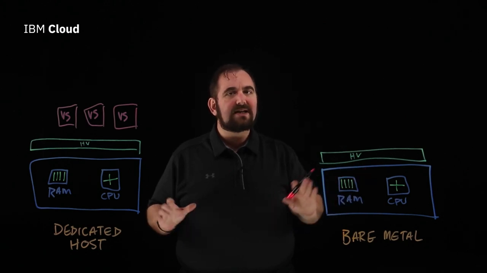
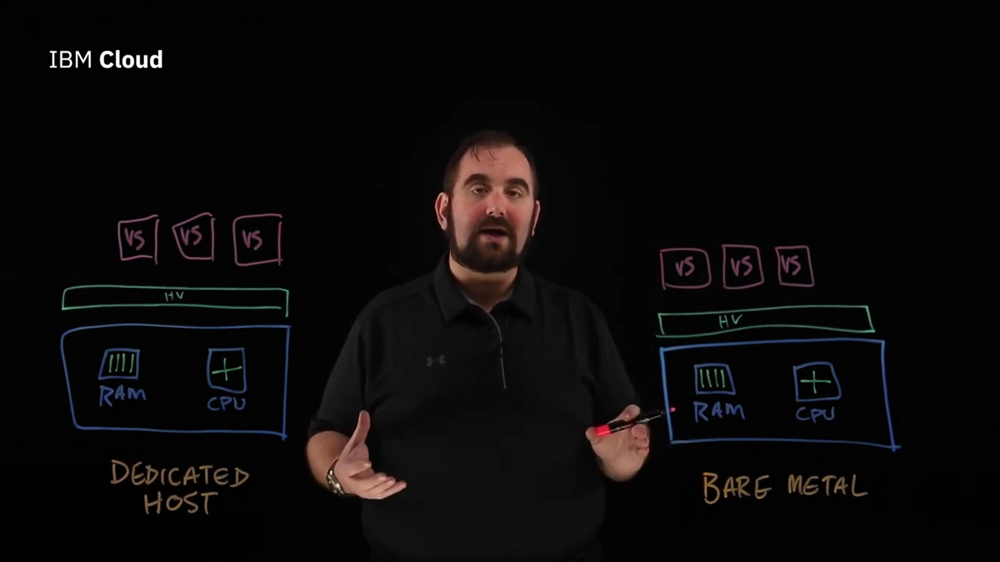
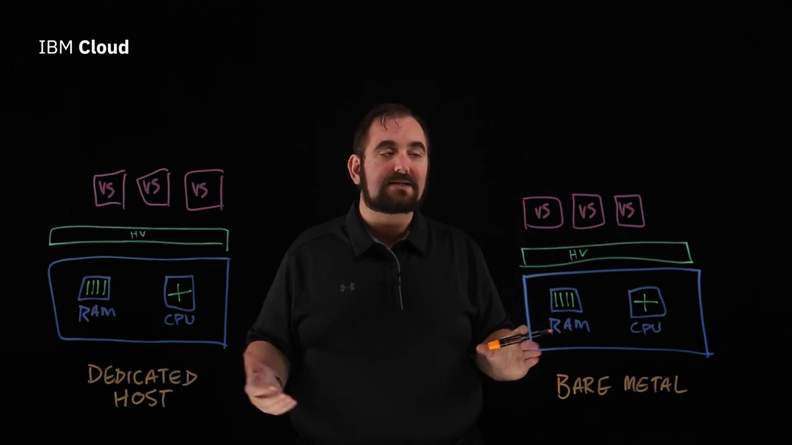
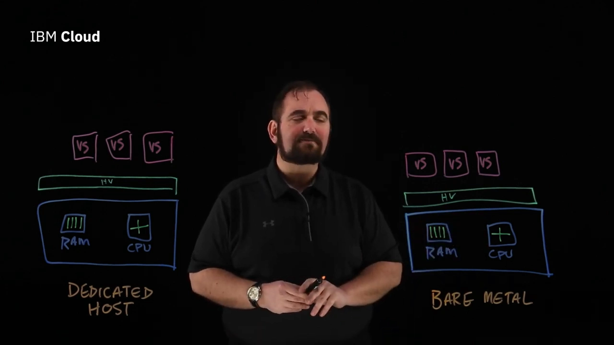
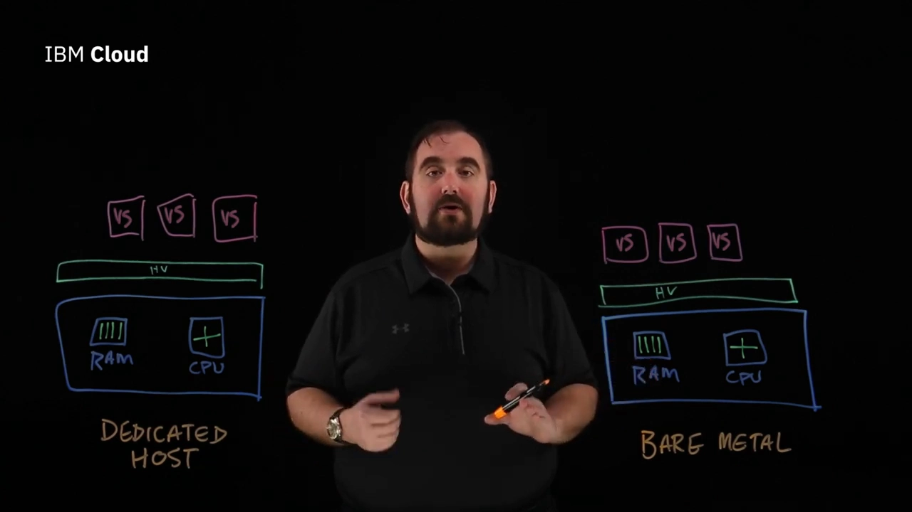

# 裸金属与专用主机：谁跑hypervisor决定你放弃什么

> 视频来源：[Bare Metal with a Hypervisor vs. Dedicated Host: What's the difference?](https://www.youtube.com/watch?v=3xH1SAWWdl0)（YouTube · IBM Cloud · 讲者 Bradley Knapp）｜时长约 5 分钟
> 这是一支"讲清楚一个决策点"的短视频，没有演示，全程白板。它回答的问题正好是本小节的核心：同一台物理机，hypervisor 由你跑还是由厂商跑，会换来什么、又失去什么。本文按"两台机器 → 谁跑 hypervisor → 你因此多拿到什么 → 决策点"的顺序整理，最后把它和 PVM、Dev-Env 两种形态放在一起做取舍。

## 本讲要解决的核心问题（SCQA）

**背景**：在云上想要"独占一台物理机"时，你面前通常有两个选项：**带 hypervisor 的裸金属**（bare metal with a hypervisor）和**专用主机**（dedicated host）。两者看起来、用起来、感觉上都很像。

**冲突**：它们底层的算力完全一样，机箱也一样，但适用场景差别很大。选错了，你要么多付了钱、要么多背了运维责任，要么反过来被厂商的限制卡住。

**疑问**：这两者的区别到底在哪？什么情况下该选哪个？

**回答（中心思想）**：**区别只有一个：那层 hypervisor 由谁来跑。** 你自己跑，你就拿到细粒度控制权（超分、监控日志、直接调 hypervisor API 备份），代价是承担管理这台机器的复杂度；厂商跑，你就拿到省心（把 VSI 交给厂商调度），代价是让出控制权。所以决策点不是"哪个性能好"，而是"你想要多少控制权、愿意让出多少"。

## 一、两台机器是一样的，差的是上面那一层

讲者从最底层讲起：一台云上的计算主机，就是数据中心里那台物理机，有 CPU 插槽、有内存、有处理器，你的一切都构建在它之上。[【跳转到 00:50】](https://www.youtube.com/watch?v=3xH1SAWWdl0&t=50)

这时候两台机器**完全一样**：同样的机箱、同样的底层算力。讲者的原话是"这些机箱是一样的，底层算力也是一样的，区别在于谁来运行那个 hypervisor"。[【跳转到 01:15】](https://www.youtube.com/watch?v=3xH1SAWWdl0&t=75)

接下来他在右边（裸金属）的方框上画了一层绿色的 HV：

在带 hypervisor 的裸金属这一边，**这个 hypervisor 由你自己运行**。它把你在本地机房里习惯拥有的全部控制权和调优能力都给了你，你可以真正进入这个 hypervisor 内部去调整它，让这台机器做任何你想让它做的事。[【跳转到 01:40】](https://www.youtube.com/watch?v=3xH1SAWWdl0&t=100)

而专用主机这一边，上面同样有一层 hypervisor，但**这一层由云厂商运行**：

厂商会把自己的知识、最佳实践都用到这个 hypervisor 上，把这份复杂度从你身上拿走，让你只需要关注虚拟服务器实例（VSI）。[【跳转到 02:05】](https://www.youtube.com/watch?v=3xH1SAWWdl0&t=125)

这就是整支视频的全部前提。后面所有的差异，都是从"谁跑这一层"推出来的。

## 二、差异一：谁来排布虚拟机

在专用主机上，部署 VSI 的方式是**你告诉厂商要什么、要多少**，厂商把它们调度到那台 hypervisor 上替你放好，于是你会有虚拟服务器 1、2、3，一直排到把机箱填满。

在带 hypervisor 的裸金属上，概念略有不同：你不再是对云厂商说"我想调度这些实例"，而是**直接和那层 hypervisor 打交道，自己去调度那些虚拟服务器**。[【跳转到 02:30】](https://www.youtube.com/watch?v=3xH1SAWWdl0&t=150)

这一条看起来只是"操作方式不同"，实际上决定了下一节的效率差异。

## 三、差异二：超分（over-commit）——裸金属真正值钱的地方

讲者问了一个问题：那你为什么想自己干这件事？答案是**更高的效率**。

具体指的是**超分**：把一颗处理器线程，通过资源池化的方式，分配给好几台不同的虚拟服务器，从而借助这台主机榨出更大的算力。这件事在带 hypervisor 的裸金属上你能做；而在专用主机上，**厂商不允许你控制超分的程度**。[【跳转到 02:55】](https://www.youtube.com/watch?v=3xH1SAWWdl0&t=175)

他把这件事讲得很具体：你可以超分 vCPU、超分内存、超额排布这台机器——如果它本来只能放 5 台 VSI，你可以决定塞 10 台进去，因为**你最了解自己的工作负载**。[【跳转到 03:45】](https://www.youtube.com/watch?v=3xH1SAWWdl0&t=225)

这里要把"超分"这个词解释清楚，因为它是很多初学者第一次遇到的成本杠杆：

- **超分（over-commit）**就是卖出比物理资源更多的"账面资源"。一台 64 线程的机器，你可以切出 128 个 vCPU 卖给 128 个租户，赌的是它们不会同时满载。
- 超分比例越高，单位算力成本越低，但**性能的可预测性越差**——邻居一忙，你就跟着卡。
- 在专用主机上，这个比例由厂商定；在裸金属上，比例由你定。**这就是"控制权"在成本上的具体体现**。

## 四、差异三：监控、日志与备份走谁的 API

第三个差异是运维侧的，讲者讲了三点：

1. **监控与日志的粒度**。因为你能接触到这层 hypervisor，你可以做到云厂商在专用主机上一般不会开放给你的那种细粒度监控和日志。[【跳转到 03:20】](https://www.youtube.com/watch?v=3xH1SAWWdl0&t=200)
2. **备份走哪条路**。在裸金属上，你可以直接通过 hypervisor 层来备份虚拟机，接上 hypervisor 自己的 API 就行；而在专用主机上，要备份一台虚拟服务器，就必须用云厂商提供的 API。
3. **能不能"进去调"**。这是最本质的一条：专用主机把一部分控制权抽象掉了，换来的是你不必承担自己管理一台裸金属服务器所带来的额外复杂度。[【跳转到 04:10】](https://www.youtube.com/watch?v=3xH1SAWWdl0&t=250)

第 2 条值得多想一步：备份路径不同，意味着**灾备方案的可移植性不同**。用 hypervisor API 做的备份，格式和流程跟着你的 hypervisor 走；用厂商 API 做的备份，跨云迁移时通常要重新设计。

## 五、决策点：你要多少控制权，愿意让出多少

讲者把结论收在一个很干脆的句子上：这确实很重要，决策点是——**你想要多少控制权？你愿意让出多少控制权，又想要多少省心？**[【跳转到 04:35】](https://www.youtube.com/watch?v=3xH1SAWWdl0&t=275)

因为毫无疑问，专用主机对你来说比带 hypervisor 的裸金属更容易运营；但这份省心的代价是失去控制权，也失去进入系统逐个调整那些设置的能力。[【跳转到 04:56】](https://www.youtube.com/watch?v=3xH1SAWWdl0&t=296)

把这句话翻译成选型语言：

- 如果你的负载**已经调好了、要的是稳定和省心**，专用主机更合适——你不需要那层 hypervisor 的旋钮。
- 如果你的负载**需要靠超分来压成本、需要细粒度观测、或者备份流程必须接自己的 hypervisor**，那就选带 hypervisor 的裸金属，并接受"这台机器归你管"。
- 如果你只是**想在云上跑一层自己的虚拟化**（比如跑 Kata、跑 MicroVM 平台），那问题就变成"VT-x 从哪来"——见下一节。

## 六、把三种形态放在一起：裸金属、PVM、Dev-Env

本小节要对比的三种形态，其实是"硬件能力"和"可管理性"两个维度上的三个落点。这支视频讲的是第一行和第三行的区别（谁跑 hypervisor），PVM 那一行则由 7.1.3 展开，Dev-Env 那一行由同目录的《云厂商的嵌套虚拟化实例：拿到VT-x丢掉控制平面》展开。

| 形态 | 硬件能力 | 开通与计费 | 谁跑 hypervisor | 主要代价 |
| --- | --- | --- | --- | --- |
| 裸金属 | 完整，性能接近 100% | 分钟级开通、按整机小时计费、受库存影响 | 你自己 | 自己管 hypervisor、自己排布与备份 |
| 专用主机（厂商托管） | 完整，但超分比例由厂商定 | 分钟级开通、按主机计费 | 云厂商 | 让出控制权，监控与备份受限于厂商 API |
| PVM | 靠页表实现，有可测的性能折扣 | 普通实例价格、随时开通 | 你自己（补丁内核就是 hypervisor 的底座） | 自己编译与维护补丁内核 |
| Dev-Env（带星号的嵌套规格） | 硬件透传，接近裸金属，多一层 L1 exit | 随时开通、按秒计费、规格弹性 | 云厂商（VT-x 由厂商透传） | 控制平面看不到里面的 VM |

由此得到的判断规则：

- **只是想在 CI 里跑一次 KVM 测试** → PVM：普通实例的价格，换一次性的运维麻烦。
- **要跑生产级虚拟化平台、需要稳定性能** → Dev-Env 或裸金属：前者开通快、弹性好，后者性能与硬件能力最完整。
- **要跑需要硬件特性的负载（SR-IOV、GPU 直通）** → 裸金属：只有独占物理机才拿得到完整设备与 IOMMU 能力。
- **要压成本、愿意自己承担运维** → 带 hypervisor 的裸金属，靠超分把单位算力价格打下来。

最后提一句隔离边界：专用主机和 Dev-Env 都仍然是"厂商的 hypervisor 在你和硬件之间"，你拿到的隔离强度由厂商那一层决定；裸金属则是独占硬件。共享资源带来的侧信道风险属于 7.2.1，这里只需要记住：**控制权、省心、隔离强度，这三样东西在云上是要互相交换的**。

## 小结

- 带 hypervisor 的裸金属和专用主机，机箱与底层算力完全一样，唯一区别是那层 hypervisor 由谁运行。
- 自己跑 hypervisor，换来的是超分比例、细粒度监控日志、直接调 hypervisor API 备份这三项控制权。
- 厂商跑 hypervisor，换来的是省心：你只说规格和数量，调度与放置由厂商完成。
- 决策点不是性能，而是"你要多少控制权、愿意让出多少"；省心的代价是失去逐个调整设置的能力。
- 放到三种形态里看：裸金属买硬件能力与完全控制，PVM 买价格与弹性，Dev-Env 买"厂商替你透传好的 VT-x"，三者各自把代价落在不同的地方。

## 关键术语速查

| 术语 | 一句话解释 |
| --- | --- |
| 裸金属（bare metal） | 直接分配一整台物理机；本文语境下指"带 hypervisor、由客户自己运行"的那种 |
| 专用主机（dedicated host） | 硬件独占、但 hypervisor 由云厂商运行的托管形态 |
| hypervisor | 虚拟机监视器，负责把物理资源切分给一台台虚拟机 |
| VSI | Virtual Server Instance，虚拟服务器实例，即云上的一台虚拟机 |
| 超分（over-commit） | 卖出比物理资源更多的账面资源，用同时满载概率低来换成本 |
| Dev-Env | 云厂商提供的"支持嵌套虚拟化"的普通实例规格，本质是厂商替你做好了 VT-x 透传 |
| PVM | 给 L1 客户机内核打补丁、在没有硬件虚拟化的云主机里提供 KVM 的方案 |