# 推测执行时代的虚拟化：独立内核挡不住共享缓存与 SMT 侧信道

> 视频来源：[14 - Virtualization in the age of speculative execution hardware bugs](https://www.youtube.com/watch?v=sdkZ042j4b0)（YouTube · LinuxLab Conference，讲者 Dario Faggioli，2019 年）｜时长约 41 分钟
> 导读：这是一场从 hypervisor 开发者视角讲 Meltdown / Spectre / L1TF 的讲座。本文按「推测执行留下什么痕迹 → 三个漏洞分别穿透哪一层边界 → 缓解手段的代价 → 云厂商怎么取舍」的顺序整理，聚焦**侧信道与共享资源**这一条线；容器与 VM 的总体取舍结论不在本文范围。

## 本讲要解决的核心问题（SCQA）

**背景**：虚拟化给人的直觉是「一台 VM 有自己独立的内核、自己的页表、自己的地址空间」，硬件还用 EPT（Extended Page Table，扩展页表）在两级页表之间做地址翻译，因此 VM 之间、VM 与 hypervisor 之间应该是硬隔离的。

**冲突**：2018 年前后出现的 Meltdown、Spectre、L1TF 表明，CPU 为了跑得快会**猜测着执行**指令；猜错时寄存器可以回滚，但**缓存、TLB、分支预测器**里留下的痕迹回滚不掉。这些部件恰恰是所有 VM 共用的。

**疑问**：既然内核是独立的、地址空间是分开的，侧信道到底还能泄漏什么？隔离边界究竟划在哪里？

**回答（中心思想）**：虚拟化边界保护的是**架构状态**（寄存器、页表、地址空间），保护不了**微架构状态**（缓存、TLB、分支预测历史、SMT 兄弟线程的执行痕迹）。所以「独立内核」并不能自动解决问题：客户机与宿主跑在同一颗物理 CPU 上，共享同一批缓存与预测器，攻击者不需要读你的内存，只需要观察共享资源的状态变化就能把数据搬出来。缓解手段（软件屏障、刷缓冲、关闭 SMT）都真实存在，但都带性能代价，最终只能按风险与负载做取舍。

## 一、推测执行把「猜」变成了可观测的痕迹

### 1.1 推测执行是「先做后撤销」

CPU 很快、内存很慢。讲座给了一个生活化的类比：你问朋友「要不要喝杯咖啡」，在等他回答的时候，你已经伸手去拿杯子、把咖啡机打开了——这就是基于猜测先干活。CPU 里的推测执行（speculative execution）本质上就是这件事：不等数据从内存回来，先按预测往下执行。[【跳转到 02:40】](https://www.youtube.com/watch?v=sdkZ042j4b0&t=160)

讲者用「平行宇宙」的比喻解释得更清楚：假设你能随时开一个平行宇宙，在里面你有超能力、做什么都成功；过 30 秒宇宙消失，如果里面做的事「是好的」，结果就复制回原宇宙，如果「是坏的」，就当没发生过。但有一个例外——某个东西会跨宇宙泄漏回来，比如物体的**温度**。于是你可以这样判断 John 有没有在偷看 Facebook：在平行宇宙里走到他背后看一眼，如果是 Facebook 就把手里的勺子握一会儿；宇宙消失后你什么都不记得，但摸一下勺子，如果变热了，就说明刚才发生过这件事。[【跳转到 03:30】](https://www.youtube.com/watch?v=sdkZ042j4b0&t=210)

这个比喻里的三个要素，正好对应一次侧信道攻击的三要素：**开平行宇宙**（让 CPU 进入推测）、**超能力**（推测期间越权访问不会触发异常）、**温度泄漏**（缓存状态被改变，事后可测量）。

### 1.2 两个「基本假设」同时不成立

整个推测执行的设计建立在两条假设上：[【跳转到 08:33】](https://www.youtube.com/watch?v=sdkZ042j4b0&t=513)

1. **回滚不留痕**：可以让 CPU 做一件事，然后撤销掉，不留任何副作用、任何痕迹。
2. **猜不猜得中不可探测**：外部观察者无法可靠判断某段代码到底会不会被推测执行。

讲者的结论是：这两条**都不成立，而且从来就没成立过**。回滚对寄存器、标志位确实工作得很好，但对**缓存、TLB 以及其他微架构部件**就不行了；而「不可探测」也不成立——不但能判断，还能主动**触发**推测执行。[【跳转到 09:23】](https://www.youtube.com/watch?v=sdkZ042j4b0&t=563)

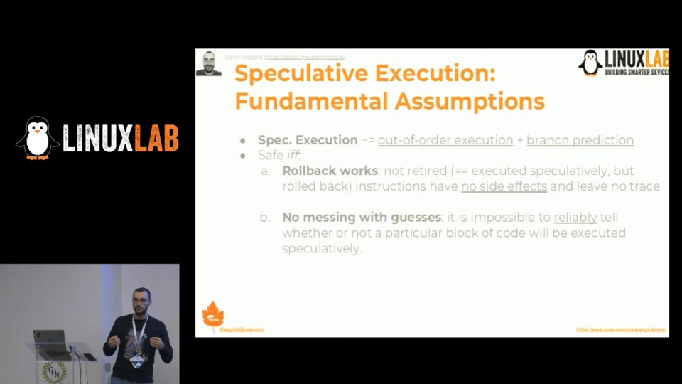

这就是本讲的立论基础：**只要共享资源存在，隔离边界就不可能把信息完全关住。**

## 二、虚拟化平台的攻击面：谁想读谁

先看虚拟化平台的分层结构：最下面是硬件（IO、内存、CPU），往上是宿主内核 / hypervisor（设备驱动、内存管理、调度器），再往上是若干台 VM，每台 VM 里有客户机内核、客户机用户态和应用程序。[【跳转到 10:30】](https://www.youtube.com/watch?v=sdkZ042j4b0&t=630)

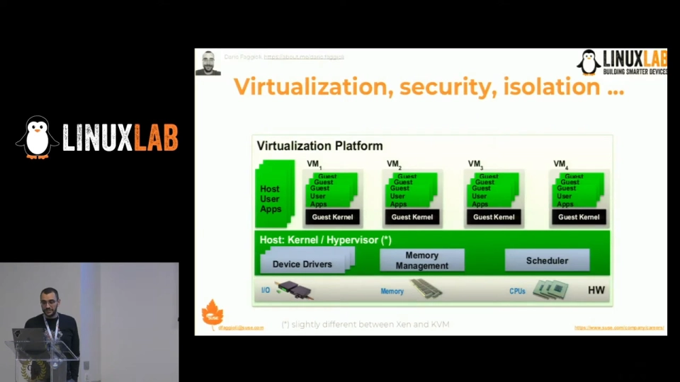

把攻击画在这张图上，就是几条箭头：[【跳转到 11:06】](https://www.youtube.com/watch?v=sdkZ042j4b0&t=666)

- **红色箭头**：恶意客户机内核或客户机应用攻击 hypervisor；
- **蓝色箭头**：VM 里的东西读取、窃取**另一台 VM** 的秘密。

从 hypervisor 开发者的角度看，最要紧的是挡住红色箭头——即「VM 里的东西读到 hypervisor 或其他 VM 的数据」。而讲者特别强调：红色箭头一旦成立，**几乎总是**意味着这台 VM 同时获得了攻击其他 VM 的能力，所以它是「特别令人担心」的一类。[【跳转到 12:26】](https://www.youtube.com/watch?v=sdkZ042j4b0&t=746)

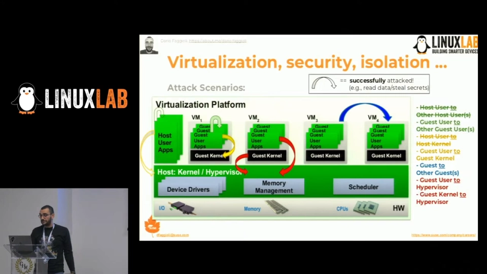

注意这张图里被共享的东西：同一颗物理 CPU 的缓存、TLB、分支预测器，同一个宿主内核的调度器与内存管理。**隔离边界画在地址空间上，而共享资源在边界之下。**

把讲座里点到的共享资源列成一张表，就能看清「共享硬件」与「共享内核」各自泄漏什么：

| 共享资源 | 泄漏什么 | 讲座里对应的攻击 |
| --- | --- | --- |
| L1 / L2 缓存 | 哪些地址被读过（缓存状态可测量） | Meltdown、L1TF、Spectre 的缓存侧信道 |
| TLB | 地址空间切换的痕迹 | 页表隔离要刷 TLB，因此才有 PCID 的代价问题 |
| 分支预测器 / BTB | 分支历史与间接跳转目标 | Spectre v1（条件分支）、Spectre v2（间接分支） |
| SMT 兄弟线程 | 另一条线程正在执行什么的痕迹 | L1TF 配合超线程，两台 VM 可并行互读 |
| 两级页表（EPT） | 翻译路径上的缓存命中 | L1TF |
| 宿主内核（容器场景） | 用户态 / 内核态边界 | Meltdown、Spectre、L1TF 都影响容器 |

## 三、Spectre v1：越界读在推测里真的发生了

Spectre v1 又叫**边界检查绕过**（Bounds-Check Bypass，CVE-2017-5753）。它攻击的是**条件分支预测**，也就是代码里的 `if`。[【跳转到 12:53】](https://www.youtube.com/watch?v=sdkZ042j4b0&t=773)

典型场景是这样的：代码先检查数组下标有没有越界，再访问数组。正常情况下越界会被拦住；但 CPU 预测「不会越界」，于是在推测中执行了越界的读取，把越界读到的值拿去做了第二次访问（例如作为另一个数组的下标），从而改变了缓存状态。事后虽然回滚了，缓存里的痕迹还在，攻击者用缓存侧信道就能反推出那个越界读到的字节。[【跳转到 13:18】](https://www.youtube.com/watch?v=sdkZ042j4b0&t=798)

攻击成立需要两个条件：目标里有可用的**泄漏小工具**（leaky gadget，即「越权读 + 影响缓存」的代码片段），或者有 JIT（比如浏览器里的 JavaScript 可以自己生成这样的代码）。受影响范围是**所有 CPU**——Intel、AMD、ARM 都一样。

Spectre v1 的「缓解」很特别：它**没有硬件级的统一缓解**，只能靠人工审计代码、找出有问题的片段逐个修，或者用工具辅助；讲者形容这是打地鼠。Xen 和 Linux 里提供了 array_index_mask_nospec() 之类的原语，用来阻止推测越过边界。好消息是这类改法的**性能影响基本为零**（只要用巧妙的写法避免真正的屏障指令）。[【跳转到 14:08】](https://www.youtube.com/watch?v=sdkZ042j4b0&t=848)

从虚拟化角度看，Spectre v1 的影响面是：**客户机用户态应用攻击同一台 VM 里的其他应用**是确实可行的（浏览器 JIT 就是现成例子）；至于「客户机应用打客户机内核、打 hypervisor、打容器」，讲座的说法是「理论上可行」——需要目标里有合适的泄漏小工具。[【跳转到 14:30】](https://www.youtube.com/watch?v=sdkZ042j4b0&t=870)

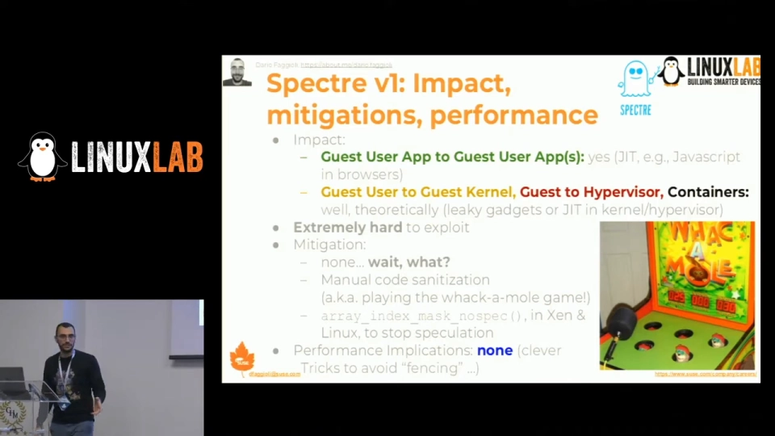

## 四、Spectre v2：分支预测器是跨 VM 共享的资源

### 4.1 攻击的是间接跳转，不是 `if`

Spectre v2 叫**分支目标注入**（Branch Target Injection，CVE-2017-5715），攻击的不是条件分支，而是**间接分支**——函数指针、`jmp *(%r11)` 这类「跳转地址在运行时才知道」的指令。[【跳转到 14:30】](https://www.youtube.com/watch?v=sdkZ042j4b0&t=870)

它的原理是：间接分支的目标由**分支目标缓冲**（BTB，Branch Target Buffer）根据历史预测。攻击者可以「投毒」BTB，让 CPU 在推测时跳到攻击者希望的位置（一个泄漏小工具），从而在推测中执行不该执行的代码，再用缓存侧信道把结果搬出来。同样影响所有 CPU 架构。

这里出现了本讲最关键的一句话，直接说明了「共享」的含义：**BTB 的预测基于历史，而用户态执行过的分支会影响内核态的预测；在 SMT 兄弟线程上执行的分支，也会影响另一条线程的预测。**[【跳转到 15:13】](https://www.youtube.com/watch?v=sdkZ042j4b0&t=913)

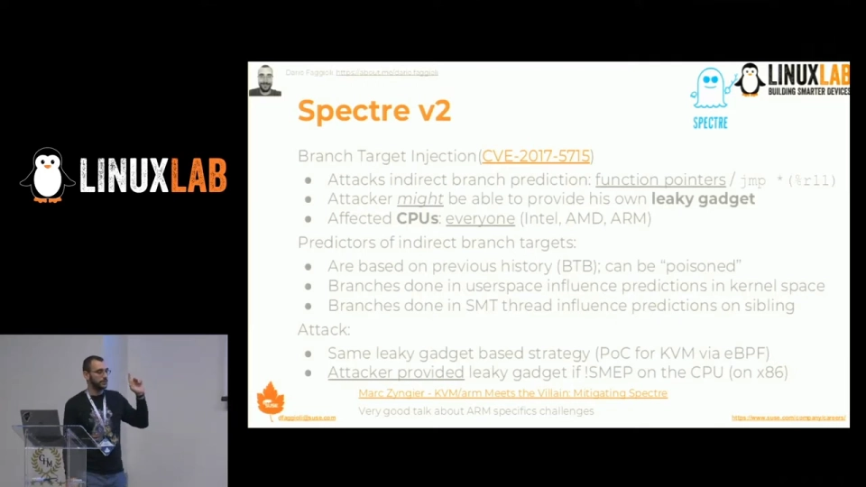

也就是说，**分支预测器不是每个地址空间一份，而是物理核共享的一份**。VM 边界、内核/用户边界在它面前都不存在。

### 4.2 影响面：从客户机一路打到 hypervisor

讲座给出了一张很直接的影响表：[【跳转到 16:53】](https://www.youtube.com/watch?v=sdkZ042j4b0&t=1013)

| 攻击方向 | 是否可行 |
| --- | --- |
| 客户机用户态 → 客户机用户态 | 是（JIT，例如浏览器里的 JavaScript） |
| 客户机用户态 → 客户机内核 | 是 |
| 客户机 → 其他客户机 | 是（经由「客户机 → hypervisor」这条路） |
| 客户机 → hypervisor | 是（有现成泄漏小工具时，或经由 JIT） |
| 容器 | 受影响 |

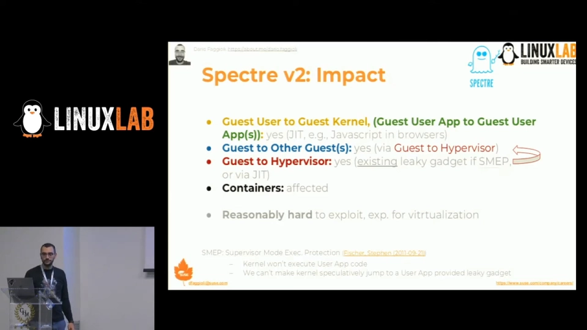

这张表回答了小节的疑问：**独立内核并没有挡住 Spectre v2**。原因不是页表被绕过，而是预测器被共享——客户机在 SMT 兄弟线程或同一物理核上留下的预测历史，直接把 hypervisor 的推测执行带偏了。讲者也承认利用难度不低：需要目标上下文里恰好存在合适的泄漏小工具，并且要稳定命中。

### 4.3 缓解：retpoline 与 IB* 系列

Spectre v2 的缓解分两类。[【跳转到 17:43】](https://www.youtube.com/watch?v=sdkZ042j4b0&t=1063)

**纯软件类：retpoline。** 思路是把推测「困在陷阱里」：牺牲掉间接分支预测正确带来的收益，换回「不再被带偏」。讲者评价它性能不错，但会反问一句——这够不够偏执级别的防护？

**固件/微码类：IB\* 系列指令。** 由 CPU 厂商通过 BIOS、固件、微码更新加入新指令，再由编译器插到相关位置。常见的有：

- `IBRS`（Indirect Branch Restricted Speculation）：限制间接分支的推测；
- `IBPB`（Indirect Branch Predictor Barrier）：清掉预测器状态；
- `STIBP`（Single Thread Indirect Branch Predictors）：让 SMT 两条线程的间接分支预测互不影响。

不同 hypervisor 的取舍不一样：Xen 在启动时挑「最合适的组合」，安全时用 retpoline，不安全时用 `IBRS`，VM 切换时做 `IBPB`，VM 切换时清 RSB；KVM 则是 retpoline 加少量 `IBRS`（例如调用固件时），VM 切换时做 `IBPB`（上下文切换时用启发式判断），上下文切换或 VM 切换时清 RSB。两家都把 `IBRS`、`IBPB`、`STIBP` 暴露/虚拟化给 VM 使用。[【跳转到 18:33】](https://www.youtube.com/watch?v=sdkZ042j4b0&t=1113)

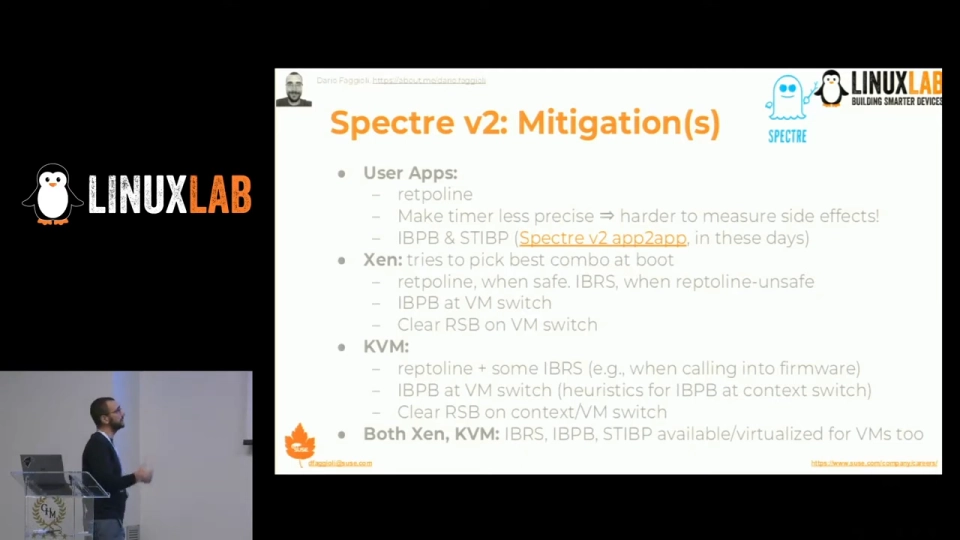

### 4.4 代价：不是「慢一点」，而是「看硬件、看负载」

讲者对性能影响的描述是「很复杂」：[【跳转到 20:13】](https://www.youtube.com/watch?v=sdkZ042j4b0&t=1213)

- **retpoline**：性能不错，但防护强度是否足够存疑；
- **`IBPB`**：中等影响；
- **`IBRS`**：影响随硬件差异极大；
- **`STIBP`**：在当时影响**巨大**，所以做成了按进程选择性开启（per-app opt-in）。Intel 上还分代：Skylake 之前非常糟，Skylake 之后好一些。

更麻烦的是「不只是刷缓冲」这件事：在 x86 上这些操作目前是**写 MSR**，非常慢；在 ARM 的某个 CPU 上，刷分支预测器甚至要**整体关闭再打开 MMU**——讲者的原话是从性能角度「完全疯了」。[【跳转到 21:53】](https://www.youtube.com/watch?v=sdkZ042j4b0&t=1313)

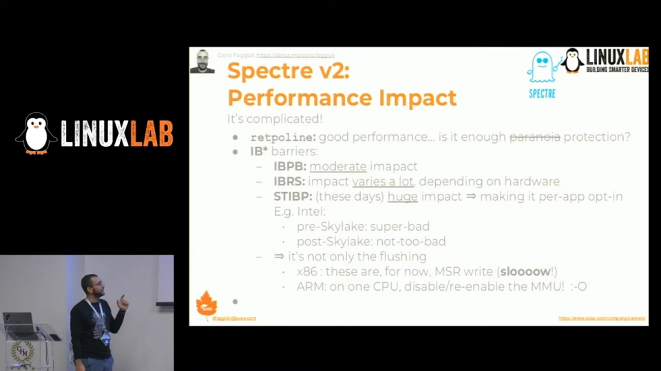

顺带一个反直觉的点：加新指令对 CPU 厂商很容易（改掩膜、流片就行），难的是**已经卖出去的 CPU**——只能靠微码更新，而微码实现出来就是写 MSR，所以慢。这也解释了为什么同一代漏洞在不同机器上表现差异巨大。
## 五、Meltdown：只打「用户 / 内核」边界，不打「VM / VM」边界

### 5.1 机制：页表项的权限位在推测中被忽略

Meltdown（熔断）的机制比 Spectre 好讲得多。前提是操作系统用 MMU 和页表把内存分成用户区和内核区：页表项里有权限位，用户态访问内核地址会触发缺页，进程被杀掉。

问题在于：为了让系统跑得快，内核内存是**映射在进程地址空间里**的（这样系统调用时不用切换地址空间）。于是页表项说「用户态不许访问」，但**推测执行时不看这个权限位**——越权访问在推测中真的会发生，只是随后被撤销。攻击者再用缓存侧信道，把「读到的那个内核字节」反推出来。[【跳转到 22:18】](https://www.youtube.com/watch?v=sdkZ042j4b0&t=1338)

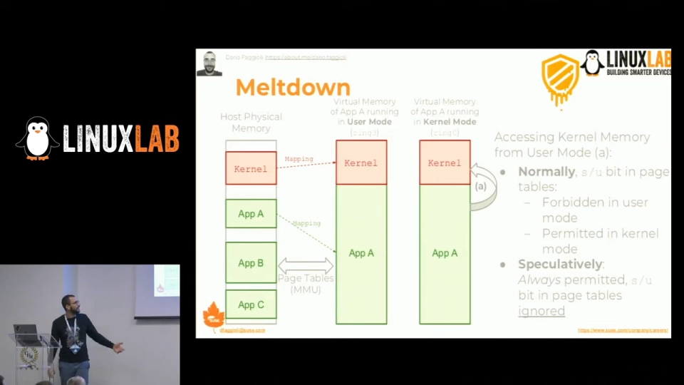

### 5.2 影响面：VM 里能打自己的内核，打不到别的 VM

这正是「隔离边界在哪」的最清晰答案：[【跳转到 25:38】](https://www.youtube.com/watch?v=sdkZ042j4b0&t=1538)

- 你在 VM 里跑一个应用，可以用 Meltdown 读到**同一台 VM 里其他应用**的内存；
- 但你**读不到 hypervisor 的内存**，也读不到**其他 VM 的内存**——因为它们根本不在你的地址空间里。

有一个例外：**半虚拟化客户机（PV guest）**。在 Xen PV 里情况反过来了——你打不到同一台 VM 里的其他应用，但**能打到 hypervisor**，那更糟；而且顺着这条路，最终也能读到其他应用的内存。[【跳转到 26:03】](https://www.youtube.com/watch?v=sdkZ042j4b0&t=1563)

讲座给出的影响表（以 KVM / Xen 的几种模式对比）：[【跳转到 26:28】](https://www.youtube.com/watch?v=sdkZ042j4b0&t=1588)

| 攻击方向 | 结论 |
| --- | --- |
| 客户机用户态 → 客户机内核（含同 VM 内应用互攻） | KVM 是；Xen HVM / PVH / PV-32bit 是；Xen PV-64bit 否 |
| 客户机 → hypervisor（含跨 VM） | KVM 否；Xen HVM / PVH / PV-32bit 否；Xen PV-64bit 是 |
| 容器 | 受影响 |

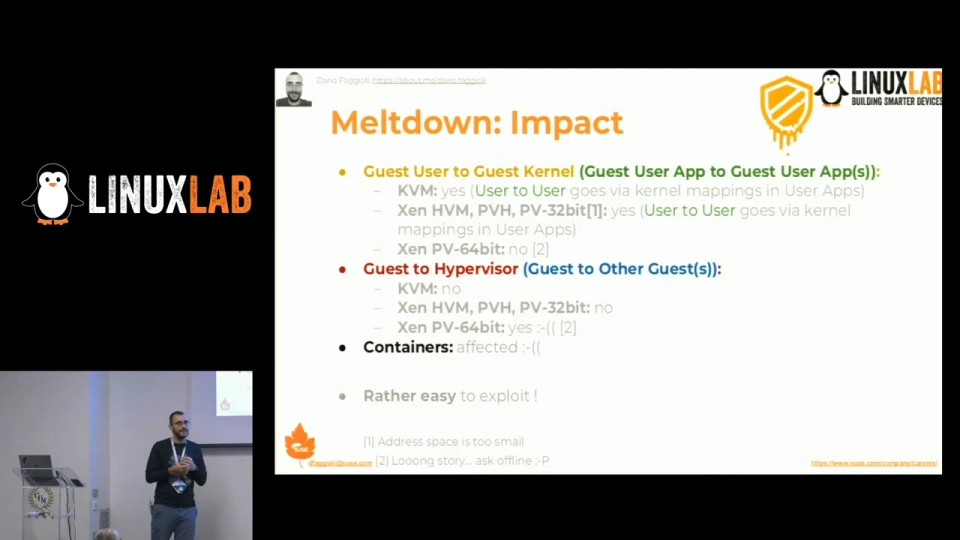

注意最后一行：**容器受影响**。容器共享同一个宿主内核，用户态与内核态之间那条「被 Meltdown 打穿」的边界，正是容器唯一的边界。

因此从虚拟化角度看，Meltdown 的修法是两头都要打补丁：**客户机内核打补丁**，保护 VM 内部应用之间；**hypervisor 层打补丁**，保护整体。[【跳转到 26:28】](https://www.youtube.com/watch?v=sdkZ042j4b0&t=1588)

### 5.3 代价：页表隔离与 PCID

Meltdown 的缓解很「简单粗暴」：既然问题是「内核内存映射进了用户地址空间」，那就**别映射了**——这就是页表隔离（Page Table Isolation，PTI）。代价是每次进出内核（系统调用、中断）都要**切换地址空间**，而切换地址空间要刷 TLB，非常伤性能。[【跳转到 26:53】](https://www.youtube.com/watch?v=sdkZ042j4b0&t=1613)

救场的是一个早就存在、但一直没人用的 CPU 特性：**PCID**（Process-Context Identifier，进程上下文标识符）。它给 TLB 表项打标签，于是切换地址空间时不必刷掉全部 TLB，可以**选择性地刷**。Intel CPU 从 2010 年起就有（Westmere 引入 PCID，Haswell 引入 `INVPCID`）；在此之前没人用它，因为「反正我们把内核映射进去了，何必呢」。Meltdown 之后，Xen 和 Linux 都开始用它。[【跳转到 28:08】](https://www.youtube.com/watch?v=sdkZ042j4b0&t=1688)

效果如何？刚出来时传闻的性能损失是 30%，实测**略好于**这个数字（降幅小于 30%），配上 PCID 后对典型负载「不算太糟」——具体多少取决于负载。

## 六、L1TF / Foreshadow：present 位也被忽略，客户机直接读宿主物理内存

### 6.1 比 Meltdown 更狠：从「读内核页」变成「读物理内存」

L1TF（L1 Terminal Fault，又称 Foreshadow / Foreshadow-NG，CVE-2018-3620 与 CVE-2018-3646）讲座里被称作**对虚拟化最要命**的一个。[【跳转到 29:48】](https://www.youtube.com/watch?v=sdkZ042j4b0&t=1788)

它和 Meltdown 是同构的，但更可怕：

- Meltdown 是「如果内核页映射在我的地址空间里，用户态就能在推测中读它」——靠的是忽略页表项的**权限位**；
- L1TF 是「**present 位**在推测中也被忽略」——于是客户机可以让 CPU 在推测中去访问一个「不存在」的地址，而物理地址的翻译结果仍然会命中 L1 缓存，**缓存命中被直接送回客户机**。结果是客户机能够直接读到宿主的物理内存。

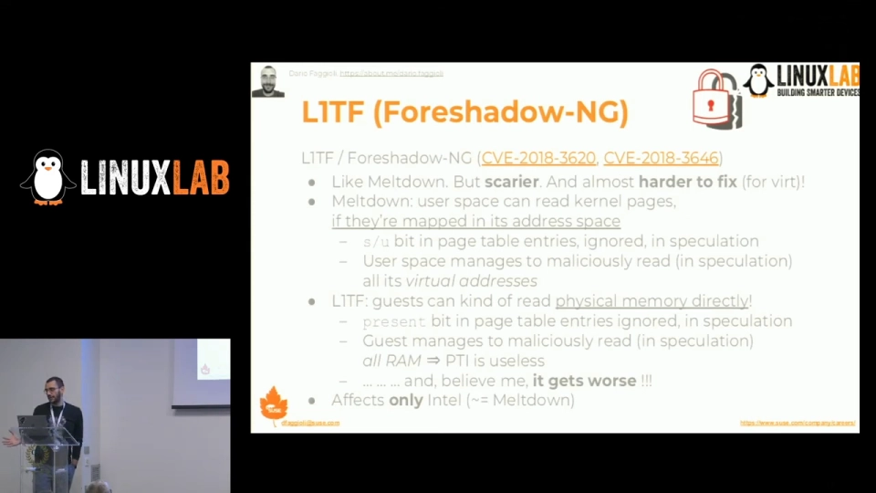

关键结论：**页表隔离（PTI）对 L1TF 无效**。PTI 解决的是「内核页不该映射进用户空间」，而 L1TF 根本不需要映射——它利用的是地址翻译失败时缓存里残留的数据。受影响范围只有 Intel（与 Meltdown 类似）。

### 6.2 一次正常访问要经过几层，泄漏就发生在哪一层

理解 L1TF 需要看清地址翻译的完整路径。客户机应用访问一个虚拟地址，先走**客户机页表**（GVA → GPA），再走**宿主页表 / EPT**（GPA → HPA），最后落到物理内存，数据被取进 L1、L2 缓存再返回给客户机。[【跳转到 30:13】](https://www.youtube.com/watch?v=sdkZ042j4b0&t=1813)

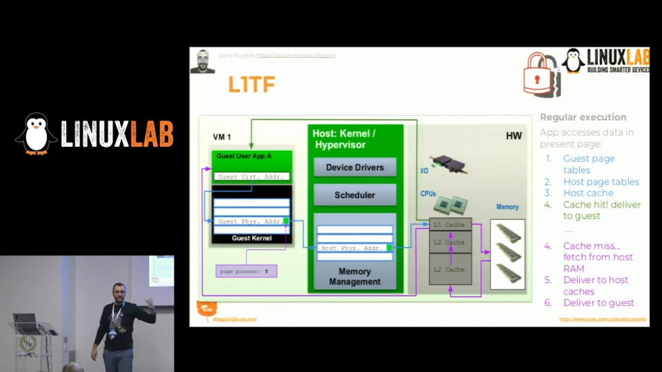

正常执行时，任何一层翻译失败都会触发 fault：客户机自己处理自己的 fault，hypervisor 处理 EPT 的 fault。但在**推测执行**时，CPU 不会停下来等 fault 处理完——它会把那个「无效」的地址继续往宿主侧翻译、去查缓存，然后把缓存里命中的内容送回客户机。[【跳转到 31:42】](https://www.youtube.com/watch?v=sdkZ042j4b0&t=1902)

这就等于**把「读宿主缓存」的能力交给了 VM**。讲者的判断很直接：从 hypervisor 的角度看，我们必须假设**任何一台 VM（哪怕是硬件虚拟化 VM）都是恶意的**，所以这是「非常非常糟」的情况。[【跳转到 32:07】](https://www.youtube.com/watch?v=sdkZ042j4b0&t=1927)

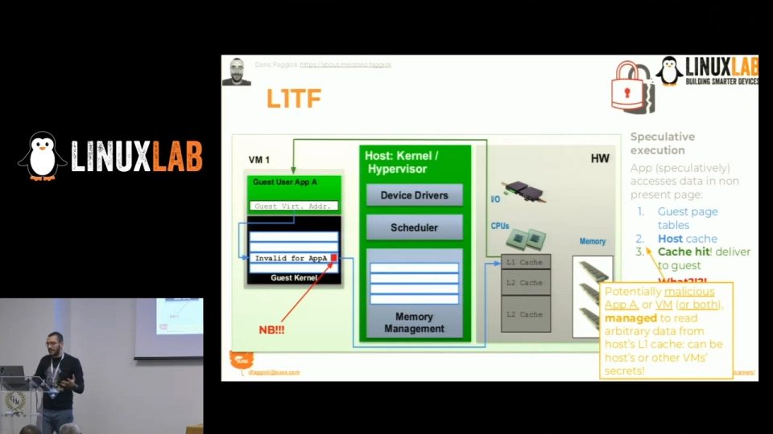

### 6.3 影响面：所有硬件虚拟化方案都中招

L1TF 的影响面比 Meltdown 大得多：[【跳转到 34:50】](https://www.youtube.com/watch?v=sdkZ042j4b0&t=2090)

| 攻击方向 | 结论 |
| --- | --- |
| 宿主用户态 → 宿主内核（含容器） | 是，但容易缓解，性能代价接近零 |
| 客户机内核 → hypervisor（含跨 VM） | Xen PV 是；Xen HVM / PVH 是；KVM 是 |
| 利用难度 | 不算难 |

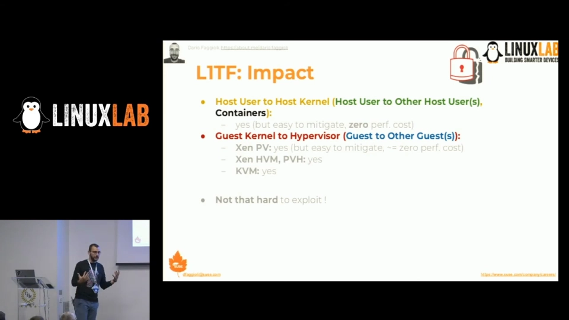

有意思的对比：**Meltdown 唯一影响的 PV 客户机，在 L1TF 下反而不受影响**（因为 PV 客户机本来就没有那套「present 位被忽略」的硬件二级翻译路径）。而所有依赖硬件两级页表的方案——也就是今天主流的硬件虚拟化——全部中招。

## 七、SMT 让两台 VM 之间连上下文切换都不需要

### 7.1 没有超线程时，中间还有一道上下文切换

如果没有超线程（SMT），攻击链条是这样的：VM 1 运行，把秘密数据装进 L1 缓存；VM 1 被换出，发生**上下文切换**；VM 2 运行，用 L1TF 读 L1 缓存，读到 VM 1 的秘密。[【跳转到 33:47】](https://www.youtube.com/watch?v=sdkZ042j4b0&t=2027)

关键在于中间那道上下文切换：内核或 hypervisor 会在切换时介入，所以**还有事情可做**（比如刷缓存、做隔离）。

### 7.2 有超线程时，两条线程并行跑，hypervisor 根本不在场

超线程改变了一切：两台 VM 可以分别跑在**同一个物理核的两个兄弟线程**上，同时运行。VM 1 把秘密放进 L1 缓存，VM 2 直接在兄弟线程上读走——**不需要上下文切换，hypervisor 连插手的机会都没有**。[【跳转到 33:22】](https://www.youtube.com/watch?v=sdkZ042j4b0&t=2002)

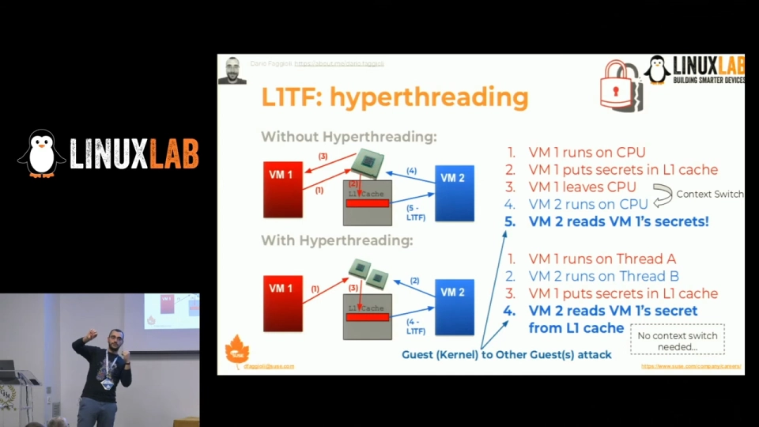

同样的问题适用于 **hypervisor 自己的数据**：如果一条线程上跑的是 hypervisor 代码，而兄弟线程上是一台恶意 VM，那么这台 VM 可以读走 hypervisor 的代码/数据，而且没有任何机制能拦住它。讲者的结论是：「我们什么都做不了。」[【跳转到 34:25】](https://www.youtube.com/watch?v=sdkZ042j4b0&t=2065)

这就是「共享资源」这条线最尖锐的地方：**SMT 把「共享」从「时间上复用」变成了「物理上同时」**，任何依赖「切换时清理」的隔离手段都失效了。

## 八、缓解的代价与云厂商的取舍

### 8.1 彻底缓解 = 关掉超线程

讲者说得很直接：L1TF 的**完整缓解**就是**禁用超线程**。如果你要「完全确定、完全安全」，这是唯一选择。[【跳转到 35:40】](https://www.youtube.com/watch?v=sdkZ042j4b0&t=2140)

但现实里有折中：如果你是云厂商、你掌控基础设施、你知道客户机的可信级别，你可以选择**保留超线程**，靠其他措施兜底，只要客户接受这个风险。讲者补充说「大多数时候这大概也是成立的」，但明确强调：**这不是完整缓解**，只是「在还有其他措施的前提下」的一种缓解。

### 8.2 关掉超线程到底损失多少

一个反直觉的结论：**关掉超线程并不等于性能减半**，因为超线程从来没有真正带来过 2 倍加速。损失因负载而异，某些负载上会比较明显。[【跳转到 36:24】](https://www.youtube.com/watch?v=sdkZ042j4b0&t=2184)

### 8.3 不关超线程的替代思路

讲座最后列了几条「正在研究中」的替代方案：[【跳转到 37:39】](https://www.youtube.com/watch?v=sdkZ042j4b0&t=2259)

- **影子页表（Shadow Page Tables）**：回到硬件虚拟化之前的做法，代价是慢，而且现在叠加 Meltdown 缓解后更慢；
- **核调度（Core Scheduling）**：只把**同一台 VM 的 vCPU** 放到 SMT 兄弟线程上。对「客户机 → 其他客户机」有效，但对「客户机 → hypervisor」无效，因为 hypervisor 代码仍可能和恶意 VM 共享兄弟线程。Xen 和 Linux 都在做，复杂度很高；
- **核调度 + 协同 VMExit（Coordinated VMExits）**：更复杂；
- **秘密隐藏（Secret Hiding）**：Hyper-V 差不多做完了，Xen 也许能做，KVM 很难；
- **影子页表 + 滥用 Intel 特性加速**（CR3 白名单、PML 等，原本是为热迁移做的）：还在「头脑风暴」阶段。

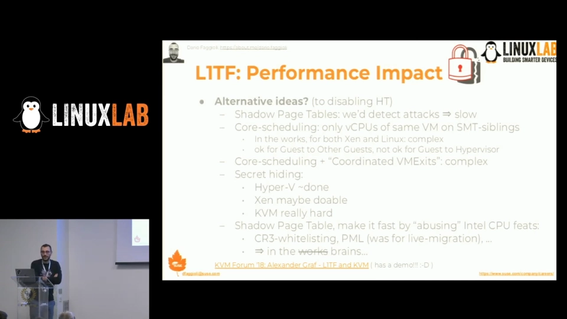

### 8.4 每个平台都有开关，选哪个要自己测

讲座的落脚点很务实：每个虚拟化平台（Xen、KVM）都提供了各种缓解的**可调开关**，可以启用/禁用、选择变体。如果你在意这件事，就应该**实际测一测各种缓解对你负载的影响，再选最合适的那一个**。[【跳转到 38:29】](https://www.youtube.com/watch?v=sdkZ042j4b0&t=2309)

讲者的总结是：这些问题难，是因为技术本身难，也是因为后果严重——它们真的能导致数据被窃取，性能影响也真实存在。但**最糟的做法是尖叫着跑开**；正确做法是评估风险、评估性能影响，然后选最优解。厂商当年选择了「性能优先」，现在就得承担后果。[【跳转到 39:19】](https://www.youtube.com/watch?v=sdkZ042j4b0&t=2359)

## 小结

- 推测执行的设计建立在「回滚不留痕」和「猜测不可探测」两条假设上，而这两条**都不成立**：寄存器能回滚，缓存、TLB、分支预测器回滚不了。
- 虚拟化边界保护的是**架构状态**（地址空间、页表、寄存器），保护不了**微架构状态**。共享的那部分——L1/L2 缓存、TLB、BTB/分支预测器、SMT 兄弟线程、两级页表——就是侧信道的通道。
- **Spectre v1** 打条件分支预测，靠人工审计 + array_index_mask_nospec() 之类的原语缓解，性能代价接近零，但影响面覆盖所有 CPU。
- **Spectre v2** 打间接分支预测，BTB 的历史是**物理核共享**的：用户态影响内核态，SMT 兄弟线程互相影响，因此客户机能打到 hypervisor 和其他客户机。缓解是 retpoline 加 `IBRS`/`IBPB`/`STIBP`，代价看硬件也看负载，x86 上表现为慢速 MSR 写。
- **Meltdown** 只打用户/内核边界：VM 内应用能读同 VM 其他应用，读不到 hypervisor 和其他 VM（Xen PV 是例外）。缓解是页表隔离 + PCID，代价是地址空间切换。
- **L1TF / Foreshadow** 打的是 present 位：客户机能在推测中读到宿主物理内存，**PTI 无效**，所有硬件虚拟化方案中招，只有 Intel 受影响。
- **SMT** 把共享从「时间复用」变成「物理同时」：两台 VM 并行跑在兄弟线程上，不需要上下文切换，hypervisor 无从插手。完整缓解只有**关闭超线程**。
- 不关超线程的替代方案（核调度、影子页表、秘密隐藏）都还在研究中；实际部署时应当**按负载实测各种缓解的代价再选**。

## 关键术语速查

| 术语 | 一句话解释 |
| --- | --- |
| 推测执行（speculative execution） | CPU 在等数据时先按预测往下执行，猜错再回滚 |
| 侧信道（side channel） | 不直接读数据，而是通过观察共享资源的状态反推数据 |
| 泄漏小工具（leaky gadget） | 目标代码里「越权读 + 影响缓存」的片段，攻击者借它搬数据 |
| BTB（Branch Target Buffer） | 记录间接分支历史目标的缓冲，Spectre v2 攻击的就是它 |
| EPT / NPT | 硬件提供的第二级页表，把客户机物理地址翻译成宿主物理地址 |
| PTI（页表隔离） | 把内核内存从用户地址空间里拿掉，缓解 Meltdown；对 L1TF 无效 |
| PCID | 给 TLB 表项打标签，切换地址空间时不必刷全部 TLB |
| retpoline | 纯软件缓解，把间接分支的推测困在陷阱里 |
| `IBRS` / `IBPB` / `STIBP` | 固件/微码提供的推测控制指令：限制、清空、隔离 SMT 兄弟线程的预测 |
| SMT / 超线程 | 一个物理核上跑两条线程，共享缓存与预测器 |
| L1TF / Foreshadow | 利用 present 位在推测中被忽略，读宿主 L1 缓存中的物理内存 |
