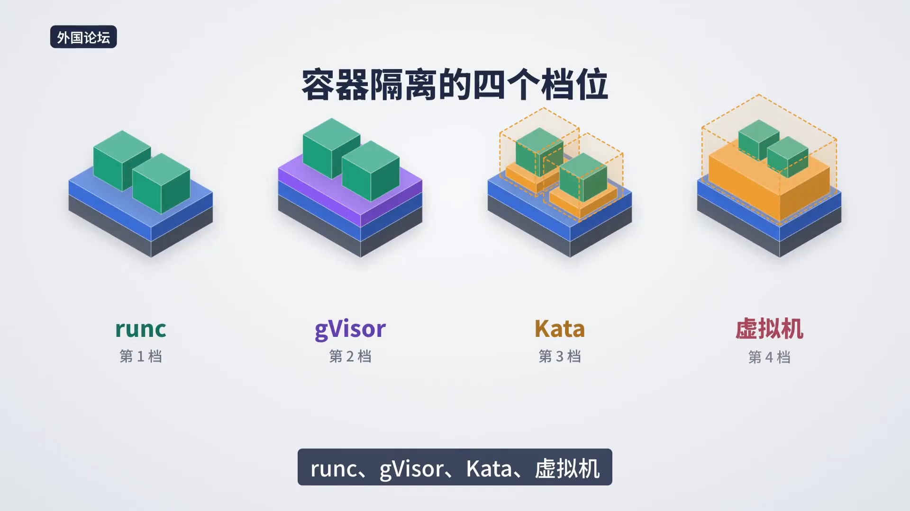
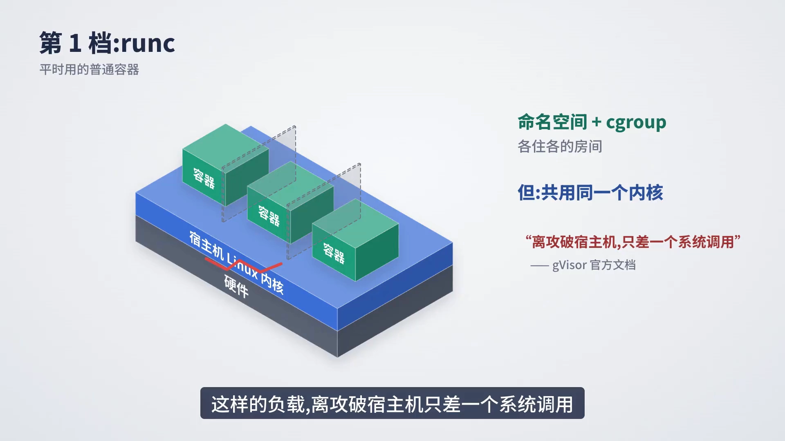
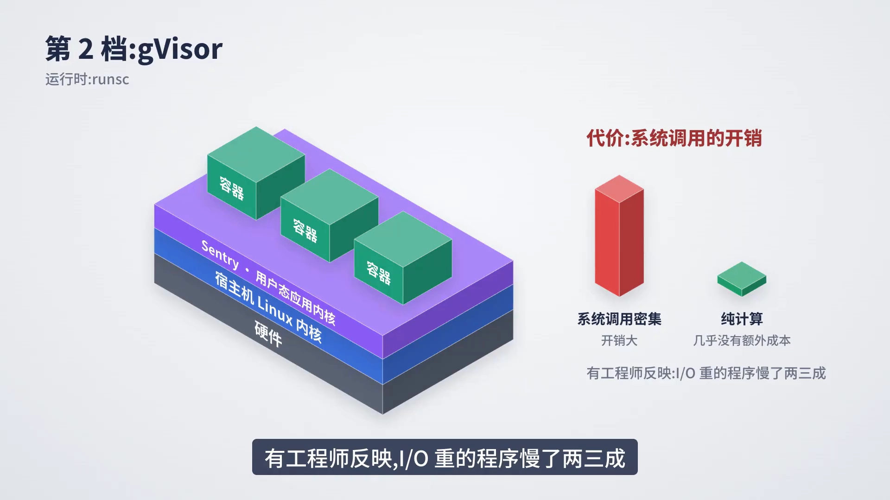
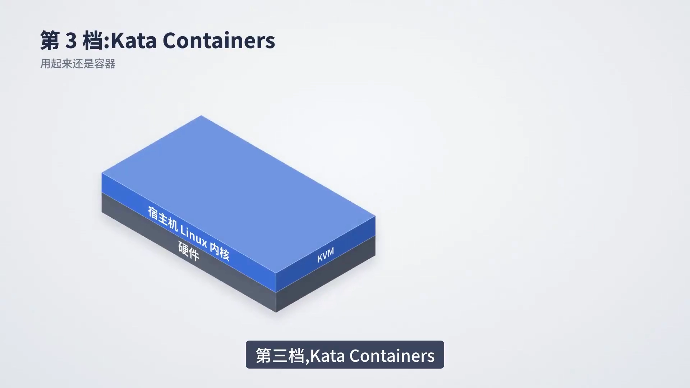
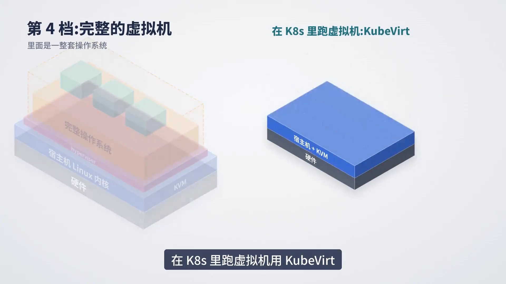
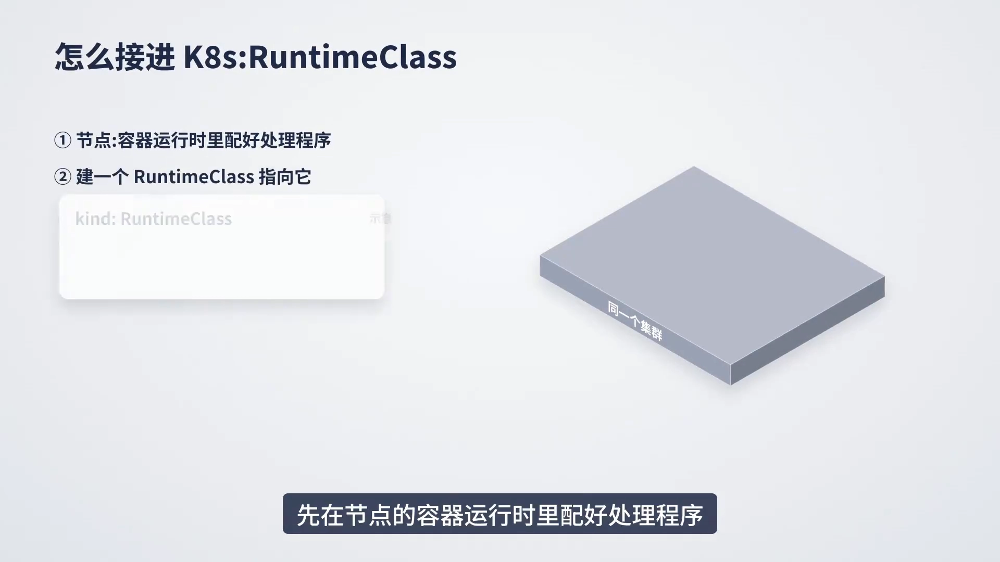
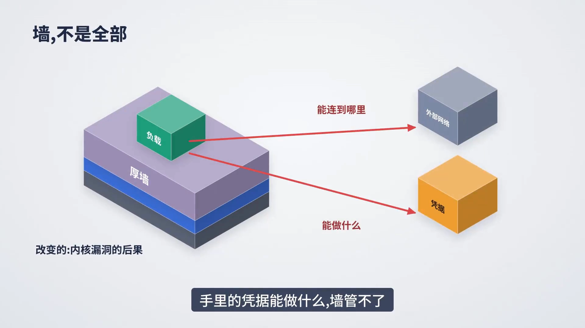
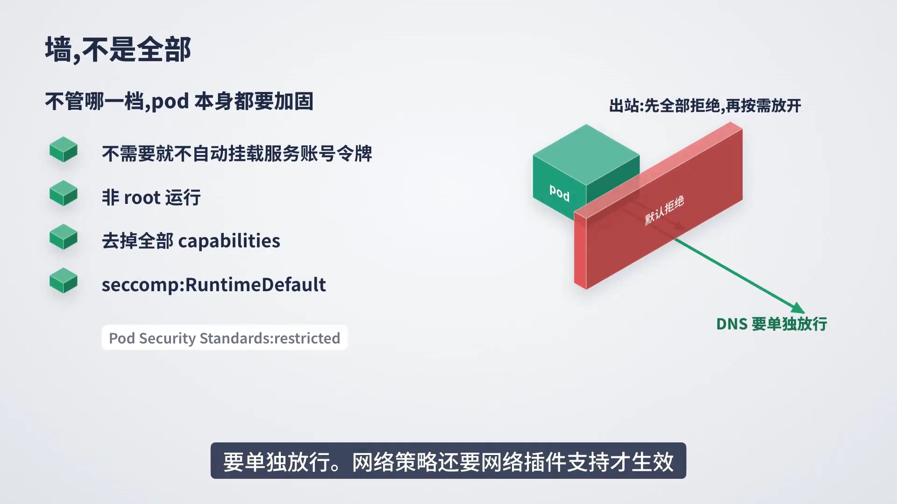
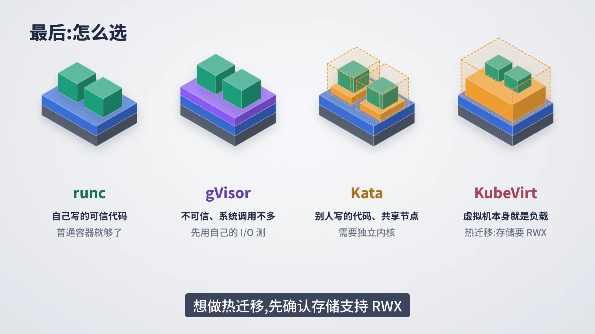

# 容器隔离的四个档位：边界画在哪一层，决定该选哪个运行时

> 视频来源：[容器隔离四个档位:runc、gVisor、Kata、虚拟机,K8s 里该用哪一档?](https://www.bilibili.com/video/BV1CFsT6XEhz/)（Bilibili · MR-PLANB）｜时长约 3 分 46 秒
> 导读：这支视频很短，讲法也很直接——用"积木"把 runc、gVisor、Kata、虚拟机四档隔离墙一层层摆出来，再说清它们怎么通过 RuntimeClass 接进 Kubernetes，最后给出一张按威胁模型选型的清单。本文按它的顺序走，落点在"横向对比与选择依据"，不重复讲某一家的内部架构（Kata 见 6.2.3，gVisor 见 6.2.4）。

## 本讲要解决的核心问题（SCQA）

**背景**：在 Kubernetes 里，`runc`、`gVisor`、`Kata`、虚拟机这四个词经常被混着用。它们都能让一个 Pod 跑起来，都能被叫作"隔离"。

**冲突**：但它们的隔离强度差着量级。同样一句"这个 Pod 已经隔离了"，在 runc 里意味着"它和别的容器共用一个内核"，在 Kata 里意味着"它有自己的内核"。视频引用了 gVisor 官方文档的一句狠话：普通容器的负载"离攻破宿主机只差一个系统调用"（[【跳转到 00:26】](https://www.bilibili.com/video/BV1CFsT6XEhz/?t=26)）。

**疑问**：这四档到底差在哪一层？在 Kubernetes 里怎么接进来？又该按什么标准选？

**回答（中心思想）**：四档的差别只有一个——**隔离墙画在哪一层**：runc 画在系统调用这一层（共用内核），gVisor 在中间插一个用户态内核，Kata 把墙挪到硬件虚拟化（每个 Pod 一个独立内核），完整虚拟机再往上加一整套操作系统。墙越往外，越安全，也越重。所以选型不是"谁更安全"，而是**按威胁模型挑一档，并让同一个集群里不同 Pod 各用各的档位**；而且墙只管"内核漏洞的后果"，管不了凭据和网络，Pod 本身还得加固。

## 一、先搭底座：所有隔离都建在同一块地基上

视频用积木做比喻，第一步是先摆底座：**最下面是硬件，上面是宿主机的 Linux 内核**（[【跳转到 00:21】](https://www.bilibili.com/video/BV1CFsT6XEhz/?t=21)）。

为什么先讲这个？因为程序要做任何"出格"的事——读文件、发网络包——最后都得通过**系统调用**（syscall）去找这个内核。系统调用是用户态程序进入内核的唯一门。所以"隔离"这件事，本质上就是回答一个问题：

> 从容器里的进程，到宿主机的内核，中间要跨过几道检查？

四档方案的区别，全部落在这个问题的答案上。

## 二、四个档位：墙一层层往外挪

### 2.1 第一档 runc：共用一个内核，只隔了"房间"

runc 就是我们平时用的普通容器。容器之间靠 **namespace**（命名空间，让进程看不到别人的进程、网络、挂载点）和 **cgroup**（控制组，限制它能用多少 CPU 和内存）隔开——视频的说法很形象："各住各的房间"。

但所有容器**共用同一个宿主机内核**。这就意味着：容器里的进程一旦找到一个内核漏洞，就能顺着系统调用爬出去，直接落到宿主机上。gVisor 官方文档的措辞是"离攻破宿主机只差一个系统调用"（[【跳转到 00:26】](https://www.bilibili.com/video/BV1CFsT6XEhz/?t=26)）。

换句话说，runc 的隔离边界是**逻辑边界**（内核帮你判断"这个进程该不该看到那个资源"），不是**物理边界**（硬件强制"这个进程根本碰不到那块内存"）。逻辑边界的安全性，等于内核那几千行 C 代码的正确性。

### 2.2 第二档 gVisor：在中间插一个用户态内核

gVisor 的思路是：既然危险在于"程序直接和宿主内核说话"，那就在中间加一个翻译层。它在容器和宿主机内核之间插进一个**用户态的应用内核**，叫 Sentry。程序的系统调用由 Sentry 自己处理，Sentry 再只向宿主内核发起很少一部分系统调用（[【跳转到 00:51】](https://www.bilibili.com/video/BV1CFsT6XEhz/?t=51)）。

代价也很明确，视频引了 gVisor 官方性能指南的说法：

- **开销集中在系统调用密集的程序上**——每一次 syscall 都要多走一层用户态实现；
- **纯计算几乎没有额外成本**——CPU 密集型程序感知不到这层墙；
- 有工程师反映 **I/O 重的程序慢了两三成**。

所以视频给了一句很实在的提醒："一定要拿自己的负载测"（[【跳转到 01:16】](https://www.bilibili.com/video/BV1CFsT6XEhz/?t=76)）。这句话是整个选型里最容易被忽略的一条：gVisor 的性价比高度依赖负载形状，别人测出来的数字对你没有意义。

### 2.3 第三档 Kata Containers：每个 Pod 一台轻量虚拟机

Kata 把墙挪到了硬件虚拟化这一层：每个 Pod 跑在一台轻量虚拟机里，**有自己独立的内核**，再用硬件虚拟化做第二道防线。但"用起来它还是一个容器"——镜像、命令行、K8s 接口都不变（[【跳转到 01:21】](https://www.bilibili.com/video/BV1CFsT6XEhz/?t=81)）。

Kata 底下可以换不同的 hypervisor，视频列了三个，各自的定位很清楚：

| hypervisor | 视频里的定位 |
| --- | --- |
| Firecracker | 设备最少、启动快、占用小 |
| Cloud Hypervisor | Rust 系 VMM 的另一个选择 |
| QEMU | 要用 GPU 的话，官方文档说目前以 QEMU 为主 |

这张小表其实回答了"Kata 里为什么还要分三种 hypervisor"——**不是性能调优，而是设备支持范围不同**。设备越少启动越快，但能直通的东西也越少；要 GPU 就得回到设备模型更全的 QEMU。这正是本系列一直在讲的"设备最小化换启动时间"的另一面（见 6.1.1）。

### 2.4 第四档 完整虚拟机：里面是一整套操作系统

第四档是完整虚拟机：里面装的是一整套操作系统，而不是一个容器进程。视频提到论坛上的一个共识——**Kata 和虚拟机的隔离强度差不多，差别在用法**：Kata 当容器用，虚拟机当机器用（[【跳转到 01:46】](https://www.bilibili.com/video/BV1CFsT6XEhz/?t=106)）。

在 Kubernetes 里跑虚拟机用 **KubeVirt**。视频特意澄清了一个常见误解：KubeVirt **不是 hypervisor**，它是 Kubernetes 上的一层管理——调度、网络、存储交给 K8s 这一层，底层虚拟化靠 KVM（[【跳转到 02:03】](https://www.bilibili.com/video/BV1CFsT6XEhz/?t=123)）。所以"KubeVirt 和 Kata 怎么区分"的答案是：Kata 让容器看起来像虚拟机（为了安全），KubeVirt 让虚拟机看起来像 Pod（为了运维）。

## 三、怎么接进 K8s：RuntimeClass 让同一集群按档位分流

四档都能在 K8s 里跑，靠的是 **RuntimeClass**（运行时类）。视频把接入步骤压成两步（[【跳转到 02:16】](https://www.bilibili.com/video/BV1CFsT6XEhz/?t=136)）：

1. **节点侧**：在节点的容器运行时（containerd / CRI-O）里配好对应的处理程序（handler），比如给 gVisor 配一个 `runsc` handler，给 Kata 配一个 `kata-qemu` handler；
2. **集群侧**：建一个 `RuntimeClass` 对象指向这个 handler，Pod 里写上 `runtimeClassName`，调度到这个节点的 Pod 就用这一档来运行。

这个机制的关键含义是：**隔离强度不是集群级开关，而是 Pod 级属性**。同一个集群里，不同的 Pod 可以选不同的档位——跑自己业务的 Deployment 用默认的 runc，跑用户提交代码的 Job 指定 `runtimeClassName: gvisor`，跑需要独立内核的多租户负载指定 `kata`。这就是"混合部署"的落地方式，也是本小节结论里最重要的一条工程实践。

## 四、墙不是全部：Pod 本身还得加固

视频中段有一个很值得记住的转折：讲完四档墙之后，它说"墙，不是全部"（[【跳转到 02:37】](https://www.bilibili.com/video/BV1CFsT6XEhz/?t=157)）。

理由是：隔离墙改变的是"**内核漏洞的后果**"，它管不了两件事——

- 这个负载在网络上**能连到哪里**；
- 它手里的**凭据能做什么**。

一个跑在 Kata 里的容器，如果挂着集群的 service account token、能访问任意公网地址，那么它被攻破后的破坏力，可能比一个跑在 runc 里但什么都不挂的容器更大。所以视频说："不管用哪一档，Pod 本身都要加固。"

具体的加固清单（[【跳转到 02:49】](https://www.bilibili.com/video/BV1CFsT6XEhz/?t=169)）：

- **不需要就不自动挂载服务账号令牌**（`automountServiceAccountToken: false`）；
- **非 root 用户运行**；
- **去掉全部 capabilities**；
- **seccomp 用 `RuntimeDefault`**；
- **出站流量先默认全部拒绝，再按需放开**。

最后一条有个容易踩的坑：默认拒绝**也会挡住 DNS**，所以要单独放行 DNS；而且网络策略还要网络插件支持才真正生效。视频把这一组要求归到 Kubernetes 的 **Pod Security Standards: restricted** 档（[【跳转到 03:08】](https://www.bilibili.com/video/BV1CFsT6XEhz/?t=188)）。

## 五、怎么选：一张按威胁模型的清单

视频最后给的选择清单，本质上是把"威胁模型"翻译成"档位"（[【跳转到 03:13】](https://www.bilibili.com/video/BV1CFsT6XEhz/?t=193)）：

| 你的处境 | 选哪一档 | 依据 |
| --- | --- | --- |
| 自己写的可信代码 | runc（普通容器） | 共用内核的风险由"代码可信"兜住，换来最好的兼容性和密度 |
| 不可信、但系统调用不多的负载 | gVisor | 墙够厚，代价只在 syscall 密集处；**先用自己的 I/O 模式测** |
| 在共享节点上跑别人写的代码，或需要独立内核 | Kata | 每个 Pod 一个内核，硬件虚拟化兜底 |
| 虚拟机本身就是负载 | KubeVirt | 要的是"一台机器"，不是"一个进程" |
| 想做热迁移 | KubeVirt | 但要先确认存储支持 RWX（多节点读写） |

这张表有两条隐含的判断值得说透：

1. **"可信"是选 runc 的前提，不是 runc 的结论**。runc 之所以够用，是因为代码是你写的、镜像来自你的仓库；一旦代码来源变成"任意用户提交"，这一档就不成立了。
2. **gVisor 与 Kata 的分界线不是"安全强度"，而是"系统调用密集度"和"是否需要独立内核"**。gVisor 便宜在启动和内存，贵在 syscall；Kata 便宜在兼容性（完整内核），贵在启动和内存。选错的典型症状是：给一个 I/O 密集的服务上了 gVisor，结果慢了三成；或者给一个只需要拦 syscall 的场景上了 Kata，白付了启动开销。

## 小结

- 四档隔离的区别只有一个变量：**墙画在哪一层**。runc 画在系统调用层（共用内核），gVisor 插一层用户态内核，Kata 挪到硬件虚拟化（每 Pod 一个内核），完整虚拟机再加一整套操作系统。
- **墙越厚，代价越具体**：gVisor 的代价是 syscall 开销（I/O 重的程序慢两三成），Kata 的代价是每 Pod 一台轻量 VM 的启动与内存，完整虚拟机的代价最重但什么都能跑。
- 接入 K8s 靠 **RuntimeClass**：节点侧配 handler，集群侧建 RuntimeClass，Pod 里写 `runtimeClassName`。**隔离强度是 Pod 级属性**，所以同一个集群可以按档位分流。
- 选型的正确问法是"我的威胁模型是什么"，不是"哪个更安全"：可信代码用 runc，不可信且 syscall 不多用 gVisor（先测），共享节点上跑别人的代码用 Kata，机器本身是负载用 KubeVirt。
- **墙不是全部**。隔离墙只管内核漏洞的后果，管不了凭据和网络；无论哪一档，Pod 都要按 restricted 标准加固。
- 视频最后一句提醒也值得抄下来：本期观点来自论坛讨论，**技术细节以各项目的官方文档为准**。

## 关键术语速查

| 术语 | 一句话解释 |
| --- | --- |
| runc | 最常用的 OCI 容器运行时，用 namespace + cgroup 隔离，所有容器共用宿主内核 |
| namespace | 命名空间，让进程只看到属于自己的进程、网络、挂载点等资源视图 |
| cgroup | 控制组，限制一组进程能用多少 CPU、内存、I/O |
| gVisor | 在应用和宿主内核之间插一个用户态内核（Sentry）的容器运行时，运行时命令是 `runsc` |
| Sentry | gVisor 的用户态内核，替应用处理系统调用，只向宿主内核发少量调用 |
| Kata Containers | 把每个 Pod 装进一台轻量虚拟机的容器运行时，Pod 有独立内核，用起来仍是容器 |
| hypervisor | 虚拟机监视器，负责创建和运行虚拟机；Kata 可选 QEMU、Cloud Hypervisor、Firecracker 等 |
| KubeVirt | 让 Kubernetes 能调度和管理虚拟机的管理层，本身不是 hypervisor，底层靠 KVM |
| RuntimeClass | Kubernetes 的资源对象，把 Pod 指向节点上某个容器运行时 handler |
| seccomp | 系统调用过滤器，用白名单限制进程能发起哪些 syscall |
| capabilities | Linux 把 root 特权拆成的一组细粒度权限，容器里通常应全部去掉 |
| Pod Security Standards | Kubernetes 官方的 Pod 安全基线，分 privileged、baseline、restricted 三档 |
| RWX | ReadWriteMany，多节点同时读写挂载，虚拟机热迁移对存储的要求 |