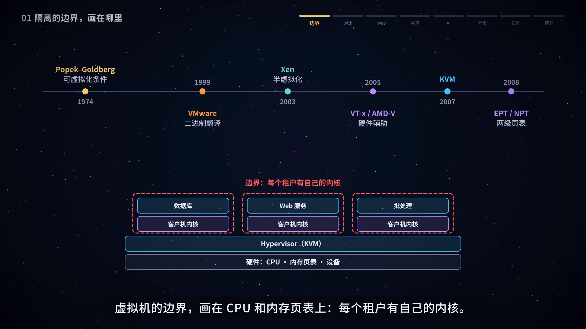
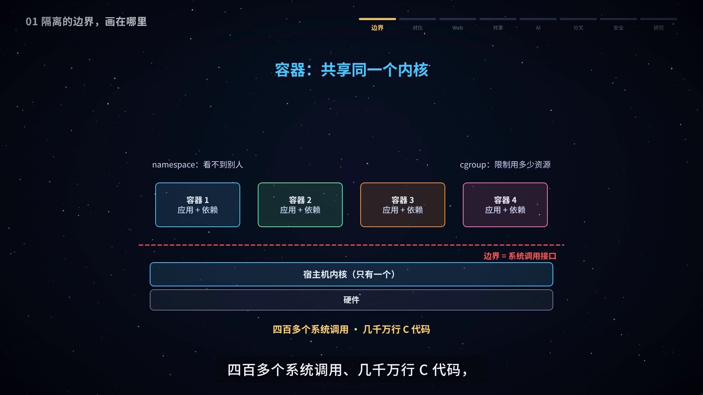
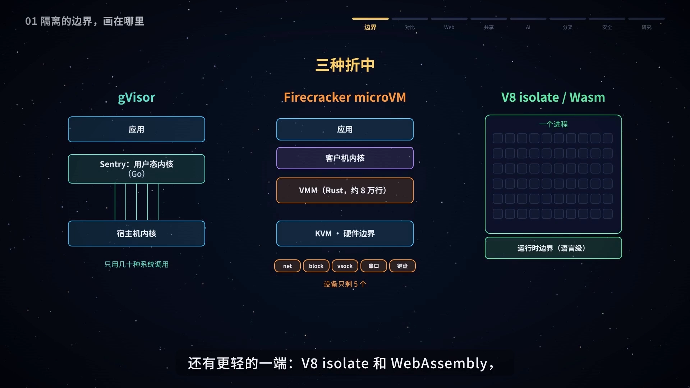
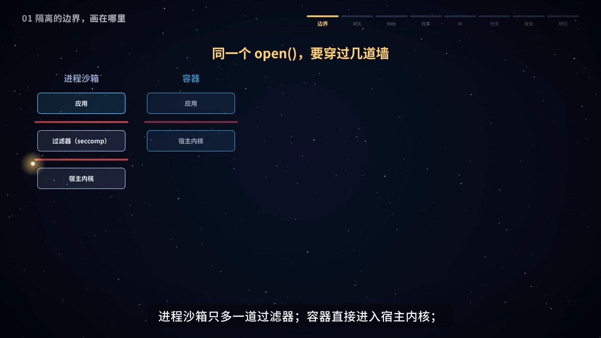
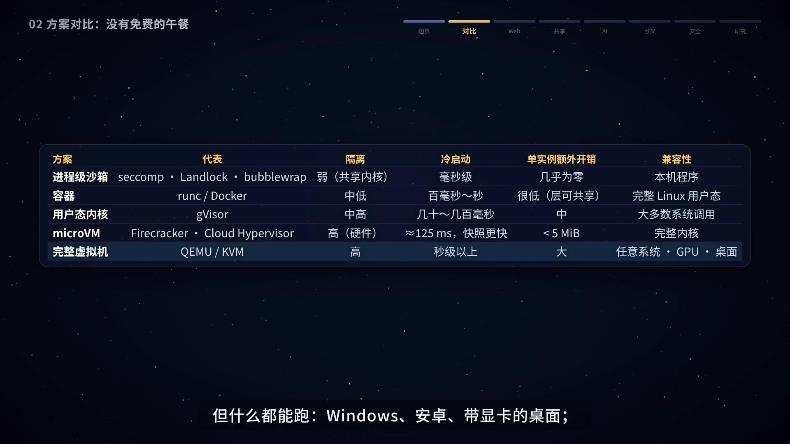
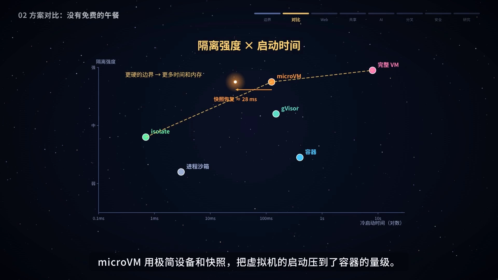
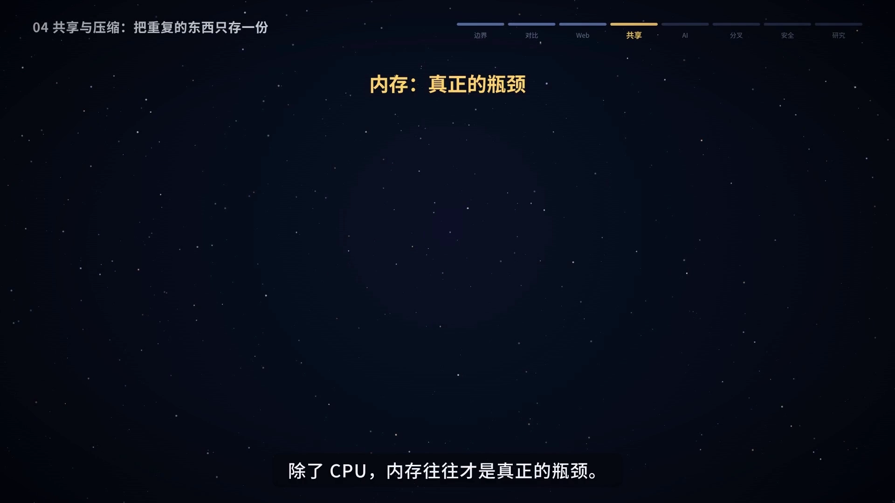
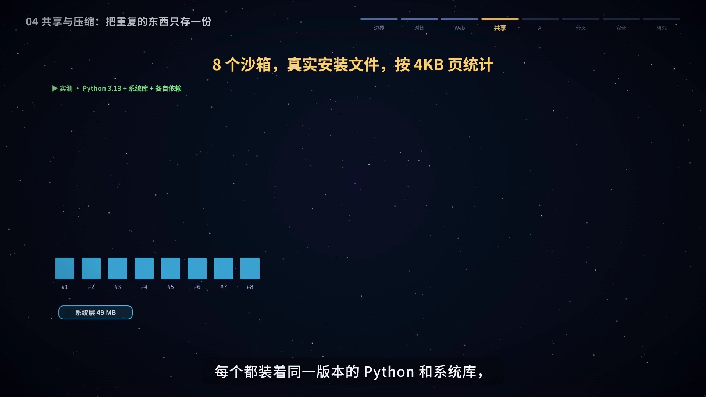
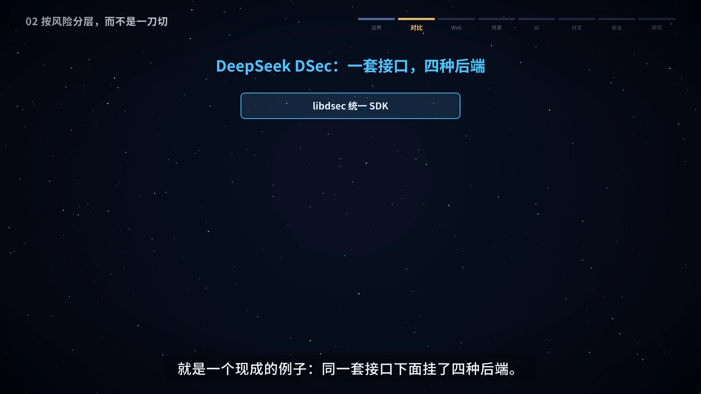
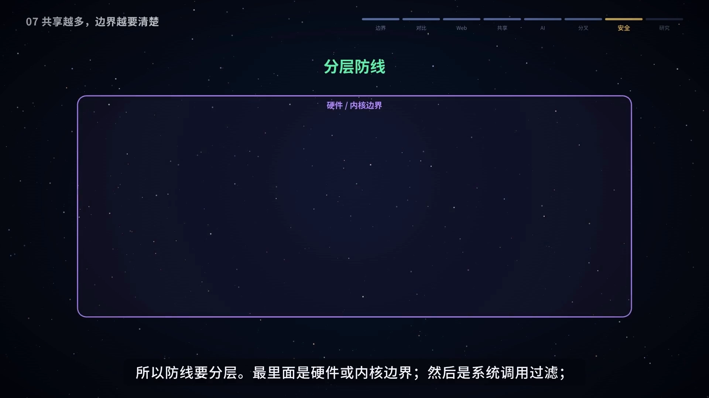

# 隔离强度换密度：四类沙箱运行时的量化对比与分层选型

> 视频来源：[隔离与密度：从虚拟机、容器、microVM 到 AI Agent 沙箱，一集讲清虚拟化的取舍](https://www.bilibili.com/video/BV1DyJ86pEWM/)（Bilibili · 题叶）｜时长约 16 分钟
> 导读：这支视频把"隔离和密度"这条主线从 1974 年讲到 2026 年，覆盖面很宽。本文只取其中**"边界划在哪一层 + 四维对比 + 按风险分层"**这一段，也就是本小节要的"内核共享与内核独立的对比结论"。视频后半段的 serverless 计费、AI agent 沙箱、快照分叉、GPU 超卖与研究前沿不在本篇范围（快照见第 5 章，设备最小化见 6.1.1）。

## 本讲要解决的核心问题（SCQA）

**背景**：虚拟化 60 年来一直在回答同一个问题——**在一台物理机器上安全地塞进尽可能多的租户**。一边是隔离（出了事，能不能关在自己的格子里），一边是密度（同样的硬件能不能卖给更多的人）。

**冲突**：这两个目标直接对立。墙越厚越安全，但每加一层墙，启动就更慢、内存就更贵、能塞的租户就更少。而业界常见的做法是"先选一个最好的运行时"，然后把它套到所有负载上——这等于用一个数字回答两个互相矛盾的需求。

**疑问**：几种隔离方案的边界到底画在哪一层？它们在启动速度、单实例开销、兼容性上各付多少代价？有没有一个统一的选型标准？

**回答（中心思想）**：把主流方案画在"隔离强度 × 启动时间"这张图上，会看到一条**前沿线**：想要更硬的边界，就得付更多的时间和内存。所以结论不是"谁更安全"，而是**按威胁模型分层**——可信代码用容器，不可信代码用 microVM 或 gVisor，要显卡或别的操作系统上完整虚拟机；而且这些后端可以挂在同一套接口、同一个集群下面。

## 一、两条路线的分岔：边界画在 CPU 上，还是画在系统调用上

### 1.1 内核独立：虚拟机的边界花在 CPU 和内存页表上

视频先把虚拟机的历史压缩成一条时间线，因为这条线上的每一步都在解决同一个问题：**怎么让"敏感指令"被拦下来**。

- **1974 年，Popek 和 Goldberg** 给出了可虚拟化的条件：敏感指令必须都能被"陷入"（trap），指令集才能被高效虚拟化。
- **x86 恰好不满足**这个条件，于是先有了 VMware 的**二进制翻译**（把敏感指令在运行时改写成能触发陷入的形式），再有了 Xen 的**半虚拟化**（让客户机操作系统主动配合，自己发起 hypercall）。
- **2005 年前后**，英特尔和 AMD 在硬件里加上虚拟化支持（VT-x / AMD-V），**2008 年**再加两级页表（EPT / NPT），KVM 才把 Linux 本身变成了 hypervisor（[【跳转到 00:55】](https://www.bilibili.com/video/BV1DyJ86pEWM/?t=55)）。

结论：**虚拟机的边界花在 CPU 和内存页表上，每个租户有自己的内核**。这条边界是硬件强制的——客户机的代码再怎么写，也改不了自己那套页表指向别人。

### 1.2 内核共享：容器的边界画在系统调用这一层

容器走的是另一条路：namespace 让进程看不到别人，cgroup 限制它能用多少资源，但**所有容器共用宿主机的同一个内核**（[【跳转到 01:20】](https://www.bilibili.com/video/BV1DyJ86pEWM/?t=80)）。

这张图把两条路线的差别说得很干净：**容器的边界就是系统调用接口**。而这道接口有多大？视频给的数字是**四百多个系统调用、几千万行 C 代码**。任何一个漏洞都可能让代码从容器里跑出来。

这就把"隔离强度"这件事量化了：

- 内核独立：攻击者要突破的是**硬件虚拟化边界**，需要先找到一个 VMM 漏洞（而且 VMM 的代码量通常远小于内核）；
- 内核共享：攻击者要突破的是**整个 Linux 内核的系统调用面**，四百多个入口，任选其一。

### 1.3 三种折中：把墙往中间挪

既然两头各有代价，就有了三种折中（[【跳转到 01:45】](https://www.bilibili.com/video/BV1DyJ86pEWM/?t=105)）：

| 折中方案 | 边界挪到哪 | 关键数字 |
| --- | --- | --- |
| gVisor | 应用和宿主内核之间多一个用户态内核（Sentry，Go 写） | 自己只向宿主内核发**几十种**系统调用 |
| Firecracker microVM | 保留硬件边界，但把设备模型砍到最小 | 设备只剩 **5 个**（net、block、vsock、串口、键盘），VMM 用 Rust 写约 **8 万行** |
| V8 isolate / WebAssembly | 边界划在**语言运行时**里 | 同一个进程里可以住成千上万个租户 |

注意这三条折中的方向完全不同：gVisor 是**缩小暴露给宿主内核的接口**，microVM 是**缩小 VMM 自身**，isolate 是**根本不给原生系统调用**。

## 二、数墙：同一个 open() 要穿过几道检查

视频给了一个很好的统一视角：不看实现细节，只看**同一个"打开文件"的调用，在每种方案里要穿过几道墙**（[【跳转到 02:10】](https://www.bilibili.com/video/BV1DyJ86pEWM/?t=130)）。

- **进程级沙箱**（seccomp、Landlock、bubblewrap）：应用 → 过滤器 → 宿主内核，**只多一道**；
- **容器**：应用 → 宿主内核，**没有额外的墙**，直接进去；
- **gVisor**：应用 → 用户态内核（Sentry）→ 宿主内核；
- **microVM**：应用 → 客户机内核 → 虚拟设备 → 宿主内核；
- **isolate**：根本不能直接调用，只能用运行时给它的接口。

一句话总结：**墙越多越安全，路径也越长**。这句话把"安全"和"性能"变成了同一个变量的两端——这比笼统地说"容器不如虚拟机安全"要有用得多，因为它解释了**代价从哪来**。

## 三、四维对比：没有免费的午餐

把主流方案放进一张表，看四个维度：**隔离强度、冷启动、每个实例的额外开销、兼容性**（[【跳转到 02:42】](https://www.bilibili.com/video/BV1DyJ86pEWM/?t=162)）。

把表里的数字逐行读一遍：

| 方案 | 代表 | 隔离强度 | 冷启动 | 单实例额外开销 | 兼容性 |
| --- | --- | --- | --- | --- | --- |
| 进程级沙箱 | seccomp、Landlock、bubblewrap | 弱（共享内核） | 毫秒级 | 几乎为零 | 本机程序 |
| 容器 | runc、Docker | 中低 | 百毫秒~秒 | 很低（层可共享） | 完整 Linux 用户态 |
| 用户态内核 | gVisor | 中高 | 几十~几百毫秒 | 中 | 大多数系统调用 |
| microVM | Firecracker、Cloud Hypervisor | 高（硬件） | 约 125 ms，快照更快 | 小于 5 MiB | 完整内核 |
| 完整虚拟机 | QEMU、KVM | 高 | 秒级以上 | 大 | 任意系统、GPU、桌面 |

几个值得单独拎出来的数字：

- **Firecracker 约 125 ms、每实例额外内存不到 5 MiB**——这两个数字来自 2020 年的论文，AWS Lambda 和 Fargate 都跑在它上面。它证明了"硬件边界"和"容器级启动速度"可以同时拿到。
- **gVisor 几十到几百毫秒**，兼容大多数系统调用，Modal 和 GKE Sandbox 都用它。
- **完整 QEMU 虚拟机最慢最重**，但什么都能跑：Windows、安卓、带显卡的桌面。
- **V8 isolate 启动不到一毫秒，开销只有几兆字节**，代价是只能跑 JavaScript 和 WebAssembly。

### 3.1 前沿线：把两个维度画成一张图

把上表的"隔离强度"和"冷启动"两列抽出来画成散点图，会看到一条斜线（[【跳转到 03:07】](https://www.bilibili.com/video/BV1DyJ86pEWM/?t=187)）：

这张图是本小节最重要的结论载体，值得读三遍：

1. **斜线本身是"物理规律"**：想要更硬的边界，就得付更多的时间和内存。这不是实现不好，是结构决定的。
2. **线上的位置是"工程成绩"**：microVM 之所以在斜线上偏左上（约 125 ms 达到硬件级隔离，快照恢复还能到约 28 ms），是因为它用**极简设备 + 快照**把虚拟机的启动代价砍掉了。这条线这几年的进步，主要就是把线往左上推。
3. **线外的点是"不同取舍"**：V8 isolate 在左下（几乎不隔离，但快到没有冷启动概念），完整 VM 在右上（最硬，但秒级）。它们不在同一条竞争关系里，因为服务的负载不同。

## 四、密度：每加一层隔离，密度就打一次折

隔离的代价最终会兑现成"一台机器能放几个"。视频给了一个非常直观的数字：**同样一个节点，最多能放 3200 个容器，或者 800 个 microVM**（[【跳转到 03:57】](https://www.bilibili.com/video/BV1DyJ86pEWM/?t=237)）。

也就是说，从内核共享换到内核独立，密度大约掉到四分之一。这个比例不是抽象概念，它直接换算成单位成本。

### 4.1 真正的瓶颈是内存，不是 CPU

视频有一句话很关键："除了 CPU，内存往往才是真正的瓶颈"（[【跳转到 05:57】](https://www.bilibili.com/video/BV1DyJ86pEWM/?t=357)）。

因为每个实例都有一份"固定开销"：内核页、运行时、共享库。容器共享内核，这份开销被摊薄；microVM 每个都要一份 guest 内核，这份开销就变成乘法。

### 4.2 一个可以复现的去重实验

视频做了一个实测：模拟八个沙箱，每个都装着同一版本的 Python 和系统库，再各自装上不同的项目依赖，用的都是真实的安装文件（[【跳转到 06:22】](https://www.bilibili.com/video/BV1DyJ86pEWM/?t=382)）。

| 共享方式 | 总内存 | 相对不共享 |
| --- | --- | --- |
| 不做任何共享 | 1480 MB | 100% |
| 按镜像层共享（只有公共基础层存一份） | 1138 MB | 77% |
| 按 4KB 页面内容去重（相同包在不同沙箱里各装一份也能认出来） | 567 MB | 38% |

**省掉六成多**。这个实验的意义在于：它说明"密度"不是只能靠减少隔离层数来换，还可以靠**共享**来换——同一份只读数据，八个沙箱没必要各存一份。

视频还列了更新一代的手段：空闲页上报（客户机主动告诉宿主哪些页没用）、virtio-mem（按块热插拔内存）、DAMON（统计冷热页，把冷的挪到更便宜的地方）、virtio-pmem（让客户机直接映射宿主机上的镜像文件，同一份数据不再两边各缓存一次，峰值内存降 40%）。

### 4.3 共享的代价：侧信道

但共享不是免费的。视频紧接着说："共享是有代价的：去重会带来侧信道"（[【跳转到 07:37】](https://www.bilibili.com/video/BV1DyJ86pEWM/?t=457)）。

- 攻击者可以通过**写入耗时**判断别人的内存里有没有某一页；
- 2014 年起 VMware 默认关闭了虚拟机之间的页面共享。

所以规则是：**共享越多，越要想清楚和谁共享**。这条线属于侧信道与共享资源的问题，本系列 7.2.1 专门讲，这里只记结论：去重能换密度，但会削弱隔离，两者要在同一个威胁模型下一起算。

## 五、分层选型：不是选一个最好的，而是按风险分层

到这里，结论自然浮出来（[【跳转到 03:32】](https://www.bilibili.com/video/BV1DyJ86pEWM/?t=212)）：

> 业界的共识不是选一个最好的，而是**按风险和负债分层**。

| 负载性质 | 选哪一档 | 依据 |
| --- | --- | --- |
| 自己写的、可信的服务，要吞吐 | 容器或 isolate | 共用内核的风险由"代码可信"兜住，换来最好的密度和兼容性 |
| 不可信的代码，但需要完整 Linux | microVM 或 gVisor | 墙够厚，且能跑完整用户态 |
| 需要显卡、图形界面或别的操作系统 | 完整虚拟机 | 只有完整设备模型和任意系统能覆盖 |

### 5.1 一个现成的例子：一套接口，四种后端

视频举了 DeepSeek 在 2026 年 9 月公开的 **DSec** 沙箱平台（[【跳转到 03:57】](https://www.bilibili.com/video/BV1DyJ86pEWM/?t=237)）：

同一套接口（`libdsec` 统一 SDK）下面挂了四种后端，按任务性质分流：

- **短小的函数调用** → 预先建好的**容器**（要的是毫秒级和密度）；
- **软件工程任务**（拉仓库、装依赖、跑测试）→ 跑在**虚拟机里的容器**（要的是完整环境和隔离）；
- **安全敏感的任务** → **Firecracker microVM**（要的是硬件边界）；
- **要安卓或图形界面** → 完整的 **QEMU 虚拟机**。

这就是"混合部署"的具体形态：**对外一套 API，对内按威胁模型路由到不同后端**。对应到 Kubernetes，落地手段就是上一节讲的 RuntimeClass——同一个集群里，不同 Pod 指定不同的运行时类。

### 5.2 墙之外：防线要分层

视频在末尾补了一个很重要的限定：**隔离墙只是最里面的一层**（[【跳转到 13:59】](https://www.bilibili.com/video/BV1DyJ86pEWM/?t=839)）。

从里到外依次是：

1. **硬件或内核边界**（microVM / gVisor / 容器）；
2. **系统调用过滤**（seccomp）；
3. **按域名的网络出口白名单**；
4. **密钥代理**——沙箱里根本不放真实密钥，请求经过外部代理时才注入；
5. **审计和回放**——每一步做了什么事后都能查。

这个分层解释了一个常见误区：**"我上了 Kata 就安全了"是不成立的**。如果沙箱里放着长期云密钥、出站不设限，那么最里面那层墙再厚，被攻破后的破坏力也不会小。反过来，如果密钥是代理注入的、出站默认拒绝，那么容器的墙薄一点也未必致命。

## 小结

- 两条路线的分岔只有一句话：**内核独立的边界花在 CPU 和内存页表上（每租户一个内核），内核共享的边界画在系统调用这一层（四百多个入口、几千万行 C 代码）**。
- 三种折中把墙往中间挪：gVisor 缩小暴露给宿主的接口（只发几十种调用），microVM 缩小 VMM 自身（5 个设备、约 8 万行 Rust），isolate 干脆不给原生系统调用。
- **墙越多越安全，路径也越长**——这是理解所有性能代价的统一视角。
- 四维对比表给出了可比的数字：容器百毫秒~秒、gVisor 几十~几百毫秒、microVM 约 125 ms 且额外内存不到 5 MiB、完整 VM 秒级以上、V8 isolate 不到 1 ms。
- 画成"隔离强度 × 启动时间"的散点图会看到一条**前沿线**：更硬的边界必然更慢更贵；microVM 的贡献是把这条线往左上推。
- **密度的代价是四倍左右**（同节点 3200 容器 vs 800 microVM），而内存才是真瓶颈；共享（镜像层、页面去重）能把内存降到 38%，但会引入侧信道。
- 选型的正确形式是**按风险分层**，并且**一套接口挂多种后端**（DSec 是现成例子；K8s 里对应 RuntimeClass）。
- 最后别忘了：**隔离墙只是最里面一层**，外面还有 syscall 过滤、出口白名单、密钥代理和审计。

## 关键术语速查

| 术语 | 一句话解释 |
| --- | --- |
| Popek-Goldberg 条件 | 1974 年提出的可虚拟化判据：敏感指令必须都能被陷入 |
| 二进制翻译 | 运行时把敏感指令改写成能触发陷入的形式，让不满足条件的 x86 也能被虚拟化 |
| 半虚拟化 | 让客户机操作系统主动配合 hypervisor，用 hypercall 代替陷入 |
| EPT / NPT | Intel / AMD 的二级页表，硬件完成客户机物理地址到宿主物理地址的翻译 |
| 系统调用面 | 内核暴露给用户态的全部 syscall 入口，是内核共享路线的攻击面 |
| Sentry | gVisor 的用户态内核，替应用处理系统调用，只向宿主内核发少量调用 |
| microVM | 只保留最小设备集的轻量虚拟机，代表是 Firecracker、Cloud Hypervisor |
| V8 isolate | V8 引擎内的独立执行环境，同一进程里可容纳成千上万个，边界在语言运行时 |
| 冷启动 | 从零创建实例到能处理请求的耗时 |
| 单实例额外开销 | 每个实例除业务本身外固定占用的内存，如内核页、运行时、共享库 |
| 页面去重（KSM） | 内容相同的内存页只保留一份，写时再复制，用于提升密度 |
| 侧信道 | 通过耗时、缓存等间接信息推断他人数据的攻击方式，共享越多风险越大 |
| RuntimeClass | Kubernetes 资源对象，把 Pod 指向节点上某个容器运行时 handler |