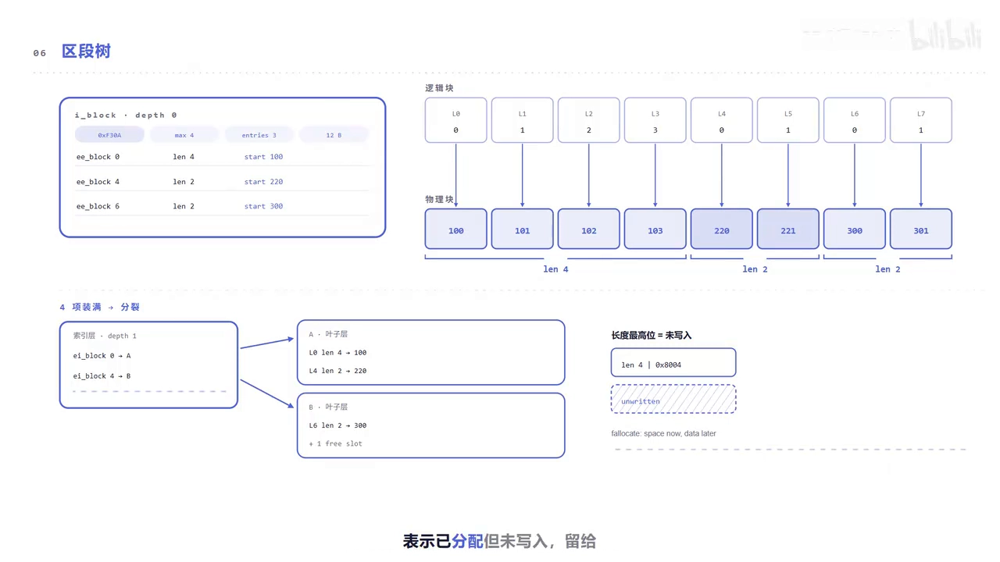
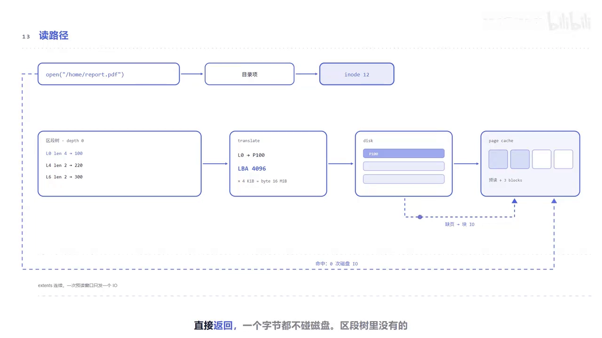
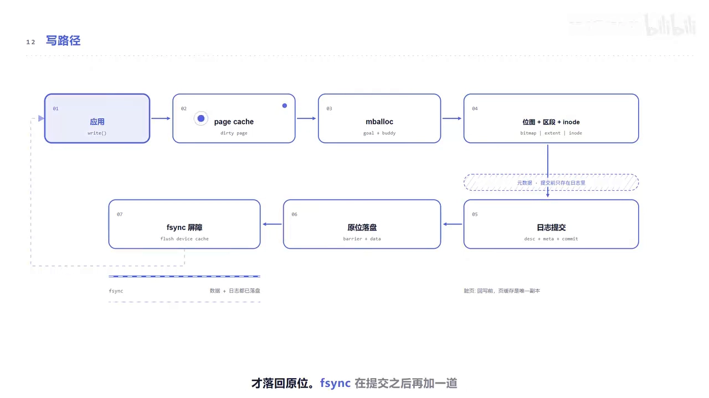

# EXT4 的 inode、区段树与块分配：一块盘怎么变成无数个文件

> 视频来源：[一块盘怎么变成无数个文件？EXT4深度解析！](https://www.bilibili.com/video/BV14Txg6zEnR/)（B 站 · 内核聊内核）｜时长约 7 分钟
>
> 导读：这是一支信息密度很高的动画讲解，7 分钟把 ext4 的「四张表」（超级块、组描述符、inode、区段树）和「两条路径」（读是翻译、写是记账）完整串了一遍。本文只取其中与**数据布局**相关的那条线：inode 里存什么、extent（区段）比块列表省了什么、块分配器怎么挑空闲块、空洞与小文件怎么处理。目录项与日志只讲到能串起上下文为止，不展开。

## 本讲要解决的核心问题（SCQA）

**背景**：文件系统要对上层回答一个很朴素的问题——「这个文件的第 N 个字节，在磁盘的哪一块上？」

**冲突**：早期 FAT32 的做法是**用一条链把块串起来**：每个块里记着下一块的地址，顺着链走才能找到第 N 块。这条链带来三个麻烦：查找要顺着走、目录只能线性扫描、掉电时链可能只写了一半（半截链）。

**疑问**：ext4 凭什么把「能存」变成「又快又可靠」？它在元数据上到底做了什么减法？

**回答（中心思想）**：ext4 把「文件的描述」和「文件的内容」彻底分开——**inode 只存属性和一棵区段树，文件内容一块都不在 inode 里**；而区段树用「起点 + 长度」一项覆盖一整段连续块，把寻址元数据从「每块一项」降到「每段一项」。剩下的问题（空闲块从哪来、空洞怎么表示、小文件怎么省）分别交给块位图 + 分配器、区段树的「缺失即空洞」、以及把数据塞进 inode 的 inline data。

## 一、一块盘先被切成块组，四张表各管一件事

### 1.1 块组：每组开头是同一套骨架

ext4 把整块设备先切成若干个**块组**（block group），每组默认 128 MB。每个块组的开头都是同一套骨架，顺序固定：

超级块 → 组描述符表 → 块位图 → inode 位图 → inode 表 → 剩下的才是数据块。

这个「骨架在前、数据在后」的顺序很关键：**元数据和数据在同一块设备上，但物理位置被分开了**。找元数据只需要读每个组的开头几块，不必在整个盘上乱找。

[【跳转到 00:34】](https://www.bilibili.com/video/BV14Txg6zEnR/?t=34)

下半张图是 `flex_bg` 特性：它允许把多个组的元数据**挤进同一个组**（图里 G0 里堆了 4 份元数据，G1~G3 只剩数据）。这样磁头（更准确说是闪存页）不用在多个组之间来回跑，元数据读写更集中。

### 1.2 超级块：说清「这台设备长什么样」

超级块在偏移 1024 字节处，开头是魔术数 `0xEF53`——这是 ext 家族的身份证。它记录的是**全局参数**：

- 总块数、总 inode 数；
- 块大小：块大小由 $1024 \ll s\_log\_block\_size$ 算出，图里 $s\_log\_block\_size = 2$，即 $1024 \times 4 = 4096$ 字节；
- 每组 inode 数（图里 8192）；
- 挂载计数、三组特性位（compat / ro_compat / incompat）；
- 上次挂载是否干净——`e2fsck` 就靠这一位决定要不要「动刀」修文件系统。

超级块在每个组都有备份，但采用**稀疏备份**：只保留 0、1 号组和 3、5、7 的幂次组（0、1、3、5、7、9、25、49…）。既保证灾难恢复有多个副本，又不至于每组都存一份浪费空间。

[【跳转到 00:59】](https://www.bilibili.com/video/BV14Txg6zEnR/?t=59)

### 1.3 组描述符：说清「空间在哪里」

组描述符是每组的**户口本**，它回答的是定位问题：本组的块位图在哪、inode 位图在哪、inode 表从哪个块开始，以及还有多少空闲块、多少空闲 inode、目录数、校验和。

两个细节值得记住：

- **64bit 特性**把描述符从 32 字节扩到 64 字节，块号终于越过 $2^{32}$ 这道墙（32 位块号 × 4 KiB 块只有 16 TiB 上限）；
- 描述符自己也带校验和，坏一个字节就会被发现——这是 ext4 相对 ext3 在「可靠」上的一个具体改进。

[【跳转到 01:24】](https://www.bilibili.com/video/BV14Txg6zEnR/?t=84)

## 二、inode 只描述文件，不装文件内容

### 2.1 inode 号不是地址，是算出来的

打开一个文件，路径解析最后拿到的是一个整数：inode 号。这个号**不是磁盘地址**，要换算两步：

1. 用 `(号 - 1) / 每组 inode 数` 得到**组号**；
2. 用 `(号 - 1) % 每组 inode 数` 得到**组内下标**；
3. 再乘以每项大小，就得到这一项在 inode 表里的字节偏移。

图里的例子：inode 号 12，每组 8192 个 inode，则 $(12-1)/8192 = 0$（第 0 组），$(12-1) \bmod 8192 = 11$（组内第 11 项），地址 = inode 表起点 $+\,11 \times 256$ 字节。

**为什么要这么绕？** 因为 inode 表按组均匀分布，每组预分配固定数量的 inode 槽位。这样 inode 号天然带有「属于哪个组」的信息，不需要在 inode 里再存一个号，也不需要一张全局的 inode 号 → 地址的映射表。少一张表，就少一处要在掉电时保持一致的地方。

[【跳转到 01:49】](https://www.bilibili.com/video/BV14Txg6zEnR/?t=109)

### 2.2 inode 里到底存了什么

一个 inode 项 256 字节，装的全是**描述信息**：

- `i_mode`：文件类型 + 权限；
- `i_uid`：属主；
- 三个时间戳（atime / mtime / ctime）加一个创建时间 crtime；
- `i_size`：文件大小（字节）；
- `i_blocks`：占用的块数（注意单位与 `i_size` 不同）；
- `i_links_count`：硬链接数；
- 扩展属性块指针；
- `i_block` 数组：**60 字节，区段树的树根**。

这里就是「元数据与数据分离」最直接的体现：**inode 里没有一个字节是文件内容**（除了下面要说的短符号链接这个特例）。文件内容全部躺在数据块里，inode 只记「怎么找到那些块」。

### 2.3 短符号链接：把内容塞进 inode 的小特例

`i_block` 有 60 字节。如果符号链接的目标路径短于 60 字节，ext4 就不再为它分配数据块，而是**把路径字符串直接写进 i_block**。图里的例子是 `/etc/hosts`，9 个字节，不占任何数据块。

这也解释了「小文件怎么处理」的第一种答案：**能塞进 inode 就不给数据块**。ext4 后来把这个思路做成了正式特性 `inline_data`——小文件的数据直接放进 inode 的扩展空间。

[【跳转到 02:14】](https://www.bilibili.com/video/BV14Txg6zEnR/?t=134)

## 三、区段树：一项顶一段，元数据从「每块一项」降到「每段一项」

### 3.1 块链和区段，差的到底是什么

回到开头的对比：FAT32 用一条链把块串起来（图里写作 `8 → 4 → 9 → 12 → EOC`），ext4 用**区段树**描述「逻辑块 → 物理块」的映射。

**省的是元数据的「条数」。** 块列表要为**每一个块**记一个地址；区段项只记「从第几个逻辑块开始、连续多少块、落在哪个物理块」，**一段连续块只占一项**。

用具体数字感受一下：一个 1 GiB 的文件，按 4 KiB 块算是 $1\,\text{GiB} / 4\,\text{KiB} = 262144$ 个块。

- 块列表：需要 262144 个地址项；
- 区段树：如果这 1 GiB 在磁盘上是连续的，只要 **1 项**（12 字节）。

元数据规模从 $O(\text{块数})$ 变成 $O(\text{碎片段数})$。文件越连续、越大，差距越夸张——这就是「区段（extent）」这个词的含义：它描述的不是一个块，而是**一段**。

顺带一句：正因为一个 extent 是一段可独立引用的区间，后来的 reflink 才能做到「两个文件指向同一批 extent 而不复制数据」。那是另一个话题，这里只需记住 extent 是它的前提。

### 3.2 i_block 的 60 字节：12 字节头 + 4 个 12 字节项

`i_block` 的 60 字节被组织成一棵区段树的**根节点**：

- 12 字节的**头**：魔术数 `0xF30A`、树的深度 `depth`、最大项数 `max`、有效项数 `entries`；
- 后面 48 字节：4 个**项**，每项 12 字节。

叶子项的三个字段正好对应「一段」的三要素：从文件第几个逻辑块开始（`ee_block`）、连续多少块（`len`）、落在磁盘的哪个物理块（`start`）。

图里 `depth = 0` 表示这个根节点**自己就是叶子**：三个项直接描述了文件全部 8 个逻辑块。注意 L0 覆盖 4 块、L4 覆盖 2 块、L6 覆盖 2 块——逻辑块号是**稀疏编号**的，只记每段的起点，中间连续的部分由 `len` 隐含。

[【跳转到 02:39】](https://www.bilibili.com/video/BV14Txg6zEnR/?t=159)

### 3.3 装满了就分裂：从单层变成 B+ 树

4 项装满怎么办？**分裂成索引层和叶子层**：

- 索引层（`depth = 1`）里每项是「逻辑块号 → 子节点块号」，图里 ei_block 0 指向子节点 A、ei_block 4 指向子节点 B；
- 叶子层 A、B 各自继续存真正的「逻辑 → 物理」映射。

这就是一棵 **B+ 树**：数据只在叶子层，内部节点只做导航。文件越碎、越大，树就越深（`depth` 逐层加 1），而查找一次逻辑块只需要从根往下走 `depth` 层。

对比一下两种寻址方式的层级结构：

| 寻址方式 | 结构 | 查找一个逻辑块的代价 | 元数据规模 |
| :--- | :--- | :--- | :--- |
| 块列表 + 间接块 | 12 个直接指针 + 一级/二级/三级间接块 | 最多 3 次额外读盘 | 与块数成正比 |
| 区段树 | B+ 树，根在 inode 里 | 树高次读盘 | 与碎片段数成正比 |

（表里「12 个直接指针 + 三级间接」是 ext2/ext3 的经典布局，ext4 默认用区段树取代了它；两者都是「inode 里放导航信息、数据在别处」的思路，区别只在导航信息的组织方式。）

### 3.4 长度的最高位：已分配但未写入

区段项里 `len` 的最高位是一个标志位：置 1 表示**这段块已经分配，但还没有写入数据**。这就是 `fallocate` 的实现基础——先把空间定下来（避免写到一半发现没空间），内容等真正写的时候再补，读到的仍是零。

## 四、块分配器：位图记账，伙伴位图下单

### 4.1 两张位图各记一件事

空闲空间由两张位图管着：

- **块位图**：一位一个块；
- **inode 位图**：一位一个 inode。

约定是「置 1 表示已用」。位图本身也是块，位置由组描述符指出——所以定位一张位图只需要「组描述符 + 组号」，不需要遍历。

### 4.2 mballoc：不逐位扫描，按区段下单

如果每分配一个块都从头扫位图找 0，大文件写入会退化得很难看。ext4 的做法是**不在位图上逐位扫描**，而是在内存里维护两样东西：

- **伙伴位图**（buddy bitmap）：按 2 的幂次管理空闲块，图里的 00/01/02/03/04 就是不同阶的空闲块链表；
- **区段信息**：记录哪里有连续空闲段。

分配时按「目标块附近的空闲区段」直接下单，还能**预分配一大段**（图里预留了 32 个块）来减少碎片。这就是为什么顺序写大文件时，ext4 倾向于给你一段连续的块，而不是东一块西一块——分配器主动在往「连续」上靠，因为连续才能让区段树里的一项覆盖更多块。

[【跳转到 03:04】](https://www.bilibili.com/video/BV14Txg6zEnR/?t=184)

### 4.3 延迟分配：先占 page cache，回写才真正分配

写文件时，`write()` 并不立刻分配磁盘块，而是先把数据放进 **page cache**、把页面标脏；等回写线程选中这个页面，才真正走「要块 → 分配 → 位图置位 → 更新 inode」这一套。

这样做的好处是分配器能看到**更大的一段写**，从而给出更连续的块。代价是数据在回写前只存在于内存里——这一点在讨论持久化语义时会变得很重要，但它属于写入路径的话题，这里只记住「分配发生在回写时」。

## 五、空洞与稀疏文件：区段树里没有的块就是洞

区段树只记录「有数据的段」。那么**没有被任何区段覆盖的逻辑块**是什么？答案是**空洞（hole）**。

空洞带来几个直接后果：

- 文件可以有 1 GiB 长，占用的块数却是零；
- 读空洞返回零，**不分配**；往里写才分配；
- `SEEK_HOLE` / `SEEK_DATA` 让你直接跳过空洞，不用一字节一字节地读零；
- `fallocate` 可以先把块定下来但标记为未写入（对应 3.4 里 `len` 的最高位），避免写到一半没空间；
- `cp --sparse=always`、`qemu-img` 这类工具靠这一手，让副本、虚拟机镜像、日志文件省下大量空间。

这也解释了一个常见困惑：为什么 `ls -l` 显示文件很大，`du` 却显示占得很少。**`i_size` 是逻辑长度，`i_blocks` 才是真正占用的块数**，两者本来就不需要一致。

[【跳转到 05:34】](https://www.bilibili.com/video/BV14Txg6zEnR/?t=334)

## 六、把四张表和两条路径合起来看

### 6.1 读路径：一次翻译

读一个文件，本质是把「文件内的偏移」翻译成「磁盘上的块号」：

1. 路径解析，逐级查目录，拿到 inode 号；
2. 读 inode，查区段树；
3. 把逻辑块翻译成物理块；
4. 缺页时发起块 IO，把块读进 page cache；
5. 顺序读时顺着区段的连续性一次多读几块；命中缓存则一次系统调用直接返回，一个字节都不碰磁盘。

注意图里 `L0 → P100`、`LBA 4096` 这一步：**区段树就是那张翻译表**。区段的连续性还顺带给了预读一个抓手——一次预读可以顺着区段读多块，而不是一块一块地发 IO。

[【跳转到 05:09】](https://www.bilibili.com/video/BV14Txg6zEnR/?t=309)

### 6.2 写路径：一次记账

写路径正好倒过来：

1. 应用 `write()`，数据进入 page cache，页面变脏；
2. 回写线程选中脏页；
3. `mballoc` 按目标块 + 伙伴位图挑空闲块；
4. 位图置位、往区段树里插一项、更新 inode 的大小/块数/时间戳；
5. 这些元数据先进日志并提交，然后才落回原位；
6. `fsync` 在提交之后再加一道屏障，保证设备缓存也落了盘。

第 4、5 步是理解「为什么元数据操作比数据写更贵」的关键：**写一个块，要改位图、改区段树、改 inode 三处元数据**，而这三处必须先经日志。日志与一致性是另一条线，这里只需看清「一次写 = 一次数据 + 三处记账」。

[【跳转到 04:44】](https://www.bilibili.com/video/BV14Txg6zEnR/?t=284)

### 6.3 怎么自己验证

不用相信任何一张示意图，这两条命令就能把上面的结构打印出来：

- `dumpe2fs -h /dev/sdb1`：超级块与每个组的描述符；
- `debugfs -R "stat <12>" /dev/sdb1`：某个 inode 的每个字段，以及**整棵区段树**（图里 `EXTENTS: (0-3):4096-4099` 就是「逻辑块 0~3 映射到物理块 4096~4099」，一项覆盖 4 块）；
- `e2fsck -n`：只检查不修改；
- `tune2fs -O`：加特性（但特性加上容易，卸下来难）。

[【跳转到 06:24】](https://www.bilibili.com/video/BV14Txg6zEnR/?t=384)

顺便看看特性矩阵，它把「哪些是今天的默认」标了出来：

与我们这一节直接相关的默认项是 `extents`（区段树）、`flex_bg`（元数据聚集）、`metadata_csum`（元数据校验和）；`inline_data` 与 `bigalloc` 需要手动开——前者把小文件塞进 inode，后者把簇放大到 16 个块，适合大文件。

## 小结

- **inode 与数据块是分开的**：inode 只存属性 + 一棵区段树的根，文件内容一块都不在里面；唯一的例外是短于 60 字节的符号链接会把路径塞进 `i_block`。
- **inode 号不是地址**：用「除每组 inode 数、模每组 inode 数」两步算出组号和组内下标，因此 inode 里不需要存自己的号。
- **区段省的是「条数」**：块列表每块一项，区段项一段一项；1 GiB 连续文件从 262144 个地址项降到 1 项，元数据规模从 $O(\text{块数})$ 变成 $O(\text{碎片段数})$。
- **区段树是一棵 B+ 树**：`i_block` 的 60 字节是根（12 字节头 + 4 个 12 字节项），装满了就分裂出索引层，`depth` 逐层加 1，数据只在叶子层。
- **分配器不逐位扫位图**：位图只负责记账，真正下单靠内存里的伙伴位图 + 区段信息，还会预分配一大段来减少碎片；写入走延迟分配，回写时才真正分配。
- **空洞 = 区段树里没有的块**：读返回零、不分配，写才分配；`fallocate` 用「已分配未写入」先把空间占住。
- **小文件有两条捷径**：短符号链接塞进 `i_block`，`inline_data` 把小文件数据塞进 inode。
- **一次读是一次翻译，一次写是一次记账**：读走「目录 → inode → 区段树 → 物理块」，写走「page cache → 分配 → 位图/区段/inode → 日志 → 原位」。

## 关键术语速查

| 术语 | 一句话解释 |
| :--- | :--- |
| 块组（block group） | 设备被切成的 128 MB 单位，每组开头固定放超级块、组描述符、两张位图、inode 表 |
| 超级块 | 全局参数表：块大小、总块数、总 inode 数、特性位、上次是否干净 |
| 组描述符 | 每组的户口本：块位图/inode 位图/inode 表的位置与空闲计数 |
| inode | 文件的描述项（256 字节），存属性与寻址结构，不存文件内容 |
| 区段（extent） | 「逻辑起点 + 长度 + 物理起点」三元组，一项描述一段连续块 |
| 区段树 | 以 `i_block` 60 字节为根的 B+ 树，叶子层存区段，索引层做导航 |
| 块位图 / inode 位图 | 一位一个块 / 一位一个 inode，置 1 表示已用 |
| mballoc | ext4 的多块分配器，用伙伴位图 + 区段信息按需下单并预分配 |
| 延迟分配 | 写入先只进 page cache，回写时才真正分配磁盘块 |
| 空洞（hole） | 没有被任何区段覆盖的逻辑块，读返回零且不占空间 |
| 未写入区段 | `len` 最高位为 1 的区段：块已分配但内容未写，供 `fallocate` 使用 |
| inline data | 把小文件的数据直接放进 inode 的特性 |