# 元数据放哪里：同盘 inode 与远端元数据引擎的两种布局

> 视频来源：[浅析大规模分布式文件系统的元数据设计](https://www.bilibili.com/video/BV1rP411P7XK/)（Bilibili · JuiceFS）｜时长约 48 分钟
> 导读：讲者从单机 ext4 的 inode 与目录树讲起，一路讲到 GFS、Meta 的 Tectonic，再到 JuiceFS 用 Redis 存元数据的三个映射表。本文按「元数据放在哪」这条主线重组内容，只讲存储布局与架构取舍，不展开 JuiceFS 的读写路径与缓存策略（那属于本系列 4.2）。

## 本讲要解决的核心问题（SCQA）

**背景**：一个文件系统要回答两件事——文件的属性、名字、目录结构（统称**元数据**）存在哪，文件内容（**数据**）存在哪。单机文件系统里，这两样东西都在同一块磁盘上。

**冲突**：当存储规模超过一台机器，元数据和数据开始被放到不同的机器、甚至不同的系统里：元数据进 Redis / TiKV / ZippyDB，数据进对象存储或 chunk 服务器。于是「打开一个文件」这件事，从一次本地内存访问变成了若干次网络往返。

**疑问**：这种拆分到底换来了什么，又付出了什么代价？

**回答（中心思想）**：把元数据从数据盘上拆出来，买的是**容量弹性、跨节点共享、以及近乎免费的快照与配额**；付的是**每次元数据操作一个网络 RTT、元数据引擎自身的容量与吞吐上限**。因此凡是分离式设计，都必须配三样东西：缓存、请求合并（如服务端脚本）、以及可横向扩展的 KV 后端。

## 一、同盘设计：inode 和目录树都长在本地磁盘上

### 1.1 文件系统的定义里就写好了「管理」二字

讲者引用的定义是：文件系统是操作系统用来管理物理存储介质上数据的一种**方法和数据结构**。它是纯软件概念，规定数据怎么组织、怎么管理，而不是直接基于裸盘读写。日常我们接触的文件、目录、属性、权限、链接、锁、配额，都是这个定义里的概念 [【跳转到 04:09】](https://www.bilibili.com/video/BV1rP411P7XK/?t=249)。

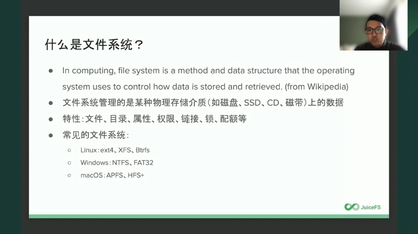

### 1.2 一次 write 的路径：从用户态一路走到磁盘

Linux 内核在各类具体文件系统之上抽象了一层 VFS（virtual file system，虚拟文件系统），它定义通用接口；ext4、XFS 这些实现按 VFS 的接口标准来实现，应用则统一通过 VFS 发起系统调用。一次写操作的路径是：用户态 `write()` → VFS 的 `sys_write` → 具体文件系统的写方法 → 写入物理介质 [【跳转到 08:19】](https://www.bilibili.com/video/BV1rP411P7XK/?t=499)。

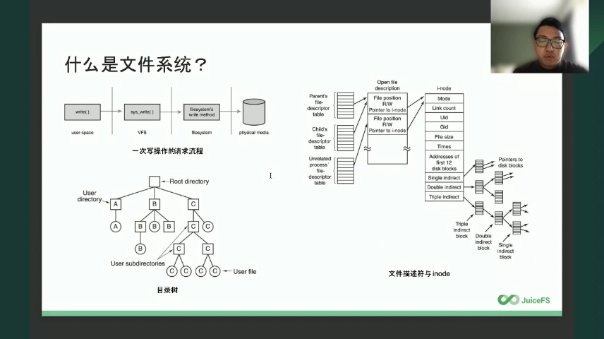

这张图里最值得记住的是右下角那条链：**文件描述符 → inode → 磁盘块**。inode 里存的是 mode（权限）、link count（硬链接数）、uid/gid、文件大小、修改时间、访问时间，以及最关键的「这个文件的数据在磁盘上的哪些位置」——以类似链表的形式指向实际的 block。

关键结论在这里：**inode 表、目录项、数据块都在同一块设备上**，所以一次 `stat`、一次目录查找，本质上都是一次本地内存/磁盘访问，没有网络这一层。这也解释了为什么同盘设计下元数据操作「便宜」到几乎不需要被单独考虑。

### 1.3 目录树是文件系统的标志性特征

所有文件系统都按树形结构组织数据：根目录是根节点，往下是子目录，叶子节点是文件。这个结构是文件系统区别于对象存储的地方——对象存储是扁平的 KV 结构，没有一层层往下走的目录 [【跳转到 11:39】](https://www.bilibili.com/video/BV1rP411P7XK/?t=699)。

后果很直接：在文件系统里把目录从 A 挪到 B 是很轻量的操作，在对象存储上则是繁重的操作。这条差异会在后面「元数据怎么落到 KV 上」时反复出现——因为分离式设计要做的，恰恰是**把树状结构压扁成 KV**。

## 二、分布式文件系统：元数据被拎出来单独部署

### 2.1 2000 年初集中诞生的那一批

讲者列了一张时间表：GPFS（1998，IBM）、GFS（2003，Google）、Lustre（2003，OpenSFS）、HDFS（2006，Yahoo）、CephFS（2006，Red Hat）、GlusterFS（2006，Red Hat）、MooseFS（2008）、盘古（2009，阿里巴巴）、Tectonic（2021，Meta）。它们大多集中在 2000 年初诞生，因为那个年代互联网开始爆发，出现了大规模文件存储需求 [【跳转到 16:14】](https://www.bilibili.com/video/BV1rP411P7XK/?t=974)。

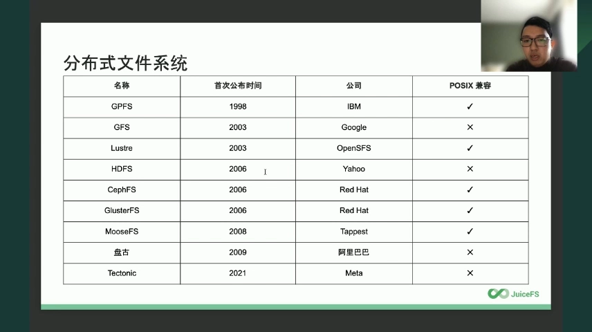

表里最后一列 POSIX 兼容性值得单独看：GFS、HDFS、盘古、Tectonic 都不兼容 POSIX。它们为了支持大规模存储、保证整体可靠性，主动砍掉了传统单机文件系统的部分特性——GFS 甚至只能通过专用客户端读写。这就是「分离」的第一笔代价：**一旦元数据不在本地，POSIX 语义里那些依赖本地原子性的操作就变得昂贵**。

### 2.2 GFS：一个 master 管全部元数据，且不能横向扩展

GFS 的架构只有三块：专用 client、master（元数据引擎，HDFS 里叫 namenode）、chunkserver（数据存储，HDFS 里叫 datanode）[【跳转到 16:39】](https://www.bilibili.com/video/BV1rP411P7XK/?t=999)。

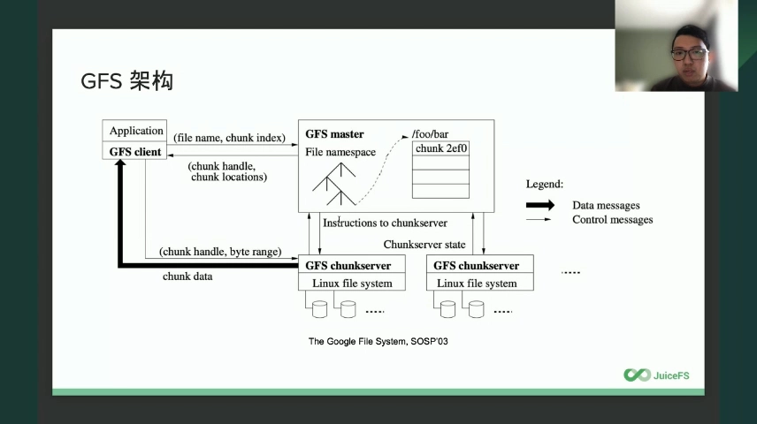

注意图里两种箭头的区别：实线是数据消息，虚线是控制消息。**client 先问 master「这个文件的 chunk 在哪」，拿到 chunk handle 和位置后，直接和 chunkserver 传数据**——元数据和数据走的是两条完全不同的路径，这是「分离」最原始也最有效的形态。

GFS 把文件按 64MB 或 128MB 切成 chunk（JuiceFS 是把数据切成 4MB 的 block），master 上保存的是「文件 → 哪些 chunkserver 的哪个 chunk」的映射。但 GFS 的 master 在设计上**无法横向扩展**，只能在单机上存元数据 [【跳转到 17:54】](https://www.bilibili.com/video/BV1rP411P7XK/?t=1074)。这就是分离式设计的第一个瓶颈：数据层可以加机器，元数据层却卡在一台机器上。

### 2.3 Tectonic：把元数据再拆成三层，压在分布式 KV 上

Meta 2021 年公开的 Tectonic（论文 *Facebook's Tectonic Filesystem: Efficiency from Exascale*）做了两处关键改动 [【跳转到 19:34】](https://www.bilibili.com/video/BV1rP411P7XK/?t=1174)。

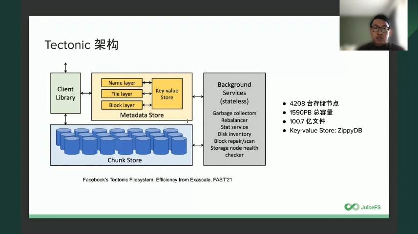

第一处是**元数据分层**：metadata store 被明确分成 name layer、file layer、block layer 三层。每层可以独立部署、独立扩容——name layer 可能 n 个节点，file layer m 个，block layer y 个，三个数字不必相同，按各自负载分配。block layer 请求量最大，就给它最多的机器 [【跳转到 21:39】](https://www.bilibili.com/video/BV1rP411P7XK/?t=1299)。

第二处是**这三层都是无状态的**：它们自己不存数据，统一依赖右边那个 key-value store——Meta 自研的 ZippyDB，基于 Raft/Paxos 共识算法，类似 TiKV、FoundationDB，是支持事务的分布式 KV [【跳转到 22:29】](https://www.bilibili.com/video/BV1rP411P7XK/?t=1349)。无状态才能随意 scale in/out，这是把「元数据引擎不能扩展」这个问题解掉的办法：**把有状态的部分下沉到一个专门做扩展的 KV 系统里**。

论文披露的规模是 4208 台存储节点、1590PB 容量、100.7 亿文件 [【跳转到 25:24】](https://www.bilibili.com/video/BV1rP411P7XK/?t=1524)。讲者的评价是：对数据中心或公有云来说，百亿到数百亿级已经是非常大的规模，千亿级以内能满足绝大部分场景。

三层在 KV 上的 key/value 设计如下 [【跳转到 26:41】](https://www.bilibili.com/video/BV1rP411P7XK/?t=1601)：

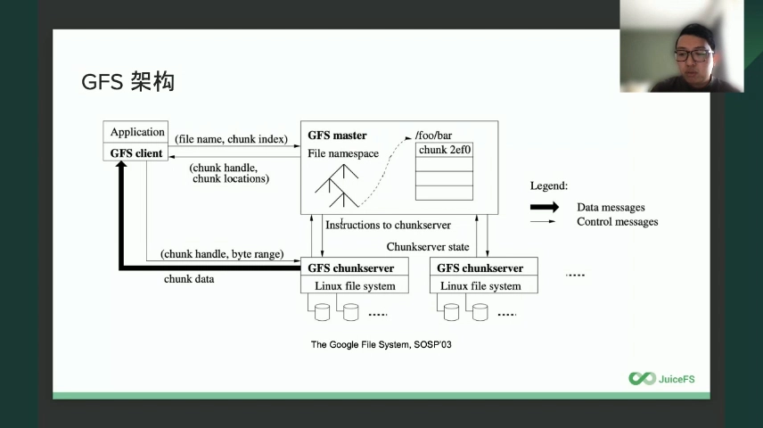

| Layer | Key | Value | 按什么分片 |
| :--- | :--- | :--- | :--- |
| Name | 目录 id + 子目录名 | 子目录信息 + 子目录 id | 目录 id |
| File | 文件 id + block id | block 信息 | 文件 id |
| Block | block id（或 disk id + block id） | disk 列表 / chunk 信息 | block id |

这张表其实就是「树状元数据怎么压成扁平 KV」的标准答案：**用 id 做 key，用 id 之间的引用表达父子关系**。

## 三、元数据到底有哪些：三个映射就够了

要从零设计一个元数据引擎，先得知道要存什么。讲者把文件系统的元数据归成几类 [【跳转到 29:07】](https://www.bilibili.com/video/BV1rP411P7XK/?t=1747)：

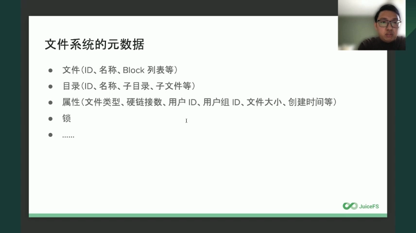

然后借用 Unix 的设计哲学「万物皆为文件」：不管普通文件、设备还是目录，都统一给一个全局唯一的 id，沿用 inode 这个名字。这里有一处和单机文件系统的重要差别：单机的 inode 号会被回收复用，而 JuiceFS 的 inode 是 64 位整型、单调递增、**不复用** [【跳转到 30:22】](https://www.bilibili.com/video/BV1rP411P7XK/?t=1822)。

有了 id，剩下的就是三个映射：

**映射一：文件 id → 属性。** 通过 inode 号查到 mode、uid/gid、大小、时间戳等 [【跳转到 31:12】](https://www.bilibili.com/video/BV1rP411P7XK/?t=1872)。

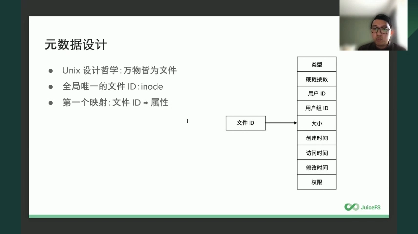

**映射二：文件 id → 数据块列表。** 这是元数据与数据真正「接头」的地方 [【跳转到 32:02】](https://www.bilibili.com/video/BV1rP411P7XK/?t=1922)。

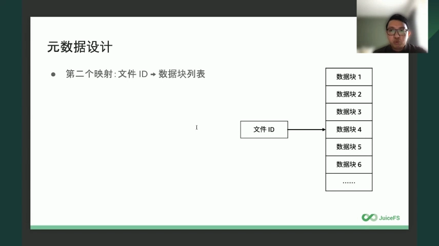

这里有个很能体现「分离式设计」心思的细节：JuiceFS **不保存对象存储上的完整路径**，只保存每个 block 的 id，路径由程序按规则算出来。原因是字符串比 64 位整型占的空间大得多，把路径全存进元数据引擎是浪费 [【跳转到 32:42】](https://www.bilibili.com/video/BV1rP411P7XK/?t=1962)。

**映射三：目录 id → 子目录与子文件列表。** 这是一个两层映射：目录 id 先指向一个哈希，哈希里 key 是子项的名字、value 是子项的 inode [【跳转到 34:07】](https://www.bilibili.com/video/BV1rP411P7XK/?t=2047)。

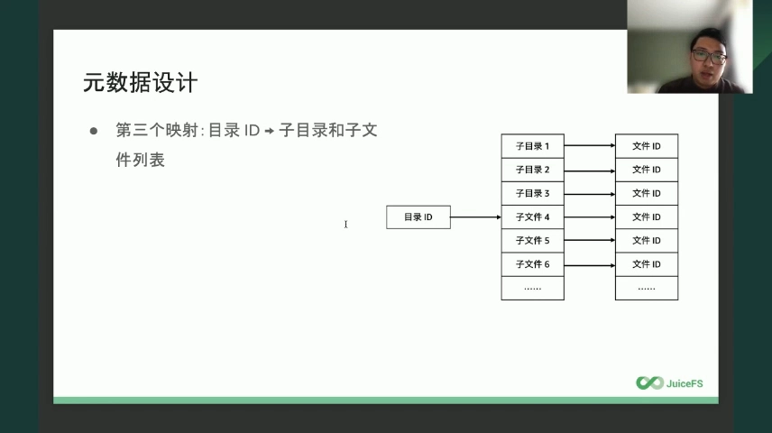

三个映射合起来，就完整表达了「一个文件的元信息 + 它的数据在哪 + 目录结构长什么样」。

## 四、落成 Redis 的键值：一次 open 变成多次网络往返

### 4.1 三张表对应三个映射

以 Redis 为例，JuiceFS 的落法非常直白 [【跳转到 37:02】](https://www.bilibili.com/video/BV1rP411P7XK/?t=2222)：

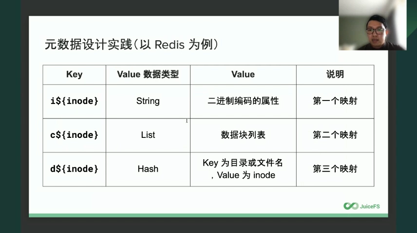

- `i` 前缀 + inode 号 → String，二进制编码的属性，对应映射一；
- `c` 前缀 + inode 号 → List，数据块（slice）列表，对应映射二；
- `d` 前缀 + inode 号 → Hash，key 是目录或文件名，value 是 inode，对应映射三。

注意 `d` 前缀这个 Hash 的设计：它把「目录里有哪些名字」这件事变成了 KV 里的一次哈希查找，**树状结构到此彻底消失了**。

### 4.2 打开 a/b/c.txt 要查几次

讲者用 `a/b/c.txt` 走了一遍完整路径 [【跳转到 40:22】](https://www.bilibili.com/video/BV1rP411P7XK/?t=2422)：

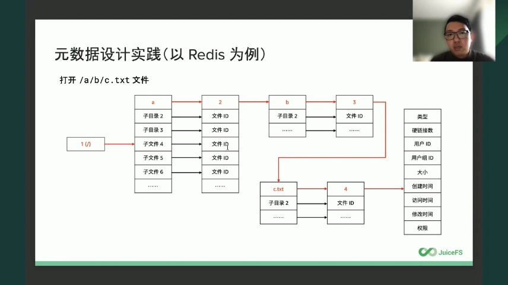

1. 根目录 inode 是 1，查 `d1` 这个 Hash，找到 `a` 对应的 inode 是 2；
2. 查 `d2`，找到 `b` 对应的 inode 是 3；
3. 查 `d3`，找到 `c.txt` 对应的 inode 是 4；
4. 查 `i4`，拿到属性，顺便做权限校验——没权限就在这里报 `permission denied`；
5. 应用拿到的文件描述符就对应 inode 4，后续读写才会用到 `c4` 这个块列表。

**这就是同盘设计与分离设计的核心差别**：同样的路径解析，在 ext4 上是一串本地内存/磁盘访问，在这里是 4 次 Redis 查询。目录越深，往返次数越多——这是分离式设计的固有成本，不是实现问题。

### 4.3 三种把 RTT 压下去的手段

讲者给了三条对策，正好对应三种不同层次的优化：

**请求合并**：Redis 支持 Lua 脚本，可以把整条查找链放到服务端一次执行完，客户端看起来只有一次 Redis 请求，直接拿到 inode 4 的属性 [【跳转到 39:07】](https://www.bilibili.com/video/BV1rP411P7XK/?t=2347)。这是把 N 次 RTT 压成 1 次，但代价是把逻辑搬到了元数据引擎里执行。

**元数据缓存**：路径上每一级都可以缓存。根目录访问最频繁、命中率最高；目录层级越深，缓存命中率越低 [【跳转到 39:57】](https://www.bilibili.com/video/BV1rP411P7XK/?t=2397)。缓存省掉的是中间那些不必要的网络请求。

**可推测的路径解析**（进阶方向）：既然一路查找最后只要拿到 `c.txt` 的 inode，那能不能在客户端直接算出来、一次网络请求都不发？在 JuiceFS 当前「inode 单调递增」的实现下做不到，需要改变 inode 的生成方式才可能实现 [【跳转到 44:57】](https://www.bilibili.com/video/BV1rP411P7XK/?t=2697)。

## 五、拆分的收益与瓶颈，最终都落在元数据引擎上

### 5.1 收益：容量弹性、跨节点共享、廉价的元数据操作

把元数据和数据分开之后，三件事变便宜了：

- **容量弹性**：数据层用对象存储或 chunk 服务器，容量几乎可以无限扩；元数据层单独扩容，两者互不牵制。
- **跨节点共享**：元数据集中在一处，多台机器看到的是同一份命名空间——这是单机文件系统做不到的。
- **快照与配额**：讲者把这两项放在「进阶」里，理由很关键——**它们只需要动元数据**。针对整个文件系统或某个子目录做快照，方便做版本管理；针对某个子目录限制容量，也必须在元数据引擎里保留相关数据才能对客户端做限制 [【跳转到 43:42】](https://www.bilibili.com/video/BV1rP411P7XK/?t=2622)。

### 5.2 瓶颈：Redis 单机内存有上限，且不好横向扩展

讲者很直接地指出 Redis 的限制：单机 master 内存有上限，没法做很好的横向扩展，极端情况下的可靠性也有问题 [【跳转到 41:12】](https://www.bilibili.com/video/BV1rP411P7XK/?t=2472)。

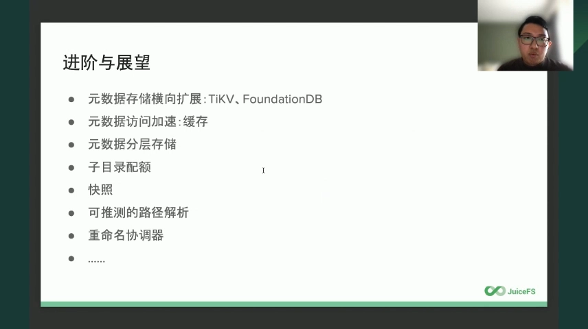

对应的解法在幻灯片上列成了七条，可以归成三类：

| 问题 | 解法 | 本质 |
| :--- | :--- | :--- |
| 元数据规模到上限 | TiKV、FoundationDB 等分布式 KV | 把有状态部分换成可扩展的 KV |
| 每次访问都要走完整查找链 | 缓存、可推测的路径解析 | 减少 RTT 次数 |
| 单点与热点 | 元数据分层存储（学 Tectonic） | 按类型分资源、分负载 |

讲者提到已经有用户基于 TiKV 在生产环境存了数百亿文件，是经过生产验证的方案 [【跳转到 42:02】](https://www.bilibili.com/video/BV1rP411P7XK/?t=2522)。最后一条「重命名协调器」很有意思：重命名是分布式文件系统里很棘手的问题，可以把它单独抽成一个组件来协调整个集群的 rename 请求，主要是为了提升可靠性，性能上不一定有很大优化 [【跳转到 47:02】](https://www.bilibili.com/video/BV1rP411P7XK/?t=2822)。

## 六、两种风格对照

| 维度 | 元数据与数据同盘（ext4/XFS） | 元数据与数据分离（JuiceFS/Tectonic） |
| :--- | :--- | :--- |
| 元数据位置 | 同一块设备上的 inode 表与目录项 | Redis / TiKV / ZippyDB 等独立引擎 |
| 数据位置 | 同一块设备上的数据块 | 对象存储或 chunk 服务器 |
| 一次 `open` 的成本 | 本地内存/磁盘访问 | 若干次网络 RTT（可被 Lua、缓存压缩） |
| 目录树 | 原生树形结构 | 压平成 KV，用 id 引用表达父子关系 |
| 扩展方式 | 换更大的盘、更大的机器 | 数据层与元数据层各自横向扩展 |
| 快照/配额 | 需要动数据层（reflink、CoW） | 主要动元数据，成本低 |
| 主要瓶颈 | 单机容量与性能上限 | 元数据引擎的容量与吞吐 |

一句话总结：**同盘设计把成本摊在每一次本地访问里，几乎没有额外开销，但天花板就是一台机器；分离设计把天花板抬掉了，代价是把「一次本地访问」换成了「一次网络往返」，于是缓存、批量化、可扩展 KV 成了必需品。**

## 小结

- 单机文件系统的骨架是「文件描述符 → inode → 磁盘块」，inode 表、目录项、数据块都在同一块设备上，所以元数据操作是一次本地访问。
- 分布式文件系统把元数据拎出来单独部署：GFS 用单机 master 管元数据（不可横向扩展），Tectonic 把元数据分成 name/file/block 三层、压在一个分布式 KV（ZippyDB）上。
- 元数据可以归纳成三个映射：文件 id → 属性、文件 id → 数据块列表、目录 id → 子项列表；树状结构因此被压成扁平 KV。
- JuiceFS 用 Redis 的 `i`/`c`/`d` 三种前缀实现这三个映射；打开 `a/b/c.txt` 需要 4 次查询，目录越深往返越多。
- 分离的收益是容量弹性、跨节点共享、廉价的快照与配额；代价是每次元数据操作一个 RTT、以及元数据引擎自身的容量与吞吐上限。
- 因此分离式设计必备三件套：缓存、请求合并（Lua/服务端脚本）、可横向扩展的 KV 后端。

## 关键术语速查

| 术语 | 一句话解释 |
| :--- | :--- |
| 元数据 | 描述文件的数据：名字、属性、权限、目录结构、数据块位置，不含文件内容本身 |
| inode | 单机文件系统里描述一个文件的结构，存属性与数据块位置；分离式设计里被借用为全局唯一 id |
| VFS | Linux 内核的虚拟文件系统层，为 ext4/XFS 等提供统一接口 |
| chunk / block | 文件被切分后的存储单元；GFS 用 64–128MB 的 chunk，JuiceFS 用 4MB 的 block |
| 元数据引擎 | 专门保存元数据的服务，如 GFS master、HDFS namenode、Redis、TiKV、ZippyDB |
| RTT | 一次网络往返的耗时；分离式设计里每个元数据查询都要付一次 |
| ZippyDB | Meta 自研的分布式 KV 存储，基于共识算法、支持事务，Tectonic 的元数据底座 |
| 纠删码（EC） | 用校验块替代多副本的冗余方式，省空间但恢复开销更大 |