# btrfs 快照为什么只要 0.1 秒：写时复制把一次写入变成「新块 + 指针切换」

> 视频来源：[Why Do Btrfs Snapshots Take Just 0.1 Seconds? Copy-on-Write and Self-Healing, Fully Explained！](https://www.youtube.com/watch?v=H7rMfwgaxwM)（YouTube · kerneltalking）｜时长约 5.5 分钟
>
> 导读：这支动画讲解把 btrfs 从「从不原地重写」这一条原则推到底：一棵大 B 树、每块校验和、子卷、只复制根节点的快照、send/receive 增量备份、scrub 自愈，最后老老实实讲了写时复制的代价（碎片化、`nodatacow`、`df` 与真实空间对不上）。本文按它的顺序展开，并补上初学者需要的前置解释。

## 本讲要解决的核心问题（SCQA）

**背景**：备份的常识是「复制一份」——100 GB 的数据要备份，就得再准备 100 GB 空间，还要等它复制完。

**冲突**：btrfs 上右键创建快照，0.1 秒完成，几乎不占空间。这不是压缩，也不是去重，它压根没有复制数据。更奇怪的是，这个「没复制」的快照居然能当不可变备份用：之后原数据怎么改，快照里的世界都不动。

**疑问**：既然没有复制，快照凭什么能冻结住那一刻的内容？把「不复制」当默认，又要在哪些地方付出代价？

**回答（中心思想）**：btrfs 的所有写入都是**写时分配**（allocate on write，通常也叫写时复制 CoW）：要改一个块，就把新内容写到新位置，再更新指向它的指针，旧块原地不动。快照因此只需要**复制 B 树的根节点**，其余数据块靠引用共享；代价是随机小写会被放大成碎片，空间账目也变得难读。

## 一、核心原则：从不原地重写

先交代一下背景：btrfs 是 2007 年由 Oracle 启动的项目，2009 年 2 月并入内核，今天已经是 openSUSE 与 SUSE 企业版的默认文件系统，Fedora 也默认用了多年。它的野心写在名字上——校验和、快照、压缩、多设备全部做进文件系统本身。

[【跳转到 00:24】](https://www.youtube.com/watch?v=H7rMfwgaxwM&t=24)

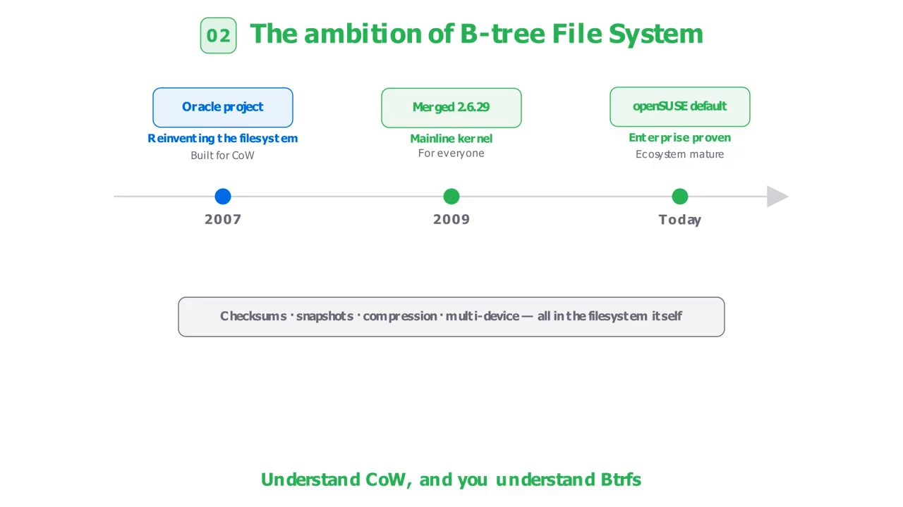

而这一切的地基只有一条：**从不原地重写**。

传统文件系统（比如 ext4 的默认路径）改一个块，就在原来的位置覆盖它。btrfs 反过来：**新内容写到新位置，然后翻转指针**，旧块保持完整。

这一条原则同时长出三样东西：

- **快照**：旧块还在，只要有人引用它，它就不会被回收；
- **校验和**：每个块写下去时算一次校验和，读的时候现场验证；
- **崩溃一致性**：指针翻转之前，旧树仍然完整可用；翻转之后，新树完整可用。中间不存在「一半新一半旧」的树。

视频把两种路径并排放在一张幻灯片上，这是全片最值得记住的一页：

| | 原地重写（传统） | 写时复制（btrfs） |
| --- | --- | --- |
| 改块的方式 | 覆盖旧块 | 新块写到新位置 |
| 旧数据 | 立刻消失 | 完整保留 |
| 断电后果 | 可能只写了一半 | 指针原子翻转，旧树或新树二选一 |

[【跳转到 01:04】](https://www.youtube.com/watch?v=H7rMfwgaxwM&t=64)

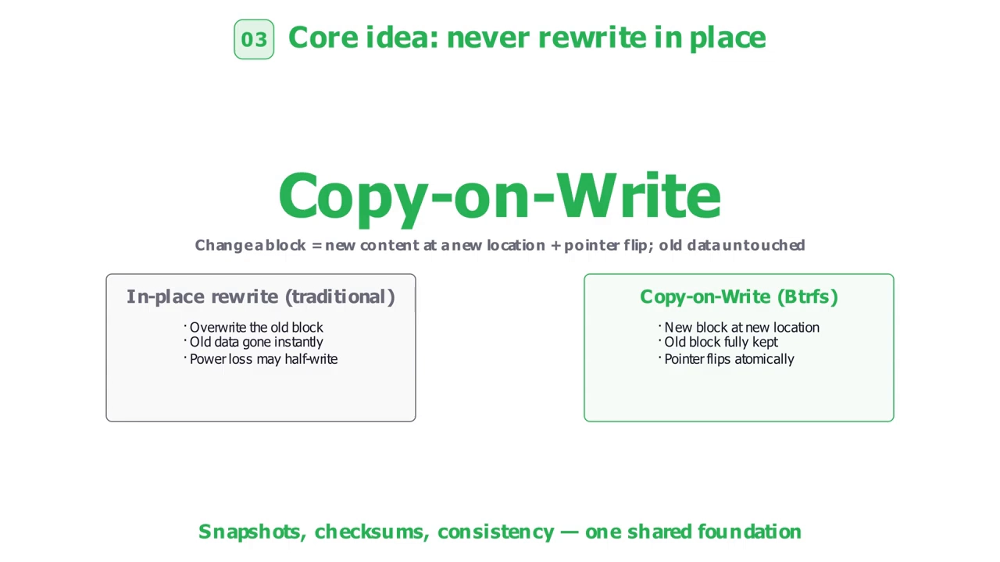

## 二、一棵大 B 树，加上每块一个校验和

btrfs 的名字就是 B-tree file system。它把所有元数据组织成**一棵大 B 树**：子卷、文件、目录，全都是这棵树上的节点。改一个文件，就是沿着树从根走到叶，把路径上经过的节点都换成新副本（因为不能原地改），最后换根。

这也是写时复制「写放大」的来源：改 4 KiB 数据，路径上的若干层元数据块都要重新写一遍。数据越碎、树越深，放大越明显。

校验和则是另一条独立的线：每个块都带一个校验和，读的时候现场比对。视频强调 btrfs 默认把**元数据存两份**，所以元数据损坏时还有副本可救；数据腐烂（bit rot，指磁盘上的位随时间自发翻转）于是第一次有了系统级的解药——不是靠应用自己算哈希，而是文件系统本身知道「这个块读出来的内容和当初写下去的不一样」。

[【跳转到 01:24】](https://www.youtube.com/watch?v=H7rMfwgaxwM&t=84)

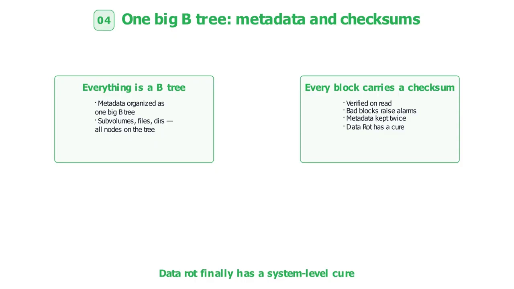

## 三、子卷：可以独立挂载的目录树

快照的单位不是分区，而是**子卷**（subvolume）。子卷既不是分区，也不是镜像文件，而是一棵可以独立挂载的目录树。一个 btrfs 卷里可以放任意多个子卷，每个子卷有自己的配额、自己的快照、自己的挂载选项。

这解释了 Linux 发行版上常见的布局：`@` 放系统根、`@home` 放用户数据、`@docker` 放容器存储、`@snapshots` 放快照。它们共享同一块空间，但可以分别回滚——系统升级炸了只回滚 `@`，用户数据不受影响。

[【跳转到 01:44】](https://www.youtube.com/watch?v=H7rMfwgaxwM&t=104)

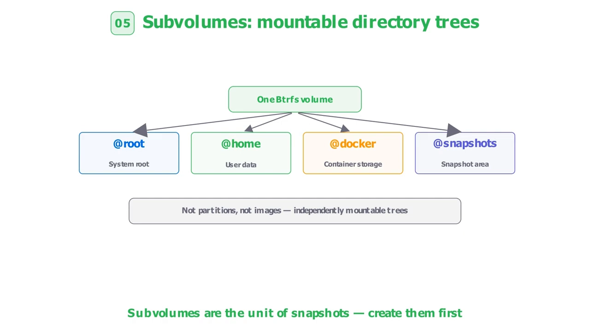

## 四、快照只复制根节点，所以是 0.1 秒

现在可以回答开头那个问题了。快照 = 子卷的写时复制副本，而写时复制只需要复制**B 树的根节点**：新的根节点指向和原来一样的子节点，所有数据块靠引用共享。所以耗时和数据量无关，只和「复制一个根节点」有关；额外空间约等于零。

快照之后，原数据继续被修改时，btrfs 不会去动快照引用的那些旧块——它写新块、改新指针。快照那棵树始终指向旧块，于是「快照里的世界冻住了」。把快照标成只读，它就是一份不可变的备份基线。

[【跳转到 02:04】](https://www.youtube.com/watch?v=H7rMfwgaxwM&t=124)

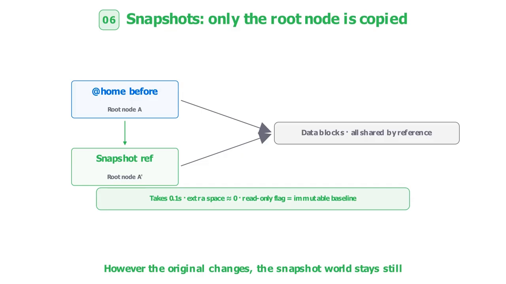

## 五、send/receive：把两个快照的差导成一条流

快照本身只是本地的「时间点」。要把它变成异地备份，用 `btrfs send` / `btrfs receive`：把两个快照之间的差异导出成一条流，在另一块盘、另一台机器上重建。

于是增量备份变成一条流水线：每周打一次快照，把「上周快照到本周快照」的差发出去，落到异地。因为差异是在 B 树层面算出来的，不需要扫描整个文件系统去比对文件内容。

[【跳转到 02:24】](https://www.youtube.com/watch?v=H7rMfwgaxwM&t=144)

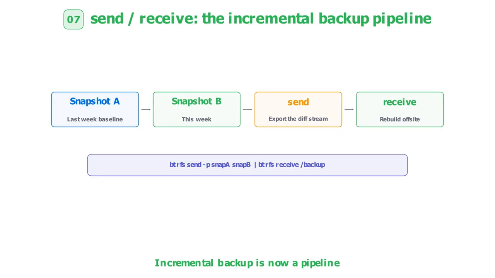

## 六、scrub：后台逐块校验，能修就修

有了每块校验和，就可以在后台做一件传统文件系统做不到的事：**scrub**——把盘上的块逐个读出来，重算校验和并比对。

发现不匹配时，如果存在好副本（比如 RAID 1 的另一份），就自动用好的那份修复坏块。这就是视频里说的「自愈数据」。要注意它的前提：**必须有冗余**。单盘 btrfs 能发现损坏，但没有第二份可拿来修。

[【跳转到 02:44】](https://www.youtube.com/watch?v=H7rMfwgaxwM&t=164)

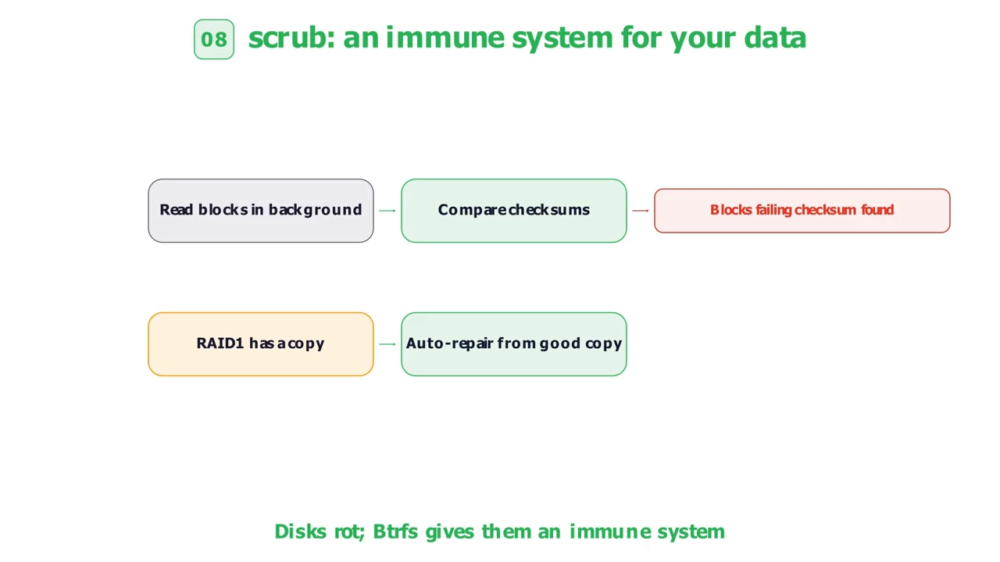

## 七、代价：随机小写被放大成碎片

写时复制不是没有账要付。视频把代价讲得很直接：**数据库数据文件、虚拟机镜像这类高频随机小写**，在 CoW 下每次写都要找新位置，文件在物理上被打散，碎片化严重，性能下降。

btrfs 给的解法是挂载选项 `nodatacow`：对数据关掉写时复制，原地改。但代价写在括号里——**校验和也跟着一起没了**。视频的建议是：如果盘本来就在 RAID 1 里、有冗余兜底，这个取舍可以接受；否则要清楚自己放弃了什么。

[【跳转到 03:24】](https://www.youtube.com/watch?v=H7rMfwgaxwM&t=204)

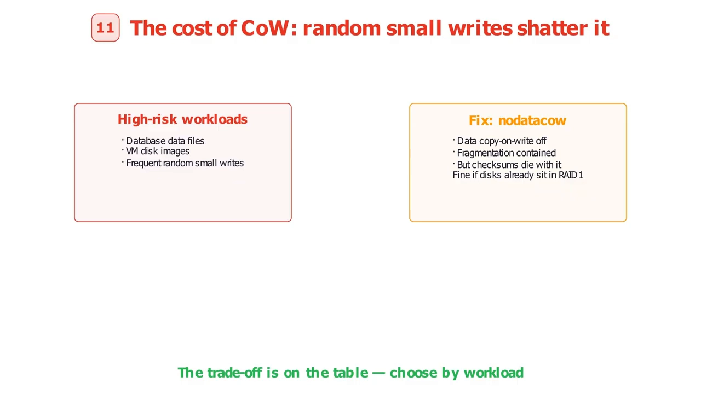

## 八、空间之谜：为什么 `df` 和 btrfs 说的不一样

用过 btrfs 的人几乎都被这件事困惑过：`df` 显示还有空间，写入却报 `no space left`；或者反过来，删了文件空间没回来。

原因有两层：一是**快照还引用着旧块**，那些块不能回收，但 `df` 的算法里未必体现得清楚；二是**空闲空间本身是碎的**，btrfs 按块组（chunk）分配，可能某一类块组用完了，而另一类还有富余。所以看真实账目要用 `btrfs filesystem usage`，它把 data、metadata、system 分开统计。

视频的判断很干脆：读不懂这两个数字之间的差距，就等于没真正懂 btrfs。

[【跳转到 03:44】](https://www.youtube.com/watch?v=H7rMfwgaxwM&t=224)

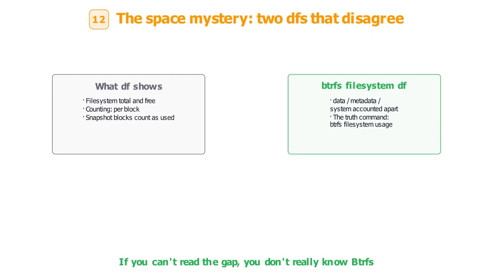

## 九、把快照当「系统级撤销键」用

把上面的能力串起来，就是一个非常实用的操作套路：

1. 大升级之前，先打一个**只读快照**；
2. 执行升级；
3. 升级出问题，一条命令回滚到快照状态。

因为回滚只是把子卷的根指针指回快照那棵树，所以几乎是瞬间完成的。这就是「系统级撤销键」的由来——它不是备份软件的附加功能，而是写时复制数据布局的直接结果。

[【跳转到 04:24】](https://www.youtube.com/watch?v=H7rMfwgaxwM&t=264)

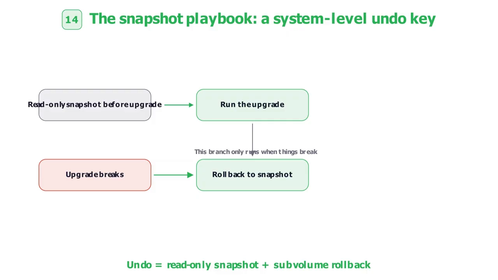

## 十、什么时候该用 btrfs

视频最后给了一张很克制的选型表，值得原样记住：

- **适合**：快照密集的备份场景、桌面与工作站、容器存储后端；
- **谨慎**：大型数据库、高频随机写——要么 `nodatacow`，要么换 ext4/XFS；
- **不要用**：RAID 5 / RAID 6，官方文档至今仍在警告，别放生产环境。

「边界清楚才是成熟的标志」——这句话对写时复制这类「看起来全是优点」的机制尤其适用。

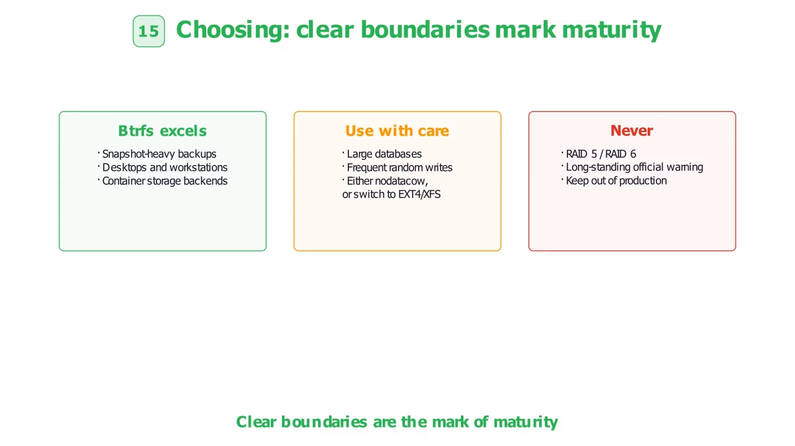

## 小结

- **一条原则**：btrfs 从不原地重写，改块就是「新块写新位置 + 指针翻转」，旧块完整保留。
- **三个副产品**：快照（旧块被引用就不回收）、校验和（每块读时验证）、崩溃一致性（旧树或新树，没有半成品）。
- **快照为什么 0.1 秒**：只复制 B 树根节点，数据块全部靠引用共享，耗时与数据量无关。
- **增量备份**：`send`/`receive` 导出两个快照之间的差异流，不需要扫全盘比对。
- **自愈的前提是冗余**：`scrub` 能发现坏块，只有存在好副本时才能修好。
- **代价**：随机小写被放大成碎片，`nodatacow` 能缓解但会丢掉校验和；空间账目要用 `btrfs filesystem usage` 才看得清。
- **选型**：快照密集与容器后端是它的主场，大数据库要谨慎，RAID 5/6 不要碰。

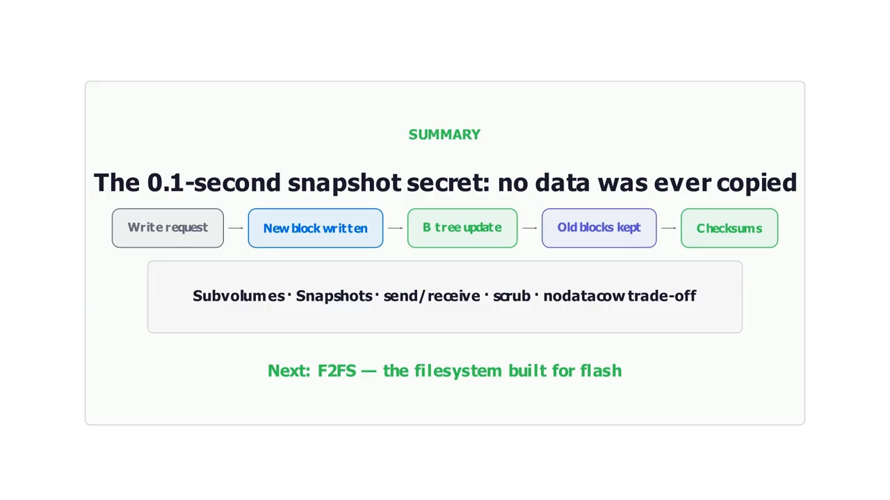

## 关键术语速查

| 术语 | 一句话解释 |
| --- | --- |
| 写时分配 / 写时复制 | 修改数据时写到新位置、再翻转指针，旧数据不动 |
| B 树 | 一种多叉平衡查找树，btrfs 用它组织全部元数据 |
| 子卷 | 可独立挂载的目录树，也是快照的单位 |
| 快照 | 复制子卷 B 树根节点得到的只读或可写副本，数据块共享 |
| 校验和 | 每个块附带的摘要值，读时重算比对，用于发现数据腐烂 |
| scrub | 后台逐块校验并尝试修复的巡检任务 |
| bit rot | 磁盘上的位随时间自发翻转，导致读出的数据与写入的不一致 |
| `nodatacow` | 挂载选项，对数据关闭写时复制以减少碎片，同时失去校验和 |
| `btrfs filesystem usage` | 查看 data/metadata/system 真实占用的命令 |
| RAID 1 | 镜像冗余，scrub 发现坏块时可以从另一份副本修复 |