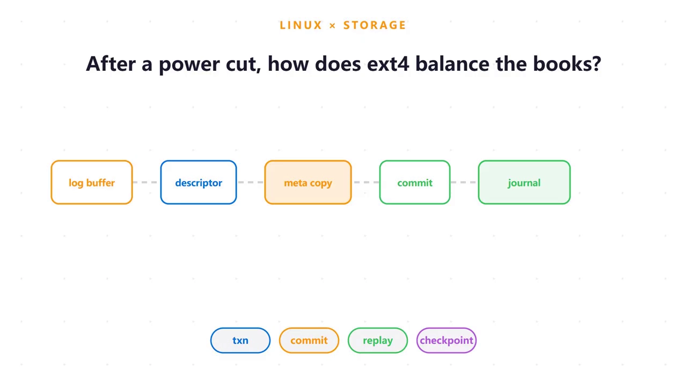
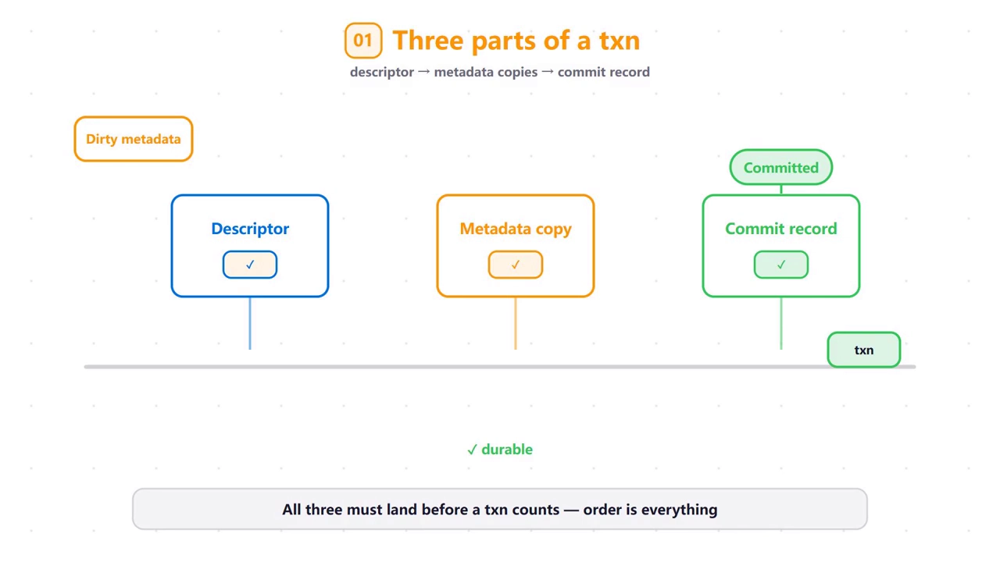
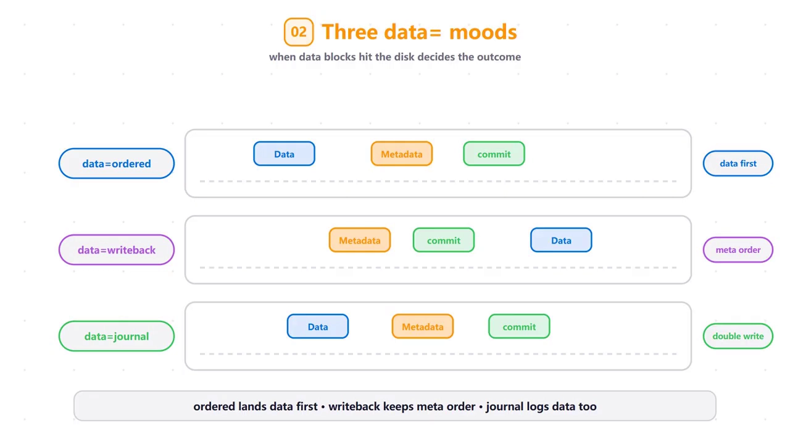
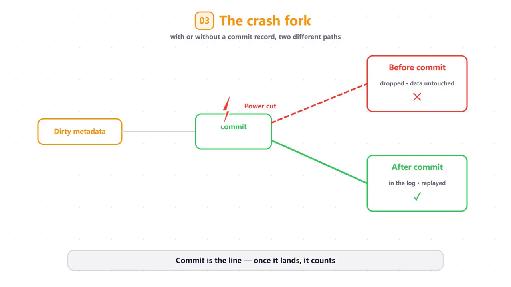
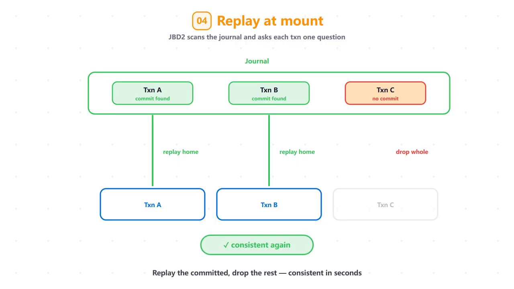
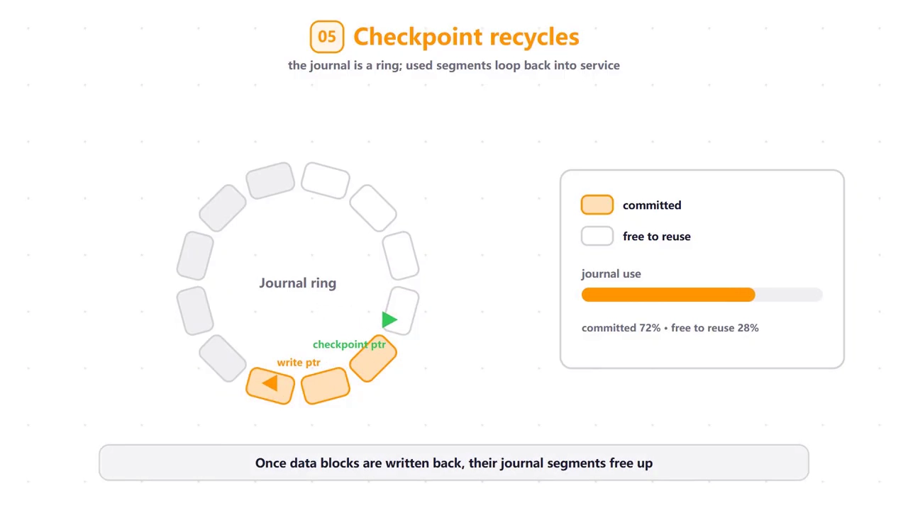
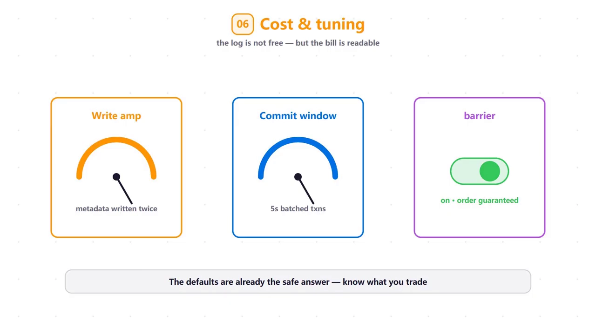
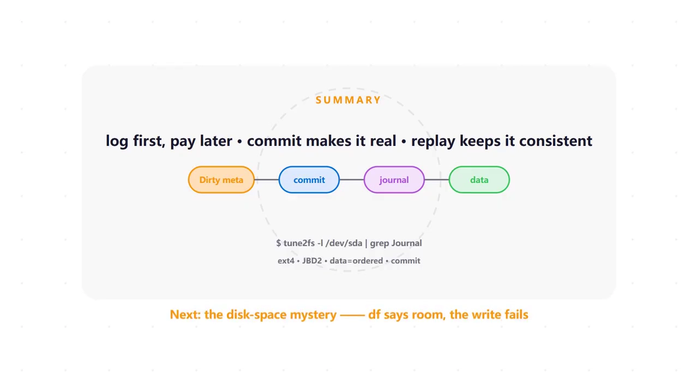

# ext4 崩溃后凭什么自愈：JBD2 日志的记账、提交与重放

> 视频来源：[How Does Linux ext4 Fix Itself After a Crash? JBD2 Journaling Fully Explained in Eight Scenes！](https://www.youtube.com/watch?v=mDDa0KSBgek)（YouTube · kerneltalking）｜时长约 2.5 分钟
>
> 导读：这是一支节奏极快的动画短片，用八张幻灯片把 ext4 的日志（JBD2）拆成「打包事务、三种 data 模式、崩溃分叉、开机重放、检查点回收、代价与调优」六个环节。本文按它的顺序讲，并在每个环节补上初学者需要的解释；字幕里的 `extension for`、`Ryback` 是 AI 自动字幕对 ext4、writeback 的误识别，已在正文中订正。

## 本讲要解决的核心问题（SCQA）

**背景**：ext4 是最常见的 Linux 文件系统之一，它的默认写入方式是**原地更新**（update in place）：你要覆盖文件里的某几个字节，它就在原来的位置改那几个块，顺手把 inode 里的时间戳、区段树也改掉。

**冲突**：原地更新有个天生的软肋——一次写操作往往要碰好几个块，而磁盘一次只能写一块。如果写到一半断电，盘上就留下「一半新、一半旧」的状态：数据块已经是新的，inode 却还没指向它；或者 inode 更新了，数据块还是旧的。

**疑问**：既然原地更新这么容易写坏，为什么 ext4 掉电之后通常几秒钟就能重新一致，而不需要像 FAT 那样把整块盘扫一遍？

**回答（中心思想）**：因为 ext4 在改原位之前，**先把「要改哪些块、改成什么」写进一个专门的日志区，并追加一条提交记录**。提交记录是唯一的分界线：它落盘了，事务就算数，开机时重放回原位；它没落盘，整个事务被丢弃，盘上还是旧样子。日志只记元数据，所以它保证的是**元数据一致**，不是数据一致——数据什么时候落盘，由 `data=` 模式决定。

## 一、原地更新的写入路径：一次覆盖写改了两类东西

要理解日志在救什么，先要看清一次写操作到底碰了哪些块。

在一个 ext4 文件上覆盖写 4 KiB，内核至少要改两处：

- **数据块**：文件内容所在的那个块，原地被新内容覆盖；
- **元数据块**：inode 里的修改时间、文件大小，以及描述「第 N 块在磁盘哪个位置」的区段树节点——如果这次写让文件变长，还要新增区段项、甚至改块位图。

这两类块分散在盘上不同位置，不可能在同一瞬间落盘。中间任何一个时刻断电，都可能出现「元数据说文件有 8 KiB，实际只有 4 KiB 数据」这种自相矛盾的状态。日志要解决的正是这个问题：**让一组分散的块改动，对外表现为「全做」或「全不做」**。

[【跳转到 00:00】](https://www.youtube.com/watch?v=mDDa0KSBgek&t=0)

## 二、一个事务由三件东西组成，顺序就是全部

ext4 的日志层叫 **JBD2**（Journaling Block Device 2）。它把一段时间内的元数据改动攒成一个**事务**（transaction），然后按固定顺序写进日志区：

1. **描述符块**（descriptor block）：打头，声明「后面跟着的这些块，原本属于磁盘上的哪些位置」。它是一张搬运清单。
2. **元数据副本**：被修改的元数据块，一份一份复制进日志区。注意复制的是**块的新内容**，不是增量。
3. **提交记录**（commit record）：最后一条，带一个**写屏障**（write barrier），把「前面这些必须先落盘」的顺序锁死。

三样都落盘，这个事务才算数。这一步的关键在于**顺序**而不是内容：描述符先于数据副本，数据副本先于提交记录。写屏障的作用就是禁止磁盘或控制器为了性能把后面的写提前——没有它，提交记录可能先落地，而它声明的元数据副本还在缓存里，重放时就会读到垃圾。

[【跳转到 00:20】](https://www.youtube.com/watch?v=mDDa0KSBgek&t=20)

## 三、`data=` 三种模式：日志管元数据，数据什么时候写由你选

日志只装元数据，那**数据块**什么时候落盘？ext4 用挂载选项 `data=` 给出三档，本质是在「性能」和「崩溃后数据可能丢多少」之间选位置：

| 模式 | 顺序 | 崩溃后的结果 |
| --- | --- | --- |
| `data=ordered`（默认） | 数据先落盘，元数据进日志，最后提交 | 元数据一致；已提交的文件不会出现「指向未初始化块」的垃圾数据 |
| `data=writeback` | 只保证元数据的顺序，数据交给页缓存自己决定 | 元数据一致，但文件里可能出现旧数据或空洞内容 |
| `data=journal` | 数据也写进日志，再回写原位 | 数据与元数据都一致，代价是数据写两遍 |

初学者最容易混淆的一点是：**三种模式都保证文件系统结构不被写坏**，差别只在「文件内容」这一层。`ordered` 之所以是默认，是因为它用「数据先于提交」这个便宜的排序，换掉了最难看的一类后果——文件大小对、内容却是别人的旧数据。

[【跳转到 00:50】](https://www.youtube.com/watch?v=mDDa0KSBgek&t=50)

[【跳转到 00:40】](https://www.youtube.com/watch?v=mDDa0KSBgek&t=40)

## 四、崩溃分叉：提交记录是那条线

有了提交记录，崩溃这件事就被简化成一个二选一的问题：**断电发生在提交记录落盘之前，还是之后？**

- **之前**：整个事务被丢弃。日志区里那些写了一半的描述符和元数据副本会被忽略，数据区从未被碰过，文件系统仍然是崩溃前那个一致的状态。
- **之后**：事务已经完整地躺在日志里了。虽然原位（home location）可能还是旧的，但日志里有全部信息，开机重放就能补齐。

所以「提交」不是一个抽象概念，而是盘上一个具体的块落地的那一刻。视频里把这条线画成一道闪电劈在 commit 框上：左边是丢弃，右边是重放。

[【跳转到 01:00】](https://www.youtube.com/watch?v=mDDa0KSBgek&t=60)

## 五、开机重放：JBD2 只问一个问题

挂载一个非正常卸载的 ext4 时，内核会让 JBD2 扫描日志，对每个事务只问一句：**有没有提交记录？**

- 有 → 按描述符的清单，把日志里的元数据副本写回它们的原位（replay home）；
- 没有 → 整个事务丢掉（drop whole）。

因为只需要顺序扫一遍日志、做有限次回写，这个过程通常几秒内结束，不需要把整块盘读一遍。这正是日志式文件系统相对早期 ext2 的最大收益：**恢复时间从「与磁盘容量成正比」变成「与未完成事务量成正比」**。视频开头那句「即使不调用 fsync，ext4 通常也能自愈」，说的就是这条路径——fsync 保证的是「调用返回时数据已经持久」，而日志保证的是「没来得及持久的那部分不会把结构写坏」。

[【跳转到 01:20】](https://www.youtube.com/watch?v=mDDa0KSBgek&t=80)

## 六、日志是一个环：检查点负责回收

日志区的容量是固定的，不能只进不出。于是它被当成一个**环形缓冲区**：写指针往前走，走到头就绕回开头。

绕回之前必须确保那一段空间可以安全复用——也就是里面记录的那些元数据，已经真正写回了原位。做这件事的叫**检查点**（checkpoint）：它把某个事务的元数据块写回 home location，然后冻结对应的日志段，标记为可复用。

只要环一直在转、检查点跟得上，日志就永远不会写满。反过来说，如果写入速度长期超过检查点回写速度，日志会被塞满，写入就会被强制阻塞等空间——这是 ext4 在持续高写入下出现延迟毛刺的经典原因之一。

[【跳转到 01:30】](https://www.youtube.com/watch?v=mDDa0KSBgek&t=90)

[【跳转到 01:40】](https://www.youtube.com/watch?v=mDDa0KSBgek&t=100)

## 七、代价与调优：日志不是免费的

原地更新 + 日志这套组合的账单很直白：

- **写放大**：元数据要写两遍（先日志、后原位），所以元数据密集的负载（大量小文件创建、目录操作）会比纯数据写入更吃亏；
- **提交窗口**：默认 5 秒，把多个事务攒成一批一起提交。窗口越长，吞吐越好，断电时可能丢的「最近几秒」也越多；
- **屏障**：开着才能保证前面说的顺序。为了跑分把它关掉，等于把「顺序保证」换成了「可能重放出垃圾」。

视频的结论很朴素：**默认值本身就是那个安全的答案**，调优之前先知道自己拿什么换什么。想确认自己机器上的设置，`tune2fs -l /dev/sda | grep Journal` 就能看到日志参数与 `data=` 模式。

[【跳转到 02:00】](https://www.youtube.com/watch?v=mDDa0KSBgek&t=120)

## 小结

- **原地更新的风险来自「一组块要一起改」**：数据块和元数据块分散在盘上，中途断电就会留下半新半旧的状态。
- **日志用「先记账、后落盘」把一组改动变成原子事务**：描述符 + 元数据副本 + 提交记录，三样按序落盘才算数。
- **提交记录是唯一的分界线**：之前崩溃整条丢弃，之后崩溃开机重放，因此恢复只需要扫日志，不需要全盘 fsck。
- **日志只装元数据**，所以它保证元数据一致；数据一致要靠 `data=journal`，默认的 `ordered` 用「数据先落盘」换掉了最难看的那类后果。
- **日志是环，检查点是回收机制**：回写跟不上，日志写满，写入就会被阻塞。
- **代价是写放大、5 秒提交窗口和屏障**：三者都是「安全换性能」的旋钮，默认值已经是偏安全的一侧。

[【跳转到 02:20】](https://www.youtube.com/watch?v=mDDa0KSBgek&t=140)

## 关键术语速查

| 术语 | 一句话解释 |
| --- | --- |
| 原地更新 | 覆盖写直接修改原来的数据块与元数据块，不另找新位置 |
| JBD2 | ext4 使用的日志层实现，负责把元数据改动打包成事务 |
| 事务 | 一组必须整体生效或整体失效的块改动 |
| 描述符块 | 事务开头的清单，声明后面这些块原本属于磁盘上的哪些位置 |
| 提交记录 | 事务末尾的一条记录，落盘即代表事务生效，是崩溃分叉的分界线 |
| 写屏障 | 强制前面的写先落盘的机制，保证日志内部顺序不被重排 |
| 重放 | 开机时把日志中已提交的元数据副本写回原位 |
| 检查点 | 把元数据写回原位并释放日志段，让环形日志可以继续复用 |
| `data=ordered` | 默认模式：数据先落盘，元数据进日志后提交 |
| 元数据一致 | 文件系统结构自洽，但文件内容可能是旧的或空的 |