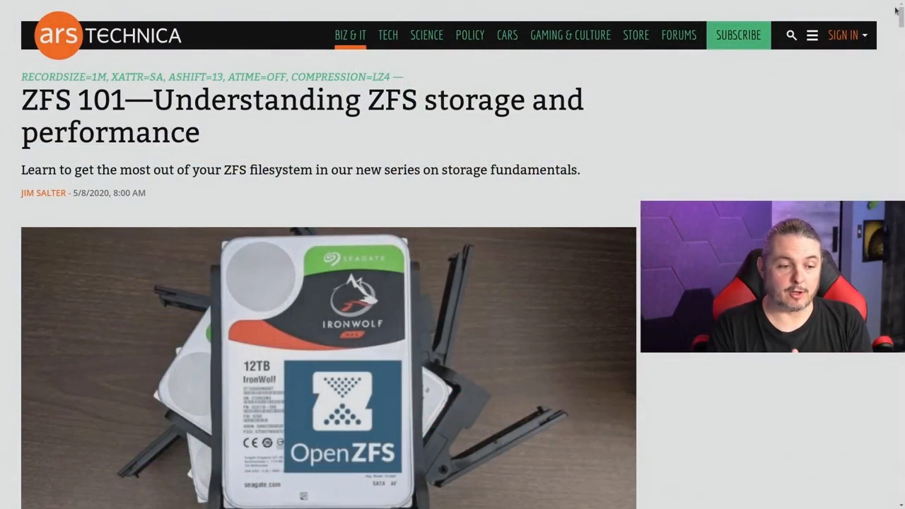
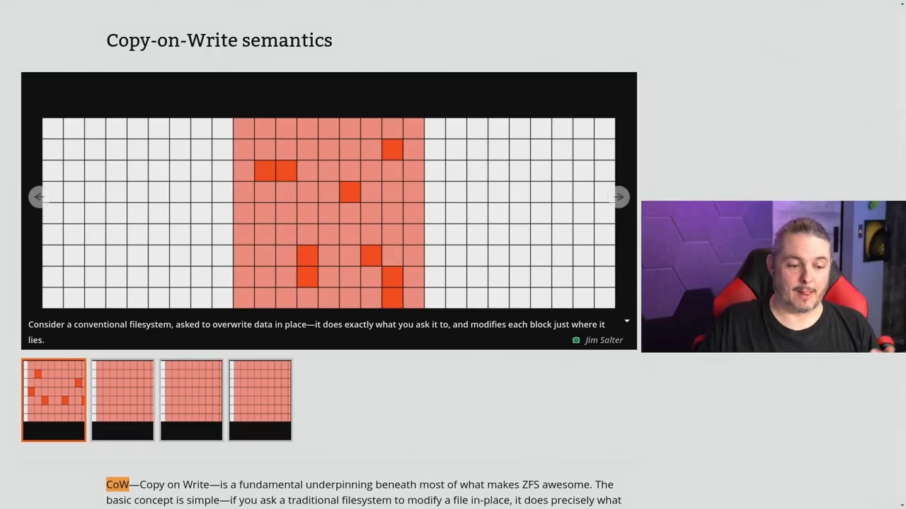
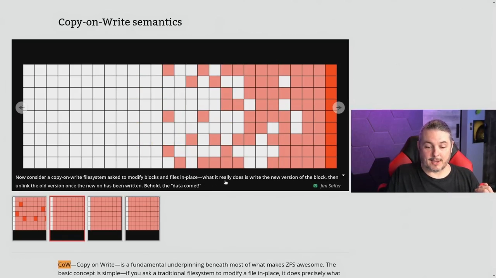
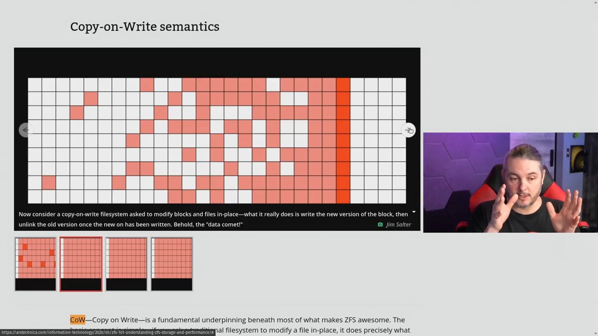
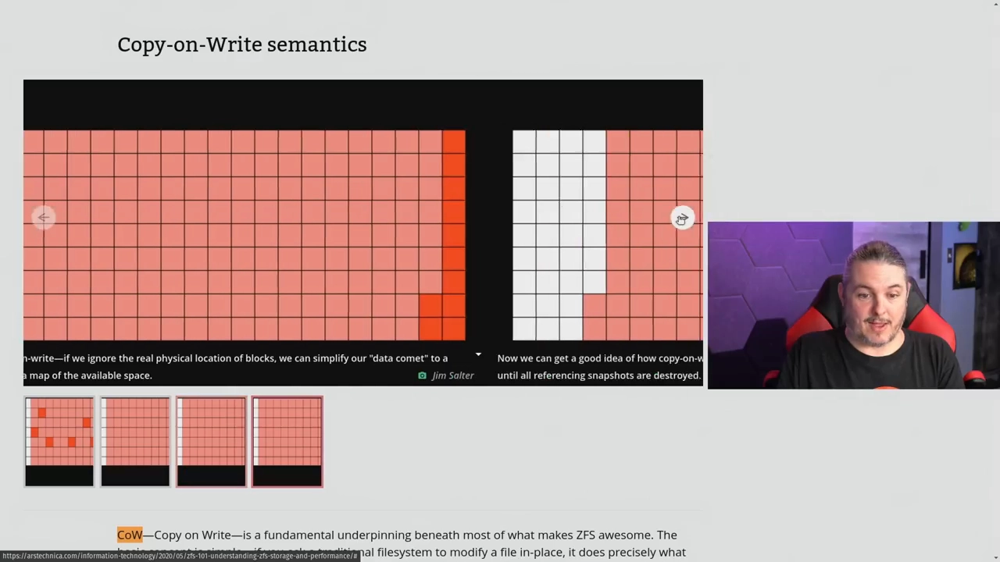
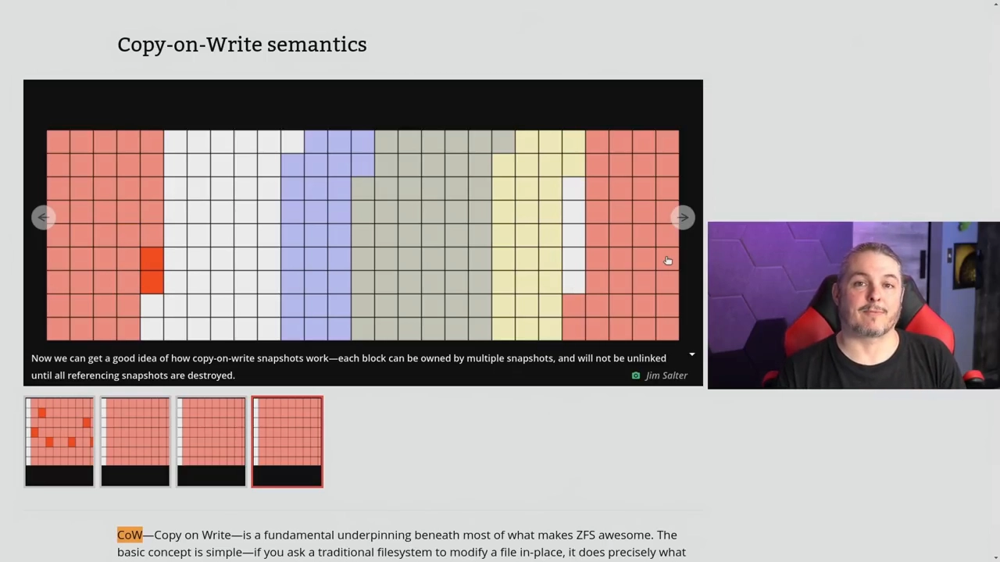
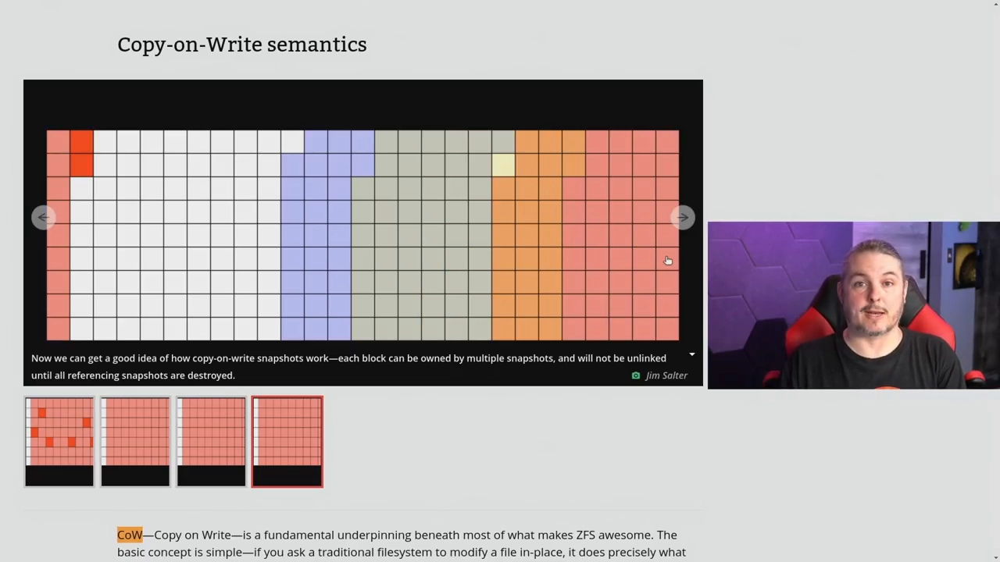
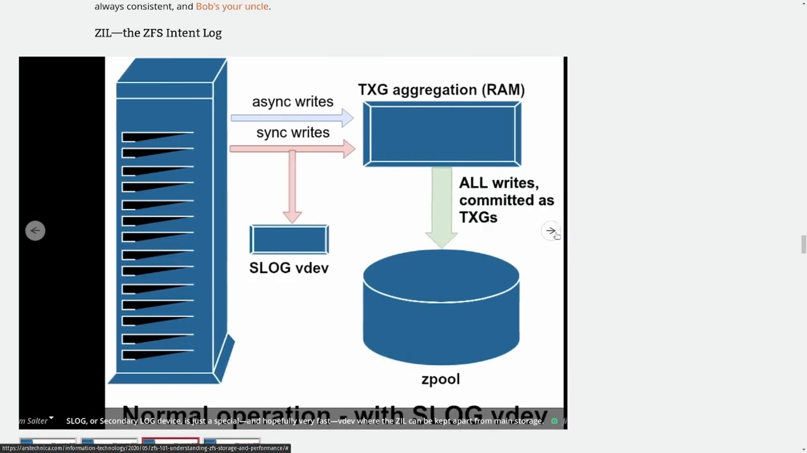

# 日志只保元数据一致，写时复制才保数据一致：ZFS 与日志式文件系统的写入路径对照

> 视频来源：[Why The ZFS Copy On Write File System Is Better Than A Journaling One](https://www.youtube.com/watch?v=nlBXXdz0JKA)（YouTube · Lawrence Systems）｜时长约 11 分钟
>
> 导读：这是一支「概念对照」型讲解，讲者 Tom 用 Ars Technica 那篇《ZFS 101》里的动画，把「原地覆盖」和「数据彗星」两种写入路径并排演示，然后顺着讲快照、回滚、克隆为什么是免费的。本文按它的论证顺序展开，并补上初学者需要的前置概念；文中「日志式只能保元数据一致」是讲者的论点，我在相应位置加了必要的限定。

## 本讲要解决的核心问题（SCQA）

**背景**：日志（journal）是过去二十年文件系统可靠性的标准答案：改数据之前，先把要改的东西记进一个专门的日志区，掉电了开机重放一遍就好。ext4、XFS、NTFS 都这么干。

**冲突**：但这套机制有个天花板——日志里通常只装**元数据**。因为把数据也塞进日志，等于所有数据都要写两遍，性能开销没人愿意付。于是日志能保证「文件系统结构不自相矛盾」，却不能保证「文件内容是你写下去的那份」。

**疑问**：写时复制（CoW）文件系统凭什么能同时保住数据和元数据？它的一致性又是靠什么机制实现的？

**回答（中心思想）**：CoW 把每一次修改都变成**写新块 + 原子地翻转指针**，并用事务语义保证「要么整串完成，要么像没发生过」。旧树在提交之前一直有效，所以崩溃后盘上必然是「旧树」或「新树」之一，不需要重放日志来修补中间状态。日志与 CoW 的差别不是实现细节，而是**保证的层次**：一个保结构，一个保内容。

## 一、先把账本分开：数据与元数据

文件系统里的信息可以分成两半：

- **数据**（data）：文件真正的那些块、记录，或者文件系统用来拼出一个文件的任何分组；
- **元数据**（metadata）：描述文件的信息——它在哪里、什么时候创建、谁有权限看。

这两样东西是分开的。这个区分之所以重要，是因为**日志式与 CoW 的核心分歧，就在于它们各自愿意为哪一半付出代价**。

[【跳转到 00:21】](https://www.youtube.com/watch?v=nlBXXdz0JKA&t=21)

## 二、日志式的天花板：只记元数据，所以只保元数据

日志是一个特殊的记录文件：文件系统在执行动作之前，先把动作写进去。如果操作系统在执行中途崩溃，下次开机只要检查日志，就能把没做完的动作补完。

问题在于成本。如果把数据和元数据的改动都放进日志，就等于把所有数据往系统里写两遍——这个开销没人接受。所以日志式文件系统**选择只记录元数据的改动**。这样在重启、突然断电这类故障导致文件写失败时，它还能恢复文件系统的结构。

讲者由此下了结论：日志式文件系统只能提供**元数据的完整性与一致性**。

> 一点必要的限定：这是「典型做法」层面的说法。ext4 的 `data=journal` 模式确实会把数据也写进日志，代价正是数据写两遍；默认的 `data=ordered` 则只记元数据。所以更准确的说法是——**日志式文件系统的默认档位保的是元数据一致**。

[【跳转到 00:51】](https://www.youtube.com/watch?v=nlBXXdz0JKA&t=51)

## 三、CoW 的做法：把修改变成事务，全成或全不成

CoW 文件系统在这个过程上做了改进：它同时提供元数据和数据的一致性，以及完整性校验。

一致性靠**事务语义**（transactional semantics）保证：这些事务必须整体完成。如果同一个事务成功，属于它的所有系统操作都成功完成，然后才写入；如果失败，就像什么都没发生过——数据、元数据、文件系统完全没变。只有在整个提交完成、所有事务和校验都到位之后，数据才算写下去。

这段话听起来抽象，落到盘上其实很具体：**提交之前，旧的数据块和旧的元数据树一直有效**；提交的那一刻，新的树根被发布出去。断电只会落在「旧树还有效」或「新树已发布」这两侧，中间状态不存在。

[【跳转到 01:59】](https://www.youtube.com/watch?v=nlBXXdz0JKA&t=119)

## 四、一致性不等于完整性：校验和与 scrub

讲者特意区分了两个词，这是很多人混在一起的地方：

- **一致性**（consistency）：文件系统的结构自洽，不会出现「元数据指向一个不存在的块」；
- **完整性**（integrity）：块里的内容没有随时间退化。

CoW 给的是一致性。完整性要靠另一套东西：ZFS 为数据生成**校验和**，读的时候验证，确保数据没有退化——这就是 **scrub**（清洗）在做的事。

这里有个必须说清的边界：**如果你只有一块盘，出了完整性问题也没法纠正**，因为没有别的副本可对比。但如果你用的是 RAID-Z1/2/3，系统会尝试从其他盘上把数据取回来，纠正这个损坏。

[【跳转到 02:35】](https://www.youtube.com/watch?v=nlBXXdz0JKA&t=155)

## 五、图上看：原地覆盖 vs 数据彗星

讲者借用了 Ars Technica 那篇《ZFS 101——理解 ZFS 的存储与性能》里的动画（作者 Jim Salter），把两种写入路径画在同一张网格上。网格里每个格子是一个块，红色表示被这个文件占用的块。

[【跳转到 03:14】](https://www.youtube.com/watch?v=nlBXXdz0JKA&t=194)

**原地覆盖**：你要求常规文件系统原地改写数据，它就照做——每个块就在它原来的位置被修改。然后元数据被更新。如果事务没完成而丢了数据，那希望日志里有一份副本，因为改动是先写进日志的，之后可以恢复。这就是整个流程：成功就写下去，没成功就从日志恢复。

[【跳转到 03:29】](https://www.youtube.com/watch?v=nlBXXdz0JKA&t=209)

**写时复制**：你要求 CoW 文件系统原地修改块，它实际做的是——先把块的新版本写出来，再把新版本链接上去、把旧版本解除链接。于是网格上出现一条拖在后面的尾巴，讲者跟着原文叫它「**数据彗星**」（data comet）。

[【跳转到 03:54】](https://www.youtube.com/watch?v=nlBXXdz0JKA&t=234)

关键在于那个「解除链接」的时机：**在提交之前它不会解除旧链接**。要等所有事务语义、所有完整性校验、整个事务里的东西都完成、提交之后，旧块才会被解除链接——那是最后一步。所以断电了，就像这个事务从未发生过；出错、网络断、任何导致整串事务没完成的情况，都是如此。这就是 CoW 文件系统不会写出损坏数据的原因。

## 六、抽象一下：从数据彗星到数据蠕虫

如果忽略块的真实物理位置，可以把「数据彗星」简化成一条从左往右移动的「**数据蠕虫**」（data worm）：新数据不断往前写，旧数据拖在后面。这只是看同一件事的另一种方式，但它是理解快照的钥匙——因为「拖在后面的旧数据」正是快照能免费存在的原因。

[【跳转到 05:34】](https://www.youtube.com/watch?v=nlBXXdz0JKA&t=334)

## 七、快照为什么是「一个指针」

现在可以解释快照了：**每个块可以被多个快照共同拥有，直到引用它的快照全部销毁，这个块才会被解除链接**。

所以「一个快照占多少空间」这个问题本身问错了：它是一个指针，一个指向这些块的元数据指针。快照锁住了这份元数据，它指向的那些块就会一直留在那里，直到你删掉这个快照。这就是快照技术上不占空间的原因——某种意义上它是**文件系统级别的差分**，只记录那之后发生的改动。

[【跳转到 05:56】](https://www.youtube.com/watch?v=nlBXXdz0JKA&t=356)

下面这张更直观：同一片空间被不同颜色分段占据，每一段属于某个时间点的快照。快照越多，被「钉住」的旧块越多，空间回收就越晚——这也是为什么删了文件空间却没回来。

[【跳转到 06:01】](https://www.youtube.com/watch?v=nlBXXdz0JKA&t=361)

## 八、回滚与克隆：都是改指针

快照之所以「快」，是因为回滚不需要搬数据：

- **回滚**：把主数据集当前的元数据重新链接回快照元数据所在的那个时间点。因为快照元数据锁住了那些数据块，系统可以直接说「我就要那个版本」，几乎瞬间完成。在快照之间来回切换都极快。
- **克隆**：把快照克隆成新的数据集——它锁住那些数据，然后创建一个新数据集，本质上是一个**分叉**，让你对它拥有读写权限。

[【跳转到 06:26】](https://www.youtube.com/watch?v=nlBXXdz0JKA&t=386)

## 九、一致性层次：同步写、异步写与 ZIL

讲者在视频里翻到原文的 ZIL 示意图，正好补上「一致性保证的层次」这一环：

- **异步写**（async writes）先进入内存里的 **TXG 聚合**（transaction group，事务组），攒成一批后整体下盘。这就是 CoW 的提交单位：一次 TXG 提交，等于一次树根切换。
- **同步写**（sync writes，比如 `fsync` 之后的写）不能等 TXG，于是先落到 **ZIL**（ZFS Intent Log，意图日志）；如果配了独立的 **SLOG** 设备，ZIL 可以放在比主存储更快的盘上。

这解释了为什么 CoW 文件系统也需要「日志」这个东西：**它不是为了崩溃后修补结构，而是为了让同步写有一个便宜的落地点**。结构一致性仍然由「旧树或新树」保证。

[【跳转到 07:28】](https://www.youtube.com/watch?v=nlBXXdz0JKA&t=448)

## 十、单盘、ECC 与「配置提交」的例子

讲者顺手回答了三个常见疑问：

- **跑 ZFS 必须要 ECC 内存吗？** ECC 对纠错有好处，但它只是多一个因素，并不影响这套机制——不管有没有 ECC，完整性检查都在做。真正让 CoW 保持完整的是那套事务与校验，不是内存。
- **单盘跑 ZFS 还有意义吗？** 单盘没法保护你免受 bit rot，因为没有副本数据（理论上可以往一块盘上写两份，但那属于例外做法）。不过写时复制的全部特性它都有。
- **pfSense 这类防火墙默认用 ZFS 意味着什么？** 突然断电时，唯一可能丢数据的情况，就是你正好在提交一次配置修改的那一刻断电；而且即使事务没走完，你也不会停在中间状态——你会仍然拥有上一份配置，因为它没有把数据链接到下一个环节。

最后一点其实就是本片的主旨在一个具体场景里的投影：**CoW 的失败模式是「回到上一版」，而不是「留下一个坏掉的版本」**。

[【跳转到 08:09】](https://www.youtube.com/watch?v=nlBXXdz0JKA&t=489)

## 小结

- **日志与 CoW 的差别在保证层次**：日志默认只记元数据，保的是结构自洽；CoW 用事务语义同时保住数据与元数据。
- **CoW 的原子性来自「先写新、后解链」**：提交之前旧块一直有效，所以崩溃只会落在旧树或新树一侧。
- **一致性不等于完整性**：一致性靠事务，完整性靠校验和与 scrub；没有冗余副本时，损坏只能发现、不能修复。
- **快照是一个元数据指针**：块被多个快照共有，直到最后一个引用它的快照被删除才释放。
- **回滚和克隆都只是改指针**：所以它们几乎瞬间完成，这也是「快照免费」的真正含义。
- **CoW 也需要日志**：ZIL/SLOG 服务于同步写的延迟，不负责修补结构。
- **失败模式**：CoW 断电后回到上一版，而不是留下半坏的文件系统。

## 关键术语速查

| 术语 | 一句话解释 |
| --- | --- |
| 原地更新 | 覆盖写直接修改原来的块，旧内容立刻消失 |
| 写时复制（CoW） | 修改时写新块再翻转指针，旧块保持完整 |
| 日志（journal） | 执行前先记录改动的专门区域，崩溃后据此补完或丢弃 |
| 事务语义 | 一组操作要么全部生效、要么完全无效 |
| 数据彗星 / 数据蠕虫 | 对 CoW 写入轨迹的两种可视化：拖尾的彗星、向前推进的蠕虫 |
| 快照 | 指向某一时刻元数据树的指针，块被引用共享 |
| 克隆 | 从快照分叉出的可写数据集 |
| 校验和 | 为数据块计算的摘要，读取时验证内容是否退化 |
| scrub | 后台巡检，逐块验证校验和并在有副本时修复 |
| TXG | 事务组，ZFS 把写入攒成一批后整体提交的单位 |
| ZIL / SLOG | 意图日志及其可选的独立高速设备，用于加速同步写 |