# reflink 不是硬链接也不是快照：两个文件共享同一批 extent，写入时才分裂

> 视频来源：[Hardlinks vs Symlinks/Softlinks vs Reflinks Explained](https://www.youtube.com/watch?v=hJ9s-S6qrxY)（YouTube · Tony Tascioglu）｜时长约 35 分钟
>
> 导读：讲者拿一张纸、一支笔，把「逻辑视图 / 硬件视图」两块画在白板上，然后依次演示硬链接、软链接、reflink 三种「共享」。本文按这条线展开，重点落在 reflink 与另外两者的差别、克隆为什么是 O(1)、以及写入时共享 extent 为什么会分裂。refcount btree 的字段布局与分裂算法留给 2.2.1。

## 本讲要解决的核心问题（SCQA）

**背景**：复制一个 2 TB 的目录，常识是要把每个字节读一遍、写一遍。文件系统里表达「两个名字指向同一份数据」的经典手段是硬链接（`ln`）和软链接（`ln -s`）。

**冲突**：在 Btrfs、XFS、ZFS 上执行 `cp --reflink`，2 TB 的目录几秒钟就「复制」完了，`du` 也几乎不涨。更奇怪的是，这个「副本」随后可以随便改，改完之后原件纹丝不动——硬链接做不到这一点，软链接又只是个别名。

**疑问**：既然一个字节都没复制，这个副本到底是什么？它凭什么既能共享数据、又能在写入时和原件彻底分开？

**回答（中心思想）**：reflink 让**两个各自独立的普通文件**，把自己的数据映射指向**同一批 extent**（磁盘上一段连续的数据块），克隆时只给这些 extent 的**引用计数加一**，所以是 O(1)；一旦有人写其中一段，文件系统就把被写的那一小段**拆出来复制成新块**，只改这一个文件的映射——这就是「部分写导致共享 extent 分裂」。

## 一、先建立两层视图：逻辑层与硬件层

讲者开场先立了一根竖线，把白板劈成两半：左边写 **Logical (software)**，右边写 **Hardware**。

- **逻辑视图**：你看到的东西——目录树、文件名、`/home/tony/Documents/foo` 这样的路径。程序调用 `open()` 时用的是这一层。
- **硬件视图**：磁盘上的**块**（block）。文件系统把文件内容放在一个或多个块里，逻辑层的东西最终都要落到某个块号上。

一个文件在逻辑层是一个名字，在硬件层是「一个指向某块（或某几块）的指针」。讲者画的 `foo` 就是一条从目录树指向块 1000 的箭头。

[【跳转到 00:12】](https://www.youtube.com/watch?v=hJ9s-S6qrxY&t=12)

这里有个细节值得记住：讲者故意简化了元数据——真实文件系统里文件名、权限、大小这些信息单独存放，文件内容另存。但**「文件 = 一张指向数据块的映射表」**这个直觉是对的，后面三种链接的全部差别，都出在「这张映射表怎么指、指向谁」上。

## 二、三种「共享」：硬链接、软链接、reflink

### 2.1 硬链接：两个目录项指向同一个块

`ln foo bar` 做的事是：给 `bar` 建一份元数据，但**不分配任何新块**，让 `bar` 的指针和 `foo` 指向同一个地址。

[【跳转到 06:23】](https://www.youtube.com/watch?v=hJ9s-S6qrxY&t=383)

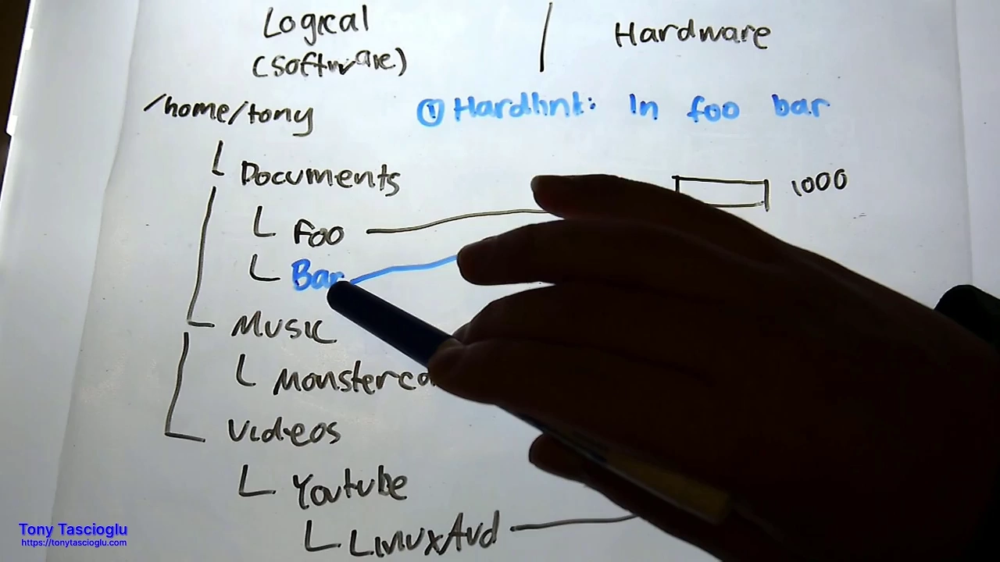

后果很直接：写 `bar` 就是写那个块，于是打开 `foo` 看到的也变了。讲者把 `hello` 改成 `flurble`，`foo` 跟着变成 `flurble`——**硬链接的两个名字永远同步，因为它们根本就是同一份数据**。

删除则体现了「最后一个人才关灯」的规则：删掉 `foo`，块 1000 不会释放；直到 `bar` 也被删掉，没有指针再指向它，块才被回收。

[【跳转到 10:30】](https://www.youtube.com/watch?v=hJ9s-S6qrxY&t=630)

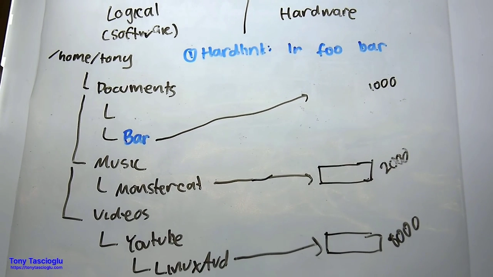

硬链接还有两条边界。第一，**不能给目录建硬链接**：目录在硬件层没有对应的「一块数据」可以指，硬链过去会直接把目录树变成环，所以内核干脆禁止。第二，想解除链接用 `unlink bar`，效果就是删掉 `bar` 这个目录项、把计数减一。

这条「有引用就不回收、引用清零才回收」的规则，正是后面 reflink 引用计数的雏形——区别只是：硬链接数的是**指向同一个 inode 的名字**，reflink 数的是**指向同一批 extent 的文件**。

### 2.2 软链接：只活在逻辑层，不跨到硬件层

`ln -s foo bar` 建的 `bar` 是一个**独立的小文件**，内容是「请去看 foo」这个路径。它不指向任何数据块，只指向另一个名字。

[【跳转到 15:28】](https://www.youtube.com/watch?v=hJ9s-S6qrxY&t=928)

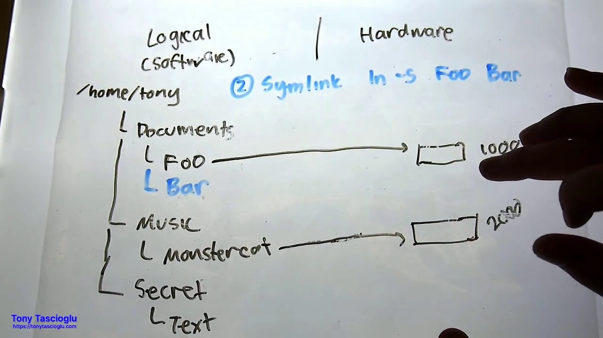

讲者的两个类比很好用：

- 硬链接像 DNS 里的 **CNAME**：访问哪个名字都一样，背后是同一台机器；
- 软链接像 **301/302 重定向**：访问 `bar` 会被明确告知「去 `foo`」，而且应用**看得见**这是一次跳转。

因此软链接有两个硬链接没有的能力：可以指向目录（因为不需要有对应的块），以及可以指向不存在的目标（悬空链接）。代价是**不透明**——程序必须愿意跟随它，`ls -l` 里也会明晃晃地显示 `->`。

### 2.3 reflink：两个独立的文件，共享同一批数据块

第三种是本文的主角。命令是 `cp` 的一个开关：

```bash
cp --reflink=always src dst   # 必须克隆，做不到就报错
cp --reflink=auto   src dst   # 能克隆就克隆，不能就退化成普通复制
cp -r --reflink=auto Documents text   # 目录也可以
```

讲者说 reflink「一开始活得像硬链接」：`bar` 建好之后，箭头也指向 `foo` 的那个块，**不占额外空间**，只多了一点元数据。

[【跳转到 23:59】](https://www.youtube.com/watch?v=hJ9s-S6qrxY&t=1439)


但它在共享的块上留了一个**星号**：这块数据现在是「只读共享」的。星号不是给用户看的标志位，而是文件系统给自己留的一句话：**这块地现在有两个人踩，谁要动它，先自己复制一份**。

[【跳转到 25:02】](https://www.youtube.com/watch?v=hJ9s-S6qrxY&t=1502)

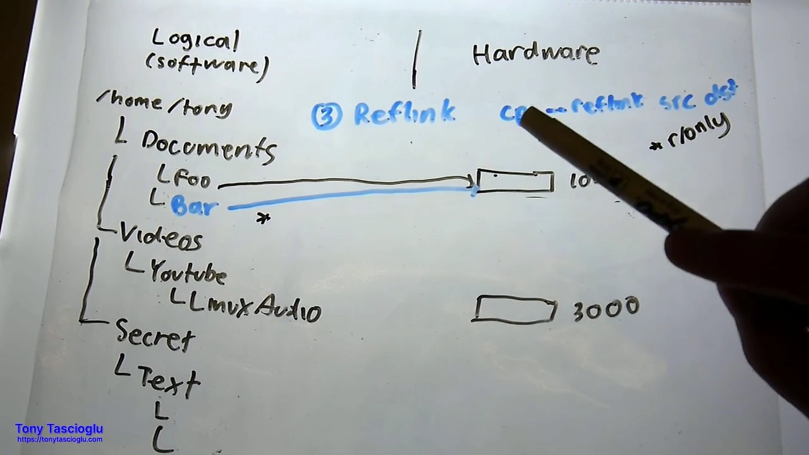

**这就是 reflink 与硬链接的分水岭**：硬链接是「同一个文件的两个名字」，reflink 是「两个文件，恰好共用了一批数据块」。两个文件各有自己的元数据、各自可以改名、各自可以删除、各自可以继续写，彼此之间**没有父子关系**——`foo` 不是 `bar` 的祖先，`bar` 也不是 `foo` 的快照。

## 三、克隆为什么是 O(1)：只改引用计数，不搬数据

讲者给的数量级感受是：**2 TB 的目录，几秒钟复制完**。原因不是磁盘快，而是**根本没有数据被读写**——文件系统只是给 `text/` 下每个文件建了一份新的映射表，把表里的每个 extent 指向原来的物理块，然后把这些块的引用计数加一。

[【跳转到 30:31】](https://www.youtube.com/watch?v=hJ9s-S6qrxY&t=1831)

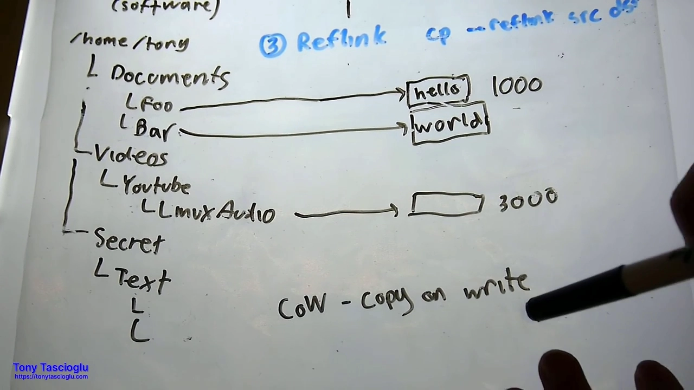

用复杂度写出来更清楚。设文件有 $n$ 个 extent、总大小为 $S$：

| 操作 | 要做的事 | 复杂度 |
| --- | --- | --- |
| 普通 `cp` | 读 $S$ 字节、写 $S$ 字节 | $O(S)$ |
| `cp --reflink` | 复制 $n$ 条映射记录、把 $n$ 个 extent 的引用计数加一 | $O(n)$ |

因为 $n \ll S$（一个 extent 通常是几十 KB 到几 MB），$O(n)$ 在实践中就是「瞬间」。这也解释了两个限制：

- **必须同一个文件系统内**：跨盘、跨文件系统就没有「同一批块」可言，只能老老实实复制（讲者明确说了这一点）；
- **不是所有文件系统都支持**：讲者提到 Btrfs、ZFS、XFS 可以，ext4 不行（他自己也留了个「如果我说错了请在评论区纠正」的口子）。

引用计数还有第二个作用：**删除时判断能不能真的回收**。删掉 `foo` 之后，共享块的计数从 2 变 1，块必须留着给 `bar`；等 `bar` 也删掉、计数归零，块才回到空闲池。这与 2.1 节硬链接的删除规则是同一个道理，只是计数的对象从「名字」换成了「extent」。

### reflink 与快照差在哪

讲者顺手把 reflink 和 Btrfs 快照放在一起对照，这里要分清两者，因为它们的机制同源、语义不同：

| | reflink（克隆） | 快照 |
| --- | --- | --- |
| 产物是什么 | 一个**普通文件**（或一棵普通目录） | 一个**子卷/文件系统的历史版本** |
| 两者关系 | 平级，互不隶属 | 有父子关系，快照属于某个子卷 |
| 怎么创建 | `cp --reflink` | `btrfs subvolume snapshot` 之类的命令 |
| 怎么删除 | `rm` 掉那个文件就行 | 删除的是整个快照子卷 |
| 共享的粒度 | 文件里的 extent | 整棵子卷的 extent 树 |

[【跳转到 27:00】](https://www.youtube.com/watch?v=hJ9s-S6qrxY&t=1620)

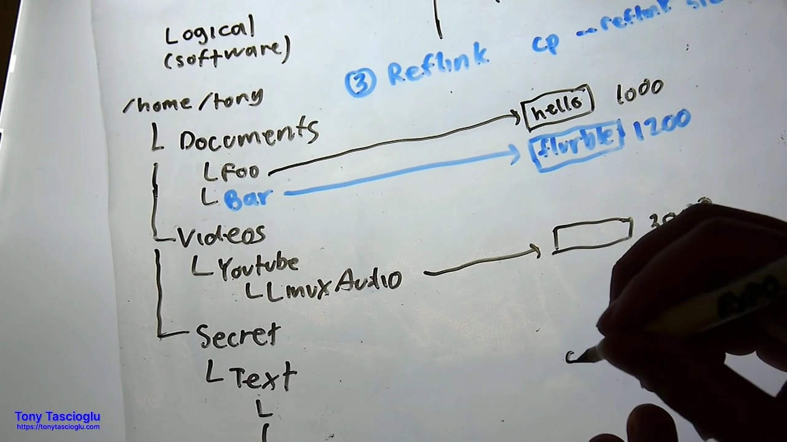

一句话概括：**快照是「整个文件系统在某个时刻的样子」，reflink 是「两个普通文件共用一批块」**。快照的写时复制原理已在 1.1.3 讲过，这里不再展开；本节只关心后者那种「平级共享」。

## 四、写入时发生什么：共享的 extent 被拆开

### 4.1 概念层：三步走

回到那个星号。现在 `foo` 和 `bar` 共享着同一批块，我要改 `bar` 中间的一小段。文件系统不能原地改，因为那块数据 `foo` 还在读——原地改就等于偷偷改了 `foo`，那 reflink 就退化成硬链接了。

所以它只能这么做：

1. **分配新块**：为要被改写的那一段申请新的物理块；
2. **把要改的那一段拷过去**：只拷被写覆盖的范围，不是整个文件；
3. **改本文件的映射 + 减旧块的引用计数**：`bar` 的映射表里，这一段指向新块；旧块的引用计数从 2 减到 1（只剩 `foo`）。

[【跳转到 26:12】](https://www.youtube.com/watch?v=hJ9s-S6qrxY&t=1572)

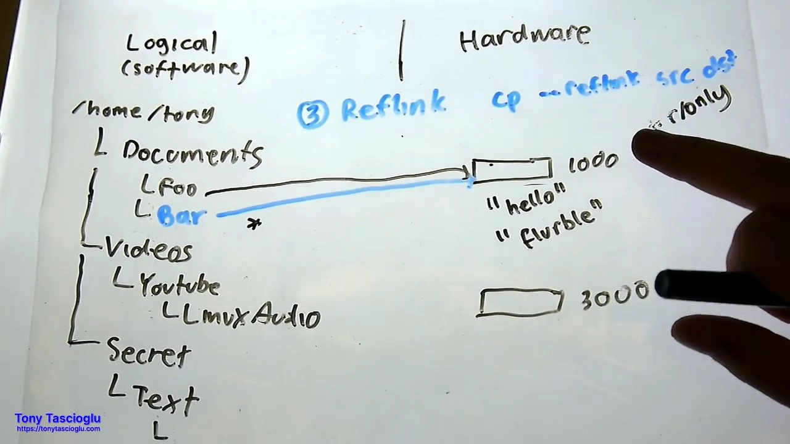

做完之后，两个文件就**彻底分家**了：`foo` 读到的是 `hello`（块 1000），`bar` 读到的是 `flurble`（新块 1200）。

[【跳转到 26:48】](https://www.youtube.com/watch?v=hJ9s-S6qrxY&t=1608)

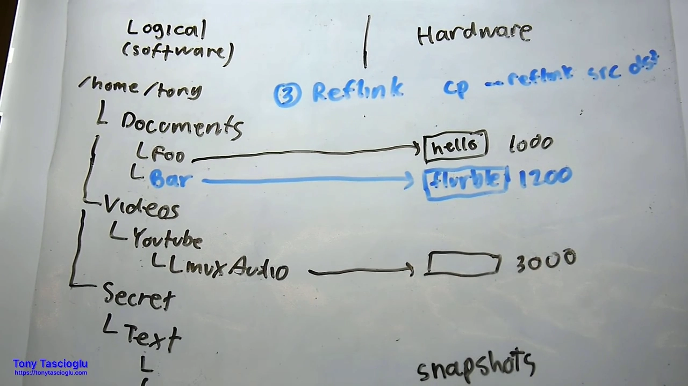

讲者在这里特意补了一句：他画的是**以整个文件为单位**的 CoW，实际上文件系统可以做到**以 extent（文件的一部分）为单位**，但那超出了这支视频的范围。本系列把那一半补上。

### 4.2 为什么「部分写」会把一个 extent 拆成三段

关键点在于：**共享的单位是 extent，不是文件**。一个 1 GiB 的文件可能只有一个 1 GiB 的 extent，`foo` 和 `bar` 共享的就是这**一个** extent。现在你只改它中间的 4 KiB：

```
写入前
  foo ─┐
       ├──> E0: 物理块 1000..1255（1 GiB，引用计数 = 2）
  bar ─┘

对 bar 写入中间 4 KiB 之后
  foo ─────> E0a（前段，仍共享，引用计数 = 1）
             E1 （新块，只属于 bar，4 KiB）
             E0b（后段，仍共享，引用计数 = 1）
  bar ─────> E0a + E1 + E0b
```

也就是说，一次 4 KiB 的写，把原来**一条** extent 记录变成了**三条**：前后两段继续指向原来的物理块（内容没变，只是被切开了），中间那一段指向新块。这就是「部分写导致 extent 分裂」。

分裂的代价可以拆成三份：

- **数据拷贝**：只拷被写的那 4 KiB，不是 1 GiB——这一份很便宜；
- **元数据增加**：多出两条 extent 记录，文件系统还要为「共享」这件事本身记账；
- **后续读的碎片化**：原本一次连续读能拿到的 1 GiB，现在要在三个地方拼接。

如果这个文件被反复「克隆 → 改一点 → 再克隆 → 再改一点」，extent 表就会越来越长、越来越碎。讲者在片尾讲去重工具时也提到了同一枚硬币的另一面：**extent 切得越细，能匹配上的重复内容越多，但每条 extent 都要自己的元数据**。

[【跳转到 33:07】](https://www.youtube.com/watch?v=hJ9s-S6qrxY&t=1987)

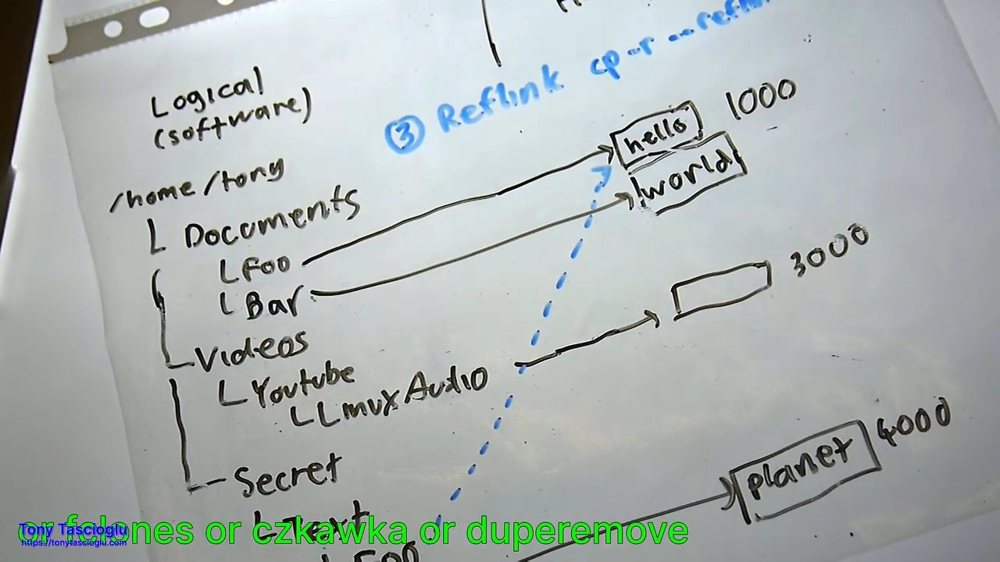

至于引用计数具体存在哪（XFS 的 refcount btree、Btrfs extent tree 里的 refs 字段）、分裂时元数据怎么记账、`cowextsize` 怎么影响预分配，这些是实现层的事，见 2.2.1。

## 五、什么时候该用 reflink，什么时候不该

讲者在片尾给了几条很实用的判断：

**适合用 reflink 的场景**

- **需要一份「现在这样子」的副本，但不想付空间和时间**：备份点、发布前的快照点、给别人一份只读参考；
- **同一份数据要开多个工作副本**：讲者自己剪视频，一个项目会有多份拷贝，克隆之后只有真正被改动的片段才会占空间；
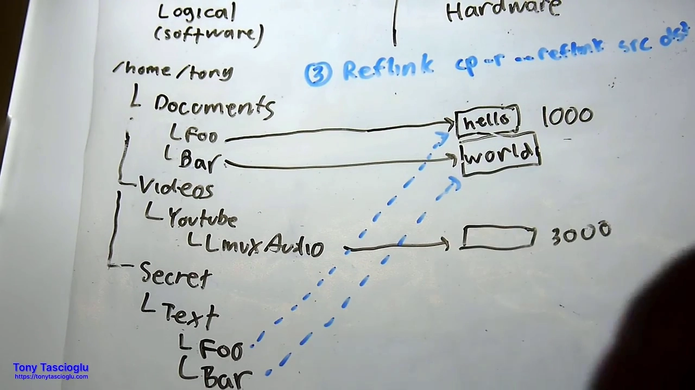

- **去重**：`duperemove` 这类工具会扫描文件里相同的 extent，把它们重新链接到同一批块上——注意这是**事后**去重，和 ZFS 的在线去重不同，不需要维护一张巨大的去重表，也不会拖慢每一次写；
- **虚拟机镜像、容器层**：克隆一个 10 GB 的镜像不花时间和空间，改哪里才复制哪里。

**不该用 reflink 的场景**

- **想靠「复制一份」防数据损坏**：两份文件共享同一批块，块坏了两个一起坏。讲者说得很直接：要防 bit rot 应该用 par2 这样的校验文件，或者用 Btrfs/ZFS 的 `copies=2`（同一块盘上存两份），再往上就是 RAID-Z1/RAID-Z2；
- **副本要放到另一块盘或另一个文件系统**：跨文件系统没有共享可言，`--reflink=auto` 会安静地退化成普通复制，`--reflink=always` 会直接报错；
- **文件系统不支持**：ext4 就没有这个能力。

[【跳转到 32:55】](https://www.youtube.com/watch?v=hJ9s-S6qrxY&t=1975)

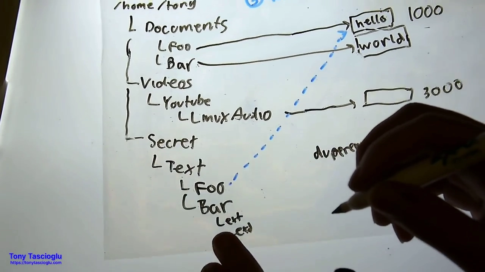

## 小结

- **三种共享，三种粒度**：硬链接共享的是「同一个文件的两个名字」；软链接只是逻辑层的一次跳转；reflink 共享的是「两个独立文件之间的一批 extent」。
- **reflink 没有父子关系**：克隆出来的就是普通文件，可以改名、可以删除、可以继续写，和原件平级。这一点把它和快照（子卷的历史版本）区分开。
- **克隆是 O(1) 的**：只复制映射表、给共享 extent 的引用计数加一，不搬数据，所以 2 TB 的目录也能几秒完成。
- **写入靠分裂**：共享块不能原地改，只能「分配新块 → 拷被写的那一段 → 改本文件映射 → 旧块计数减一」。共享单位是 extent，所以一次 4 KiB 的写可能把一条 1 GiB 的 extent 拆成三段。
- **代价是碎片**：分裂会多出 extent 记录、让后续读变碎；反复克隆加部分写会让 extent 表越长越碎。
- **适用面**：适合要副本但不想付空间和时间的场景（VM 镜像、工作副本、事后去重）；不适合当防损坏的备份，也跨不了文件系统。

## 关键术语速查

| 术语 | 一句话解释 |
| --- | --- |
| 逻辑视图 / 硬件视图 | 前者是目录树和文件名，后者是磁盘上的块；文件系统负责把前者翻译成后者 |
| 硬链接 | 两个目录项指向同一份数据，改一个另一个也变，最后一个删除才释放空间 |
| 软链接 | 一个存着「目标路径」的小文件，只在逻辑层跳转，应用看得见 |
| reflink（克隆） | 两个独立文件共享同一批 extent，写入时才把被写的那段复制出来 |
| extent | 磁盘上一段连续的块，是文件系统分配和共享数据的基本单位 |
| 引用计数 | 记录一批数据被多少个文件引用，克隆时加一、删除时减一，归零才回收 |
| CoW（写时复制） | 不原地改，而是写新块再改映射，旧数据保持完整 |
| 快照 | 子卷或文件系统在某个时刻的完整版本，与 reflink 共用 CoW 机制但语义不同 |
| duperemove | 扫描文件里相同的 extent 并把它们重新链接到同一批块的事后去重工具 |
| `--reflink=auto` / `always` | `auto` 能克隆就克隆、不能就普通复制；`always` 做不到就报错 |