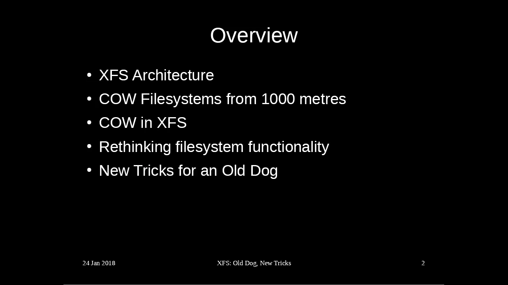
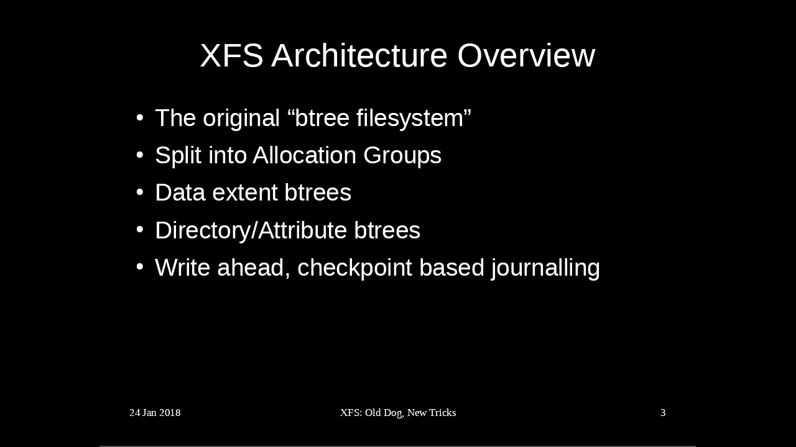
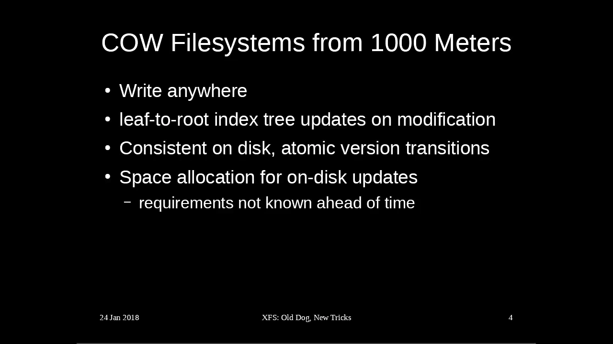
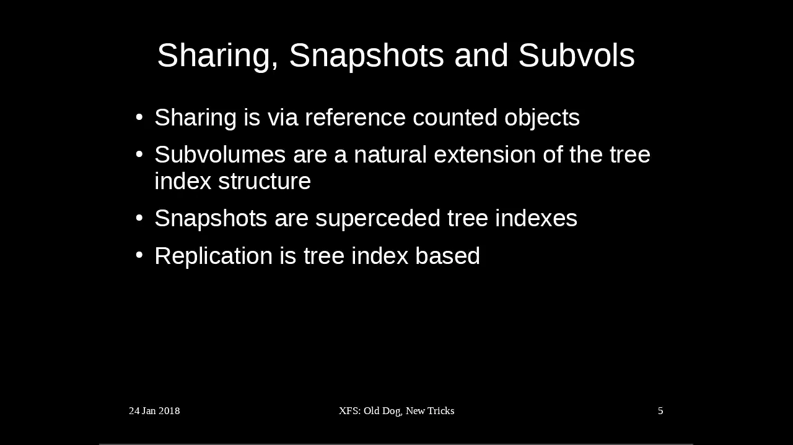
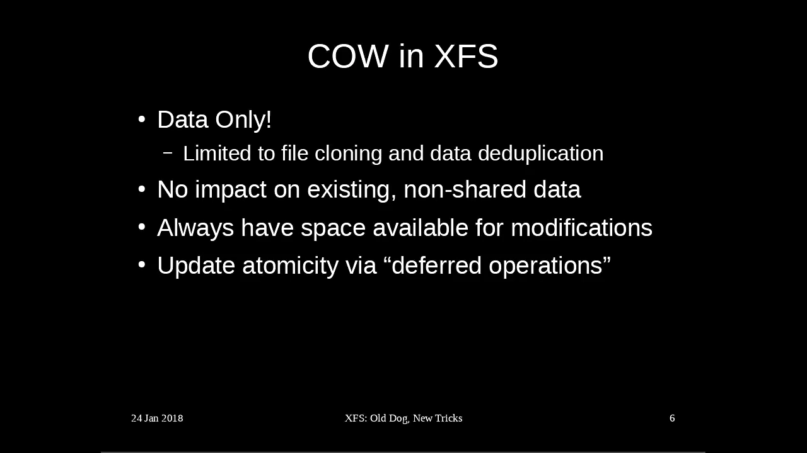
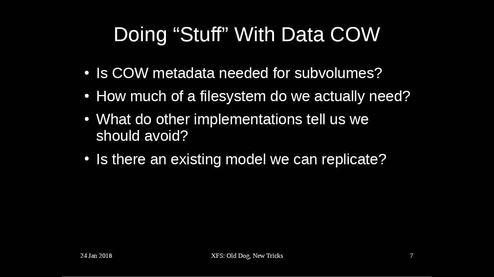
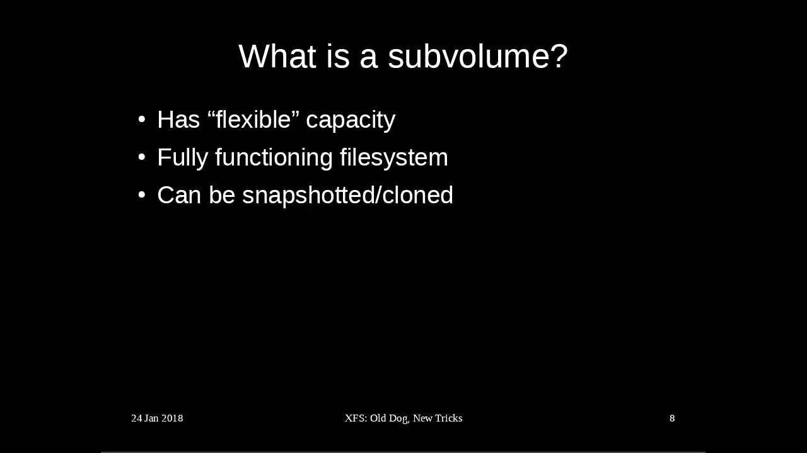

# XFS 的 reflink 只能共享数据块：元数据不能 CoW，能力就止步于克隆与去重

> 视频来源：[XFS: Teaching an Old Dog Old Tricks](https://www.youtube.com/watch?v=wG8FUvSGROw)（YouTube · linux.conf.au 2018 · 讲者 Dave Chinner，XFS 维护者）｜全长约 47 分钟
>
> 导读：这是一支从架构层面回答「XFS 的 reflink 为什么长这样」的演讲。**本文只跟它的前 12 分钟**：XFS 的 B\* 树结构、通用 CoW 文件系统的模型、以及「为什么 XFS 只能做 data-only CoW」这条硬约束，最后停在「子卷到底需要什么」这个问题上。演讲后半段转入「如何在 data-only CoW 之上造出子卷与快照」的设计推演与现场演示，属于本系列其他小节的范围，本文不展开。字幕由本地 faster-whisper 转写（该视频无官方字幕），术语已按幻灯片订正。

## 本讲要解决的核心问题（SCQA）

**背景**：XFS 从 2016 年起支持 reflink——两个文件可以共享同一批数据块，克隆一个文件几乎不花时间也不占空间。用起来和 Btrfs、ZFS 的 reflink 没什么区别。

**冲突**：可 Btrfs 和 ZFS 上，`reflink` 只是顺带的能力，它们真正好用的是**快照和子卷**——`btrfs subvolume snapshot` 一敲，整个子卷瞬间冻结成一个新版本。XFS 明明也能共享数据块，却做不出快照。

**疑问**：同样是「引用计数 + 共享」，为什么 XFS 只能做到文件克隆，做不到快照？这条边界是历史包袱，还是结构决定的？

**回答（中心思想）**：是结构决定的。CoW 文件系统的快照能力来自**元数据也能 CoW**——改一个块就复制一条从叶到根的索引路径，最后原子地换掉根指针。而 XFS 的 B\* 树在每个节点和叶子之间都有**兄弟指针**，改一个块不仅要改父节点，还要改指向它的兄弟；兄弟改了又要改兄弟的父节点……代价会横向扩散，最坏情况变成**重写整个文件系统**。所以 XFS 只能做 **data-only copy-on-write**：共享的只有数据块，元数据永远原地更新。这条约束直接划定了 reflink 的能力边界——它能给你**文件克隆**和**数据去重**，给不了**快照**和**子卷**。

## 一、XFS 的骨架：一切都是 B 树

讲者用一句话给 XFS 定位：「**它是最早的 B 树文件系统**（the original btree filesystem），所有元数据都用 B 树索引。」

[【跳转到 01:40】](https://www.youtube.com/watch?v=wG8FUvSGROw&t=100)

具体到结构，有五件事要记住：

[【跳转到 02:00】](https://www.youtube.com/watch?v=wG8FUvSGROw&t=120)

1. **不是普通 B 树，是 B\* 树**。区别在于「每个节点和每个叶子都有**兄弟指针**（sibling pointers）」，因此可以沿着树做**横向遍历**。讲者特意强调：「等我们讲到 copy-on-write 时，这一点会变得很重要。」
2. **按分配组（allocation group，AG）切分**。每个 AG 像一个小文件系统，各有自己的空闲空间索引 B 树、inode B 树、**反向映射 B 树（reverse mapping btree）** 和 **extent 引用计数 B 树（extent reference count btree）**。后两个正是 reflink 与去重的记账基础。
3. **文件数据由 extent 引用**，extent 记录在 B 树里，可以跨越多个 AG，所以一棵树就能索引整个文件系统。
4. **目录和属性也是 B 树**。目录树最复杂——「虚拟映射的多索引 B 树，还带各种哈希」，讲者说这远超本场范围。
5. **崩溃恢复靠写前日志（write-ahead journaling），不靠 CoW**。并且用检查点（checkpoint）降低日志的写放大：已经记进日志的块还会被**再次原地修改**。

第 5 点很关键：XFS 的元数据是「原地更新 + 日志保护」，不是「写新副本再换指针」。这个设计选择在后面会直接决定 reflink 的天花板。

## 二、通用 CoW 文件系统：改一个块，重写一条到根的路径

讲者用「从 1000 米高空看」的方式，抽象地讲了一遍 CoW 文件系统的共同机制（不针对任何具体文件系统）：

[【跳转到 03:40】](https://www.youtube.com/watch?v=wG8FUvSGROw&t=220)

- **可以写到任意位置**。因为每次修改都是「复制一份再改」，新数据不必回到老地方。
- **修改会自叶向根传播**。改一个块要改指向它的指针，指针在父节点里，所以父节点也要复制一份；父节点被复制后，指向父节点的祖父又要改……一路到根。结果是一条**从叶到根的完整新路径**。
- **写出的是一整棵树**。所以可以把所有写操作重新排序、线性化，性能上有好处；更重要的是，可以**先把整棵新树写完，再原子地切换根索引**——磁盘上永远是一份自洽的镜像，崩溃恢复特别省心。
- **代价是空间**。每次磁盘更新都要分配新空间（数据 + 元数据），而且**事先算不出这次 CoW 到底要多少空间**。

用树高 $h$ 来写，一次修改至少要复制 $h$ 个节点：

$$
\text{cost}_{\text{CoW}} = O(h) \quad \text{（每个被修改块的祖先路径）}
$$

这个 $O(h)$ 很便宜，正是快照能做成 $O(1)$ 的原因——**只要留下旧根，整棵旧树就自动变成历史版本**。

共享与快照就是这套结构的自然延伸：

[【跳转到 05:30】](https://www.youtube.com/watch?v=wG8FUvSGROw&t=330)

- **共享靠引用计数**：一个对象可以被多条索引指向，引用计数记着「有几个人在用我」。
- **快照就是一棵被取代的旧树**：更新时写出新树、指向它，如果**故意留着**那棵旧树不释放，它就是一个快照；不想留了，交给垃圾回收，空间自然释放。
- **复制（replication）也要懂树**：复制快照等于复制树索引以及它引用的所有对象，因此复制工具必须理解树结构、对象类型、引用计数——很复杂，但这正是 `send`/`receive` 式增量复制的来源。

## 三、XFS 的不同：B\* 树的兄弟指针让元数据 CoW 变得不可承受

讲到这里，讲者话锋一转：「**XFS 里的 copy-on-write 有点不一样。**」

[【跳转到 07:10】](https://www.youtube.com/watch?v=wG8FUvSGROw&t=430)

原因就是第一节埋下的伏笔——**兄弟指针**。在普通 B 树里，改一个块只要向上改父节点；在 B\* 树里，改一个块还要改**指向它的兄弟节点**：

1. 改块 $B$ → 必须更新父节点 $P$；
2. 因为 $B$ 变了，兄弟节点里指向 $B$ 的指针也要更新；
3. 兄弟变了，兄弟的父节点和指向兄弟的兄弟又要更新；
4. 于是更新从「一条竖直路径」变成「横向铺开」，整棵树上部的所有节点都要重写。

讲者的结论毫不含糊：

> 如果我们写的是一个叶子（大多数 B 树更新都是写叶子，因为记录都存那儿），**一次修改就变成整棵树的重写**。最坏情况下，我们得重写整个文件系统。

$$
\text{cost}_{\text{meta-CoW}}^{\text{XFS}} \approx O(\text{整棵树}) \gg O(h)
$$

所以：

> **我们被限制在只做 data-only copy-on-write。这也限制了我们能提供的功能——只剩下文件克隆（file cloning）和数据去重（data deduplication）。**

[【跳转到 07:47】](https://www.youtube.com/watch?v=wG8FUvSGROw&t=467)

这句话就是本节要回答的「限制」：**reflink 不是 XFS 的一个可选小功能，而是 XFS 在「元数据不能 CoW」这条硬约束下，能做出来的全部 CoW 功能。**

讲者随后列举了这项能力的真实用户，都是云原生/存储场景里很实际的用法：

- **OverlayFS 已经在用文件克隆来优化它的 copy-up 过程**——容器镜像分层往上叠时，与其把整个文件复制到 upper 层，不如克隆一份只复制真正被改的部分；
- **NFS 服务器可以用数据共享做 copy offload**——客户端要求复制文件时，服务端不必搬数据；
- 还有一堆操作可以「用克隆代替复制」而变快。

## 四、data-only 的代价：省了空间账，欠了崩溃一致性

讲者没有只说好处，而是把 trade-off 摆得很清楚。

[【跳转到 08:23】](https://www.youtube.com/watch?v=wG8FUvSGROw&t=503)

**好处有三条**（幻灯片上的三条）：

1. **不影响已有的非共享数据**。共享的只是数据块，元数据不做 CoW，所以没被共享的部分「行为上跟没做这件事一模一样」。
2. **修改时永远有空间**。因为元数据是原地重写的，只需要为**被覆盖的数据**分配空间，而且「我们知道要覆盖多少」——不存在 CoW 文件系统那种「先算不清要多少空间、算不清就可能 ENOSPC」的鸡生蛋问题。
3. **不需要为元数据准备额外空间**，因此也不会出现「元数据树更新到一半发现没空间」的死局。

**代价是原子性**。CoW 文件系统靠「写完新树再切根」获得原子性；XFS 不写新树，就没有这个机制。讲者的原话是：

> 但有了日志之后，提供崩溃抵抗（crash resistance）就变得困难一些，因为我们不是「写一棵树然后再更新」。

XFS 的解法是**延迟操作（deferred operation）**：

[【跳转到 09:15】](https://www.youtube.com/watch?v=wG8FUvSGROw&t=555)

- 在日志里把「意图」（intent）先记下来，形成一套**意图日志（intent logging）**机制；
- 这套机制最早用于空闲 extent 的管理，现在扩展到**引用计数更新**和**反向映射 B 树的更新**等；
- 崩溃恢复时，如果发现某个意图没有完成，就**重放**对应的 CoW 更新和 extent 共享更新。

也就是说：**reflink 的每一次克隆、每一次 CoW 写入，都要靠日志里的意图记录来保证「要么全做、要么全不做」**。这是 data-only CoW 必须付的账。

## 五、边界之外：还想要快照和子卷，就得另想办法

讲者用一句话点出动机：

> 每个人都想要一个能做**子卷快照**的文件系统。它能唱能跳、什么都能干——可我们总是卡在同一个地方：**这类高级功能通常需要 copy-on-write 元数据，而我们没有。**

[【跳转到 10:00】](https://www.youtube.com/watch?v=wG8FUvSGROw&t=600)

于是问题被重新表述成：**「一个子卷到底需要什么？」** 讲者给了三条判据：

[【跳转到 11:40】](https://www.youtube.com/watch?v=wG8FUvSGROw&t=700)

1. **弹性容量**：能瞬间扩容和缩容，空间来自底层存储池；
2. **是一个功能完整的文件系统**：能分配空间、打洞、搬文件、在内部克隆文件，用起来和普通文件系统没差别；
3. **是快照的粒度单位**：可以独立于文件系统其余部分被快照。

第 3 条正是 reflink 单靠自己给不出的东西——**reflink 能克隆文件，但克隆不了「文件系统」这个容器本身**。演讲从这里开始转入「怎么在 data-only CoW 之上，用命名空间、镜像文件、跨层空间账务等机制拼出一个子卷」，那是另一个话题了。

## 小结

- **XFS 的一切都是 B 树**，而且是带兄弟指针的 B\* 树；分配组里还有反向映射 B 树和引用计数 B 树，这两个是 reflink 的记账基础。
- **通用 CoW 文件系统靠「复制叶到根的路径 + 原子换根」获得一致性和快照能力**，代价是空间用量事先不可知。
- **XFS 不能 CoW 元数据**：兄弟指针会让一次叶子修改扩散成整棵树（最坏整个文件系统）的重写。
- **所以 XFS 只做 data-only CoW**，能力边界被限定为**文件克隆**与**数据去重**——OverlayFS 的 copy-up、NFS 的 copy offload 都建立在这条边界之内。
- **data-only 换来的是可预测的空间**：元数据原地更新，只需为被覆盖的数据分配空间，不存在「算不出要多少空间」的问题。
- **代价是原子性**：没有「写新树再切根」，只能靠日志里的**意图记录（deferred operations）**保证克隆与 CoW 更新的原子性，崩溃后重放未完成的意图。
- **快照与子卷在边界之外**：它们需要 COW 元数据，而 XFS 没有；想要就得在文件系统之上另造一层。

## 关键术语速查

| 术语 | 一句话解释 |
| --- | --- |
| B\* 树 | 每个节点和叶子都带兄弟指针的 B 树变体，可以沿树横向遍历；XFS 全部元数据都用它 |
| 分配组（AG） | XFS 把设备切成若干「迷你文件系统」，各自管理空闲空间、inode、反向映射与引用计数 |
| 反向映射 B 树（rmapbt） | 记录「这个物理块被哪些 inode 引用」，是去重与在线修复的基础 |
| 引用计数 B 树（refcount btree） | 记录每个共享 extent 被几个文件引用，克隆时加一、私有化时减一 |
| data-only CoW | 只对数据块做写时复制，元数据始终原地更新——XFS reflink 的全部实现方式 |
| 快照 | 在 CoW 文件系统里就是「被取代但故意保留的旧树索引」 |
| deferred operation | XFS 的延迟操作机制，先在日志里记意图、再分步执行，用于保证引用计数更新等的原子性 |
| copy-up | 联合文件系统（如 OverlayFS）把下层文件「提升」到可写层的动作，用克隆可大幅省钱 |
| copy offload | 让存储端自己完成文件复制，避免数据穿过客户端；NFS 可用数据共享实现 |