# xfs_info 里 reflink=1 才是开关：cp --reflink 让 2 GiB 文件复制只花元数据

> 视频来源：[RHEL 8 Beta - XFS Copy-On-Write Data Extents](https://www.youtube.com/watch?v=YGX1d9WEJYI)（YouTube · Red Hat · 讲者 Brian Smith，Senior Technical Account Manager）｜时长约 5 分 46 秒
>
> 导读：这是一支纯演示视频，全程只有一块终端。它不解释内核实现，只回答一个很实际的问题——**怎么确认这台机器上的 XFS 打开了 reflink，打开之后 `cp` 的行为到底哪里不一样**。本文按演示顺序走一遍：`xfs_info` 读开关、普通 `cp` 与 `cp --reflink` 的对照、`xfs_bmap` 看共享 extent、改一个字节看 CoW 只复制一个块、目录级 reflink 的元数据开销。字幕由本地 faster-whisper 转写（该视频无官方字幕），术语已按画面订正。

## 本讲要解决的核心问题（SCQA）

**背景**：在 RHEL 8 上，XFS 的 reflink 默认就是开着的（`reflink=1`）；而 `cp` 复制一个文件，直觉上就是把数据完整再写一份。

**冲突**：同一个文件系统上，一份 2 GiB 的数据被复制成两份，磁盘上就真的占了两份空间，复制过程还要等 I/O。可这两份内容一开始是一模一样的——**凭什么要为同一份字节付两次钱**？

**疑问**：XFS 的 reflink（copy-on-write data extents，写时复制数据区）能不能让两个文件共享同一批数据块？如果能，怎么知道自己的文件系统开了这个特性，开了之后又该用什么命令看出"它们真的在共享"？

**回答（中心思想）**：能不能共享，取决于**文件系统自己**——`xfs_info` 输出里 `reflink=1` 那一行就是开关，RHEL 8 上默认就是 1。开关打开后，`cp --reflink` 会让新文件直接指向源文件的那批块（`df` 不涨、`xfs_bmap` 显示完全相同的块号），只有真正被改写的那一小段才需要新块；而"一小段"的最小单位，正是 `xfs_info` 里同样被讲者圈出来的 `bsize=4096`。

## 一、第一步不是复制，而是确认开关

讲者没有先敲 `cp`，而是先看文件系统的元数据：

```bash
[root@rhel8beta demo]# xfs_info /
meta-data=/dev/mapper/rhel-root  isize=512    agcount=4, agsize=4456448 blks
         =                       sectsz=512   attr=2, projid32bit=1
         =                       crc=1        finobt=1, sparse=1, rmapbt=0
         =                       reflink=1
data     =                       bsize=4096   blocks=17825792, imaxpct=25
         =                       sunit=0      swidth=0 blks
naming   =version 2              bsize=4096   ascii-ci=0, ftype=1
log      =internal log           bsize=4096   blocks=8704, version=2
         =                       sectsz=512   sunit=0 blks, lazy-count=1
realtime =none                   extsz=4096   blocks=0, rtextents=0
```

[【跳转到 00:26】](https://www.youtube.com/watch?v=YGX1d9WEJYI&t=26)

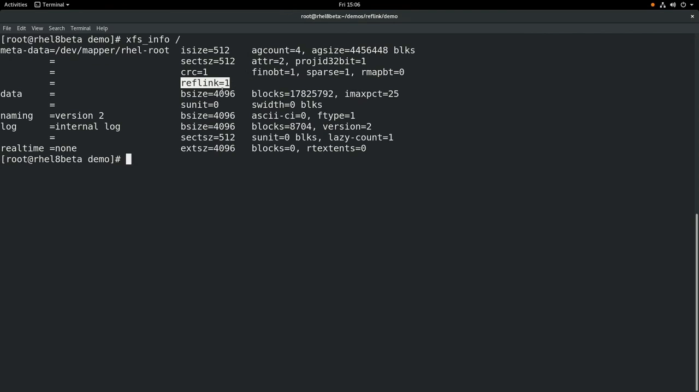

讲者的原话是：**"reflink=1，这是 RHEL 8 上的默认值，正是它开启了 copy-on-write data extents。"** 这句话把因果关系说得很清楚——`cp --reflink` 不是万能钥匙，它只是一个请求；**文件系统有没有 `reflink=1`，才是这个请求能不能兑现的前提**。

同一屏里还有几个参数值得顺手认识，它们描述的是"这个文件系统被创建成什么样"，而不是"这次挂载用了什么选项"：

| 字段 | 含义 | 本例取值 |
| --- | --- | --- |
| `reflink` | 是否允许文件之间共享数据块（克隆） | `1`，开启 |
| `crc` | 元数据是否带 CRC 校验（v5 文件系统的标志） | `1` |
| `rmapbt` | 是否有反向映射 btree（记录"这个块被谁引用"） | `0`，没开 |
| `sparse` | 是否支持稀疏 inode | `1` |
| `bsize` | 数据块大小，即最小的分配单位 | `4096` 字节 |
| `realtime` | 实时（realtime）设备 | `none`，没有 |

讲者特意把 `bsize=4096` 圈了出来，并说"**我们后面会回到这一点**"。这句伏笔在第四节兑现：CoW 的粒度就是这一个块。

这张表顺带也说明了 reflink 的"邻居"：它和 `crc=1`（v5 文件系统的元数据校验）、`sparse=1`（稀疏 inode）一起出现；而 `rmapbt=0` 说明**reflink 并不要求反向映射 btree 打开**——那是给去重和在线修复用的另一套索引；`realtime=none` 说明这个文件系统没有实时设备。换句话说，reflink 是文件系统**创建时**就定下的一组特性中的一项，不是挂载时可以临时加减的开关。

[【跳转到 00:34】](https://www.youtube.com/watch?v=YGX1d9WEJYI&t=34)

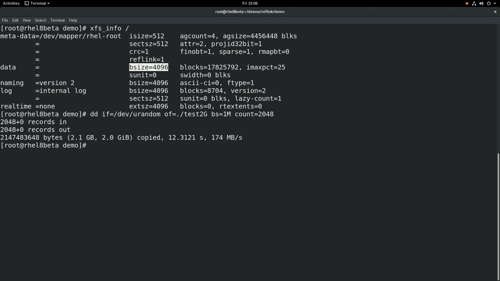

注意整支视频里讲者**没有改过任何挂载参数**：没有 `mount -o`，没有 `/etc/fstab`。reflink 在这台机器上"本来就在"，因为它是随文件系统一起建好的特性——这也是为什么本节要先讲"看开关"，再讲"用命令"。

## 二、对照组：同一个 2 GiB 文件，两种复制方式

为了把差别放大，讲者先造了一个 2 GiB 的随机数据文件：

```bash
dd if=/dev/urandom of=./test2g bs=1M count=2048
# 2147483648 bytes (2.1 GB, 2.0 GiB) copied, 12.3121 s, 174 MB/s
```

用随机数据是有讲究的：如果内容全是零，文件系统可能直接把它记成"空洞"（hole），`df` 本来就不会涨，对照实验就失真了。

此时 `df -h /` 显示已用 26G：

[【跳转到 01:02】](https://www.youtube.com/watch?v=YGX1d9WEJYI&t=62)

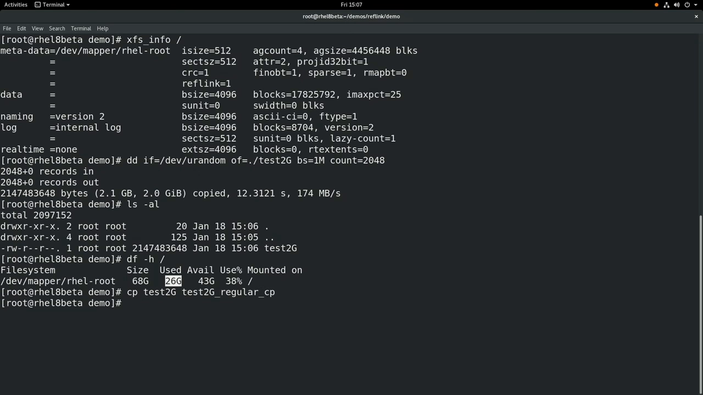

然后做普通复制：

```bash
cp test2g test2g_regular_cp
```

讲者提醒观众注意"按下回车之后有一小段等待"——因为内核真的把那 2 GiB 数据读出来、再写到新分配的块上。复制完 `df -h` 变成 28G，**正好多了 2 GiB**。

[【跳转到 01:17】](https://www.youtube.com/watch?v=YGX1d9WEJYI&t=77)

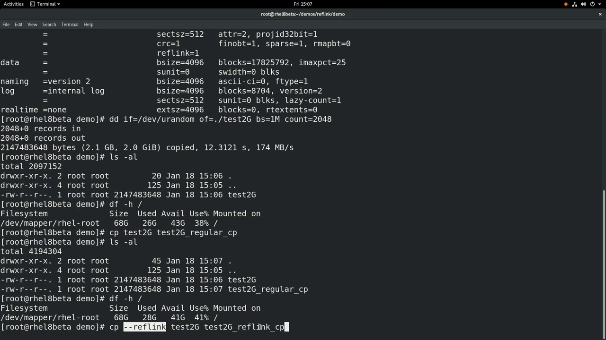

换成 reflink 复制：

```bash
cp --reflink test2g test2g_reflink_cp
```

[【跳转到 01:30】](https://www.youtube.com/watch?v=YGX1d9WEJYI&t=90)

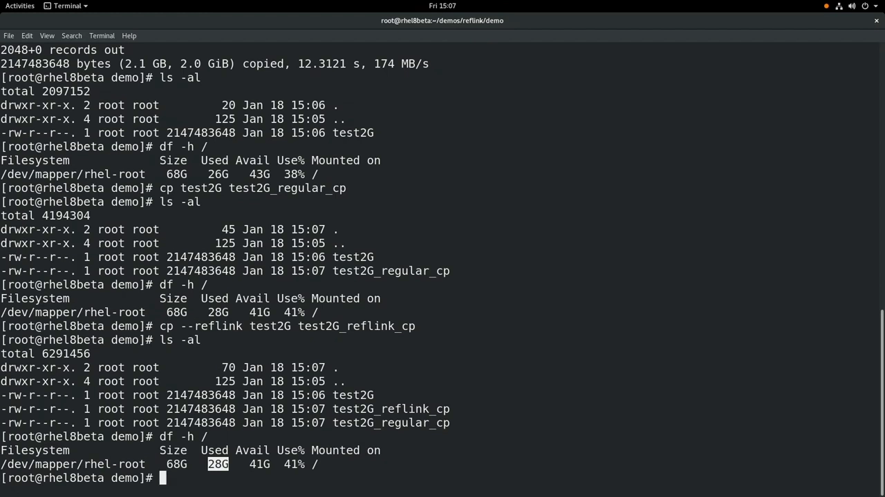

结果有两个"没变"：

- **命令瞬间返回**——讲者的解释是"它并不需要真的复制这些数据块"；
- **`df -h` 还是 28G**——2 GiB 的文件复制了一份，磁盘占用一点没涨。

`ls -al` 也看不出任何区别，三个文件都是 2147483648 字节。这正是 reflink 的迷惑之处：**在 inode 的常规属性上，它们就是三个普通文件**，差别藏在 extent 列表里。

## 三、用 xfs_bmap 把"共享"这件事看出来

`xfs_bmap -v` 会打印一个文件的所有 extent（数据区），讲者用它对比三份文件。

先看普通复制的那一对：

```bash
xfs_bmap -v test2g test2g_regular_cp
```

[【跳转到 02:14】](https://www.youtube.com/watch?v=YGX1d9WEJYI&t=134)

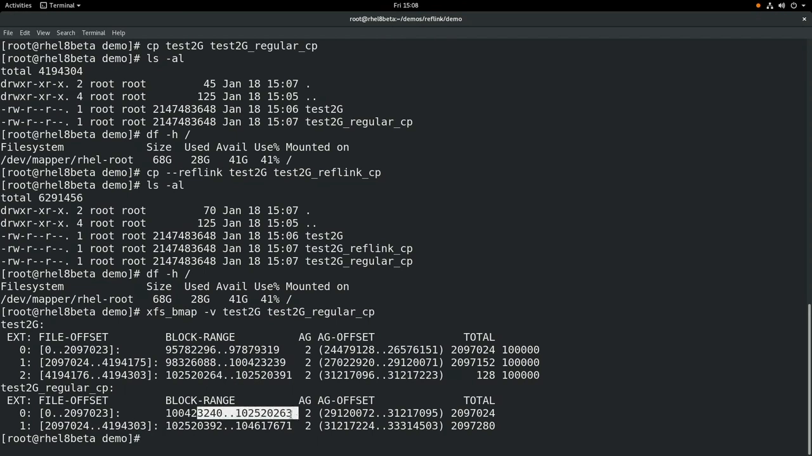

`test2g` 的 `BLOCK-RANGE` 是 `95782296..97879319`、`98326088..100423239`、`102520264..102520391`；`test2g_regular_cp` 的则是 `100423240..102520263`、`102520392..104617671`——**全新的一批块，数据被完整搬了一份**。

再看 reflink 复制的那一对：

```bash
xfs_bmap -v test2g test2g_reflink_cp
```

[【跳转到 02:22】](https://www.youtube.com/watch?v=YGX1d9WEJYI&t=142)

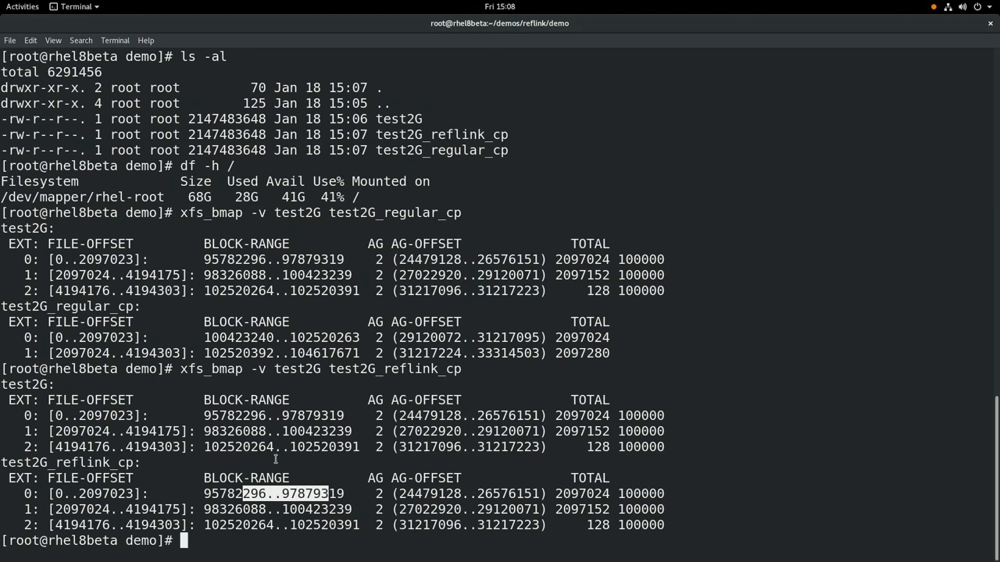

这一次两边的三段 extent **完全一致**：块号、分配组、组内偏移都一样。讲者的结论是"**这就是为什么 reflink 复制之后 `df` 没有涨——这些文件在共享文件系统上的同一批数据块**"。

要读懂这张表，先记住列的含义（这张表里所有偏移量都以 **512 字节扇区**为单位，所以讲者后面会说"八个 512 字节的块"）：

| 列 | 含义 |
| --- | --- |
| `FILE-OFFSET` | 这段数据在**文件内部**的位置区间 |
| `BLOCK-RANGE` | 这段数据落在**磁盘上**的物理块区间 |
| `AG` / `AG-OFFSET` | 属于哪个分配组（allocation group）、组内偏移 |
| `TOTAL` | 这段的长度（扇区数） |

所以"共享"这件事在工具层面是可验证的：**两个 inode 的 extent 列表指向了同一批物理块**。文件系统里只存了一份数据，两份"文件"只是两条指向它的索引。

## 四、改一个字节：只复制被改到的那一个块

接下来是整支视频最关键的一步。讲者往 `test2g_reflink_cp` 的**正中间**（1 GiB 偏移处）写 44 个字节：

```bash
printf 'changed data right in the middle of the file' | \
  dd of=test2g_reflink_cp bs=1M seek=1024 count=44 conv=notrunc
```

[【跳转到 02:54】](https://www.youtube.com/watch?v=YGX1d9WEJYI&t=174)

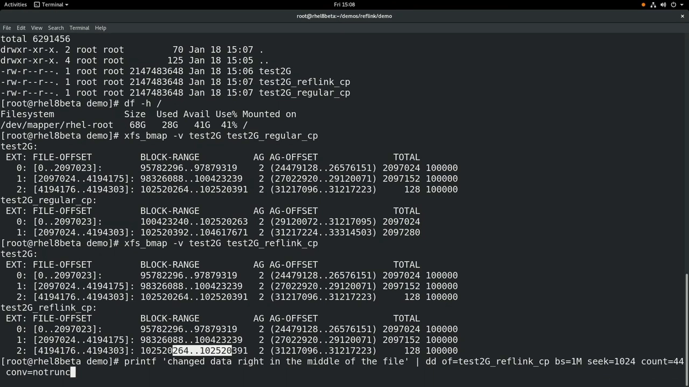

`conv=notrunc` 是这里的关键：不加它，`dd` 写完会把文件截断到写入位置，实验就变成"改文件大小"而不是"改文件内容"了。

随后用 `md5sum` 证明两个文件确实不同了：

```text
40b7f6552aac552c14f43a7573f6ba37  test2g
1aba8c259d552f6ed2f599b48ca29640  test2g_reflink_cp
```

[【跳转到 03:14】](https://www.youtube.com/watch?v=YGX1d9WEJYI&t=194)

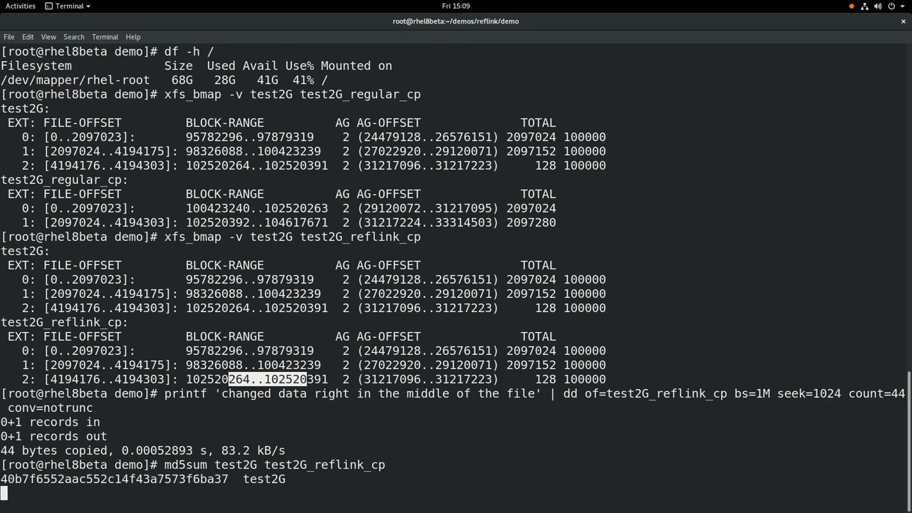

注意此刻 `df -h` **仍然是 28G**。内容已经不同了，空间却没涨——讲者随后执行了几次 `sync` 把数据刷到磁盘，再跑一次 `xfs_bmap -v`，画面才变：

```text
test2g_reflink_cp:
EXT: FILE-OFFSET        BLOCK-RANGE          AG AG-OFFSET          TOTAL
 0: [0..2097023]:       95782296..97879319   2 (24479128..26576151) 2097024
 1: [2097024..2097151]: 98326088..98326215   2 (27022920..27023047)     128
 2: [2097152..2097159]: 76186040..76186047   2 (4882872..4882879)         8
 3: [2097160..4194175]: 98326224..100423239  2 (27023056..29120071) 2097016
 4: [4194176..4194303]: 102520264..102520391 2 (31217096..31217223)     128
```

[【跳转到 03:33】](https://www.youtube.com/watch?v=YGX1d9WEJYI&t=213)

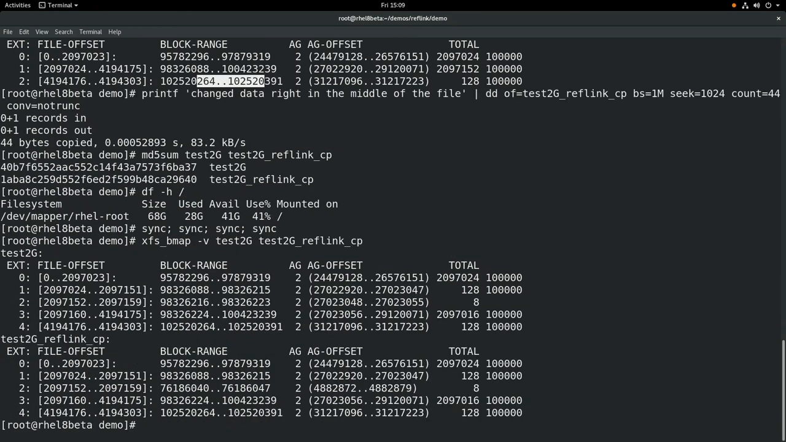

逐行读这张表，能读出三件事：

1. **只有第 3 段换了地方**。`test2g_reflink_cp` 的第 3 段从原来的 `98326216..98326223` 搬到了新的 `76186040..76186047`，其余四段的块号与 `test2g` 完全相同。讲者的说法是"**它只为被改动的那部分文件分配了新的数据块**"。
2. **新块只有 8 个扇区**，也就是 $8 \times 512 = 4096$ 字节——**正好一个文件系统块**。这就是讲者一开始圈出 `bsize=4096` 的原因：CoW 的最小单位不是字节，而是文件系统块。
3. **源文件的 extent 也被切细了**。`test2g` 原本是 3 段，改动后画面里变成 5 段：共享区间被从中间切开后，两边都要按新边界重新记录自己的 extent。共享不是免费的——**第一次写入会在元数据上留下切分的痕迹**。

用一句话概括这个机制：写入时如果发现目标块是共享的（引用计数大于 1），就先复制这一块、把引用计数减一，再往新块上写。可以把它想成"合租的房子，你想重新刷一面墙，得先自己租一间"。

## 五、目录级 reflink：数据几乎免费，元数据要钱

演示的最后一段把粒度放大到目录。讲者拿一份 Linux 4.20.3 的内核源码树做实验：`ls -alR` 数出 87367 个条目，`du -sm` 显示占 913 MB。

[【跳转到 04:33】](https://www.youtube.com/watch?v=YGX1d9WEJYI&t=273)

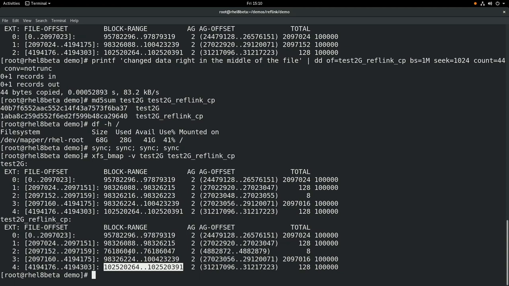

然后递归克隆：

```bash
cp --reflink -aR linux-4.20.3 testing_linux-4.20.3
```

[【跳转到 05:10】](https://www.youtube.com/watch?v=YGX1d9WEJYI&t=310)

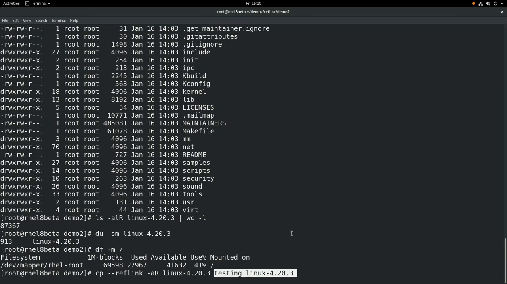

结果很能说明问题：

- 耗时比单个文件长——讲者的解释是"**它仍然要为所有这些文件创建元数据**"，但比普通复制快，因为数据块没有被复制；
- `df -m` 只涨了约 **37 MB**，而源目录本身有 913 MB。

37 MB 摊到 87367 个条目上，平均每个条目四百多字节——这就是 inode、目录项、extent 列表这些**元数据**的成本。换句话说：**reflink 省的是数据，不省元数据**。文件越多、越小，克隆的"固定开销"占比就越高。

## 小结

- **开关在文件系统上，不在命令行上**：`xfs_info` 输出里 `reflink=1` 才谈得上克隆，RHEL 8 默认就是 1；讲者全程没有调整任何挂载参数。
- **`cp --reflink` 是请求，不是保证**：它成功的前提是底层文件系统支持共享 extent。
- **共享的证据在 extent 列表里**：`xfs_bmap -v` 显示两个 inode 的 `BLOCK-RANGE` 完全一致，`df` 不增长。
- **CoW 的粒度是一个文件系统块**：写 44 字节，只私有化 8 个 512 字节扇区（= 4 KiB = 1 块），其余块继续共享。
- **第一次写入会切分 extent**：源文件的 extent 从 3 段变成 5 段，元数据有代价。
- **目录级克隆省数据不省元数据**：913 MB 的源码树克隆后只涨约 37 MB，但克隆仍要为 87367 个条目建元数据、因此不是瞬间完成。
- **`bsize` 值得先看一眼**：它决定了 CoW 的最小复制单位，也决定了后面做块级对齐时"一个块"到底是多大。

## 关键术语速查

| 术语 | 一句话解释 |
| --- | --- |
| reflink | XFS 的写时复制数据区特性，允许多个文件共享同一批物理数据块 |
| copy-on-write data extent | 共享的 extent 在被写入时才复制一份，其余部分继续共享 |
| `xfs_info` | 打印一个 XFS 文件系统的几何参数（块大小、特性开关等），`reflink=1` 就在这里 |
| `bsize` | 文件系统数据块大小，本例 4096 字节，是分配与 CoW 的最小单位 |
| `xfs_bmap -v` | 列出文件的 extent 映射，用来确认两个文件是否指向同一批块 |
| extent | 一段连续的物理块，文件内容由若干 extent 组成 |
| 分配组（AG） | XFS 把设备切成若干独立的分配组，各自管理自己的空闲空间 |
| `df` | 查看文件系统已用空间；reflink 复制后它不会增长，是共享生效的直观信号 |
| `conv=notrunc` | `dd` 的选项，表示写入后不截断文件，用于原地覆盖 |