# 用 truncate 与 cp 管理稀疏文件：从 inode 块指针到 loop 挂载镜像

> 视频来源：[Linux sparse files](https://www.youtube.com/watch?v=YePw4jyCMgo)（YouTube · uadmin / random Linux stuff）｜时长约 7 分钟
>
> 导读：这支视频从 inode 的块指针讲起，用 `df`、`ls -lh`、`ls -lhs` 三条命令反复对照同一个文件的两个大小，再演示"不认识稀疏文件的工具会把空洞写实"以及 `cp --sparse=always` 如何把空洞保留下来，最后把一个 100 MB 的稀疏文件做成可挂载的文件系统。本文按这条演示链复述。

## 本讲要解决的核心问题（SCQA）

**背景**：在 Linux 里创建一个文件，目录项指向一个 inode，inode 记录大小、属主、权限，并持有指向数据块的指针。文件按块写入，块大小随文件系统而定。

**冲突**：可是 `truncate -s 16K file2` 之后，`ls -lh` 说 file2 有 16K，`df` 却说文件系统的占用几乎没变；给 `ls` 加上 `-s` 参数，多出来的一列直接写着 0。

**疑问**：一个 16K 的文件，为什么可以一个数据块都不占？这种文件被普通工具读写之后会发生什么？

**回答（中心思想）**：稀疏文件有名字、有 inode、有逻辑大小，但**没有分配任何数据块**，所以 `ls` 报的 16K 是逻辑大小，`df`/`ls -s` 报的是真实块占用。空洞只在"被不认识它的工具整体读写"时才会被写实——`cp --sparse=always` 这类显式选项才会把零块重新释放成空洞。

## 一、普通文件：inode 的块指针决定物理占用

### 1.1 目录项只记名字，属性与块指针都在 inode 里

视频先回到基础（[【跳转到 00:05】](https://www.youtube.com/watch?v=YePw4jyCMgo&t=5)）：在 Linux 里创建文件时，目录的数据块里会存一条记录，它有一个名字，指向文件系统中的一个 inode；inode 里存着文件属性，比如大小、属主、权限。

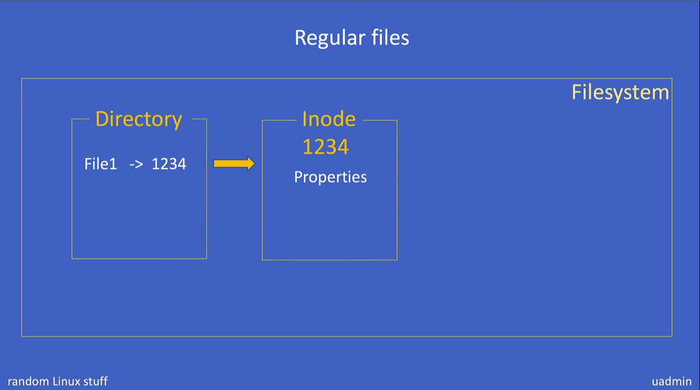

要看这些属性，用 `ls` 或 `stat` 都行。但对本文讨论最关键的一点是：**当一个文件有内容时，inode 会持有指向文件系统数据块的指针**（[【跳转到 00:30】](https://www.youtube.com/watch?v=YePw4jyCMgo&t=30)）。

### 1.2 16K 的文件 = 4 个 4K 块，逻辑与物理相等

数据按块写入，块大小因文件系统而异。视频的例子里文件系统用 4K 块，一个 16 KB 的文件占 4 个块，此时**逻辑大小与物理大小都是 16 KB**（[【跳转到 00:55】](https://www.youtube.com/watch?v=YePw4jyCMgo&t=55)）。

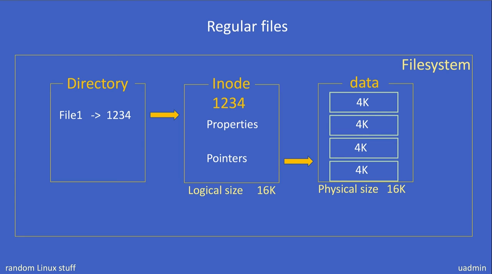

### 1.3 用 `df` 和 `ls` 观察占用

视频把文件系统挂到 `/mnt/data`，`cd` 进去跑 `df`，显示文件系统只用了 2 KB；接着用 `dd` 造一个 16 KB 文件：

```bash
dd if=/dev/urandom bs=16K count=1 of=file1
```

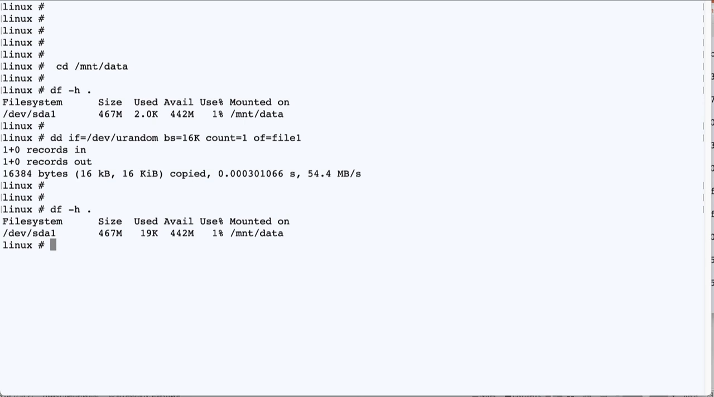

`df` 显示用了 19 KB，`ls` 显示 file1 是 16 KB——多出来的部分是文件系统的开销（[【跳转到 01:42】](https://www.youtube.com/watch?v=YePw4jyCMgo&t=102)）。此时 file1 在逻辑和物理上都是 16K。

## 二、稀疏文件：有 inode，没有块

### 2.1 两种造洞的方法：`truncate -s` 和 `dd seek`

稀疏文件与 file1 一样有名字、有 inode，区别只在于**不会分配任何真实块**（[【跳转到 01:56】](https://www.youtube.com/watch?v=YePw4jyCMgo&t=116)）。视频给了两种造法：

```bash
truncate -s 16K file2
dd if=/dev/urandom bs=1 count=0 seek=16K of=file3
```

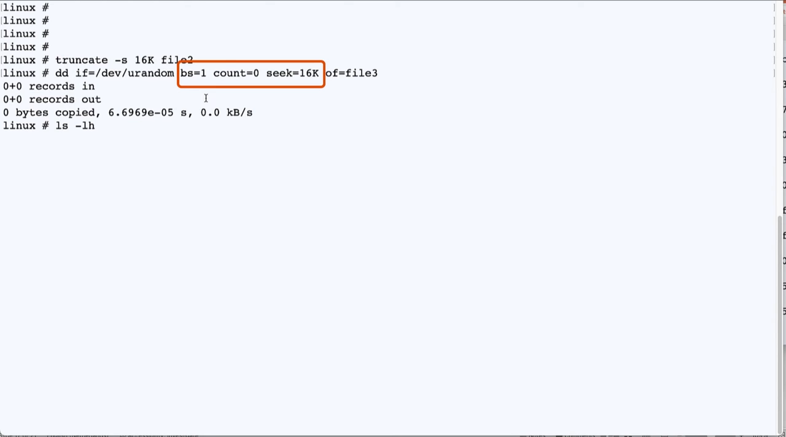

第二条命令的关键是 `count=0`：它不写任何数据，只把文件的结束位置指针设到 16 KB。除了文件的元数据，它没有往磁盘写任何东西（[【跳转到 02:14】](https://www.youtube.com/watch?v=YePw4jyCMgo&t=134)）。

### 2.2 `ls -lh` 三个文件一样大，`df` 只有一个占空间

再看 `ls -lh`，三个文件的逻辑大小都是 16 KB；但 `df` 显示只有 file1 真的在文件系统里分配了 16K（[【跳转到 02:39】](https://www.youtube.com/watch?v=YePw4jyCMgo&t=159)）。

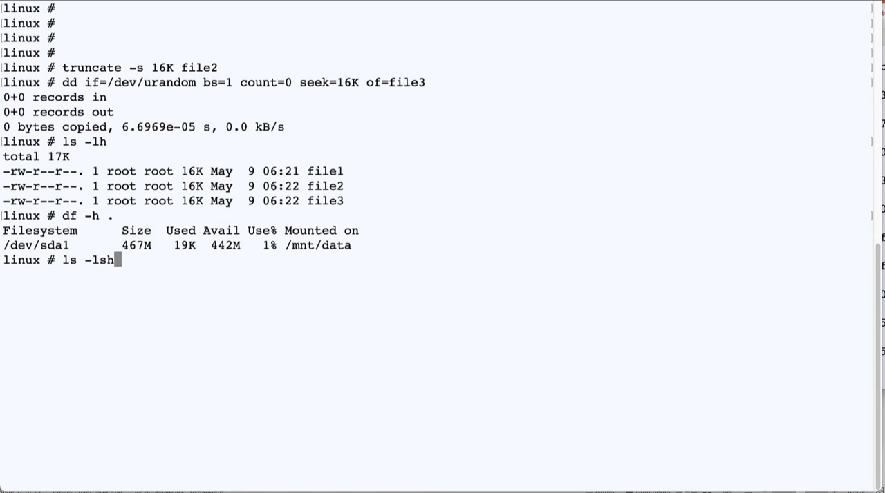

`ls` 有一个很好用的 `-s` 选项：它会多给一列，列出文件**实际占用**的空间。加上之后可以看到，第一列告诉我们对 file2 和 file3 来说物理占用是 0——这两个文件没有使用任何块（[【跳转到 03:04】](https://www.youtube.com/watch?v=YePw4jyCMgo&t=184)）。

这就是 `du` 与 `ls -l` 差异的来源：`ls -l` 报的是 inode 里那个逻辑大小，`ls -s`（以及 `du`、`df`）报的是块分配情况。

## 三、不认识稀疏文件的工具会把空洞写实

### 3.1 工具读出的是元数据里的零

视频抛出一个问题：你的应用知道什么是稀疏文件吗？（[【跳转到 03:19】](https://www.youtube.com/watch?v=YePw4jyCMgo&t=199)）

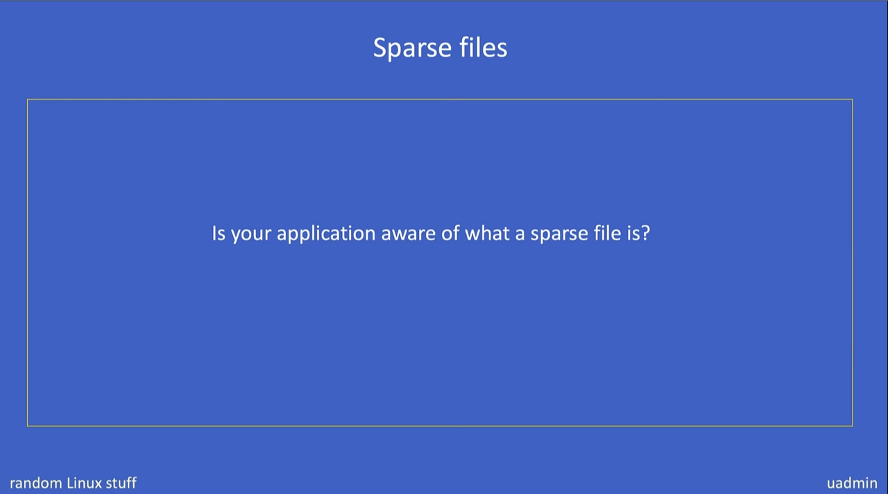

当一个不认识稀疏文件的工具访问它时，工具会把那些"并不在磁盘上"的零读出来；而只要这个工具**回写**文件，这些数据就会被真正写到磁盘上。于是这个文件就不再是稀疏的了（[【跳转到 03:24】](https://www.youtube.com/watch?v=YePw4jyCMgo&t=204)）。

### 3.2 用 `vi` 打开稀疏文件：满屏 ^@

视频用 `vi` 打开 file2 来验证。屏幕上显示的是空字符（null）的表示形式——也就是那些"其实不在磁盘上"的零（[【跳转到 03:45】](https://www.youtube.com/watch?v=YePw4jyCMgo&t=225)）。

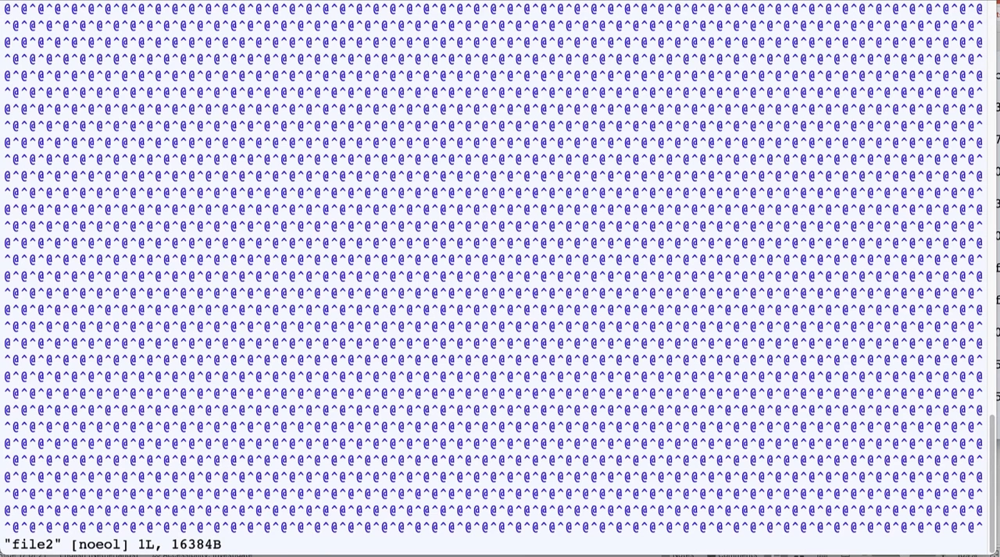

保存之后再用 `ls` 看，这个文件真的开始占磁盘了，甚至比 file1 还多一点（[【跳转到 03:58】](https://www.youtube.com/watch?v=YePw4jyCMgo&t=238)）：

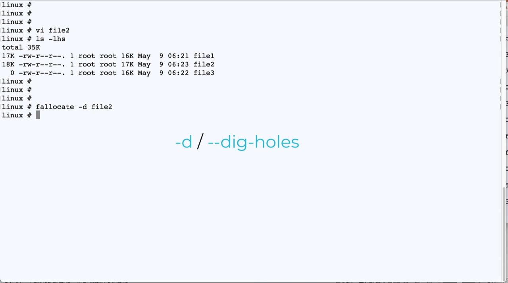

### 3.3 把零块再释放掉

如果想让这些零重新变回空洞，可以用 `fallocate`。视频只提了一个选项：`-d`（`--dig-holes`），它会把文件里只含零的块释放掉（[【跳转到 04:23】](https://www.youtube.com/watch?v=YePw4jyCMgo&t=263)）。执行 `fallocate -d file2` 后，占用从 18 KB 掉回 2 KB——剩下的那点是文件系统开销。

## 四、拷贝时保留空洞：`cp --sparse=always`

`cp` 也有处理稀疏文件的选项。视频先用 `dd` 造一个纯零文件：

```bash
dd if=/dev/zero of=file4 bs=16K count=1
```

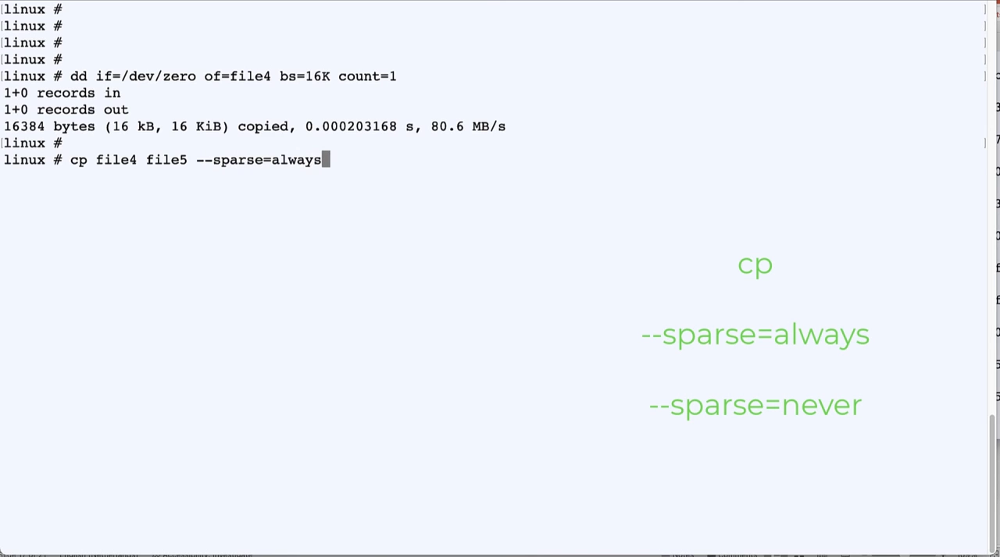

然后带 `--sparse=always` 拷贝（[【跳转到 05:13】](https://www.youtube.com/watch?v=YePw4jyCMgo&t=313)）：

- `--sparse=always`：把所有只含零的块释放掉，拷贝出来的 file5 实际占用又回到零。
- `--sparse=never`：原样拷贝所有块，零也当普通数据写下去，目标端不会有空洞。

这就是"按逻辑大小传"和"只传数据区"的差别：前者把零也搬过去，后者保留空洞。

## 五、实战：把稀疏文件做成可挂载的文件系统

### 5.1 为什么需要这种玩法

视频给的实战理由是（[【跳转到 05:31】](https://www.youtube.com/watch?v=YePw4jyCMgo&t=331)）：文件系统常被用来给特定用途存数据，比如虚拟机的数据存储，或者替代磁带的备份文件系统。做法是——先创建一个几乎不占空间的稀疏文件，在上面做文件系统，再挂载它。这样这个文件系统只在真的存了文件时才消耗块。

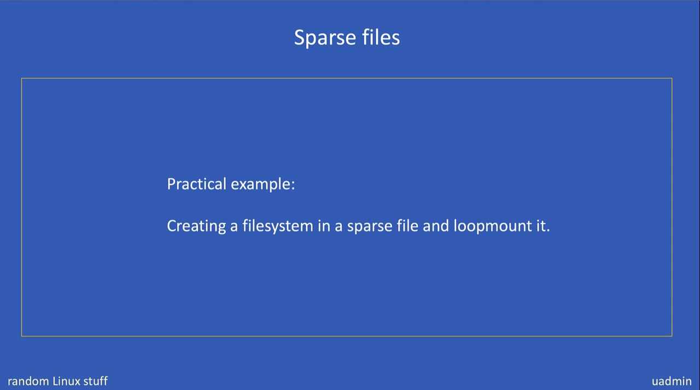

### 5.2 建 100 MB 镜像并 `mkfs`

先清掉旧文件，再 `truncate -s 100M backup.img`，然后 `mkfs`（[【跳转到 06:01】](https://www.youtube.com/watch?v=YePw4jyCMgo&t=361)）：

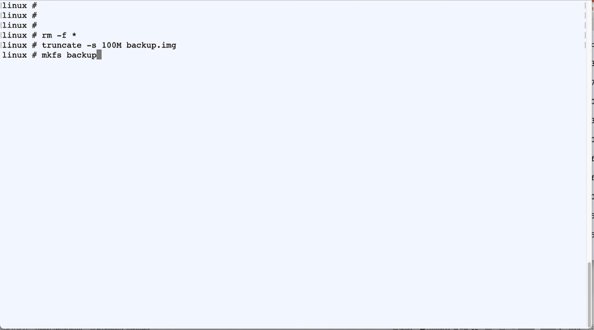

建完文件系统后检查占用：**逻辑空间是 100 MB，物理空间只有 334 KB**——这 334 KB 就是文件系统自身的管理结构（[【跳转到 06:26】](https://www.youtube.com/watch?v=YePw4jyCMgo&t=386)）。

### 5.3 `mount -o loop` 挂上去，再往里拷日志

创建挂载点后用 loop 方式挂载（[【跳转到 06:51】](https://www.youtube.com/watch?v=YePw4jyCMgo&t=411)）：

```bash
mkdir /mnt/backup
mount -o loop backup.img /mnt/backup
```

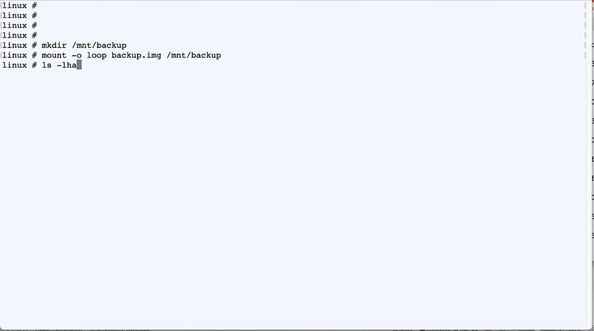

接着把 `/var/log` 递归拷进这个稀疏文件系统。再看 `ls`：**逻辑空间仍然是 100 MB，物理空间只有 9 MB**（[【跳转到 07:16】](https://www.youtube.com/watch?v=YePw4jyCMgo&t=436)）。

这就是稀疏镜像的实际效果：容量看起来是 100 MB，磁盘上只付了实际写入的 9 MB。镜像文件本身、以及镜像里那个文件系统，都保持了"按需分配"。

## 小结

- 文件由目录项（名字）→ inode（属性 + 块指针）→ 数据块三级构成；有内容时 inode 的指针指向真实块。
- 稀疏文件有名字、有 inode、有逻辑大小，但**不分配任何块**；`truncate -s` 与 `dd count=0 seek=` 都能造出来。
- `ls -l` 报逻辑大小，`ls -s`、`du`、`df` 报块占用——两者的差就是空洞。
- 不认识稀疏文件的工具读出的是"元数据里的零"，一旦回写就会把空洞写实；`vi` 打开稀疏文件满屏 ^@ 就是这个过程的可视化。
- `cp --sparse=always` 保留空洞，`--sparse=never` 把零块原样搬过去。
- 稀疏文件 + `mkfs` + `mount -o loop` 可以得到一个"看起来 100 MB、实际只占几 MB"的文件系统，这是虚拟机数据存储与备份卷的常见做法。

## 关键术语速查

| 术语 | 一句话解释 |
| --- | --- |
| inode | 存文件属性与数据块指针的结构，目录项通过编号找到它 |
| 逻辑大小 | inode 里记录的文件长度，`ls -l` 显示的就是它 |
| 物理占用 | 实际分配的数据块总量，`ls -s`、`du`、`df` 反映它 |
| 空洞（hole） | 逻辑范围内没有分配块的区间，读出来是零 |
| `ls -s` | 让 `ls` 多输出一列"实际占用块数"的选项 |
| `truncate -s` | 只设置文件长度、不写数据的命令，因此产生空洞 |
| `dd ... seek=` | 把写入位置直接跳到指定偏移，配合 `count=0` 可只造长度不写数据 |
| `fallocate -d` | 把只含零的块释放成空洞（`--dig-holes`） |
| `cp --sparse=always` | 拷贝时把零块转成空洞；`never` 则原样拷贝所有块 |
| loop 挂载 | 把普通文件当作块设备挂载，`mount -o loop img /mnt/x` |