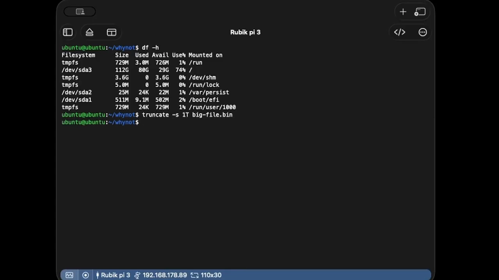
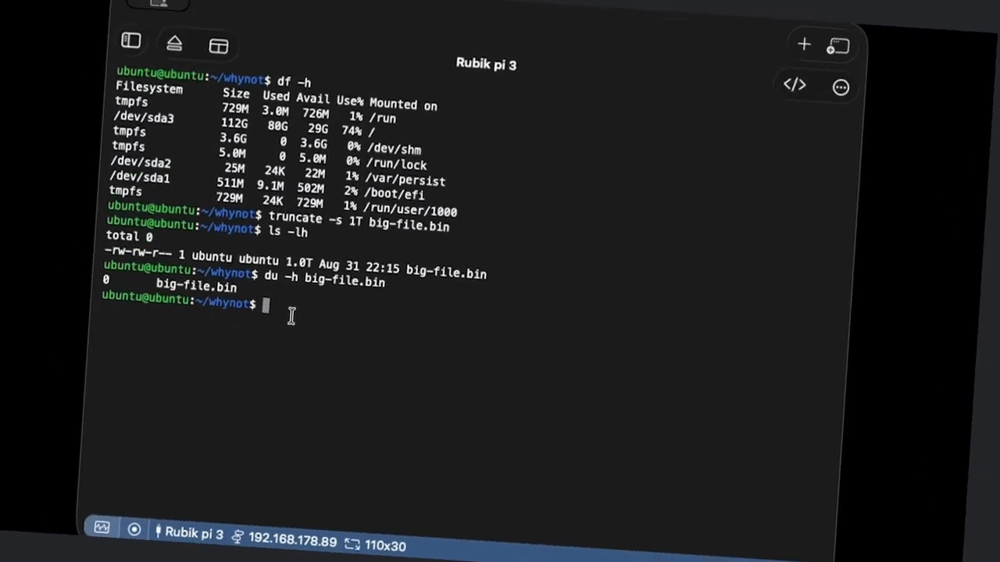
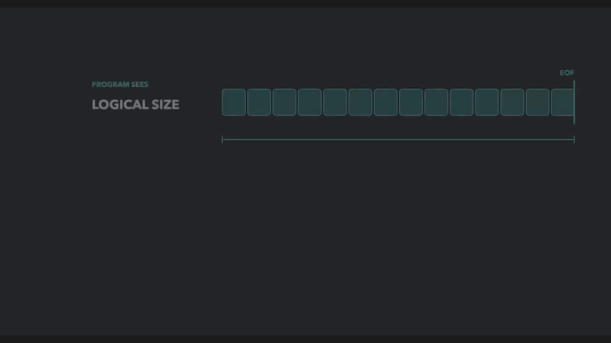
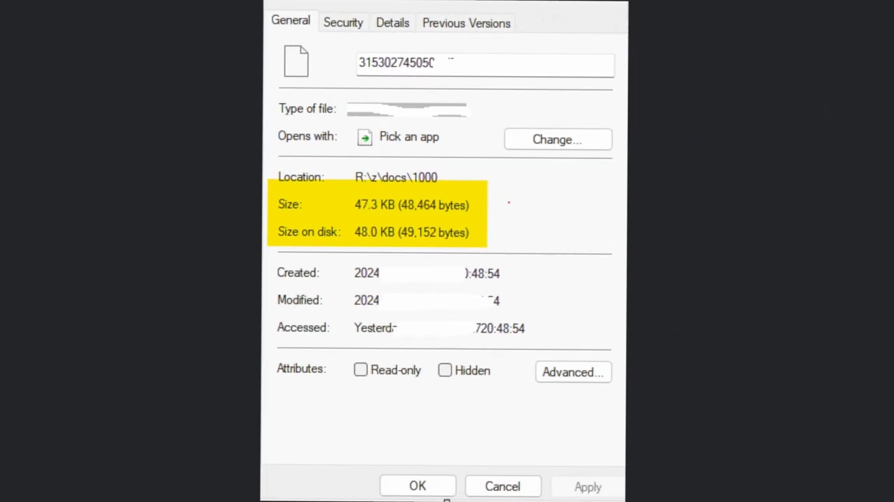
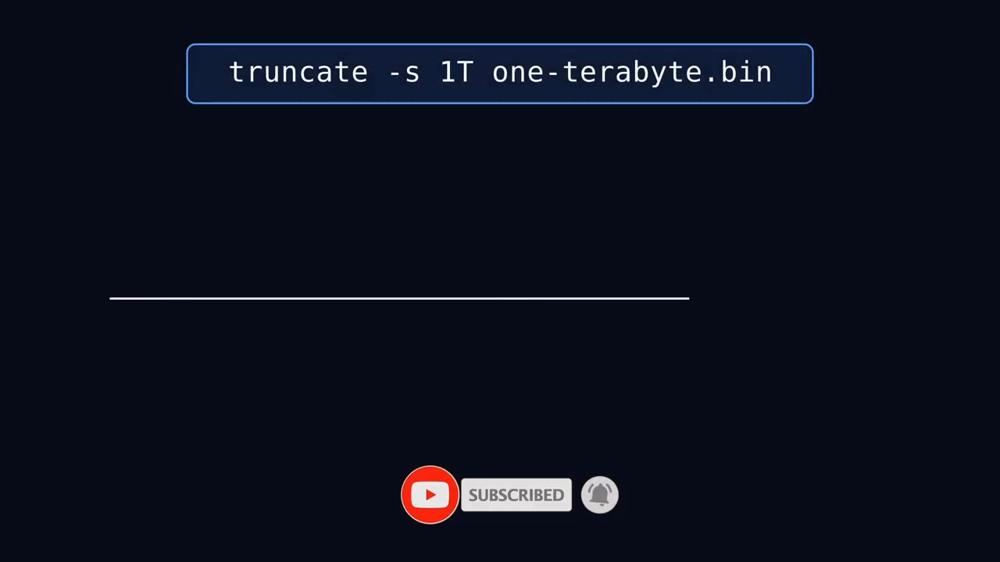
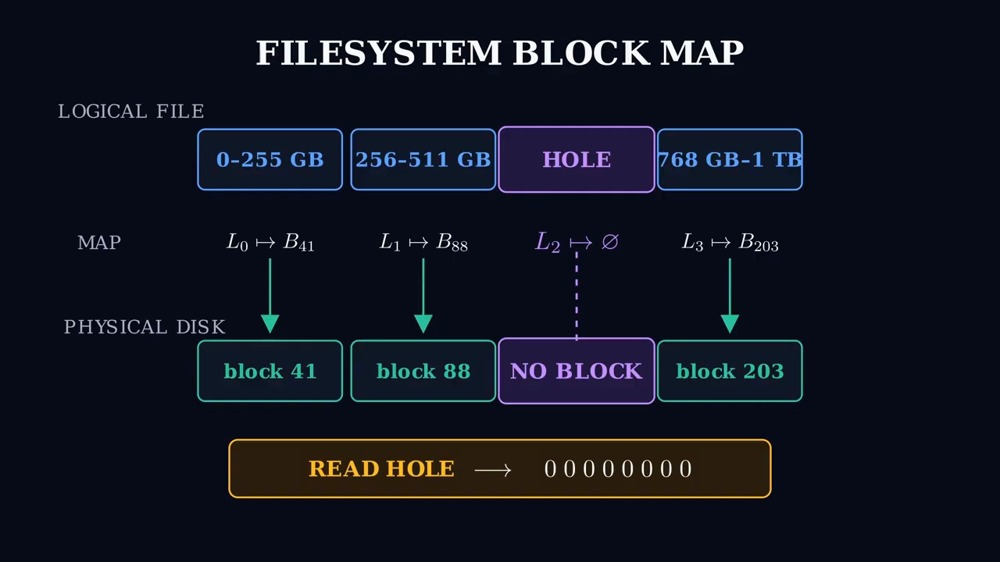
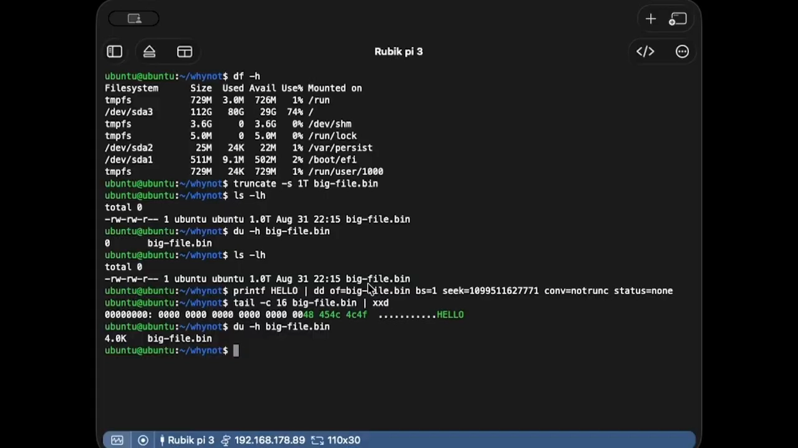
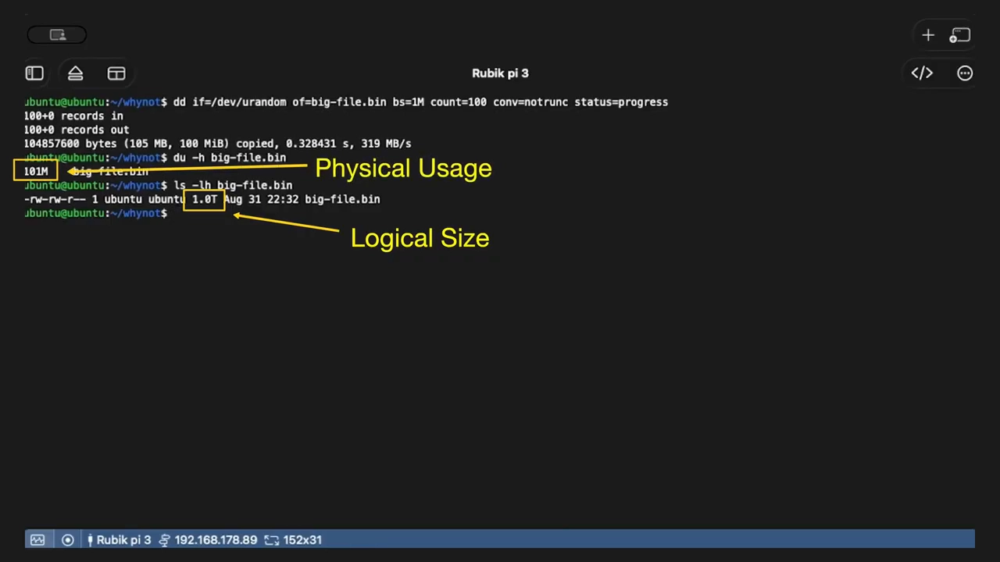
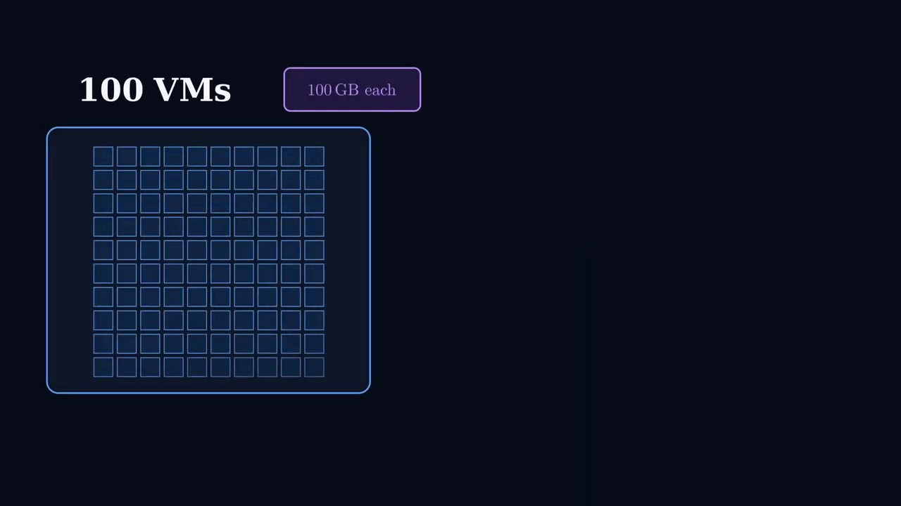

# 稀疏文件的逻辑大小与磁盘占用为什么能差出 1 TB

> 视频来源：[This 1 TB File Takes Almost No Disk Space](https://www.youtube.com/watch?v=LjcJ5sJ9hW8)（YouTube · ML Guy）｜时长约 6 分钟
>
> 导读：这支视频用一台只剩 29 GB 空闲空间的设备，当场造出一个 `ls -lh` 显示 1.0 TB、`du` 显示 0 的文件，然后一步步拆开"逻辑大小"与"已分配大小"这两个数。本文按视频顺序复述这条演示链，并补上它给出的虚拟机镜像与拷贝场景。

## 本讲要解决的核心问题（SCQA）

**背景**：我们习惯把文件想成一排格子，每个格子存一个字节。一个 1 TB 的文件，就该占 1 TB 的磁盘。

**冲突**：但在一台只剩 29 GB 空闲空间的机器上，`truncate -s 1T big-file.bin` 立刻成功；`ls -lh` 说它是 1.0 TB，`du -h` 说它占 0 字节。两条命令给出的答案互相矛盾。

**疑问**：到底哪个数字是真的？一个文件怎么可能"有 1 TB 长，却不占磁盘"？

**回答（中心思想）**：因为文件系统记录的是两个不同的数——**逻辑大小**（文件在哪里结束，程序能读到多远）和**已分配大小**（这段范围里哪些部分真的有磁盘块）。稀疏文件就是把这两者拉开距离的合法状态：未被写入的区域是 **hole（空洞）**，它在块映射表里没有对应的物理块，读它时文件系统按规则返回全零。`ls` 报逻辑大小、`du` 报已分配大小，两条命令都没说谎，它们回答的是两个不同的问题。

## 一、先把两个"大小"分开

### 1.1 一台 29 GB 的机器造出 1 TB 文件

视频开头的设备是台 Rubik Pi，通过 Wi-Fi SSH 登录，`df -h` 显示根分区只剩 29 GB 可用（[【跳转到 00:15】](https://www.youtube.com/watch?v=LjcJ5sJ9hW8&t=15)）。按"一排格子"的模型，在这里创建 1 TB 文件应该直接报错。



实际结果如下（[【跳转到 00:53】](https://www.youtube.com/watch?v=LjcJ5sJ9hW8&t=53)）：

```text
$ truncate -s 1T big-file.bin
$ ls -lh big-file.bin
-rw-r--r-- 1 ubuntu ubuntu 1.0T Aug 31 22:15 big-file.bin
$ du -h big-file.bin
0       big-file.bin
```

同一时刻，`ls -lh` 的 1.0T 和 `du -h` 的 0 都是对的。视频作者强调：这里没有云盘、没有压缩、没有隐藏的驱动器，就是一个普通本地文件。



这段演示之所以反直觉，是因为我们默认了"每个格子都存着一个字节"这个心智模型（[【跳转到 00:48】](https://www.youtube.com/watch?v=LjcJ5sJ9hW8&t=48)）：


### 1.2 逻辑大小说"文件到哪里结束"，已分配大小说"哪些部分有块"

文件系统可以同时跟踪两个数字（[【跳转到 01:01】](https://www.youtube.com/watch?v=LjcJ5sJ9hW8&t=61)）：

- **逻辑大小（logical size）**：文件在哪里结束。它决定了程序最多能读到哪个偏移，`ls -l` 显示的正是它。
- **已分配大小（allocated size）**：这段范围里哪些部分背后真的有物理存储。`du` 统计的是它。



这也解释了图形界面里为什么同时有"大小"和"磁盘上的大小"两栏（[【跳转到 01:12】](https://www.youtube.com/watch?v=LjcJ5sJ9hW8&t=72)）：



对普通文件，这两个数通常很接近，差异只是块对齐带来的零头；而稀疏文件把这个零头放大成了 1 TB 的缺口（[【跳转到 01:17】](https://www.youtube.com/watch?v=LjcJ5sJ9hW8&t=77)）。

### 1.3 `truncate` 只改了终点，没有写一万亿个字节

`truncate -s 1T` 做的事情比想象中少得多：Linux 没有写一万亿个字节，它只把文件的终点改到了 1 TB 处（[【跳转到 01:27】](https://www.youtube.com/watch?v=LjcJ5sJ9hW8&t=87)）。



这一大片从未被写入的区域就变成了 **hole（空洞）**。含空洞的文件就叫**稀疏文件（sparse file）**，视频里的 `big-file.bin` 就是。

## 二、空洞不是"坏数据"，而是一条"读出来是零"的规则

### 2.1 空洞在块映射表里没有物理块

空洞没有分配任何磁盘块，但程序读它时，文件系统会像那些字节真的存过一样返回零（[【跳转到 01:44】](https://www.youtube.com/watch?v=LjcJ5sJ9hW8&t=104)）。原因在于文件系统维护着一张"逻辑区间 → 真实块"的映射表：



- 空洞是这张映射表里**故意定义为"读作零"、且没有物理块**的一段区间。
- 它不是丢失的数据，也不是损坏的数据。
- 它甚至没有"高效地存一万亿个零"——它只存了一条规则：这段未写入的区域读出来是零。

### 2.2 往空洞里写 5 个字节，只有一个块变成真的

视频接着往离文件开头约 1 TB 的位置写入 `HELLO`（[【跳转到 02:13】](https://www.youtube.com/watch?v=LjcJ5sJ9hW8&t=133)）：

```text
$ printf HELLO | dd of=big-file.bin bs=1 seek=1099511627771 conv=notrunc status=none
$ tail -c 16 big-file.bin | xxd
00000000: 0000 0000 0000 0000 0000 4845 4c4c 4f    ..........HELLO
$ du -h big-file.bin
4.0K    big-file.bin
```



`du` 从 0 变成 4 KB：这 5 个字节让**一个存储块**变成了真实的块。它之前的全部字节仍然是空洞，因此没有被分配。视频的总结很直白：1 TB 的逻辑文件，4 KB 的磁盘占用（[【跳转到 02:33】](https://www.youtube.com/watch?v=LjcJ5sJ9hW8&t=153)）。

### 2.3 这不是 Linux 的漏洞

同样的基本机制在 Windows 的 NTFS 与 macOS 的 APFS 上都有（[【跳转到 02:46】](https://www.youtube.com/watch?v=LjcJ5sJ9hW8&t=166)）。它是文件系统的通用能力，不是某个平台的取巧。

## 三、空洞不等于压缩，它只是把成本推迟

### 3.1 空洞只能代表零

看到"1 TB 文件占 4 KB"，很容易怀疑这是不是白送的空间：能不能把一部 1 TB 的电影塞进去，仍然只占 4 KB？答案是不能（[【跳转到 02:56】](https://www.youtube.com/watch?v=LjcJ5sJ9hW8&t=176)）。

**稀疏空洞不是压缩**，这是两个概念：

- **压缩**存的是真实信息的更小表示，内容本身还在。
- **空洞**只能代替零。一旦写入真实数据，文件系统就必须分配真实的块。

### 3.2 继续填洞，占用会涨而逻辑大小不变

视频随后用 `dd` 往文件里写了 100 MB 随机数据（[【跳转到 03:18】](https://www.youtube.com/watch?v=LjcJ5sJ9hW8&t=198)）：



`du` 涨到约 100 MB，`ls` 仍然是 1 TB。视频的结论是：如果一直填洞，这块盘最终会被填满——**稀疏存储只是把你要付的存储成本推迟了，并没有消除它**（[【跳转到 03:48】](https://www.youtube.com/watch?v=LjcJ5sJ9hW8&t=228)）。

## 四、为什么要故意造这种"表里不一"的文件

### 4.1 虚拟机镜像：100 台机器 × 100 GB 不必先付 10 TB

视频给出的典型场景（[【跳转到 03:57】](https://www.youtube.com/watch?v=LjcJ5sJ9hW8&t=237)）：一台服务器要起 100 台虚拟机，每台都认为自己有一块 100 GB 的磁盘。



问题是：在这些机器还什么都没存之前，宿主机就该先预留 10 TB 吗？

稀疏磁盘镜像给出的答案是"不必"。每个 guest 都能看到自己完整的虚拟磁盘，而宿主机只在扇区真正被写入时才分配物理块。数据库快照用的是同一个原理：一开始很小，随着变更到来才增长。一个新创建的 100 GB 磁盘镜像几乎不占空间，然后随着操作系统和应用填进去而分块增长（[【跳转到 04:13】](https://www.youtube.com/watch?v=LjcJ5sJ9hW8&t=253)）。

没有这层分离，测试大批虚拟机就得在上线前预留巨量闲置存储。视频把它比作**贷款**：系统现在先把地址空间承诺给你，物理块以后再付（[【跳转到 04:44】](https://www.youtube.com/watch?v=LjcJ5sJ9hW8&t=284)）。

### 4.2 代价：一次拷贝可能把 4 KB 变成 1 TB

稀疏文件有一个明确的缺点（[【跳转到 04:54】](https://www.youtube.com/watch?v=LjcJ5sJ9hW8&t=294)）：你拷贝这个 4 KB 的文件，目标端可能突然需要 1 TB。

发生这种情况的条件是：**拷贝工具或目标文件系统不保留空洞**。工具会读出一长串零，再把这些零当作普通已分配数据写下去，于是目标端逐字节地"实心化"了。

视频提到，GNU 的 `cp` 通常会尝试保留稀疏区域，但并不是每一种传输方式或存储格式都会这样做。它给出的建议很实用：**要验证某条拷贝路径是否保留空洞，先用一个小的一次性文件去试，别拿这个 1 TB 的文件去试**（[【跳转到 05:18】](https://www.youtube.com/watch?v=LjcJ5sJ9hW8&t=318)）。

## 小结

- 文件系统同时记录**逻辑大小**（文件在哪里结束）和**已分配大小**（哪些区间有物理块），普通文件两者接近，稀疏文件可以差出几个数量级。
- `truncate -s 1T` 只改终点，不写数据；由此产生的未写入区域就是 **hole**。
- 空洞在块映射表里没有物理块，但被定义为"读出来是零"，所以它不是坏数据，也不是压缩。
- 往空洞里写数据会按块真实分配：写 5 个字节，`du` 从 0 变成 4 KB。
- 稀疏文件的收益是**推迟**存储成本（虚拟机镜像、数据库快照），不是消除成本；填满空洞最终仍会占满磁盘。
- `ls` 与 `du` 都没说谎：一个回答"程序能看到多大"，一个回答"存储设备实际付了多少钱"。
- 拷贝稀疏文件时，若工具或目标文件系统不保留空洞，目标端会被展开成完整大小——先用小文件验证拷贝路径。

## 关键术语速查

| 术语 | 一句话解释 |
| --- | --- |
| 稀疏文件（sparse file） | 逻辑大小远大于实际磁盘占用的文件，中间大片区域是空洞 |
| 空洞（hole） | 块映射表中没有物理块、但被定义为读出全零的一段逻辑区间 |
| 逻辑大小（logical size） | 文件在哪里结束，决定程序能读到哪个偏移，`ls -l` 显示它 |
| 已分配大小（allocated size） | 这段逻辑范围里真正有磁盘块的部分，`du` 统计它 |
| `truncate -s` | 只改文件终点（逻辑大小）的扩容方式，不写入数据，因此天然产生空洞 |
| 稀疏磁盘镜像 | 虚拟机/快照用的镜像文件，guest 看到完整容量，宿主机按写入量分配块 |
| `conv=notrunc` | `dd` 的选项，表示不先截断输出文件，用于在文件中间位置写入而不破坏已有内容 |