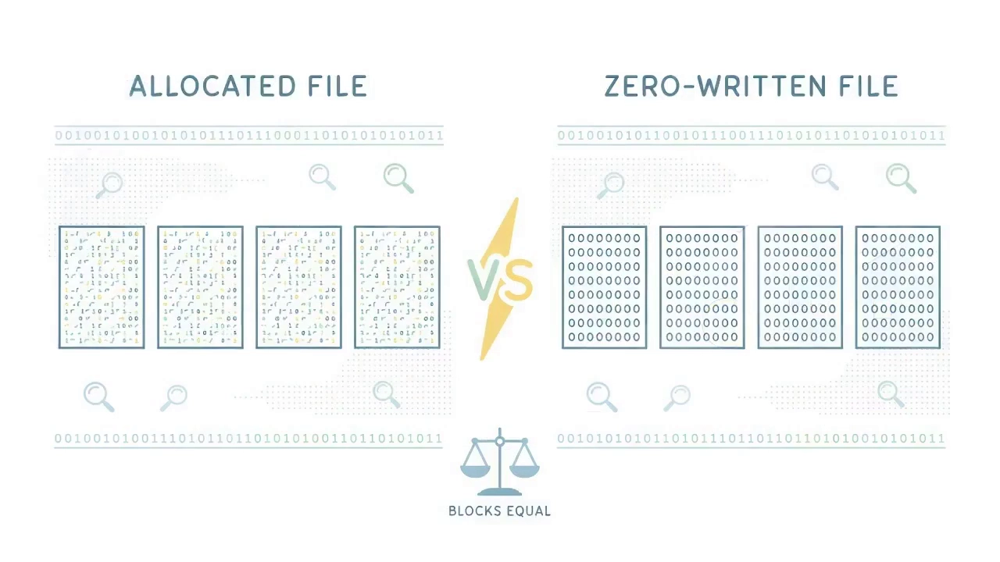
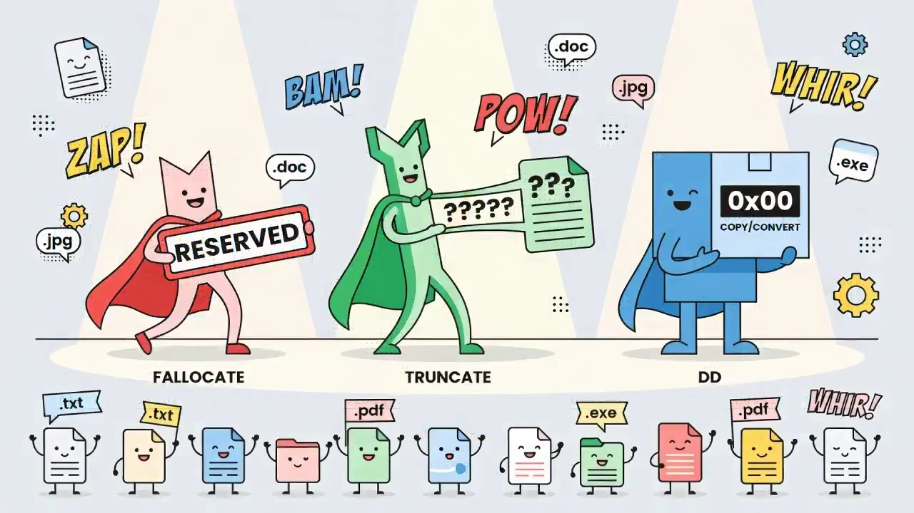
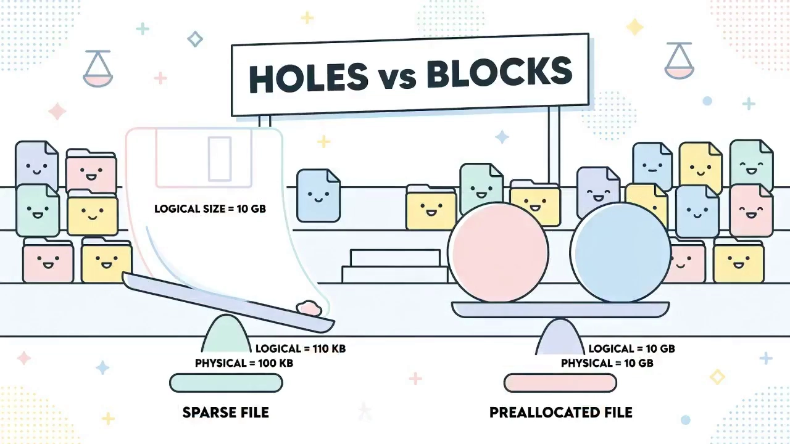
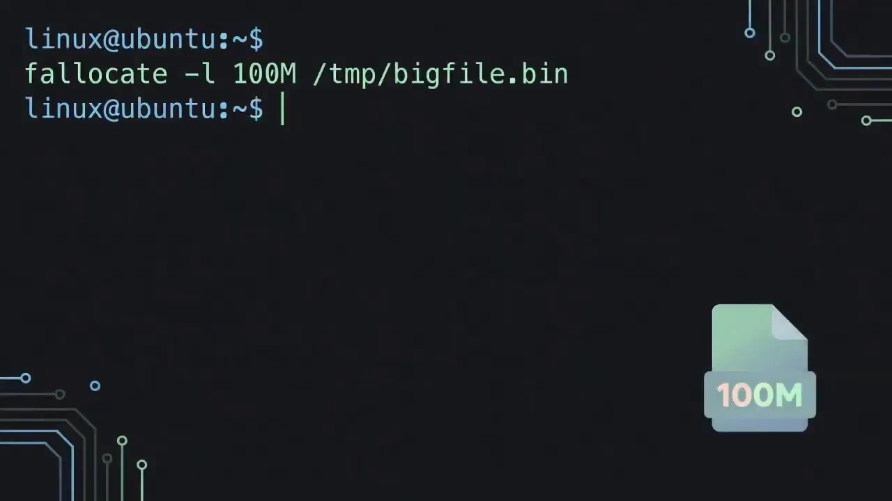
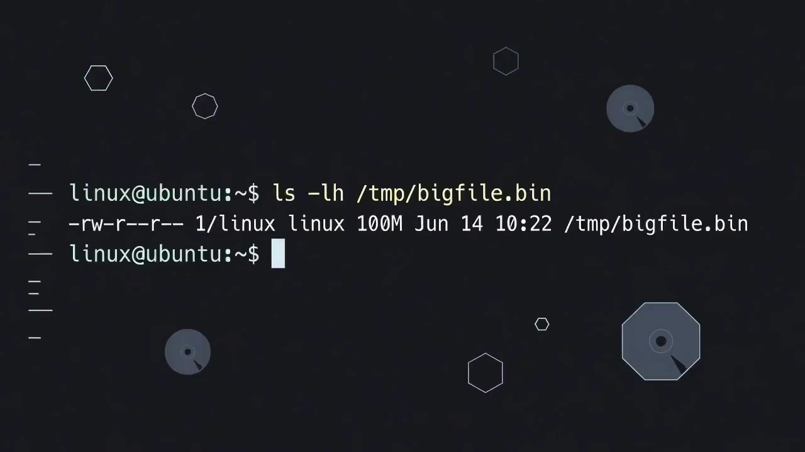
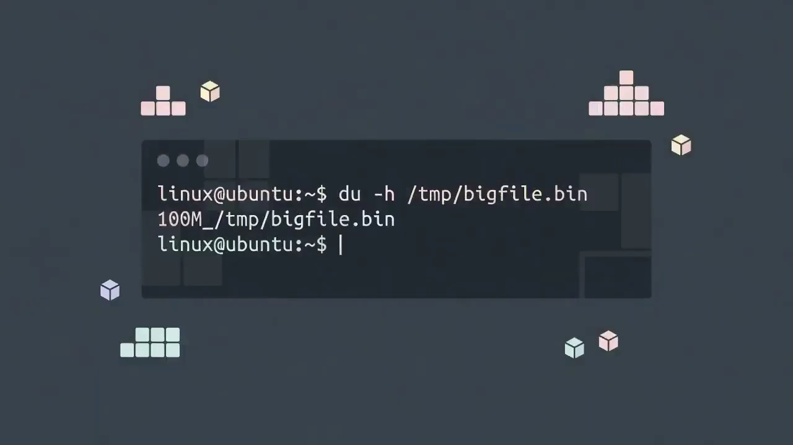
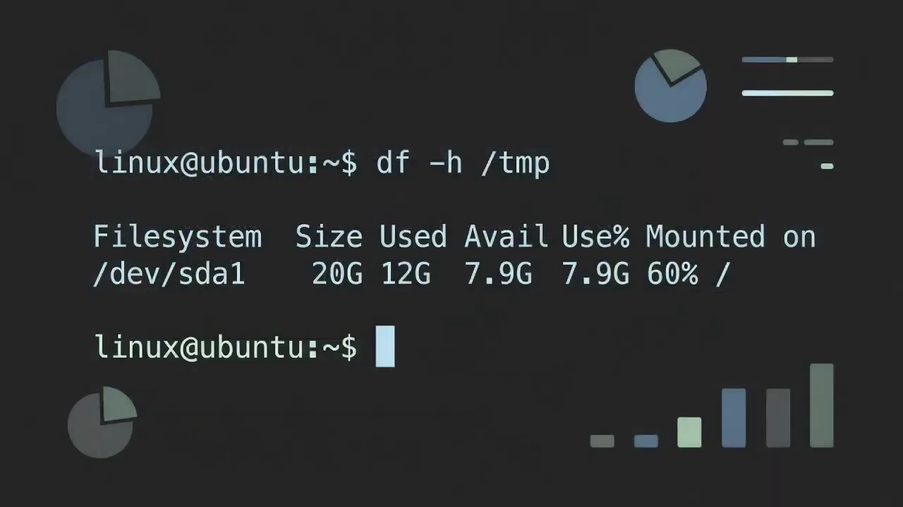
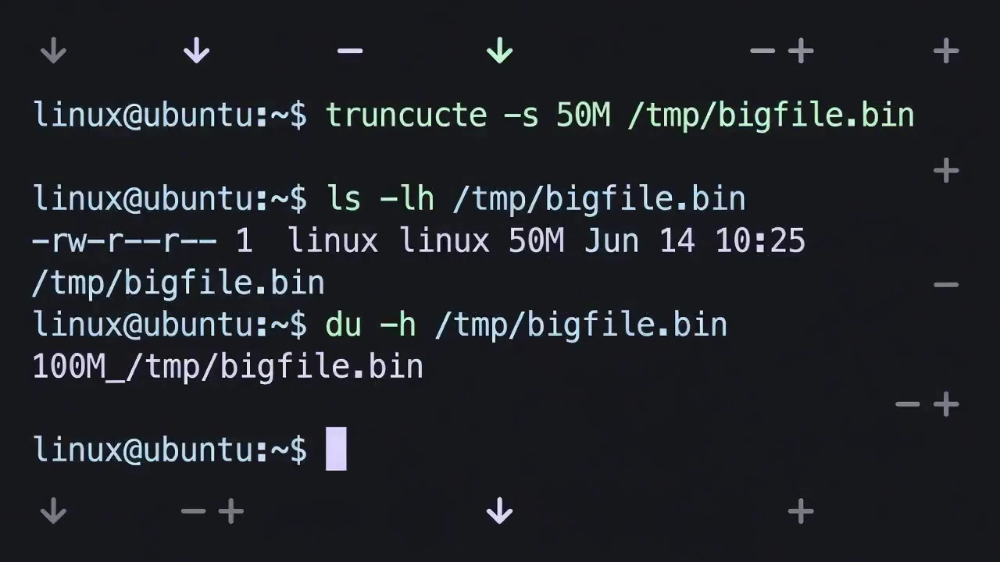
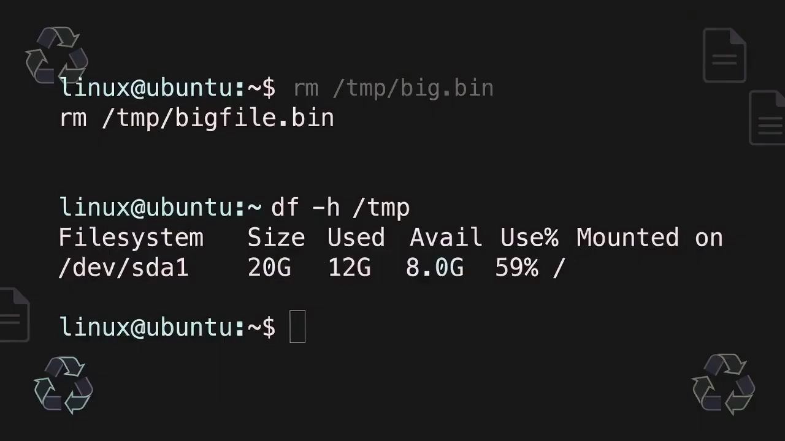

# fallocate 只改元数据：预分配与写零对镜像体积的两种后果

> 视频来源：[fallocate vs truncate vs dd: Linux Sparse Files & Disk Usage Demo](https://www.youtube.com/watch?v=JPr_mIgGRiU)（YouTube · TechTooniya）｜时长约 4 分钟
> 简要导读：这支短片用一次 100 MB 的现场实验，把「分配空间」和「写零」拆成两个动作，再拿 `ls -l`、`du`、`df` 三个视角互相印证。本文按它的演示顺序讲清 fallocate 的分配语义，并说明为什么这一步决定了稀疏镜像与快照的物理体积。

## 本讲要解决的核心问题（SCQA）

**背景**：建一个 swap 文件、造一个 1 TB 的测试假数据、给数据库预留一段连续空间，这些操作的共同点都是「先占住一块磁盘」。

**冲突**：同样是 100 MB 的文件，有的在磁盘上只占几 KB，有的实打实吃掉 100 MB；更让人意外的是，把文件从 100 MB 缩到 50 MB 之后，`du` 报告的占用一点没变。

**疑问**：`fallocate`、`truncate`、`dd` 在磁盘上到底做了哪些不同的事？为什么这个差别会直接变成镜像和快照的体积？

**回答（中心思想）**：`fallocate` 只做「分配」——在文件系统元数据里把块划给文件，一个字节的数据都不写；`dd` 做的是「置零」——真的把 `0x00` 写进每一个块。在支持空洞的文件系统上，这两条路走出来的物理体积完全不同：预分配会把一个稀疏镜像"撑实"，而写零则既撑实又付出真实的 IO 代价。`truncate` 是第三种动作，它只改被声明的尺寸，既不分配也不回收。

## 一、每个文件都有两个大小

### 1.1 表观大小给程序看，真实块给磁盘看

磁盘上的每个文件都有两个尺寸：你在目录列表里看到的**表观大小**（apparent size），和它**真正消耗的数据块**（real blocks）。搞清这两者的差别，能省下磁盘空间、加快任务速度，也能避开一些让人措手不及的意外。[【跳转到 00:00】](https://www.youtube.com/watch?v=JPr_mIgGRiU&t=0)


这两个数字平时是一致的，一旦不一致，差额就是本文要讨论的全部内容。

### 1.2 `ls -l` 与 `du` 的分歧就是省下来的空间

有两个命令可以同时揭示这两种大小：`ls -l` 显示逻辑上的表观大小，`du` 显示实际磁盘占用。当两者不一致时，你看到的就是一个稀疏文件，中间的差额就是纯赚到的节省。[【跳转到 01:26】](https://www.youtube.com/watch?v=JPr_mIgGRiU&t=86)


图里那个 10 GB 与 120 KB 的对比，就是「表观大小 10 GB、实际只占 120 KB」的稀疏文件。后面所有实验都围绕这一对数字展开。

## 二、分配与置零是两种不同的动作

### 2.1 分配只写元数据，所以是毫秒级的

所谓**文件分配**（file allocation），就是为一个文件预留出与它表观大小相等的磁盘块。文件系统只记录下文件的大小和它占用的块区间，并不一定会往这些块里写入任何有意义的数据。所以这基本上是一次元数据操作，速度很快。[【跳转到 00:15】](https://www.youtube.com/watch?v=JPr_mIgGRiU&t=15)

这句话里有两个关键词值得记住：

- **只记录**：文件系统记住「这段块归你了」，但并没有真的往块里写数据。
- **元数据操作**：改的是 inode 与 extent 记录，不产生数据面的 IO，因此几乎不花时间。

### 2.2 写零要过一遍真实 IO

**写零**就完全不同了：你是在真正发起写操作，把 `0x00` 这样的字节写进磁盘块。这会消耗真实的存储空间，也会产生真实的 IO。[【跳转到 00:29】](https://www.youtube.com/watch?v=JPr_mIgGRiU&t=29)


这张图把「置零」画成了一条生产线：每个块都要被搬运一次。写零之后，文件的内容和一个被分配过的文件在读取时看不出区别，但代价是实打实的——一个是改记录，一个是搬箱子。

### 2.3 差别只在支持空洞的文件系统上才显现

把两种做法并排放在一起看：被分配过的文件预留的是连续的块，块里是什么内容都无所谓；写零得到的文件预留的块则明确填满了零。**在非稀疏文件系统上，两者的磁盘占用是一样的；但在支持空洞的文件系统上，情况就完全不同了。**[【跳转到 00:43】](https://www.youtube.com/watch?v=JPr_mIgGRiU&t=43)



这张图的下方天平写着「blocks equal」：在只看块数的层面，两者一样多。真正的分水岭在于「块里是不是必须真的存在」——这就引出了稀疏文件与预分配文件的定义。

## 三、三个工具的分工：fallocate、truncate、dd

日常的分配任务基本由三个工具覆盖，它们各自做的事完全不同：[【跳转到 00:58】](https://www.youtube.com/watch?v=JPr_mIgGRiU&t=58)

| 工具 | 它做了什么 | 是否产生数据 IO | 是否改文件大小 |
| --- | --- | --- | --- |
| `fallocate` | 通过文件系统预留块，分配空间非常快 | 否，只动元数据 | 会（实验里从无到 100M） |
| `truncate` | 只设置表观大小，可能因此产生空洞 | 否 | 会 |
| `dd` | 逐字节地拷贝和转换，所有内容都是真写下去的 | 是 | 会（写到哪算哪） |



用一句话概括这张图：`fallocate` 举的是「已预留」，`truncate` 举的是「只是改了个数字」，`dd` 举的是「我是真的在搬 0x00」。

### 3.1 稀疏文件与预分配文件：一个省空间，一个换确定性

紧接着是两个定义：

- **稀疏文件**：逻辑大小远大于物理大小，文件的大部分都是空洞。
- **预分配文件**：逻辑大小等于物理大小，每一个块都是真的。

一句话的取舍是：**稀疏省空间，预分配换来确定性的性能。**[【跳转到 01:12】](https://www.youtube.com/watch?v=JPr_mIgGRiU&t=72)



同一个「逻辑 10 GB」，左边只压了 100 KB 的秤，右边把 10 GB 全压上了。这就是为什么同样叫「10 GB 的文件」，在镜像仓库里可能只传几十兆，也可能要传满 10 GB。

### 3.2 空洞在 POSIX 里的语义：读出来是零

在 POSIX 里，**空洞是一段没有被磁盘块承载的零**。读一个空洞，合法地返回零。此外还有两个 seek 操作 `SEEK_DATA` 和 `SEEK_HOLE`，它们让程序直接跳到下一段真实数据或下一个空洞——`cp`、`tar` 这类工具就是靠它们高效处理稀疏文件的。[【跳转到 01:26】](https://www.youtube.com/watch?v=JPr_mIgGRiU&t=86)


注意这里的关键性质：**空洞读出来是零，但它并没有占块**。这意味着「文件内容全是零」和「文件不占空间」可以是同一件事——只要这些零从来没被真的写下去。

## 四、现场实验：100 MB 的三个视角

### 4.1 `fallocate -l` 毫秒级预留 100 MB

`fallocate` 是一个 Linux 工具，它直接操作文件系统的 extent，几乎瞬间就能为文件预留出磁盘空间。为了看清它和稀疏分配的区别，视频做了一个四步实验：创建文件、用 `df` 核实真实占用、用 `truncate` 缩小、观察反差。[【跳转到 02:12】](https://www.youtube.com/watch?v=JPr_mIgGRiU&t=132)

```bash
fallocate -l 100M /tmp/bigfile.bin
```



这条命令会立刻为文件预留出恰好 100 MB 的真实磁盘块。由于 `fallocate` 工作在文件系统元数据层面，它**没有任何输出，几毫秒就返回，尺寸再大也一样**。[【跳转到 02:28】](https://www.youtube.com/watch?v=JPr_mIgGRiU&t=148)

### 4.2 `ls -l` 看到的是表观大小

接着执行 `ls -lh /tmp/bigfile.bin`，看到的是文件的表观大小，也就是任何程序读这个文件时会看到的大小。这里显示 100M，但这个数字反映的是**逻辑大小**，而不是磁盘上实际消耗的块。[【跳转到 02:53】](https://www.youtube.com/watch?v=JPr_mIgGRiU&t=173)



单看这一行，你无法判断这 100M 是真占了还是虚的——这正是为什么下一步必须换一个命令。

### 4.3 `du` 也报 100M，才证明分配是真的

`du -h` 这条命令报告的才是实际磁盘占用（以块计），而不是表观大小。这里也显示 100M，就证明 `fallocate` 确实分配了真实空间：文件系统因为这个文件少了 100 MB 的空闲块。[【跳转到 02:58】](https://www.youtube.com/watch?v=JPr_mIgGRiU&t=178)



`df -h` 显示的是文件系统层面的用量，它印证了 `du` 给出的结论：`/tmp` 所在文件系统可用空间比之前少了 100M。这是系统全局视角，证明这次分配是真的，而不只是元数据上的一个承诺。[【跳转到 03:12】](https://www.youtube.com/watch?v=JPr_mIgGRiU&t=192)



三个命令的分工到这里就清楚了：`ls -l` 看声明，`du` 看这个文件吃掉多少块，`df` 看整块盘还剩多少。三者一致，说明这次分配是实打实的。

## 五、`truncate` 缩小不等于回收

现在用 `truncate -s 50M` 把文件缩小，把它的逻辑大小设成 50 MB。`truncate` 改的是「被声明的尺寸」这个元数据，但关键在于，**它不会回收此前已经分配出去的块**。所以尽管 `ls` 现在报告的是一个更小的文件，文件系统的占用却纹丝不动。[【跳转到 03:26】](https://www.youtube.com/watch?v=JPr_mIgGRiU&t=206)



这张图是全文最有信息量的一帧：同一个文件，`ls` 说 50M，`du` 说 100M。缩容只改了账面上的数字，块还挂在文件身上。

最后 `rm /tmp/bigfile.bin` 删掉文件，把它占用的所有块还给文件系统。这反过来证实了之前的分配是真实的：文件一旦消失，`df` 就会显示可用空间恢复了。[【跳转到 03:51】](https://www.youtube.com/watch?v=JPr_mIgGRiU&t=231)



可用空间从 7.9G 回到 8.0G，这 100 MB 直到这一刻才真正回到文件系统手里。

## 六、这对镜像与快照意味着什么

视频在讲完定义之后点出了四类典型用法，它们正好对应「该选稀疏还是该选预分配」：[【跳转到 01:55】](https://www.youtube.com/watch?v=JPr_mIgGRiU&t=115)


- **swap 文件**：应当预分配，以避免碎片。
- **虚拟机磁盘镜像**：是典型的稀疏文件。
- **测试夹具**：喜欢用稀疏文件，快速造出很大的假数据。
- **数据库**：通过预分配保证 extent 连续，从而获得可预测的 IO。

把这四条和前面的实验对上，就能推出本文最实用的一条结论：

1. **预分配会把稀疏镜像"撑实"。** 一个逻辑 10 GB 的虚拟机镜像，如果内容是稀疏的，物理上可能只占很小一块；一旦对它做一次 `fallocate` 预分配，`du` 立刻变成 10 GB。此后无论做快照、打包还是传输，要搬运的都是实打实的 10 GB，而不是原来那点真实块。
2. **`truncate` 不能让体积变小。** 把镜像从 100 MB 缩到 50 MB，`ls` 会变，`du` 不会；想真正把空间还回去，只能删掉文件（或者用真正会打洞的操作）。
3. **写零是最贵的一种"分配"。** 它同时付出空间和 IO：空间上等价于预分配，时间上还要多走一遍数据面。所以「先把文件填满零」这种写法，在需要快速准备大文件的场景里是最不划算的。

一句话收束：**判断一个镜像会不会把快照撑大，不看 `ls -l` 的数字，只看 `du` 的数字；而决定 `du` 数字的，是当初用了分配还是写零。**

## 小结

- 每个文件有两个大小：`ls -l` 的表观大小与 `du` 的真实块占用，两者不一致时就是稀疏文件。
- `fallocate` 只做分配：改元数据、不写数据，毫秒级完成，但块是真的划走了（`df` 会减少）。
- `dd` 做的是置零：真的把 `0x00` 写进块，既占空间又耗 IO；在非稀疏文件系统上它与分配的结果看不出区别。
- `truncate` 只改声明的尺寸，既不分配也不回收，所以缩小文件不会让 `du` 变小。
- 空洞读出来是零但不占块，`SEEK_DATA`/`SEEK_HOLE` 让 `cp`、`tar` 能跳过空洞。
- 预分配把稀疏镜像撑成实占，写零更贵；要控制快照与镜像体积，先看 `du` 而不是 `ls -l`。

## 关键术语速查

| 术语 | 一句话解释 |
| --- | --- |
| 表观大小（apparent size） | 目录里显示、程序读到的逻辑长度，`ls -l` 报的就是它 |
| 真实块（real blocks） | 文件真正占用的磁盘块，`du` 报的就是它 |
| 文件分配（allocation） | 在元数据里把一段块划给文件，不写数据，因此极快 |
| 写零（zero-writing） | 把 `0x00` 真正写入每个块，占空间也耗 IO |
| 空洞（hole） | 一段没有被磁盘块承载的零，读出来合法地返回零 |
| 稀疏文件 | 逻辑大小远大于物理大小、大部分是空洞的文件 |
| 预分配文件 | 逻辑大小等于物理大小、每个块都真实存在的文件 |
| `fallocate` | 通过操作 extent 直接预留块的 Linux 工具，毫秒级返回 |
| `truncate` | 只修改被声明的文件尺寸，不回收已分配的块 |
| `SEEK_DATA` / `SEEK_HOLE` | 让程序直接跳到下一段真实数据或下一个空洞的 seek 操作 |