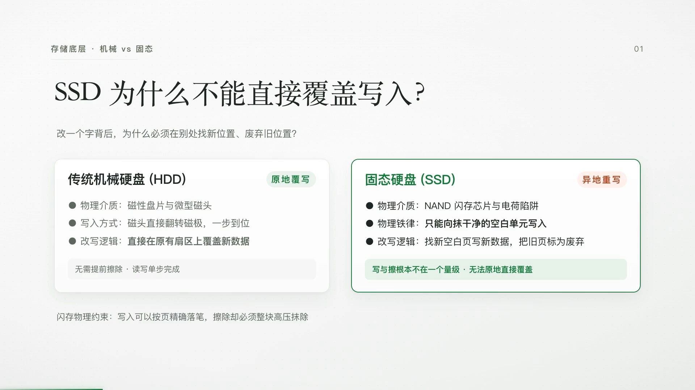
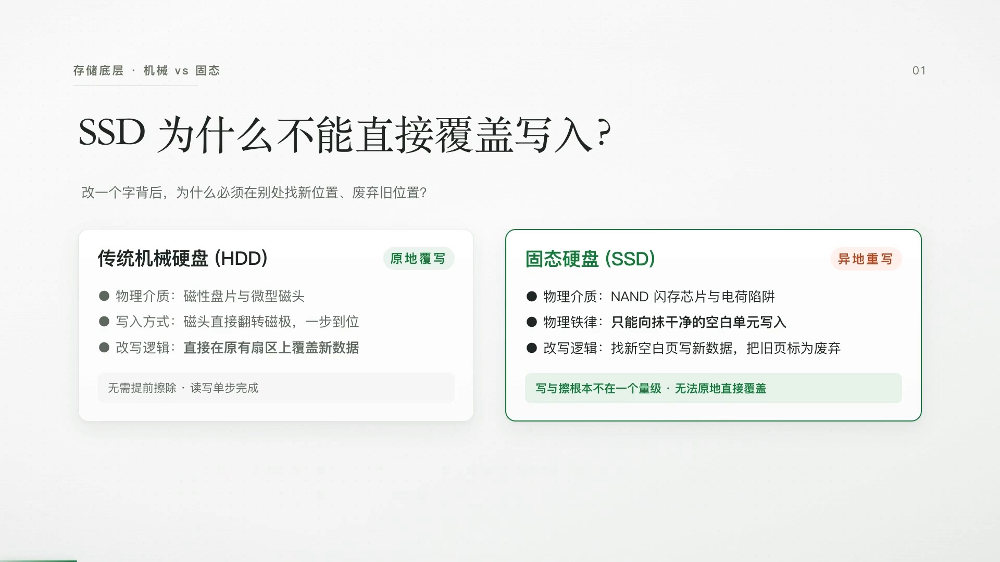
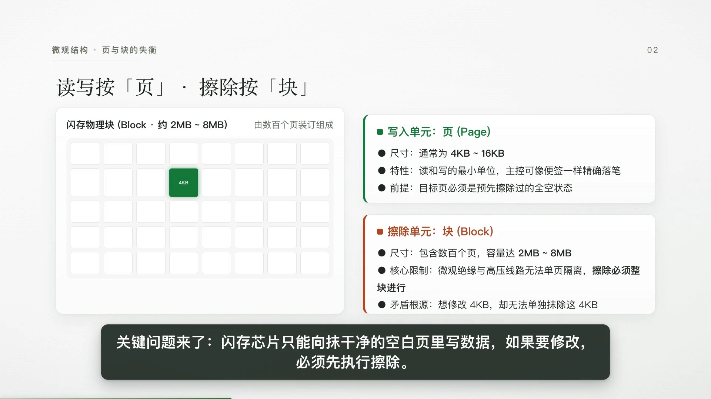
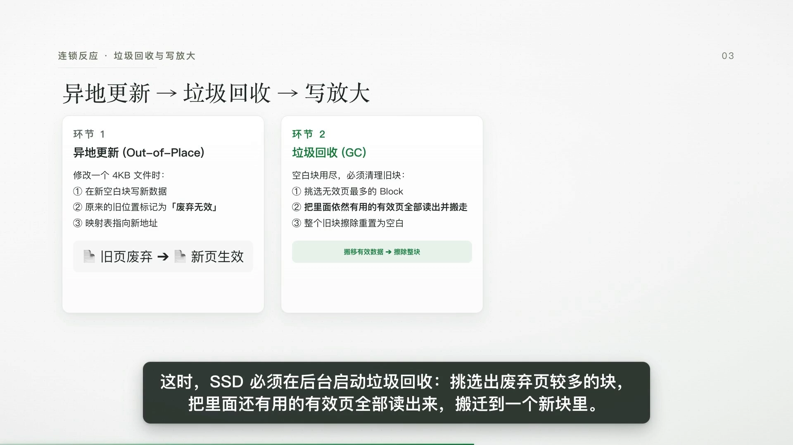
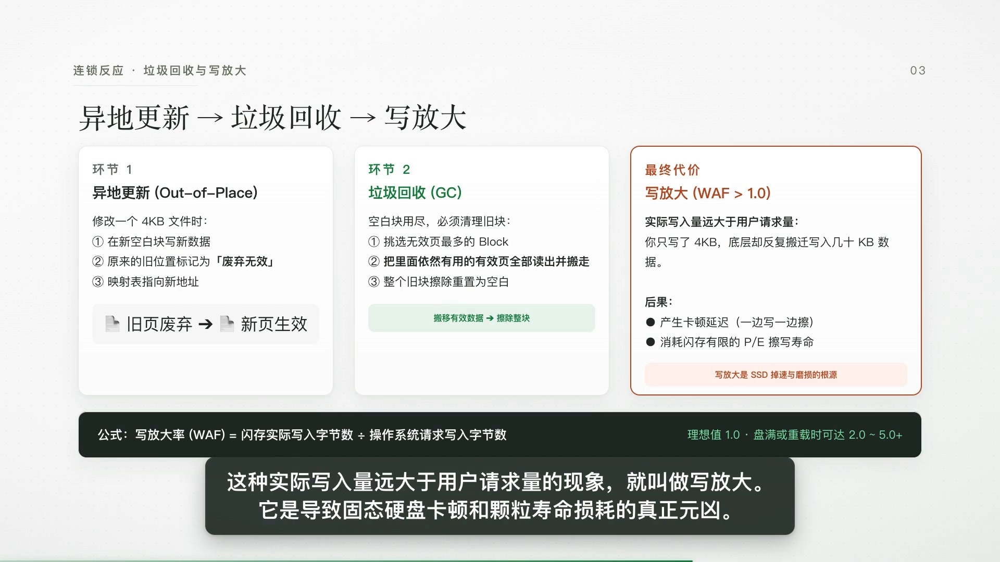
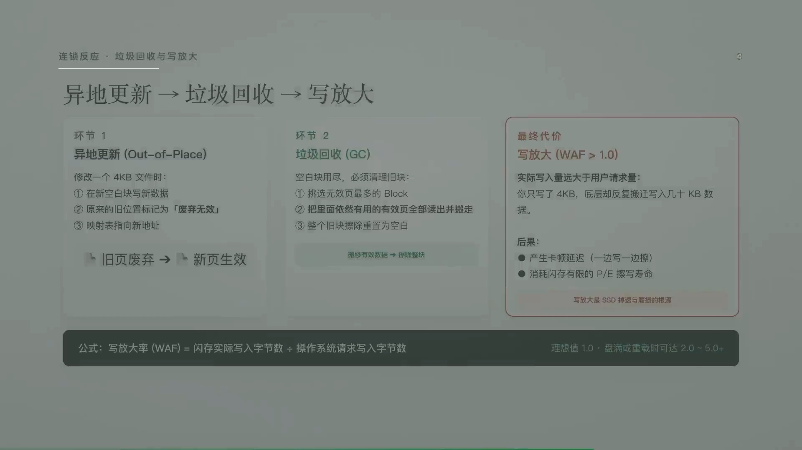
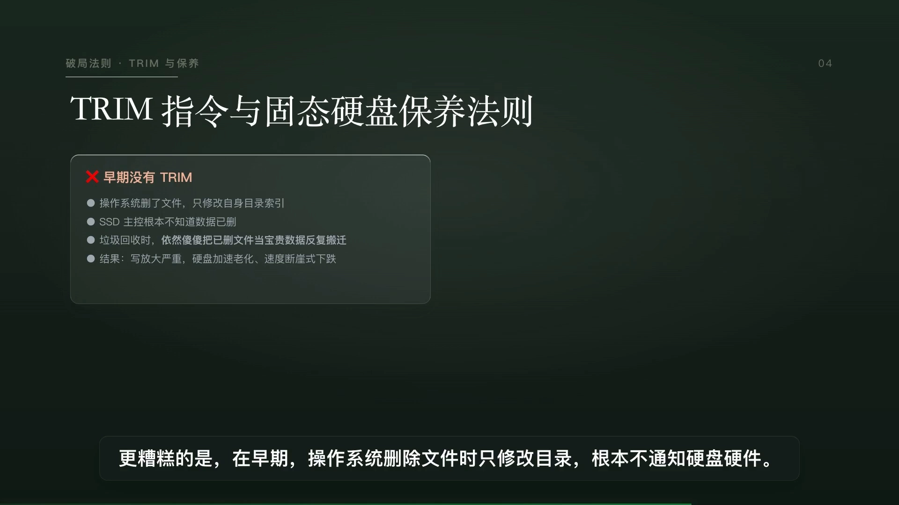
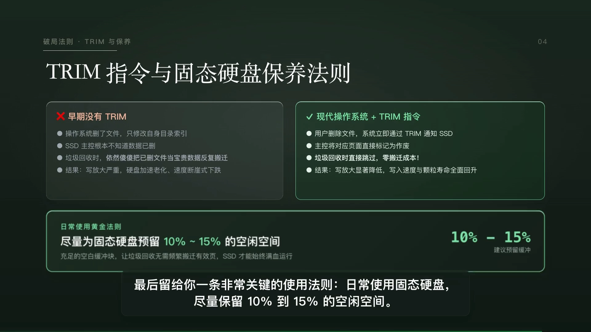

# TRIM 不是清零：它只是告诉 SSD 主控这些页已经作废

> 视频来源：[固态硬盘为什么不能直接覆盖写入？搞懂闪存与 TRIM 底层机制](https://www.bilibili.com/video/BV1nbyez4E8h/)（Bilibili · 云泊飘）｜时长约 3 分钟
> 导读：上一篇讲"删了文件空间却没还回去"，这一篇往下钻一层：那块空间还回去之后，硬件到底做了什么。视频用一条因果链把闪存的物理限制、垃圾回收、写放大和 TRIM 串起来，最后给出一条使用法则。

[【跳转到 00:00】](https://www.bilibili.com/video/BV1nbyez4E8h/?t=0)

## 本讲要解决的核心问题（SCQA）

**背景**：机械硬盘改一个文件，直接在原来的磁道上重写一遍就行。SSD 不行——哪怕只改一句话，底层也必须换个地方写，再把旧位置废弃掉。

**冲突**：这个"绕弯子"的操作会带来连锁反应：废弃的页越积越多，主控必须在后台搬运有效数据、擦除整块，实际写入量远超你请求的写入量。更糟的是，早期操作系统删文件时只改自己的目录，根本不通知硬盘。

**疑问**：为什么 SSD 不能原地覆盖写？删除文件时那个"通知"到底是什么，它改变了什么？

**回答（中心思想）**：闪存"写按页、擦按块"的物理不对称，逼出了异地更新和垃圾回收，进而产生写放大；**TRIM 的作用不是把数据清零，而是把"这些页已经作废"这件事告诉主控**，让垃圾回收直接跳过它们，从而把写放大压下来。

## 一、为什么 SSD 不能原地覆盖写

### 1.1 写和擦不在一个量级

[【跳转到 00:13】](https://www.bilibili.com/video/BV1nbyez4E8h/?t=13)

机械硬盘的介质是磁性盘片，磁头翻转磁极就能改写，一步到位，不需要提前擦除。SSD 的介质是 NAND 闪存芯片与电荷陷阱，它的物理铁律是：**只能向抹干净的空白单元写入**。要改一个已经有数据的页，必须先擦掉它。

[【跳转到 00:25】](https://www.bilibili.com/video/BV1nbyez4E8h/?t=25)

### 1.2 页和块：写按页，擦按块

[【跳转到 00:55】](https://www.bilibili.com/video/BV1nbyez4E8h/?t=55)

- **页（Page）**：闪存读写数据的最小单元，通常 4 KB 到 16 KB，像一页便签纸。写入可以精确到页。
- **块（Block）**：很多个页装订在一起的大册子，通常包含几百个页，大小 2 MB 到 8 MB。**擦除只能整块进行。**

为什么不能单页擦？视频的解释是微观电路与高压线路的限制：主控无法单独对某一个 4 KB 的页施加擦除电压，一擦就是一整块。

于是矛盾出现了：**你想修改 4 KB，却无法单独抹掉这 4 KB**。这种读写不对称，就是后面一切麻烦的源头。

[【跳转到 00:30】](https://www.bilibili.com/video/BV1nbyez4E8h/?t=30)

## 二、连锁反应：异地更新 → 垃圾回收 → 写放大

[【跳转到 01:16】](https://www.bilibili.com/video/BV1nbyez4E8h/?t=76)

### 2.1 环节一：异地更新（Out-of-Place）

既然不能原地改，主控只能换个地方写：

1. 在另一个空白块里找一页，写入新数据；
2. 把原来的旧页面标记为"废弃无效"；
3. 映射表指向新地址。

### 2.2 环节二：垃圾回收（GC）

随着日常使用，大量废弃的无效页散落在各个块里，可用空白块越来越少。这时 SSD 必须在后台启动垃圾回收：

1. 挑选出废弃页最多的块；
2. 把里面还有用的有效页全部读出来，搬迁到新块；
3. 把原来的旧块整体擦除，重新变成全空白状态。

### 2.3 环节三：写放大（WAF）

问题就在这里：你明明只改写了 4 KB，底层却把周围几十 KB 的有效数据来回搬迁、重复写入。

[【跳转到 01:41】](https://www.bilibili.com/video/BV1nbyez4E8h/?t=101)

视频给出的定义式是：

$$
\mathrm{WAF} = \frac{\text{闪存实际写入字节数}}{\text{操作系统请求写入字节数}}
$$

理想值是 1.0，盘快满或重载时可以达到 2.0 甚至 5.0 以上。写放大的后果有两个：**产生卡顿延迟**（一边写一边擦），以及**消耗闪存有限的 P/E 擦写寿命**。视频的说法是，它是 SSD 掉速与磨损的根源。

## 三、TRIM：把"删除"翻译给主控

### 3.1 没有 TRIM 的年代，主控在搬僵尸数据

[【跳转到 02:05】](https://www.bilibili.com/video/BV1nbyez4E8h/?t=125)

早期操作系统删除文件时，只修改自己的目录索引，**根本不通知硬盘硬件**。结果就是：SSD 不知道这些数据已经没用了，垃圾回收时依然傻傻地把它们当宝贝反复搬迁。写放大因此严重，硬盘加速老化，速度断崖式下跌。

### 3.2 TRIM 干的事：标记作废，而不是清零

[【跳转到 02:10】](https://www.bilibili.com/video/BV1nbyez4E8h/?t=130)

TRIM 的逻辑很朴素：你每次删除文件，系统立刻通过 TRIM 告诉固态硬盘"这几个页面已经作废、不需要再保留了"。主控把对应页面标记为作废，下一次垃圾回收时**直接跳过它们，零搬迁成本**。结果是写放大显著降低，写入速度与颗粒寿命全面回升。

这里要强调一个容易误解的点：**TRIM 不是"把数据擦成 0"**。它只是一条"这些块我不再需要了"的通知，让主控的账本和实际情况对齐。也正因为如此，它才有意义——如果它真的去擦数据，开销会比收益大得多。

> 术语补充：这条"这些块不再使用"的信号，在 Linux 里叫 **discard**；SATA 协议里对应的命令叫 **TRIM**，NVMe 里叫 **UNMAP**。名字不同，语义是同一个。所以在上一层的精简池、虚拟磁盘场景里打开 `discard`，最终落到硬件上就是这件事。

### 3.3 一条使用法则：给主控留出搬迁缓冲区

视频最后给了一条很实用的法则：**日常使用固态硬盘，尽量保留 10% 到 15% 的空闲空间**。理由是给主控留出足够的搬迁缓冲区，垃圾回收才能高效从容，SSD 才能始终保持满血速度。

[【跳转到 02:35】](https://www.bilibili.com/video/BV1nbyez4E8h/?t=155)

## 小结

- **闪存的物理铁律**：只能往抹干净的空白页写；写按页（4 KB~16 KB），擦按块（2 MB~8 MB，含数百页），不能单页擦。
- **异地更新是唯一选择**：改 4 KB 也要找新页写、把旧页标废弃，映射表指向新地址。
- **垃圾回收会放大写入量**：挑废弃页最多的块，搬走有效页，再整块擦除。
- **写放大是代价**：$\mathrm{WAF} = \text{实际写入} / \text{请求写入}$，理想 1.0，满载可达 2.0~5.0+，带来卡顿与寿命损耗。
- **没有 TRIM 时**：删除只改目录，主控不知道，垃圾回收反复搬运僵尸数据。
- **TRIM 的语义是"通知"不是"清零"**：标记作废 → 垃圾回收直接跳过 → 写放大下降。Linux 里这条信号叫 discard，SATA 叫 TRIM，NVMe 叫 UNMAP。
- **使用法则**：给 SSD 预留 10%~15% 空闲空间当搬迁缓冲区。

## 关键术语速查

| 术语 | 一句话解释 |
| --- | --- |
| 页（Page） | 闪存读写的最小单元，4 KB~16 KB，写入可以精确到页 |
| 块（Block） | 闪存的擦除单元，含数百个页，2 MB~8 MB，只能整块擦 |
| 异地更新（Out-of-Place） | 不原地改写，而是写到新页、把旧页标为废弃 |
| 垃圾回收（GC） | 后台挑废弃页最多的块，搬走有效页后整块擦除 |
| 写放大（WAF） | 闪存实际写入量 ÷ 系统请求写入量，越大越伤寿命与速度 |
| TRIM / discard / UNMAP | 告诉下层"这些块不再使用"的信号，SATA/NVMe/Linux 各自的叫法 |
| P/E 擦写寿命 | 闪存颗粒能承受的编程/擦除次数，写放大越大消耗越快 |