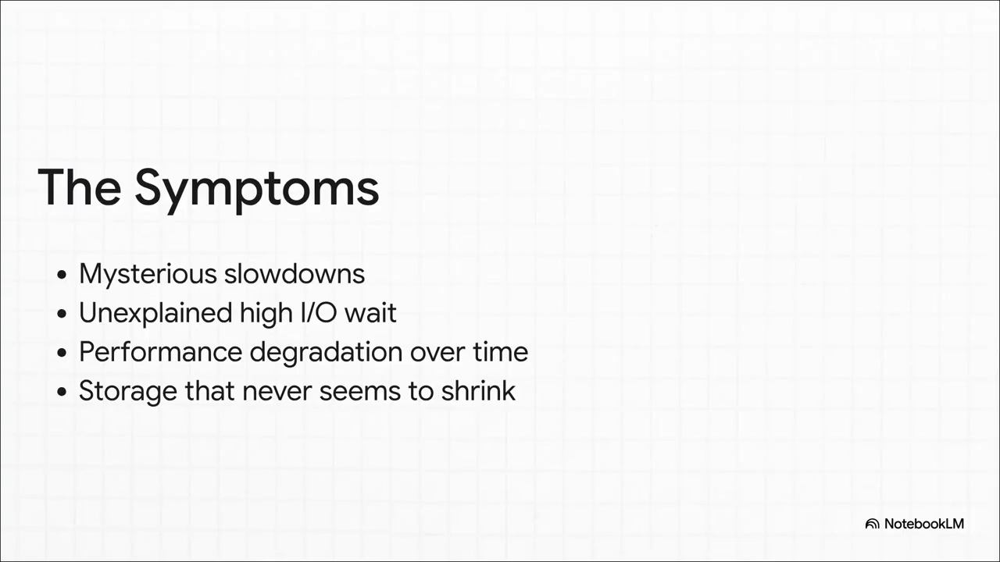
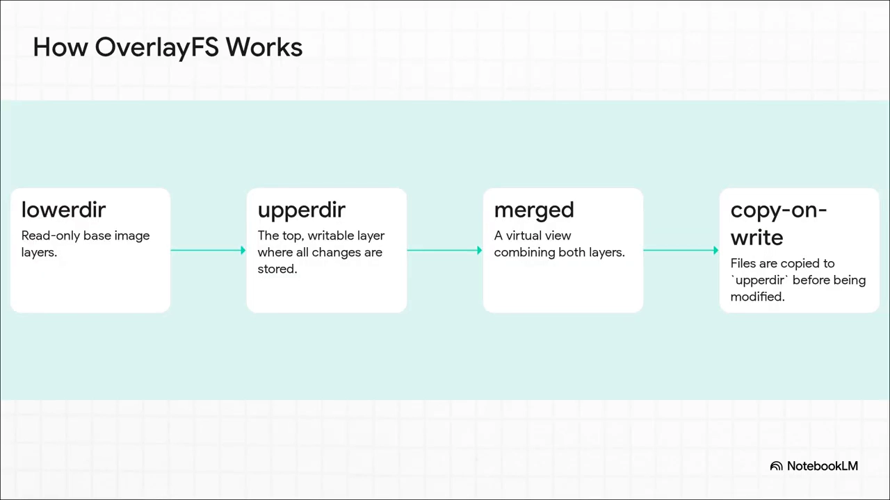
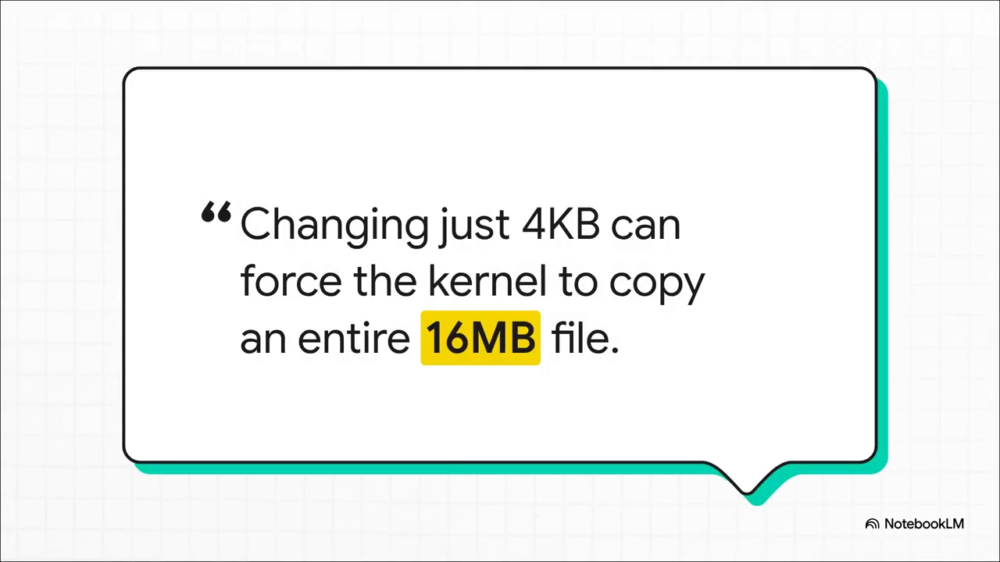
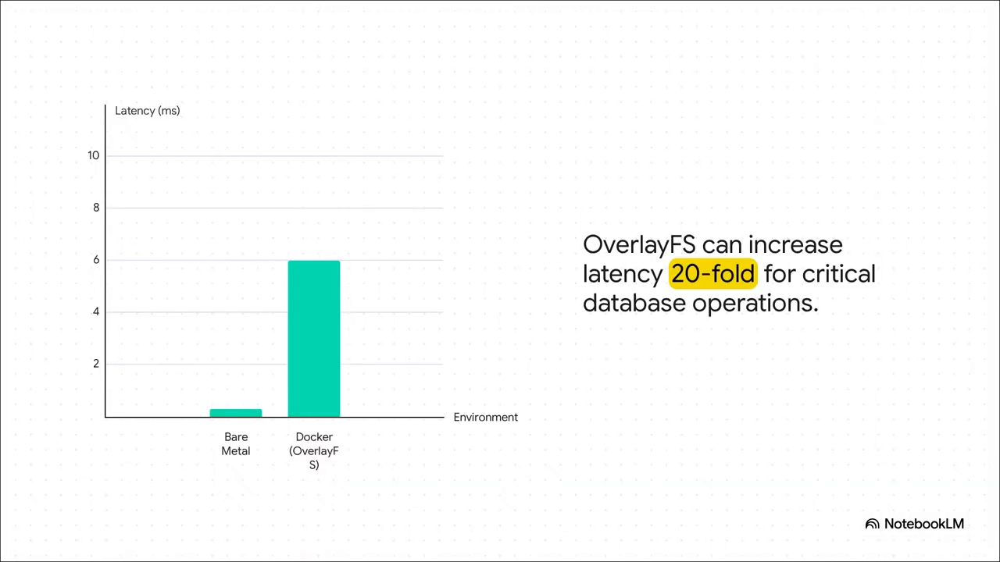
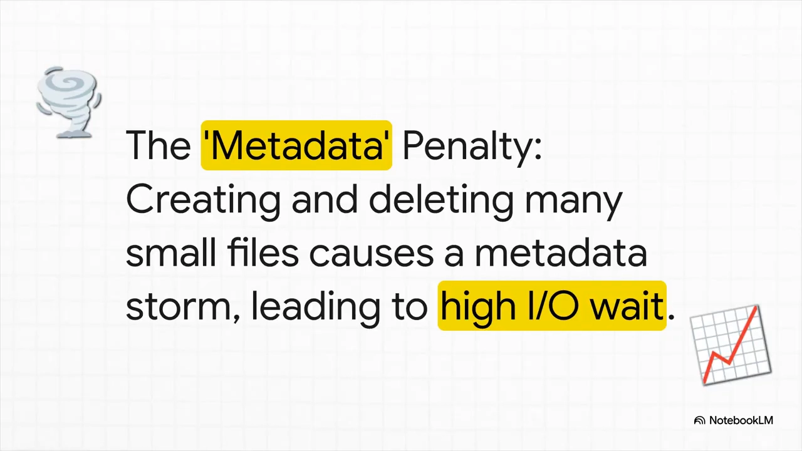
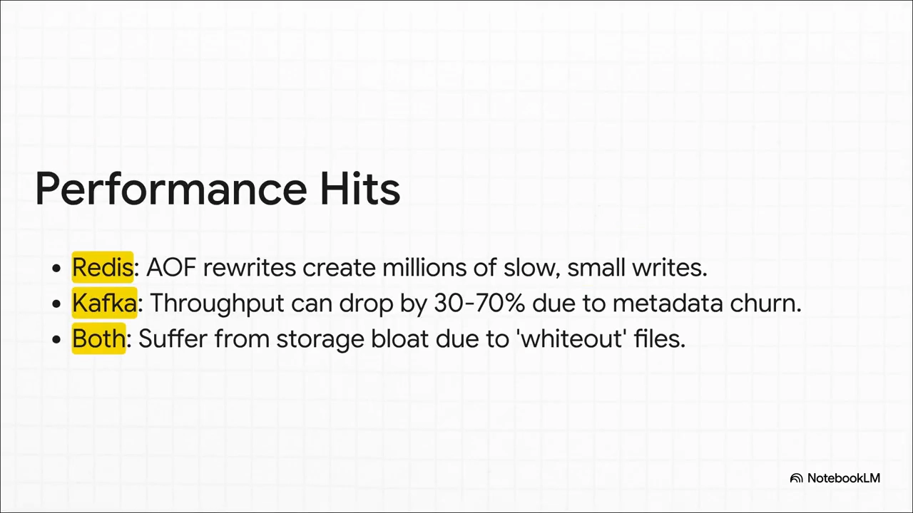
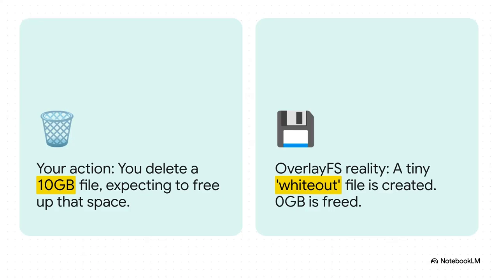
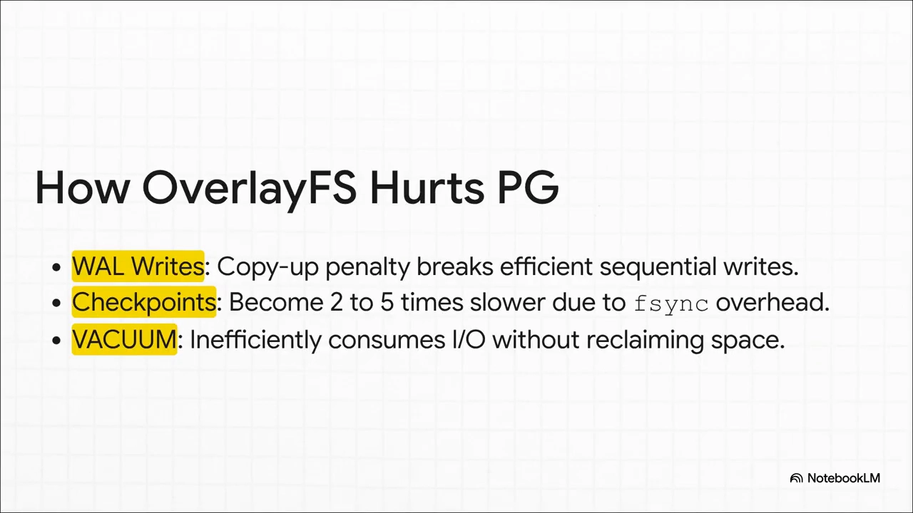
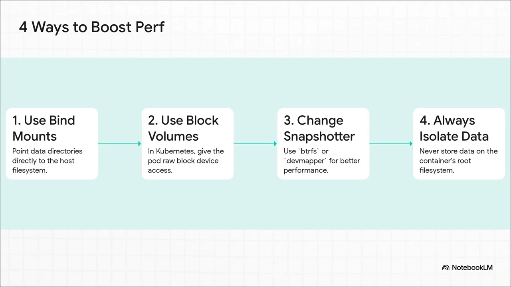

# Docker 里的数据库为什么越跑越慢：copy-up 惩罚的实测账

> 视频来源：[Docker DBs The Hidden Cost](https://www.youtube.com/watch?v=aDieJcruNRk)（YouTube · Bug & Coffee）｜时长约 8.5 分钟
> 导读：这支视频用一组具体数字把 OverlayFS 的 copy-up 代价摆到台面上——4 KB 的写要复制整个 16 MB 文件，`fsync` 从 0.3 ms 变成 6 ms。本文顺着它的"侦探"叙事，把三笔账（copy-up、元数据风暴、白化文件）和四条解法讲清楚；机制层面的推导见同小节的另一篇。

## 本讲要解决的核心问题（SCQA）

**背景**：Docker 的默认存储驱动是 OverlayFS。对无状态应用它是极好的设计：镜像分层共享、启动快、磁盘省。

**冲突**：可数据库不是无状态应用。它在容器里跑头几天一切正常，然后开始莫名其妙地变慢；监控上 I/O wait 飙高却找不到原因；更怪的是，删掉一堆数据，磁盘占用还在涨。

**疑问**：慢在哪一层？是谁在替这次写入付钱？

**回答（中心思想）**：付钱的是 copy-up。**一次只有 4 KB 的写，会让内核先复制整个 16 MB 文件——4000 倍的放大**；再加上小文件引发的元数据风暴和白化文件造成的空间只增不减，数据库在容器里系统性吃亏。解法不是弃用容器，而是把 IO 重的持久数据移出 overlay。

## 一、症状与嫌疑：问题不在数据库，在它脚下的文件系统

视频开场先列了四条"灵异现象"：

- 说不清原因的变慢；
- 监控上高 I/O wait，但找不到是谁；
- 性能随时间退化；
- 存储占用只涨不落。

这四条凑在一起，很像数据库自己的 bug，但它们其实指向同一个方向 [【跳转到 00:46】](https://www.youtube.com/watch?v=aDieJcruNRk&t=46)。

第一反应通常是怀疑 PostgreSQL、Redis 或者那块"很快的 SSD"。视频的结论是：**都不是。真凶在更下面一层——Docker 处理文件的方式本身** [【跳转到 01:05】](https://www.youtube.com/watch?v=aDieJcruNRk&t=65)。

这张图就是全部机制：`lowerdir` 是永不改变的镜像层，`upperdir` 装容器的所有改动，`merged` 是给容器看的合并视图。第四步是关键——**文件在被修改之前，要先被复制到 `upperdir`** [【跳转到 01:57】](https://www.youtube.com/watch?v=aDieJcruNRk&t=117)。

一个"微小到可以忽略"的改动，触发了一次"巨大而缓慢"的复制。这就是后面所有问题的起点。

## 二、第一笔账：copy-up 惩罚（有具体数字）

视频举的例子是 PostgreSQL 的 WAL（write-ahead log，预写日志）：数据库为了保证数据完整性，会不停地往 WAL 里追加很小的更新。**为了改其中 4 KB，OverlayFS 让内核先把整个 16 MB 文件复制一遍** [【跳转到 02:50】](https://www.youtube.com/watch?v=aDieJcruNRk&t=170)。

放大倍数可以直接算：

$$
\text{放大倍数} = \frac{16\ \text{MB}}{4\ \text{KB}} = 4000
$$

也就是说，**你请求的工作量是 1 份，内核实际做了 4000 份**。视频的评语是"absurd（荒谬）"，这个评价并不过分——因为放大倍数等于文件大小除以改动大小，文件越大、改动越小，放大越离谱。

### 2.1 `fsync` 的 20 倍

`fsync` 是数据库对操作系统说的话："请确保这份数据真的落到盘上。" 在裸金属的普通文件系统上，视频给出的数字是 **0.3 ms**，基本等于瞬间完成；在同样硬件的 Docker + OverlayFS 里是 **6 ms**——**20 倍延迟** [【跳转到 03:14】](https://www.youtube.com/watch?v=aDieJcruNRk&t=194)。

对数据库来说这是致命的：每个提交的事务都要 `fsync`，延迟翻 20 倍，等于每个事务都慢 20 倍。视频的原话是"purely because of the filesystem"。

> **读这组数字时补一句（本文说明）**：copy-up 对**同一个文件**只发生一次，复制完成后文件已经在 `upperdir` 里。所以这 20 倍不是"每次事务都重新复制 16 MB"，而是 OverlayFS 这条路径上的整体开销——复制本身、元数据操作、以及跨层带来的额外同步成本叠加的结果。视频没有把这三者拆开，但方向是明确的：**文件系统这一层的开销，已经大到能主导数据库的事务延迟。**

## 三、第二笔账：元数据风暴（小文件派）

大文件吃亏在"复制量"，小文件吃亏在"次数"。

视频点名了两类负载 [【跳转到 03:45】](https://www.youtube.com/watch?v=aDieJcruNRk&t=225)：

- **Redis 重写 AOF**（append-only file）：不断产生大量小写入；
- **Kafka**：不停滚动出新的小日志段（log segment）。

在普通文件系统上这不算什么；在 OverlayFS 上，**每一次文件创建都要在后台做大量额外的元数据工作**，把磁盘吞吐打满，于是监控上出现了那条说不清来历的高 I/O wait。

具体数字：Kafka 的吞吐相比直接跑在宿主上可以**下降 30% 到 70%**；Redis 的 AOF 重写则被形容为"千刀万剐"（death by a million paper cuts）——每一次微小的写都要交一遍元数据税 [【跳转到 06:10】](https://www.youtube.com/watch?v=aDieJcruNRk&t=370)。

## 四、第三笔账：白化文件（删了也不还空间）

第三笔账最反直觉，也最能解释"容器越跑越胖"。

在容器里删掉一个 10 GB 的日志文件，你期待回收 10 GB。但 OverlayFS **不能真的去只读层里删文件**，它只能在最上层放一个很小的标记文件（whiteout，白化文件），告诉容器"请假装这个大文件不存在"。原始的 10 GB 仍然躺在镜像层里，永远占着盘 [【跳转到 04:36】](https://www.youtube.com/watch?v=aDieJcruNRk&t=276)。视频把这种“越滚越大”直接归因于此 [【跳转到 05:01】](https://www.youtube.com/watch?v=aDieJcruNRk&t=301)。

这就是"删了一堆数据、磁盘占用还在涨"的机制解释。它和 copy-up 是一对：**copy-up 让写入放大，白化让删除无效**，两头都在推高容器层的体积。

## 五、真实伤害：PostgreSQL 的三处痛点

把三笔账合起来看，PostgreSQL 的处境最典型 [【跳转到 05:21】](https://www.youtube.com/watch?v=aDieJcruNRk&t=321)：

- **WAL 写**：PostgreSQL 的性能建立在"极快的顺序写"上，copy-up 惩罚直接摧毁了这个模型 [【跳转到 05:32】](https://www.youtube.com/watch?v=aDieJcruNRk&t=332)；
- **checkpoint**：关键操作慢 **2 到 5 倍**；
- **VACUUM**：本该清理旧数据，结果变成一场反复摩擦磁盘的 IO 噩梦，而且因为白化文件的存在，**在宿主上根本回收不了空间**。

## 六、解法：把 IO 重的持久数据移出 overlay

视频给的核心结论只有一句：**用 Docker 跑应用代码，但把持久化、IO 重的数据搬离 OverlayFS——绕开它**。

四条路径，按实施成本从低到高 [【跳转到 07:12】](https://www.youtube.com/watch?v=aDieJcruNRk&t=432)：

1. **bind mount（最简单）**：告诉 Docker，PostgreSQL 的数据目录别用它自己的文件系统，直接用宿主机上的这个目录。OverlayFS 被绕开，拿到原生性能。原理就是让写入根本不进 `upperdir`，自然没有 copy-up。
2. **block volume（Kubernetes 上更好）**：给数据库 Pod 一块裸块设备的直接访问权，是能拿到的最快形态。代价是放弃了文件系统层的便利（快照、扩容要靠块存储自己做）。
3. **换 snapshotter（更进阶）**：containerd 这类运行时可以换用 btrfs 或 devmapper 等更适合写重负载的存储驱动。原理是把"文件级 copy-up"换成"extent 级/块级 CoW"，两种 CoW 的性能模型差异见 2.3.1。
4. **永远隔离数据（黄金法则）**：不管选哪条，落到一句话——**永远不要把持久化的数据库文件放在容器根文件系统上**，一律用 volume 或 bind mount。

## 七、回到"启动时延"这条线

视频讲的是长期运行的数据库，但它给出的机制同样适用于"第一次写"这个瞬间：copy-up 的账**是在第一次碰某个文件时一次性结算的**。所以：

- 容器启动脚本里第一次 `apt install`、第一次写日志、第一次 `sed -i` 改镜像里的配置文件，都可能触发一次整文件复制；
- 复制的量约等于"首写文件的大小"，与"你改了多少"无关；
- 把这段放进启动时间线，就是几百毫秒到数秒的尖峰——足以抵消 MicroVM 那点百毫秒级的启动优势（见 S06 6.3.2）。

这也是为什么"把数据目录挂成 volume"同时改善两件事：它既消掉了运行期的 copy-up 惩罚，也消掉了启动时的首写尖峰。

## 小结

- 真凶不是数据库、不是 SSD，是 OverlayFS 的 copy-on-write：改文件前先复制整个文件到 `upperdir`。
- 第一笔账（copy-up 惩罚）：改 4 KB 复制 16 MB，**4000 倍放大**；`fsync` 从 0.3 ms 变 6 ms，**20 倍延迟**。
- 第二笔账（元数据风暴）：大量小文件创建/删除带来额外元数据工作，Kafka 吞吐可掉 **30%–70%**。
- 第三笔账（白化文件）：删除只写标记，**空间永不回收**，容器层只涨不落。
- PostgreSQL 的具体表现：WAL 顺序写被破坏、checkpoint 慢 2–5 倍、VACUUM 白耗 IO。
- 解法按成本排序：bind mount → block volume → 换 snapshotter（btrfs/devmapper）→ 黄金法则"持久数据永远不放容器根文件系统"。

## 关键术语速查

| 术语 | 一句话解释 |
| --- | --- |
| copy-on-write（写时复制） | 修改前先把数据复制一份，保证原副本不变；OverlayFS 在**文件**粒度上做这件事 |
| copy-up 惩罚 | copy-up 复制的量是"整个文件"而不是"改动量"，导致放大倍数 = 文件大小 ÷ 改动大小 |
| lowerdir / upperdir | 只读的镜像层 / 容器可写层；`merged` 是二者合成的视图 |
| 白化文件（whiteout） | 删除只读层文件时在上层留下的标记文件；被删数据仍然占盘 |
| 元数据风暴 | 大量小文件创建/删除带来的元数据操作洪峰，表现为高 I/O wait |
| WAL | 预写日志，数据库先把改动顺序写入它再落数据文件，因此对写延迟极敏感 |
| `fsync` | 要求操作系统把数据真正刷到持久介质；数据库每次提交都要调用 |
| bind mount | 把宿主目录直接挂进容器，写入绕过 OverlayFS |
| snapshotter | containerd 里负责管理镜像层与容器可写层的组件，可换实现（overlayfs / btrfs / devmapper） |