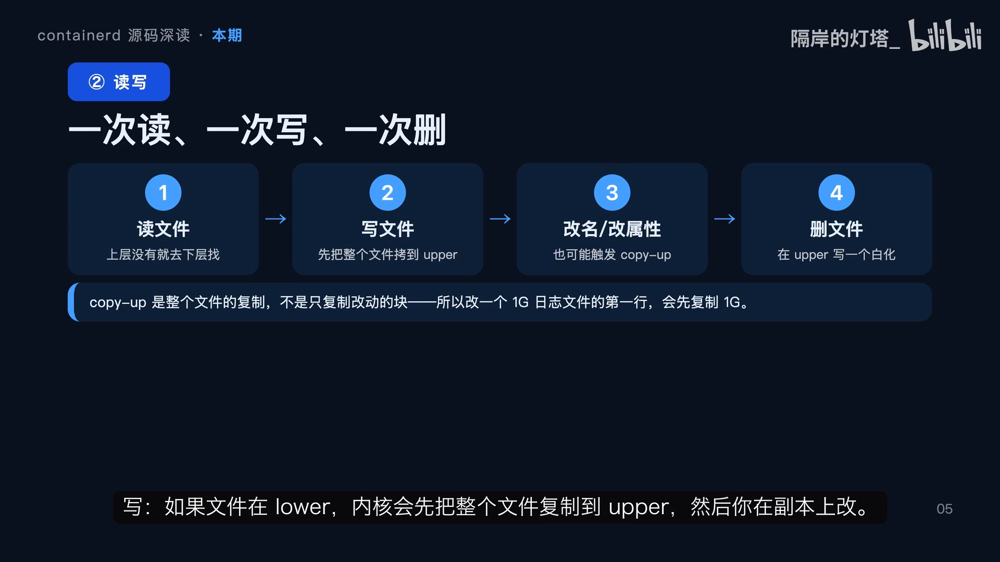
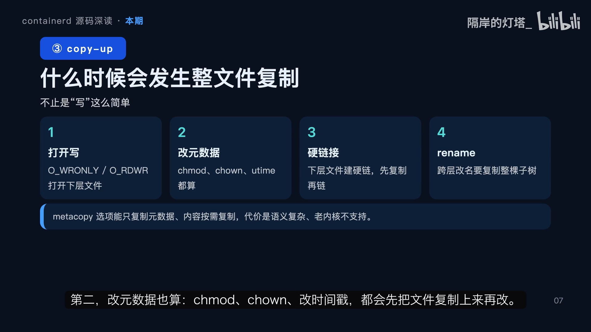
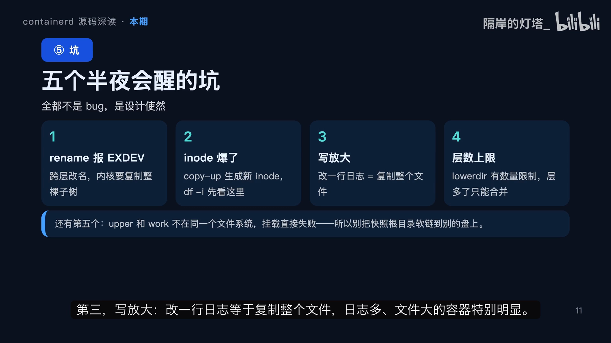
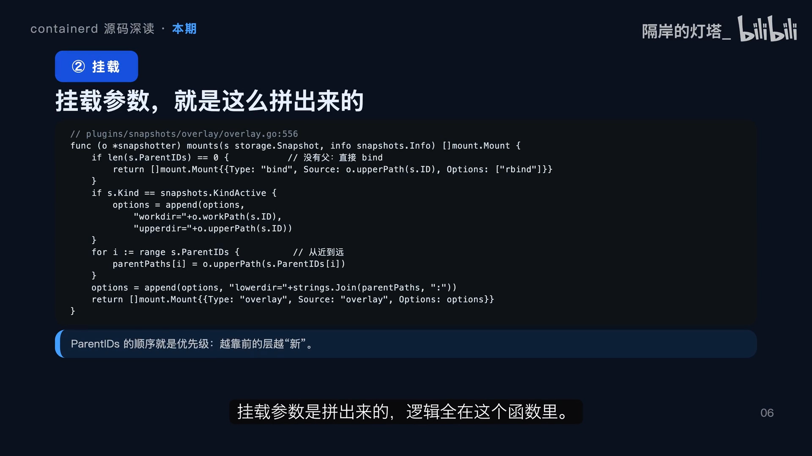
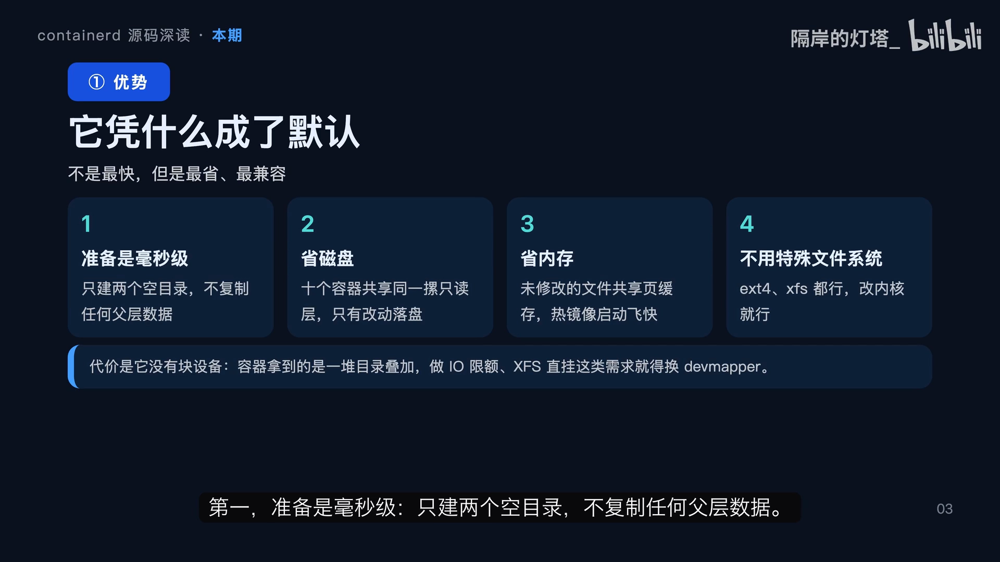
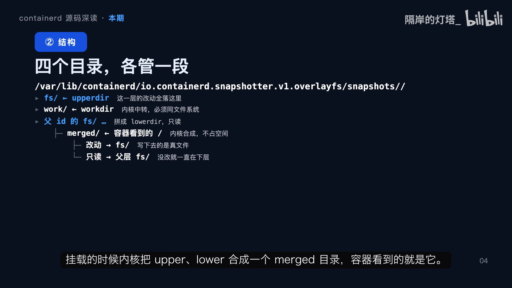
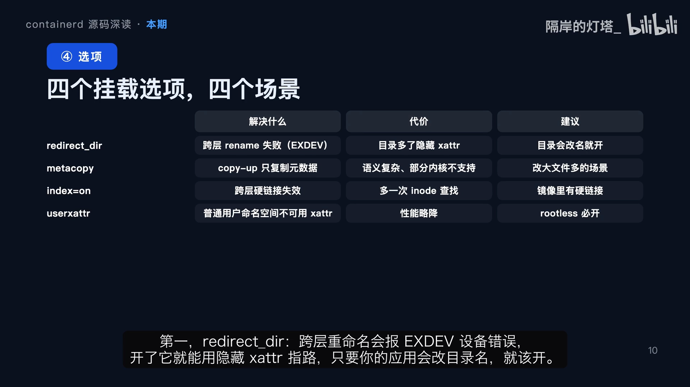
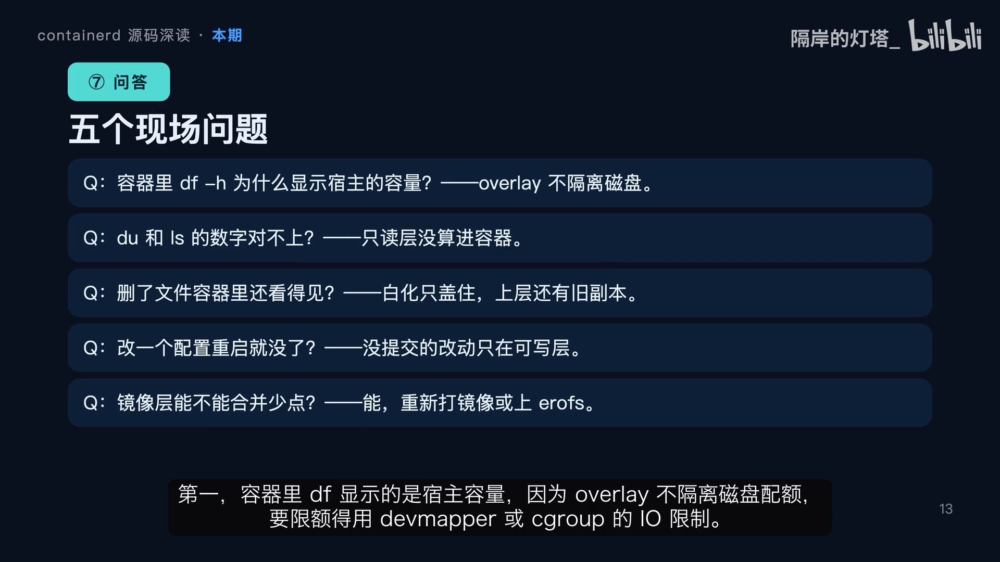

# copy-up 的代价：改一个字节，为什么要先复制整个文件

> 视频来源：[15·overlayfs：三层目录拼出一块盘，删文件为什么要写白化｜containerd 源码深读](https://www.bilibili.com/video/BV1bhxP6ZEYJ/)（B 站 · 隔岸的灯塔_）｜时长约 7 分钟
> 导读：这支视频讲 OverlayFS 的四层语义、白化与五个坑。本文只取其中"代价"这一条线：一次 copy-up 要花多少、跟什么成正比、在什么场景下会变成用户能感觉到的卡顿，以及内核给了哪些缓解开关。层叠结构与触发时机见 2.1.1，本文不重复。

## 本讲要解决的核心问题（SCQA）

**背景**：Docker 镜像由一摞只读层叠成，最上面盖一层可写层。容器看到的 `merged` 目录只是视图，不占空间；没被改过的文件，读的时候直接读下层，连页缓存都是共享的。

**冲突**：正因为"读"这么便宜，很多人以为"写"也便宜。可一旦你要改的文件躺在只读层里，内核会先把**整个文件**复制到可写层，然后才允许你改。改一个字节，复制一个文件。

**疑问**：这一次复制到底要花多少时间？它跟什么成正比？什么时候会从"看不见的开销"变成"用户能感觉到的卡顿"？

**回答（中心思想）**：copy-up 的代价是 $O(\text{文件大小})$，而不是 $O(\text{改动量})$；这笔账不在容器启动时付，而是**推迟到第一次写**时付——所以"第一次写大文件"最贵，它能把几百毫秒到数秒的时间塞进启动时间线里。

## 一、代价模型：复制的是整个文件，不是被改的那一页

先把最容易误解的一点钉死。视频里用一张图把读、写、改名、删除四件事排成一条链：

图里那句注解就是本文的出发点：**copy-up 是整个文件的复制，不是只复制改动的块——所以改一个 1G 日志文件的第一行，会先复制 1G。** [【跳转到 02:04】](https://www.bilibili.com/video/BV1bhxP6ZEYJ/?t=124)

### 1.1 为什么不能只复制一页

因为 overlayfs 是**文件级**的写时复制，不是 extent（数据块区间）级的。上层要出现一个"属于自己"的文件，就必须有完整的 inode、完整的数据块、完整的扩展属性（xattr）。内核没法让 upper 里的半个文件去指向 lower 里的另一半——那样一来，任何一次读都要跨两层拼数据，读路径会立刻碎掉。

所以代价可以写成：

$$
T_{\text{copy-up}} \approx \frac{S}{B_{\text{copy}}}
$$

其中 $S$ 是文件大小，$B_{\text{copy}}$ 是这次复制的**有效吞吐**。注意 $B_{\text{copy}}$ 不是磁盘标称带宽：复制要"读一遍 + 写一遍"，所以它大致是读写带宽的调和结果；如果调用方还要求落盘（`fsync`），还要再叠加一次刷盘时间。

### 1.2 量级：1 GiB 的文件要多久

下表是**按顺序吞吐做的换算**（不是视频里的实测数字，只是让你对量级有感觉）。假设复制过程能吃满设备带宽的一半：

| 存储介质 | 典型顺序吞吐 | 1 GiB 文件 copy-up 的粗略耗时 |
| --- | --- | --- |
| NVMe SSD | 2–3 GB/s | 数百毫秒 |
| SATA SSD | 约 500 MB/s | 2–4 秒 |
| 机械硬盘 | 100–200 MB/s | 7–14 秒 |
| 网络存储（NFS/CephFS） | 受网络与元数据往返限制 | 更久，且抖动大 |

一句话：**文件越大、介质越慢，这笔账越难看；而它跟"你改了多少"完全无关。**

### 1.3 对照：reflink 为什么是 $O(1)$

同样一次"复制"，如果底层文件系统支持 reflink（XFS、btrfs 的 extent 共享），克隆一个 1 GiB 文件只需要改元数据，让两个文件指向同一批 extent，耗时与文件大小无关，是 $O(1)$。视频在结尾把这条线留给了下一期：*native 靠整目录拷贝，btrfs 靠 reflink 子卷* [【跳转到 07:03】](https://www.bilibili.com/video/BV1bhxP6ZEYJ/?t=423)。引用计数怎么维护、部分写入时 extent 怎么分裂，属于 2.2.1 的内容，这里只记住结论：**copy-up 是 $O(S)$，reflink 是 $O(1)$，这是两种 CoW 性能差几个数量级的根源。**

## 二、触发条件比"写"更宽：改属性、建硬链接、改名都算

很多人以为只有 `write()` 才触发 copy-up。视频专门纠正了这一点：**copy-up 不止发生在写的时候。**

四类操作，按"意外程度"排序 [【跳转到 03:04】](https://www.bilibili.com/video/BV1bhxP6ZEYJ/?t=184)：

1. **打开写**：以 `O_WRONLY` / `O_RDWR` 打开一个还在下层的文件，内核在 `open` 阶段就把它整份拷上来，然后你才开始写。
2. **改元数据**：`chmod`、`chown`、改时间戳（`utime`）都算。你只想改一个权限位，代价却是一整个文件。
3. **建硬链接**：给下层文件建硬链接，也是先复制再链。
4. **跨层改名**：文件改名已经够贵，**给目录改名可能要复制整棵子树**——这是四类里最贵的。

第 4 条值得单独记一笔：跨层 rename 在内核里做不到原子替换，只能把整棵子树搬上去，所以会直接报 `EXDEV`（设备错误）。这也解释了为什么后面那个挂载选项 `redirect_dir` 存在。

由此得到一条实践上的判断标准：**"第一次写"要理解成"第一次碰"**。一个只在启动时 `chmod` 一下配置文件的脚本，同样会为整个配置文件付一次复制费。

## 三、写放大与 inode：两个容易被忽略的账

copy-up 的代价不只是时间，还有两笔会累积的账。

### 3.1 写放大：改一行日志 = 复制整个日志

日志、数据库 WAL、审计文件都是"只追加、越写越大"的形态。它们的坏运气在于：**文件在镜像层里（lower），而写入发生在容器里（upper）**。于是第一次追加就要把整个历史日志复制一遍，之后每次容器重建又来一遍。

视频的措辞很直白：*改一行日志等于复制整个文件，日志多、文件大的容器特别明显* [【跳转到 05:36】](https://www.bilibili.com/video/BV1bhxP6ZEYJ/?t=336)。

### 3.2 inode：磁盘还有空间，inode 先没了

每次 copy-up 都会**生成新的 inode**。所以会出现一种很迷惑的现象：`df -h` 显示还有空间，写入却失败——因为 inode 用光了。排查顺序是先看 `df -i`，再看 `df -h`。这也解释了为什么"反复重建容器 + 大量小文件"的负载，磁盘占用和 inode 消耗会一起失控。

### 3.3 层数与 copy-up 成本：不是线性叠加

一个常见误解是"镜像有 20 层，copy-up 就要复制 20 次"。看视频里讲的读路径就能推出正确结论：**读，先在 upper 找，找不到就去 lower 找，找到就是它**；`lowerdir` 那一长串的顺序就是优先级，越靠前的层越新 [【跳转到 01:39】](https://www.bilibili.com/video/BV1bhxP6ZEYJ/?t=99)。

所以：

- 一次 copy-up 的**复制源**是"第一个命中该文件的层"，只复制**一份**，不会逐层向上叠着复制。层数增加不会让单次 copy-up 变贵。
- 层数真正影响的是**查找成本**（要按优先级逐层找）和**数量上限**：`lowerdir` 有层数限制，层太多只能合并。视频把"层数上限"列为五个坑之一，并提到 EROFS 那类方案存在的理由之一就是能合并层 [【跳转到 05:38】](https://www.bilibili.com/video/BV1bhxP6ZEYJ/?t=338)。

换句话说，代价的公式里没有"层数"这一项，只有"文件大小"这一项。层数影响的是**命中率**：文件越靠近上层，越可能已经在 upper 里，copy-up 就越少发生。

## 四、为什么"第一次写"最贵：代价被推迟到首写

这是本文最想让你记住的一节。

### 4.1 挂载本身几乎不花钱

视频列了 OverlayFS 成为默认存储驱动的四条理由，第一条就是"准备是毫秒级"：

**只建两个空目录（`fs` 与 `work`），不复制任何父层数据**；十个容器共享同一摞只读层；没被修改的文件共享页缓存，所以"热镜像启动飞快" [【跳转到 00:52】](https://www.bilibili.com/video/BV1bhxP6ZEYJ/?t=52)。

这两张图合起来说明一件事：**容器启动时，文件系统这一层几乎没有成本，因为它什么都没复制。** 成本被推迟了——推迟到容器里第一次真正去改一个镜像里的文件。

### 4.2 于是启动时间线上出现了"首写尖峰"

把容器启动拆成两段看：

| 阶段 | 文件系统在做什么 | 耗时特征 |
| --- | --- | --- |
| 挂载 + 起进程 | 建两个空目录、拼 `lowerdir`、合成 `merged` | 毫秒级，与镜像大小无关 |
| 应用初始化 | `apt install`、写日志、改配置文件、初始化数据库 | 每次"第一次碰 lower 里的文件"都可能触发整文件复制 |

第二段就是尖峰所在。启动脚本里一个不起眼的 `sed -i`，如果目标是镜像里一个 200 MB 的配置文件，代价就是 200 MB 的复制；一个数据库容器在数据目录里初始化，第一次写就可能撞上几百 MB 甚至上 GB 的镜像内文件。

把这段放进启动总时延里估算：

$$
T_{\text{启动}} \approx T_{\text{挂载}} + \sum_{i \in \text{首写文件}} \frac{S_i}{B_{\text{copy}}}
$$

$T_{\text{挂载}}$ 是毫秒级，求和项却可能是数百毫秒到数秒。**这正好能把 MicroVM 那点百毫秒级的启动优势吃掉**（内存侧的快照与恢复见 S06 6.3.2，这里不展开）。

### 4.3 三类典型受害者

- **数据库文件**：数据目录在镜像层里，第一次启动就要把整个数据文件搬上来；之后每次重建容器再来一次。
- **日志文件**：追加写 + 文件持续变大 = 每次重建都复制一份越来越大的历史。
- **`/etc` 下的大配置文件**：只改一行，复制整份。

## 五、缓解手段：四个挂载选项 + 一条架构原则

内核给了四个挂载选项，视频的说法是"各治一个病"：

| 选项 | 解决什么 | 代价 | 什么时候该开 |
| --- | --- | --- | --- |
| `redirect_dir` | 跨层 rename 报 `EXDEV` | 目录多了一份隐藏 xattr | 应用会改目录名 |
| `metacopy` | copy-up 只复制元数据 | 语义复杂、部分内核不支持 | 改大文件的场景多 |
| `index=on` | 跨层硬链接失效 | 多一次 inode 查找 | 镜像里带硬链接 |
| `userxattr` | 普通用户命名空间用不了特权 xattr | 性能略降 | rootless 容器必开 |

### 5.1 `metacopy`：把"复制数据"再推迟一层

这是针对本文主题最直接的一个开关。默认行为是 copy-up 时把**元数据 + 数据**一起复制；开了 `metacopy` 之后，copy-up **只复制元数据**，数据块仍然指向 lower，直到你真正去写数据时才复制 [【跳转到 04:57】](https://www.bilibili.com/video/BV1bhxP6ZEYJ/?t=297)。

对"只 `chmod` 一下"或"只改文件头几个字节"的场景，收益巨大。代价也在视频里说清楚了：**语义更复杂，老内核不支持，出问题不好查**——因为读路径要多判断一次"这个文件的数据到底在哪一层"。

### 5.2 `redirect_dir`：目录改名不再复制整棵子树

跨层 rename 本来只能整棵子树搬上去，开了 `redirect_dir` 之后，内核用一份隐藏 xattr 记下"这个目录原来在哪"，改名退化成写一个指针 [【跳转到 04:43】](https://www.bilibili.com/video/BV1bhxP6ZEYJ/?t=283)。对"部署脚本会 `mv` 目录"的应用，这一项能省掉最贵的一类 copy-up。

### 5.3 架构原则：把热点可写目录挂成 volume

比任何挂载选项都有效的一条：**别让高频写入落在 overlay 上**。把数据目录、日志目录挂成 volume 或 bind mount，写入直接落在宿主文件系统，根本不进 copy-up 这条路。视频把它总结成"一个容器的盘就是一个挂载" [【跳转到 07:03】](https://www.bilibili.com/video/BV1bhxP6ZEYJ/?t=423)。

### 5.4 底层换 reflink 文件系统

如果 upper 所在的文件系统支持 reflink（XFS 开 `reflink=1`、btrfs），"复制"可以退化成 $O(1)$ 的 extent 克隆。这是把 $O(S)$ 直接改写成 $O(1)$ 的办法，原理见 2.2.1 / 2.2.2。

> **延伸（视频外补充，供对照）**：overlayfs 还有一个 `volatile` 挂载选项，思路是放弃"崩溃后仍保证一致"来换写入性能——它不解决 copy-up 的复制量，而是省掉同步写盘的开销，属于另一个方向的取舍。

## 六、五个"不是 bug，是设计"的坑

视频最后列了五个现场问题，其中三个与 copy-up 直接相关 [【跳转到 06:28】](https://www.bilibili.com/video/BV1bhxP6ZEYJ/?t=388)：

- **`rename` 报 `EXDEV`**：跨层改名不能原子替换，只能复制整棵子树（用 `redirect_dir` 缓解）。
- **inode 爆了**：copy-up 每次生成新 inode，先看 `df -i`。
- **写放大**：改一行日志等于复制整个文件。
- **层数上限**：`lowerdir` 有数量限制，层太多只能合并。
- **`upper` 与 `work` 不在同一个文件系统**：挂载直接失败——所以别把快照根目录软链到别的盘上。

## 小结

- copy-up 的代价是 $O(\text{文件大小})$：复制的是整个文件、完整 inode 与 xattr，不是被改的那一页。
- 触发条件比"写"宽：以 `O_WRONLY` 打开文件、`chmod`/`chown`/`utime`、建硬链接、跨层 rename 都算；目录改名最贵，可能要复制整棵子树。
- 层数不进入代价公式：一次 copy-up 只从"第一个命中的层"复制一份；层数影响的是查找成本和 `lowerdir` 上限。
- 代价被推迟到首写：挂载是毫秒级、不复制任何父层数据，所以容器启动的"文件系统账"在应用第一次改镜像内文件时才结算。
- 缓解有四个挂载选项（`metacopy`、`redirect_dir`、`index=on`、`userxattr`），但最有效的是架构上把热点可写目录挂成 volume，让写入根本不进 overlay。
- 把 $O(S)$ 变成 $O(1)$ 的唯一办法是底层用 reflink 文件系统——那是 2.2 的主题。

## 关键术语速查

| 术语 | 一句话解释 |
| --- | --- |
| copy-up | 写一个还在只读层的文件时，内核先把整个文件复制到可写层，再让你改 |
| lowerdir / upperdir | 只读的镜像层 / 容器自己的可写层；`merged` 是两者合成的视图，不占空间 |
| workdir | 内核做原子替换用的中转目录，必须和 upperdir 在同一个文件系统上 |
| 写放大 | 实际写入量远大于逻辑改动量；copy-up 是典型例子（改 1 字节 → 复制整个文件） |
| `metacopy` | 挂载选项：copy-up 只复制元数据，数据仍指向 lower，真正写数据时才复制 |
| `redirect_dir` | 挂载选项：跨层目录改名用隐藏 xattr 指路，避免复制整棵子树 |
| reflink | extent 级共享：克隆文件只改元数据，耗时与文件大小无关，$O(1)$ |
| inode | 文件的元数据对象；每次 copy-up 都会生成新的，可能先于磁盘空间耗尽 |