# ZFS 快照为什么是 O(1)：只保存旧根块，把代价推迟到首次写与删除

> 视频来源：[How ZFS snapshots really work And why they perform well (usually)](https://www.youtube.com/watch?v=NXg86uBDSqI)（YouTube · BSDCan 2019，讲者 Matt Ahrens，ZFS 快照的早期设计者之一）｜时长约 46 分钟
> 导读：本文只跟这支演讲的主线走——快照为什么能瞬间创建、代价被推迟到了哪里、以及"快照占多少空间"为什么这么难算。演讲是 ZFS 视角的，本文不展开其他文件系统的具体实现。

## 本讲要解决的核心问题（SCQA）

**背景**：快照的用法很朴素——配一条策略每小时自动拍一张，误删文件时回去取。`zfs snapshot` 几乎立刻返回，无论文件系统里装着几百 GB 还是几 TB。

**冲突**：如果快照真的要"复制一份数据"，几十 TB 的卷不可能在毫秒内复制完。更奇怪的是快照拍多之后，空间数字自相矛盾：所有快照的 `USED` 加起来只有 7GB，可删掉全部快照却能回收 300GB。

**疑问**：一次快照到底做了什么？既然创建时不花钱，这笔账被记到了哪里？为什么"快照占多少空间"这么难回答？

**回答（中心思想）**：快照只做一件事——**把旧的根块留下来、不覆盖它**，数据块一个都不复制，靠两棵平行的树共享。所以创建是 O(1)，与文件大小无关；代价被推迟到两个地方：**第一次写**（写时复制要分配新块，旧块又不能释放）和**删除快照**（要找出"只被这个快照引用"的块）。后者才是真正的工程难点，ZFS 为此换了三代算法，而"快照占多少空间"的困惑，正是这套共享结构带来的副作用。

## 一、快照的全部工作，就是"留下旧的根块"

### 1.1 先看写时复制文件系统是怎么写入的

ZFS 是写时复制（copy-on-write，CoW）文件系统：每次要把数据写到盘上，都选一块以前没用过的新位置写，唯一的例外是根块（uberblock）。演讲用一张四步图讲清了这条路径：

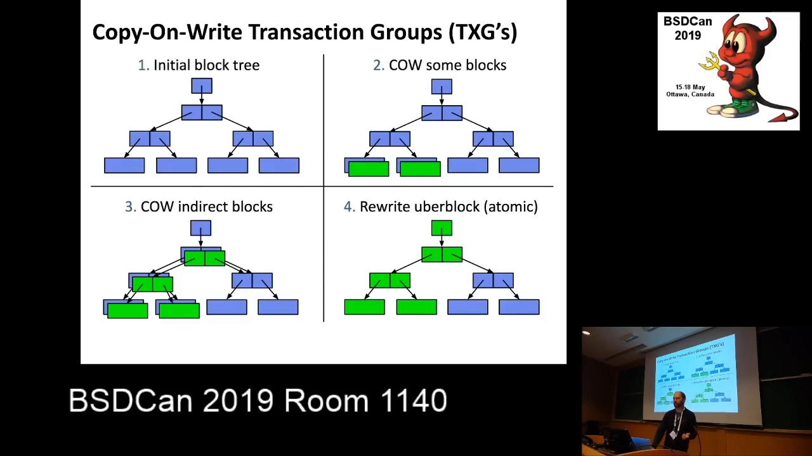

1. **初始块树**：数据块在叶子，间接块（indirect block）在上面，根在顶上。
2. **改数据块**：不原地覆盖，而是找一块新位置写（图中绿色）。此刻还没有任何指针指向这块新数据，如果现在崩溃，它也找不回来。
3. **写新的间接块**：新写一层间接块指向新数据，再往上写一层新的间接块，一路写到根。
4. **重写 uberblock**：把根指针覆盖成指向新的根，原子地切换到新的世界状态。

"这其实是所有写时复制文件系统（即使没有快照）通用的做法，而它让实现快照变得非常容易。" [【跳转到 02:58】](https://www.youtube.com/watch?v=NXg86uBDSqI&t=178)

### 1.2 快照 = 在覆盖根块之前，把旧根留下来

有了上面这条写入路径，创建快照只需要做一件事：**在覆盖根块之前，把旧的根块留下来，保证它不被改写**。

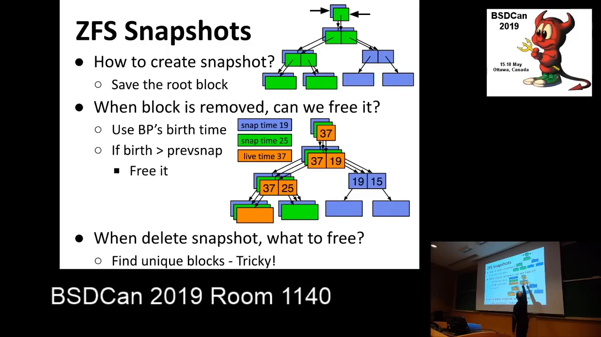

于是文件系统里出现两棵平行的树：绿色的是新的文件系统，蓝色的是快照。它们引用一部分相同的块，也各自拥有一些独有的块。演讲者说："看起来很简单，但快照还有几件事要处理。" [【跳转到 04:24】](https://www.youtube.com/watch?v=NXg86uBDSqI&t=264)

### 1.3 所以它是 O(1)：代价只与元数据路径有关

从这张图可以直接读出"O(1)"的含义：块树的高度是固定的（数据块 → 若干层间接块 → 根），拍快照只需要保留一个根指针、再记一点快照元数据，**不需要遍历任何数据块**。给 1TB 的文件系统拍快照，和给 1KB 的文件系统拍快照，工作量一样。

换句话说，快照的创建成本只与元数据规模相关，与数据量无关。这也解释了为什么 `zfs snapshot` 能瞬间返回——它根本没有"复制"这个动作，只是让旧根不被覆盖。

## 二、代价一：第一次写要分配新块，旧块又不能释放

快照创建几乎不花钱，但从下一笔写开始，账单就来了。

**第一笔：写时复制本身的开销。** 快照存在之后，任何修改都不能再原地覆盖旧块（旧块可能被快照引用），必须分配新块、写新的间接块、换根。一次逻辑写会放大成"数据块 + 若干层间接块"的物理写，这是快照"分期付款"的第一笔。

**第二笔：能释放的块变少了。** 没有快照时，删掉文件，那些块立即没人引用，文件系统可以回收、重新分配。有快照时就不行了。ZFS 的解法是给每个块记一个**出生时间**（birth time，即分配并写入这个块的时间），存在指向它的块指针里。比如某个块是在时间 37 写入的，块指针里就记着 37。

于是删除一个块时，手上就有它的块指针，可以当场判断：

- 写入时间**晚于**最近一次快照 → 没有快照引用它 → 可以释放；
- 写入时间**早于**最近一次快照 → 至少那个快照还引用它 → 不能释放。

[【跳转到 04:49】](https://www.youtube.com/watch?v=NXg86uBDSqI&t=289)

结果就是：快照越多、越久，可回收的块越少，空间越"粘"在盘上——这正是后面所有空间记账困惑的根源。

## 三、代价二：删快照时要找出"只被它引用"的块

这是整场演讲的主体，也是标题里"why they perform well (usually)"的落点。

删除快照时，只能释放**只被这个快照引用**的块；只要还被别的快照或文件系统引用，就必须留下。演讲给出的理想算法标准是：

- 时间正比于**要释放的块数**（删一个只占 1GB 的快照应该快，删一个占 1TB 的慢一点可以接受）；
- 从盘上**读**的块数应远少于要释放的块数。

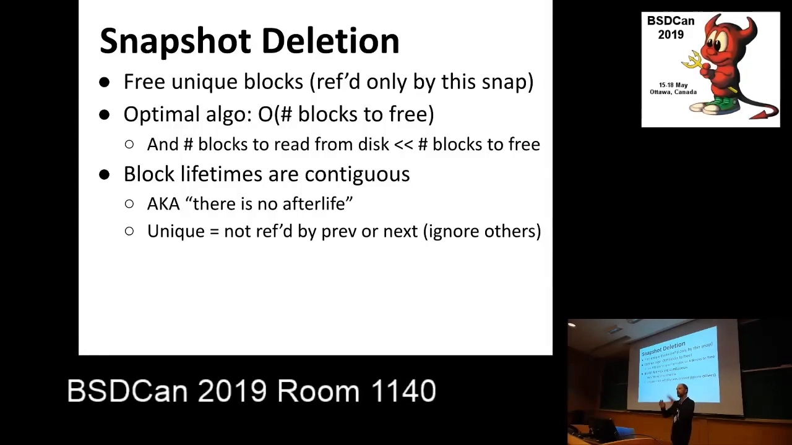

让这件事可行的关键性质是：**块的生命周期是连续的**，演讲者称之为"there is no afterlife"——一个块一旦死亡（不再被文件系统引用），就不会复活、不会重新变成文件系统的一部分。所以"只属于某个快照的块"，就是既不被**前一个**快照、也不被**后一个**快照引用的块，不必往更早或更晚去找。 [【跳转到 08:11】](https://www.youtube.com/watch?v=NXg86uBDSqI&t=491)

### 3.1 乌龟算法：正确，但随机读把吞吐打死

第一代做法（演讲里叫"乌龟"）是反向遍历块树，用出生时间判断"前一个快照是否还引用它"。它有个漂亮的剪枝：如果一个间接块是很久以前创建的，那它的所有子块也一定是很久以前创建的，整棵子树可以直接跳过。

但还要判断"后一个快照是否引用"。一种做法是到后一个快照里，找到同一文件、同一偏移处的块指针，看是不是同一个块——这里利用了快照的另一个性质：块指针不会在文件之间移动，同一位置上的指针要么相同、要么不同。

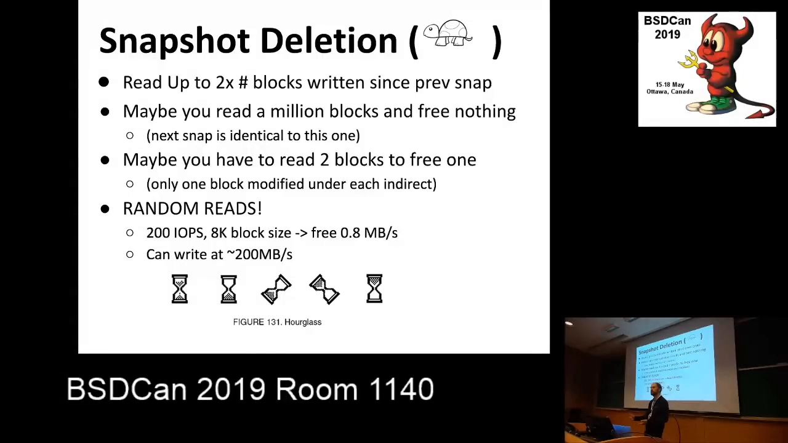

问题在于**随机读**：可能读了一百万个块却一个都没能释放（比如后一个快照和这个快照内容几乎一样），也可能读两块才释放一块。按 200 IOPS、8K 块算，释放吞吐只有 0.8MB/s，而顺序写能到 200MB/s。于是删除快照反过来成了写入的瓶颈，而且删除过程持有锁，会拖住新数据写入。 [【跳转到 11:06】](https://www.youtube.com/watch?v=NXg86uBDSqI&t=666)

### 3.2 deadlist（兔子算法）：把"死掉的块"提前记下来

第二代做法引入一个额外的数据结构：**deadlist（死亡列表）**，记录"已经不再被引用的块"。每个 dataset（每个快照、每个文件系统）都有一份，内容是"被前一个快照引用、但我不再引用的块"——也就是"我杀掉的块"。

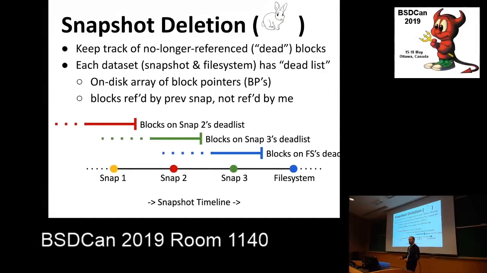

删快照时，只要看后一个快照的 deadlist，用块指针里的出生时间判断它是否落在"两个快照之间"的区间：落在里面，说明它只属于要删的那个快照，可以释放；否则它还被前一个快照引用，不能动。

它的巨大优势是**紧凑**：deadlist 是块指针的磁盘数组，每读一个 1KB 的块，里面可能有上千个块指针可以判断，理论上比乌龟算法快两千倍左右。缺点仍然存在：列表里可能全是"出生在前一个快照之前"的块，遍历很久却释放不出东西。 [【跳转到 11:56】](https://www.youtube.com/watch?v=NXg86uBDSqI&t=716)

### 3.3 cheetah：按出生时间把 deadlist 切成子列表

第三代做法（演讲里叫 cheetah，思路 ZFS 早期就有，2008–2009 年做了改进）是在 deadlist 之上再切一刀：**按出生时间把 deadlist 分成若干子列表（sublist），一个子列表对应一个更早的快照**。

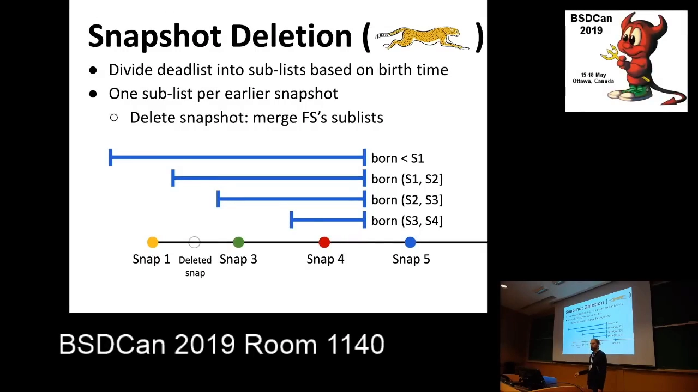

删除快照时，只需遍历并合并与目标时间区间相关的几个子列表；合并还可以用"引用"的方式完成，不必真的把整个列表拷贝一遍。

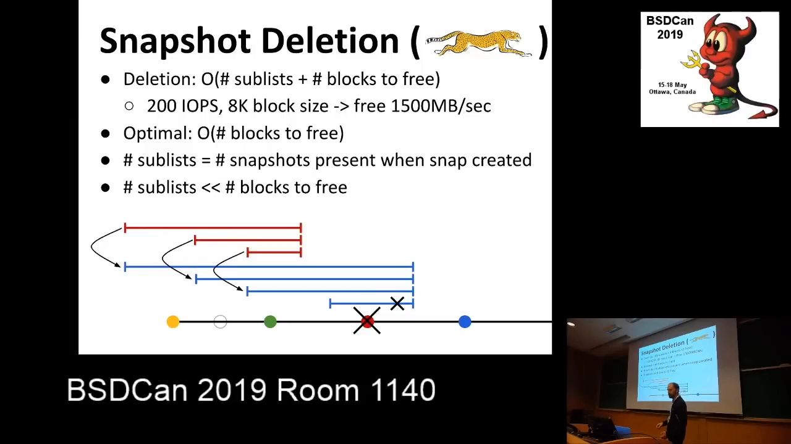

复杂度变成 `O(子列表数 + 要释放的块数)`，而子列表数远小于块数。按 200 IOPS、8K 块计算，释放吞吐从 1MB/s 级别提升到 **1500MB/s**。"于是删除快照不再是瓶颈，而保存子列表的开销远小于保存所有块指针。" [【跳转到 16:31】](https://www.youtube.com/watch?v=NXg86uBDSqI&t=991)

## 四、代价三：元数据随快照数量增长，O(n²) 是隐患

创建快照是 O(1)，但"快照数量"本身会以元数据的形式收费，而且账单落在删除和空间统计这两条路径上。

按每小时一张、保留一年算，一个文件系统有 8700 张快照。子列表数量大约正比于 $n^2$，于是到了 **7500 万个**这个量级。

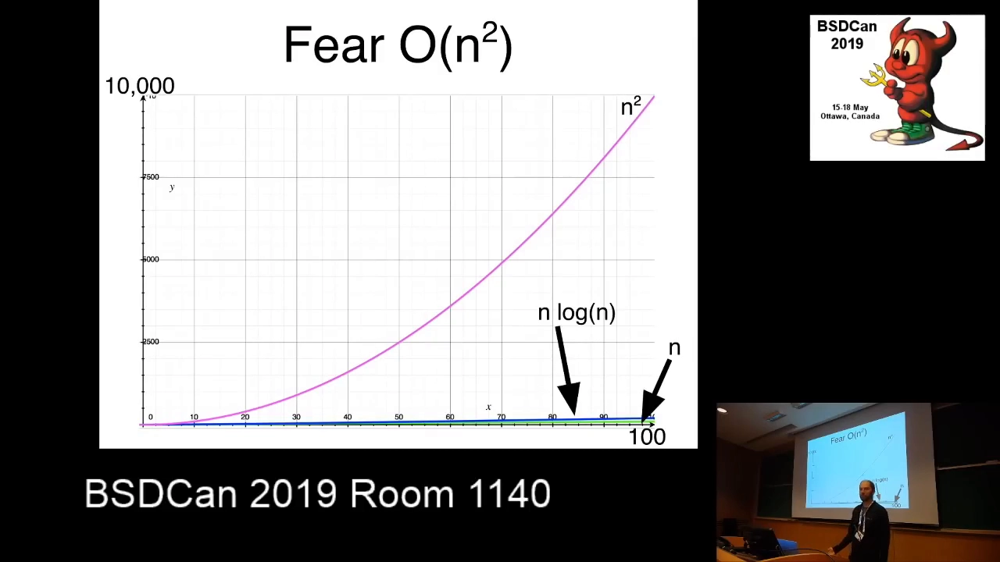

听起来只是 CPU 多算点东西——每秒几十亿条指令，不算大事。但把子列表当磁盘对象看就麻烦了：

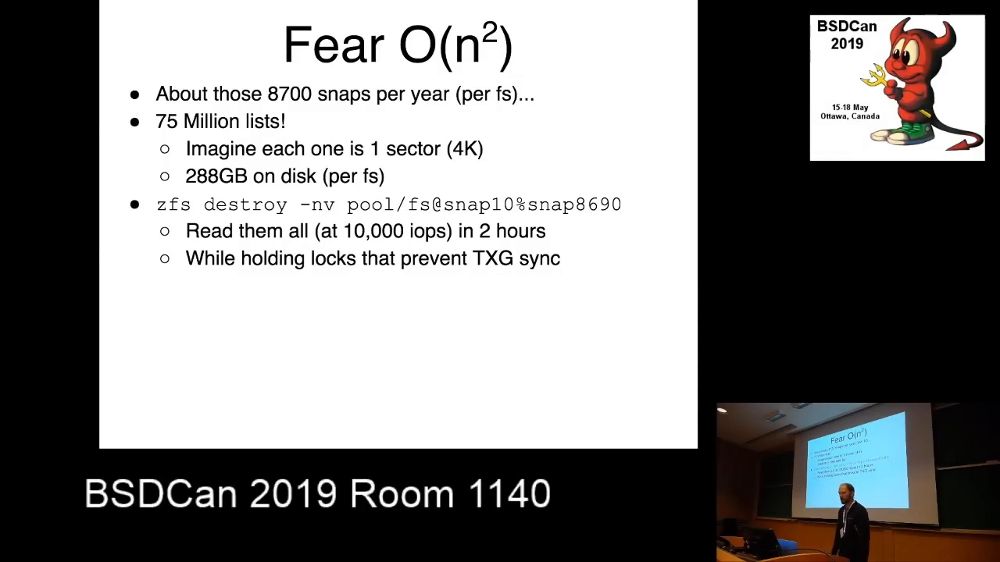

- 每个子列表按一个扇区（4K）算，单个文件系统就要多占 **288GB** 元数据；
- 要回答"删掉 `snap10` 到 `snap8690` 能省多少空间"，得把它们全读一遍：即使磁盘能跑 1 万 IOPS，也要 **两小时**；
- 更糟的是这期间持有全局锁，事务无法提交，几秒之后就没法再往数据库里写东西了。

[【跳转到 36:54】](https://www.youtube.com/watch?v=NXg86uBDSqI&t=2214)

关键观察是：几乎不可能所有子列表都非空。子列表是按出生时间切分的，某个时间区间里删掉的数据，不太可能均匀散布在上千个不同区间里。于是 ZFS 做了三次优化：

1. **2012 年的 `empty_bpobj`**（用一个 feature flag 控制）：不再把空的子列表写到磁盘上。这样既能在**一分钟左右**回答"这 8000 张快照用了多少空间"，又不会浪费那 288GB。
2. **部分加载 deadlist**：算法仍是 $O(n^2)$，但一旦发现某个子列表为空就提前短路跳过，性能提升 5 倍、后来到 12 倍。
3. **缓存部分加载的 deadlist**：把真正有内容的子列表留在内存里，收益 **70 倍**，耗时不到一秒（第一次问仍要付 12 秒的代价）。

[【跳转到 38:59】](https://www.youtube.com/watch?v=NXg86uBDSqI&t=2339) [【跳转到 41:29】](https://www.youtube.com/watch?v=NXg86uBDSqI&t=2489)

这段工程史给我们的结论是：**快照的"创建"永远是 O(1)，但"快照很多"这件事会在删除、空间统计这些路径上收取代价**。选型时该问的不是"能不能拍快照"，而是"这套实现能不能在快照很多时仍然高效地回答删掉它能省多少"。

## 五、"快照占多少空间"是个陷阱

### 5.1 三个数字互相打架

先看一个真实例子：

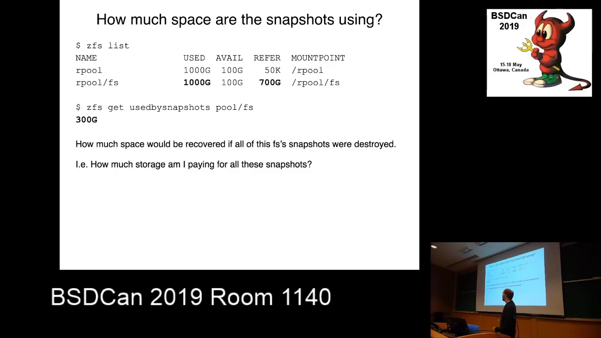

`zfs list` 里文件系统的 `USED` 是 1000G、`REFER` 是 700G，而 `usedbysnapshots` 是 300G——它的含义是"把这个文件系统的所有快照都删掉，能回收多少空间"，也就是"我为这些快照付了多少钱"。 [【跳转到 18:09】](https://www.youtube.com/watch?v=NXg86uBDSqI&t=1089)

但如果你逐个去看每张快照的 `USED`，加起来只有 **7GB**，不是 300GB。剩下那 293GB 去哪了？

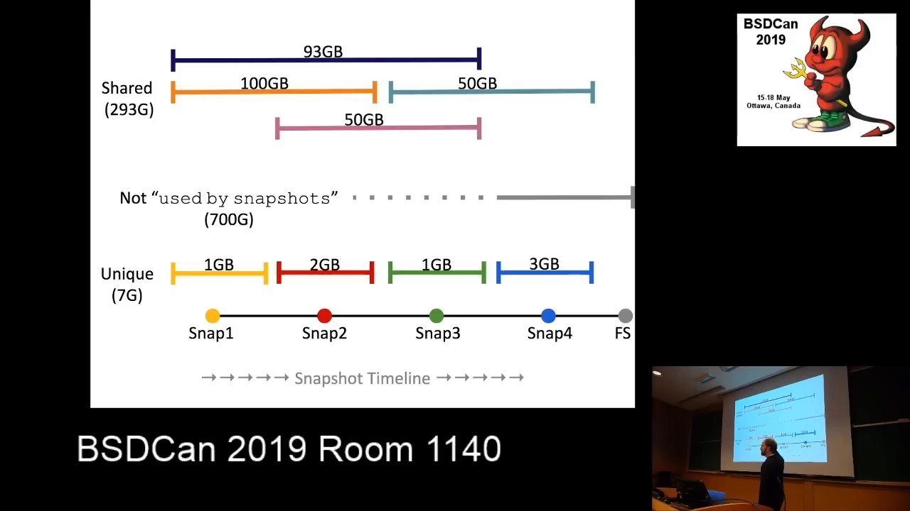

答案是：快照的 `USED` 只算"它独有的"那部分。而快照天生共享——同一块空间可能被 2、3、4、5、6、7 张快照同时引用，这些共享的部分不会记到任何一张快照头上。极端例子是每小时连拍两张：两张内容几乎一样，每张的 `USED` 都接近 0，但删掉其中一张几乎回收不到空间，两张一起删才能回收一大块。 [【跳转到 21:04】](https://www.youtube.com/watch?v=NXg86uBDSqI&t=1264)

演讲者的原话很直接：把这条信息显示得这么醒目，大概是个错误，因为它太容易误导人了。

### 5.2 换一个视角：看 written，而不是 used

既然"独有空间"这个模型帮不了你决策，就换一个模型：不看快照占了多少，而看**数据是以什么速率写进文件系统的**。这就是 `written` 属性——自上一个快照以来写入了多少空间。

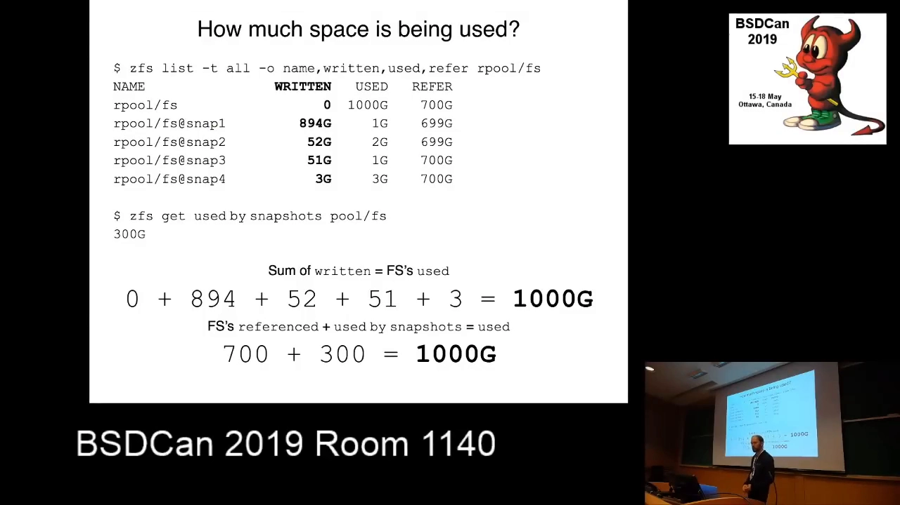

这个模型自洽得多：

$$
0 + 894 + 52 + 51 + 3 = 1000\text{G} = \text{文件系统的 used}
$$

$$
700\text{G（referenced）} + 300\text{G（usedbysnapshots）} = 1000\text{G}
$$

两个等式都对，但它们**不是同一个量**，不能相加也不能互相替代：前者是"这条时间线上写过的总量"，后者是"当前可访问的数据 + 快照独占的数据"。 [【跳转到 23:09】](https://www.youtube.com/watch?v=NXg86uBDSqI&t=1389)

`written` 还能回答更有用的问题：你可以在属性后面挂一个过去的快照名，问"从那个快照到现在写了多少"。

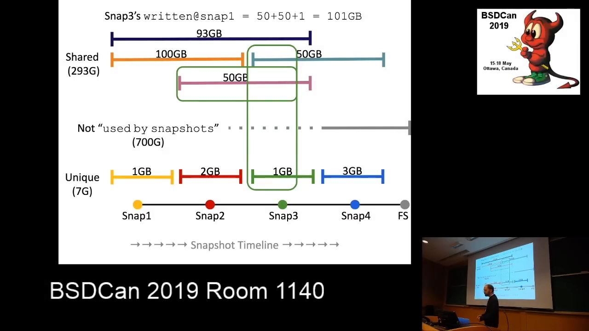

图上快照 3 相对快照 1 的写入量是 50 + 50 + 1 = 101GB——注意它只统计"出生时间在快照 1 之后"的块，中间那段在快照 3 之前就死掉的块不算在内。这套机制同时被 `zfs send` 用来估算增量要传多少数据。 [【跳转到 28:09】](https://www.youtube.com/watch?v=NXg86uBDSqI&t=1689)

### 5.3 估算"删掉一段快照能省多少"

`usedbysnapshots` 只回答"全删"。要回答"删掉中间一段呢"，思路是把这段快照引用的空间按"被其中几个快照共享"拆开，再分别累加：

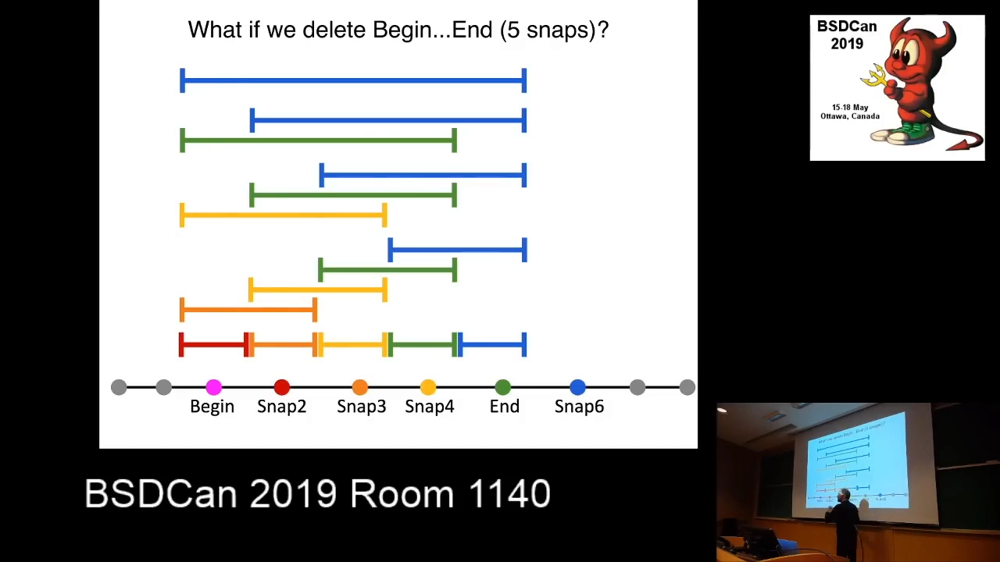

实现上，这等价于找出这些快照的 deadlist 子列表、把非空的那些加起来。子列表个数约正比于 $n^2$（$n$ 是这一段里的快照数），所以段越长越慢；不连续的几段则分别计算再相加，因为块的生命周期是连续的、不会复活。 [【跳转到 33:59】](https://www.youtube.com/watch?v=NXg86uBDSqI&t=2039)

### 5.4 演讲者给的四条实践建议

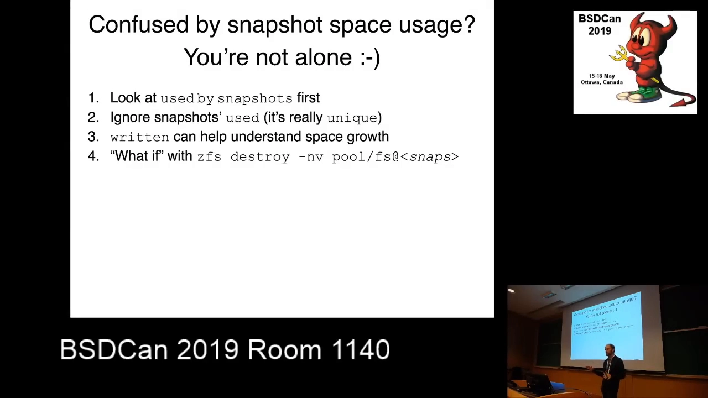

1. 先看 `usedbysnapshots`——所有快照合起来到底花了你多少空间；
2. 忽略单张快照的 `USED`——它其实是"独有"空间，几乎总是误导；
3. 用 `written` 理解空间是怎么随时间长起来的；
4. 用 `zfs destroy -nv` 做"如果删掉会怎样"的实验。

[【跳转到 43:09】](https://www.youtube.com/watch?v=NXg86uBDSqI&t=2589)

## 六、工程结论：快照什么时候值得用

把上面三笔账合起来看，快照的取舍就很清楚了：

- **创建免费**，所以"多拍一张"本身不心疼，适合做高频策略（每小时一张）。
- **写入付费**：每次修改都要分配新块、写新的间接块，写放大是持续成本。
- **删除付费**：删除成本取决于"要释放多少块 + 有多少子列表"，保留策略越激进，删除越慢；实现不好时，删快照甚至会拖住前台写入。
- **元数据付费**：快照数量以子列表的形式占盘，$O(n^2)$ 的账单出现在删除与空间统计路径上。
- **有依赖的快照删不掉**：演讲中提到，有些快照后来想删却删不掉，因为你在里面创建了克隆（clone），快照就不能被删除。 [【跳转到 31:29】](https://www.youtube.com/watch?v=NXg86uBDSqI&t=1889)

一句话总结选型标准：**快照适合"创建频繁、读取偶尔、删除可控"的场景**；如果业务需要长期保留海量快照，先确认这套实现能不能高效回答"删掉这些能省多少、要多久"，否则你会在某个深夜发现删除任务把存储锁住了两个小时。

## 小结

- 快照不复制数据，只**保留旧的根块**；新文件系统与快照形成两棵共享块的树，所以创建是 O(1)，与数据量无关。
- 代价被推迟到**第一次写**：写时复制必须分配新块；同时块指针里的**出生时间**决定旧块能不能释放，快照越多，能回收的块越少。
- 删除快照要找出"只被它引用"的块。因为块的生命周期连续（没有"来世"），只需看前后两个快照。
- 三代算法：乌龟（随机读，0.8MB/s）→ deadlist（紧凑，快约 2000 倍）→ cheetah（按出生时间切子列表，复杂度只与子列表数和要释放的块数相关，1500MB/s）。
- 快照数量会以元数据收费：8700 张快照 = 7500 万个子列表 = 288GB，读完要两小时；靠空子列表不落盘、部分加载、缓存，把回答时间压到一秒级。
- 单张快照的 `USED` 是"独有"空间，几乎总是误导；`usedbysnapshots` 才是"删掉全部能回收多少"，`written` 才能解释空间怎么长起来的。
- 实践四招：看 `usedbysnapshots`、忽略快照 `USED`、用 `written` 看增长、用 `zfs destroy -nv` 做实验。

## 关键术语速查

| 术语 | 一句话解释 |
| --- | --- |
| 写时复制（CoW） | 不原地覆盖旧数据，总是写到新位置，再用指针切换，因此旧版本天然可保留 |
| uberblock | ZFS 的根块，指向整棵块树的根；覆盖它是整个事务的原子提交点 |
| 块指针（BP） | 指向数据块或间接块的元数据，里面记着该块的出生时间 |
| 出生时间（birth time） | 块被分配并写入的时间，用来判断某张快照是否可能引用它 |
| 独有块 | 只被某一个快照引用、不被其他快照或文件系统引用的块；删除该快照时才能释放 |
| deadlist | 每个 dataset 维护的"已死亡块"列表：被前一个快照引用、但当前不再引用的块 |
| 子列表（sublist） | 按出生时间把 deadlist 切成的片段，一个片段对应一个更早的快照 |
| usedbysnapshots | 删掉该文件系统全部快照能回收的空间，即"为快照付了多少钱" |
| written | 自上一个快照（或指定的某个过去快照）以来写入的空间量 |
| referenced | 从该文件系统的文件出发能访问到的真实数据量 |
