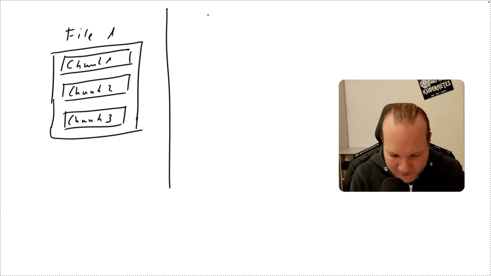
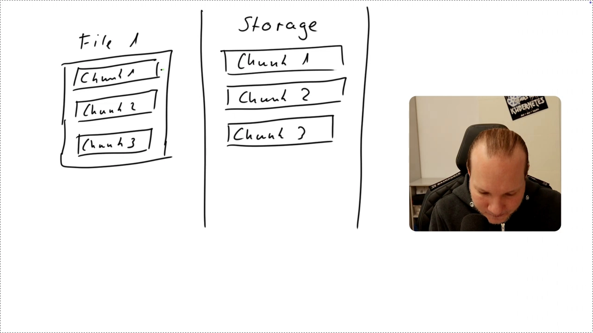
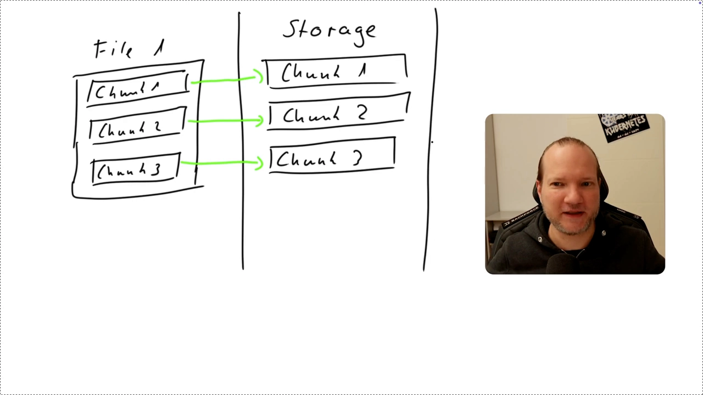
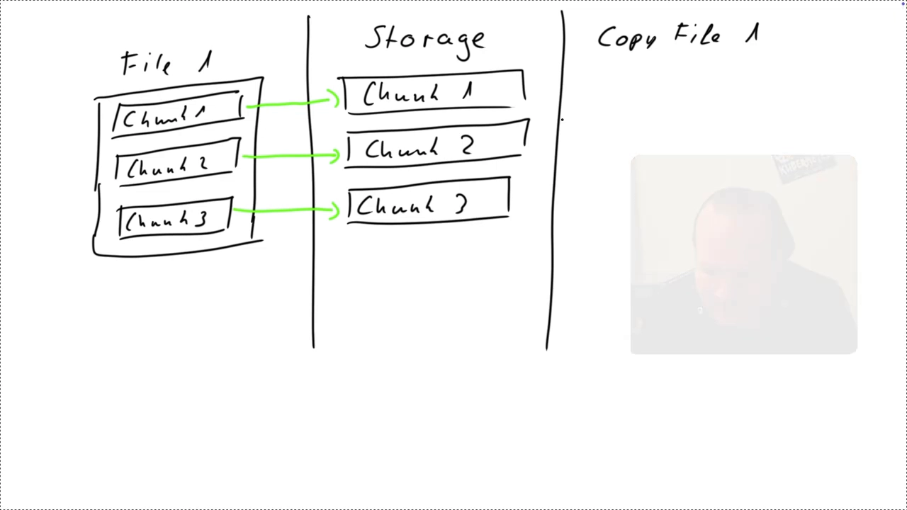
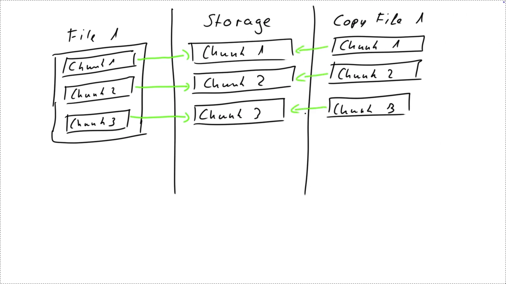
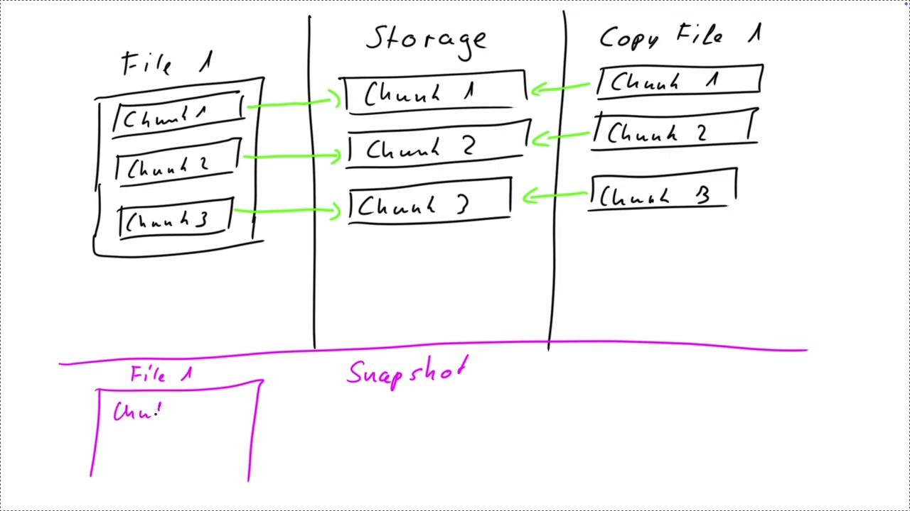
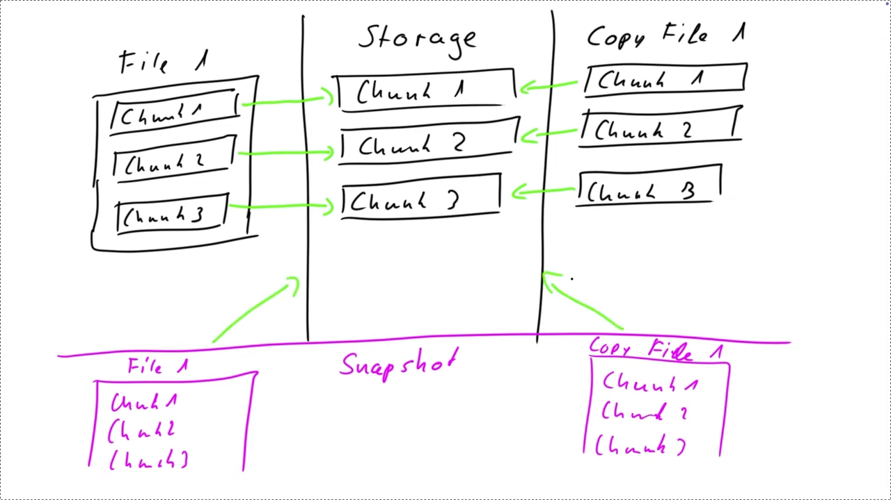
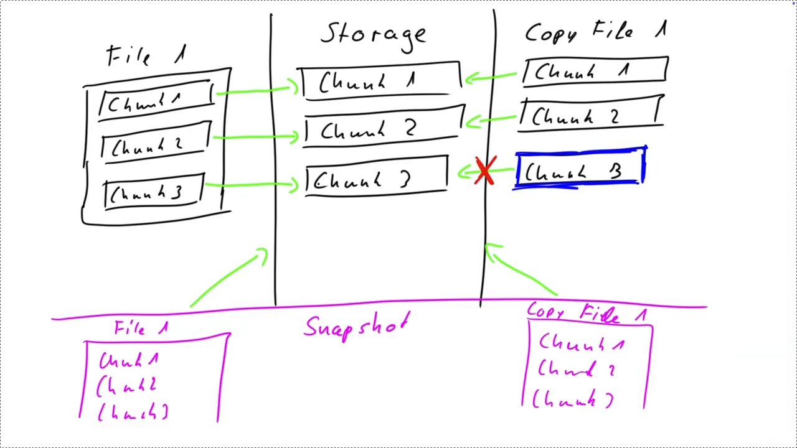
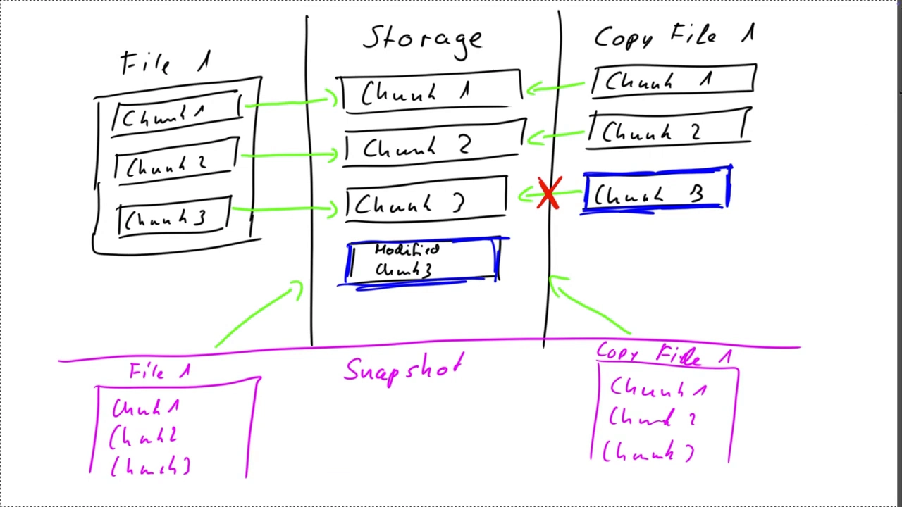

# 写时复制为什么能把拷贝变成瞬间操作：它复制的是引用表，不是数据

> 视频来源：[What is Copy-On-Write (CoW)?](https://www.youtube.com/watch?v=wMy1r8RVTz8)（YouTube · simplyblock）｜时长约 6 分钟
> 本文用这支短视频的"目录表"类比，讲清 extent 级 CoW 的成本为什么与文件大小无关；文件级 copy-up 那一半（成本随文件大小线性增长）见同小节的另一篇《容器里跑数据库为何越跑越慢》。视频本身没有使用大 O 记号，本文用 $O(\cdot)$ 只是为了把它的演示形式化。

## 本讲要解决的核心问题（SCQA）

**背景**：在普通文件系统上复制一个文件，要等。文件越大等得越久，这是所有人都有过的经验。

**冲突**：但在支持写时复制与 reflink 的文件系统上，复制一个几 GB 的文件、给整个目录做一次快照，几乎都是"瞬间"完成的，磁盘占用也几乎不增加。同一台机器、同一块盘，为什么差距这么大？

**疑问**：拷贝的代价到底花在哪里？为什么有的拷贝必须按文件大小付费，有的却只改几个数字？

**回答（中心思想）**：因为文件本身只是一张指向数据块的"目录表"。普通拷贝复制的是数据，成本是 $O(S)$；写时复制只复制这张目录表，成本是 $O(1)$ 量级的元数据操作。真正的数据复制没有消失，它被推迟到了第一次修改，而且那时也只复制被改动的那一块。

## 一、文件不是数据，而是一张指向数据块的目录表

视频先建立了一个必须记住的心智模型：**文件内部是由"块"（chunk）组成的**。[【跳转到 00:43】](https://www.youtube.com/watch?v=wMy1r8RVTz8&t=43) 最坏情况下，一个块就是存储设备的一个块大小；你可以简单理解成"写三个字母 ABC，就占三个不同的块"。

关键在于，文件里存的并不是这些块的内容，而是**指向这些块的引用**。视频把这张引用表比作一本书的**目录**：

- 目录（引用表）里只有章节标题和页码；
- 真正的内容（数据块）在正文里，也就是在存储层上另存一份。

真实的存储层上，这些块是另外存放的。[【跳转到 01:34】](https://www.youtube.com/watch?v=wMy1r8RVTz8&t=94) 这个"目录 + 正文"的分离，是后面所有性能差异的根源。因为一旦你接受"文件 = 一张表"，那么"复制文件"就有两种截然不同的做法：复制正文，或者只复制表。

## 二、普通拷贝是 $O(S)$：成本随文件大小线性增长

普通文件系统的复制，是**把整本书的每一页都复印一遍**。视频的原话是：复制一本书时，你要对书里的每一页做一次完整的复印，页数翻倍——这正是普通文件系统复制文件时发生的事。你在 Windows 上复制一个文件，底层数据也被完整复制了一份。

所以每个人都有的经验是对的：复制一个大视频文件要花时间，因为底层数据必须被搬一遍。[【跳转到 01:59】](https://www.youtube.com/watch?v=wMy1r8RVTz8&t=119)

写成式子就是：

$$
T_{\text{copy}} \approx \frac{S}{B}
$$

其中 $S$ 是文件大小，$B$ 是这条拷贝路径的有效带宽。文件大一倍，时间就大一倍——这就是 $O(S)$。视频举的例子是 4K 视频这类"好几个 GB"的文件，复制它带来的存储变化是"相当可观"的。

## 三、写时复制把拷贝降到 $O(1)$：只复制目录表

写时复制文件系统的做法完全不同。[【跳转到 02:24】](https://www.youtube.com/watch?v=wMy1r8RVTz8&t=144) 视频的演示是：创建一个 "Copy File 1"，它做的事情是**复制那张目录表**——新增一个视图、新增一组指向同一批数据的引用。[【跳转到 02:37】](https://www.youtube.com/watch?v=wMy1r8RVTz8&t=157)

结果是：**一个字节的数据都没有被复制**，但你现在有了两个看起来完全独立的文件。视频在这里给了一个很直观的收益数字：这样做等于省下了 50% 的存储[【跳转到 02:59】](https://www.youtube.com/watch?v=wMy1r8RVTz8&t=179)——因为原本要存两份的数据，现在只存了一份。

成本呢？视频的说法是：**创建这张目录表"基本上是瞬间的"（basically instantaneous）**。它只与"表里有多少个条目"有关，与"这些条目指向的数据有多大"无关。这正是 $O(1)$ 的含义：拷一个 1 KB 的文件和拷一个 4 GB 的文件，花在复制引用上的功夫是同一个量级。

## 四、快照是"某一时刻的引用集合"，所以也是 $O(1)$

理解了"复制目录表"，快照就顺理成章了：**快照就是在某个时间点，把当时的引用集合固定下来**。

视频的演示里，快照里记录了 File 1 的 Chunk 1、Chunk 2、Chunk 3，同时也记录了 Copy File 1 的那一份——它们都指回存储层上同一批数据。[【跳转到 03:28】](https://www.youtube.com/watch?v=wMy1r8RVTz8&t=208)

这带来三个直接后果，视频逐条点明了：

1. **不影响存储容量**：快照只是引用，不复制数据；
2. **不影响存储性能**：没有大量数据搬运；
3. **快照是一致的，而且不需要"停顿"**：它是一个立即完成的操作，不需要为了拍快照而让系统停下来（"we don't have to stop the world for anything"）。

这就是为什么"给 1 TB 的卷打快照"可以是毫秒级动作，而"把 1 TB 的卷复制一份"不可能。[【跳转到 05:07】](https://www.youtube.com/watch?v=wMy1r8RVTz8&t=307)

## 五、代价被推迟，而不是消失：第一次写只复制一个块

CoW 不是魔法，它只是把账记到了后面。视频的最后一段演示了这个"记账"过程：

现在你想把 Copy File 1 里的 Chunk 3 改成蓝色。[【跳转到 04:22】](https://www.youtube.com/watch?v=wMy1r8RVTz8&t=262)问题是，Chunk 3 这块数据**同时被 File 1、Copy File 1 和快照引用着**。如果直接原地改，另外两个引用者看到的数据也会跟着变——共享就变成了串扰。

于是文件系统做了一件事：**为这次修改单独复制一个块**，视频里把它命名为 "Modified Chunk 3"，然后让 Copy File 1 的第三个条目改指向这个新块。[【跳转到 04:48】](https://www.youtube.com/watch?v=wMy1r8RVTz8&t=288)

请注意这里的粒度：**复制的是"一个块"，不是"整个文件"**。这就是 extent 级 CoW 与文件级 copy-up 最本质的区别——同样是"第一次写"，一个只付一个块的钱，一个要付整个文件的钱。

## 六、把两种模型放在一起看

把视频演示的两条路径写成一张对照表，差距的来源就一目了然了：

| 操作 | 文件级 copy-up（如 OverlayFS） | extent 级 CoW（reflink） | 差距来源 |
| :--- | :--- | :--- | :--- |
| 复制一个文件 | 复制全部数据，$O(S)$ | 复制引用表，$O(1)$ 元数据 | 是否搬运数据 |
| 打一个快照 | 需要额外复制或冻结数据（视实现） | 记录当时的引用集合，$O(1)$ | 快照是"引用"还是"副本" |
| 第一次修改文件里的 1 个块 | 整个文件先被复制一遍 | 只复制被改的那一个块 | 复制的粒度 |
| 存储占用 | 每份副本都占满额空间 | 未修改的部分共享，只多出被改的块 | 共享还是独占 |

把四个常见场景按这套模型推一遍（下面是按机制推算的搬运量，不是实测基准）：

| 场景 | 文件级 copy-up 要搬的数据 | reflink 要改的元数据 | 推算依据 |
| :--- | :--- | :--- | :--- |
| 10 GB 的镜像文件，首次改 1 个字节 | 10 GB | 1 个块的引用 | 复制单位是文件还是块 |
| 1 万个 1 MB 的文件，逐个首次写 | 约 10 GB | 每个文件只分裂被写的块 | 成本随文件大小而非改动量增长 |
| cp -r 一个项目目录 | 目录里全部文件的数据量 | 每个文件一份引用表 | 拷贝是复制正文还是复制目录 |
| 容器启动时写镜像层里的文件 | 被写文件的大小之和 | 被写块的引用 | 与容器启动要改多少数据无关，只与碰到的文件多大有关 |

视频没有给出基准测试数字，但它给出的机制足以解释数量级差异。同小节另一支视频里有一个可以对照的实测：在 OverlayFS 上修改 16 MB 文件里的 4 KB，内核要先复制整个 16 MB，放大倍数是 4000 倍。而在本文这套模型下，同样的修改只需要复制一个块——按 4 KB 的块算，就是 4 KB 对 16 MB。

## 七、"$O(1)$"不等于免费：三条边界

视频在结尾处其实点出了这套模型的边界，值得单独拎出来：

**第一，$O(1)$ 的是"元数据条数"，不是"零成本"。** 引用表本身也要占空间、也要写盘。文件被切成多少个块，表就有多少个条目；块越小、文件越大，表越长。

**第二，写时复制把成本从"拷贝时"挪到了"修改时"。** 如果你的负载是"创建副本之后再也不改"，CoW 几乎白赚；如果负载是"复制完立刻整文件重写一遍"，那么该付的数据搬运一分都不会少，只是账单换了个时间到。

**第三，共享的前提是"有人还在引用"。** 视频强调 Chunk 3 之所以不能被原地改，是因为它同时被多个文件引用。反过来说，一旦某个块不再被其他人引用，就不再需要为它分裂——"谁还在指向这块数据"才是这套机制真正的簿记工作。

## 小结

- 文件 = 一张指向数据块的引用表；数据块在存储层上另存。
- 普通拷贝复制数据，成本 $O(S)$，因为要"复印整本书"。
- 写时复制只复制引用表，成本 $O(1)$ 量级，所以拷贝和快照都是瞬间完成的。
- 数据复制没有消失，它被推迟到第一次修改，而且只复制被改的那一个块。
- 快照 = 某个时间点的引用集合，因此不影响容量、不影响性能，也不需要停业务。
- 判断收益的方法：看你的负载是"复制后只读"还是"复制后立刻整文件重写"。

## 关键术语速查

| 术语 | 一句话解释 |
| :--- | :--- |
| 块（chunk / block） | 文件数据被切分后的最小存储单位，通常等于存储设备的块大小 |
| 引用（reference） | 目录表里的一个条目，指向存储层上的某个数据块 |
| 写时复制（CoW） | 共享数据、只在要修改时才复制被改部分的策略 |
| reflink | 让两个文件共享同一批数据块的文件系统特性，拷贝只改元数据 |
| 快照（snapshot） | 某一时刻全部引用的集合，本身不复制数据 |
| 分裂（split） | 修改共享块时，为该块单独复制一份，使引用者各自独立 |
| $O(S)$ | 成本随文件大小 $S$ 线性增长；$O(1)$ 则表示成本与文件大小无关 |