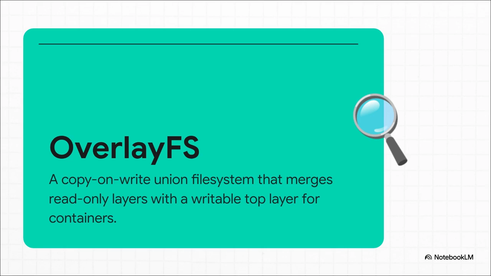
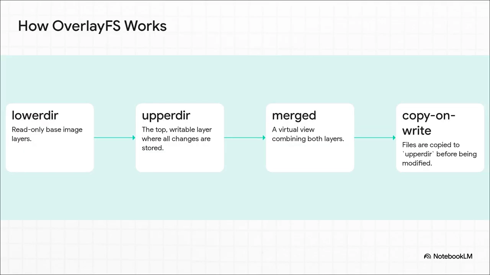
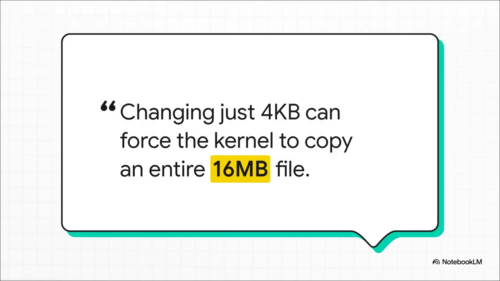
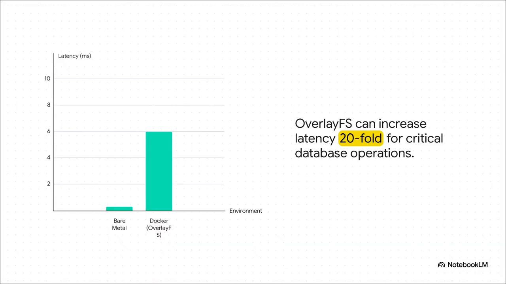
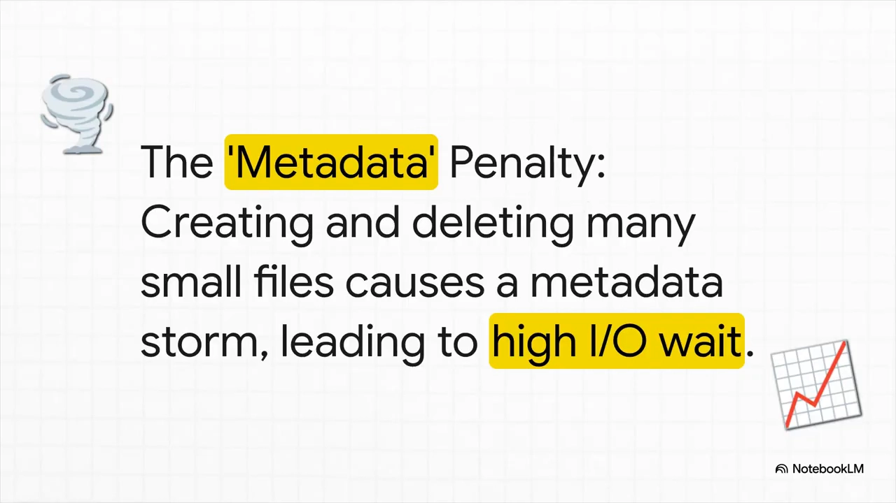
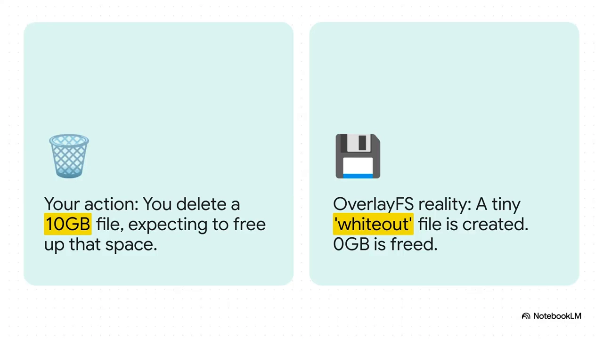
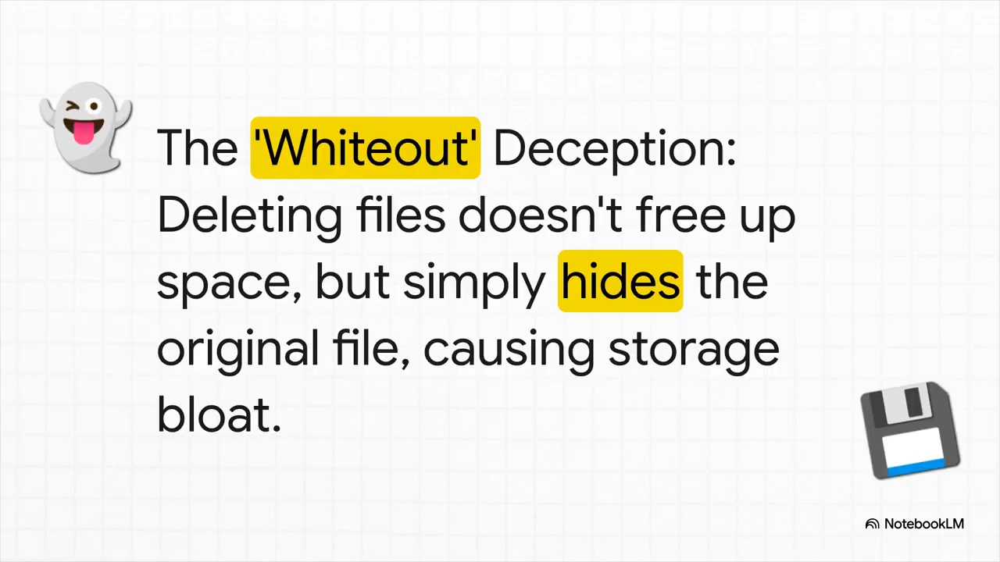
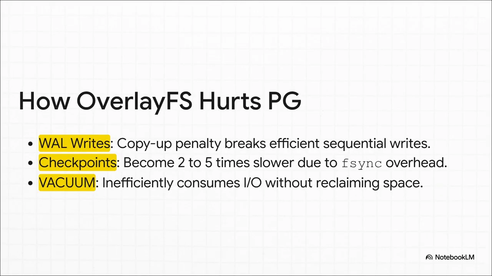
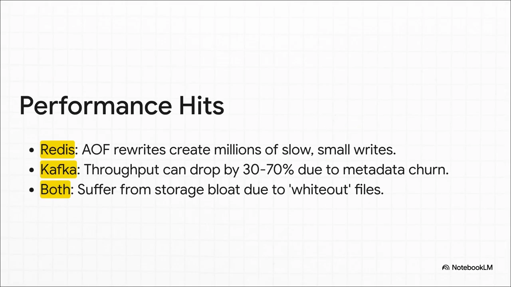
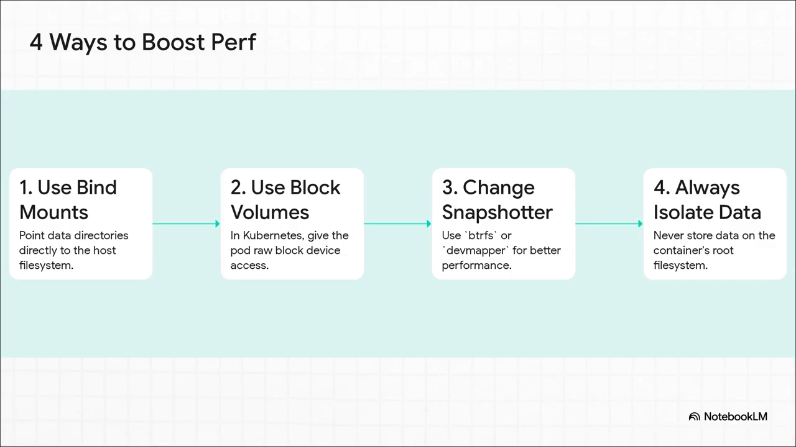

# 容器里跑数据库为什么越跑越慢：改 4 KB 要先复制 16 MB

> 视频来源：[Docker DBs The Hidden Cost](https://www.youtube.com/watch?v=aDieJcruNRk)（YouTube · Bug & Coffee）｜时长约 8.5 分钟
> 本文从这支视频的三个"症状"出发，拆解文件级 copy-up 的成本结构：放大倍数、延迟倍数、元数据风暴与 whiteout。extent 级 reflink 那一半（成本为什么与文件大小无关）见同小节的另一篇《写时复制为何能把拷贝变成瞬间完成》。

## 本讲要解决的核心问题（SCQA）

**背景**：把数据库放进容器里跑，是很多人默认的做法。头几天一切正常，快、顺手。

**冲突**：然后它开始变慢。监控上 I/O 压力莫名很高，更奇怪的是——你删掉了一大堆数据，磁盘占用却还在涨。视频把这三个症状列成了一张"罪案现场清单"。[【跳转到 00:46】](https://www.youtube.com/watch?v=aDieJcruNRk&t=46)

**疑问**：数据库没改配置，SSD 也没坏，慢是从哪来的？

**回答（中心思想）**：慢不在数据库，在文件系统。OverlayFS 的写时复制是**文件级**的：只要你要改的文件在只读的下层里，内核就必须先把**整个文件**复制到可写上层，然后才允许你改那一个字节。于是"改 4 KB"变成"复制 16 MB"，成本从 $O(\Delta)$ 变成了 $O(S)$。

## 一、先把 OverlayFS 的写路径摆出来

OverlayFS 是 Docker 的默认存储驱动。[【跳转到 01:20】](https://www.youtube.com/watch?v=aDieJcruNRk&t=80)它的结构可以用四个词概括[【跳转到 01:36】](https://www.youtube.com/watch?v=aDieJcruNRk&t=96)，视频给了一张很清楚的流程图：

- **lowerdir**：镜像的只读层，永远不变；
- **upperdir**：容器所有修改都写到这里；
- **merged**：两者合并后呈现给容器的统一视图；
- **copy-on-write**：文件在被修改之前，要先被复制到 upperdir。

问题就出在最后一步。[【跳转到 01:57】](https://www.youtube.com/watch?v=aDieJcruNRk&t=117)视频的说法是：**在数据库能改动基础镜像里某个文件的哪怕一个字节之前，OverlayFS 必须先做一次 copy-on-write——把整个文件复制到顶层可写层。** 一个微小的改动，触发了一次巨大的、缓慢的复制。

这里要强调"文件级"三个字：复制的单位是**文件**，不是文件里被改的那一段。这就是 OverlayFS 与 reflink 类文件系统在性能模型上的分水岭。

## 二、代价一：copy-up 放大，4 KB 变成 16 MB

视频给的第一个例子非常具体：PostgreSQL 为了数据完整性，会不停地在预写日志（WAL）上做很小的更新。[【跳转到 02:36】](https://www.youtube.com/watch?v=aDieJcruNRk&t=156)**为了改其中 4 KB，OverlayFS 让内核先把整个 16 MB 的文件复制一遍。** 视频把这称为"4000 倍的放大"。[【跳转到 02:50】](https://www.youtube.com/watch?v=aDieJcruNRk&t=170)

放大倍数可以写成一个很朴素的比值：

$$
\mathrm{Amplification} = \frac{S_{\mathrm{file}}}{S_{\mathrm{write}}}
$$

其中 $S_{\text{file}}$ 是被复制的文件大小，$S_{\text{write}}$ 是实际改动的大小。

按视频的数字代入，就是 $16\,\text{MB} / 4\,\text{KB} = 4000$。这个比值不是固定的，它随文件变大而变大——这正是 $O(S)$ 的直观含义：**你改的是一小块，付的却是整个文件的搬运费。**

放大不只体现在字节数上，还体现在延迟上。[【跳转到 03:14】](https://www.youtube.com/watch?v=aDieJcruNRk&t=194)视频给了一张 fsync 的对比图：fsync 是数据库在说"操作系统，请确保这份数据真的落盘了"，是每次事务提交都要走的路径。

- 裸金属、普通文件系统：**0.3 毫秒**，基本是瞬间；
- 同一套硬件，放进 Docker + OverlayFS：**6 毫秒**。

这是 **20 倍**的延迟增长。视频的结论很直接：你提交的每一个事务都慢了 20 倍，原因纯粹在文件系统这一层。

## 三、代价二：小文件多的时候，是元数据风暴

如果负载不是"改大文件"，而是"不停创建小文件"呢？[【跳转到 03:45】](https://www.youtube.com/watch?v=aDieJcruNRk&t=225)视频说这属于另一类工具，但结局一样：那个说不清来源的高 I/O 压力。

典型例子是 Redis 重写 append-only 文件，或者 Kafka 不停滚动出新的小日志段。在普通文件系统上这不算什么；但在 OverlayFS 上，**每一次文件创建都会在后台带出大量额外的元数据工作**，把磁盘吞吐占满。

注意这里的成本结构又变了：不是"复制多少数据"，而是"每个文件要额外做多少簿记"。文件数越多，这笔开销越大——它也是 $O(N)$，而不是 $O(\Delta)$。

## 四、代价三：whiteout 让删除不释放空间

第三个症状最反直觉：**你删了数据，磁盘占用还在涨。**[【跳转到 04:25】](https://www.youtube.com/watch?v=aDieJcruNRk&t=265)

视频的解释是：OverlayFS 不能真的去删只读层里的文件。它能做的，是在上层放一个很小的标记文件——whiteout，告诉容器"假装这个大文件不存在"。原来的数据仍然躺在下层，继续占着盘。

视频举的数字是删掉一个 10 GB 的日志文件，期望回收 10 GB，实际回收 **0 GB**。[【跳转到 04:36】](https://www.youtube.com/watch?v=aDieJcruNRk&t=276)这解释了那种"容器慢慢变胖、永远不会瘦"的观感。

## 五、落到真实数据库上：三个放大镜

视频把上面的机制套到三类常见负载上，给出了可感知的损失：

**PostgreSQL**：它的性能建立在"对 WAL 做极快的顺序写"上，copy-up 恰好摧毁了这个模型。[【跳转到 05:21】](https://www.youtube.com/watch?v=aDieJcruNRk&t=321)

- WAL 写：copy-up 惩罚破坏了高效的顺序写；
- checkpoint：因为 fsync 开销，慢了 **2 到 5 倍**；
- VACUUM：大量消耗 I/O，却因为 whiteout 无法真正在宿主机上回收空间。

**Redis 与 Kafka**：[【跳转到 06:02】](https://www.youtube.com/watch?v=aDieJcruNRk&t=362)

- Redis 的 AOF 重写变成"千刀万剐"：每一次小写入都要付元数据开销；
- Kafka 受影响最重：它依赖操作系统的页缓存和高效的文件创建，而 OverlayFS 把这些都破坏了，吞吐相对直接跑在宿主机上会掉 **30% 到 70%**；
- 两者都因为 whiteout 而出现存储膨胀。

## 六、OverlayFS 并非一无是处：它适合什么

视频在开头就说得很公道：OverlayFS 对**它被设计出来的场景**——无状态应用——非常出色。把它放回性能模型里看，它的适用面就很清楚了：

| 负载特征 | 为什么 OverlayFS 合适或吃亏 |
| :--- | :--- |
| 只读为主，几乎不写 | 不触发 copy-up，成本接近零 |
| 写的是容器自己新建的文件 | 新文件直接落在 upperdir，没有下层文件要复制 |
| 小文件、一次性写入 | 每个文件只付一次复制，放大有限 |
| 大文件、反复原地改写 | 每次首次修改都按整个文件付费，放大最严重 |
| 频繁创建删除小文件 | 元数据簿记成为瓶颈 |
| 需要删除大量下层数据 | whiteout 让空间无法回收 |

一句话：**OverlayFS 的成本与"你碰到的下层文件有多大"成正比，与"你改了多少"无关。** 判断是否合适，看的是访问模式，不是数据总量。

## 七、四条出路：把重 I/O 数据移出 OverlayFS

视频给出的核心结论不是"别用容器"，而是"别把重 I/O 的持久数据放在容器的根文件系统上"。[【跳转到 06:40】](https://www.youtube.com/watch?v=aDieJcruNRk&t=400)具体有四条路：

1. **bind mount**：把 Postgres 的数据目录直接指到宿主机上的目录，绕过 OverlayFS，拿到原生性能。[【跳转到 07:12】](https://www.youtube.com/watch?v=aDieJcruNRk&t=432)这是最简单的修法。
2. **block volume**（Kubernetes）：给数据库 Pod 一块裸块设备的直接访问，是最快的形态。
3. **换 snapshotter**：containerd 这类运行时可以换成 btrfs、devmapper 等更适合写密集负载的存储驱动。这一步之所以有效，正是因为它们把复制粒度从"文件"降到了"块 / extent"。
4. **永远隔离数据**：不管选哪条，黄金法则都是——持久化的数据库文件永远不要放在容器根文件系统上，永远用卷或 bind mount。

## 八、回到性能模型：两种 CoW 的分界线

把本文的数字和机制收拢成一张表，两种 CoW 的差别就不再是"实现不同"，而是"复杂度不同"：

| 维度 | 文件级 copy-up（OverlayFS） | extent 级 reflink（如 btrfs） |
| :--- | :--- | :--- |
| 首次写的复制单位 | 整个文件 | 被写的那一个块 |
| 首次写成本 | $O(S)$ | $O(1)$ 个块 |
| 视频中的实测放大 | 改 4 KB 复制 16 MB，4000 倍 | 只复制被改块，无整文件放大 |
| 提交延迟 | fsync 0.3 毫秒 涨到 6 毫秒，20 倍 | 不产生整文件搬运 |
| 小文件密集创建 | 元数据风暴，$O(N)$ 额外开销 | 元数据操作更轻 |
| 删除下层数据 | whiteout 标记，空间不回收 | 引用计数归零后真正释放 |
| 稳态开销 | 每层查找、whiteout 累积 | 引用计数维护、写时分裂 |

所以"两种 CoW 差几个数量级"这句话，具体差在三个地方：**复制的粒度**（文件 vs 块）、**成本的变量**（文件大小 vs 改动量）、**删除的语义**（标记 vs 释放）。这也解释了为什么同一套数据库，在 OverlayFS 上 checkpoint 慢 2 到 5 倍、Kafka 吞吐掉 30% 到 70%，而换到块级 / extent 级 CoW 的存储上就能拿回大部分性能。

## 小结

- OverlayFS 的 copy-up 是**文件级**的：改一个字节，也要先复制整个文件。
- 放大倍数 = 文件大小 ÷ 改动大小。视频里的例子是 16 MB ÷ 4 KB = 4000 倍。
- 放大直接变成延迟：fsync 从 0.3 毫秒变成 6 毫秒，20 倍。
- 小文件密集创建会触发元数据风暴；删除下层文件只留下 whiteout，空间不回收。
- 受损最重的是写密集的数据库：PostgreSQL checkpoint 慢 2 到 5 倍，Kafka 吞吐掉 30% 到 70%。
- OverlayFS 适合无状态、只读为主、写自己新建文件的场景；不适合大文件反复改写。
- 出路是把重 I/O 数据移出 OverlayFS：bind mount、block volume、换 snapshotter、隔离数据。

## 关键术语速查

| 术语 | 一句话解释 |
| :--- | :--- |
| OverlayFS | Linux 的联合文件系统，把只读层与可写层合并成一个视图，Docker 默认用它 |
| lowerdir / upperdir | 只读的镜像层 / 容器所有修改落入的可写层 |
| copy-up | 修改下层文件前，先把整个文件复制到上层的动作 |
| 写放大 | 实际搬运的数据量远大于实际改动的数据量，本文中是 4000 倍 |
| whiteout | 上层的一个标记文件，用来"遮住"下层同名文件，不真正删除数据 |
| 元数据风暴 | 大量小文件创建/删除带来的额外元数据操作，表现为高 I/O 等待 |
| WAL | 预写日志，数据库为保证崩溃一致性而顺序写入的日志 |
| fsync | 要求操作系统把数据真正刷到磁盘的系统调用，是事务提交的关键路径 |
| bind mount | 把宿主机目录直接挂进容器，绕过 OverlayFS 的写路径 |
| block volume | 直接给 Pod 一块块设备，绕开文件系统层的复制开销 |