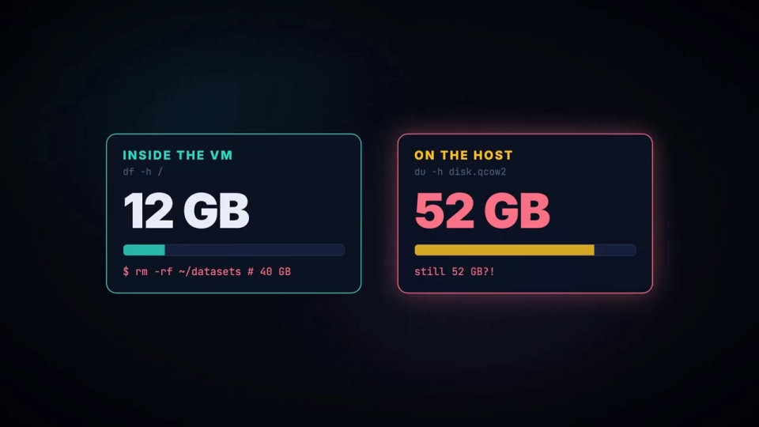
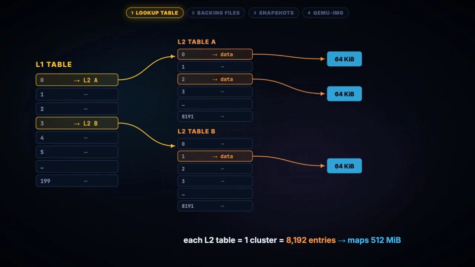
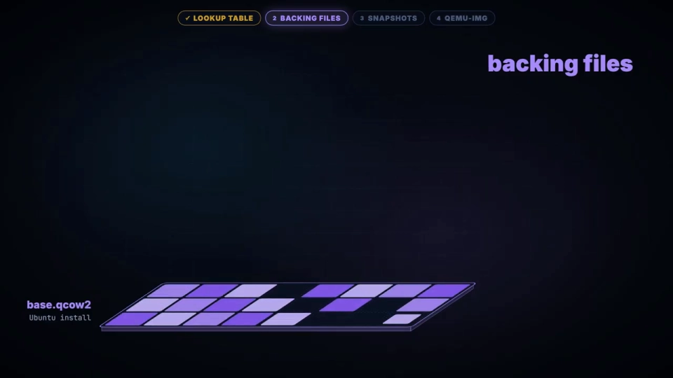
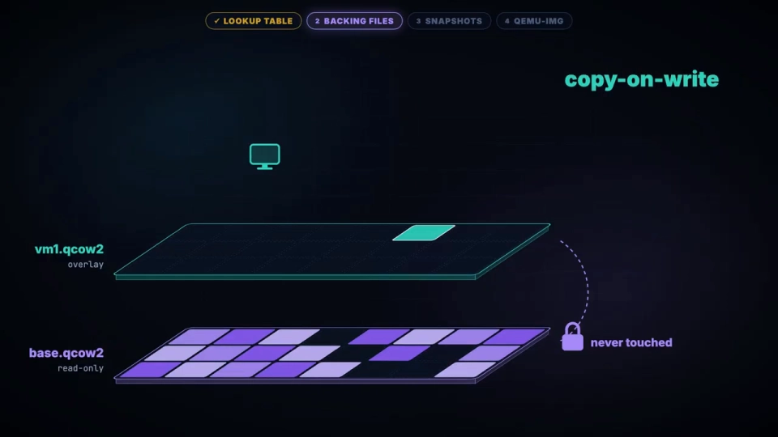
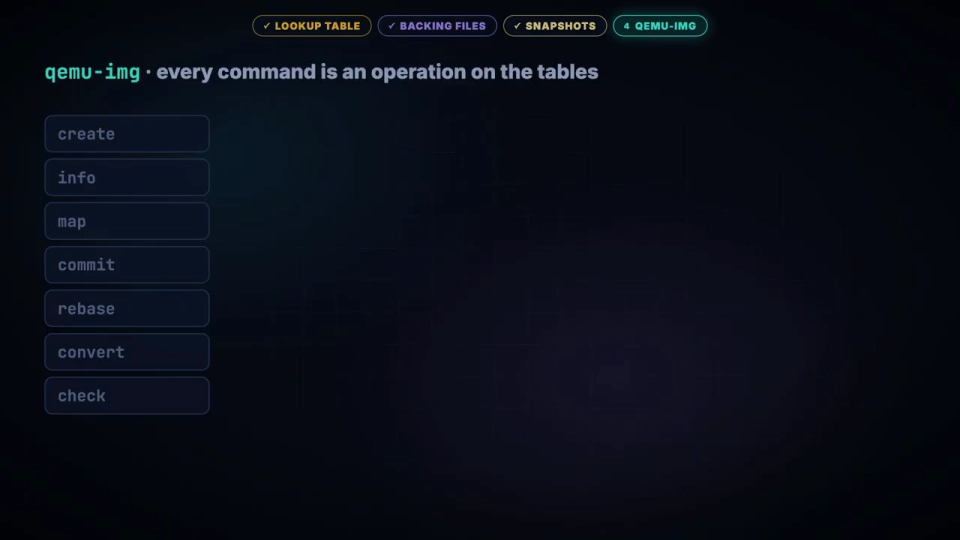
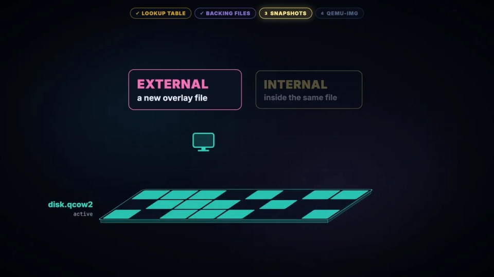
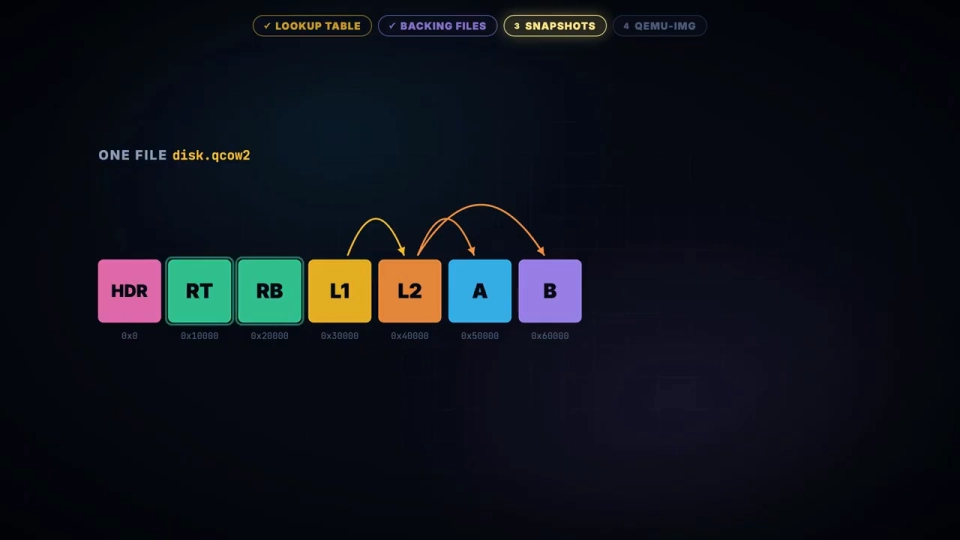
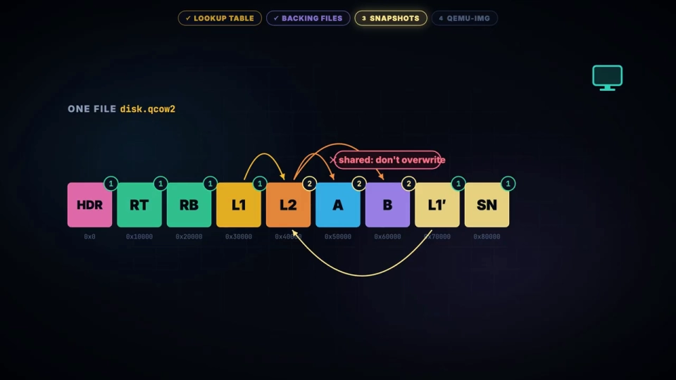
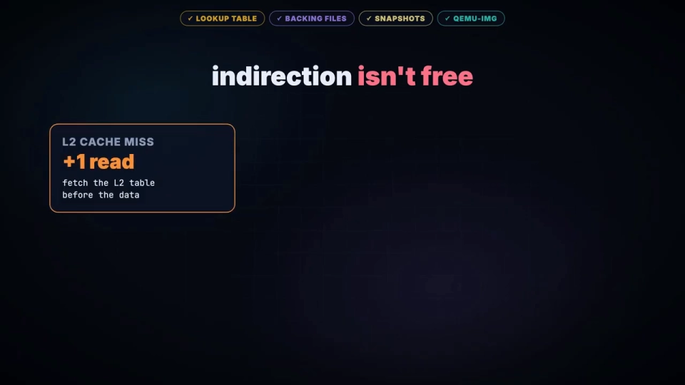

# qcow2 的两种快照：链式删中间节点要搬数据，扁平删谁都瞬间

> 视频来源：[How VM Disks Actually Work: qcow2, Snapshots & qemu-img](https://www.youtube.com/watch?v=141JYQFvDvs)（YouTube · XOR）｜时长约 8 分钟
> 本文顺着这支视频的"查找表"主线，把 qcow2 的外部快照（链式）与内部快照（扁平）拆开对照，重点放在**读一次要翻几层**和**删一个快照要搬多少数据**这两件事上。视频没有使用"链式/扁平"这两个词，也没有给出复杂度记号，本文用它们来归纳视频演示的两种结构。同小节的另一篇《删除中间快照为什么要搬数据》从 QEMU 的 block-stream / block-commit 两个原语出发，讲链式快照的维护操作。

## 本讲要解决的核心问题（SCQA）

**背景**：快照的用处是"回到过去"。在 qcow2 上，这件事看起来又快又便宜：视频开场给的数字是，一块一百 GB 的虚拟磁盘在宿主机上只占 196 KB，打一个快照一秒就能回滚。[【跳转到 00:00】](https://www.youtube.com/watch?v=141JYQFvDvs&t=0)

**冲突**：但同样是"快照"，qcow2 的两种做法在**删除**上表现完全不同。外部快照是一串文件，你想删掉中间那一层，就得把它的差异搬进相邻层，数据量可能几十 GB；内部快照全在一个文件里，删掉任意一个都只是把引用计数减一，瞬间完成。为什么同一个格式里，两种快照的删除代价能差出一个数量级？

**疑问**：快照到底存了什么？为什么有的快照必须"挂在别人身上"，有的却能独立存在？读一次数据要经过几层间接寻址？

**回答（中心思想）**：区别在于**快照是否拥有一棵完整的元数据树**。链式快照（qcow2 的 backing file 链、LVM 的 origin+snapshot、ZFS 的快照链）每个节点只记录"相对父节点的差异"，读一个块要沿链向上找到最近的版本，所以有**读放大**，删中间节点必须**合并**；扁平快照（qcow2 内部快照、btrfs 子卷快照、XFS reflink 克隆）每个快照都有一份完整的树根，读路径只有一层，删谁都不影响别人，代价是元数据更多。



## 一、先建立地基：qcow2 是一张两级的查找表

要理解快照，先要理解"虚拟磁盘不是数据，而是一张指向数据的表"。

对虚拟机来说，一块磁盘就是一长排编号的块。最简单的实现是 raw 镜像：磁盘的第 N 个字节就是文件的第 N 个字节。它又快又简单，但布局是固定的——**没有地方保存一个块的旧版本，也没办法让两块磁盘共享同一份数据**。[【跳转到 00:50】](https://www.youtube.com/watch?v=141JYQFvDvs&t=50)

qcow2 在这中间加了一层间接寻址：把虚拟磁盘切成 64 KB 一个的 **cluster**（簇，分配和映射的最小单位），再维护一张表，记录"每个 cluster 实际落在文件的哪个位置"。新建的镜像里这张表是空的，读操作直接返回零；guest 写入时，QEMU 在文件末尾追加一个新 cluster，把地址记进表里。所以数据是按写入顺序落盘的，不是按磁盘顺序。

一百 GB 的盘如果只用一张平表，需要一百六十万个条目、超过十二 MB，而这还没存一个字节的数据。所以 qcow2 像 CPU 的页表一样分两级：

- **L1 表**：很小，每个条目指向一张 L2 表；
- **L2 表**：本身是一个 cluster，含 8192 个条目，足以映射 512 MB 磁盘；
- 只有 guest 写过的地方，才存在对应的 L2 表。



一次真实的查找是这样的：guest 读五 GB 出头的位置，高位选出 L1 的第 10 项，接着十三位选出那张 L2 表里的第 3 项，最后十六位是 cluster 内部的偏移。**两次表读取**，QEMU 就知道字节在哪；常用的 L2 表会缓存在内存里，所以大多数查找根本不碰磁盘。[【跳转到 02:55】](https://www.youtube.com/watch?v=141JYQFvDvs&t=175)

这张表就是后面所有快照操作的抓手。两种快照的差别，本质上就是"快照能不能自己拥有一张表"。

## 二、链式快照：每个节点只存差异，读要沿链往下找

链式快照在 qcow2 里叫**外部快照**（external snapshot），它的实现方式极其简单：**一个新的 overlay 文件**。



做法是拿一个基础镜像（比如刚装好的 Ubuntu），给每台虚拟机一个 overlay：一个新的 qcow2 文件，它的 header 里写着"我的 backing file 是那个基础镜像"。overlay 一开始是空的，所以虚拟机读的时候查找落空，**读请求就穿透（fall through）到基础镜像**。一百台虚拟机，只有一份 Ubuntu。虚拟机写入时，新 cluster 落在自己的 overlay 里，基础镜像永远不会被碰。[【跳转到 03:42】](https://www.youtube.com/watch?v=141JYQFvDvs&t=222)



打快照就是把这个动作再做一遍：**冻结当前镜像，在上面叠一个空的 overlay**，让所有新写入进到这一层，被冻结的那层就是快照。[【跳转到 04:32】](https://www.youtube.com/watch?v=141JYQFvDvs&t=272) overlay 可以层层叠加，于是形成一条链：

```
base.qcow2  ←  snap1.qcow2  ←  snap2.qcow2  ←  active.qcow2
（只读）        （差异 1）       （差异 2）       （当前写入）
```

这就是**读放大**的来源。视频的原话是：overlay 可以层层叠加，**一次读要沿着链往下走，直到某一层有这个 cluster**；`qemu-img info --backing-chain` 能把整条链列出来。[【跳转到 04:07】](https://www.youtube.com/watch?v=141JYQFvDvs&t=247)

把这件事写成式子会很直观。设链长为 $N$（含活跃层），一次查找在每个节点上要读一次 L1/L2 表，那么最坏情况下一次随机读的元数据开销是：

$$
C_{\text{read}} = \sum_{i=1}^{N} c_i \approx N \cdot c_{\text{table}} + c_{\text{data}}
$$

其中 $c_{\text{table}}$ 是查一级表项的开销，$c_{\text{data}}$ 是真正读数据 cluster 的开销。如果缓存全部命中，$c_{\text{table}}$ 可以忽略；但**冷缓存**（刚启动、刚迁移、缓存被挤掉）时，每个节点都要真的去磁盘上取表。于是随机读 IOPS 大致按 $1/N$ 衰减：

$$
\text{IOPS}_{\text{random}} \approx \frac{\text{IOPS}_{\text{raw}}}{1 + \alpha (N-1)}
$$

$\alpha$ 是表读取相对数据读取的权重（命中率高时 $\alpha \to 0$，全落空时 $\alpha \approx 1$）。这就是"链越长越慢"的量化版本：链长从 1 涨到 10，冷缓存下的随机读可能只剩十分之一。

链式快照还有两条铁律，都是"只存差异"带来的：

- **永远不要写基础镜像**。一旦写了，它上面每个 overlay 都会突然看到不一样的数据——这是静默的数据损坏。
- **不要移动基础镜像**。overlay 是靠 header 里记的**文件名**去找基础镜像的，路径一变链就断了。

## 三、链式快照的删除：中间节点必须把差异合并下去

链式快照**不能随便删中间节点**，这是本小节最关键的一点。

原因很直接：`snap1.qcow2` 里存的是"相对 base 的差异"，而 `snap2.qcow2` 和 `active.qcow2` 的读路径都要经过它。你删掉它，上层就找不到那些 cluster 了。所以删除中间节点的唯一办法是**把它的差异搬进相邻层**——这个过程叫合并（commit / merge）：

- qcow2 用 `qemu-img commit`：把 overlay 里的 cluster 拷进它的 backing file；
- LVM 用 `lvconvert --merge`；
- 视频里的说法是"要保留改动就往下合并"。

合并的成本是 $O(\text{差异数据量})$，不是 $O(1)$：

$$
T_{\text{commit}} \approx \frac{D_{\text{delta}}}{B_{\text{disk}}}
$$

$D_{\text{delta}}$ 是这一层相对父层真正写过的数据量，$B_{\text{disk}}$ 是有效带宽。一层差异如果是 40 GB，这次"删快照"就要搬 40 GB——**删除操作变成了一个可能跑几十分钟的 I/O 任务**，而且期间要保证上层仍然可读。这就是"快照链越深越难维护"的根源：不是链本身占空间，而是每次想修剪链，都要为历史差异付一次搬运费。

视频给的操作建议很朴素：**长链会让每次查找落空都要多搜几层，所以趁链还没堆起来就要合并**。[【跳转到 04:45】](https://www.youtube.com/watch?v=141JYQFvDvs&t=285)

如果合并也嫌麻烦，还有一条更彻底的路：`qemu-img convert` 走一遍表，写出一个全新的镜像。它能**压平一条链**、丢掉浪费的空间、压缩，或者转成 raw、VMDK、VHDX。[【跳转到 06:19】](https://www.youtube.com/watch?v=141JYQFvDvs&t=379) 压平之后读路径只剩一层，但你也失去了所有中间历史点。



## 四、扁平快照：每个快照拥有一棵完整的树根

qcow2 的**内部快照**（internal snapshot）走的是另一条路：所有快照都活在**同一个文件**里。视频把这两种放在一起对比：外部快照是"一个新 overlay 文件"，内部快照是"在同一个文件里面"。[【跳转到 05:10】](https://www.youtube.com/watch?v=141JYQFvDvs&t=310)



它的关键结构是 header 里的**引用计数表**（refcount table / refcount block）。文件里每个 cluster 都有一个计数器，记录"有多少张表指向我"。[【跳转到 05:16】](https://www.youtube.com/watch?v=141JYQFvDvs&t=316)

打快照时，QEMU 做的事情是：

1. **复制一份 L1 表**（只有一张表，不是整盘数据）；
2. 给这份 L1 表能到达的每个 cluster 的引用计数**加一**。

一个字节的数据都没复制，所以哪怕是一百 GB 的盘，也几乎是瞬间完成。现在这些 cluster 是共享的，计数为二。





写入时，QEMU 不能原地覆盖一个共享 cluster：它写一份新副本，把活跃的表指过去，再把旧 cluster 的计数降回一——快照看到的还是旧数据。为了不必每次写都查计数，每个表项的最高位有一个 **copied 标志**，意思是"我的计数是一，可以原地写"。[【跳转到 05:41】](https://www.youtube.com/watch?v=141JYQFvDvs&t=341)

请注意这个结构和链式快照的本质区别：**每个快照都有一棵完整的 L1 表，所以每个快照都是一棵独立树的根**。这正是"扁平"的含义——快照之间不是父子关系，而是并排的多个根，共享底下的 cluster。btrfs 的子卷快照、XFS reflink 克隆都是这个形状（共享底层 extent 的独立树根；reflink 的引用计数与分裂细节见 2.2.1）。

扁平结构带来的直接后果，就是**删除行为完全不同**：

- 删除一个内部快照，只是把它的 L1 表能到达的 cluster 计数**减一**；
- 任何降到零的 cluster 变成空闲空间；
- **不需要搬任何数据**，也不影响其他任何快照；
- 回滚甚至更简单：把 L1 表换回去就行。

## 五、把两种模型放在一张表里

| 维度 | 链式快照（外部快照 / backing chain） | 扁平快照（内部快照 / 独立树根） |
| --- | --- | --- |
| 快照存什么 | 相对父层的差异 cluster | 一份完整 L1 表 + 共享 cluster 的引用计数 |
| 读放大 | 最坏 $N$ 层，冷缓存下 IOPS 随 $1/N$ 衰减 | 一层，与快照数量无关 |
| 写放大 | 首次写要整 cluster 从下层拷上来（写 4 KB 拷 64 KB） | 共享 cluster 首次写要复制整 cluster，之后原地写 |
| 删除成本 | 删中间节点必须合并，$O(\text{差异数据量})$ | 计数减一，$O(\text{元数据})$，可删任意一个 |
| 空间效率 | 高：每层只存差异 | 高：cluster 级共享，但每个快照多一份表 |
| 元数据开销 | 每个快照一个文件、一个 header | 每个快照一份 L1 表，文件会随快照数增长 |
| 恢复速度 | 回滚 = 丢掉 overlay，快；但要先确认链完整 | 回滚 = 换回 L1 表，最快 |
| 可维护性 | 链越深越难修剪，容易忘记合并 | 随时可删，但文件可能膨胀、没有在线碎片整理 |

## 六、工程取舍：什么时候用链，什么时候用扁平

视频最后给了一个很务实的判断：所有这些间接寻址都不是免费的——**一次缓存未命中要多一次读，首次写必须先分配，写时复制会把小写变成大写**。所以很多环境干脆不用 qcow2 的快照，而是在 ZFS 或 LVM-thin 上跑 raw 磁盘，让底下的存储层去做快照，而不是为写时复制付两遍钱。[【跳转到 07:09】](https://www.youtube.com/watch?v=141JYQFvDvs&t=429)



把取舍归纳成两条判断：

**该用链式的时候**——快照频繁、保留期短、只关心"最近几个还原点"。链式的元数据开销最小（一个快照就是一个 header），创建也最便宜；只要你能保证定期合并、不让链长超过个位数，读放大的代价可以接受。典型场景是 CI 里跑一次测试就回滚、Proxmox 的 linked clone 批量开机器。

**该用扁平的时候**——保留期长、需要随时删掉中间某个还原点、读性能敏感。扁平模型里删除是纯元数据操作，读路径永远只有一层，运维上不会出现"想删一个旧快照，结果要搬 40 GB"的意外。代价是元数据更多（每个快照一份 L1 表），以及某些实现下文件会随快照数膨胀、缺少在线碎片整理。

一句话总结这条分界线：**链式快照把成本推迟到"读"和"删"上，扁平快照把成本提前到"元数据"上**。选哪个，取决于你更怕哪一种账单。

## 小结

- qcow2 的虚拟磁盘是一张两级查找表（L1 → L2 → 64 KB cluster），快照的两种实现都是在操作这张表。
- **链式快照**（外部快照、backing file 链）每个节点只存相对父层的差异，读一个块要沿链向下找最近的版本，链长 $N$ 时最坏要查 $N$ 层。
- 链式快照**不能随意删中间节点**：删它必须把差异合并到相邻层，成本是 $O(\text{差异数据量})$，这就是"链越深越难维护"的根源。
- **扁平快照**（内部快照）每个快照拥有一份完整的 L1 表，靠引用计数共享 cluster，读路径只有一层，删任意快照都只是计数减一。
- 链式的优点是元数据省、创建便宜；扁平的优点是删除自由、读路径短。取舍点在于"你更怕读放大还是更怕删不动"。
- 快照不是备份：内部快照和原数据在同一个文件、同一块磁盘上。

## 关键术语速查

| 术语 | 一句话解释 |
| --- | --- |
| cluster | qcow2 的分配单位，默认 64 KB，映射表按它记账 |
| L1 / L2 表 | 两级查找表，L1 指向 L2，L2 的条目指向数据 cluster |
| backing file | 一个 qcow2 文件在 header 里声明的"父镜像"，读落空时向下穿透 |
| 外部快照 | 新建一个 overlay 文件叠在链顶，被冻结的那层就是快照 |
| 内部快照 | 同一个文件里保存多份 L1 表，靠引用计数共享 cluster |
| 引用计数 | 每个 cluster 被多少张表指向；降到零即成为空闲空间 |
| 读放大 | 一次逻辑读要触发多次物理读，链式快照下与链长成正比 |
| commit / 合并 | 把 overlay 的差异搬进 backing file，是删中间节点的前提 |
| convert / 压平 | 走一遍表写出全新镜像，把链压成一层，同时丢掉浪费的空间 |