# 删除中间快照为什么要搬数据：block-stream 与 block-commit 是两个方向

> 视频来源：[Backing Chain management in QEMU and libvirt](https://www.youtube.com/watch?v=etIGp12RHRE)（YouTube · KVM Forum 2015 · Eric Blake / Red Hat）｜时长约 50 分钟
> 这是 2015 年 KVM Forum 上的一场实现剖析，讲 QEMU 的 backing chain（快照链）为什么需要一套"链上手术"原语，以及 libvirt 如何把它们暴露出来。视频里的 QEMU 版本是 2.4/2.5，部分命令今天已经更完善，但**链的结构与代价模型没有变**。本文只取与本小节相关的部分：链的读放大、删中间节点的两个方向、以及内部快照（扁平模型）的优劣；在线备份、存储迁移的完整流程只做简要交代。

## 本讲要解决的核心问题（SCQA）

**背景**：给虚拟机打快照，最常见的实现是"再叠一个文件"——原来的镜像变成只读，新写入进到一个新的 qcow2 文件里。这样打快照几乎不花时间，一个快照就是一个文件。

**冲突**：但快照一多，链就变长，而链上的文件**不能随便删**。想删掉中间那一层，你必须把它的差异搬进相邻层；这个搬运可能比打快照本身慢几个数量级。更糟的是，链上的文件之间是"父子"关系，动一个可能悄悄损坏另一个。

**疑问**：为什么删一个快照要搬数据？搬多少、往哪个方向搬？有没有一种快照结构，删谁都不用搬？

**回答（中心思想）**：链式快照里每个文件只存"相对父层的差异"，所以**删中间节点等于把一段历史压平**，成本是 $O(\text{差异数据量})$，方向有两个——往上拉（block-stream）或往下推（block-commit），哪个方向要搬的 cluster 少就该选哪个。而扁平快照（qcow2 内部快照）让每个快照拥有一份完整的元数据树，删除只是引用计数减一，代价转移到了"文件会膨胀"上。

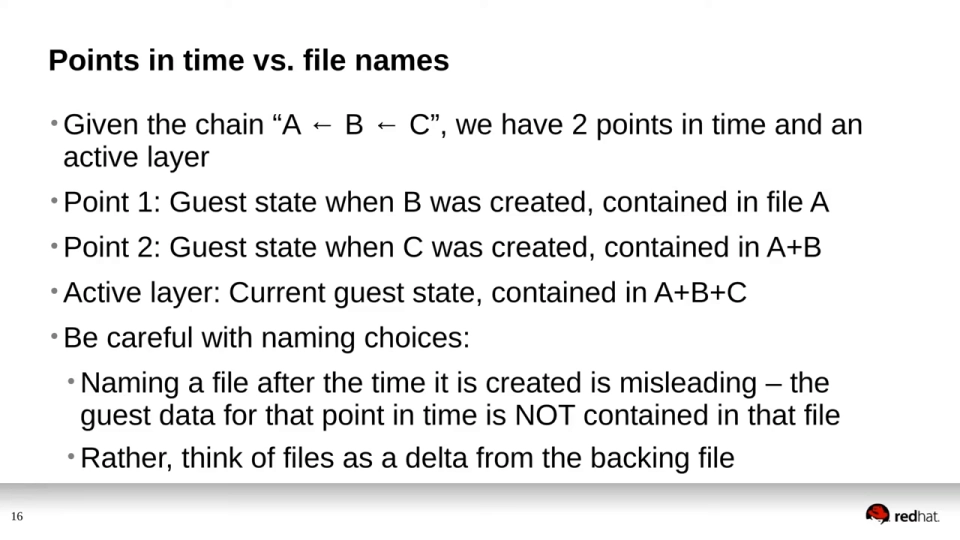

## 一、链上的每个文件是一个时间点，不是一份数据

Eric Blake 先统一了记法：`A ← B` 表示 A 是 B 的 backing image，B 在链的顶层（也叫 top），是活跃层。越新的 wrapper 排在越右边。前面演示建出来的链就是 `base.qcow2 ← wrap.qcow2`。[【跳转到 16:10】](https://www.youtube.com/watch?v=etIGp12RHRE&t=970)

想看清一条链上每个 cluster 到底来自哪个文件，用 `qemu-img map`：

```
$ qemu-img map wrap.qcow2
Offset      Length    Mapped to File
0x62f0000   0x20000   0x50000   wrap.qcow2
0x6300000   0x10000   0x70000   base.qcow2
```

第一行是 wrap 自己写的，第二行是从 base 读出来的。**没有列在 map 里的偏移，读到的就是零**。

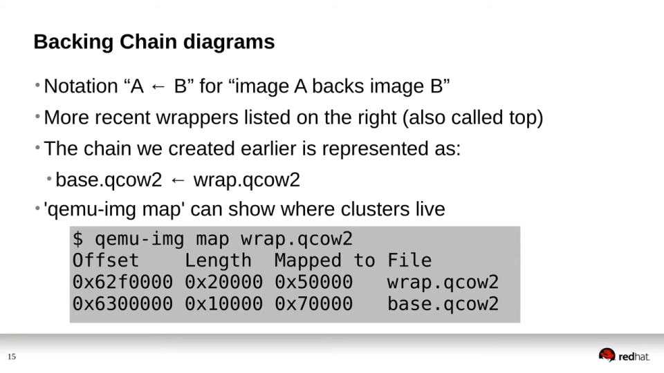

这个记法带来一个容易被忽略的结论：**链上的文件不是"某一刻的数据"，而是"从那一刻起的增量"**。Blake 把它讲成"时间点"：

- 链 `A ← B ← C` 有两个快照时间点加一个活跃层；
- 时间点 1 是创建 B 的那一刻，那一刻的 guest 状态**活在文件 A 里**；
- 时间点 2 是创建 C 的那一刻，那一刻的状态活在 **A 和 B 的组合**里；
- 活跃层是 A+B+C 组合起来的当前状态。

所以给文件按时间戳命名会误导人：一个叫 `Tuesday.qcow2` 的文件，里面装的不是"周二的数据"，而是"周二以来的变更"。想知道周二有什么，得读它下面的整条链。[【跳转到 17:08】](https://www.youtube.com/watch?v=etIGp12RHRE&t=1028)

这个"每个文件只是一层增量"的事实，同时决定了两件事：读的时候要沿链找，删的时候要沿链搬。

## 二、链式的代价之一：读放大，以及"backing file 不许改"

**读放大**在视频里的表述非常直白：QEMU 每读一个 cluster，都要**在 backing chain 上找第一个包含这个 cluster 的文件**；文件一多，I/O 就多。第一次读的时候 QEMU 会做一些缓存，缓存有帮助，但**把链变短仍然是有收益的**。[【跳转到 15:46】](https://www.youtube.com/watch?v=etIGp12RHRE&t=946)

用式子写就是：链长 $N$、缓存未命中率为 $m$ 时，一次逻辑读的期望物理读次数是

$$
E[\text{reads}] = 1 + m \cdot (N-1)
$$

$N=1$（没有链）时退化成裸盘；$m=1$（冷缓存）时最坏要读 $N$ 次。这就是为什么"链长"本身就是一个需要运维盯住的指标。

链式快照还有一条硬约束，Blake 用一整页幻灯片强调：**backing file 绝不能改**。他现场演示了后果：往公共基础镜像里写四个 cluster，两个从它精简置备出来的 guest 立刻看到了"从未存在过的数据"——因为 guest 本地的 cluster 优先级更高，覆盖掉一部分，露出来的就是拼错的组合。[【跳转到 18:27】](https://www.youtube.com/watch?v=etIGp12RHRE&t=1107)

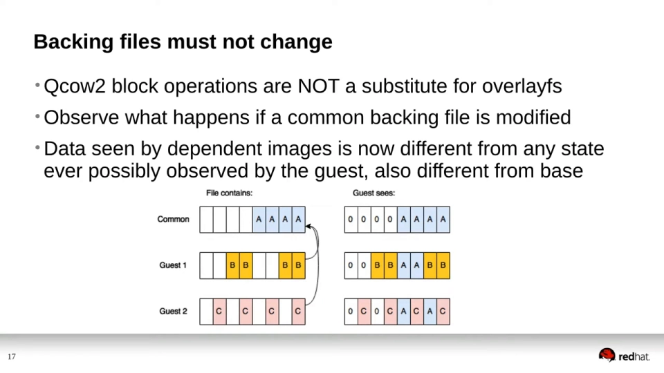

最危险的地方在于**它不会立刻报错**：Blake 的原话是，运气不好的话 guest 会继续运行，你好几天甚至几周都看不到损坏，然后就很难收场了。所以他的经验法则是：绝不要写一个正被 QEMU 打开着的镜像，也绝不要改一个可能有 guest 在用的 backing image。他还顺带澄清了一个常见误解：**qcow2 的 block 操作不是 overlayfs 的替代品**——想要"改基础层、所有上层立刻看到"的效果，应该用 overlayfs 或多块磁盘，而不是 backing chain。

## 三、删中间节点：两个方向，成本取决于差异量

这是本小节的核心。链上要"删掉一个时间点"，本质是把一段历史压平，QEMU 提供了两个方向相反的原语。

### 3.1 block-stream：把数据往上拉

`block-stream`（libvirt 里叫 `pull`，后来又有个名字 `block rebase`，都是同义词）从 `A ← B ← C` 出发，**把 cluster 往顶层拷或移**，然后改写 backing chain，把已经冗余的文件丢掉。[【跳转到 22:30】](https://www.youtube.com/watch?v=etIGp12RHRE&t=1350)

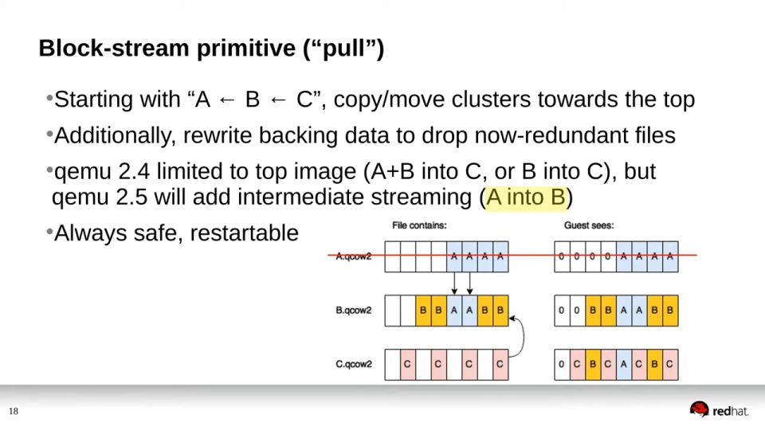

它的语义是："凡是 guest 视角已分配、但宿主机视角还没分配的 cluster，就从 backing chain 里拷过来。"做完之后，文件 C 的状态和之前完全一样，只是不再依赖 A 和 B 提供那些 cluster。也可以只做中间层：把 B 拉进 C，只拷两个 cluster，然后改写 C 的 backing 指针从 B 改成 A，B 就出局了。

Blake 特别强调这个操作**永远是安全的**：因为你是把数据往前拉，被绕过、被摘掉的链上文件内容从来没有变过。那些不再需要的 backing 文件可以扔掉，也可以留着当作那个时间点的备份。

### 3.2 block-commit：把数据往下推

`block-commit` 是反方向：**把 cluster 从顶层拷走、移走**，然后改写 backing chain。[【跳转到 23:28】](https://www.youtube.com/watch?v=etIGp12RHRE&t=1408)

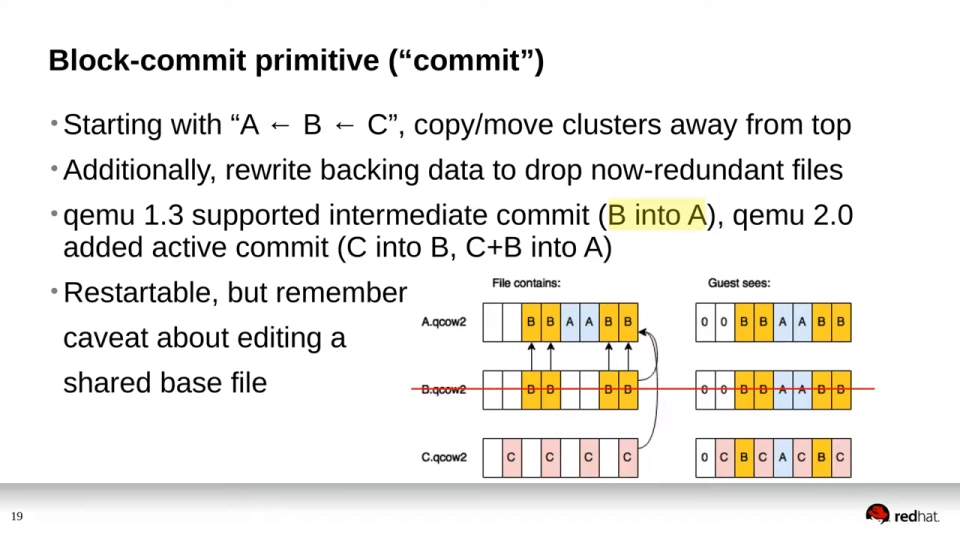

注意这一步的副作用：**它会丢掉一个时间点**。把 B 的 cluster 推进 A 之后，A 里可见的内容变了——我们不再拥有"A 被标成只读、B 被创建"那一刻的状态，我们拥有的是"B 被标成只读、C 被创建"那一刻的状态。所以 commit 不是无损操作，它是"用一段历史换一条更短的链"。

QEMU 2.0 又加了 **active commit**：把 C 提交进 B，让 B 变成活跃文件，guest 完全看不到数据变化。但多文件提交（把 C 一路提交进 A）有个坑：一旦你把 C 的 cluster 写进 backing file A，A 的内容就被改了；此时看 C 没问题、看 A 也没问题，但**去看 B 就会看到从未出现在 guest 实际状态里的数据**。[【跳转到 24:17】](https://www.youtube.com/watch?v=etIGp12RHRE&t=1457)

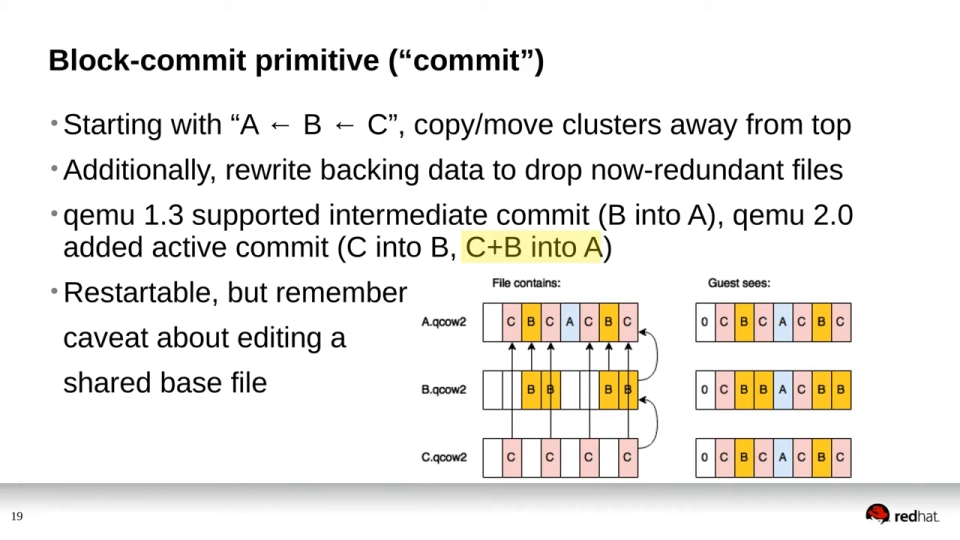

Blake 的建议很实在：做多文件操作时，记住你可能在损坏什么，务必删掉那些文件或采取其他预防措施，不要试图回滚到一个已经无效的状态。

### 3.3 哪个方向更省？先数 cluster

同一个目标——"删掉 `A ← B ← C ← D` 里的第二个时间点"——两个方向都能做到：

- 把 B 拉进 C：得到 `A ← C' ← D`；
- 把 C 推进 B：得到 `A ← B' ← D`。

**但一个方向要搬的 cluster 可能比另一个多得多**。取决于这个增量跑了多久、guest 产生了多少数据。`qemu-img map` 可以帮你算出往某个方向做要搬多少个 cluster，从而选更划算的那个。[【跳转到 26:41】](https://www.youtube.com/watch?v=etIGp12RHRE&t=1601)

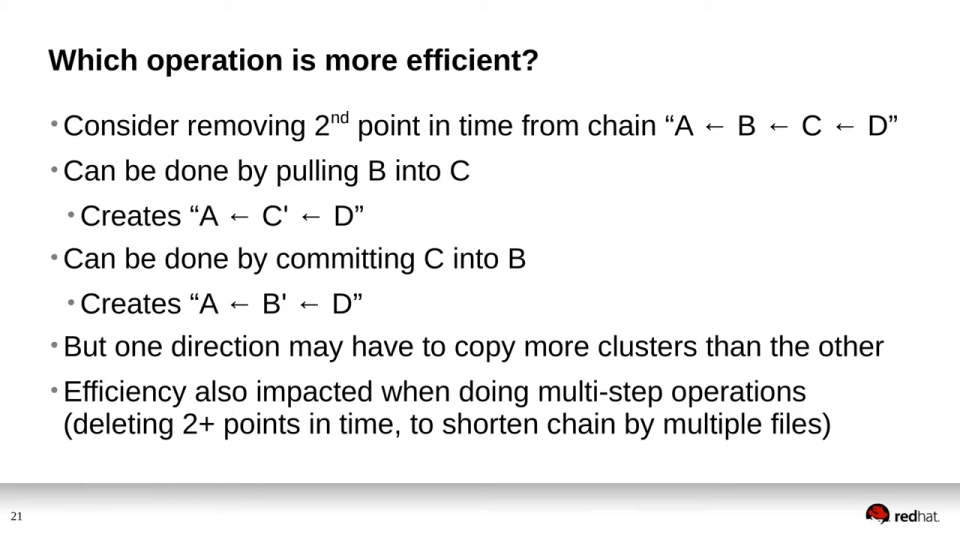

还有一个效率细节：能不能先 stream 再 commit？那是两个操作，而一步做完是一个操作。另外，如果你沿 A→B、B→C、C→D 一路做，结果虽然一致，但**同一个 cluster 可能被搬好几次**；直接从 A 搬到 D，搬运次数最少。多步操作能提升效率，但如果你不仔细盯着数据流向，也会带来让镜像处于不一致状态的风险。

把这一节写成式子：

$$
T_{\text{delete}} \approx \frac{D_{\text{move}}}{B_{\text{disk}}}, \qquad D_{\text{move}} = \min(D_{\text{delta}}^{\text{up}}, D_{\text{delta}}^{\text{down}})
$$

$T_{\text{delete}}$ 是"删一个快照"实际花的时间，$D_{\text{move}}$ 是要搬的差异数据量，取两个方向里更小的那个。**这就是"链越深越难维护"的算术解释**：链一深，可选的删除路径变多，但每条路径都要搬一段差异；差异越靠近活跃层，能省的空间越少。

## 四、扁平模型：内部快照的两张脸

同一场演讲里，Blake 把内部快照（qcow2 的扁平模型）和外部快照（链式模型）放在一起对比，这正好是本小节要的对照。

### 4.1 内部快照为什么"读没有惩罚"

内部快照的所有内容都在**一个文件**里：header 指向某一张 L1 表，snapshot 结构指向另一张 L1 表，切换 L1 表就等于切换时间点。打快照时只复制 L1 表、给可达的 cluster 引用计数加一，所以一个字节的数据都不用拷。[【跳转到 08:00】](https://www.youtube.com/watch?v=etIGp12RHRE&t=480)

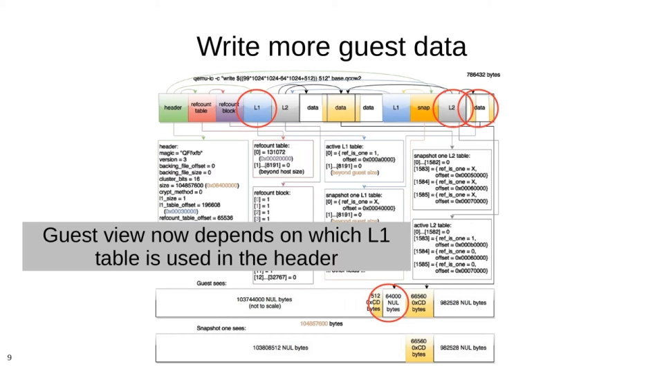

这带来的最大好处，Blake 写在幻灯片第一条：**对活跃状态没有 I/O 惩罚**（no I/O penalties to active state）。活跃镜像的那些 cluster 是直接可访问的，不需要沿任何链去找——因为活跃层自己就有一棵完整的树。只有当你写一个共享 cluster 时才需要拷一份，而那是一次性操作，拷完之后副本的引用计数就是 1。

### 4.2 代价在别处：文件膨胀、不能在线读、不能整理

内部快照的缺点也很具体：

- **QEMU 运行期间读不到快照数据**，所以不能做在线备份；
- **QMP 对内部快照的管理效率不高**，命令不如外部快照丰富；
- **文件可能膨胀到 guest 所见大小的很多倍**：快照之间一旦开始分叉，引用计数就逼着你去克隆 cluster；
- **没有碎片整理**：在文件系统上丢掉快照还能靠打洞回收空间，但 qcow2 直接铺在块设备上时没法打洞，空间回收不了，也没法把文件重排得更连续。

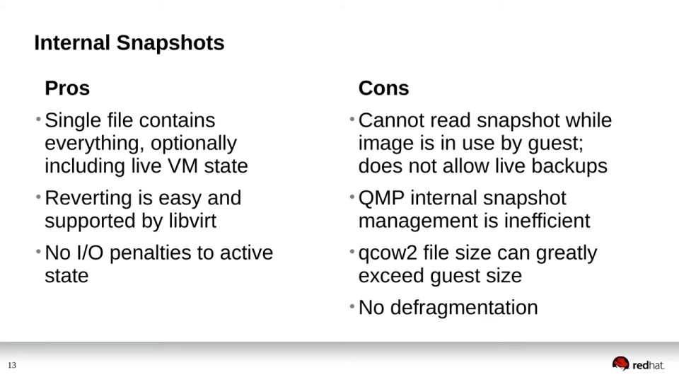

### 4.3 外部快照的对照面

外部快照那一页则几乎逐条对偶：在线备份和存储迁移容易、QMP 性能更好、构件可以组合、非常适合从公共基础镜像批量精简置备；但**删快照更麻烦**（libvirt 当时还得让用户手动跑 `qemu-img`）、**要管理多个文件**、**长链有 I/O 开销**。[【跳转到 14:26】](https://www.youtube.com/watch?v=etIGp12RHRE&t=866)

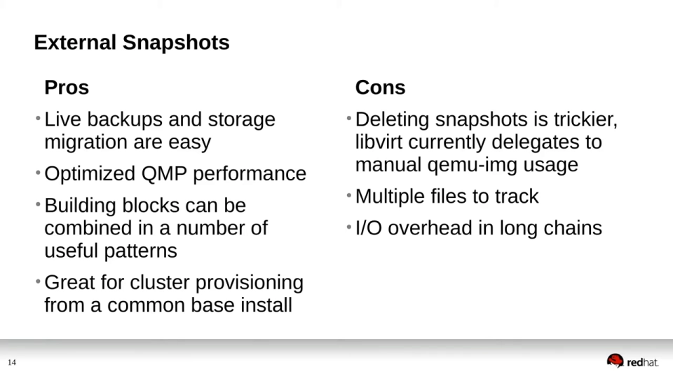

把两页幻灯片合起来看，取舍就很清楚了：**链式把成本推到"读"和"删"上，扁平把成本推到"空间"和"运维限制"上**。

## 五、第三条路：不要链，只要一张位图

演讲最后给了一个跳出二选一的答案：**dirty bitmap**（脏位图）。它本来只是 drive mirror / drive backup 的幕后工具，QEMU 2.5 把它提升为一等公民：管理程序可以为每个镜像跟踪一个或多个位图，记录"某个时间点之后哪些 cluster 被写过"。[【跳转到 32:36】](https://www.youtube.com/watch?v=etIGp12RHRE&t=1956)

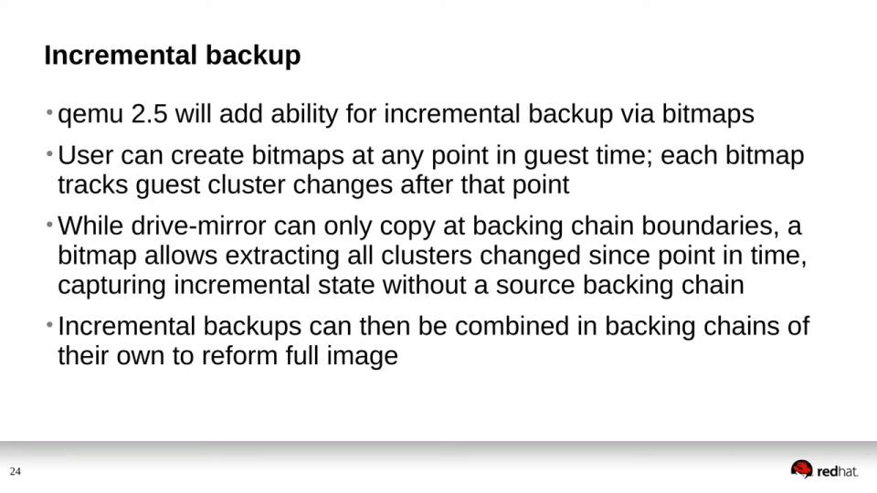

它的意义在于：**你不需要一条链，也能追踪时间点**。Blake 的原话是——backing chain 越长，I/O 惩罚越大，因为 QEMU 要去追这条链；而有了 dirty bitmap，你不需要 backing chain，照样能定位"自某个时间点以来改过的 cluster"。这等于把"历史"从**读路径**里挪到了**一张位图**里：读永远是单层的，增量信息存在旁边。

这也是今天很多备份系统的做法（每次全量索引 + 去重块），只是粒度不同：qcow2 的位图是 cluster 级，去重备份系统是块级或文件级。

## 六、对照表与工程取舍

| 维度 | 链式快照（外部快照 / backing chain） | 扁平快照（内部快照 / 独立树根） |
| --- | --- | --- |
| 快照是什么 | 一个新的 overlay 文件，只存增量 | 同一个文件里的另一张 L1 表 + 引用计数 |
| 读路径 | 沿链找第一个含该 cluster 的文件，最坏 $N$ 层 | 一层，活跃状态无 I/O 惩罚 |
| 删除任意一个快照 | 需要 stream 或 commit，$O(\text{差异量})$ | 引用计数减一，$O(\text{元数据})$ |
| 删除的副作用 | commit 会丢掉一个时间点；多文件提交会污染中间层 | 无，其他快照不受影响 |
| 空间 | 每层只存增量，最省 | cluster 级共享，但文件可能膨胀到 guest 大小的数倍 |
| 在线备份 | 容易（叠一层新 overlay 即可） | 不行（运行中读不到快照数据） |
| 运维复杂度 | 要管多个文件、要盯链长、要防误改 backing file | 单文件，但不能碎片整理、块设备上无法打洞回收 |
| 适用场景 | 频繁快照、短保留、批量精简置备 | 长保留、需要随时删中间点、读性能敏感 |

**什么时候用链**：快照频繁、保留期短、只关心最近几个还原点，而且能保证定期合并。链式的创建最便宜、空间最省，代价是你要盯住链长（读放大）和删除时的搬运量。

**什么时候用扁平**：保留期长、需要随时删掉中间某个还原点、读性能敏感。扁平模型里删除是纯元数据操作，读永远只有一层，运维上不会出现"想删一个旧快照，结果要搬几十 GB"的意外；代价是文件膨胀和"运行中不能读快照"这类限制。

**如果两者都不合适**：用 dirty bitmap 这类"旁路记录增量"的机制，把历史从读路径里彻底拿出去——读永远是单层的，增量单独存一份位图。这也是现代备份系统（每次全量索引 + 去重）与容器镜像分层共同指向的方向。

## 小结

- 链式快照里每个文件只是"一层增量"，所以**链上的一个文件对应一个时间点**，而不是"那一刻的数据"。
- 链式的读放大来自"沿链找第一个含该 cluster 的文件"，链长 $N$、未命中率 $m$ 时一次读的期望物理读是 $1 + m(N-1)$。
- **删中间节点必须搬数据**：往上拉是 `block-stream`（安全、可重入），往下推是 `block-commit`（会丢掉一个时间点）。成本是 $O(\text{差异量})$，方向选错可能多搬很多 cluster。
- 多文件 commit 会改动共享的 base 文件，让中间层变成"从未存在过的状态"，必须删掉或隔离。
- **扁平快照**（内部快照）让每个快照拥有一棵完整的 L1 表，读没有惩罚、删除只是计数减一；代价是文件膨胀、运行中不能读快照、不能碎片整理。
- 第三条路是 dirty bitmap：不要链也能追踪时间点，把历史从读路径挪到位图里。

## 关键术语速查

| 术语 | 一句话解释 |
| --- | --- |
| backing chain | 一条 `A ← B ← C` 的镜像链，箭头指向"谁是谁的父层" |
| 活跃层（top） | 链的最顶层，guest 当前写入的文件 |
| 时间点 | 某一层被创建那一刻的 guest 状态，它活在"该层以下的整条链"里 |
| block-stream / pull | 把下层 cluster 往上层拉，拉完可以丢掉下层文件 |
| block-commit | 把上层 cluster 往下推，合并后可以丢掉上层文件，但会丢掉一个时间点 |
| active commit | commit 的一种：把顶层提交进下一层，让下一层变成活跃文件 |
| qemu-img map | 逐段列出每个偏移实际落在链上哪个文件里 |
| 内部快照 | 同一个 qcow2 文件里的多份 L1 表，靠引用计数共享 cluster |
| dirty bitmap | 记录"某时间点之后哪些 cluster 被写过"的位图，可替代链来追踪增量 |